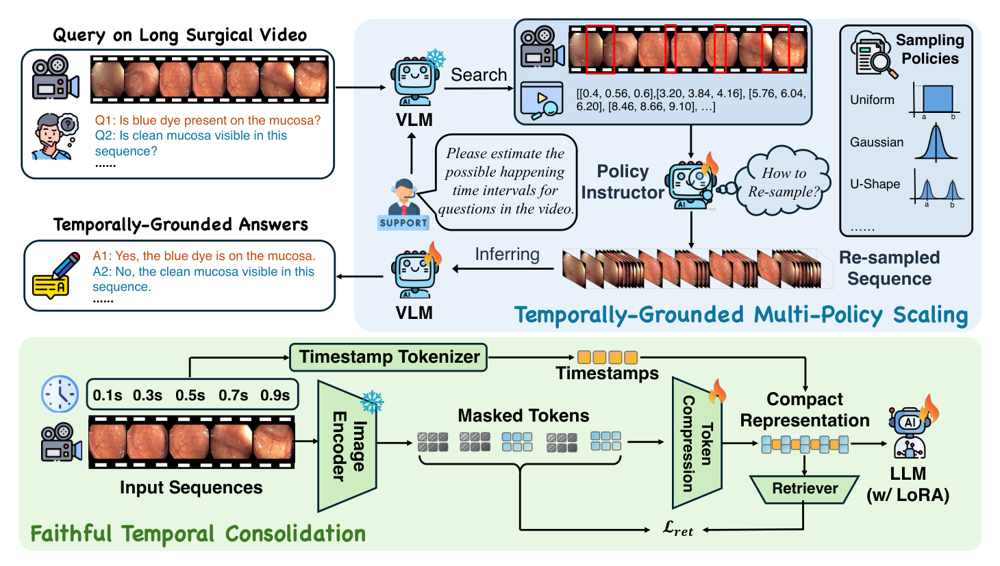
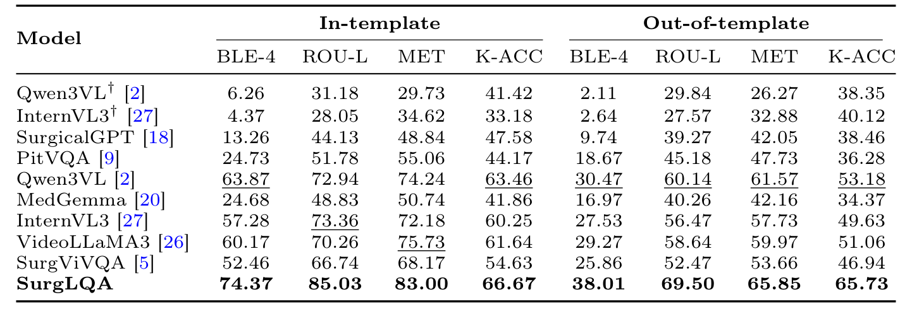
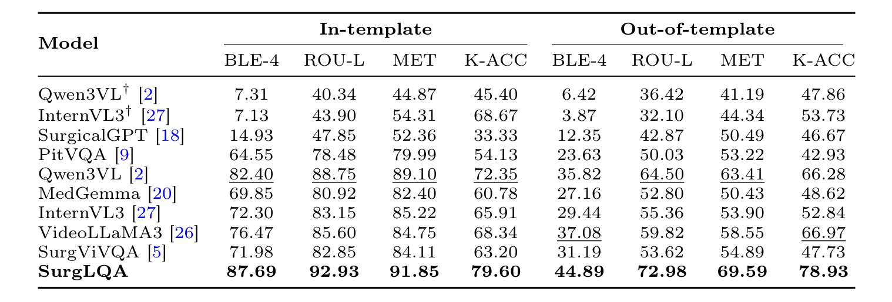
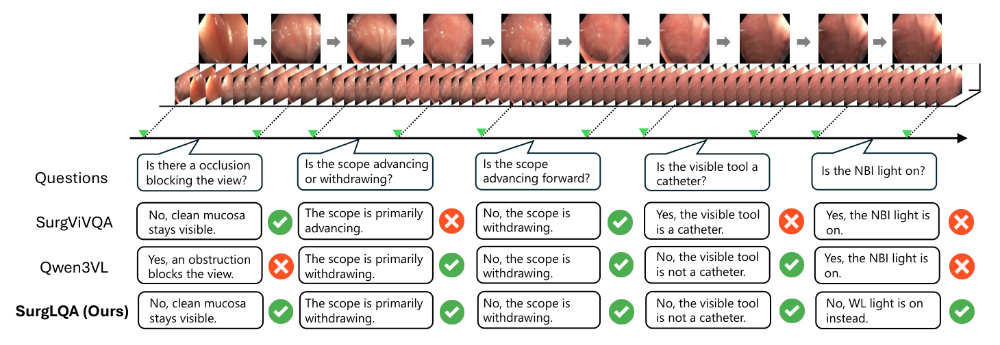
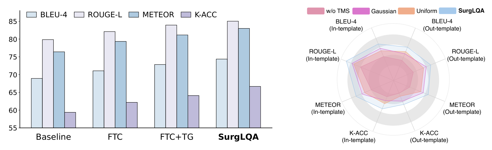
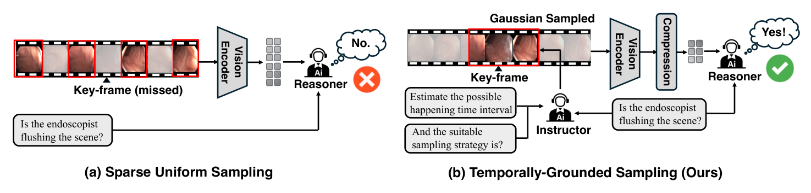
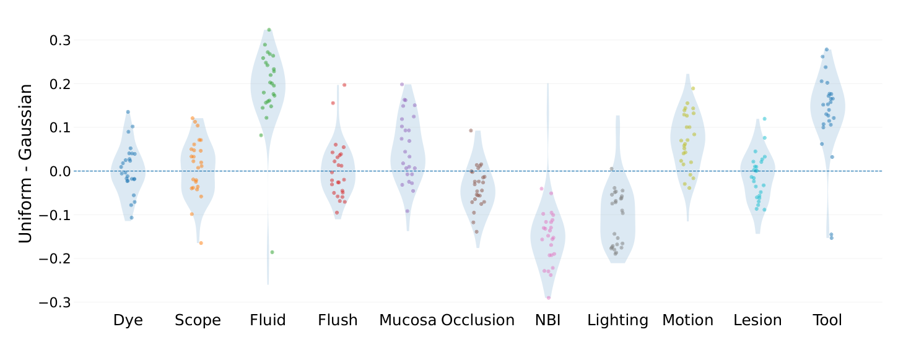
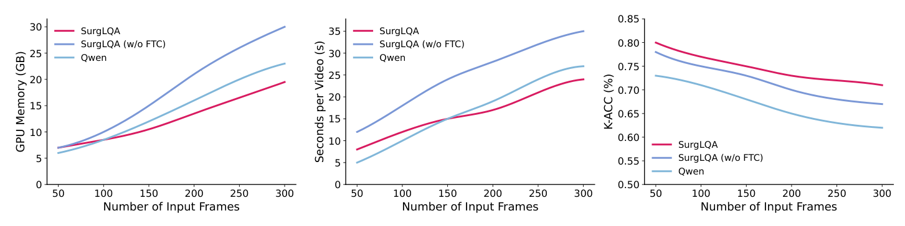

---
tags:
  - papers/手术数据集
aliases:
  - "SurgLQA"
  - "Colon-LQA"
  - "长时程手术视频问答"
date: 2026
arxiv_id: "2605.17915"
---

# SurgLQA: Scalable Long-Horizon Surgical Video Question Answering

## 核心信息

- 标题: SurgLQA: Scalable Long-Horizon Surgical Video Question Answering
- 标题翻译: SurgLQA：可扩展的长时程手术视频问答
- 作者: Diandian Guo, Xikai Yang, Ruiyang Li, Jialun Pei, Pheng-Ann Heng
- 机构: 香港中文大学
- 发表时间: 2026
- 发表渠道: arXiv 预印本（cs.CV）；项目 README 称已被 MICCAI 2026 提前接收
- arXiv: 2605.17915
- 论文链接: https://arxiv.org/abs/2605.17915
- 代码 / 项目: https://github.com/RascalGdd/SurgLQA
- 数据 / 资源: Colon-LQA 数据与标注尚未发布（仓库路线图中未勾选）
- 论文类型: AI_method

## 原文摘要翻译

手术视频问答（VideoQA）为术中的动态解读提供了一种有前景的范式，可以在临床环境中支持实时决策和上下文相关的检索。然而，现有方法大多局限于图像或短片段，难以建模贯穿漫长手术流程的远程操作动态和因果依赖。

为此，我们提出 SurgLQA，一个面向可扩展手术推理的统一长时程视频问答框架。该框架包含忠实时间整合（FTC），它利用视频内在的时间线索构建紧凑的长程表示，同时保持细粒度的时间保真度。我们还提出时间定位的多策略扩展（TMS），这是一种自适应的测试时推理范式，在时间定位后的上下文中有策略地调整策略层面的推理能力。

为了系统评测，我们重构了一个长时长结肠镜视频问答基准 Colon-LQA，并在 Colon-LQA 和 REAL-Colon-VQA 上做了大量实验。实验结果表明，我们的方法借助时间定位推理，在长程推理上取得了一致的性能提升。代码链接：SurgLQA。

## 创新点

1. **时间戳词元与视觉词元交错。** FTC 把每个时间单元的压缩视觉词元前面插入一段“timestamp: t seconds”的文本词元，让语言模型直接读到时间位置。这比隐式位置编码更容易在长序列里找回时间边界。
2. **带掩码检索损失的压缩。** 3D 卷积压缩之后，对压缩表示随机掩码，再用轻量检索器回推压缩前的特征。这样压缩模块不能只保留便于回答的粗信息，必须保住被压缩前的细节。
3. **先定位区间、再按问题选采样策略。** TMS 让模型先估计问题对应事件可能发生的时间区间，再由 BERT 指导器在高斯、均匀、密集、U 形等分布中为每个窗口挑一种重采样方式。图 3 给出的动机是：不同问题类型偏好的采样分布确实不同。
4. **拼接构造的长视频评测集 Colon-LQA。** 把连续的结肠镜片段按时间顺序拼起来，并聚合它们的问答对，得到比单片段更长的问答样本。

## 一句话总结

SurgLQA 用“时间戳交错的压缩表示加掩码检索损失”处理长视频的词元量，再用“先问区间、再按问题选采样分布”的两阶段推理找到稀疏证据，在约 34 秒的拼接结肠镜问答集 Colon-LQA 上把模板内 BLEU-4 从最强基线的 63.87 提到 74.37；但规模、划分与方差都没报告，数据也还未公开。

## 研究问题

**手术越来越长、越来越复杂，临床推理常常需要跨阶段的上下文。** 外科医生判断当前情况时，会参考此前多个阶段发生了什么，而不只看眼前一帧。视频问答把自然语言和手术视频连在一起，可以在一个统一框架里回答各种流程相关的问题，既能用于术中辅助，也能用于术后回顾和质量评估。

**但现有手术问答几乎都停留在图像或短片段。** 作者指出两方面的不足：

- **数据。** 已有基准多是图像级或短片段级，问题关注器械类型、空间布局这类静态线索，问答对锚定在很窄的帧或片段上。真实的临床推理需要在较长时间范围内聚合证据。
- **模型。** 多数手术视觉语言模型用固定的均匀或稀疏采样。手术事件分布很不均匀，关键事件稀疏且短暂，均匀采样容易漏掉它们（图 1 a），而把所有帧都编码又会让计算量随视频长度失控。

作者据此提出长时程手术问答的三条要求：长时间范围内精确的时间建模，稀疏关键事件的准确定位，以及在有限算力下可扩展的推理。

### 核心观点速览

论文的回答由两个模块组成，分别对应“表示”和“取证”。

- **表示：FTC。** 3D 卷积把视频压缩成紧凑词元，时间戳文本词元与之交错，掩码检索损失约束压缩不丢细节。
- **取证：TMS。** 模型先估计问题对应的时间区间，取区间中心建窗口，指导器为每个窗口挑采样分布，重采样后的序列再送回模型作答。
- **结果。** 在 Colon-LQA 上，SurgLQA 模板内四项指标全部第一，BLEU-4 为 74.37，最强微调基线 Qwen3VL 为 63.87；模板外 K-ACC 为 65.73，对手最高 53.18。
- **代价。** 图 6 显示去掉 FTC 时显存和耗时随帧数增长更快。

**边界：** “长时程”实际是约 34 秒的拼接视频；只有结肠镜一个领域；没有方差，消融只给图；Colon-LQA 尚未公开。

下一节先交代评测数据，因为“长时程”这个说法要放在数据实际有多长的背景下看。

## 数据与任务定义

**判断 SurgLQA 的结论能推到多远，先要看两个评测集是怎么来的、有多长。**

### 数据来源

论文用了两个结肠镜问答数据集：

- **REAL-Colon-VQA。** 来自 SurgViVQA 工作的已有短片段问答基准，作者把它当作标准短视频设置。
- **Colon-LQA。** 作者“重构”出的长视频版本：把连续的结肠镜片段按时间顺序拼接成更长的连续视频，再把这些片段各自的问答对聚合到同一个长视频样本里。构造思路引用了 VideoWeave 的数据拼接方法。

**Colon-LQA 每个长视频约 34 秒。** 这是论文给出的唯一规模信息。长视频数、问答对数、拼接的片段数、训练测试划分、问题类型分布，以及它与 REAL-Colon-VQA 的划分是否一致，论文未说明。原始片段是否全部来自 REAL-Colon-VQA，论文也未明确写出，只能从“restructured”和对同一领域的引用推断两者同源。

从图 3 与图 4 可以看出问题类型共 11 类：染色、内镜进退、液体、冲洗、黏膜可见度、遮挡、NBI 光源、照明、画面运动、病灶和器械。多数是是非题或短答句。

### 任务与设置

任务是开放式问答生成：输入长视频和一个问题，输出一句自然语言答案。评测分两种设置：

- **模板内（in-template）。** 测试问题的措辞与训练模板一致。
- **模板外（out-of-template）。** 测试问题换了说法，检验模型是否只记住了模板。

### 评测指标

指标沿用 SurgViVQA：BLEU-4、ROUGE-L、METEOR 三项文本重合度指标。

另加关键词准确率 K-ACC。它的具体算法，例如关键词表怎么定，论文未说明。所有消融都只在 Colon-LQA 上做。

数据和指标清楚之后，下一节看模型如何在这么长的输入上取到证据。

## 方法主线

**这一节的问题是：怎样在算力有限时，既把整段视频装进模型，又让模型在答题时只看与问题有关的那几段。** 先写整体四步，再分开写 FTC、TMS 和训练细节。

### 机制流程

1. **压缩与时间标记（FTC）。** 输入整段视频帧序列。冻结的图像编码器提取特征，3D 卷积压缩成紧凑词元，每个时间单元前插入时间戳文本词元。输出为交错序列 $S$，送入语言模型。
2. **区间定位（TMS 第一步）。** 在问题后追加一句指令，要求模型估计问题所涉事件可能发生的时间区间。模型输出一组区间，取每个区间的中心 $\mu_m$ 构造窗口。输出为窗口集合 $B$。
3. **选策略并重采样（TMS 第二步）。** BERT 指导器根据窗口与问题，从候选采样分布中选一种；按选中的分布在窗口内重采样帧。输出为证据更密集的序列 $V^*$。
4. **作答。** $V^*$ 直接送入视觉语言模型，由带 LoRA 的语言骨干生成最终答案。

*论文原图编号：Fig. 2。整体框架：上半部分是 TMS 的“检索区间、指导器选策略、重采样、推理”循环，下半部分是 FTC 的编码、掩码、压缩、检索器与时间戳词元。放在这里是因为它对应上面四步的数据流。*

### FTC：压缩但保留时间

**长手术视频的视觉词元太多，逐帧全编码代价不可接受。** 设视频共 $T$ 帧，每帧为 $C\times H\times W$ 的图像。

先切成不重叠的三维块，时间方向大小为 $p_t$，空间方向为 $p_s$，块数为

$$N=\frac{T}{p_t}\cdot\frac{H}{p_s}\cdot\frac{W}{p_s}.$$

然后用 $L$ 层带 SiLU 激活的 3D 卷积逐层压缩：

$$Z_l=\sigma(\mathrm{Conv3D}_l(Z_{l-1})),\quad l=1,\dots,L.$$

块大小、层数和最终压缩率，论文未说明。

**时间信息靠显式文本给出。** 每个时间单元 $i$ 构造提示“timestamp: $t_i$ seconds”，分词得到 $T_i$，与该单元的压缩视觉词元 $V_i$ 交错：

$$S=[T_1;V_1;T_2;V_2;\cdots;T_{N'};V_{N'}].$$

模型读这些时间戳就能知道某段视觉内容位于何时，这也是 TMS 第一步能输出具体秒数区间的前提。

**检索损失约束压缩不丢细节。** 从块索引中随机抽一个集合 $\mathcal{M}$，对压缩表示 $Z_{\mathrm{FTC}}$ 做随机掩码，让轻量检索器 $g$ 预测被掩位置压缩前的特征 $z^{(1)}_i$：

$$\mathcal{L}_{\mathrm{ret}}=\sum_{i\in\mathcal{M}}\big\|[g(\mathrm{Mask}(Z_{\mathrm{FTC}}))]_i-z^{(1)}_i\big\|_2^2.$$

掩码的作用是防止检索器直接从相邻时间的词元抄答案。掩码比例和检索器结构论文未说明。

### TMS：先定位，再按问题采样

**动机来自图 3。** 照明、成像模式这类属性在时间上稳定，均匀采样就够；遮挡、内镜突然移动、某种器械出现这类事件稀疏而短暂，需要在事件附近密集取样。图 3 统计了每类问题在均匀采样与高斯采样下的得分差，流体、器械、运动偏好高斯，NBI、照明偏好均匀。

给定视频和问题 $q$，模型先输出区间，取中心 $\mu_m$ 作为锚点，构造窗口

$$B(\mu_m,w)=\{t\in\{1,\dots,T\}:|t-\mu_m|\le w\},\quad B=\bigcup_m B(\mu_m,w).$$

窗口半宽 $w$ 的取值论文未说明。每个窗口有 $K$ 个候选采样策略，正文列出高斯、均匀、密集、U 形四种。指导器根据窗口和问题选出一个策略：

$$\hat p=\mathrm{Instructor}(B_m,q).$$

按选中策略定义的分布在窗口内重采样，得到序列 $V^*$。

### 训练目标与实现细节

总损失为

$$\mathcal{L}=\mathcal{L}_{\mathrm{QA}}+\lambda_{\mathrm{ret}}\mathcal{L}_{\mathrm{ret}}+\lambda_{\mathrm{policy}}\mathcal{L}_{\mathrm{policy}}.$$

第一项是在 $V^*$ 上生成答案的下一词预测损失，第三项是指导器在 $K$ 个策略上的交叉熵。两个系数的取值，以及指导器的监督标签从哪里来，论文未说明。

| 项目 | 设置 |
|---|---|
| 硬件 | 两张 NVIDIA RTX 4090 |
| 视觉编码器 | SigLIP2-Large 300M |
| 语言骨干 | Qwen3 2B，原权重冻结，LoRA 秩 8、缩放 16 |
| 策略指导器 | BERT-base-uncased |
| 优化 | AdamW，学习率 5×10^-4，权重衰减 0.01，三轮 |
| 批量 | 2，梯度累积 8 步 |

输入帧数、分辨率与推理时的重采样帧数，论文未说明。作者仓库目前放出的是 Qwen3-VL 2B 的 LoRA 微调代码，它与正文写的 SigLIP2 加 Qwen3 2B 组合是否为同一套实现，仓库说明里没有交代。

方法交代清楚后，下一节看这些设计在两张主表和消融里换来了多少。

## 关键结果

**主结果回答一个问题：在同样的微调协议下，SurgLQA 比通用视频大模型和已有手术问答模型强多少。** 作者说明零样本效果太差，所以除带 † 的两行外，所有对比方法都按各自默认实现、相同划分、分辨率和指标重新微调。

### 主结果与强基线

*论文原图编号：Table 1。Colon-LQA 上十个系统在模板内与模板外的四项指标，† 为零样本。放在这里是因为它是长视频结论的主证据。*

Colon-LQA 上的关键行：

| 模型 | 模板内 BLEU-4 | 模板内 K-ACC | 模板外 BLEU-4 | 模板外 K-ACC |
|---|---|---|---|---|
| Qwen3VL 零样本 | 6.26 | 41.42 | 2.11 | 38.35 |
| SurgViVQA | 52.46 | 54.63 | 25.86 | 46.94 |
| InternVL3 | 57.28 | 60.25 | 27.53 | 49.63 |
| VideoLLaMA3 | 60.17 | 61.64 | 29.27 | 51.06 |
| Qwen3VL | 63.87 | 63.46 | 30.47 | 53.18 |
| SurgLQA | 74.37 | 66.67 | 38.01 | 65.73 |

SurgLQA 在八列中全部第一。

与 Qwen3VL 相比，模板内 BLEU-4 高 10.50，K-ACC 只高 3.21；模板外 K-ACC 则高 12.55。也就是说，模板内的优势主要体现在措辞贴合，而换说法之后关键词答对率的优势反而更大。

专为手术或医学设计的几个模型明显落后于通用视频大模型，例如 PitVQA 模板内 BLEU-4 只有 24.73。

*论文原图编号：Table 2。REAL-Colon-VQA 短视频基准上的同一组对比。放在这里是因为它检验 SurgLQA 在短视频上是否仍有效。*

在 REAL-Colon-VQA 上，SurgLQA 模板内 BLEU-4 为 87.69、K-ACC 为 79.60。

模板外两项为 44.89 和 78.93。最强基线 Qwen3VL 模板内两项为 82.40 和 72.35。

作者说长时程建模的好处在短视频上“自然减弱”，但表中 SurgLQA 依然八列全部第一。模板外 K-ACC 比第二名 VideoLLaMA3 的 66.97 高 11.96，差距并不比长视频上小。

*论文原图编号：Fig. 4。Colon-LQA 上一个长视频的五个问题，SurgViVQA、Qwen3VL 与 SurgLQA 的回答对比。放在这里是因为它展示了模型在哪些问题上分出胜负。*

图 4 里 SurgViVQA 错了三题，Qwen3VL 错了两题，SurgLQA 全对；两个基线都在“NBI 灯是否开启”上答错。这只是挑选出的单个样例。

### 消融到底说明了什么

*论文原图编号：Fig. 5。左图是从基线逐步加入各组件的柱状图；右图是去掉 TMS、只用高斯、只用均匀与完整策略选择的雷达图。放在这里是因为它是两个模块各自贡献的唯一证据。*

- **组件消融（图 5 左）。** 依次加入 FTC、时间定位（TG）和策略指导器（PI），四项指标逐级上升。最后一级就是表 1 的完整结果。正文说 TG 对 K-ACC 帮助最明显。
- **TMS 消融（图 5 右）。** 去掉 TMS 最差，只用单一高斯或均匀策略居中，完整策略选择最好。

两组消融都只有图，没有数字表，雷达图无法读出具体差值。

**图中的基线模型构成论文未说明，而它本身已经很强。** 从柱状图目测，它的 BLEU-4 约 69，已高于表 1 中微调 Qwen3VL 的 63.87；关键词准确率约 59，低于后者的 63.46。

我的判断：主表上对 Qwen3VL 的文本重合度优势，有一大半在加入两个模块之前就已存在，可能来自所选骨干组合或训练配方。

两个模块合起来让 BLEU-4 从约 69 升到 74.37，关键词准确率从约 59 升到 66.67，后者更能代表它们的作用。

### 失败或不稳定设置

- **模板外下降很大。** Colon-LQA 上 SurgLQA 的 BLEU-4 从模板内 74.37 降到 38.01，几乎减半，说明生成的句子仍强烈依赖训练模板。
- **K-ACC 的区分度可疑。** 表 2 中零样本 InternVL3 模板内 K-ACC 为 68.67，而它的 BLEU-4 只有 7.13。这个 K-ACC 高于微调后的 InternVL3（65.91）和其他几个微调系统。
- **没有方差。** 所有数字都是单次结果，种子数和置信区间论文未说明。

这些结果只回答了“好多少”，下一节讨论“为什么好”和“哪些说法超出了证据”。

## 深度分析

**这一节分开讨论三件事：两个模块为什么可能有效，“长时程”和“实时”这两个说法站不站得住，以及 Colon-LQA 能不能拿来用。**

### 为什么有效

*论文原图编号：Fig. 1。左图为稀疏均匀采样漏掉关键帧导致答错；右图为指导器先估区间、再高斯采样命中关键帧。放在这里是因为它直观展示了 TMS 的动机。*

TMS 的思路是把一次推理拆成两次：第一次用压缩后的全视频回答“事件在哪”，第二次在该处加密采样回答“事件是什么”。这样帧预算集中在少数相关窗口里。它依赖 FTC 的时间戳词元，否则模型无法输出以秒为单位的区间。

*论文原图编号：Fig. 3。11 类问题在均匀采样减高斯采样后的得分差分布。放在这里是因为它是多策略设计的经验依据。*

图 3 是这套设计最有说服力的证据：流体、器械的得分差大多在 0.1 到 0.3，NBI、照明大多为负，方向相反。这说明“一种分布打天下”确实不够。但图 3 本身是由“Instructor”产出的统计，图注写的是指导器揭示了偏好；得分差用的是什么指标、在哪个子集上算的，论文未说明。

### 复杂度与扩展性

*论文原图编号：Fig. 6。输入帧数从 50 增至 300 时，SurgLQA、去掉 FTC 与 Qwen 的显存、单视频耗时和 K-ACC。放在这里是因为它是“可扩展”和“低延迟”说法的唯一证据。*

从曲线目测：300 帧时 SurgLQA 显存约 20 GB，去掉 FTC 约 30 GB，Qwen 约 23 GB。

三者的关键词准确率都随帧数下降，SurgLQA 降得最慢。FTC 带来的显存节省是清楚的。

**但耗时曲线不支持“实时”。** 50 帧时 SurgLQA 单视频约 8 秒，Qwen 约 5 秒。

直到 150 帧左右，两者耗时才持平。300 帧时 SurgLQA 约 24 秒处理一个视频，而 Colon-LQA 的视频本身只有约 34 秒。TMS 需要两次前向，这部分开销是固有的。讨论部分说 SurgLQA “低延迟、可无缝集成到术中实时决策辅助”，这超出了图 6 能证明的范围。

**图 6 的 K-ACC 还与表 1 对不上。** 50 帧时 SurgLQA 约 0.80，而表 1 Colon-LQA 上是 66.67，反倒接近表 2 REAL-Colon-VQA 的 79.60。这张图是在哪个数据集上测的、图例中的 Qwen 是哪个规模的模型，论文未说明，因此它对长视频结论的支撑要打折扣。

另一个值得注意的现象是，所有模型的 K-ACC 都随帧数增加而下降。更多帧反而更差，说明瓶颈在于模型从长序列中取证的能力，而不只是信息量。

### 替代解释没有排除

- **骨干与配方。** 上面已经指出，Baseline 已经超过微调 Qwen3VL。论文没有给出“同骨干、同配方、不加两模块”在两张主表上的完整数字，所以主表差距里有多少属于模块，无法精确拆分。
- **重采样密度还是选对分布。** 图 5 右只比较了单一高斯、单一均匀和完整选择。没有“随机挑策略”的对照，增益可能主要来自在窗口内加密采样，而不是指导器选对了分布。

### 与长视频压缩方法的区别

通用长视频模型常用均匀抽帧或词元合并来压缩输入，作者认为这会漏掉稀疏的细粒度手术事件。SurgLQA 的不同在两点：压缩带检索损失，用来约束保真；推理时先按问题定位再加密采样，而不是在全视频上一次性分配帧预算。论文没有直接与任何通用长视频压缩方法做对比实验，这一定位只停留在讨论部分。

### 34 秒算不算长时程

引言的动机是“手术常持续数十分钟到数小时”，但实际评测的视频约 34 秒。这比 REAL-Colon-VQA 的单片段长，却远没到完整手术的量级。因此这篇论文证明的是“在几十秒、多片段拼接的结肠镜视频上，时间定位加重采样有效”。在一小时级手术视频上，区间预测是否仍准、窗口是否仍能覆盖证据，没有实验。

拼接构造还有一个隐患：片段之间的接缝可能带来画面突变，模型可能借接缝来定位问题所属的片段，而真实长手术里没有这种边界。论文未讨论这一点。

### 复现注意点

- 指导器的训练标签是复现的最大未知数。正文只说用交叉熵训练，没说标签是否通过分别跑各策略、取答得最好的那个离线生成。
- 压缩率、块大小、窗口半宽、损失系数、帧数都未给出，复现只能靠代码。
- 仓库目前只发布了 Qwen3-VL 2B 的 LoRA 微调代码；方法本体、推理、评测代码、Colon-LQA 数据与模型权重都在路线图中未完成。

### 数据能否获取

截至 2026 年 11 月检查：作者的代码仓库公开，说明文档写明训练数据和模型权重有意不放入仓库。

发布路线图里，长视频数据集与标注、短视频基准的预处理说明两项都还没有勾选。

在 Hugging Face 上按方法名和数据集名搜索，都没有找到数据集或模型。Colon-LQA 目前没有公开或申请获取的途径。

## 局限

- Colon-LQA 的样本数、问答对数、划分方式与问题类型分布论文未说明，唯一的规模信息是每个视频约 34 秒。
- “长时程”只有几十秒，与动机中的数十分钟到数小时差距很大。
- 两个评测集都是结肠镜，没有其他术式。
- 所有结果为单次运行，没有方差或显著性检验。
- 消融只有柱状图和雷达图，没有数字；没有单独去掉检索损失或时间戳词元的实验。
- 压缩率、块大小、窗口半宽、损失系数、帧数、指导器监督标签来源，论文未说明。
- 图 5 的 Baseline 未定义；图 6 的评测数据集和图例中 Qwen 的规模论文未说明，且其 K-ACC 与表 1 对不上。
- 没有随机选策略的对照，也没有与通用长视频压缩方法的直接比较。
- 实时部署的说法缺乏证据：图 6 中 300 帧单视频约 24 秒，低帧数时比 Qwen 更慢，也没有临床验证。
- 模板外 BLEU-4 接近减半，K-ACC 与文本指标相互矛盾，指标本身的可靠性有限。
- Colon-LQA 数据与标注、方法代码和权重都尚未公开。

## 我的笔记

- **可以照搬：** 时间戳文本词元与视觉词元交错，几乎零成本地给语言模型提供显式时间；“先问区间、再在区间内加密采样”的两阶段推理，不需要改模型结构。
- **使用前检查：** 拿到 Colon-LQA 后先统计样本数和问题分布，确认它与 REAL-Colon-VQA 的训练测试是否有片段重叠；先跑一遍均匀采样的同骨干基线，看 TMS 的增益有多大。
- **避免：** 把 34 秒的拼接视频结果当作完整手术长视频的结论；把图 6 当作实时可部署的证据。
- 待查：指导器标签如何生成；去掉检索损失与时间戳词元各自掉多少；在数十分钟的真实手术视频上区间定位的准确率。

## 引用

- Guo et al. (2026). SurgLQA: Scalable Long-Horizon Surgical Video Question Answering. arXiv:2605.17915.
- Drago et al. (2025). SurgViVQA: Temporally-grounded video question answering for surgical scene understanding. arXiv:2511.03325.
- Durante et al. (2026). VideoWeave: A data-centric approach for efficient video understanding. arXiv:2601.06309.
- Bai et al. (2025). Qwen3-VL technical report. arXiv:2511.21631.
- Tschannen et al. (2025). SigLIP 2: Multilingual vision-language encoders with improved semantic understanding, localization, and dense features.
