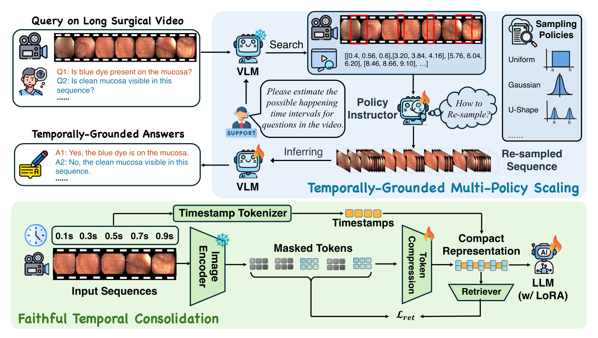
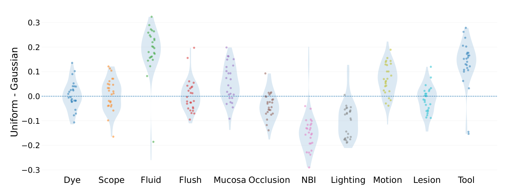
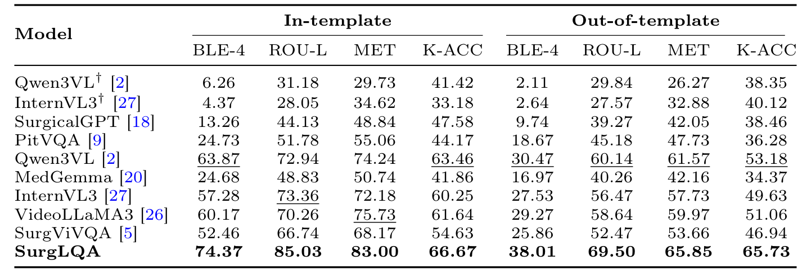
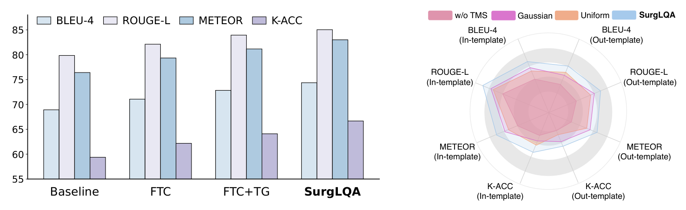
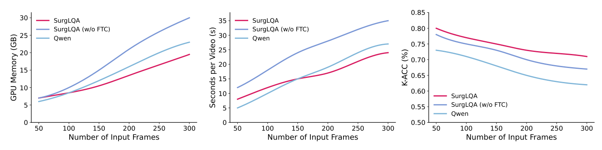

## 1. 背景与动机

手术问答把自然语言和手术视频连起来，可以回答“现在在冲洗吗”“NBI 灯开着吗”这类问题。**问题在于，已有工作几乎都停留在单张图像或几秒的短片段。**

长视频带来两个难点。关键事件稀疏而短暂，均匀稀疏采样容易漏掉它；把所有帧都编码，词元量又会随时长失控。

作者想同时解决“怎么装下长视频”和“怎么在长视频里找到与问题相关的那几帧”。

## 2. 核心观点速览

**做法是把一次推理拆成两步：先用压缩后的全视频回答“事件在哪”，再在那里加密采样回答“事件是什么”。**

- 表示（FTC）：3D 卷积压缩视觉词元，每段前面插入写有秒数的文本词元，掩码检索损失约束压缩不丢细节。
- 取证（TMS）：模型先输出时间区间，BERT 指导器为每个区间挑一种采样分布，重采样后再作答。
- 结果：Colon-LQA 模板内 BLEU-4 为 74.37，最强微调基线 Qwen3VL 为 63.87。

**边界：** 视频只有约 34 秒，只有结肠镜，没有方差，数据还没公开。

:::highlights
- 时间戳文本与视觉词元交错，让模型能输出秒级区间
- 不同问题偏好不同采样分布，图 3 给出了直接证据
:::

:::data
- Colon-LQA 每个长视频约 34 秒
- 语言骨干 Qwen3 2B，LoRA 秩 8
:::

先看评测数据，因为“长时程”这个词要放在数据实际有多长的背景下理解。

## 3. 数据：拼出来的长视频

Colon-LQA 把连续的结肠镜短片段按时间顺序首尾相接，再把各片段的问答对合并到同一个长视频样本里。另一个评测集 REAL-Colon-VQA 是已有的短片段基准。

**论文给出的唯一规模信息是每个长视频约 34 秒。** 样本数、问答对数、训练测试划分、问题类型分布，论文未说明，所以无法判断评测是否足够大、两套数据之间有没有片段重叠。

问题有 11 类，包括染色、冲洗、遮挡、NBI 光源、器械等，多是是非题。评测分模板内与模板外：后者把问题换了说法，检验模型是否只记住了措辞。

数据是拼接出来的，下一节看模型如何在这样的输入里取证。

## 4. FTC：压缩但保留时间

*论文原图编号：Fig. 2。上半部分是 TMS 的定位、选策略、重采样循环，下半部分是 FTC 的压缩与检索损失。*

视频先切成三维块，经多层 3D 卷积压缩。**每个时间单元前插入“timestamp: t seconds”的文本词元**，语言模型读到它就知道这段画面在何时。

为防止压缩只留下粗信息，训练时遮住部分压缩词元，让一个轻量检索器回推压缩前的特征：

$$\mathcal{L}_{\mathrm{ret}}=\sum_{i\in\mathcal{M}}\big\|[g(\mathrm{Mask}(Z_{\mathrm{FTC}}))]_i-z^{(1)}_i\big\|_2^2.$$

块大小、层数、压缩率和掩码比例，论文未说明。

## 5. TMS：先定位，再按问题采样

*论文原图编号：Fig. 3。11 类问题在均匀采样减高斯采样后的得分差分布。*

**图 3 是这套设计的依据：不同问题偏好不同分布。** 流体、器械类问题在高斯采样下更好，NBI、照明类问题在均匀采样下更好。

推理时，模型先按追加指令输出事件可能发生的区间，取中心建窗口；BERT 指导器在高斯、均匀、密集、U 形中挑一种，在窗口内重采样，再送回模型作答。总损失是问答损失、检索损失和策略交叉熵的加权和，权重和指导器的标签来源论文未说明。

## 6. 结果说了什么

*论文原图编号：Table 1。Colon-LQA 上十个系统的模板内与模板外结果。*

| 模型 | 模板内 BLEU-4 | 模板内 K-ACC | 模板外 K-ACC |
|---|---|---|---|
| SurgViVQA | 52.46 | 54.63 | 46.94 |
| VideoLLaMA3 | 60.17 | 61.64 | 51.06 |
| Qwen3VL | 63.87 | 63.46 | 53.18 |
| SurgLQA | 74.37 | 66.67 | 65.73 |

SurgLQA 八列全部第一。**换了问法之后，关键词准确率的优势反而更大**：模板外 K-ACC 比 Qwen3VL 高 12.55，模板内只高 3.21。REAL-Colon-VQA 上它同样八列第一，模板内 BLEU-4 为 87.69。

*论文原图编号：Fig. 5。左为逐步加入组件的消融，右为采样策略的消融。*

消融只有图。**未定义的 Baseline 自身 BLEU-4 约 69，已经高于微调 Qwen3VL 的 63.87。** 我的判断：主表上的 BLEU 优势有一大半在加模块之前就已存在，K-ACC 从约 59 到 66.67 的提升更能代表两个模块的作用。

:::data
- 模板内 BLEU-4：74.37 对 63.87
- 模板外 K-ACC：65.73 对 53.18
:::

数字说明“好多少”，下一节讨论它们不能说明什么。

## 7. 结果没说什么

*论文原图编号：Fig. 6。帧数从 50 增至 300 时的显存、单视频耗时与 K-ACC。*

- **不能说明实时可用。** 300 帧时单视频约 24 秒，而视频本身约 34 秒；50 帧时 SurgLQA 约 8 秒，比 Qwen 的约 5 秒还慢。节省的主要是显存。
- **不能说明真正的长时程能力。** 34 秒远短于动机里的数十分钟到数小时；拼接接缝还可能帮模型定位片段。
- **不能确认是选对了分布。** 没有随机选策略的对照，增益可能只来自在窗口内加密采样。
- **图 6 的数据集不明。** 50 帧时 K-ACC 约 0.80，与表 1 的 66.67 对不上；图例中 Qwen 的规模也未说明。

这些空白决定了复现时要先查什么。

## 8. 数据能否获取

作者仓库公开，但只放出了 Qwen3-VL 2B 的微调代码。**说明文档写明训练数据和模型权重不放入仓库，路线图中长视频数据集与标注仍未完成。** Hugging Face 上也搜不到对应数据集。

想复用 Colon-LQA，目前只能按论文思路自己从短片段拼接，或等待作者发布。

## @takeaways
- 时间戳文本与视觉词元交错是低成本的显式时间编码，可以直接移植
- 先问区间、再在区间内加密采样的推理不需要改模型结构
- 34 秒的拼接视频结果不能代表完整手术长视频

## @strengths
- 图 3 用数据说明了多策略采样的必要性
- 模板外设置检验了措辞泛化，SurgLQA 在这一设置下优势更明显
- 图 6 同时给出了显存、耗时和准确率三条曲线

## @weaknesses
- Colon-LQA 的规模、划分与问题分布都未交代
- 没有方差，消融只给图，Baseline 未定义
- 实时部署说法与耗时曲线矛盾
- 数据、方法代码和权重都未公开

## @questions
- 指导器的策略标签是怎样生成的
- 去掉检索损失或时间戳词元各自损失多少
- 在数十分钟的真实手术视频上，区间定位还准不准
