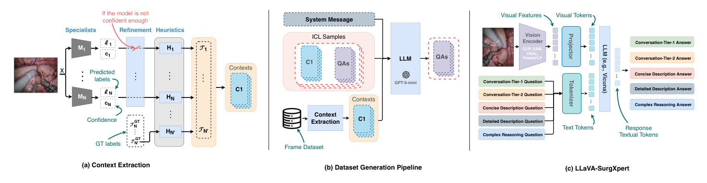
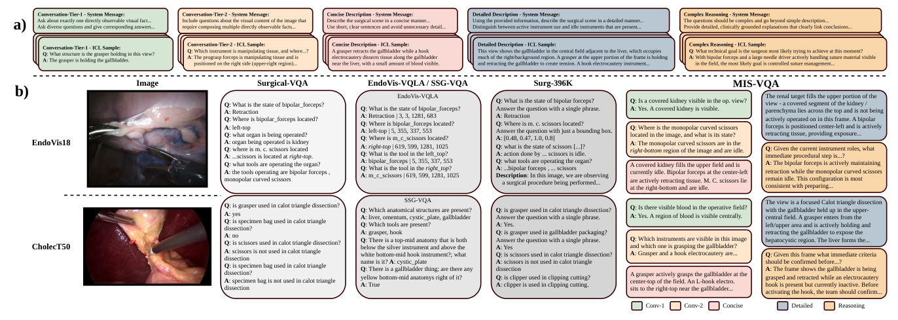
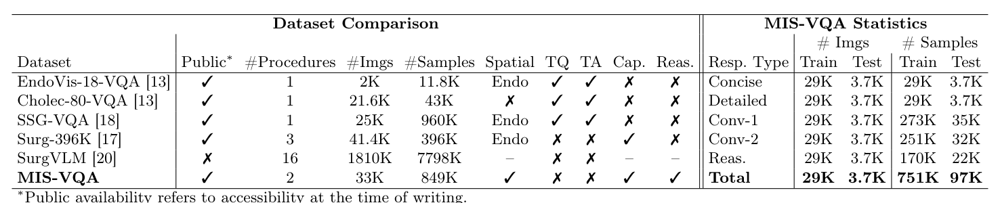

---
tags:
  - papers/手术数据集
aliases:
  - "MIS-VQA"
  - "LLaVA-SurgXpert"
  - "标注驱动的手术视觉问答数据集"
date: 2026-10-25
arxiv_id: 2610.34210
---

# MIS-VQA: An Annotation-Driven Surgical Vision-Language Dataset for Complex Surgical Understanding

## 核心信息

- 标题: MIS-VQA: An Annotation-Driven Surgical Vision-Language Dataset for Complex Surgical Understanding
- 标题翻译: MIS-VQA:面向复杂手术理解的标注驱动手术视觉语言数据集
- 作者: Mohamed Hamdy, Iheb Zouari, Fatmaelzahraa Ahmed, Muraam Abdel-Ghani, Muhammed Arsalan, Ponnuthurai Suganthan, Khalid Al-Jalham, Abdulaziz Al-Ali, Shidin Balakrishnan
- 机构: 卡塔尔大学计算机科学与工程系; 哈马德医疗集团
- 发表时间: 2026-10-25(arXiv v1)
- 发表渠道: arXiv 预印本(cs.CV);代码仓库首页标注为 MICAD 2026,论文正文未写
- arXiv: 2610.34210
- 论文链接: https://arxiv.org/abs/2610.34210
- 代码 / 项目: https://github.com/M-Hamdy-M/MIS-VQA
- 数据 / 资源: https://huggingface.co/datasets/M-Hamdy/MIS-VQA(由代码仓库指向;门控数据集,填表同意条款后可下载,只含文本,图像需另向 CholecT50 与 EndoVis 2018 原作者申请)
- 论文类型: 数据集论文(benchmark_or_dataset)

## 原文摘要翻译

现代手术人工智能越来越需要多模态理解,而不只是孤立的感知,但现有数据集大多局限于单任务监督,例如识别、分割或模板化问答。现有医学视觉问答资源往往依赖合成模板,缺少自然的描述性监督,或者标注稀疏,难以支撑关于空间关系和手术流程上下文的推理。

我们提出 MIS-VQA,一个通过标注驱动流程生成的手术视觉语言数据集,该流程把异构的手术标注转换为结构化的文本场景表示。我们以 EndoVis18 和 CholecT50 为基础,把阶段、器械、交互、三元组和分割标签转换为统一的上下文,引导大语言模型生成临床上连贯的问答对。MIS-VQA 支持四类回答:简要和详细描述、感知层面的定位、多步推理,从而支持从原子级视觉定位到组合推理的分层评测。为应对标注稀疏,我们引入经置信度过滤的分割预测和跨标注一致性检查,实现大规模的空间定位监督。MIS-VQA 为带空间监督和多层推理评测的手术视觉语言理解建立了统一基准。

为展示其用途,我们提出 LLaVA-SurgXpert,一组视觉编码器可替换的手术视觉语言模型,用于分析视觉表示如何影响多模态推理。实验显示它相对现有手术视觉问答基线有一致的提升,同时揭示了以往基准中被掩盖的感知定位与高层推理之间的能力差距。MIS-VQA 与 LLaVA-SurgXpert 共同把标注驱动的数据生成和结构化评测确立为多模态手术人工智能的可扩展基础。数据集和实现已在 GitHub 公开。

## 创新点

1. 用已有标注代替人工描述。每帧的阶段、器械、三元组、交互和分割掩码先按规则写成一段文本上下文,再交给 GPT-5-mini 生成问答。这样不需要新的人工标注,就能得到带位置信息的自由文本问答。
2. 用预测掩码补齐稀疏的空间标注。CholecT50 只有 CholecSeg8k 子集带掩码,作者用 FASL 分割模型预测其余帧,只保留置信度高于 0.9 的结果,并在提示词里写明信息来自真值还是预测。
3. 五种回答类型分层评测。简述、详述、单事实问答(Conv-1)、多事实组合问答(Conv-2)和复杂推理,同一帧上都有,可以比较模型在感知和推理上的差距。
4. 用同一框架比较视觉编码器。LLaVA-SurgXpert 固定投影层和 Vicuna 语言模型,只换 CLIP、SAM、FASL、PeskaVLP 四种编码器,把编码器预训练方式当作唯一变量。

## 一句话总结

MIS-VQA 把两个公开手术数据集的已有标注写成文本上下文,再由 GPT-5-mini 生成约 849K 条问答和描述(33K 帧)。

在它上面训练的对照模型中,换用 SAM 编码器的版本在胆囊切除推理题上得分 81.92,但对话类问题仍是 EndoChat 最好。

## 研究问题

**难点在于:手术画面里的空间关系和流程状态很难由人逐帧写成自然语言,而已有手术问答数据大多靠模板凑出短答案。** 手术视频数据已经很多,阶段识别、器械交互、分割、三元组识别等单任务模型也已成熟,但它们各自独立,不能用自然语言提问。多模态大模型可以把感知和推理放进一个框架,前提是有合适的训练和评测数据。

作者指出现有手术视觉问答数据有四个缺口:

- 问题多是短事实或"有没有某器械"的分类题,不支持涉及空间关系、器械交互和流程上下文的组合推理。
- 空间问题依赖稠密掩码,Cholec 系列只有 CholecSeg8k 有掩码,所以 Cholec80-VQA、Surg-396K 都没有空间监督。
- 不少数据集用模板出题,语言单一,模型可能记住句式而不是看图。
- 简述与详述这两类描述监督在不同数据集里有缺失,无法在一个基准里同时评测描述、定位和推理。

论文要回答:能否不做新的人工标注,只用已有的多源标注,生成带空间信息、分层次的手术问答数据。

### 核心观点速览

论文的答案是:先把已有标注写成文字,再让大模型照着文字"看图出题"。

- 数据:EndoVis18 与 CholecT50 两个来源,共 33K 帧、849K 条问答和描述,五种回答类型从单事实问答到复杂推理。
- 关键做法:CholecT50 缺掩码的帧用 FASL 预测补全,置信度高于 0.9 才用,并在提示词里标明来源。
- 结果:换用 SAM 编码器的对照模型在胆囊切除子集推理题上评委分 81.92 最高;对话题上 EndoChat 仍然领先。
- 边界:**生成答案没有人工抽检,评委分没有与人工评分校准,置信度过滤没有消融。**

下一节先看这些问答从哪些标注来、分几类、有多大。

## 数据与任务定义

这一节回答:标注从哪来,五类题各问什么,规模多大、怎么划分。

### 数据来源

两个来源的标注条件不同:

- EndoVis18:所有帧都有语义分割掩码和器械-组织交互标签,标注完整,不需要辅助模型。论文按作者此前工作中的规则把它们直接写成文本上下文。
- CholecT50:标注来自三处拼接。阶段和动作三元组来自 CholecT50,器械存在标签来自 Cholec80(与 Cholec45 的交集),分割掩码来自 CholecSeg8k 子集。掩码只覆盖少数帧,其余帧用 FASL 预测。

### 任务拆分

每帧有五种回答类型:

| 类型 | 问什么 | 系统提示要点 |
|---|---|---|
| 简述 Concise | 简短场景描述 | 短句,避免多余细节 |
| 详述 Detailed | 完整场景描述 | 区分正在使用和闲置的器械 |
| Conv-1 | 一个可直接看到的视觉事实 | 只问一个事实,问题要多样 |
| Conv-2 | 组合多个可见事实 | 例如哪件器械在操作组织、在什么位置 |
| 复杂推理 Reasoning | 多实体的组合判断 | 超出描述,给出与临床依据相连的解释 |

摘要把 Conv-1 和 Conv-2 合称为"对话评测",所以写作四类;实际数据和评测按五类统计。

### 规模与划分

表 1 右侧给出各类型的规模:

| 类型 | 训练图像 | 测试图像 | 训练样本 | 测试样本 |
|---|---|---|---|---|
| Concise | 29K | 3.7K | 29K | 3.7K |
| Detailed | 29K | 3.7K | 29K | 3.7K |
| Conv-1 | 29K | 3.7K | 273K | 35K |
| Conv-2 | 29K | 3.7K | 251K | 32K |
| Reasoning | 29K | 3.7K | 170K | 22K |
| 合计 | 29K | 3.7K | 751K | 97K |

表 1 左侧写作 33K 图像、849K 样本,与右侧训练加测试之和(32.7K、848K)基本一致,差异来自取整。划分按视频:

- EndoVis18 沿用 EndoVis-VQA 的协议,序列 1、5、16 作测试。
- CholecT50 保留 Cholec80-VQA 测试集在 CholecT50 中的交集,视频 5、12、26、27、31 作测试,其余用于训练。

两个子集各占多少,论文正文没有分开给。代码仓库首页给出:CholecT50 训练 27,063 帧、测试 3,247 帧,EndoVis18 训练 1,788 帧、测试 447 帧。按这个数字,胆囊切除子集约占九成,两个子集的结论分量并不对等。

每帧生成几条对话题和推理题,论文未说明。Conv-1 训练样本 273K 对应 29K 帧,平均约每帧 9 条,但数量是固定配额还是由模型自行决定,无从得知。

数据讲完,下一节看这些问答是怎样生成的。

## 方法主线

这一节回答:标注怎样变成文字,文字怎样变成问答,评测时怎样打分。这是数据集论文,LLaVA-SurgXpert 只是评测用的对照模型。

### 机制流程

1. 上下文抽取:输入一帧及其可用标注,提取其中的实体信息(阶段、器械、三元组、交互、掩码),按规则转写成描述可见实体、空间关系和流程状态的文本,输出该帧的上下文。
2. 掩码补全与过滤:对 CholecT50 中无掩码的帧,输入图像到在完整 CholecSeg8k(训练加测试)上训练的 FASL,置信度高于 0.9 才写入空间信息,否则省略,输出带来源标记的上下文。
3. 问答生成:输入上下文、按类型设计的系统提示和外科医生写的上下文学习样例,GPT-5-mini 被要求"像直接看图一样"生成问答,输出五种类型的样本。
4. 采样与清洗:按 1 fps 取帧,阶段、器械或三元组任一变化即取样,最长间隔 5 秒并在长静止段补中点帧;剔除视觉无效帧和引用了不存在器械的三元组,输出最终数据集。

*论文原图编号：Fig 1。左栏为上下文抽取:专科模型预测、按置信度细化、按规则转写;中栏为系统提示加上下文学习样例驱动大模型生成问答;右栏为对照模型结构。*

### 生成模型的选择

作者在一个代表性子集上比较了 GPT-5、GPT-5-mini 和 GPT-5-nano:GPT-5 过于冗长,GPT-5-nano 较短但有时笼统或不可靠,GPT-5-mini 在临床忠实度、结构化推理和简洁之间最平衡,用于全量生成。比较是定性的,没有给出数字。

*论文原图编号：Fig 2。上半部分为五类系统提示和上下文学习样例节选;下半部分把同一帧在四个已有数据集与本数据集中的样本放在一起对比。*

### LLaVA-SurgXpert

结构是视觉编码器、投影层和 Vicuna 语言模型,各变体只换编码器:

- 通用:CLIP。
- 任务导向:SAM,带分割先验。
- 手术专用:FASL(手术器械与解剖分割模型)和 PeskaVLP(基于 ResNet 的手术视频语言模型)。

不同编码器的输出统一成 1024 个视觉标记:

| 编码器 | 原始特征 | 变换 |
|---|---|---|
| FASL | 128×128×64 | pixel unshuffle 成 32×32×1024 |
| SAM | 64×64×1024 | 经 neck 成 64×64×256,再 pixel unshuffle 成 32×32×1024 |
| PeskaVLP | 7×7×2048 | space-to-depth 成 28×28×128,再双线性插值到 32×32×128 |
| CLIP | 标准 LLaVA 处理 | 无额外变换 |

训练分两阶段:

- 预训练只训投影层,用简述和详述数据,训练 2 轮,学习率 1e-3,余弦调度。
- 指令微调联合训练投影层和语言模型的低秩适配器,用全部类型,训练 1 轮,学习率 2e-5。

作为编码器的 FASL 只在训练视频上训练,避免泄漏。

算力:内镜机器人子集用单张 RTX 4090,批大小 1;胆囊切除子集用 2 张 H100,每卡批大小 16。

### 评测协议

- 对照:VisualBert、VisualBert-RM、EndoChat,按各自官方协议训练。
- 指标:BLEU、CIDEr、METEOR、text-embedding-3-large 的余弦相似度,以及归一化 GPT-Score。
- GPT-Score:GPT-5-nano 读取同一份标注上下文,从视觉定位、临床正确性、逻辑一致性、完整性和幻觉惩罚几方面给预测答案打分;参考答案用同样方式打分,用来归一化。归一化的具体公式(比值还是差值、是否截断)论文未说明,所以无法从分数反推答案与参考答案的接近程度。

协议讲完,下一节看结果。

## 关键结果

这一节回答:它和已有数据集比多了什么,在它上面哪个模型最好,评委分与传统指标是否一致。

### 与已有数据集的对比

*论文原图编号：Table 1。左侧为与已有手术问答数据集的对比,右侧为 MIS-VQA 各回答类型的图像数和样本数。*

| 数据集 | 公开 | 术式数 | 图像 | 样本 | 空间 | 模板问题 | 描述 | 推理 |
|---|---|---|---|---|---|---|---|---|
| EndoVis-18-VQA | 是 | 1 | 2K | 11.8K | 仅 Endo | 是 | 否 | 否 |
| Cholec-80-VQA | 是 | 1 | 21.6K | 43K | 否 | 是 | 否 | 否 |
| SSG-VQA | 是 | 1 | 25K | 960K | 仅 Endo | 是 | 否 | 否 |
| Surg-396K | 是 | 3 | 41.4K | 396K | 仅 Endo | 否 | 是 | 否 |
| SurgVLM | 否 | 16 | 1810K | 7798K | 未标 | 否 | 未标 | 未标 |
| MIS-VQA | 是 | 2 | 33K | 849K | 是 | 否 | 是 | 是 |

MIS-VQA 是表中唯一同时有空间监督、描述和推理的数据集。它的样本数少于 SSG-VQA,术式只有两种。

### 主结果

> [!figure] Table 2 五种回答类型的定量结果
> 建议位置：关键结果
> 放置原因：它是"优于已有基线"和"分割编码器更好"两个结论的唯一证据。
> 当前状态：保留占位；自动裁剪没有取到表体，属 asset_candidate_missing，GPT-Score 已转写到下表。
> 论文原图编号：Table 2

表 2 的 GPT-Score:

| 子集 | 模型 | Conv-1 | Conv-2 | Concise | Detailed | Reasoning |
|---|---|---|---|---|---|---|
| EndoVis | VisualBert | 59.37 | 41.98 | 无 | 无 | 无 |
| EndoVis | VisualBert-RM | 50.70 | 43.32 | 21.85 | 无 | 无 |
| EndoVis | EndoChat | 60.95 | 51.60 | 24.32 | 21.43 | 70.76 |
| EndoVis | PeskaVLP 版 | 55.29 | 46.85 | 22.71 | 24.91 | 76.60 |
| EndoVis | FASL 版 | 60.98 | 51.82 | 36.17 | 39.98 | 78.47 |
| EndoVis | SAM 版 | 62.51 | 52.61 | 29.46 | 31.47 | 78.44 |
| EndoVis | CLIP 版 | 61.06 | 47.55 | 26.27 | 28.53 | 77.16 |
| Cholec | EndoChat | 73.15 | 70.52 | 47.55 | 46.75 | 80.47 |
| Cholec | SAM 版 | 66.99 | 65.37 | 52.05 | 51.60 | 81.92 |
| Cholec | FASL 版 | 59.57 | 55.54 | 41.04 | 39.11 | 80.83 |
| Cholec | CLIP 版 | 64.44 | 62.75 | 48.45 | 47.56 | 81.42 |

- EndoVis 上,五个评委分列的第一名都是 FASL 版或 SAM 版。FASL 版领先简述、详述和推理,SAM 版领先两类对话题。
- Cholec 上,EndoChat 在两类对话题的全部指标上最好。
- Cholec 上,SAM 版在其余三类上最好,推理题得分 81.92,CIDEr 为 23.70。
- Cholec 上 FASL 版在五类评委分上都是 LLaVA-SurgXpert 中最低的,简述和详述甚至低于 EndoChat。
- PeskaVLP 版在 EndoVis 上整体排最后,Conv-1 低于 VisualBert。

### GPT-Score 与 n-gram 指标的分歧

EndoVis 的单事实问答上,EndoChat 的 BLEU-1 为 54.06、BLEU-3 为 42.57,都是最高。但它的评委分 60.95 低于 SAM 版的 62.51。

作者据此认为评委分更能反映视觉定位和临床正确性。正文把两个 BLEU 值写成同一个 54.06,与表 2 不符。

描述类的 CIDEr 普遍很低:EndoVis 详述最高只有 8.37,EndoChat 只有 1.05。这说明生成的长描述措辞差异很大,用单个参考答案计算的重合度指标几乎没有区分力。

数字讲完,下一节讨论这些分数实际测到了什么。

## 深度分析

这一节回答:分数高到底说明模型看懂了画面,还是只学会了复述标注。

### 数据集真正测到了什么

MIS-VQA 的答案来自标注上下文,而不是来自外科医生看图写的描述。所以它测的是"模型能否从图像中恢复出这些标注所含的信息,并用自然语言说出来"。标注里没有的内容,例如出血量、组织状态,模型说对了也拿不到分,说出来还可能被当成幻觉。

GPT-Score 加重了这一点。评委 GPT-5-nano 读的是生成答案时用的同一份上下文,生成器 GPT-5-mini 与评委同属一个系列。一个答案越接近上下文的写法,得分可能越高。作者用 BLEU 与 GPT-Score 的分歧说明 GPT-Score 更可靠,但没有拿它与人工评分比较,这个论点无法成立。

### 分割编码器结论只在 EndoVis 成立

内镜机器人子集上,两个分割编码器领先,作者归因于分割预训练带来的几何先验。胆囊切除子集上,FASL 版却是最差的变体。

我的推断:作为编码器的 FASL 只在训练视频上训练,而这个子集的空间标注本身也来自 FASL 的预测,两者可能相互影响。论文没有分析这一反差。

EndoVis 测试集只有三段序列,模型间 GPT-Score 差距常在 1 个点以内,例如推理题 FASL 版 78.47 对 SAM 版 78.44,论文没有方差,这样的排名不稳定。

### 与已有路线的定位

- 相对 Surgical-VQA、Cholec-80-VQA、SSG-VQA:不用模板,有描述和推理。
- 相对 Surg-396K 与 EndoChat:Cholec 部分补上了空间信息。
- 相对 SurgVLM:样本数小一个数量级,但公开。

下一节列出这些判断背后仍缺的证据。

## 局限

- 生成问答的正确率没有人工抽检,也没有统计幻觉比例。
- "置信度过滤减少错误"只有一句观察,没有去掉预测掩码的消融。
- GPT-Score 的归一化公式论文未说明,也没有与人工评分做相关性检验。
- 所有结果只跑一次,没有方差。
- 只有单帧,没有时序;术式只有两种。
- 生成模型的选择是定性比较,没有数字。
- PeskaVLP 版和 VisualBert 没有在 Cholec 上评测,原因论文未说明。
- 正文 BLEU-3 数字与表 2 不符。
- GPT-Score 的归一化公式、每帧问答数量规则,论文未说明。
- 测试帧的空间上下文也可能来自 FASL 预测,而 FASL 用 CholecSeg8k 训练加测试全部数据训练;若 CholecSeg8k 含测试视频,掩码预测会带有测试集信息。

## 我的笔记

可以照搬:

- 把多源标注先写成文本上下文,再让大模型出题,比模板出题自然,也比人工写描述便宜。
- 在提示词里标明空间信息来自真值还是预测。

使用前要检查:

- 数据在 Hugging Face 上是门控发布:填姓名、单位并勾选非商用和已申请图像两项条款后可下载,许可为 CC BY-NC-SA 4.0。数据只含文本,图像需从 CAMMA 和 EndoVis 2018 挑战网站分别申请。
- 测试帧的上下文是否也用了 FASL 预测掩码,而 FASL 训练用的 CholecSeg8k 是否包含测试视频。

后续问题:

- 人工抽检一批生成答案,错误率是多少?
- GPT-Score 与外科医生评分的相关性有多高?

## 引用

- Seenivasan et al. (2022). Surgical-VQA: Visual question answering in surgical scenes using transformer. MICCAI.
- Yuan et al. (2024). Advancing surgical VQA with scene graph knowledge. IJCARS.
- Wang et al. (2026). EndoChat: Grounded multimodal large language model for endoscopic surgery. Medical Image Analysis.
- Nwoye et al. (2022). Rendezvous: Attention mechanisms for the recognition of surgical action triplets in endoscopic videos. Medical Image Analysis.
- Hong et al. (2020). CholecSeg8k: A semantic segmentation dataset for laparoscopic cholecystectomy based on Cholec80. arXiv:2012.12453.
- Allan et al. (2020). 2018 robotic scene segmentation challenge. arXiv:2001.11190.
- Liu et al. (2023). Visual instruction tuning. NeurIPS.
- Zeng et al. (2025). SurgVLM: A large vision-language model and systematic evaluation benchmark for surgical intelligence. arXiv:2506.02555.
