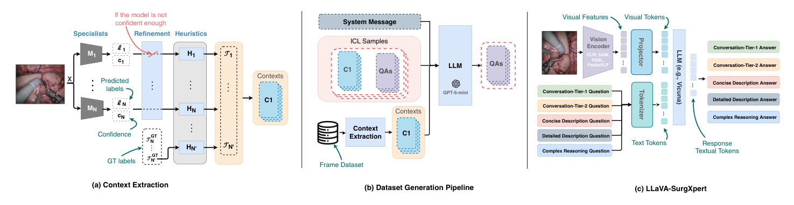
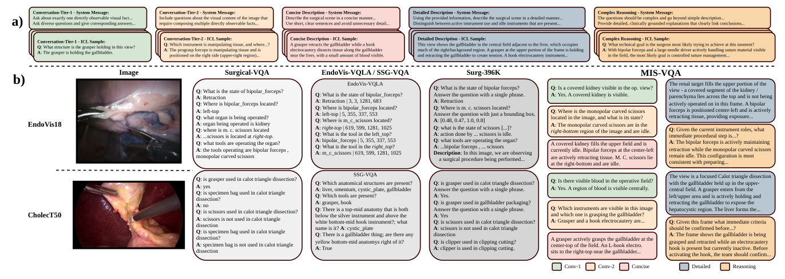
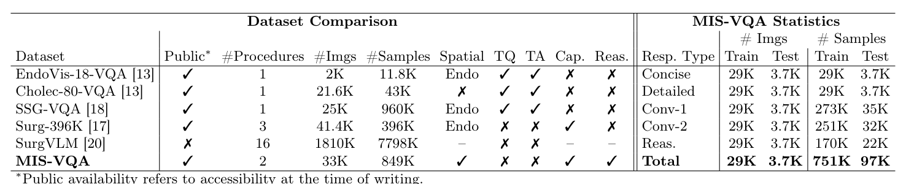

## 1. 背景与动机

**手术画面里的空间关系和流程状态很难由人逐帧写成文字,所以已有手术问答数据大多靠模板凑短答案。** 阶段识别、分割、三元组识别这些单任务模型已经成熟,但它们不能用自然语言对话。

作者列出已有数据的四个缺口:问题多为短事实或分类题;Cholec 系列只有 CholecSeg8k 有掩码,所以 Cholec80-VQA、Surg-396K 没有空间监督;模板出题让语言单一;简述和详述两类描述监督不齐全。

:::highlights
- 缺口在监督的深度和结构,而不只是规模。
:::

下一节看论文怎样补这些缺口。

## 2. 核心观点速览

论文的做法是:先把已有标注写成文字,再让大模型照着文字"看图出题"。

- 数据:EndoVis18 与 CholecT50 两个来源,共 33K 帧、849K 条问答和描述。
- 五种回答类型:简述、详述、单事实问答 Conv-1、多事实组合问答 Conv-2、复杂推理。
- 关键做法:CholecT50 缺掩码的帧用 FASL 预测补全,置信度高于 0.9 才用,并在提示词里标明来源。
- 结果:换用 SAM 编码器的对照模型在胆囊切除子集推理题上评委分 81.92 最高;对话题上 EndoChat 仍然领先。

**边界:生成答案没有人工抽检,评委分没有与人工评分校准,置信度过滤没有消融。**

:::data
- 849K 样本,训练 751K、测试 97K
- 掩码置信度阈值 0.9
:::

## 3. 标注怎样变成文字

两个来源的标注完整度差别很大。EndoVis18 每帧都有分割掩码和器械-组织交互标签,直接按规则转写。CholecT50 的标注拼自三处:阶段和三元组来自 CholecT50,器械存在来自 Cholec80,掩码只在 CholecSeg8k 子集里有。

缺掩码的帧用 FASL 预测,FASL 在完整 CholecSeg8k(训练加测试)上训练。置信度低于 0.9 时不写空间信息。提示词会告诉生成模型空间信息来自真值还是预测。

*论文原图编号：Fig 1。左栏为上下文抽取,中栏为系统提示加上下文学习样例驱动大模型生成问答,右栏为对照模型结构。*

**作者只用一句观察说明过滤减少了噪声,没有去掉预测掩码的消融。**

:::highlights
- 胆囊切除子集的空间信息多半来自模型预测,不是人工真值。
:::

下一节看文字怎样变成问答。

## 4. 文字怎样变成问答

上下文、按类型设计的系统提示、外科医生写的示范样例一起交给 GPT-5-mini,要求它"像直接看图一样"出题。作者在一个子集上比较了 GPT-5、GPT-5-mini、GPT-5-nano,认为 GPT-5 太啰嗦、GPT-5-nano 有时笼统,选了 GPT-5-mini;比较是定性的。

取帧规则:1 fps 下阶段、器械或三元组任一变化即取样,最长间隔 5 秒,长静止段补中点帧。引用了不存在器械的三元组会被删掉。

*论文原图编号：Fig 2。上半部分为系统提示与示范样例节选,下半部分把同一帧在四个已有数据集与本数据集中的样本放在一起对比。*

每帧生成几条对话题和推理题,论文未说明。Conv-1 训练样本 273K 对应 29K 帧,平均约每帧 9 条。

下一节看规模和划分。

## 5. 规模与划分

| 类型 | 训练样本 | 测试样本 |
|---|---|---|
| Concise | 29K | 3.7K |
| Detailed | 29K | 3.7K |
| Conv-1 | 273K | 35K |
| Conv-2 | 251K | 32K |
| Reasoning | 170K | 22K |
| 合计 | 751K | 97K |

划分按视频:EndoVis18 测试序列 1、5、16,沿用 EndoVis-VQA;CholecT50 测试视频 5、12、26、27、31,沿用 Cholec80-VQA 的测试交集。

代码仓库首页给出 CholecT50 训练 27,063 帧、测试 3,247 帧,EndoVis18 训练 1,788 帧、测试 447 帧。**胆囊切除子集约占九成,两个子集的结论分量不对等。**

:::data
- EndoVis18 测试帧 447,只来自三段序列
:::

下一节看评测怎样打分。

## 6. 对照模型与评分

LLaVA-SurgXpert 固定投影层和 Vicuna 语言模型,只换编码器:CLIP、SAM、FASL、PeskaVLP。四种编码器的输出都重排成 1024 个视觉标记。训练分两段:先只训投影层 2 轮,学习率 1e-3;再联合训投影层和低秩适配器 1 轮,学习率 2e-5。

指标有 BLEU、CIDEr、METEOR、余弦相似度,以及评委分 GPT-Score。评委 GPT-5-nano 读取同一份标注上下文给答案打分,再用参考答案的得分归一化。**归一化公式论文未说明。**

下一节看结果。

## 7. 结果说了什么

*论文原图编号：Table 1。左侧为与已有手术问答数据集的对比,右侧为本数据集各回答类型的规模。*

表 1 中 MIS-VQA 是唯一同时有空间监督、描述和推理的数据集,但样本数少于 SSG-VQA 的 960K,术式只有两种。

表 2 的评委分要点:

| 子集 | 题型 | 最好 | 分数 |
|---|---|---|---|
| EndoVis | Conv-1 | SAM 版 | 62.51 |
| EndoVis | Reasoning | FASL 版 | 78.47 |
| Cholec | Conv-1 | EndoChat | 73.15 |
| Cholec | Reasoning | SAM 版 | 81.92 |

- 内镜机器人子集上,第一名都是两个分割编码器之一。
- 胆囊切除子集上,对话题 EndoChat 最好,FASL 版在五类评委分上都是对照模型中最低的。
- PeskaVLP 版在内镜机器人子集上排最后,单事实问答 55.29 低于 VisualBert 的 59.37。

:::highlights
- "分割编码器更好"只在占一成的内镜机器人子集成立。
:::

下一节看这些分数测到了什么。

## 8. 分数测到了什么

答案来自标注上下文,所以数据集测的是"能否从图像恢复出标注里的信息并说出来"。标注里没有的内容,模型说对了也得不到分。

评委与生成器同属 GPT-5 系列,读的是同一份上下文。作者用 EndoChat 的 BLEU-1 54.06 最高而评委分 60.95 偏低,论证评委分更可靠;但没有与人工评分比较,**这只说明两类指标不一致,不说明哪个对。**

内镜机器人推理题上 FASL 版 78.47 对 SAM 版 78.44,差 0.03,没有方差,这样的排名不稳定。

下一节列出使用前要核对的事项。

## 9. 复现与使用要注意什么

- 数据在 Hugging Face 上门控发布:填姓名、单位并勾选非商用、已申请图像两项条款后可下载,许可 CC BY-NC-SA 4.0。
- 数据只含文本,图像要分别向 CAMMA 和 EndoVis 2018 挑战网站申请。
- 测试帧的空间上下文也可能来自 FASL 预测,而 FASL 用 CholecSeg8k 全部数据训练,要先确认其中是否含测试视频。
- 正文把两个 BLEU 值写成同一个 54.06,表 2 中 BLEU-3 为 42.57,引用时以表为准。

## @takeaways
- 用已有标注生成问答,比模板自然,比人工描述便宜,但正确性取决于标注和生成模型。
- 胆囊切除子集约占九成,其空间信息多来自预测掩码。
- 主结果用的评委分没有人工校准。

## @strengths
- 五种回答类型在同一帧上都有,能分开比较感知和推理。
- 按视频划分,沿用旧基准的测试视频,便于横向比较。
- 数据、代码和训练命令都已公开。

## @weaknesses
- 没有人工抽检生成答案,也没有统计幻觉比例。
- 置信度过滤、掩码补全都没有消融。
- 结果只跑一次,子集间结论相反却没有分析。

## @questions
- 人工抽检一批生成答案,错误率是多少?
- 评委分与外科医生评分的相关性多高?
- 去掉预测掩码后,空间题的结果如何变化?
