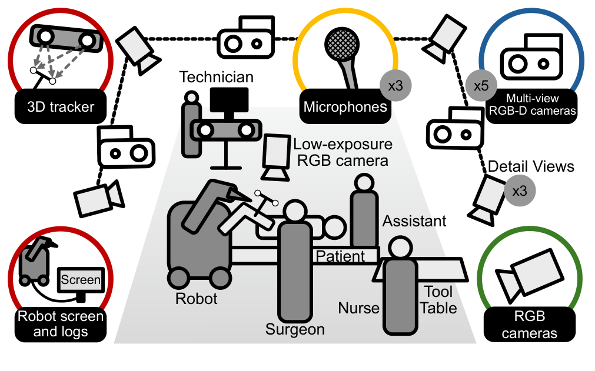
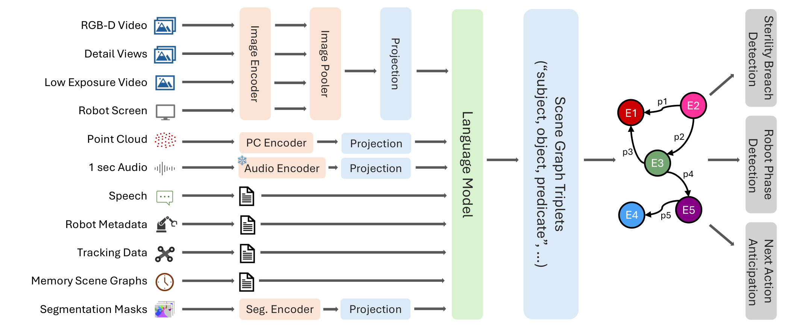
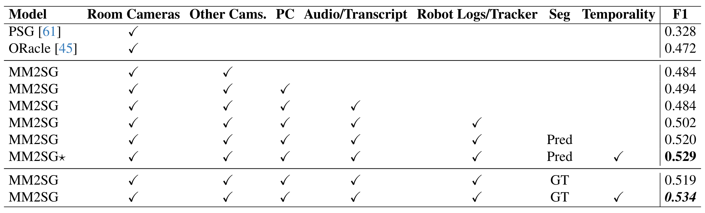

## 1. 背景与动机

**手术室要回答"谁在对什么做什么"，但公开数据既少又只有画面。** 采集受准入、隐私和硬件不能干扰手术的限制，已有外部视角数据集要么不公开，要么规模小。

同组的 4D-OR 是此前最大的公开手术室数据集，也是唯一带场景图的，但只有 6,743 个时间点、一天录完、演员不是医务人员，没有分割，也没有音频和机器信号。

**而手术室里很多信息不在画面上**：锤击声、口头指令、机器人进入了哪一步、标定工具在哪里。MM-OR 要补的就是这一块。

:::highlights
- 缺口：手术室缺少规模足够、包含非视觉信号的公开数据
- 回答：同步七类传感器，标注分割、场景图和下游任务
:::

## 2. 核心观点速览

论文的答案分三步：在模拟手术室由真实外科医生对膝关节模型做 17 台机器人膝关节置换，同步七类传感器到 1 帧每秒；给 25,277 个时间点标注全景分割和场景图，另加机器人阶段、下一动作、无菌破坏三个下游任务；提出 MM2SG，把每种模态编码成令牌交给大语言模型生成三元组。

**头条结果：** 全模态加时序 0.529，高于 ORacle 的 0.472。**边界：** 一间手术室、一类术式、4 个测试 take、没有方差；稀有动作仍完全失败。

:::data
- 92,983 个时间点，25,277 个标注，约 500GB
- 5 路 RGB-D、3 路细节相机、3 个麦克风
- 宏平均 F1：PSG 0.328，ORacle 0.472，MM2SG 0.529
:::

## 3. 数据从哪里来

**这一节回答：录了什么手术，用了哪些传感器。** 录制内容是机器人辅助的全膝与部分膝关节置换，跨多天、不同主刀和团队。患者是包在泡沫里、接在人体模型上的医用级膝关节模型，每次换新。

*论文原图编号：Figure 2。录制布局与传感器，灰色圆圈中的数字是传感器数量。*

| 模态 | 设备 | 价值 |
|---|---|---|
| 多视角 RGB-D | 5 台 Kinect | 3D 点云与整场视角 |
| 细节视角 | 3 台 PTZ 相机 | 看清器械与手部 |
| 低曝光 RGB | 跟踪系统相机 | 无影灯下不过曝 |
| 音频与转写 | 3 个佩戴式麦克风，Whisper v3 | 器械声与口头交流 |
| 日志与屏幕 | 机器人内部日志与录屏 | 机器人阶段与状态 |
| 红外跟踪 | 基座、标定阵列、膝部跟踪器 | 空间位置 |

**所有模态统一到 1 帧每秒**，秒级以下的动作细节不在数据里。参与者人数论文未说明。

:::highlights
- 真实外科医生、模拟患者，真实度提升主要在人员行为
:::

## 4. 标了什么、怎样标

**这一节回答：每个时间点上能学到什么。** 全景分割在三路视角上完成：首帧点击，Segment Anything 生成掩码，AOT 传播，人工修正；高动作段逐帧、低动作段每 5 帧。每个有分割的时间点都有人工场景图，平均 8 个节点、10 条边。

每个标注一人完成、一人复核，一致性论文未说明，所以无法估计标签噪声。

关系分布极不均衡：CloseTo 67,148 次，最少的 Cementing 只有 48 次。**宏平均 F1 的高低主要取决于这些少见动作。**

:::data
- 平均 8 个节点、10 条边，最多 16 个节点、20 条边
- 划分：9 训练、3 验证、4 测试 take
:::

## 5. 数字对不上的地方

**这一节回答：复用前要先核对什么。** Table 6 四行时间点之和为 66,996，标注之和为 19,253，都小于正文的 92,983 与 25,277。9、3、4 个 take 合计 16，与 17 台全长录制差一台。短片段数量在正文中出现 22 和 20 两种写法。这些差异论文未说明。

**测试集只有 4 个 take、2,960 个标注**，0.01 级别的差距不足以下结论。

## 6. MM2SG 怎样读多种模态

**这一节回答：七类输入怎样变成一张场景图。**

*论文原图编号：Figure 3。MM2SG 架构：各模态经专用编码器投影，语言模型生成三元组。*

1. 图像经 CLIP 编码与图像池化，取 576 个令牌；点云、音频、每个分割掩码各编码成 1 个令牌。
2. 转写、机器人日志、跟踪数据直接写成文本。
3. 此前预测的场景图压缩成"记忆场景图"文本，提供时序。
4. 大语言模型（LLaVA-7B，Vicuna-7B）自回归生成三元组。

训练时每种模态以 50% 概率丢弃，并把部分模态换成场景图相似样本的同类模态。**训练集约 20% 来自 4D-OR**，基线是否同样如此论文未说明。

## 7. 结果说了什么

*论文原图编号：Table 1。逐步增加模态的场景图生成结果。*

| 配置 | 宏平均 F1 |
|---|---|
| PSG | 0.328 |
| ORacle | 0.472 |
| 加其他相机 | 0.484 |
| 加点云 | 0.494 |
| 加音频与转写 | 0.484 |
| 加日志与跟踪 | 0.502 |
| 加预测分割 | 0.520 |
| 加时序 | 0.529 |

**总体上升，但不单调**：加音频与转写这一步下降了 0.010。真值分割换掉预测分割几乎没用（0.519 对 0.520），分割质量不是瓶颈。

增强消融：无增强 0.436，加丢弃 0.469，再加混合 0.520。**增强的贡献不小于全部模态。**

:::data
- 增强：0.436、0.469、0.520
- 丢弃率验证：0.671、0.728、0.733、0.718
:::

## 8. 长尾与其他任务

**这一节回答：模型在哪里失败。** 宏平均 0.529，加权平均 0.703。Cutting 与 Suturing 的 F1 为 0。按频率分组，MM2SG 在 tail 组 0.262，ORacle 0.120，head 组两者几乎相同。

分割基线 DVIS++ 联合训练的离线设定最好，MM-OR 上 67.5/67.0/66.4；但单帧和在线设定在窗口 0 上，联合训练反而更低。

下游任务：无菌破坏 0.550，下一动作 0.354，机器人阶段 0.569。类别数和多数类基线论文未说明，**这些数字只说明任务可做**。

## 9. 结果没说什么

- 模态递增的趋势是否稳定：没有方差，4 个测试 take。
- tail 增益来自多模态还是来自联合 4D-OR 训练：没有分离。
- 多模态混合本身的作用：缺少只用混合的一行。
- 在真实手术上是否成立：所有数据来自同一间模拟手术室，没有迁移实验。

## 10. 相对已有数据集新在哪里

| 数据集 | 非视觉模态 | 场景图 | 分割 |
|---|---|---|---|
| 4D-OR | 无 | 有 | 原版无 |
| MVOR | 无 | 无 | 无 |
| EgoExo4D | 音频、注视 | 无 | 无 |
| MM-OR | 音频、转写、日志、跟踪 | 有 | 有 |

MM-OR 是 4D-OR 的直接继任者，标注格式相同，可以联合训练。

## @takeaways
- MM-OR 是目前唯一同时有非视觉模态、场景图和全景分割的公开手术室数据集，需填表申请下载
- 全模态加时序得到 0.529，但模态增益不单调，增强贡献不小于模态
- 长尾动作仍是主要难点，宏平均与加权平均要一起报告

## @strengths
- 七类传感器硬件同步，覆盖手术室特有的机器信号
- 真实外科医生操作，多天多团队
- 同时提供分割、场景图和三个下游任务标签，与 4D-OR 格式兼容

## @weaknesses
- 一间手术室、一类术式、模拟患者
- 测试仅 4 个 take，没有方差
- 划分统计与总数不一致，短片段数量前后不一
- 增强与长尾分析缺少关键对照

## @questions
- 只用混合不用丢弃时 F1 是多少？
- 不用 4D-OR 训练时 tail 增益还剩多少？
- 在真实手术录像上，音频与日志的增益是否保持？
