---
tags:
  - papers/手术数据集
aliases:
  - "MultiBypass-4C-T40"
  - "SPIRIT"
  - "MultiBypassTriplets2026"
date: 2026-08-03
arxiv_id: "2608.02188"
---

# SPIRIT: Spatio-temporal Pairwise Relational Modeling of Instrument-Tissue Interactions for Surgical Action Triplet Recognition

## 核心信息

- 标题: SPIRIT: Spatio-temporal Pairwise Relational Modeling of Instrument-Tissue Interactions for Surgical Action Triplet Recognition
- 标题翻译: SPIRIT：面向手术动作三元组识别的器械与组织交互时空成对关系建模
- 作者: Saurav Sharma, Lorenzo Arboit, Nabani Banik, Sarah Meuli, Julia Alekseenko, Jan Liechti, Franziska Heitzinger, Michela Orsi, Didier Mutter, Daniel Gero, Philipp C. Nett, Beat P. Müller, Joël L. Lavanchy, Nicolas Padoy
- 机构: 斯特拉斯堡大学 ICube；斯特拉斯堡 IHU；帕维亚大学；巴塞尔大学 Clarunis 消化健康中心；罗马第二大学；斯特拉斯堡大学医院；苏黎世大学医院；伯尔尼大学医院；巴塞尔大学生物医学工程系
- 发表时间: 2026-08-03
- 发表渠道: arXiv 预印本（v1）
- arXiv: 2608.02188
- 论文链接: https://arxiv.org/abs/2608.02188
- 代码 / 项目: https://github.com/CAMMA-public/multibypass-4c-t40（论文写明“代码将公开”；2026-11-08 访问时返回 404）
- 数据 / 资源: 论文未说明数据获取方式；截至 2026-11-08 未找到公开下载或申请渠道
- 论文类型: benchmark_or_dataset

## 原文摘要翻译

对手术活动的细粒度理解，是手术室中情境感知辅助的基础，包括安全监测、不良事件识别和技能评估。

手术动作三元组定义为 ⟨器械, 动作, 目标⟩ 形式的元组，为器械与组织的交互提供了结构化描述。然而，一个关键的开放问题是：如何学到在不同机构之间仍然可靠的三元组表示。不同机构的手术视频在采集条件、术者风格、器械使用和组织处理上都有差异，而现有三元组数据集不支持对按中心迁移的显式评测。

为解决这一问题，我们提出 SPIRIT，一个用于手术动作三元组识别的结构化框架，目标是学到跨中心迁移更可靠的交互表示。SPIRIT 不把每个三元组当作扁平的类别标签，而是先学习器械、动作和目标的时空表示，再建模它们之间的成对关系，最后组合成一致的三元组预测，并用多头蒸馏稳定训练。

为评测这一设定，我们建立了 MultiBypass-4C-T40：一个面向 Roux-en-Y 胃旁路手术稠密三元组识别的多中心数据集，覆盖四个地理上不同的中心，并附带阶段和步骤标注。在多种评测协议下，SPIRIT 都稳定超过近期的强基线，说明显式关系推理对多中心三元组识别有价值。代码将公开于 https://github.com/CAMMA-public/multibypass-4c-t40。

## 创新点

1. **第一个按中心划分的三元组数据集。** 40 段 Roux-en-Y 胃旁路（RYGB）视频来自斯特拉斯堡、伯尔尼、巴塞尔、苏黎世四家医院，在同一协议下标注三元组，并保留阶段和步骤。此前的 CholecT50 只有单中心，ProstaTD 没有做跨中心评测。
2. **把动作当作时间区间来标。** 先找器械与组织接触最清楚的“顶点”，再向前后各延约 3 秒，并按器械可见性和相邻动作调整边界。这和 CholecT50 按帧判断有无的做法不同，让标签带有起止时间。
3. **一套能隔离未见中心的划分。** challenge 划分只用 C1、C2 训练，隐藏测试集包含 C3、C4 两家完全没见过的医院，可以单独读出未见中心的掉点。
4. **SPIRIT 把三元组拆成三层来学。** 先学器械、动作、目标三种单项表示，再在“器械与目标”“器械与动作”两张二部图上学成对关系，最后只在本体允许的组合上推理三元组。

## 一句话总结

MultiBypass-4C-T40 用四家医院 40 段胃旁路视频、85 类三元组和 420,911 个实例搭出第一个跨中心三元组基准；在只用两家中心训练的划分下，所有方法在未见中心 C4 上的三元组 AP 都不超过 36.4，而 SPIRIT 的关系建模让这个数字比最强基线高约 9 个点。

## 研究问题

手术动作三元组是比阶段、步骤更细的标签：它要求模型说出哪件器械、在做什么、作用在哪个组织上。安全监测、不良事件分析和技能评估都需要这个粒度。

问题在于，不同医院的视频差别很大：成像设备、分辨率、色彩、套管位置、镜头操作、术者的分离习惯和器械偏好都不同。先前工作已经在胆囊切除和胃旁路上证明，这些差异会让阶段识别掉点。三元组要区分细微的交互，作者预期跨中心问题更严重。

现有三元组数据集测不了这个问题。CholecT45、CholecT50 是单中心胆囊切除；ProstaTD 把三元组扩展到机器人前列腺切除，但没有作为多中心泛化基准。胃旁路手术时间长、交互密集，很多动作外观相似但语义不同：模型可能认出了抓钳、吻合器和胃，却分不清它是在牵拉、分离、夹闭还是钉合。

方法上，已有三元组模型多数直接预测扁平类别。CurConMix 用课程学习从目标、器械目标对到完整三元组逐步训练；MCIT-IG 在实例检测上做图关联；场景图方法依赖实例级标注。作者认为，在推理三元组之前显式建模成对关系的做法还很少。

论文提出两个问题。第一，什么样的表示能在换中心后保住三元组语义。第二，应该怎样设计基准，才能显式测出对真实机构差异的鲁棒性。

### 核心观点速览

- 数据：四家中心共 40 段视频，1 fps 下 420,911 个三元组实例，85 类，由 12 种器械、13 种动作、15 种目标组成；同时带阶段和步骤标签。
- 划分：全中心固定划分（all-centers）为 22/8/10 段，三折交叉验证每折 24/6/10 段。
- 挑战赛划分（challenge）只用 C1、C2 训练，隐藏测试 15 段包含 C1 的新视频和 C3、C4。
- **跨中心掉点主要落在关系上**：同一方法从 C1 换到 C4，单项 AP 降得少，器械与动作、器械与目标、三元组 AP 降得多。
- SPIRIT-TS 在 all-centers 上三元组 AP 51.9，比微调后的 DinoV3-L 高 9.4；在隐藏测试 C4 上为 36.4，最强基线约 27。
- 边界：每个未见中心只有 5 段测试视频，中心间的标签分布本身就不同；标注一致性论文未说明；数据的发布方式论文未说明，仓库地址目前无法访问。

下面先看数据怎么来、怎么标。

## 数据与任务定义

### 数据来源

这一节回答：四家中心各提供什么，数据经过哪些标准化。

| 编号 | 中心 | 说明 |
|---|---|---|
| C1 | 法国斯特拉斯堡大学医院 | 未采集临床变量；视为匿名数据，不需要单独伦理审批 |
| C2 | 瑞士伯尔尼大学医院 | 视频已包含在公开的 MultiBypass140 中 |
| C3 | 瑞士巴塞尔大学 Clarunis 消化健康中心 | 只出现在 challenge 隐藏测试 |
| C4 | 瑞士苏黎世大学医院 | 只出现在 challenge 隐藏测试 |

各中心从机构数据库中回顾性挑选接受 RYGB 的患者，取回视频，并从电子病历中收集年龄、性别、体重指数、手术日期与时长、住院天数和术后并发症（C1 除外）。数据全部去标识，视频去除患者和机构信息。伦理审批编号为 #2021-01666，豁免知情同意。

各中心原生分辨率和帧率不同，统一转为 25 fps、480p，再导入 MOSaiC 标注平台。**每个中心的视频总数论文未说明**，只能从表 8 知道隐藏测试每个中心 5 段，因此无法判断各中心在训练集中的权重。

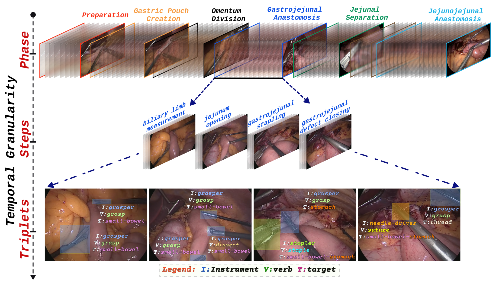
*论文原图编号：Fig. 2。同一段胃旁路视频中阶段、步骤和三元组三个粒度的时间对齐。放在这里是为了说明三层标签如何嵌套。*

### 标注协议

这一节回答：一个三元组标签的起止时间怎么定。

作者参考 CholecT50 和 ProstaTD，花了多年反复设计、试标和专家复核。核心观点是手术动作是有开始、执行、结束的时间事件，而不是器械碰到组织的那一瞬间。论文 Algorithm 1 的流程是：

1. 找到动作顶点，即 ⟨器械, 动作, 目标⟩ 最清楚的时刻。
2. 初始区间为顶点前约 3 秒到后约 3 秒。
3. 起点修正：若初始起点时器械不可见，移到器械出现的第一帧；若上一个动作还在进行，移到它结束之后。
4. 终点修正：若器械提前消失，移到交互仍有视觉证据的最后一帧；若新动作提前开始，移到切换点。
5. 连续性：器械短暂被遮挡但动作明显时保留；器械离开视野不到约 3 秒且同一静态动作仍可推断时保留；超过约 3 秒或证据消失时结束。
6. 给区间打上三元组标签。

两名医学生和两名外科住院医接受培训后标注，由一名手术数据科学临床专家监督，最终由一名外科专家仲裁。**标注者间一致性论文未说明**，所以无法判断三元组 AP 的上限受标签噪声影响多大。

### 标签合并

这一节回答：85 类是怎么来的。

原始标签中最常见的歧义来自器械身份和动作类型，先由外科专家调解，得到 212 个候选三元组。然后删除三类：只在某个中心出现的三元组（例如圆形吻合器相关），出现不到 10 次的三元组，以及“休眠”三元组，例如 ⟨牵开器, 牵拉, 肝⟩ 总在背景里静止出现。剩下的每个三元组由两名医学专家独立判断是否相关，至少一人认为相关的再交给负责调解的临床专家终审。最终得到 85 类，12 种器械、13 种动作、15 种目标。

### 样本统计

这一节回答：标签分布有多不均匀。

按 CholecT50 的做法 1 fps 抽帧，40 段视频共 420,911 个三元组实例。

| 排名 | 三元组 | 实例数 |
|---|---|---|
| 1 | 抓钳, 抓持, 小肠 | 59,984 |
| 2 | 抓钳, 抓持, 缝线 | 50,084 |
| 3 | 抓钳, 抓持, 胃 | 49,470 |
| 4 | 抓钳, 空动作, 空目标 | 30,137 |
| 5 | 持针器, 缝合, 胃小肠吻合口 | 27,997 |

组件层面也不均匀：抓钳 295,619，持针器 64,358，施夹器只有 682；动作中抓持 215,926、缝合 95,923，冲洗只有 383；目标中胃 81,237、小肠 76,973，海绵、脾、结肠、粘连都很少。所以一个三元组难，可能是整个组合少见，也可能是其中某个组件本身少见。

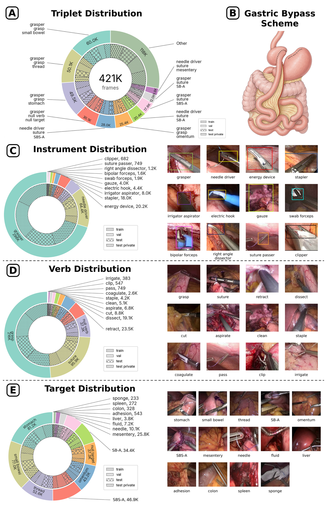
*论文原图编号：Fig. 3。三元组、器械、动作、目标的分布环形图及各类示例帧，环内纹理区分训练、验证、测试、隐藏测试。放在这里是为了直观看到长尾。*

**中心之间的类别分布并不一致。** 附录表 A1 按中心给出每个三元组的帧数，很多类在某些中心为 0。例如 ⟨持针器, 缝合, 胃小肠吻合口⟩ 在 C1、C2、C3 分别为 12,828、11,348、3,821，在 C4 为 0；⟨双极钳, 电凝, 胃⟩ 只出现在 C1。

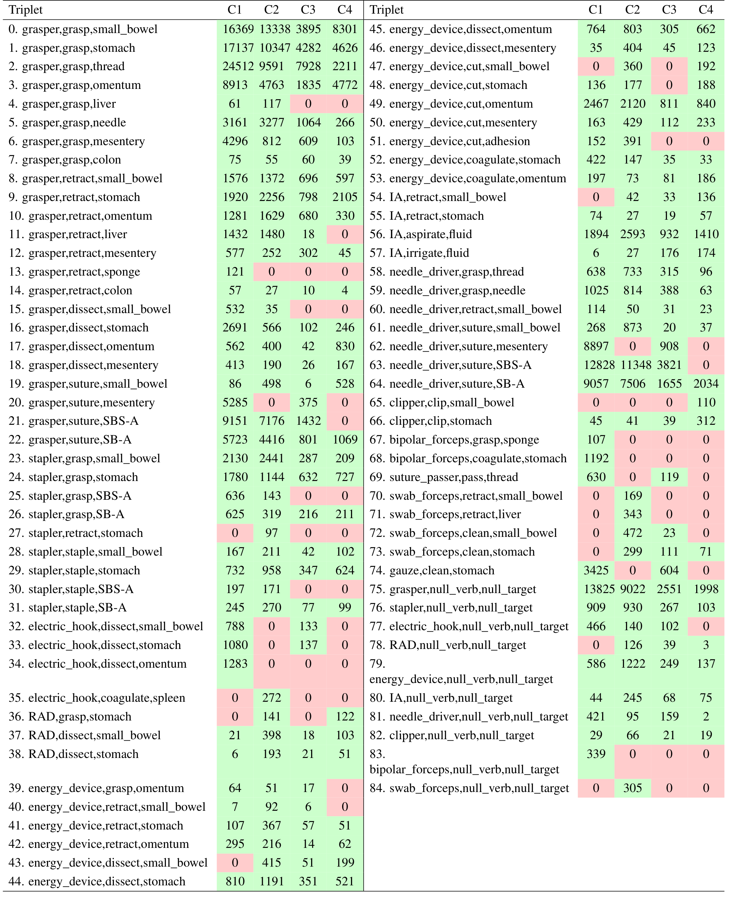
*论文原图编号：Table A1。按中心统计的三元组帧数，红色为该中心缺失的类别。放在这里是因为它决定了跨中心结果怎么解读。*

### 任务拆分

这一节回答：三种划分各测什么。

| 划分 | 训练 | 验证 | 测试 | 隐藏测试 |
|---|---|---|---|---|
| all-centers | 22 / 117,796 | 8 / 36,734 | 10 / 54,466 | |
| crossval-fold1 | 24 / 123,693 | 6 / 29,972 | 10 / 55,331 | |
| crossval-fold2 | 24 / 120,739 | 6 / 28,092 | 10 / 60,165 | |
| crossval-fold3 | 24 / 132,770 | 6 / 32,709 | 10 / 43,517 | |
| challenge | 14 / 73,855 | 2 / 9,723 | 9 / 50,572 | 15 / 74,846 |

（每格为视频数 / 帧数。）

- all-centers：四个中心都参与训练和测试，测的是共享多中心分布下的识别能力。
- 交叉验证：同样跨四个中心，三折换划分，测结果对划分的敏感程度。
- challenge：为 MultiBypassTriplets2026 挑战赛（MICCAI）设计。
  C1、C2 用于训练、验证和公开测试；隐藏测试由 C1 的新视频和 C3、C4 的视频组成。

### 评测指标

按 CholecT50 的做法，三元组识别被视为逐帧多标签分类，并且是因果设定：每帧只能看当前帧和之前的帧。

主指标是 mAP：先在每个视频内对每个类别算 AP，再在类别和视频上平均。

除三元组 AP（APIVT）外，还报告单项的 API、APV、APT。

成对指标为 APIV 和 APIT。

补充指标 Hit@k（k 取 5、10、20）表示前 k 个预测中是否至少命中一个真值三元组，只在至少有一个正标签的帧上平均。

数据定义清楚后，接下来看作者在这份数据上提出的方法。

## 方法主线

这一节回答：SPIRIT 如何把三元组拆成单项、成对、组合三层来学，以及基线怎么设置。

### 机制流程

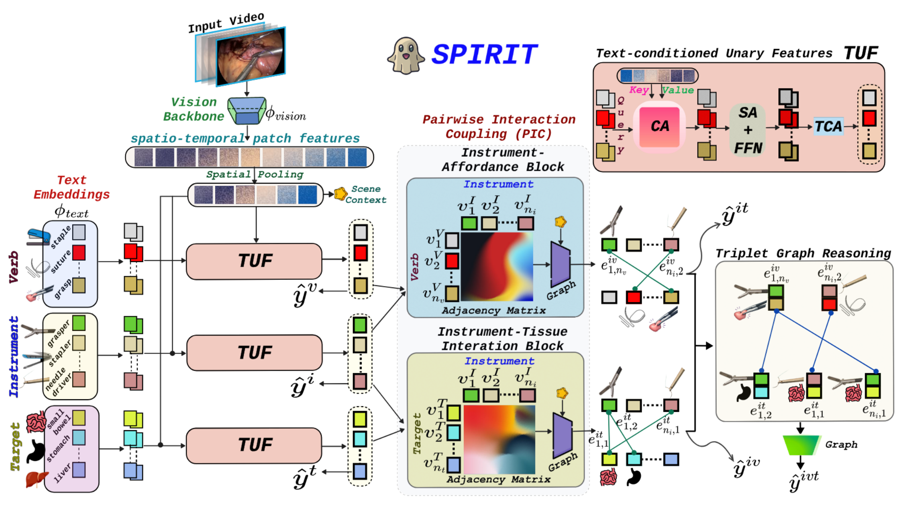
*论文原图编号：Fig. 5。SPIRIT 总览：左侧三个 TUF 分支，中间 PIC 的两张二部图，右侧 TGR 三元组图。放在这里是为了对照下面四步。*

1. **时空视觉记忆**：输入是以当前帧结尾、长度为 8 帧的因果片段，每帧 224×224；视觉塔（dino.txt，基于 DINOv3 ViT-L/16）提取特征，空间池化到 8×8，投影到 128 维并加正弦空间与时间位置编码，输出时空记忆 $Z$，送给三个单项分支。
2. **文本条件单项特征（TUF）**：输入是 $Z$ 和类别查询，查询由类名套入固定英文提示模板后经文本塔编码得到；每个分支依次做交叉注意力（查询读取全部时空视觉单元）、自注意力、前馈网络，再对逐帧平均描述子做时间交叉注意力，输出器械、动作、目标三组节点特征，并各接一个分类头。
3. **成对交互耦合（PIC）**：输入是单项节点和片段级场景向量；对每个器械与目标对、器械与动作对，把两端节点和场景向量拼接后编码成边嵌入，在完整二部图上做一层 GATv2，再把边嵌入平均回节点，输出两张关系矩阵和更新后的边嵌入，送给 TGR。
4. **三元组图推理（TGR）**：输入是两类边嵌入，把每条边当作一个“关系节点”；只有当一个器械与目标节点和一个器械与动作节点共同构成本体中的有效三元组时才连边，做一层 GATv2，对每个三元组取对应两个关系节点组合后分类，输出 85 维三元组 logits。

### 关键公式

TUF 的第一步是让类别查询去读视觉记忆：

$$A^\kappa=\mathrm{softmax}\!\left(\frac{(Q^{\kappa,0}W_Q^\kappa)(MW_K^\kappa)^\top}{\sqrt{d_h}}\right),\quad \bar Q^\kappa=\mathrm{LN}\!\left(Q^{\kappa,0}+A^\kappa M W_V^\kappa\right)$$

其中上标 $\kappa$ 依次取器械、动作、目标三个分支，$M$ 是展平后的时空视觉单元。

类别查询用文本嵌入初始化，所以每个查询一开始就带有类名的语义先验。

TGR 的关系图只连接本体允许的组合：

$$\mathcal{E}_{rel}=\{((i,t),(i,v))\mid (i,v,t)\in\mathcal{M}_{ivt}\}$$

对三元组 $k$，取出它对应的两个关系节点，组合特征为：

$$z_k=[\tilde h^{it}_k;\tilde h^{iv}_k;\tilde h^{it}_k\odot\tilde h^{iv}_k;|\tilde h^{it}_k-\tilde h^{iv}_k|]$$

四段分别保留两种关系的身份、一致程度和差异。

### 训练目标与蒸馏

单项、成对、三元组共六个头，都用带类别权重的二元交叉熵损失：

$$\mathcal{L}_{sup}=\sum_{h}\lambda_h\,\mathrm{BCE}(\hat y_h,y_h)$$

第二阶段把第一阶段最好的检查点冻结为教师，对六个头做蒸馏。每个样本的蒸馏权重为

$$w_n\propto TS_n\exp(-TG_n/\beta),\quad TS_n=\mathrm{BCE}(s_n,\sigma(t_n)),\ TG_n=\mathrm{BCE}(t_n,y_n)$$

学生与教师分歧越大，样本越有学习价值；教师与真值分歧越大，教师越不可信，权重被压低。设置为 $\beta=1.0$、温度 1.0、全局权重 1.1，只用置信度分位数 0.1 到 0.9 之间的样本；蒸馏头权重单项 0.2、成对 0.4、三元组 1.6。论文中 SPIRIT-S 指第一阶段模型，SPIRIT-TS 指加蒸馏后的模型。

### 关键实现细节

- 视觉主干冻结到第 15 个块；视觉特征 1024 维，文本特征 2048 维。
- TUF 每分支一个解码块，4 头，前馈扩张比 2.0，dropout 0.05。
- PIC 两个分支各一层 4 头 GATv2，边嵌入 128 维，输出节点 256 维，场景向量 256 维；TGR 隐层 128 维，一层 4 头 GATv2。
- 训练 30 个周期，批大小 16，AdamW，基础学习率 $10^{-4}$，主干学习率 $2\times10^{-5}$，权重衰减 0.06，梯度裁剪 1.2，余弦学习率；训练时用 RandAugment，按验证集三元组 mAP 选模型，硬件为 A100。
- 片段长度不足时重复最早一帧；组件和成对标签由三元组标签投影得到，有效对掩码来自本体。
- 各监督头损失权重 $\lambda_h$ 的具体数值论文未说明，复现时只能自行调。

### Baseline 设置

- 三元组专用模型：RDV、RiT（ResNet-18）；SelfD、TERL、CurConMix，各有 224、384 两种分辨率和集成版本。
- 基础模型：SurgeNetXL、LemonFM 及其时序版 LemonFM-T，DinoV3-L 及使用相同 8 帧输入的时序版 DinoV3-L-T。所有基础模型都在目标训练集上微调。
- 基线超参数沿用原作者设置，汇总在附录表 A5。

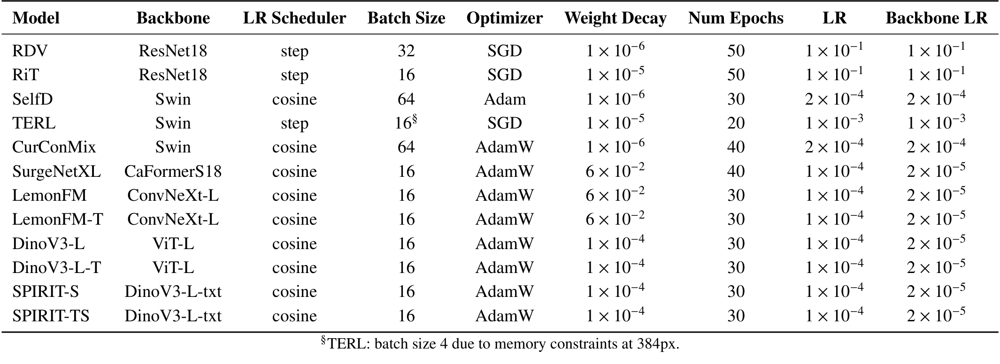
*论文原图编号：Table A5。各模型训练超参数。放在这里是为了核对基线是否按各自原设定训练。*

方法讲完，下面按划分看结果。

## 关键结果

### 数据集定位

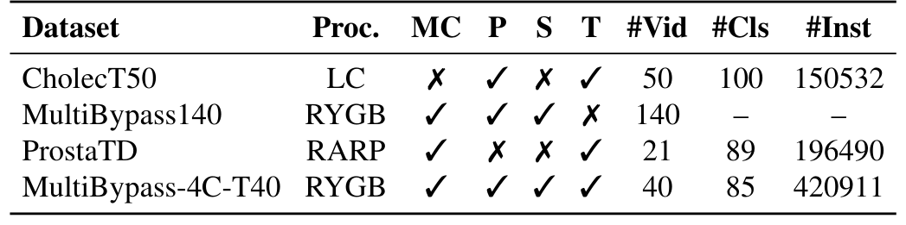
*论文原图编号：Table 1。与已有工作流和三元组数据集的对比。放在这里是为了看清本数据集补的是哪个空缺。*

| 数据集 | 术式 | 多中心 | 阶段/步骤/三元组 | 视频 | 三元组类 | 实例 |
|---|---|---|---|---|---|---|
| CholecT50 | 胆囊切除 | 否 | 阶段、三元组 | 50 | 100 | 150,532 |
| MultiBypass140 | 胃旁路 | 是 | 阶段、步骤 | 140 | 无 | 无 |
| ProstaTD | 前列腺切除 | 是 | 三元组 | 21 | 89 | 196,490 |
| MultiBypass-4C-T40 | 胃旁路 | 是 | 三者都有 | 40 | 85 | 420,911 |

视频数并不多，实例数最多，是因为胃旁路手术时间长、交互密集。

### 基线表现

这一节回答：在不同划分下，这个基准把方法拉开了多大差距。

| 方法 | 交叉验证 APIVT | all-centers APIVT | challenge 公开 / 隐藏 APIVT |
|---|---|---|---|
| RDV | 21.4 ± 10.8 | 21.6 | 9.0 / 8.6 |
| RiT | 20.5 ± 10.7 | 26.4 | 12.7 / 11.7 |
| SelfD (Ens) | 44.1 ± 2.1 | 43.0 | 42.3 / 32.2 |
| CurConMix (Ens) | 43.6 ± 2.1 | 42.4 | 41.5 / 32.1 |
| LemonFM | 41.5 ± 1.8 | 39.7 | 38.8 / 35.0 |
| DinoV3-L | 43.0 ± 1.7 | 42.5 | 38.3 / 32.3 |
| DinoV3-L-T | 44.0 ± 2.1 | 41.4 | 39.2 / 33.2 |
| SPIRIT-S | 48.6 ± 2.0 | 47.9 | 42.8 / 39.3 |
| SPIRIT-TS | 51.5 ± 2.2 | 51.9 | 47.3 / 42.3 |

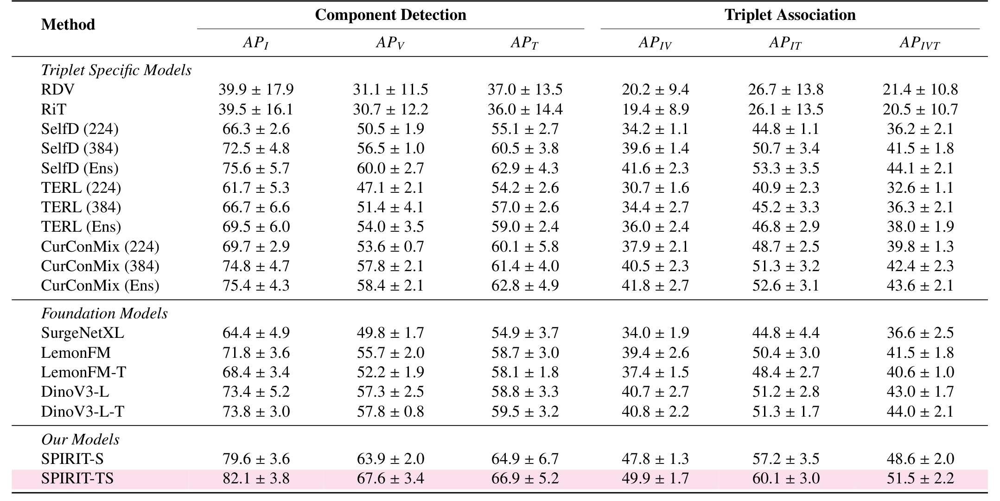
*论文原图编号：Table 5。交叉验证三折均值和标准差，含全部六项 AP。*

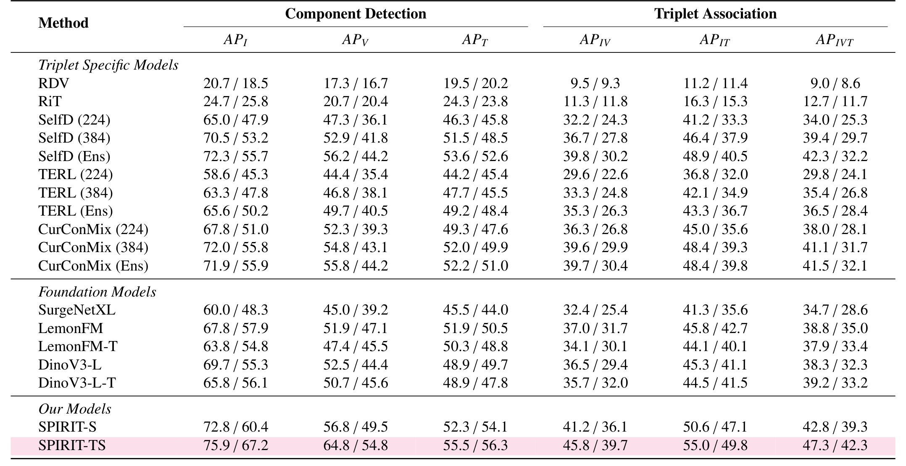
*论文原图编号：Table 7。challenge 划分，每格为公开测试 / 隐藏测试。*

> [!figure] Table 6 all-centers 划分结果
> 建议位置：关键结果
> 放置原因：all-centers 是论文的主固定划分，数字已整理在上表。
> 当前状态：保留占位；自动裁剪候选未通过视觉质量检查，数字取自正文表格文本。

三个现象值得注意：

- **RDV 和 RiT 在交叉验证上标准差超过 10**，说明弱表示下这个任务对划分非常敏感；更强的方法标准差降到 2 左右。
- **主干加时序不一定有用。** all-centers 上 LemonFM-T 和 DinoV3-L-T 都弱于单帧版本；交叉验证上 DinoV3-L-T 只比 DinoV3-L 高 1.0。
- 在 challenge 划分上，所有方法从公开测试到隐藏测试都掉点。SelfD (Ens) 从 42.3 掉到 32.2；SPIRIT-TS 从 47.3 掉到 42.3，掉得较少。隐藏测试上最强基线是 LemonFM 的 35.0。

### 按中心看未见中心

这一节回答：跨中心的难度具体落在哪一层。

隐藏测试每个中心 5 段。C2 不在表中，因为它的视频已在 MultiBypass140 公开。

| 方法 | C1 器械 / 三元组 | C3 器械 / 三元组 | C4 器械 / 三元组 |
|---|---|---|---|
| SelfD (Ens) | 68.9 / 42.1 | 51.2 / 31.3 | 50.3 / 21.2 |
| CurConMix (Ens) | 66.0 / 40.7 | 54.0 / 31.2 | 52.0 / 22.4 |
| LemonFM | 68.2 / 40.2 | 53.3 / 33.8 | 54.9 / 27.2 |
| DinoV3-L-T | 69.1 / 40.3 | 51.6 / 32.6 | 52.1 / 27.0 |
| SPIRIT-TS | 74.0 / 46.7 | 58.6 / 39.0 | 72.3 / 36.4 |

> [!figure] Table 8 隐藏测试按中心结果
> 建议位置：关键结果
> 放置原因：完整六项 AP 的按中心表，关键数字已整理在上表。
> 当前状态：保留占位；自动裁剪候选未通过视觉质量检查。

C1 的隐藏测试视频虽没参与训练，但中心本身见过，所以最容易；C3、C4 明显更难。

**单项分数掉得少，三元组分数掉得多**：以 SelfD 集成版为例，从 C1 到 C4，器械分数少 18.6，三元组分数少 20.9，后者已经只剩原值的一半。

C3 和 C4 都没见过，但掉点幅度不同，说明“未见中心”不是一种统一的偏移。

SPIRIT-TS 在每个中心、每一项上都最好，C4 上三元组 AP 为 36.4，比 LemonFM 高 9.2。

它在 C4 上的器械 AP 达 72.3，几乎回到 C1 水平，但三元组仍然只有 36.4，说明认出器械之后，组合关系依然是主要难点。

### 消融到底说明了什么

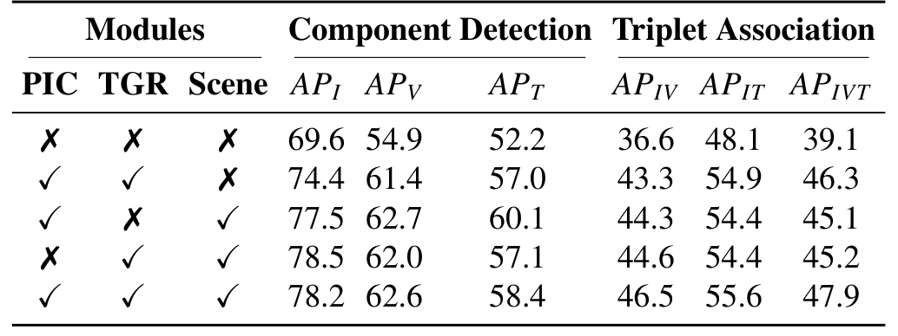
*论文原图编号：Table 9。all-centers 划分上 SPIRIT-S 的模块消融。*

| PIC | TGR | 场景 | APIV | APIT | APIVT |
|---|---|---|---|---|---|
| 否 | 否 | 否 | 36.6 | 48.1 | 39.1 |
| 是 | 是 | 否 | 43.3 | 54.9 | 46.3 |
| 是 | 否 | 是 | 44.3 | 54.4 | 45.1 |
| 否 | 是 | 是 | 44.6 | 54.4 | 45.2 |
| 是 | 是 | 是 | 46.5 | 55.6 | 47.9 |

- 加入关系结构（PIC 和 TGR）是最大的一步，APIVT 提高 7.2。
- 去掉任意一个模块，APIVT 都落到 45 左右；去掉 PIC 和去掉 TGR 的成对分数几乎相同。所以“PIC 管成对、TGR 管组合”的分工，主要是作者的解释，数据只显示两者都需要。
- 场景向量的作用最小：完整模型比不用场景高 1.6。

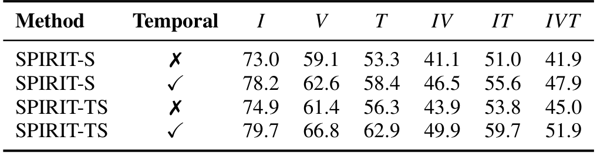
*论文原图编号：Table 11。时序建模消融。*

去掉时序后，SPIRIT-S 的 APIVT 从 47.9 降到 41.9，SPIRIT-TS 从 51.9 降到 45.0。**单帧 SPIRIT-S 的 41.9 甚至低于单帧 DinoV3-L 的 42.5**，说明关系模块的收益要借助时序特征才能体现。这和 3 秒区间的标注方式一致：标签本来就是按时间段定义的。

消融说明了收益来自哪里，下面看收益落在哪些类别上。

### 难度分布

稀有类定义为训练集中少于 200 帧的三元组。

| 方法 | 常见类 APIVT | 稀有类 APIVT |
|---|---|---|
| SelfD (Ens) | 52.5 | 26.0 |
| DinoV3-L | 48.6 | 26.6 |
| SPIRIT-TS | 58.6 | 34.5 |

每个方法在稀有类上的分数都远低于常见类，长尾是这个基准的主要难点之一。SPIRIT-TS 在稀有类上比 DinoV3-L 高 7.9，与 TGR 只在有效组合上推理、缩小搜索空间的设计相符，但论文没有单独对稀有类做模块消融。

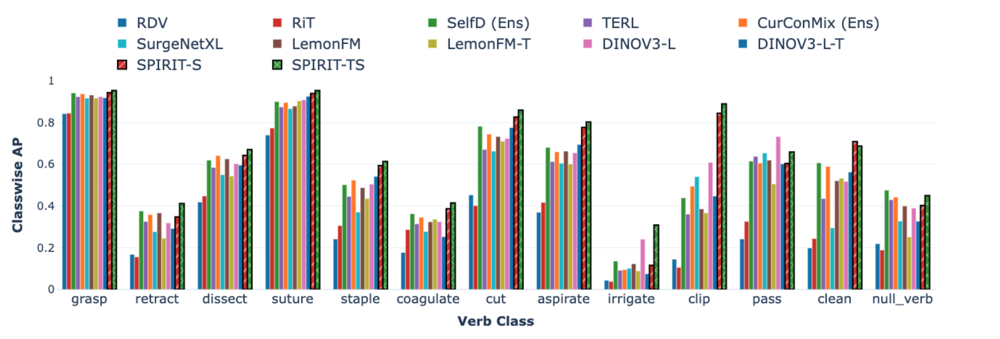
*论文原图编号：Fig. 7。all-centers 划分上各模型按动词类别的 AP。放在这里是为了看哪些动作最难。*

按动作看，抓持和缝合对强模型都超过 0.9。钉合、电凝、夹闭差异最大：相对 DinoV3-L，SPIRIT-TS 在钉合从 0.505 到 0.614，电凝从 0.325 到 0.415，夹闭从 0.609 到 0.890。**穿线（pass）是反例**，DinoV3-L 的 0.733 超过所有 SPIRIT 变体；冲洗（irrigate）对所有方法都很差。

### 排名指标与成本

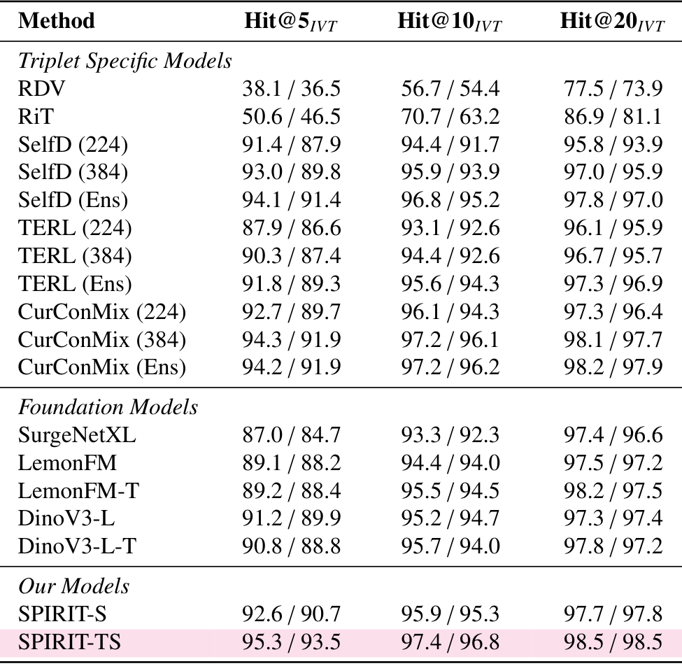
*论文原图编号：Table 10。challenge 划分上的 Hit@5/10/20。*

Hit@k 在强模型之间几乎饱和：SPIRIT-TS 的 Hit@5 为 95.3 / 93.5，最强基线 CurConMix (384) 为 94.3 / 91.9。这个指标对区分强模型帮助不大，三元组 AP 仍是主要依据。

> [!figure] Table 13 计算复杂度
> 建议位置：关键结果
> 放置原因：成本数字已在下文列出。
> 当前状态：保留占位；未提取到可用的独立表格裁剪。

成本方面，SPIRIT-S 和 SPIRIT-TS 的可训练参数都是 103.21 百万、487.47 GFLOPs 每样本，推理延迟约 46.6 毫秒每样本，是所有单模型里最慢的；单帧 DinoV3-L 为 60.90 GFLOPs、13.28 毫秒。蒸馏几乎不增加成本。

### 显著性与外部数据

在挑战赛划分的 9 段测试视频上逐视频比较，SPIRIT-TS 的三元组 AP 比 DinoV3-L-T 平均高 6.53 个点，配对置换检验 p 值 0.00355，自助法 95% 置信区间为 4.89 到 8.01。

附录表 A4 在 CholecT45 交叉验证上，SPIRIT-TS 的三元组 AP 为 43.7 ± 2.7，高于 MEJO-B 的 41.2 ± 2.6。

结果看完，下面分析这个基准到底测到了什么。

## 深度分析

### benchmark 真正测到了什么

challenge 划分是这份数据集最有价值的部分。它测的是“只见过两家医院、换到第三和第四家医院后，三元组识别还剩多少”。表 8 给出了清楚的答案：器械识别还能维持，三元组关系掉一半。

但这个掉点不全是视觉迁移造成的。表 A1 显示中心间类别分布差异很大。

C4 完全没有 ⟨持针器, 缝合, 胃小肠吻合口⟩ 和 ⟨抓钳, 缝合, 胃小肠吻合口⟩，而前者在 C1、C2 各有一万多帧，后者各有七千到九千帧；电钩分离类在 C2、C4 中全部为 0。

因为 mAP 是在每个视频内对出现的类别计算，C4 的类别构成和训练集不同，本身就会改变分数。**论文把掉点归因为“关系泛化问题”，但没有把术式差异（不同中心做法不同）和视觉差异（同一动作看起来不同）分开。**

all-centers 和交叉验证划分则更像一个标准的多中心三元组基准，用来比较方法。它们混合了四个中心，不能用来声称跨中心泛化。

### 方法收益从哪里来

SPIRIT 相对 DinoV3-L 的提升有三个来源，论文的对照只能部分拆开：

- 关系结构：表 9 中去掉 PIC 和 TGR，APIVT 掉 7 到 9 个点，这是最直接的证据。
- 时序：表 11 中时序带来约 6 到 7 个点，而且没有时序时 SPIRIT 不如 DinoV3-L。
- 主干差异：SPIRIT 用的是带文本塔的 dino.txt，基线 DinoV3-L 只用视觉塔。文本查询初始化的作用论文未说明，没有单独消融。

另一个需要谨慎的地方是基线训练。表 A5 显示基线沿用原作者超参数，比如 SelfD 与 CurConMix 用 Swin 主干、224 或 384 分辨率；SPIRIT 则在本数据集上按验证集调参。这种比较能说明 SPIRIT 在这份数据上的效果，不能直接证明方法本身优于经过同等调参的基线。

### 适用边界

分析到这里，可以归纳出使用这份数据集时需要注意的范围。

- 规模小：40 段视频，每个未见中心只有 5 段测试视频，按视频平均的 AP 对个别视频很敏感。
- 地域窄：四家中心都在法国和瑞士的大学医院，术式和设备差异有限。
- 标签可靠性未知：论文没有给出标注者一致性。
- 帧级 1 fps 评测：区间标注保存了起止时间，但评测仍按帧做多标签分类，时间定位能力没有被测。
- 与 MultiBypass140 重叠：C2 视频已公开，用 MultiBypass140 预训练的模型在 C2 上可能有数据泄漏。

## 局限

- 数据可得性论文未说明：论文只写“代码将公开”，没有说明数据集的发布时间、方式或许可证；2026-11-08 访问仓库地址返回 404，Hugging Face 上也没有官方发布。
- 规模和中心有限，见上节。
- 标注者一致性、每个中心的视频数、各损失权重 $\lambda_h$ 和 $\omega_h$ 的数值，论文未说明。
- 多随机种子结果论文未说明，只有交叉验证三折的标准差；显著性检验只做了 SPIRIT-TS 对 DinoV3-L-T，且只有 9 个视频。
- 跨中心掉点里，类别分布差异和视觉差异没有拆分。
- SPIRIT 的推理延迟和计算量在单模型里最高，实时部署代价论文没有讨论。
- C1 没有临床变量，论文也没有用临床变量做任何分析。

## 我的笔记

- 要复制的：challenge 划分的设计，即训练只用部分中心、隐藏测试包含见过中心的新视频和未见中心，并按中心报告单项、成对、三元组三层 AP。
- 要检查的：做跨中心实验时，先按中心统计类别分布，排除“测试中心没有这个类”带来的偏差。
- 要检查的：时序主干不一定有用，要和结构化使用时序的方法一起比。
- 要避免的：用 all-centers 或交叉验证的结果声称跨中心泛化。
- 待查问题：数据何时发布、许可证是什么；标注一致性；在类别分布对齐后，未见中心的掉点还剩多少；多随机种子下 SPIRIT 与 DinoV3-L-T 的差距。

## 引用

- Sharma, S., Arboit, L., Banik, N., et al. (2026). SPIRIT: Spatio-temporal Pairwise Relational Modeling of Instrument-Tissue Interactions for Surgical Action Triplet Recognition. arXiv:2608.02188.
- Nwoye, C.I., et al. (2022). Rendezvous: Attention mechanisms for the recognition of surgical action triplets in endoscopic videos. Medical Image Analysis 78, 102433.
- Lavanchy, J.L., et al. (2024). Challenges in multi-centric generalization: phase and step recognition in Roux-en-Y gastric bypass surgery. IJCARS.
- Chen, Y., et al. (2026). ProstaTD: Bridging surgical triplet from classification to fully supervised detection. ICLR.
- Jeon, Y., et al. (2025). CurConMix: A curriculum contrastive learning framework for enhancing surgical action triplet recognition. MICCAI.
- Siméoni, O., et al. (2025). DINOv3. arXiv:2508.10104.
