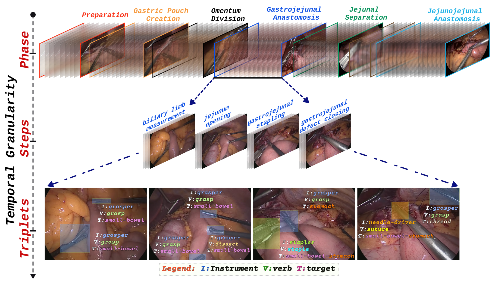
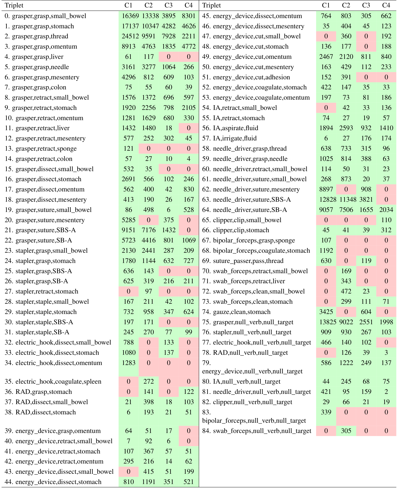
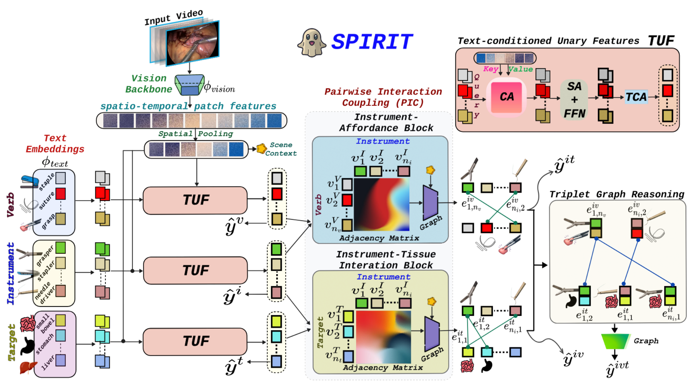
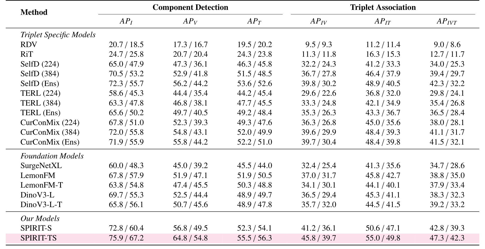
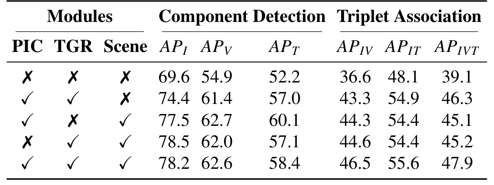
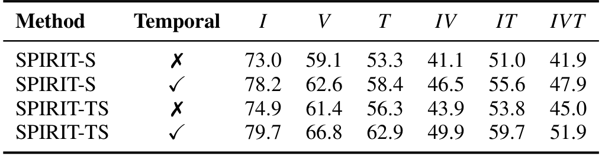

## 1. 背景与动机

手术动作三元组要求模型说出哪件器械、在做什么、作用在哪个组织上，比阶段和步骤细得多。安全监测、不良事件分析和技能评估都需要这个粒度。

**问题是没人知道三元组模型换一家医院还能不能用。** 不同医院的成像设备、镜头操作、术者习惯和器械偏好都不一样。已有工作证明阶段识别跨中心会掉点；三元组要区分更细的交互，作者预期掉得更多。

现有三元组数据集测不了这件事：CholecT50 是单中心胆囊切除，ProstaTD 没有设计跨中心评测。胃旁路手术时间长、动作相似，又是一个更难的场景。

## 2. 核心观点速览

- 数据：四家中心共 40 段视频，1 fps 下 420,911 个实例，85 类三元组，同时带阶段和步骤。
- 标签按时间区间标：以动作顶点为中心，前后约 3 秒。
- 挑战赛划分只用 C1、C2 训练，隐藏测试含两家完全没见过的医院。
- **跨中心掉点主要落在关系上**：器械识别还能维持，三元组分数掉一半。
- 边界：每个未见中心只有 5 段测试视频，中心间类别构成不同，数据获取方式论文未说明。

:::highlights
- 第一个能按中心评测三元组迁移的数据集
- 掉点可能部分来自类别分布差异，论文没有拆开
:::

先看数据怎么建。

## 3. 数据：四家医院、一套协议

*论文原图编号：Fig. 2。同一段视频中阶段、步骤和三元组三层标签的时间对齐。*

四家中心是斯特拉斯堡（C1）、伯尔尼（C2）、巴塞尔（C3）、苏黎世（C4）。视频统一为 25 fps、480p。C2 的视频已经包含在公开的 MultiBypass140 里。**每个中心的视频总数论文未说明。**

标注时先找器械与组织接触最清楚的顶点，再前后各延约 3 秒，并根据器械是否可见、相邻动作是否开始调整边界。两名医学生和两名住院医标注，专家仲裁；**标注一致性论文未说明**，所以无法估计标签噪声的上限。

原始 212 个候选三元组，删掉中心特有的、出现不到 10 次的和总在背景里静止的，再经两名专家判断临床相关性，最终保留 85 类。

:::data
- 12 种器械、13 种动作、15 种目标
- 实例最多的三元组：抓钳抓持小肠 59,984 个
:::

标签确定后，下一步是划分。

## 4. 三种划分各测什么

| 划分 | 训练 | 验证 | 测试 | 隐藏测试 |
|---|---|---|---|---|
| all-centers | 22 | 8 | 10 | |
| 交叉验证每折 | 24 | 6 | 10 | |
| challenge | 14 | 2 | 9 | 15 |

（单位为视频段数。）

all-centers 和交叉验证混合四个中心，比较的是方法本身。**只有挑战赛划分能测未见中心**：C3、C4 只出现在隐藏测试里。

*论文原图编号：Table A1。按中心的三元组帧数，红色为该中心缺失的类别。*

这张表很关键：很多类在某个中心是 0。例如持针器缝合胃小肠吻合口在 C4 完全没有。这会影响后面跨中心结果的解读。

## 5. SPIRIT 怎么建模关系

*论文原图编号：Fig. 5。SPIRIT 的三个模块：TUF、PIC、TGR。*

SPIRIT 把三元组分三层学：

1. **单项**：用类名的文本嵌入作查询，去读 8 帧片段的时空特征，得到器械、动作、目标三组节点。
2. **成对**：在“器械与目标”“器械与动作”两张二部图上各做一层图注意力，得到两张关系矩阵。
3. **组合**：把每条关系边当成节点，只在本体允许的 85 种组合之间连边，再分类三元组。

之后把第一阶段模型冻结当教师做蒸馏，教师和真值越不一致，样本权重越低。主干是 dino.txt（DINOv3 ViT-L/16 加文本塔）。

方法交代完，看结果。

## 6. 结果：基准把方法拉开了多少

| 方法 | 交叉验证 | all-centers | 公开 / 隐藏测试 |
|---|---|---|---|
| RDV | 21.4 | 21.6 | 9.0 / 8.6 |
| SelfD (Ens) | 44.1 | 43.0 | 42.3 / 32.2 |
| LemonFM | 41.5 | 39.7 | 38.8 / 35.0 |
| DinoV3-L | 43.0 | 42.5 | 38.3 / 32.3 |
| SPIRIT-TS | 51.5 | 51.9 | 47.3 / 42.3 |

（三元组 AP。）

*论文原图编号：Table 7。挑战赛划分，每格为公开测试 / 隐藏测试。*

**所有方法从公开测试到隐藏测试都掉点**，SelfD 集成版掉了 10.1，SPIRIT-TS 掉 5.0。另一个现象是主干加时序不一定有用：all-centers 上 DinoV3-L-T 比单帧版本低 1.1。

## 7. 按中心看：难在关系

| 方法 | C1 器械 / 三元组 | C4 器械 / 三元组 |
|---|---|---|
| SelfD (Ens) | 68.9 / 42.1 | 50.3 / 21.2 |
| LemonFM | 68.2 / 40.2 | 54.9 / 27.2 |
| SPIRIT-TS | 74.0 / 46.7 | 72.3 / 36.4 |

SPIRIT-TS 在 C4 上的器械分数几乎回到 C1 水平，三元组却只有 36.4。**认出器械之后，组合关系依然是主要难点。**

:::data
- C4 上 SPIRIT-TS 比 LemonFM 高 9.2
- C3、C4 都没见过，但掉点幅度不同
:::

## 8. 消融说明了什么

*论文原图编号：Table 9。all-centers 划分上 SPIRIT-S 的模块消融。*

加入关系结构让三元组分数从 39.1 升到 46.3。去掉 PIC 或 TGR 中任意一个，分数都在 45 左右，两者分工更多是作者的解释。

*论文原图编号：Table 11。时序消融。*

**没有时序时，SPIRIT-S 的 41.9 低于单帧 DinoV3-L 的 42.5。** 关系模块要靠时序特征才有效，这和按时间区间标注的方式一致。

## 9. 深入分析：掉点来自哪里

作者把未见中心的掉点归因为关系泛化。**我的判断**：还有一个没被排除的解释，即中心间类别构成不同。按视频计算的 mAP 只对测试视频中出现的类别取平均，C4 缺少训练中很常见的缝合类，分数自然会变。论文没有在类别对齐的子集上比较，两种解释没有分开。

方法收益也有三个来源混在一起：关系结构（消融支持）、时序（消融支持）、文本主干（论文未说明，没有消融）。基线沿用原作者超参数，SPIRIT 在本数据集上调参，比较不完全对等。

## 10. 结果没说什么

- 不能外推到更多国家或设备：四家中心都是法国和瑞士的大学医院。
- 不能说明标签可靠性：一致性论文未说明。
- 不能保证结果稳定：多随机种子论文未说明，显著性只在 9 段视频上做。
- 不能评估时间定位：标注有起止时间，评测仍是 1 fps 逐帧分类。

## 11. 复现要注意什么

**数据获取方式论文未说明。** 论文只写代码将公开于 GitHub；2026-11-08 访问该地址返回 404，Hugging Face 上也没有官方发布。在数据放出之前，本文数字无法复现。

计算成本：SPIRIT 每样本 487.47 GFLOPs、推理约 46.6 毫秒，是所有单模型里最慢的。用 MultiBypass140 预训练的模型在 C2 上有数据重叠风险。

## @takeaways
- 三元组跨中心评测要按中心、按单项、成对、三元组三层报告
- 评估未见中心之前先检查类别分布是否对齐
- 时序要结构化地用，简单给主干加帧不一定有效

## @strengths
- 第一个带未见中心隐藏测试的三元组基准
- 时间区间标注协议写得清楚，可复用
- 基线覆盖三元组专用模型和基础模型，并报告了计算成本

## @weaknesses
- 数据获取方式和许可证论文未说明
- 未报告标注一致性和每个中心的视频数
- 类别分布差异与视觉差异没有拆分

## @questions
- 数据何时发布、许可证是什么
- 类别对齐后，未见中心还掉多少
- 文本查询初始化单独贡献多少
