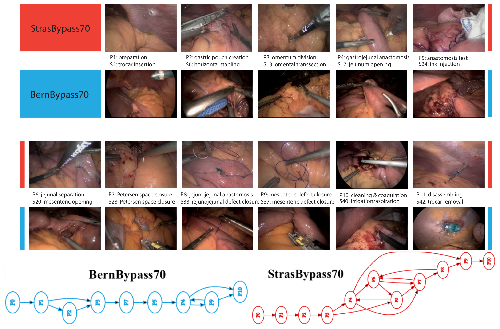
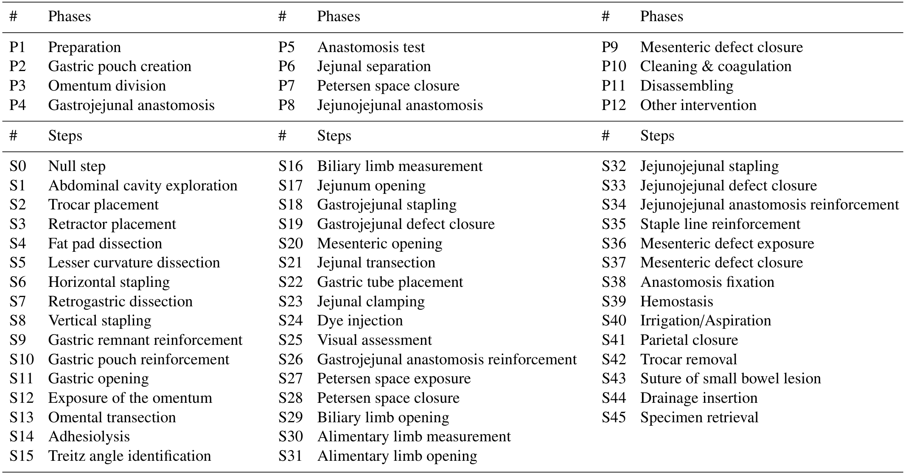
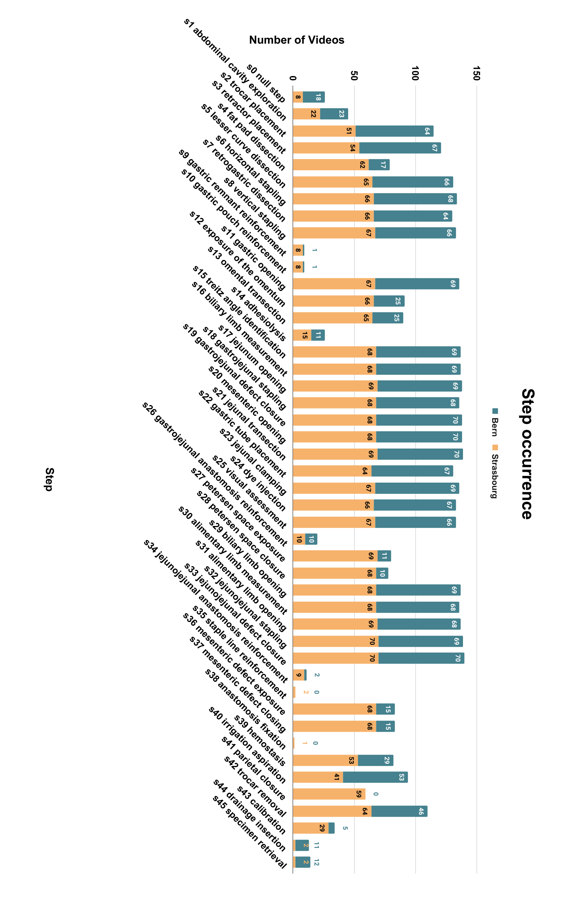
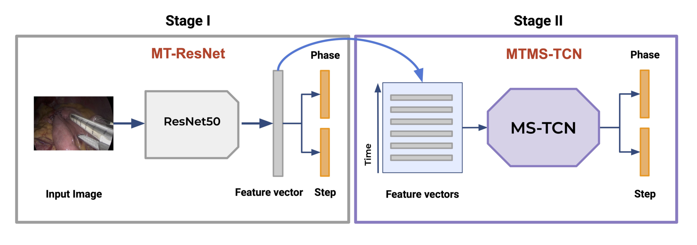
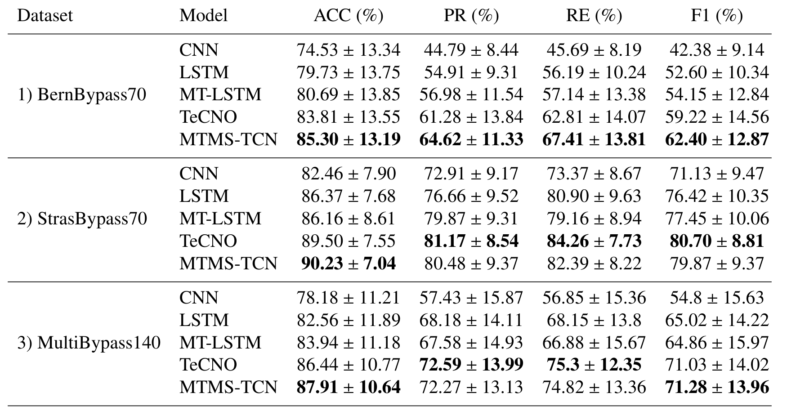
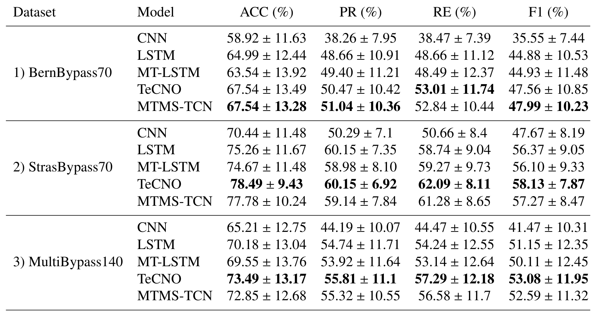
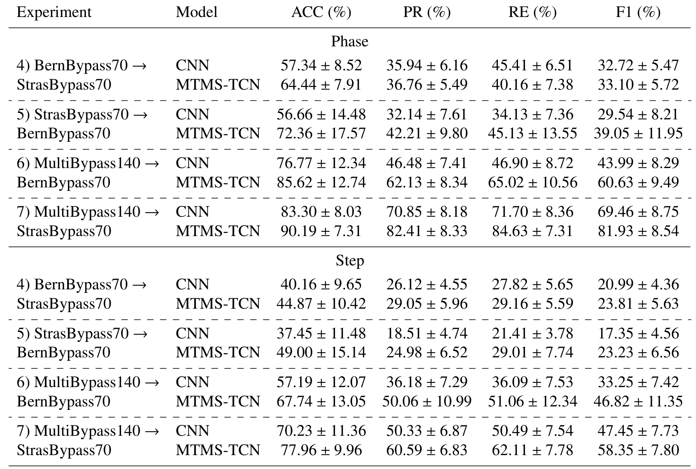
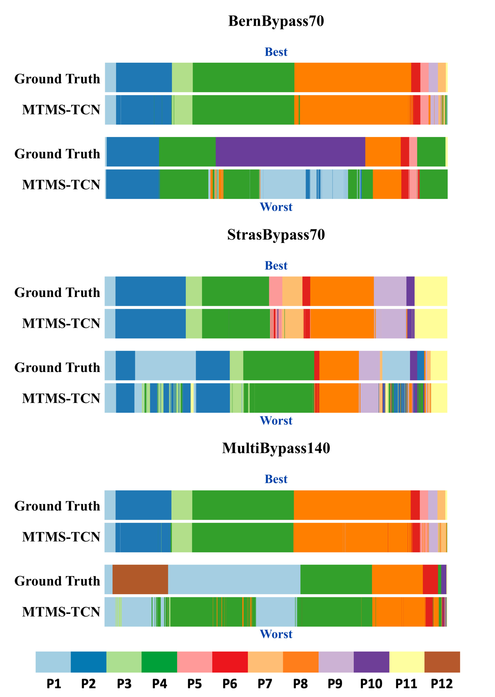
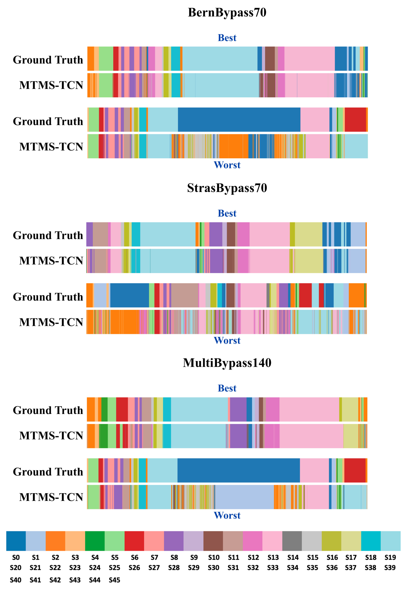

---
tags:
  - papers/手术数据集
aliases:
  - "MultiBypass140"
  - "StrasBypass70"
  - "BernBypass70"
date: 2023
arxiv_id: "2312.11250"
---

# Challenges in Multi-centric Generalization: Phase and Step Recognition in Roux-en-Y Gastric Bypass Surgery

## 核心信息

- 标题: Challenges in Multi-centric Generalization: Phase and Step Recognition in Roux-en-Y Gastric Bypass Surgery
- 标题翻译: 多中心泛化的挑战：Roux-en-Y 胃旁路手术中的阶段与步骤识别
- 作者: Joël L. Lavanchy, Sanat Ramesh, Diego Dall'Alba, Cristians Gonzalez, Paolo Fiorini, Beat Müller-Stich, Philipp C. Nett, Jacques Marescaux, Didier Mutter, Nicolas Padoy
- 机构: 巴塞尔大学 Clarunis 消化健康中心；斯特拉斯堡 IHU 图像引导手术研究所；斯特拉斯堡大学 ICube；维罗纳大学 Altair 机器人实验室；斯特拉斯堡大学医院；伯尔尼大学医院 Inselspital；IRCAD France
- 发表时间: 2023
- 发表渠道: arXiv 预印本
- arXiv: 2312.11250
- 论文链接: https://arxiv.org/abs/2312.11250
- 代码 / 项目: https://github.com/CAMMA-public/MultiBypass140
- 数据 / 资源: https://github.com/CAMMA-public/MultiBypass140
- 论文类型: benchmark_or_dataset

## 原文摘要翻译

**目的：** 多数利用人工智能识别手术活动的研究，只从规模小、来自单一中心的手术视频数据集中识别一种活动。这些模型能否泛化到其他中心，目前仍只是推测。

**方法：** 本文提出一个大规模、多中心、多活动的数据集 `MultiBypass140`，包含在两家医学中心完成的 140 例腹腔镜 Roux-en-Y 胃旁路手术（LRYGB）视频，两家中心分别是法国斯特拉斯堡大学医院（`StrasBypass70`，下称斯特拉斯堡子集）和瑞士伯尔尼大学医院 Inselspital（`BernBypass70`，下称伯尔尼子集）。数据集由两名执业外科医生完整标注了阶段和步骤。我们还通过 7 组实验评估泛化能力，并对多种深度学习模型做阶段与步骤识别的基准测试：1）在伯尔尼子集上训练和评估；2）在斯特拉斯堡子集上训练和评估；3）在合并数据集上训练和评估；4）在伯尔尼训练，在斯特拉斯堡评估；5）在斯特拉斯堡训练，在伯尔尼评估；6）在合并数据集上训练，在伯尔尼评估；7）在合并数据集上训练，在斯特拉斯堡评估。

**结果：** 模型性能明显受训练数据影响。实验 4 和 5 的结果最差，证实单中心数据训练的模型泛化能力有限。使用多中心训练数据（实验 6 和 7）能提升模型的泛化能力，使其超过单中心独立训练和验证（实验 1 和 2）的水平。

**结论：** MultiBypass140 显示，不同中心的 LRYGB 手术在技术和流程上差异很大，因此泛化实验中的模型性能差异也很明显。这些结果说明，多中心数据集对 AI 模型泛化很重要，可以覆盖手术技术和流程上的差异。数据集和代码已公开于 https://github.com/CAMMA-public/MultiBypass140。

## 创新点

1. **两中心、140 例同一术式的视频数据。** 斯特拉斯堡和伯尔尼各 70 例腹腔镜胃旁路手术。此前同类数据多来自单一中心，例如 Bypass40；多中心的 HeiChole 只有 33 例胆囊切除。两中心各 70 例让“跨中心”实验在样本量上对称。
2. **同一套 12 阶段、46 步骤的本体标注两个中心。** 本体来自作者先前提出并经多中心验证的 LRYGB 本体，两名有 10 年以上经验的外科医生标注，阶段 kappa 96%、步骤 kappa 81%。统一标签空间是做跨中心比较的前提。
3. **七组实验把中心内、合并与跨中心放在同一协议下。** 同样的模型、同样的划分，只改变训练和测试数据来源，因此能直接读出换中心带来的掉点。
4. **公开数据、划分和代码。** 视频经离体画面检测模型 OoBNet 匿名化并人工复核后发布，训练、验证、测试按视频时长分层。

## 一句话总结

MultiBypass140 把斯特拉斯堡和伯尔尼各 70 例胃旁路手术视频用同一套 12 阶段、46 步骤标签标注，七组实验显示 MTMS-TCN 跨中心阶段 F1 只有 33 到 39，而合并两中心训练后在两个测试集上分别回到 60.63 和 81.93。

## 研究问题

手术流程识别模型大多在单中心数据上训练和测试。不同医院的外科医生做同一台手术，技术选择、步骤顺序和设备都可能不同。单中心测试分数高，并不能说明模型换一家医院还能用。

现有数据集覆盖不了这个问题。`Cholec80`、`Bypass40` 都来自单一中心；`HeiChole` 是多中心，但只有 33 例胆囊切除，任务以阶段为主。阶段和步骤联合识别此前只在单中心数据上做过。

论文要回答两个问题：在两家中心之间，阶段和步骤识别模型能迁移多少；把两中心数据合在一起训练，能否弥补这个差距。

### 核心观点速览

- 数据：两家中心各 70 例腹腔镜胃旁路视频，同一套 12 阶段、46 步骤标签，按视频时长划分为每中心 40/10/20 例。
- 流程差异是真实存在的：斯特拉斯堡平均每例 10 个阶段、33 个步骤，伯尔尼 8 个阶段、27 个步骤，伯尔尼手术平均短 38 分钟。
- **单中心训练跨中心几乎失效**：MTMS-TCN 跨中心阶段 F1 只有 33.10 和 39.05，中心内为 79.87 和 62.40。
- 合并训练后，两个测试集上的阶段 F1 回到 60.63 和 81.93，接近中心内水平。
- 边界：测试中心在训练时都见过，所以这说明“混合训练可以同时容纳两种流程”，并不说明能泛化到第三家医院；外观差异和流程差异的贡献论文没有拆开。

下面先看数据怎么来、两家中心差在哪里。

## 数据与任务定义

### 数据来源

这一节回答：两个子集在画面和规模上是否可比。

| 子集 | 中心 | 视频数 | 分辨率 | 帧率 | 平均时长 |
|---|---|---|---|---|---|
| StrasBypass70 | 斯特拉斯堡大学医院 | 70 | 原始 854 × 480 或 1920 × 1080，统一为 854 × 480 | 25 fps | 111±33 分钟 |
| BernBypass70 | 伯尔尼大学医院 | 70 | 720 × 576 | 25 fps | 73±20 分钟 |

StrasBypass70 是在 Bypass40 基础上扩展得到的。伯尔尼的手术由三名外科医生完成；斯特拉斯堡的外科医生人数论文未说明。

*论文原图编号：Fig. 1。上方为两中心各阶段的样例帧，下方为两中心在 10 例以上手术中出现过的阶段转移图。放在这里是为了直观对比两中心画面风格和流程结构。*

匿名化方式是把体外画面涂黑：先用作者公开的 `OoBNet` 检测离体帧，再人工复核。**两个子集的原始分辨率不同**，这本身就是一种外观差异，后面跨中心掉点时无法排除它的影响。

### 任务拆分与标签

标签分两个粒度：

- 阶段：12 个，例如准备、胃小囊制作、网膜分离、胃空肠吻合、吻合口测试、空肠离断、Petersen 间隙关闭、空肠空肠吻合、系膜缺损关闭、清理与止血、撤离器械、其他干预。
- 步骤：46 个，从 S0 空步骤到 S45 标本取出，每个步骤隶属于一个或多个阶段。

*论文原图编号：Table 1。LRYGB 的 12 个阶段和 46 个步骤列表。放在这里是因为它定义了整个数据集的标签空间。*

两名有 10 年以上临床经验的外科医生用 `MOSaiC` 平台标注。本体的标注者间一致性（Cohen's kappa，扣除随机一致后的一致程度）为阶段 96%、步骤 81%。**这组数字来自作者先前的本体论文，不是在 MultiBypass140 上重新计算的**，本数据集自身的标注一致性论文未说明。步骤一致性明显低于阶段，意味着步骤识别的上限本身就更低。

### 规模与划分

按 1 fps 计，StrasBypass70 共 464,794 帧，BernBypass70 共 305,907 帧。两个子集都按视频时长划分为训练 40、验证 10、测试 20 例，合并后为 80、20、40 例。

| 子集 | 训练（平均时长 / 帧数） | 验证 | 测试 |
|---|---|---|---|
| StrasBypass70 | 106 ± 32 分钟 / 253,913 | 121 ± 33 / 72,555 | 115 ± 32 / 138,326 |
| BernBypass70 | 69 ± 19 / 166,431 | 77 ± 20 / 46,497 | 77 ± 24 / 92,979 |
| MultiBypass140 | 88 ± 33 / 420,344 | 99 ± 35 / 119,052 | 96 ± 34 / 231,305 |

### 两中心流程差异

这一节回答：同一台手术在两家医院到底差多少。斯特拉斯堡平均每例包含 10 个阶段、33 个步骤；伯尔尼平均 8 个阶段、27 个步骤。差异集中在三个阶段：斯特拉斯堡常规分离大网膜（P3）并关闭两处系膜缺损（P7、P9），伯尔尼不常规做。由于阶段和步骤是层级关系，缺一个阶段就缺它下面的一串步骤，所以伯尔尼平均少 2 个阶段、6 个步骤，时长短 38 分钟。

*论文原图编号：Fig. 4。两中心各步骤出现在多少个视频中。放在这里是因为它直接显示哪些步骤在伯尔尼很少出现。*

> [!figure] Fig 3 两中心阶段出现次数
> 建议位置：数据与任务定义
> 放置原因：与 Fig. 4 对应，显示阶段层面的出现次数差异。
> 当前状态：保留占位；自动裁剪未通过视觉质量检查。

标签和差异清楚之后，下一步是看基准用什么模型、怎么比。

## 方法主线

这一节回答：基准里的模型怎么处理视频，七组实验各自隔离了什么因素。本文的“方法”是基准协议，模型均为已有方法。

### 机制流程

1. **空间特征**：输入为 1 fps 采样的单帧图像；用 ImageNet 预训练的 ResNet-50 以阶段与步骤多任务方式训练 30 个周期（Adam 优化器），输出为每帧的视觉特征向量。
2. **时序建模**：输入为一段视频的特征序列；单阶段的多任务因果时序卷积网络 MTMS-TCN 训练 200 个周期，用指数增长的空洞卷积只看过去帧，输出为每帧的阶段和步骤预测。
3. **评测**：输入为预测与人工真值；在每个视频内对各类别计算准确率、精确率、召回率和 F1，再对视频求平均，输出为表中的“均值 ± 标准差”。

*论文原图编号：Fig. 2。模型结构：第一阶段 MT-ResNet 提取单帧特征，第二阶段 MTMS-TCN 在时间维度上处理特征序列，同时输出阶段和步骤。放在这里是为了说明基准模型的两段式流程。*

作者只用单阶段时序模型，理由是先前工作发现第二个阶段不提升性能。学习率、批大小和两个任务的损失权重论文未说明，复现时只能参考 `MTMS-TCN` 原论文或公开代码。

### 基线设置

- CNN：只用 ResNet-50 单帧预测。
- LSTM 与 MT-LSTM：在 CNN 特征上加长短期记忆网络，后者为多任务版本。
- TeCNO：多阶段时序卷积网络，原用于阶段识别。
- MTMS-TCN：多任务因果时序卷积网络。

### 七组实验

| 编号 | 训练集 | 测试集 | 回答的问题 |
|---|---|---|---|
| 1 | BernBypass70 | BernBypass70 | 中心内 |
| 2 | StrasBypass70 | StrasBypass70 | 中心内 |
| 3 | MultiBypass140 | MultiBypass140 | 合并数据基准 |
| 4 | BernBypass70 | StrasBypass70 | 跨中心 |
| 5 | StrasBypass70 | BernBypass70 | 跨中心 |
| 6 | MultiBypass140 | BernBypass70 | 合并训练回到单中心测试 |
| 7 | MultiBypass140 | StrasBypass70 | 合并训练回到单中心测试 |

实验 1 到 3 测五个模型，实验 4 到 7 只测 CNN 和 MTMS-TCN，为什么不测其他三个模型论文未说明。**这张表的设计重点在于测试集固定、只换训练来源**，因此表 4 与表 2 同一测试集的行可以直接相减。

协议讲完，先看中心内的基线，再看换中心掉了多少。

## 关键结果

### 中心内与合并基准

这一节回答：不换中心时，两个子集难度差多少。

*论文原图编号：Table 2。阶段识别基准。放在这里是因为它是中心内与合并训练的主表。*

阶段识别 F1（%）：

| 模型 | 1）伯尔尼 | 2）斯特拉斯堡 | 3）合并 |
|---|---|---|---|
| CNN | 42.38 | 71.13 | 54.8 |
| LSTM | 52.60 | 76.42 | 65.02 |
| MT-LSTM | 54.15 | 77.45 | 64.86 |
| TeCNO | 59.22 | 80.70 | 71.03 |
| MTMS-TCN | 62.40 | 79.87 | 71.28 |

*论文原图编号：Table 3。步骤识别基准。放在这里是因为它给出更细粒度任务的难度。*

步骤识别 F1（%）：

| 模型 | 1）伯尔尼 | 2）斯特拉斯堡 | 3）合并 |
|---|---|---|---|
| CNN | 35.55 | 47.67 | 41.47 |
| TeCNO | 47.56 | 58.13 | 53.08 |
| MTMS-TCN | 47.99 | 57.27 | 52.59 |

所有模型在伯尔尼上都低于斯特拉斯堡。CNN 阶段识别准确率低 8%，F1 低 28%；MTMS-TCN 准确率低 5%，其他指标低 15 到 17 个点。**准确率差距小、F1 差距大**，说明伯尔尼的问题集中在少见类别上：常见阶段识别得还行，少见阶段几乎认不出来，而按类别平均的 F1 会把这些类别放大。

合并数据集上的分数介于两者之间，这只是两个测试集混在一起的平均。时序模型普遍优于单帧 CNN，阶段 F1 在伯尔尼上从 42.38 提到 62.40。TeCNO 与 MTMS-TCN 互有胜负，在斯特拉斯堡阶段 F1 上 TeCNO 的 80.70 反而高于 79.87，所以多任务时序结构的优势在这份数据上并不稳定。

中心内的差距已经不小，换中心后会更大。

### 跨中心

这一节回答：不做微调直接换医院，模型还剩多少。

*论文原图编号：Table 4。跨中心评估。放在这里是因为它是本文泛化结论的核心证据。*

MTMS-TCN 的 F1（%）：

| 实验 | 阶段 | 步骤 | 同一测试集的中心内参照（阶段 / 步骤） |
|---|---|---|---|
| 4）伯尔尼 → 斯特拉斯堡 | 33.10 | 23.81 | 79.87 / 57.27 |
| 5）斯特拉斯堡 → 伯尔尼 | 39.05 | 23.23 | 62.40 / 47.99 |
| 6）合并 → 伯尔尼 | 60.63 | 46.82 | 62.40 / 47.99 |
| 7）合并 → 斯特拉斯堡 | 81.93 | 58.35 | 79.87 / 57.27 |

**跨中心时阶段 F1 只剩中心内的四成到六成**，步骤 F1 降到 23 左右，基本不可用。用斯特拉斯堡这份流程更完整的数据训练，迁到伯尔尼也一样差，作者因此认为问题不只是伯尔尼数据少。

合并训练后，斯特拉斯堡测试集略高于中心内训练（81.93 对 79.87），伯尔尼测试集略低（60.63 对 62.40）。作者把这写成“没有退化”，但伯尔尼上的小幅下降说明，流程较少的中心在混合训练中略吃亏。两者差距都小于标准差，论文也没有做显著性检验。

### 逐视频结果

*论文原图编号：Fig. 5。三个数据集上 MTMS-TCN 最好与最差视频的阶段真值和预测。放在这里是为了说明错误集中在非常规流程的视频。*

*论文原图编号：Fig. 6。对应的步骤真值和预测。放在这里是为了说明步骤层面预测更碎。*

逐视频结果把平均数背后的错误类型显示出来。最好的视频都按常规顺序推进：准备、胃小囊制作、网膜分离依次出现。最差的视频出现非常规转移，例如胃空肠吻合之后先做清理与止血、再做空肠空肠吻合，或者准备阶段中途插入其他干预、再回到准备。**时序模型学到的是“常见顺序”**，流程一旦偏离，错误会连成一片。

数字说明了掉点有多大，下一步要问它说明了什么原因。

## 深度分析

### 数据集真正测到了什么

这一节回答：掉点究竟来自外观还是流程。两中心差异同时包含外观和流程。作者给出两种解释：器械、光照和患者体型等外观差异影响 CNN；流程顺序差异影响时序模型。**论文没有做把两者分开的实验**，例如固定流程只换外观，或对齐分辨率和色调后再测。

我的判断：表 4 里单帧 CNN 跨中心同样大幅掉点（伯尔尼到斯特拉斯堡阶段 F1 为 32.72），而 CNN 不看时间顺序，这提示外观差异本身就足以造成大部分掉点，流程差异的独立贡献可能被高估。

伯尔尼更难的一个直接原因是类别稀疏。伯尔尼很多阶段和步骤只在部分视频中出现，指标又是先在视频内按类别平均。视频内缺失的类别是否计为零、还是直接跳过，论文未说明，这会改变伯尔尼分数的含义。另一个替代解释是样本量：伯尔尼训练集只有 166,431 帧，斯特拉斯堡有 253,913 帧，论文没有用等量数据对照。

### 合并训练结论的适用范围

这一节回答：合并训练的好结果能外推到哪里。实验 6 和 7 的测试中心在训练时已经见过。**它说明一个模型可以同时容纳两种流程，而不说明模型能泛化到没见过的第三家医院。**要回答后者，需要留一中心外的测试，而两中心的数据做不到。

### 适用边界

这些边界决定了数据集该怎么用。

- 适合：两中心之间的域迁移实验、阶段与步骤联合识别、流程差异分析。
- 不适合直接回答：多于两个中心的泛化、机器人手术、其他术式。

## 局限

- 只有两个中心，作者在讨论中也承认这一点，因此无法做留一中心外的测试。
- 跨中心实验只测了 CNN 和 MTMS-TCN。
- 外观差异与流程差异的贡献没有拆分，样本量差异也没有对照。
- 训练超参数（学习率、批大小、损失权重）、斯特拉斯堡外科医生人数、划分的具体分层规则、视频内缺失类别的计分方式，论文均未说明，复现时需要以公开代码为准。
- 逐视频标准差很大，例如伯尔尼阶段识别 MTMS-TCN 的准确率为 85.30 ± 13.19，而论文没有做显著性检验。
- kappa 来自先前本体论文，不是本数据集的标注一致性。

## 我的笔记

- 要复制的：中心内、合并、跨中心三类实验放在同一划分下对比。
- 要检查的：按视频平均的 F1 对缺失类别很敏感，复现时确认缺失类别如何计入；同时报告准确率和 F1，两者差距能提示少见类别的问题。
- 要检查的：用伯尔尼子集评估时，标明训练集是否包含伯尔尼数据，否则实验 6 与实验 5 的数字会被混用。
- 要避免的：把实验 6 和 7 当成对未见中心的泛化证据。
- 待查问题：留一中心外的测试；外观归一化能否单独缩小差距；无标注多中心数据的预训练收益。

## 引用

- Lavanchy, J.L., Ramesh, S., et al. (2023). Challenges in Multi-centric Generalization: Phase and Step Recognition in Roux-en-Y Gastric Bypass Surgery. arXiv:2312.11250.
- Ramesh, S., et al. (2021). Multi-task temporal convolutional networks for joint recognition of surgical phases and steps in gastric bypass procedures. IJCARS.
- Lavanchy, J.L., et al. (2023). Proposal and multicentric validation of a laparoscopic Roux-en-Y gastric bypass surgery ontology. Surgical Endoscopy.
- Wagner, M., et al. (2023). Comparative validation of machine learning algorithms for surgical workflow and skill analysis with the HeiChole benchmark. Medical Image Analysis.
- Czempiel, T., et al. (2020). TeCNO: Surgical phase recognition with multi-stage temporal convolutional networks. MICCAI.
- Twinanda, A.P., et al. (2017). EndoNet: A deep architecture for recognition tasks on laparoscopic videos. IEEE TMI.
