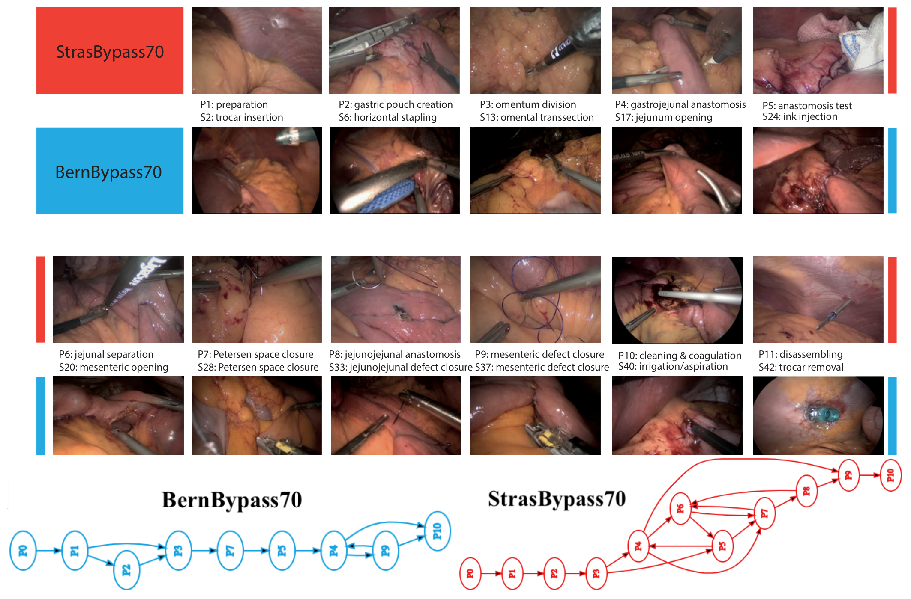
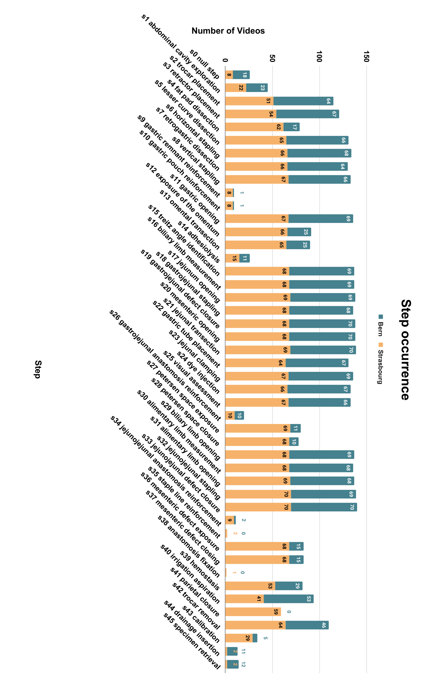
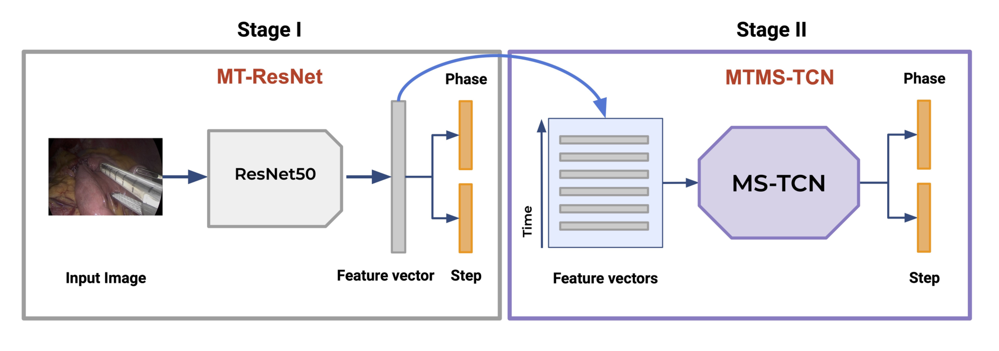
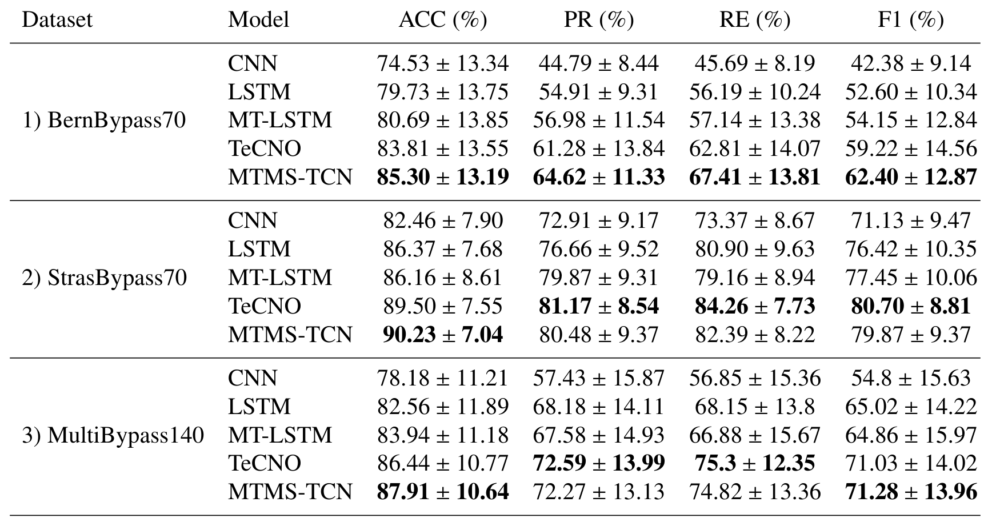
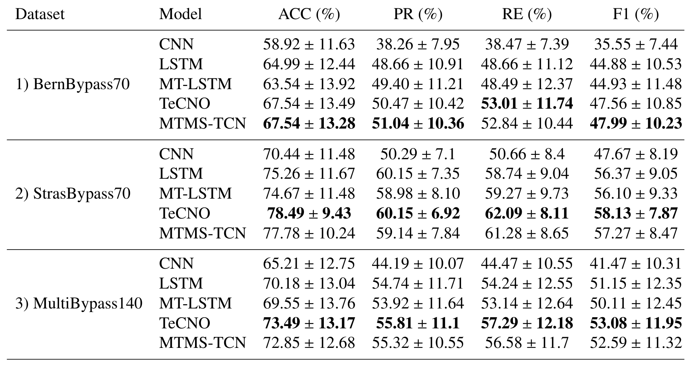
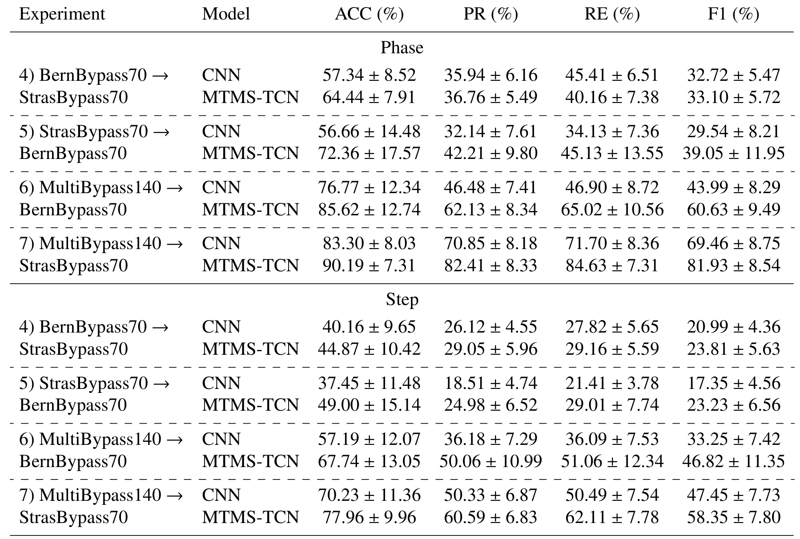
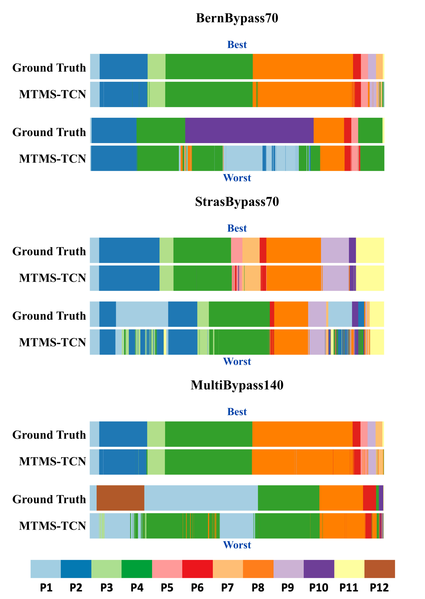

## 1. 背景与动机

手术流程识别是让系统知道“现在做到哪一步”。这类模型几乎都在单一医院的数据上训练和测试。

**问题在于，不同医院做同一台手术，流程并不一样。** 单中心测试分数高，并不能说明模型换一家医院还能用。`Cholec80`、`Bypass40` 都是单中心；多中心的 `HeiChole` 只有 33 例胆囊切除。阶段和步骤联合识别此前没有多中心数据。

所以论文要先造一份两中心、标签统一的数据，再回答模型能迁移多少。

## 2. 核心观点速览

- 数据：斯特拉斯堡和伯尔尼各 70 例腹腔镜 Roux-en-Y 胃旁路手术（LRYGB），同一套 12 阶段、46 步骤标签。
- 两中心流程确实不同：斯特拉斯堡平均每例 10 个阶段、33 个步骤，伯尔尼 8 个阶段、27 个步骤。
- **单中心训练换中心后几乎失效**：MTMS-TCN 跨中心阶段 F1 为 33.10 和 39.05。
- 合并两中心训练后，在两个测试集上阶段 F1 回到 60.63 和 81.93。
- 边界：测试中心在训练时都见过，这不等于能泛化到第三家医院。

:::highlights
- 统一标签空间是做跨中心比较的前提
- 合并训练的好结果只对见过的中心成立
:::

## 3. 数据：两家医院差在哪里

这一节回答：两个子集在画面和流程上是否可比。

| 子集 | 分辨率 | 平均时长 | 1 fps 帧数 |
|---|---|---|---|
| StrasBypass70 | 统一为 854 × 480 | 111±33 分钟 | 464,794 |
| BernBypass70 | 720 × 576 | 73±20 分钟 | 305,907 |

*论文原图编号：Fig. 1。两中心各阶段样例帧与阶段转移图。*

**差异集中在三个阶段**：斯特拉斯堡常规做网膜分离（P3）和两处系膜缺损关闭（P7、P9），伯尔尼不常规做。阶段和步骤是层级关系，缺一个阶段就缺一串步骤，所以伯尔尼平均少 2 个阶段、6 个步骤，手术短 38 分钟。

*论文原图编号：Fig. 4。两中心各步骤出现在多少个视频里。*

两名有 10 年以上经验的外科医生标注，kappa 为阶段 96%、步骤 81%。这组数字引自作者先前的本体论文，本数据集自身的一致性论文未说明。

:::data
- 140 个视频，每中心按时长划分为 40/10/20
- 12 个阶段，46 个步骤
:::

标签清楚之后，接着看基准怎么设计。

## 4. 基准协议：七组实验隔离了什么

这一节回答：模型怎么读视频，每组实验在比什么。

*论文原图编号：Fig. 2。第一阶段 ResNet-50 提取单帧特征，第二阶段 MTMS-TCN 处理特征序列，同时输出阶段和步骤。*

MTMS-TCN 是多任务因果时序卷积网络：只看过去帧，用空洞卷积扩大时间视野。ResNet-50 训练 30 个周期，时序模型训练 200 个周期。学习率和批大小论文未说明。

| 编号 | 训练 | 测试 |
|---|---|---|
| 1 / 2 / 3 | 伯尔尼 / 斯特拉斯堡 / 合并 | 同一来源 |
| 4 / 5 | 伯尔尼 / 斯特拉斯堡 | 另一家中心 |
| 6 / 7 | 合并 | 伯尔尼 / 斯特拉斯堡 |

**测试集固定，只换训练来源**，所以表 4 和表 2 中同一测试集的行可以直接比较。指标先在每个视频内按类别平均，再对视频平均。

## 5. 结果：中心内已有差距

这一节回答：不换中心时两个子集难度差多少。

*论文原图编号：Table 2。阶段识别基准。*

| 模型 | 伯尔尼阶段 F1 | 斯特拉斯堡阶段 F1 |
|---|---|---|
| CNN | 42.38 | 71.13 |
| TeCNO | 59.22 | 80.70 |
| MTMS-TCN | 62.40 | 79.87 |

CNN 在伯尔尼上准确率低 8%，F1 却低 28%。**准确率差距小、F1 差距大，说明问题集中在少见类别上。** TeCNO 和 MTMS-TCN 互有胜负，多任务结构的优势并不稳定。

*论文原图编号：Table 3。步骤识别基准，最好的 F1 也只有 58.13。*

中心内已经有差距，换中心后更大。

## 6. 结果：换中心后掉了多少

*论文原图编号：Table 4。跨中心评估。*

| 实验 | MTMS-TCN 阶段 F1 | 中心内参照 |
|---|---|---|
| 伯尔尼 → 斯特拉斯堡 | 33.10 | 79.87 |
| 斯特拉斯堡 → 伯尔尼 | 39.05 | 62.40 |
| 合并 → 伯尔尼 | 60.63 | 62.40 |
| 合并 → 斯特拉斯堡 | 81.93 | 79.87 |

**跨中心时阶段 F1 只剩中心内的四成到六成**，步骤 F1 只有 23 左右。合并训练后，斯特拉斯堡略高于中心内，伯尔尼略低。作者写成“没有退化”，但伯尔尼上的小幅下降说明流程较少的中心在混合训练里略吃亏。

:::data
- 跨中心步骤 F1：23.81 与 23.23
- 合并训练步骤 F1：46.82 与 58.35
:::

*论文原图编号：Fig. 5。最好与最差视频的阶段真值和预测，错误集中在流程非常规的视频。*

## 7. 深入分析：掉点来自哪里

作者给出两个原因：外观差异影响 CNN，流程差异影响时序模型。**论文没有把两者分开。**

我的判断：单帧 CNN 跨中心同样大幅掉点，阶段 F1 为 32.72，而 CNN 不看时间顺序。这提示外观差异本身就能造成大部分掉点，流程差异的独立贡献可能被高估。

还有一个替代解释是样本量。伯尔尼训练集 166,431 帧，斯特拉斯堡 253,913 帧，论文没有等量对照。

## 8. 结果没说什么

- 不能外推到第三家医院：只有两个中心，做不了留一中心外测试。
- 不能说多任务时序模型一定更好：TeCNO 和 MTMS-TCN 互有胜负。
- 不能说差距显著：逐视频标准差常在 10 个点以上，没有显著性检验。
- 视频内缺失类别如何计分论文未说明，伯尔尼的 F1 含义因此不确定。

## 9. 复现要注意什么

- 以公开代码确认超参数和划分。
- 同时报告准确率和 F1，两者差距能暴露少见类别问题。
- 用伯尔尼测试时标明训练集是否含伯尔尼数据。

## @takeaways
- 同一术式在两家医院流程不同，单中心模型换中心后阶段 F1 降到 33 到 39
- 合并训练在见过的中心上接近中心内结果
- 外观、流程和样本量三个因素没有被拆开

## @strengths
- 两中心各 70 例，规模对称，标签统一
- 七组实验在固定测试集上只换训练来源，读数直接
- 数据、划分和代码公开

## @weaknesses
- 只有两个中心，无法测未见中心
- 跨中心只测两个模型，没有显著性检验
- kappa 来自先前论文，不是本数据集

## @questions
- 加入第三家医院后，合并训练还能保持吗
- 外观归一化能单独缩小多少差距
- 无标注多中心数据的自监督预训练收益多大
