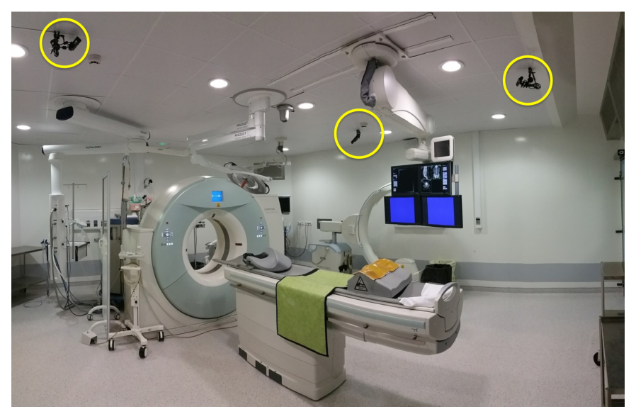
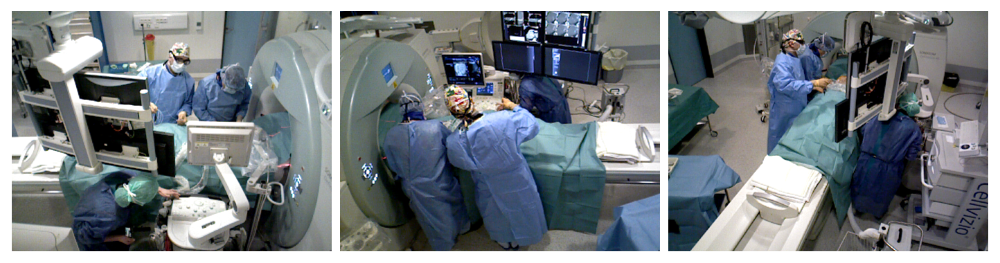
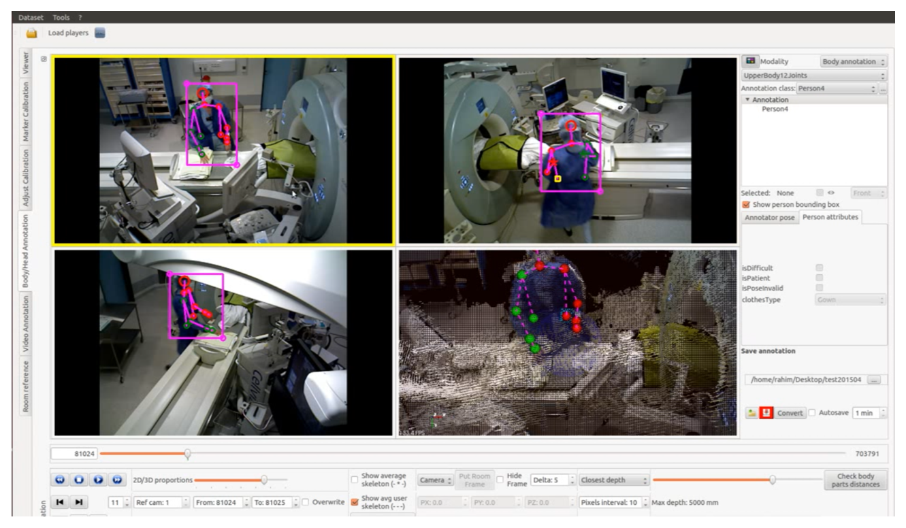
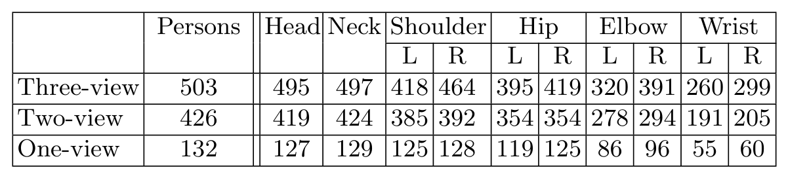
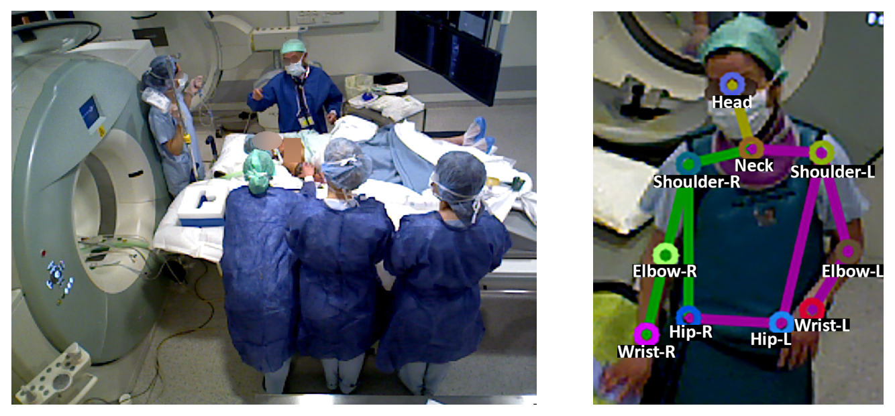
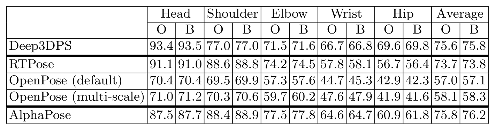
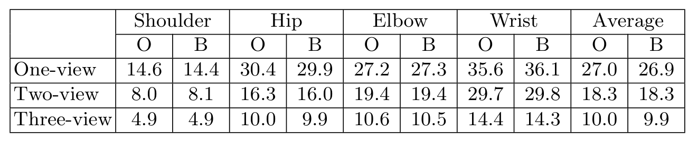
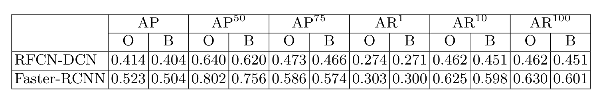

## 1. 背景与动机

手术室是姿态估计最难的场景之一：设备多，医护人员穿宽松手术衣，几个人挤在手术床边互相遮挡。作者先前的工作已经发现，最先进的方法在手术室数据上性能明显下降。

**问题在于没有合适的公开数据来衡量这种下降。** `COCO`、`MPII` 只有二维；`Human3.6M`、`HumanEva`、`IXMAS` 有三维，但都是单人受控场景；`MultiHumanOR` 是手术室多视角数据，却由演员模拟。

MVOR 要补的就是这块：真实临床介入中录制、带多人三维姿态的多视角数据。

## 2. 核心观点速览

- 数据：一间介入手术室，三台吊装相机，四天录制，732 个同步多视角帧，附标定参数和以手术床为参照的全局坐标系。
- 标注：4699 个人体框，2926 个二维和 1061 个三维上半身姿态，每个姿态 10 个关键点。
- 基线：现成方法都没在 MVOR 上训练。二维最好平均 `PCK` 约 76，三维单视图误差 27.0 cm，检测最好 `AP` 0.523。
- 匿名化：原图和模糊图结果几乎一样。
- 边界：没有训练/测试划分，标注一致性论文未说明。

**所以 MVOR 实际上是一份跨域测试集。** 下面先看数据怎么采。

## 3. 数据怎么采

三台 Asus Xtion Pro 相机用关节臂吊在天花板上，对着手术床周围，以 20 FPS、640x480 同步录制彩色和深度。手术包括椎体成形术和肺活检。

*论文原图编号：Fig. 2。介入手术室布置，黄圈为三台相机。*

每台相机的内参用标定板求得，相机之间和到全局坐标系的变换按两步法求得。732 帧是从四天录像中采样出来的，**采样间隔论文未说明**，相邻帧可能很像，有效样本量也许小于帧数。

*论文原图编号：Fig. 1。同一时刻的三个视角，除患者外有三个人。*

:::data
- 732 个多视角帧，三台相机
- 20 FPS，640x480
:::

采集讲完，接下来是标签。

## 4. 标签怎么做

所有人都标框；只有在至少一个视角中上半身可见超过 50% 的工作人员才标姿态。**患者只有框没有姿态**，所以二维姿态 2926 个，比框少约四成。

三维标注分两步：先在每个视角画二维骨架，用深度反投影到三维并对可见关节取平均；再由标注员检查投影，必要时直接在三维中修正。修正之所以必要，是因为深度有误差，各视角的二维标注也因角度和遮挡不一致。

*论文原图编号：Fig. 4。标注工具同时显示三个视角和三维点云，关节可在二维或三维中移动。*

**标注员人数、修正比例和一致性论文未说明**，标签噪声有多大无从判断。

*论文原图编号：Table 1。三维标注中每人和各部位在几个视角可见。*

三维姿态里在三视角、两视角、单视角可见的分别是 503、426、132 人。腕部最难看到。

:::highlights
- 三维标签由二维反投影平均后人工在三维校正
- 患者没有姿态标注
:::

## 5. 匿名化怎么做

患者面部和裸露部位完全模糊；医护人员戴口罩时只模糊眼部，否则整张脸模糊。作者想尽量少模糊，以免影响算法。

*论文原图编号：Fig. 3。左为模糊示例，右为 10 个上半身关键点。*

10 个关键点里只有头部靠近模糊区域，所以对姿态的影响理应很小。结果也确认了这一点。

## 6. 结果说了什么

**二维。** `AlphaPose` 平均 `PCK` 75.8，`Deep3DPS` 75.6，旧版 `RTPose` 73.7，新版 `OpenPose` 默认只有 57.0。所有方法都是腕部和髋部最差，而这正是手术室里最常被挡住的部位。

*论文原图编号：Table 2。分部位 PCK，O 为原图，B 为模糊图。*

**三维。** `MV3DReg` 平均误差单视图 27.0 cm、两视图 18.3 cm、三视图 10.0 cm。腕部三视图下仍有 14.4 cm，对判断手是否接触器械来说仍然太大。

*论文原图编号：Table 3。按支撑视图数的三维平均每关节误差（cm）。*

**检测。** `Faster-RCNN` 的 `AP` 0.523、`AP50` 0.802，最好。由骨架推出的框中 `AlphaPose` 最好，`AP50` 0.540，仍低于专门的检测器。

*论文原图编号：Table 4。两种检测器的 AP 与 AR。*

:::data
- 二维最好平均 PCK：75.8（原图）/ 76.2（模糊）
- 三维：27.0 → 18.3 → 10.0 cm
- 检测最好 AP50：0.802
:::

这些数字能支持什么结论，要看它们和哪些因素混在一起。

## 7. 为什么会这样（深入分析）

**低分测的是迁移，不是上限。** 所有方法都没在 MVOR 上训练，`Deep3DPS` 只在同一手术室的另一份数据上微调过。“仍有很大提升空间”这句话，论文无法区分是任务本身难，还是模型没适配；要区分它需要在 MVOR 划分上训练的结果，论文没有。

**视图数和样本难度混在一起。** 表 3 三行是不同的人。只在一个视角可见的人本来就被挡得更重，所以 27.0 到 10.0 cm 的下降不能全算在视图数上。能分开二者的实验是：对三视图可见的同一批人只给一个视角再测，论文没做。

**自顶向下在拥挤场景里占优。** `AlphaPose` 先检测人再估计姿态，只用彩色图就追平了用深度且见过同一手术室的 `Deep3DPS`。我的判断：这说明先找人能减少关节错配，但两者条件不对等，不能据此排序。

:::highlights
- 低分来自领域差异还是任务难度，论文无法区分
- 视图数分层的误差下降混入了样本难度
:::

## 8. 结果没说什么

- 模糊无影响只对“在模糊图上测试”成立；在模糊图上训练会不会学到捷径，论文没检验。检测器受模糊影响稍大，`Faster-RCNN` 的 `AP50` 从 0.802 降到 0.756。
- 新版 `OpenPose` 为何比旧版 `RTPose` 低 16 个点以上，论文未说明。
- “首个真实临床数据集”只是相对作者列举的数据集，没有系统检索。
- 下半身和患者姿态没有标注，相关应用无法用 MVOR 验证。

## 9. 复现要注意什么

- 没有官方划分。若要在 MVOR 上训练，按天或按手术划分，避免相邻帧泄漏。
- 三维误差按支撑视图数分层报告，并写明二维输入来自哪个检测器，因为 `MV3DReg` 的误差包含 `OpenPose` 的误差。
- 写明方法是否在 MVOR 或同一手术室数据上训练过，否则和论文基线不可比。
- 由骨架推框时只比 `AP50`，框偏小会让高交并比下的精度失真。

## @takeaways

- MVOR 是一份小规模、真实介入手术室的多视角跨域测试集，不是训练集。
- 二维反投影平均再三维校正的标注流程值得在其他多视角 RGB-D 场景复用。
- 发布前在原图和匿名化图像上各跑一遍基线，是医疗视觉数据公开时值得照搬的做法。

## @strengths

- 首次把真实介入过程中的遮挡与杂物带进多人三维姿态评测。
- 标定参数与全局坐标系一起发布，多视角方法可以直接用。
- 用数字说明了匿名化的代价。

## @weaknesses

- 732 帧、单中心、四天录制，规模小且无划分。
- 只有上半身 10 个关键点，患者无姿态。
- 标注员人数和一致性论文未说明；基线条件不对等。

## @questions

- 在 MVOR 上训练后，二维和三维误差能降到多少？
- 固定同一批人只减少视图数，三维误差会怎么变？
- 在模糊图上训练的模型，换到原图上是否仍然一样好？
