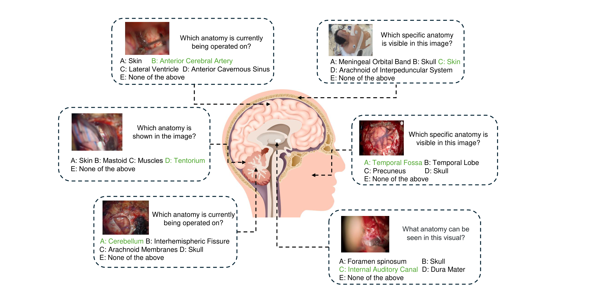
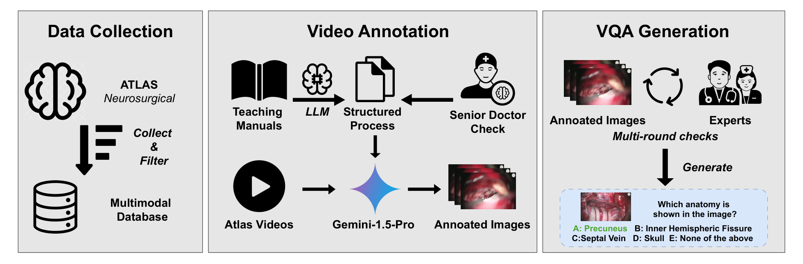
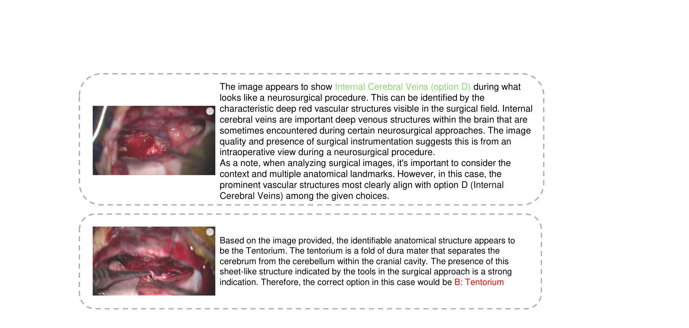

---
tags:
  - papers/手术数据集
aliases:
  - "NeuroABench"
  - "Neurosurgical Anatomy Benchmark"
date: 2025-12-07
arxiv_id: 2512.06921
---

# NeuroABench: A Multimodal Evaluation Benchmark for Neurosurgical Anatomy Identification

## 核心信息

- 标题: NeuroABench: A Multimodal Evaluation Benchmark for Neurosurgical Anatomy Identification
- 标题翻译: NeuroABench:面向神经外科解剖结构识别的多模态评测基准
- 作者: Ziyang Song, Zelin Zang, Xiaofan Ye, Boqiang Xu, Long Bai, Jinlin Wu, Hongliang Ren, Hongbin Liu, Jiebo Luo, Zhen Lei
- 机构: 香港科学创新研究院; 香港大学深圳医院; 香港中文大学电子工程系
- 发表时间: 2025-12-07(arXiv v1,目前唯一版本)
- 发表渠道: arXiv 预印本(cs.CV),arXiv 元数据注明已被 IEEE ICIA 2025 接收
- arXiv: 2512.06921
- 论文链接: https://arxiv.org/abs/2512.06921
- 代码 / 项目: 论文未给出链接
- 数据 / 资源: 论文未给出数据集下载链接;只给出视频来源 Neurosurgical Atlas(https://www.neurosurgicalatlas.com/)
- 论文类型: 基准论文(benchmark_or_dataset)

## 原文摘要翻译

多模态大语言模型(MLLM)在手术视频理解上显示出很大潜力。随着零样本性能的提升和人机交互的改进,它们为推进手术教育与手术辅助打下了坚实基础。然而,现有研究和数据集主要关注对手术流程和工作流的理解,对解剖理解这一关键环节关注有限。在临床实践中,外科医生高度依赖精确的解剖理解来解读、回顾手术视频并从中学习。

为填补这一空白,我们提出神经外科解剖基准(NeuroABench),这是第一个专门用于评测神经外科领域解剖理解的多模态基准。NeuroABench 包含 9 小时、覆盖 89 台不同手术的已标注神经外科视频,并通过一条带有多轮审核的新型多模态标注流程构建。该基准评测 68 种临床解剖结构的识别,为评估模型性能提供了严格、标准化的框架。

对 10 余个最先进 MLLM 的实验揭示了明显局限:表现最好的模型在解剖识别任务上的准确率只有 40.87%。为进一步检验该基准,我们抽取数据集的一个子集,请四名神经外科住院医师做了一次参考性测试。结果显示,表现最好的学员准确率为 56%,最低为 28%,平均为 46.5%。最好的 MLLM 与得分最低的学员相当,但仍明显落后于该组的平均水平。这一对比既说明了 MLLM 在解剖理解上的进步,也说明了距人类水平仍有很大差距。这些发现凸显了针对神经外科应用优化 MLLM 的重要性。

## 创新点

1. 把评测对象从流程换成解剖。已有手术多模态模型的数据集多问器械、阶段和动作,医学问答中的解剖题又多来自断层影像。这个基准只问术中画面里是哪一种解剖结构,覆盖 68 类,多于表 I 中最多的 48 类。
2. 换了数据来源。题目取自 Neurosurgical Atlas 的教学视频,而不是重新标注已有公开数据集,作者以此规避 GMAI-MMBench 一类基准的数据泄漏风险。
3. 用 LLM 加医生的标注流程。OpenAI-o1 把教学手册总结成以解剖标志为线索的流程,神经外科专家校正;Gemini-1.5-Pro 结合画面与术者讲解给视频标出步骤、关键解剖和时间段;医生再多轮审核抽出的帧。
4. 同时报告实例级和解剖级指标,并加入四名住院医师的人类参照,使 40.87% 这样的分数有了临床水平的对照。

## 一句话总结

NeuroABench 从 Neurosurgical Atlas 的 89 个入路视频中,用 Gemini-1.5-Pro 标注、医生审核,做出 1079 道覆盖 68 类解剖的五选一题;16 个 MLLM 零样本最好只有 40.87%(随机 19.48%),在子集上低于四名住院医师的平均 46.5%。

## 研究问题

手术 MLLM 的研究和数据集大多关注器械、阶段和动作识别,很少专门评测解剖理解。神经外科医生看手术视频时主要靠识别解剖结构、理解它与操作的关系,所以这一缺口在神经外科最明显。

已有医学 VQA 基准不能补上这个缺口:

- VQA-RAD、SLAKE、OmniMedVQA 中有解剖题,但多是 CT、MRI 等静态影像上的器官级识别,没有术中的动态细节。
- GMAI-MMBench 包含临床环境的解剖任务,但重用并重新标注旧数据集,可能有数据泄漏;解剖分类也不够细。

论文要回答的问题是:当前 MLLM 能否在真实神经外科术中画面里认出具体的解剖结构,与住院医师相比差多少。

### 核心观点速览

论文的答案是:从教学视频里自己做题,题目只问"这一帧是哪种解剖结构"。

- 数据:Neurosurgical Atlas 的 886 个视频筛到 89 个入路视频,约 9 小时,配 32 本教学手册。
- 构建:OpenAI-o1 读手册总结流程,Gemini-1.5-Pro 读画面和讲解给视频标解剖,医生多轮审核删去坏帧,得到 1079 道五选一题,覆盖 68 类解剖。
- 结果:16 个 MLLM 零样本最好的是 Gemini-2.0-Flash,准确率 40.87%,随机为 19.48%;在一个子集上它得 36%,四名住院医师平均 46.5%。
- 边界:**标注的核心一步由 Gemini 完成,子集大小、数据是否公开都论文未说明,前两名模型的差距在统计误差之内。**

下一节先看题目从哪里来、长什么样。

## 数据与任务定义

这一节回答:题目来自什么视频,每道题问什么,分数怎么算。

### 数据来源

视频全部来自 Neurosurgical Atlas,这是一个由专家临床医生讲授的神经外科教学平台。

- 共检索 886 个视频,筛出 89 个聚焦手术入路的视频,总时长约 9 小时。
- 同时取得 32 本入路教学手册,内容是分步操作规范和注意事项。
- 贡献部分称覆盖 32 种神经外科入路和 68 种核心解剖结构。

筛选标准论文只说"高质量、聚焦入路",具体规则论文未说明,所以无法判断被筛掉的 797 个视频是否系统性地更难。摘要把 89 写成"89 种不同手术",正文写的是 89 个视频、32 种入路,应以正文为准。

**入路视频决定了题目的构成。** 入路是从切皮到暴露病灶的路径,画面依次出现皮肤、颅骨、硬膜、脑表面,再到深部血管神经,所以题目里浅层结构不会少。

### 任务与题型

任务是单帧解剖识别,形式为五选一:

- 题干从 5 个预设问题中随机选一个,例如"图中可见的是哪种解剖结构""当前正在操作的是哪种解剖结构"。
- 选项 A 到 D 是具体解剖名称,E 是"以上都不是"。
- 正确答案在 5 个位置上各占 20% 的概率,所以随机猜测的期望准确率是 20%。

正确答案为 E 时干扰项怎样选,E 题占多少,论文未说明。这会影响解读:如果模型很少选 E,它在 E 题上几乎全错,总分会被系统性拉低。

*论文原图编号：Fig 1。六道示例题,绿色为正确答案,围绕中央的头颅解剖示意图。放在这里是因为它显示题目里既有皮肤、颅骨这类浅层结构,也有大脑前动脉、内听道这类深部结构,难度跨度很大。*

Fig 1 中有一题的正确答案是皮肤,画面是患者体位照片。这类题几乎不需要神经外科知识。各难度层的题数,论文未说明,所以总分里有多少来自这类送分题无法估计。

最终得到 1079 道题。表 I 中各基准只统计与解剖相关的题:

| 基准 | 解剖题数 | 解剖类别数 | 来源 |
|---|---|---|---|
| VQA-RAD | 106 | 31 | Medpix |
| SLAKE | 507 | 21 | MSD、Chestx-ray8、CHAOS |
| GMAI-MMBench | 2098 | 18 | 284 个公开与医院数据集 |
| OmniMedVQA | 16448 | 48 | 73 个分类数据集 |
| NeuroABench | 1079 | 68 | Neurosurgical Atlas 网站 |

NeuroABench 的类别最多,但题数少于 GMAI-MMBench 和 OmniMedVQA。按 68 类平均,每类约 16 题;各类的实际题数分布,论文未说明。**每类只有十几道题时,解剖级指标里单个类别的分数会很不稳定。**

### 评测指标

评测是零样本,提示中不给示例。输出里没有按要求明确选出字母选项的,计为错误。

指标是宏平均的 Precision、Recall 和 F1,外加准确率,分两层报告:

- 实例级:在全部图像上平均各项指标。
- 解剖级:先按每种解剖结构计算指标,再在结构之间平均,用来减轻类别分布不均的影响。

论文给出的实例级公式为

$$\text{Instance-Level Metric}=\frac{1}{N}\sum_{i=1}^{N}\frac{1}{K}\sum_{j=1}^{K}M_{i,j}$$

其中 $N$ 和 $K$ 的含义论文未说明,公式在正文中也没有被引用。按上下文推测 $i$ 遍历图像,但 $j$ 遍历什么无法确定。解剖级指标没有给公式。

两层指标的差距本身有信息:实例级高、解剖级低,说明模型主要答对了常见结构。

题目和指标讲清之后,下一节看这 1079 道题是怎样从视频里做出来的。

## 方法主线

这是基准论文,方法主线是数据构建与评测协议,不涉及新模型。这一节回答:标签由谁给出,谁来把关,把关删掉了什么。

### 构建流程

构建分三步,对应 Fig 2 的三个面板。

第一步,数据收集。从 Atlas 收集视频和教学手册,筛到 89 个视频和 32 本手册。

第二步,视频标注。

- OpenAI-o1 读教学手册,以解剖标志为线索自动总结各入路的流程;神经外科专家审核、修正术语。
- Gemini-1.5-Pro 在这些流程的指导下标注视频,同时利用画面和视频里术者的讲解语音。每个视频输出一个 JSON,含三个键:步骤序号、该步骤的关键解剖、时间段。
- 标签标准化:把缩写展开成全称,例如把内听道的缩写 IAC 写成完整名称;合并同义词,例如把硬膜的两种写法统一成一个名称。

第三步,问答生成。按每秒一帧抽帧并对齐到解剖标注,由临床医生多轮审核这些"图像-解剖"对,删除三类样本:

- 标注与画面矛盾的;
- 画面质量差、看不清解剖细节的;
- 一帧里有多个标志性解剖、可能引起歧义的。

保留下来的每个样本配一个随机题干和五个选项。

**医生的角色是删除,不是重新标注。** 标签的来源始终是 Gemini-1.5-Pro 的输出,医生只决定一帧留下还是删去。9 小时视频按每秒一帧约有 3.2 万帧(推算),最终只留下 1079 道题;抽帧总数和每类删除的数量论文未说明,所以无法知道审核删掉了多少 Gemini 的错误标签,也就无法估计剩余标签的错误率。

第三类删除规则让每帧只有一种标志性解剖。这让题目答案唯一,但也意味着基准不测临床中更常见的多结构同框场景。

### 机制流程

1. 输入 Atlas 的 886 个视频和教学手册,筛选后得到 89 个入路视频和 32 本手册。
2. 输入手册,OpenAI-o1 总结以解剖为线索的流程,专家校正后交给 Gemini-1.5-Pro;它读视频画面和讲解,输出每个视频的步骤、关键解剖与时间段。
3. 输入按秒抽出的帧和对齐的解剖标签,医生多轮审核,删去错配、模糊和多解剖帧。
4. 输入保留的图像-解剖对,套用 5 个题干和 A 到 E 选项并均匀分配正确位置,输出 1079 道题,用于零样本评测。

*论文原图编号：Fig 2。构建流程的三个面板:数据收集、视频标注、问答生成。放在这里是因为它显示 Gemini-1.5-Pro 位于标注环节的中心,高年资医生只审核流程和最终图像。*

### 评测协议

被测模型共 16 个,分三组:

- 开源通用模型 7 个:mPLUG-Owl3、Deepseek-VL2、LLaVA-NeXT 7B 与 72B、Baichuan-Omni-1.5、Qwen2.5-VL 7B 与 72B。
- 闭源接口模型 6 个:GPT-4o 与 Qwen-VL-MAX,两个版本的 Gemini,两个版本的 Claude,具体型号见下方结果表。
- 医学专用模型 3 个:LLaVA-Med-v1.5、HuatuoGPT-Vision 7B 与 34B。

开源权重取自官方 Hugging Face 仓库。提示词原文、解码参数、API 调用日期论文未说明。输出中没有明确选项字母的计为错误,但各模型格式失败的比例论文未说明,所以低分模型有多少是"不会答"、多少是"不按格式答"分不开。

另请四名神经外科住院医师做数据集的一个子集,与 Gemini-2.0-Flash 在同一子集上比较。子集题数、抽样方式、住院医师年资论文未说明。

协议讲完,下一节看分数。

## 关键结果

这一节回答:模型比随机好多少,比人差多少,医学专用模型有没有优势。

### 模型总体表现

| 模型 | 参数 | 准确率 | 实例级 F1 | 解剖级 F1 |
|---|---|---|---|---|
| 随机 | - | 19.48 | 19.96 | 1.68 |
| Gemini-2.0-Flash | - | 40.87 | 38.56 | 25.52 |
| Claude-3.5-Sonnet | - | 40.41 | 38.12 | 24.52 |
| Gemini-1.5-Pro | - | 38.83 | 35.88 | 20.57 |
| Qwen2.5-VL | 72B | 37.44 | 37.52 | 20.17 |
| HuatuoGPT-Vision | 34B | 36.52 | 32.71 | 21.49 |
| Qwen2.5-VL | 7B | 34.11 | 32.18 | 18.31 |
| Claude-3.7-Sonnet | - | 33.27 | 30.98 | 20.35 |
| GPT-4o | - | 30.21 | 29.93 | 19.56 |
| Qwen-VL-MAX | - | 18.26 | 18.31 | 9.29 |
| LLaVA-Med-v1.5 | 7B | 15.01 | 7.66 | 10.79 |

最好的 Gemini-2.0-Flash 准确率 40.87,约为随机的两倍。正文把它写成 40.87% 的 precision,表中它是准确率,实例级 Precision 是 46.61。

**前两名的差距没有统计意义。** 1079 道题、准确率约 40% 时,标准误约 1.5 个点(推算),Gemini-2.0-Flash 的 40.87 与 Claude-3.5-Sonnet 的 40.41 无法区分。论文只跑一次,没有置信区间。表中除随机基线外的前八个模型,解剖级 F1 都比实例级低 10 到 18 个点,说明模型在少见结构上更差。LLaVA-Med-v1.5 相反,解剖级 10.79 高于实例级 7.66,它的实例级 F1 被少数大类上的错误拉低。

有两个模型低于随机:LLaVA-Med-v1.5 为 15.01,Qwen-VL-MAX 为 18.26。论文没有分析原因。我的判断是"不按格式作答计为错误"的规则可能是一部分原因:LLaVA-Med 的实例级 F1 只有 7.66,远低于它的准确率,符合大量输出集中到少数选项或无效答案的情形。

规模没有带来稳定提升:Qwen2.5-VL 从 7B 到 72B 提高 3.33 个点,LLaVA-NeXT 72B 的 27.53 反而低于 7B 的 28.82。新版本也不一定更好:Claude-3.7-Sonnet 的 33.27 比 Claude-3.5-Sonnet 低 7.14 个点。这些反常说明,这个基准上的分数主要取决于训练数据里有没有类似的术中画面,而不是模型规模。

随机基线的解剖级 F1 只有 1.68,但它的 Precision 和 Recall 分别是 16.86 和 12.10。按 F1 的定义,同一组数据的 F1 不会远低于两者,计算口径论文未说明,解剖级 F1 一列的绝对值要谨慎使用。

### 与住院医师比较

| 参与者 | 准确率 |
|---|---|
| 住院医师 1 | 0.48 |
| 住院医师 2 | 0.28 |
| 住院医师 3 | 0.56 |
| 住院医师 4 | 0.54 |
| Gemini-2.0-Flash | 0.36 |

四人平均 46.5%,Gemini-2.0-Flash 为 36%,低 10.5 个点,即论文所说的 -10.50%;它只高于最差的住院医师。**Gemini 在子集上的 36% 低于它在全集上的 40.87%,说明子集可能偏难,或者子集太小、分数波动大。** 子集题数论文未说明,两种解释分不开。

住院医师之间相差 28 个点(28% 到 56%),人类参照本身就很分散。只有 4 人时,平均值 46.5 的不确定性很大。

论文还说模型的性能方差远低于人类,但没有给出模型多次运行的方差,这个比较实际上是 16 个不同模型之间的离散度对 4 个人之间的离散度。

### 医学专用模型

论文称医学专用模型比通用模型平均高 7.52 个点。按表 II 计算,HuatuoGPT-Vision-34B 的 36.52 减去 7 个开源通用模型的平均 29.01,约为 7.51,与之接近;论文未说明具体口径。三个医学模型的平均只有 27.28,低于开源通用模型平均,所以这个"提升"只对最好的医学模型成立。

论文据此推测医学训练数据缺少术中解剖。另一种解释是这些医学模型的基座较旧,差距来自基座而非数据;同基座的通用版与医学版对照论文没有做。

结果的数字到此为止,下一节讨论它们实际说明了什么。

## 深度分析

这一节回答:40.87% 和人机差距这两个结论,有多少来自模型能力本身,有多少可能来自题目构造。

### 基准测到了什么

**NeuroABench 测的是:给一帧经过筛选、只含一种标志性解剖的术中画面,模型能否在五个名称中选对。** 这比临床实际要简单,因为删去了多结构同框的帧,而且有选项提示;又比临床实际要难,因为没有时间上下文和讲解,而医生看视频时两者都有。

所以 40.87% 衡量的是单帧、有选项条件下的识别,不能直接换算成模型在真实视频回看或术中辅助中的可用程度。

### 标注模型与被测模型重叠

标注的核心环节由 Gemini-1.5-Pro 完成,而 Gemini-1.5-Pro 和 Gemini-2.0-Flash 分别排第三和第一。医生只做删除式审核,不改写标签,所以保留下来的题偏向 Gemini 能"看出"解剖的帧。这是一个可能的偏置来源,论文没有讨论。

**Gemini-2.0-Flash 排第一这件事,和"题目由 Gemini 标注"这件事分不开。** 能把两者分开的证据,是在医生独立标注的子集上重新排名,论文没有做。Claude-3.5-Sonnet 与 Gemini-2.0-Flash 几乎持平,说明偏置即使存在也不大,但无法排除。

### 形变案例的证据强度

*论文原图编号：Fig 3。Claude-3.5-Sonnet 对同一手术两帧相近画面的回答:上方识别出大脑内静脉(正确),下方把被牵拉变形的结构答成小脑幕(错误)。放在这里是因为它是论文关于形变影响的唯一证据。*

讨论部分认为,模型的解剖知识停留在教科书式的静态形态,术中牵拉造成的形变会让识别失败。Fig 3 只有一对帧,能说明现象存在,不能说明它在错误中占多大比例。第二帧同时有器械遮挡和视野变化,答错也可能与形变无关。要支持这个结论,需要按手术阶段或形变程度分组统计准确率,论文没有给出。

### 与已有基准的定位

| 对比对象 | 对方提供 | NeuroABench 新增 | 没有超过的地方 |
|---|---|---|---|
| VQA-RAD、SLAKE | 放射影像上的器官级问答 | 术中画面,类别更细 | 题数与 SLAKE 同量级 |
| GMAI-MMBench、OmniMedVQA | 大规模多来源医学问答 | 新采集来源,无旧数据集重标 | 题数少一到两个数量级 |
| 手术 VQA 数据集 | 器械、阶段、动作问答 | 以解剖为中心,神经外科 | 只有单帧,无时间与定位 |

**真正新的是两件事:术中神经外科画面,以及 68 类细粒度解剖。** 题数和题型都没有超过已有基准,首创性只相对表 I 的四个放射影像为主的基准成立;论文没有与腹腔镜、内镜等术中多模态基准比较。

## 局限

- 数据集是否公开、Atlas 视频的使用许可论文未说明,他人能否复现评测无法确定。
- 人类对比的子集题数、抽样方式、住院医师年资论文未说明;4 人无法做显著性检验,"落后 10.5 个点"只是参考。
- 所有模型只跑一次,没有置信区间;提示词原文与解码参数论文未说明,前几名的排序不稳定。
- 标注由 Gemini-1.5-Pro 完成,与被测的 Gemini 系列存在重叠,排名可能偏向 Gemini。
- 医生审核删除了多少帧论文未说明,剩余标签的错误率无法估计。
- 正确答案为 E 的题占多少、模型选 E 的比例,论文未说明,无法判断低分有多少来自 E 题。
- 各模型格式失败的比例论文未说明,低于随机的两个模型分不清是不会还是不按格式答。
- 随机基线解剖级 F1 只有 1.68,而 Precision 和 Recall 分别为 16.86 和 12.10,计算口径论文未说明,解剖级 F1 的绝对值不宜直接引用。
- 正文把 40.87 写成 precision,表中它是准确率;正文还把基准写成 SABench,模型参数范围写成 7B 到 72B,而 Deepseek-VL2 激活参数为 4.5B。
- 只做单帧识别,不涉及定位、分割或时间推理。

## 我的笔记

可以照搬的做法:

- 均匀分配正确答案位置并加 E 兜底,把随机基线固定在 20%,方便横向比较。
- 同时报告实例级和解剖级指标,能看出模型是否只认识常见结构。
- 用 LLM 读手册和讲解生成弱标注,再由医生删除错例,能低成本扩到更多术式。

使用前要检查的:

- 拿到数据后先统计每类题数和 E 答案占比。
- 比较 Gemini 系列时单独报告,注意标注偏置。
- 自己评测时至少跑三次或报告置信区间,并统计格式失败率。

不要做的:

- 不要把 40.87% 与 40.41% 的差距当作模型优劣的证据。
- 不要用这个基准的分数推断模型在术中辅助中的可用性;它只测单帧、有选项的识别。
- 不要直接引用解剖级 F1 的绝对值,先确认计算口径。

后续问题:

- 按手术阶段或形变程度分组时,准确率掉多少?
- 加入相邻帧或讲解文本后,模型能提升多少?

## 引用

- Hu et al. (2024). OmniMedVQA: A new large-scale comprehensive evaluation benchmark for medical LVLM. CVPR.
- Lau et al. (2018). A dataset of clinically generated visual questions and answers about radiology images. Scientific Data.
- Liu et al. (2021). SLAKE: A semantically-labeled knowledge-enhanced dataset for medical visual question answering. ISBI.
- Ye et al. (2024). GMAI-MMBench: A comprehensive multimodal evaluation benchmark towards general medical AI. NeurIPS.
- Twinanda et al. (2016). EndoNet: A deep architecture for recognition tasks on laparoscopic videos. IEEE TMI.
- Chen et al. (2024). HuatuoGPT-Vision, towards injecting medical visual knowledge into multimodal LLMs at scale. arXiv:2406.19280.
- Team et al. (2024). Gemini 1.5: Unlocking multimodal understanding across millions of tokens of context. arXiv:2403.05530.
