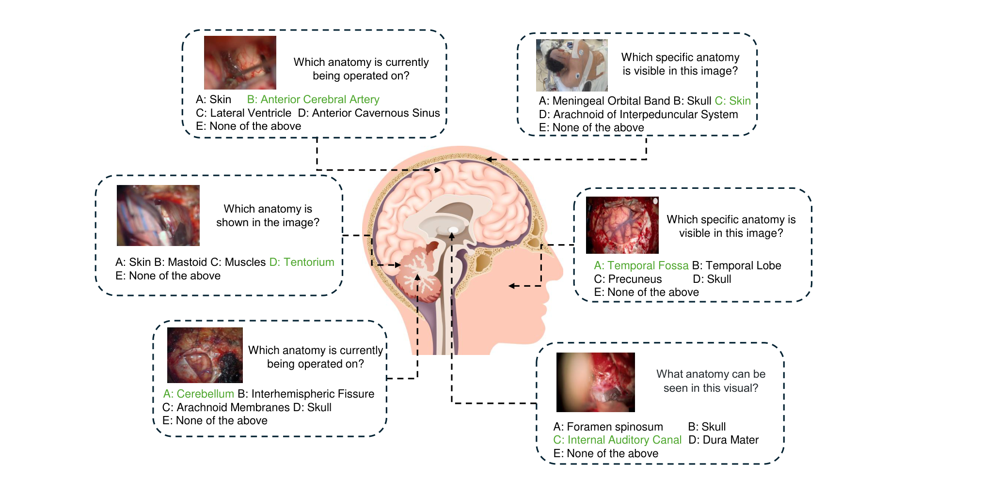
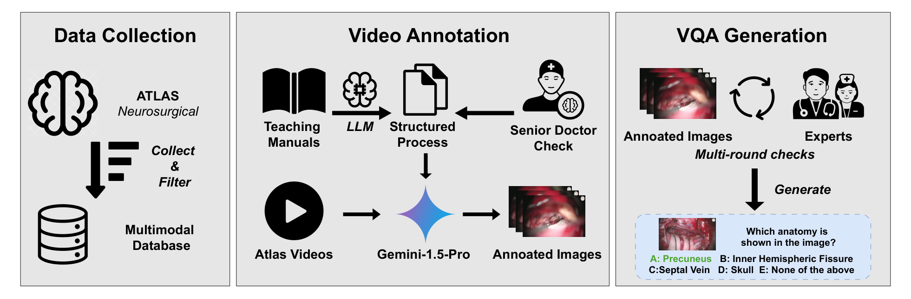
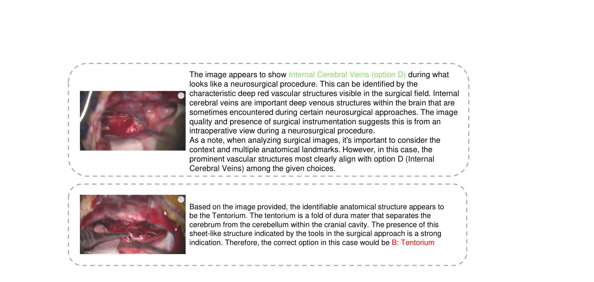

## 1. 背景与动机

**手术多模态大模型的研究大多问器械、阶段和动作,很少问"这是哪种解剖结构"。** 神经外科医生看视频主要靠认解剖,所以这个缺口在神经外科最明显。

已有医学问答基准补不上它。VQA-RAD、SLAKE、OmniMedVQA 的解剖题多来自断层影像,只到器官级;GMAI-MMBench 有临床场景,但重标旧数据集,可能有数据泄漏。

:::highlights
- 缺口:没有专测术中神经外科解剖识别的多模态基准
- 已有医学基准以放射影像为主,类别粗
:::

## 2. 核心观点速览

论文的答案是从教学视频里自己做题,每道题只问一帧里是哪种解剖。

- 数据:Neurosurgical Atlas 的 886 个视频筛到 89 个入路视频,约 9 小时,另有 32 本教学手册。
- 构建:OpenAI-o1 读手册,Gemini-1.5-Pro 读画面和讲解标解剖,医生删去坏帧,得到 1079 道五选一题、68 类解剖。
- 结果:16 个模型零样本,最好的 Gemini-2.0-Flash 为 40.87%,随机为 19.48%;子集上它得 36%,住院医师平均 46.5%。

**边界:标注由 Gemini 完成,子集题数与数据开放都论文未说明,前两名差距在误差之内。**

:::data
- 1079 道题,68 类解剖,32 种入路
- 最好 40.87%,随机 19.48%
- 住院医师 28% 到 56%,平均 46.5%
:::

## 3. 题目长什么样

每道题是一帧术中画面加五个选项:A 到 D 是解剖名,E 是"以上都不是"。正确答案在五个位置各占 20%,随机猜对的期望就是 20%。

**入路视频决定了题目构成。** 入路从切皮到暴露病灶,画面依次出现皮肤、颅骨、硬膜,再到深部血管。所以题目里既有大脑前动脉、内听道,也有正确答案是皮肤的体位照片。

*论文原图编号：Fig 1。六道示例题,绿色为正确答案。放在这里是因为它显示题目难度跨度很大。*

各难度层的题数、E 题的占比,论文未说明,所以总分里有多少来自送分题、多少被 E 题拉低,都无法估计。

| 基准 | 解剖题数 | 解剖类别数 |
|---|---|---|
| VQA-RAD | 106 | 31 |
| SLAKE | 507 | 21 |
| GMAI-MMBench | 2098 | 18 |
| OmniMedVQA | 16448 | 48 |
| NeuroABench | 1079 | 68 |

类别最多,题数不多。按 68 类平均每类约 16 题,解剖级指标里单类分数会很不稳定。

:::highlights
- 单帧、单解剖、五选一
- 类别最细,题数中等
:::

## 4. 标签从哪里来

标签的来源决定了题目可信到什么程度。流程分三步:

1. 从 Atlas 筛出 89 个入路视频和 32 本手册。
2. OpenAI-o1 把手册总结成以解剖为线索的流程,专家校正;Gemini-1.5-Pro 读画面和讲解,为每个视频输出步骤、关键解剖和时间段,再统一缩写和同义词。
3. 每秒抽一帧并对齐标签,医生多轮审核,删去标签与画面矛盾、画面模糊、一帧多解剖三类样本,剩下的配上题干和选项。

*论文原图编号：Fig 2。数据收集、视频标注、问答生成三个面板。放在这里是因为它显示 Gemini-1.5-Pro 位于标注中心。*

**医生只删不改,标签始终来自 Gemini。** 9 小时按每秒一帧约 3.2 万帧,最后留下 1079 题;删了多少论文未说明,剩余标签的错误率无法估计。

:::highlights
- LLM 标注,医生删除式审核
- 一帧只留一种解剖,答案唯一但场景简化
:::

## 5. 怎么评测

16 个模型分三组:开源通用 7 个、闭源接口 6 个、医学专用 3 个,全部零样本,提示里不给示例。输出里没有明确选项字母的计为错误。

指标分两层。实例级在全部图像上平均,常见结构权重大;解剖级先按每类算再在类间平均,少见结构与常见结构同权。

提示词原文、解码参数、各模型格式失败的比例,论文未说明。所以低分模型有多少是"不会",有多少是"不按格式答",分不开。

另请四名神经外科住院医师做一个子集,与 Gemini-2.0-Flash 比较。子集题数、抽样方式和住院医师年资论文未说明。

## 6. 结果说了什么

| 模型 | 准确率 | 实例级 F1 | 解剖级 F1 |
|---|---|---|---|
| 随机 | 19.48 | 19.96 | 1.68 |
| Gemini-2.0-Flash | 40.87 | 38.56 | 25.52 |
| Claude-3.5-Sonnet | 40.41 | 38.12 | 24.52 |
| Gemini-1.5-Pro | 38.83 | 35.88 | 20.57 |
| Qwen2.5-VL 72B | 37.44 | 37.52 | 20.17 |
| HuatuoGPT-Vision 34B | 36.52 | 32.71 | 21.49 |
| GPT-4o | 30.21 | 29.93 | 19.56 |
| Qwen-VL-MAX | 18.26 | 18.31 | 9.29 |
| LLaVA-Med-v1.5 | 15.01 | 7.66 | 10.79 |

最好的模型约为随机的两倍。正文把 40.87 写成 precision,表中它是准确率,实例级 Precision 是 46.61。

**前两名分不出高下。** 1079 题、准确率约 40% 时标准误约 1.5 个点,40.87 与 40.41 无法区分,论文只跑一次。

规模和版本都不保证提升:LLaVA-NeXT 72B 的 27.53 低于 7B 的 28.82,Claude-3.7-Sonnet 比 3.5 低 7.14 个点。两个模型低于随机。

随机基线的解剖级 F1 只有 1.68,却有 16.86 的 Precision 和 12.10 的 Recall,口径论文未说明,这一列的绝对值要谨慎。

:::data
- 40.87 对 40.41,差距小于标准误
- LLaVA-NeXT:72B 为 27.53,7B 为 28.82
- 随机解剖级 F1 为 1.68
:::

## 7. 和人比差多少

| 参与者 | 准确率 |
|---|---|
| 住院医师 1 | 0.48 |
| 住院医师 2 | 0.28 |
| 住院医师 3 | 0.56 |
| 住院医师 4 | 0.54 |
| Gemini-2.0-Flash | 0.36 |

四人平均 46.5%,Gemini 为 36%,低 10.5 个点,只高于最差的那位。

**Gemini 在子集上的 36% 低于全集的 40.87%。** 子集可能偏难,也可能题太少、分数波动大;子集题数未给出,两种解释分不开。人类之间相差 28 个点,4 个人的平均本身不确定性很大。

医学专用模型方面,论文称平均高 7.52 个点。按表计算,只有 HuatuoGPT-Vision 34B 的 36.52 比开源通用平均 29.01 高约 7.51;三个医学模型平均 27.28,反而更低。

## 8. 结果没说什么

- **排名与标注模型分不开。** Gemini-1.5-Pro 标注、医生只删不改,题目偏向 Gemini 能认的帧;Gemini 系列排第一和第三。医生独立标注子集上的重排没有做。
- **形变解释只有一个案例。** Fig 3 一对相近帧中,Claude-3.5-Sonnet 在暴露期答对、牵拉后答错;第二帧还有遮挡和视野变化,按阶段分组的统计没有给出。
- **医学数据缺失只是推测。** 医学模型基座较旧,同基座通用版与医学版的对照没有做。
- **不能外推到临床使用。** 只测单帧、有选项的识别,没有时间上下文、讲解和多结构同框。

*论文原图编号：Fig 3。Claude-3.5-Sonnet 对两帧相近画面的回答,上方正确、下方错误。放在这里是因为它是形变影响的唯一证据。*

## 9. 复现与使用要注意什么

- 数据是否公开、Atlas 视频的许可论文未说明,先确认能否拿到数据。
- 拿到后先统计每类题数、E 题占比和格式失败率。
- 至少跑三次或报告置信区间,不要用一两个点的差距排名。
- 单独报告 Gemini 系列,注意标注偏置。
- 先确认解剖级 F1 的计算口径再引用。

## @takeaways
- 第一个专测神经外科术中解剖识别的基准,68 类、1079 题
- 最好 40.87%,约为随机两倍,但前两名差距在误差之内
- 人机差距 10.5 个点来自一个大小未知的子集和 4 个人
- 标注由 Gemini 完成,排名可能有偏

## @strengths
- 评测对象新:术中神经外科解剖,类别细
- 选项位置均匀,随机基线清楚
- 同时报告实例级与解剖级,并有人类参照

## @weaknesses
- 子集题数、审核删除量、E 题占比、提示词等多项论文未说明
- 只跑一次,没有置信区间
- 正文表述与表格不符,如把准确率写成 precision
- 随机基线解剖级 F1 的口径可疑

## @questions
- 在医生独立标注的子集上,模型排名是否改变?
- 按手术阶段分组时,形变阶段的准确率掉多少?
- 加入相邻帧或讲解文本后,模型能提升多少?
