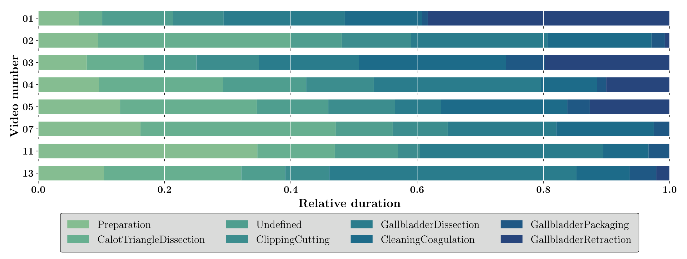
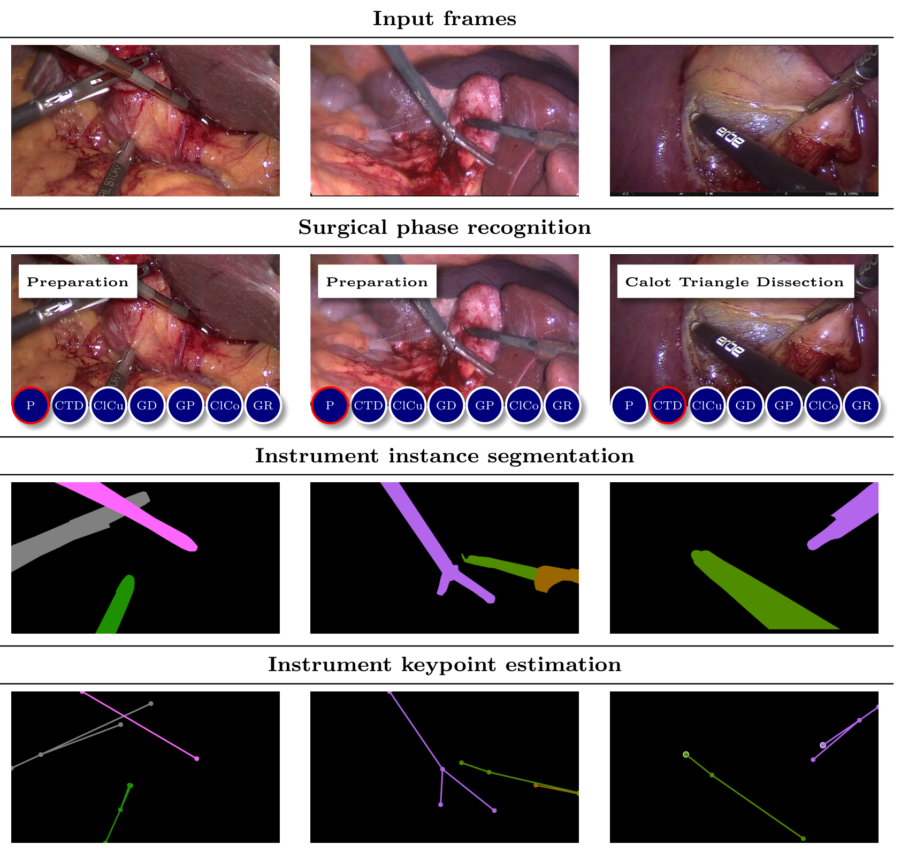
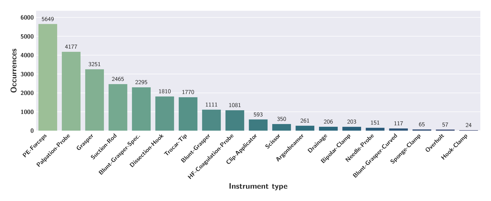
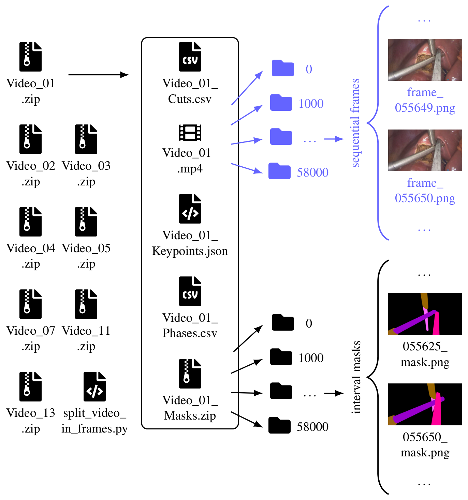

## 1. 背景与动机

**手术辅助系统要同时知道器械是什么、在哪、是哪一个,以及手术进行到哪一步,而公开数据把这几件事拆在不同数据集里。** 阶段识别有 Cholec80、HeiChole,器械分割有 EndoVis 2017/2018、ROBUST-MIS,关键点只有少数数据集提供。

作者还指出三类与真实手术不符的问题:只有 HeiChole 是多中心;很多数据集不区分器械类型或实例;完整手术少见,部分数据用的是非人体组织。这些缺口让时序建模和跨机构泛化都难以研究。

:::highlights
- 缺口:没有一个数据集在同一批完整手术上同时标阶段、实例掩码和关键点
- 论文的回答:PhaKIR,MICCAI 2024 PhaKIR 挑战赛的训练集
:::

## 2. 核心观点速览

论文的答案是把三项任务标在同一批序列上:三家德国医院的 8 个完整腹腔镜胆囊切除视频,阶段逐帧标,器械实例掩码和关键点每秒标一帧。

**它只是数据描述。** 论文不训练模型、不报告挑战赛成绩,方法比较在同一团队的挑战赛论文 arXiv 2507.16559 中。

**边界有三条:** 医院比例为 6:1:1,跨中心结论很弱;阶段与关键点没有定量质检;测试集不公开,使用者要自己按视频划分。

:::data
- 8 个视频,总时长 323:55,25 fps,1920 × 1080
- 阶段标签 485,875 帧;分割与关键点各 19,435 帧
- 19 类器械,7 个阶段加 undefined,每件器械 2 到 4 个关键点
:::

## 3. 视频从哪里来

能外推多远,取决于视频构成。MRI 提供 6 个视频,UKHD 和 KWS 各 1 个;UKHD 的视频就是 HeiChole2.mp4,按新协议全部重标。腹腔外画面被裁掉,裁剪帧索引随数据发布。

**多中心的主体仍是一家医院:** MRI 的阶段帧约占 79%。另两家各只有一个视频,单个病人或术者的差异与医院差异分不开。

Table 1 的合计行写成 486,875 帧和 19,475 帧,而逐行相加得到的是正文的 485,875 和 19,435,合计行应是笔误。复现时以文件实际帧数为准。

病人年龄、术者经验和相机型号,论文未说明,所以无法分析域偏移来自哪里。

## 4. 三项任务标了什么

**阶段识别**沿用 Cholec80 的 7 个阶段,另设 undefined 表示过渡。阶段起点是特征器械首次出现,终点是这些器械全部消失。undefined 的占比和评测处理论文未说明,不同论文的阶段指标口径可能不同。

*论文原图编号：Figure 2。8 个视频各阶段的相对时长。各视频阶段比例差异很大,每个视频都有长短不一的过渡段。*

**实例分割**在 CVAT 中画多边形,只标可见部分,19 类器械,同类实例分开。掩码的红、绿通道编码类别,蓝通道编码实例。

**关键点**按器械类型标 2 到 4 个点:入画端点、杆尖交界、一到两个尖端,每点带可见、遮挡、不存在三态。与分割不同,遮挡点允许借助前后帧推断位置,这部分真值含有标注者的推断。

*论文原图编号：Figure 1。三家医院各一帧的原图与三项任务的标注。最后一行白圈是被遮挡的关键点。*

分割与关键点为何选 1 fps,论文未说明。相邻两次标注隔 24 帧,逐帧时序方法只能用稀疏监督。

:::highlights
- 三项标注对齐在同一序列上,分割与关键点还对齐在同一帧上
- 遮挡关键点的真值是推断位置,分割只标可见区域
:::

## 5. 标注怎样检查

四名有医学背景的人员标注:一名资深外科医生和三名医学生。每个视频一人初标,本人复查,再由两人依次复核。作者认为这三项任务比肿瘤分割简单、数据量大,所以选顺序复核而不是并行双标。

分割和关键点还把标注与原图并排做成视频,按时间看颜色是否跳变。关键点由未参与分割的人在掩码之上标注,顺带复核了分割分类。

**唯一的定量数字是分割第二、第三轮之间的 DSC 一致性 83.64%**,主要差异来自器械分类,类别错的实例记零。它衡量的是最后一轮的修改量,不是对独立真值的精度。阶段和关键点没有定量数字。

:::data
- 分割复核一致性 DSC 83.64%
- 66 支挑战赛队伍使用,未报告系统性错误
:::

## 6. 结果说了什么

论文没有基线,能看的是分布。器械出现帧数是长尾:PE-Forceps 出现在 5649 帧,Hook-Clamp 只有 24 帧。

*论文原图编号：Figure 4。19 类器械各自出现的帧数。最多与最少相差两个数量级以上。*

**长尾意味着平均指标会被常见类主导。** 按视频划分时,最少的几类可能在验证视频里一次都不出现,需要单独报告或合并。

## 7. 结果没说什么

- 没有基线,数据的难度和区分度要看挑战赛论文。
- 没有标注者间一致性。顺序复核时后一位看得到前一位的结果,容易沿用前人判断;83.64% 不能当作标注精度。
- 社区验证偏弱。参赛者的目标是训练模型,不一定检查标签;修正了多少错误、发过哪些版本,论文未说明。
- 测试集的视频数和医院来源论文未说明,挑战赛成绩能否代表跨中心泛化无法判断。

## 8. 复现与使用前要核对什么

作者建议按视频划分,可用留一视频或留一医院。我的判断:留一视频更可靠;留一医院时 UKHD 和 KWS 各只有一个视频,只能当作域偏移的定性参考。

*论文原图编号：Figure 5。数据集目录结构。每个视频包含视频、裁剪索引、阶段、关键点和掩码五个文件。*

数据在 Zenodo 申请获取,许可为 CC-BY-NC-SA,仅限非商业用途,使用时需同时引用本文、挑战赛论文和 HeiChole 论文。

## @takeaways
- PhaKIR 的价值在三任务对齐和完整序列,不在规模
- 帧数以文件为准,Table 1 合计行有误
- 按视频划分,长尾类别单独报告,遮挡关键点按可见性分开评估

## @strengths
- 阶段、实例掩码、关键点在同一批完整手术上对齐
- 掩码编码、关键点模板和文件结构交代清楚,格式开放
- 质检流程写得具体,并给出一个定量一致性数字

## @weaknesses
- 只有 8 个视频,MRI 占主体,跨中心证据弱
- 没有基线,没有标注者间一致性,阶段和关键点没有定量质检
- Table 1 合计行与正文不一致

## @questions
- 测试集来自哪些医院,规模多大?
- undefined 过渡段占多少,评测是否计入?
- 三任务联合训练是否优于单任务?
