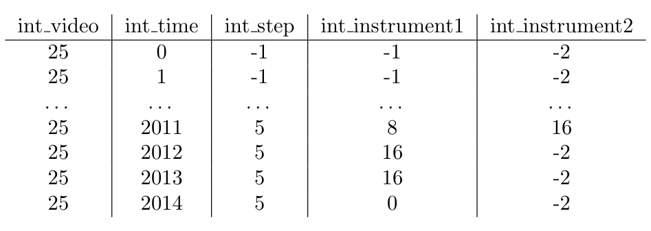
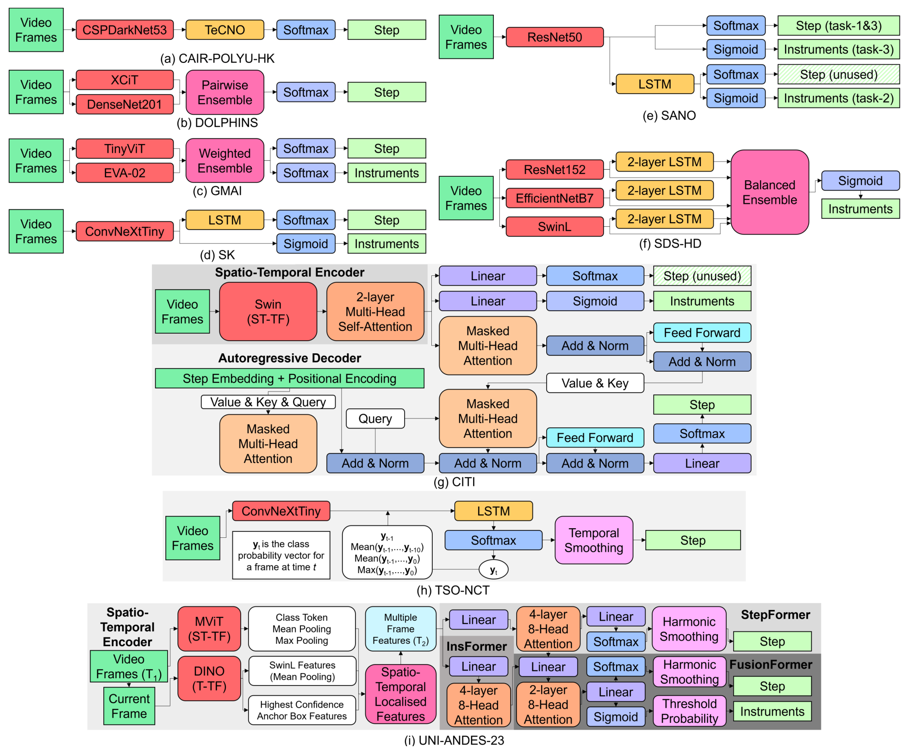
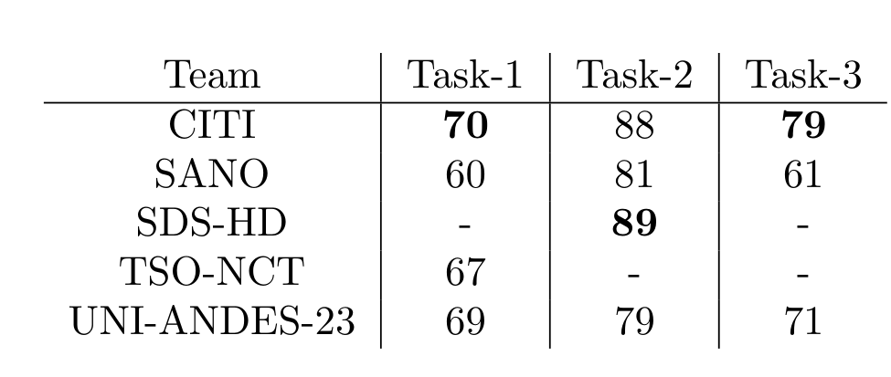
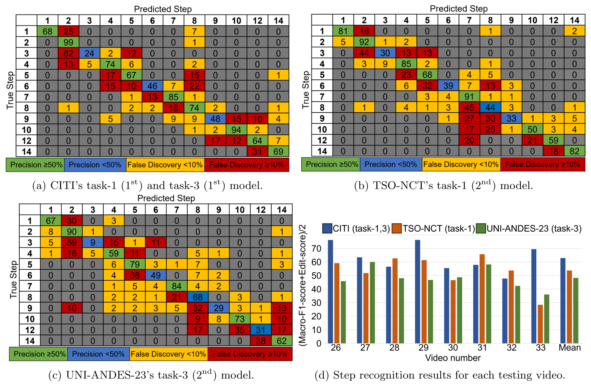

## 1. 背景与动机

内镜经蝶入路垂体腺瘤切除（eTSA）从鼻孔进入颅底，术野窄、镜头细、畸变大。手术步骤短而多，切换频繁且顺序不固定；器械杆占满画面而尖端很小；出血时要反复退镜清洗。

**此前这台手术只有私有数据上的步骤识别**：50 个视频 7 步 weighted-F1 0.74，97 个视频 27 步视频级 0.80。器械识别和多任务识别都没有发表工作，社区也没有可下载的数据。

PitVis-2023 作为 EndoVis-2023 的子挑战，想同时补上数据和评测协议两块空白。

## 2. 核心观点速览

- **数据**：25 个公开训练视频，逐秒标注 12 个评测步骤和 19 类器械（含无器械），8 个更早录制的私有视频做测试。
- **协议**：只许在线推理；步骤排名是宏平均 F1 与 Edit-score 的平均，器械只看宏平均 F1。
- **结果**：步骤最高 62.9，**前三名 Edit-score 在 46 以上，后四名不到 2**；器械最高 41.7，验证集上却有 89。
- **边界**：结论来自跨队对比，不是受控消融；测试只有 8 个视频。

:::highlights
- 时序一致性是步骤任务的分水岭
- 器械识别的验证分严重高估测试表现
:::

:::data
- 9 支队伍，18 份提交，52 人注册
- 步骤 62.9，器械 41.7，多任务 49.0
:::

## 3. 数据怎么来、怎么标

数据来自单一中心 NHNN。训练视频录于 2021-07 至 2022-12，测试视频录于 2018-12 至 2021-01，**测试全部早于训练**。视频统一转成 24 FPS、720p，评测时按 1 FPS 抽帧。

*论文原图编号：Table 1。逐秒 csv 标注：步骤一列，器械两列，-1 为体外，-2 为无第二器械。*

步骤由两名神经外科住院医师标注并协商，器械外包给非临床标注公司，再由两人核对、顾问医师终审。**标注者一致性论文未说明**，所以少数器械的低分无法与标注噪声分开。

步骤 11、13 只出现在 2 个和 1 个训练视频中，被移出评测。器械分布训练与测试差异明显，杯状钳在测试集中完全缺席。这为第 6 节的验证集落差埋下伏笔。

## 4. 评测协议奖励什么

宏平均 F1 让每类等权；Edit-score 把逐帧标签压成片段序列后按编辑距离打分，任何短暂跳变都扣分。

$$\text{Macro-F1} = \frac{1}{N}\sum_{i=1}^{N} \text{F1}_i$$

步骤指标是两者平均，所以**一半分数奖励"少跳变"**。器械不计 Edit-score，因为器械变化频繁且被无器械与吸引器主导，多标签也无法写成单一序列。Edit-score 如何归一化到 0 到 100 论文未说明，复现时需看评测脚本。

运行限制是单块 V100 32 GB 上 10 倍速以上。下一节看各队用什么结构应对这套指标。

## 5. 参赛模型的共同结构

几乎所有模型都是三段：空间或时空编码器、时序解码器、在线平滑。

*论文原图编号：Figure 10。九支队伍的架构，(g-i) 另外使用了时序特征传播。*

- CITI：Swin 时空编码器加 80 帧自回归解码器，三个任务共用一个模型。
- TSO-NCT：ConvNeXtTiny 加 512 帧 LSTM，把历史 softmax 分数送回 LSTM，再做 7 帧阈值平滑。
- SDS-HD：三个骨干各接 LSTM 再集成，对 5 类少数器械上采样。

各队训练时长从 2 到 88 小时不等，**任何跨队差距都混杂了算力与工程投入**。

## 6. 结果说了什么

| 任务 | 第一名 | 分数 | 第二名 | 分数 |
|---|---|---|---|---|
| 步骤 | CITI | 62.9 | TSO-NCT | 53.7 |
| 器械 | SDS-HD | 41.7 | SANO | 41.6 |
| 多任务 | CITI | 49.0 | UNI-ANDES-23 | 40.5 |

步骤任务里 SANO 的单帧模型 Macro-F1 仍有 39.6，但 Edit-score 只有 1.4，失分来自来回跳变。器械任务赢家是常规的 CNN 加 LSTM 加数据平衡，赢过了更复杂的多任务模型。

*论文原图编号：Table 8。建议验证集上的分数，测试集不公开时唯一可对照的基准。*

**器械从验证集的 88-89 掉到测试的约 42**，步骤只降约 7。所以验证集上的器械分数不能当作真实水平。

:::data
- 步骤验证 70，测试 62.9
- 器械验证 89，测试 41.7
:::

## 7. 为什么会这样

*论文原图编号：Figure 11。三个最强模型的步骤混淆矩阵与逐视频得分。*

步骤错误集中在相邻步骤和短而零散的止血步骤，与转移概率不固定一致。器械错误大量流向无器械和吸引器两个主导类，器械 4、12、13 在前两名上都差。

器械的验证到测试落差，作者归因于对少数类过拟合。**录制时间造成的分布偏移是同样能解释的另一原因**，论文没有把两者分开。我的判断：后者至少同样重要，因为杯状钳在测试集里根本没出现。

## 8. 结果没说什么

- 时序或多任务"更好"没有受控对照：同一骨干加与不加时序解码器的实验不存在。CAIR-POLYU-HK 用了时序卷积网络，Edit-score 仍只有 1.1，原因论文未说明。
- 多任务增益只在 UNI-ANDES-23 一队上可从表格复算；SANO 的降幅正文写 −1.4 与 −4.5，按表格复算不一致，原因论文未说明。
- 排名稳定性论文未说明：只有 8 个视频，相邻名次常落在一个标准差以内。
- 单中心、单设备，跨医院泛化完全未测。

## 9. 复现要注意什么

- 用公开评测脚本复算 Edit-score，不要按 1/Lev 自己实现。
- 按录制时间留出验证视频，模拟训练与测试的时间偏移。
- 剔除体外帧和步骤 11、13 的帧，否则与官方口径不一致。
- 数据许可为 CC BY-NC-SA 4.0，不能商用。

## @takeaways
- 步骤识别必须同时报 Macro-F1 和 Edit-score，并给出有无平滑两组结果
- 器械识别的瓶颈是长尾与分布偏移，先做类别平衡
- 测试集私有，对照只能用表 8 的验证集基准

## @strengths
- 首个公开的该术式逐秒标注数据，附采样与评测脚本
- 指标设计明确惩罚时序不一致，并限制在线与运行时间
- 详细列出各队架构与训练超参数，便于复现

## @weaknesses
- 单中心、25 个训练视频，部分器械只出现在 6 到 12 个视频中
- 跨队比较混杂算力与工程差异，没有受控消融
- 标注一致性、Edit-score 归一化、排名稳定性均未报告

## @questions
- 加入其他中心数据后，器械验证到测试的落差能缩小多少
- 同一骨干下，时序解码器与平滑各贡献多少 Edit-score
- 外包器械标注的错误率有多高
