---
tags:
  - papers/手术数据集
aliases:
  - "PolypGen"
date: 2021-06-08
doi: 10.1038/s41597-023-01981-y
arxiv_id: "2106.04463"
---

# A multi-centre polyp detection and segmentation dataset for generalisability assessment

## 核心信息

- 标题: A multi-centre polyp detection and segmentation dataset for generalisability assessment
- 标题翻译: 用于泛化性评估的多中心息肉检测与分割数据集
- 作者: Sharib Ali, Debesh Jha, Noha Ghatwary, Stefano Realdon, Renato Cannizzaro, Osama E. Salem, Dominique Lamarque, Christian Daul, Michael A. Riegler, Kim V. Anonsen, Andreas Petlund, Pål Halvorsen, Jens Rittscher, Thomas de Lange, James E. East
- 机构: 利兹大学；牛津大学生物医学工程研究所与转化胃肠病学组；SimulaMet；挪威北极大学；埃及阿拉伯科技与海运学院；意大利威尼托肿瘤研究所；意大利 CRO 肿瘤参考中心；亚历山大大学；凡尔赛圣康坦大学 Ambroise Paré 医院；洛林大学 CRAN；萨尔格伦斯卡大学医院；Augere Medical；奥斯陆城市大学；奥斯陆大学医院
- 发表时间: 2021-06-08（arXiv 第 1 版），正式发表于 2023 年
- 发表渠道: Scientific Data 10, 75 (2023)；本笔记依据 arXiv 第 3 版
- DOI: 10.1038/s41597-023-01981-y
- arXiv: 2106.04463
- 论文链接: https://arxiv.org/abs/2106.04463
- 代码 / 项目: https://github.com/sharibox/PolypGen-Benchmark.git ；https://github.com/sharibox/EndoCV2021-polyp_det_seg_gen
- 数据 / 资源: https://doi.org/10.7303/syn26376615
- 论文类型: benchmark_or_dataset

## 原文摘要翻译

结肠息肉是公认的癌前病变，通过结肠镜检查发现。虽然大多数息肉是良性的，但息肉的数量、大小和表面结构与结肠癌风险相关。已有多种方法用于自动检测和分割息肉，但主要问题在于，它们没有在一个大型、专门构建的多中心数据集上经过严格测试，原因之一是缺少全面的公开数据集。因此，已开发的方法可能无法泛化到不同人群的数据。

为此，我们从六个不同中心整理了一个数据集，涵盖 300 多名患者。数据集同时包含单帧和序列数据，共有 3762 个带标注的息肉标签，息肉边界的精确勾画由六位资深消化科医生核验。据我们所知，这是由计算科学家和消化科专家团队整理的最全面的检测与像素级分割数据集（称为 `PolypGen`）。本文介绍了数据构建与标注策略、质量保证和技术验证。数据集可从 https://doi.org/10.7303/syn26376615 下载。

## 创新点

1. **按中心组织的多中心数据。** 数据来自法国、意大利（两家）、挪威、英国和埃及共六家医院，单帧按 `data_C1` 到 `data_C6` 分文件夹存放。按中心组织让“留出一个中心测试”成为数据自带的用法，这正是单中心数据集做不到的跨中心泛化评估。
2. **单帧、阳性序列和阴性序列并存。** 阳性 3762 帧中有 1537 张单帧和 2225 张序列帧，另有 4275 张无息肉的阴性序列帧。序列里息肉会出现又消失，更接近真实检查画面，可以测假阳性和时序模型。
3. **写明标注协议和拒收比例。** 论文列出凸起、染色、器械遮挡、带蒂、平坦息肉等情形的勾画规则，并报告专家二值审核中 30.5% 的标注被拒。给出拒收率的数据集论文不多，这让读者能估计标注难度。
4. **给出跨中心技术验证。** 用 C1 到 C5 的 1449 张单帧训练，在未参与训练的 C6 上测单帧 88 张和序列 432 张，比较七种分割网络，并报告尺寸分层的 `DSC` 和边界距离指标。

## 一句话总结

`PolypGen` 汇集六个中心 300 多名患者的结肠镜数据，发布 3762 张阳性帧（单帧加序列）和 4275 张阴性帧及像素级掩码。

技术验证用五个中心训练、第六个中心测试，最佳网络 `DeepLabV3+`（`ResNet101`）单帧 `DSC` 0.82，序列只有 0.71，小息肉只有 0.46；但论文只给了一种划分，没有标注一致性指标。

## 研究问题

结直肠癌每年新发约 130 万例，死亡率约 51%，是癌症死亡的第三大原因。约 90% 的结直肠癌由腺瘤或锯齿状息肉缓慢转化而来，如果在癌前阶段发现并完整切除，死亡率几乎为零。问题在于检查依赖操作者：一项荟萃分析显示腺瘤漏检率为 26%、进展期腺瘤 9%、锯齿状息肉 27%。巴黎分型等形态分类在专家之间也有很大差异。

作者认为自动检测和分割系统能提高检出率、减少观察者差异，但现有深度学习模型在遇到域偏移较大的外部数据时性能下降明显。多数工作不在多中心数据上评测，原因是**缺少公开的多中心、多人群、带像素级标注的数据集**。已有数据集要么需要申请（而且部分已经不可获取），要么没有像素级真值，要么只来自一两个中心。

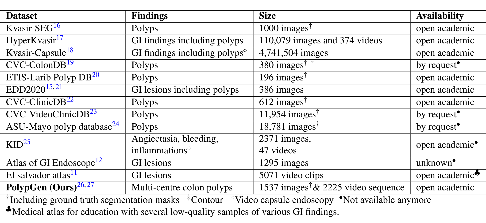
*论文原图编号：Table 1。已有胃肠道病变数据集与 PolypGen 的规模和可获取性对比；带圆点标记的数据集已不可获取。*

对照表 1，`PolypGen` 的差别落在三点：

- 带掩码的开放数据集如 `Kvasir-SEG`（1000 张）、`CVC-ClinicDB`（612 张）、`ETIS-Larib`（196 张）都只有单帧；论文称多数公开数据只来自一两个中心。
- 有视频的 `CVC-VideoClinicDB`（11,954 张）和 `ASU-Mayo`（18,781 张）需要申请，且已标为不可获取。
- 规模最大的 `HyperKvasir` 在表中没有标注带分割掩码。

**`PolypGen` 是表中唯一同时满足多中心、带掩码、含序列且开放获取的一项。**

所以本文要补的是**评测泛化性所需的数据缺口**：提供按中心划分、带像素级掩码的息肉数据，让方法能在“没见过的医院和设备”上检验。

### 核心观点速览

- 数据：六个中心、300 多名患者；阳性 3762 帧（单帧 1537、序列 2225），阴性 4275 帧；发布 3447 个息肉标注。
- 标注：三名研究者用 `Labelbox` 勾画，资深消化科医生二值审核，首轮 2213 个标注中拒收 676 个（30.5%）。
- 验证：C1 到 C5 训练、C6 测试；最佳 `DeepLabV3+`（`ResNet101`）单帧 `DSC` 0.82、序列 0.71，小息肉仅 0.46。
- 边界：只有一种划分，没有 C6 内部训练上界，没有检测基线，标注一致性论文未说明。

下面先看数据怎么来、怎么标，再看基线到底说明了什么。

## 数据与任务定义

**多中心数据集的价值取决于中心之间到底差在哪里。** 这一节依次看来源、样本构成、采样规则和标注质控。

### 数据来源

数据来自六家医院，论文用 C1 到 C6 编号。每个中心至少提供 50 名不同患者的视频和图像，由参与项目的资深消化科医生采集并发送。各中心自行负责伦理、法律与隐私，流程包括患者知情同意（必需）、伦理委员会审查（视中心而定）和发送前匿名化（必需）。

| 中心 | 医院 | 内镜系统 | 伦理与同意 |
|---|---|---|---|
| C1 | 巴黎安布鲁瓦兹·帕雷医院 | `Olympus Exera 195` | 法国伦理编号 2019-A01602-55；内镜光谱研究同意 |
| C2 | 帕多瓦威尼托肿瘤研究所 | `Olympus H190` | 通用患者同意 |
| C3 | 意大利 CRO 肿瘤参考中心 | `Olympus VG-165, CV180, H185` | 通用患者同意 |
| C4 | 奥斯陆大学医院 | `Olympus Evis Exera III, CF 190` | 经数据监察机构豁免；书面知情同意 |
| C5 | 牛津约翰·拉德克利夫医院 | `GIF-H260Z`、`CV260` | 英国伦理编号 16/YH/0247；普遍同意 |
| C6 | 埃及亚历山大大学 | `Olympus Exera 160AL, 180AL` | 书面知情同意 |

> [!figure] Table 2 各中心采集系统与伦理信息
> 建议位置：数据与任务定义
> 放置原因：这张表列出六个中心的内镜型号、伦理批准号和同意类型，是判断设备域差异的直接依据。
> 当前状态：保留占位；自动提取没有得到这张表的独立裁剪候选，上方已按原文整理成 Markdown 表。

所有中心都使用 `Olympus` 系统，型号不同。这意味着数据集覆盖的“设备差异”是同一厂商内的型号差异，不含其他厂商。

图像尺寸从 384×288 到 1920×1080 像素不等。由于执行完全匿名化，不提供性别和年龄信息。

### 任务拆分

数据分为阳性和阴性两部分：

- **阳性样本**：来自确诊有息肉的患者视频，共 3762 帧，六个中心依次为 484、1166、457、677、458、520 帧。
- 其中单帧 1537 张：前五个中心的 1449 张也用于 `EndoCV2021` 挑战赛，C6 有 88 张。
- 序列帧 2225 张，共 23 条阳性序列，主要来自 C2（865）、C4（450）和 C6（432）。
- **阴性样本**：只有序列，来自确认无息肉的患者视频或远离息肉的区域，共 4275 帧、23 条序列，含结肠皱襞、反光、粪便覆盖等容易误判为息肉的画面。

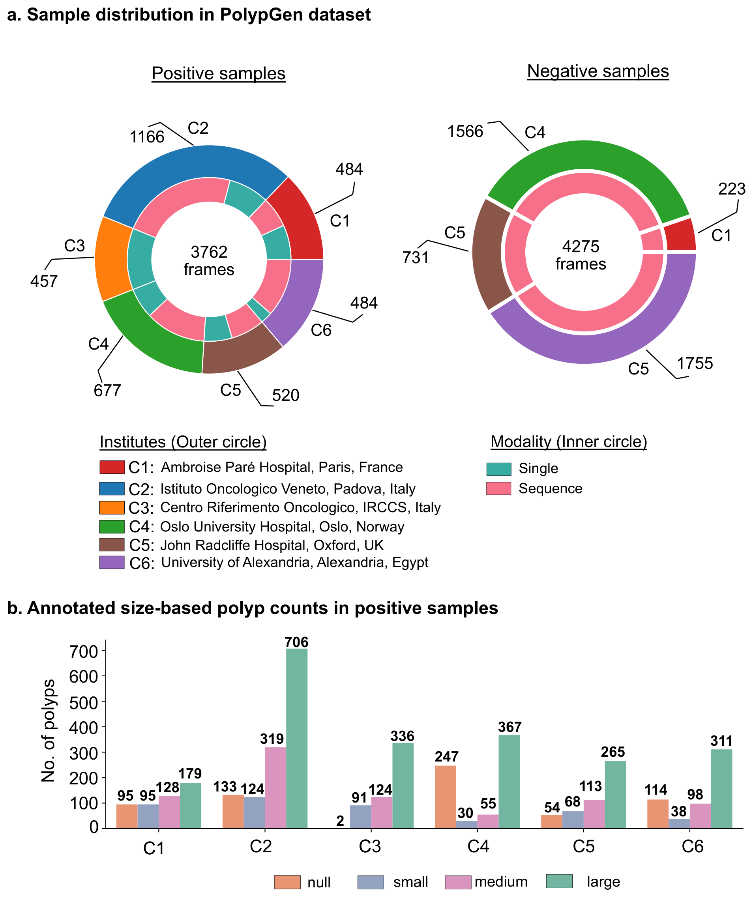
*论文原图编号：Fig. 2。上半部分为各中心阳性与阴性帧数，内环区分单帧与序列；下半部分为各中心按尺寸统计的息肉数量，空类表示帧中没有息肉。*

需要注意图中阳性环 C5 标的是 520、C6 标的是 484，而正文写 C5 为 458、C6 为 520，两者不一致，论文未解释。

阴性环有四段：C1 223、C4 1566、C5 731，另有一段 1755 用的是图例中 C6 的紫色，却被标为 C5。正文说阴性帧来自“四家医院”，这一段究竟属于哪个中心论文未说明。

阳性样本按息肉外接尺寸分为小（≤100×100 像素）、中（大于 100×100 且 ≤200×200）和大（>200×200）。Fig. 2b 显示每个中心都是大息肉最多，例如 C2 有 706 个大息肉，而 C3 只有 2 帧无息肉。论文发布的息肉标注总数为 3447。

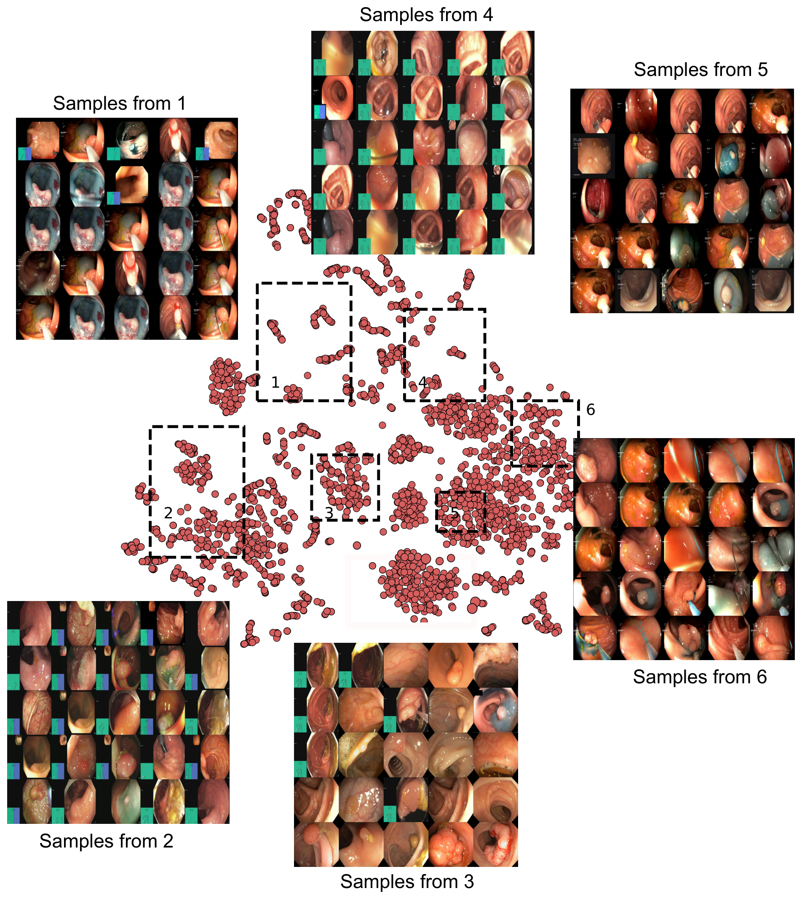
*论文原图编号：Fig. 1。阳性样本基于自编码器特征的 t-SNE 嵌入，六个虚线框各随机抽 25 张图展示；作者用它说明数据的多样性。*

t-SNE 图是定性证据：它显示阳性样本在特征空间分布分散，但没有按中心着色，读者无法从图中看出中心之间是否可分。

### 采样协议

论文规定了四条采样规则：

1. 单帧从每个患者视频中按不同视角抽取。
2. 序列帧以较小间隔连续抽取，大多同时包含息肉可见和不可见的帧。
3. 单帧包含该患者的所有息肉实例；序列只针对一个局部目标息肉。
4. 阳性序列来自确认有息肉的视频，可以混有无息肉帧；阴性序列只取正常黏膜视频。

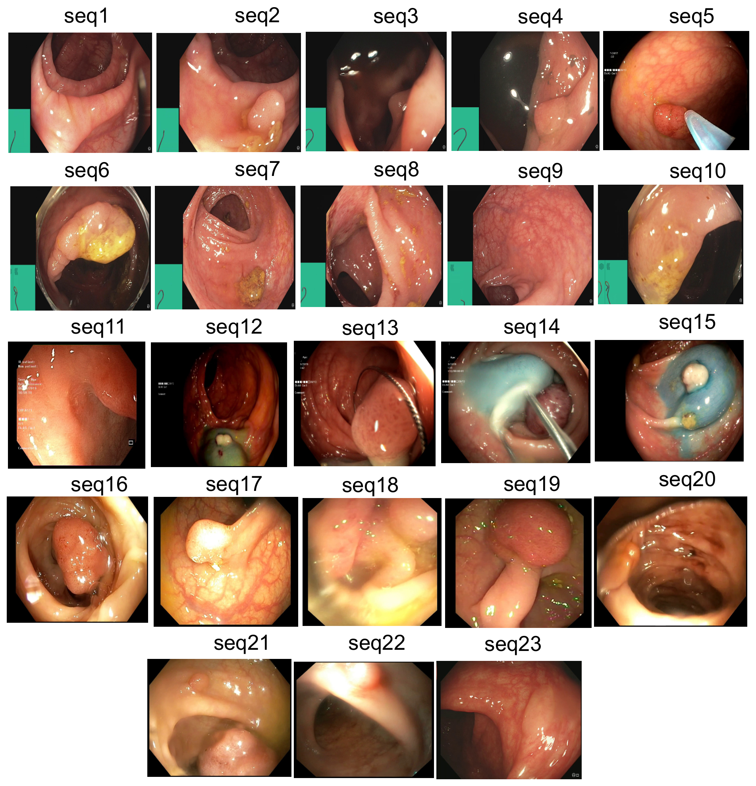
*论文原图编号：Fig. 4。23 条阳性序列各取一张代表帧，对应表 3 的序列描述。*

Table 3 逐条描述了 23 条阳性序列：既有 2 到 7 毫米的小息肉，也有巴黎分型 1p、带长蒂、JNET 2a 的大息肉，以及被圈套器套住、靛胭脂抬举、粪便部分遮挡、模糊或低对比度的画面。其中 seq1 和 seq7 描述为“正常黏膜”，seq18 为“难以判读”。

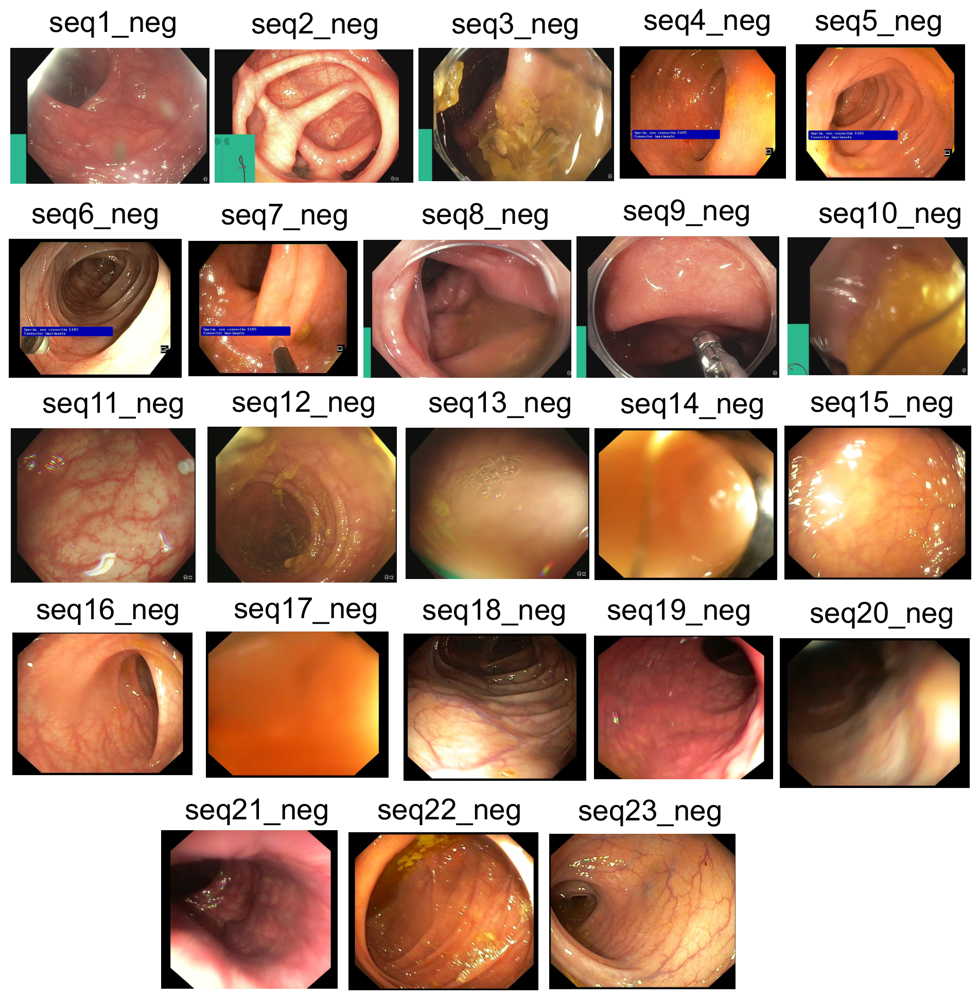
*论文原图编号：Fig. 5。23 条阴性序列各取一张代表帧，对应表 4 的伪影描述。*

Table 4 中阴性序列的伪影包括周边反光、镜头不洁、粪便遮挡视野、气泡、过于贴近肠壁和半透明液体等。这些是检测模型最常误报的场景。

### 标注与筛选协议

参与人员包括 6 名资深消化科医生（均有 20 年以上内镜经验）、2 名博士后和 1 名博士生。标注由三名研究者在 `Labelbox` 上完成，数据平均分给三人，每人标一组帧。之后所有标注由资深医生团队复查，再由该中心专家交叉核对边界，最后交给一名资深医生做独立的二值审核，多数情况下审核者来自其他中心。

勾画规则按息肉类型写明：

- 凸起息肉只勾画隆起区域，注意不要沿正常皱襞勾画。
- 染色息肉只勾画未被染色覆盖的部分。
- 有器械遮挡时不包含器械，可能拆成多个目标。
- 带蒂息肉包含所有隆起部分，除非出现在皱襞上。
- 平坦息肉先放大再勾画，必要时咨询中心专家。
- 序列中远处、不清晰的息肉不标注。
- 被粪便或器械遮挡的部分排除。
- 已癌变但不呈息肉外观的黏膜不标注，呈腺瘤样隆起的则标注。

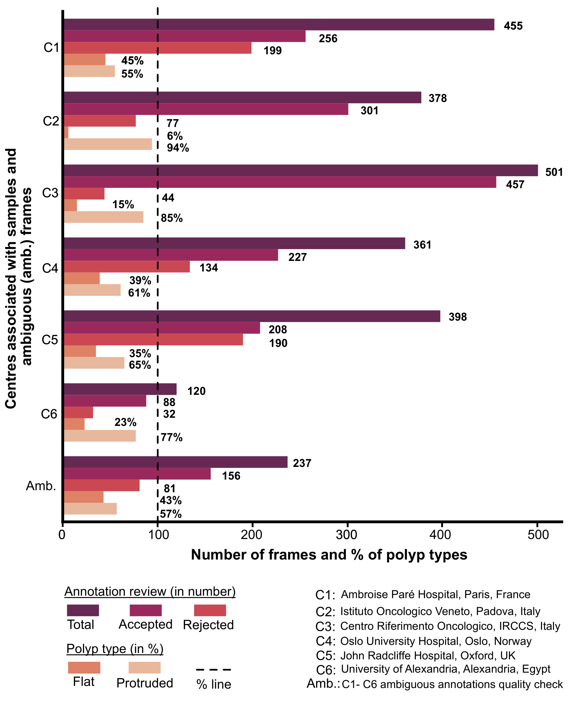
*论文原图编号：Fig. 6。单帧数据的专家审核结果：各中心总数、接受数、拒收数，以及平坦与隆起息肉占比；Amb. 为模糊批次。*

二值审核的结果是：不计模糊批次，共 2213 个标注，接受 1537、拒收 676，拒收率 30.5%。被专家附反馈的帧进入模糊批次，由两名研究者共同重标后再审，第二轮仍有 34.17% 被拒。各中心拒收比例差异很大：C1 有 199/455 被拒，C3 只有 44/501。平坦息肉占比也随中心变化，C1 为 45%，C2 只有 6%。

### 数据发布格式

数据托管在 `Synapse`，需注册账号下载，采用知识共享署名 4.0 许可。

主文件夹分为阳性和阴性。阳性下分单帧目录 `Single_Frames_centre_Split`（按中心分为六个子目录）和序列目录 `Sequence_Frames`（23 个子目录）。

每个末级文件夹含原图、掩码、`PASCAL VOC` 格式边框文本和叠框图，图像均为 `jpg`。无息肉的阳性帧对应空边框文件和全零掩码。阴性文件夹只有原图。

> [!figure] Fig. 7 文件夹结构
> 建议位置：数据与任务定义
> 放置原因：它展示阳性与阴性文件夹的三级结构和文件格式，复现时用来对照下载后的目录。
> 当前状态：保留占位；自动规划未选中此图，上文已用文字描述目录层级。

论文强调发布版本**不含训练测试划分**，用户可自行设计。技术验证中使用的训练验证划分以 txt 文件随数据发布。

数据本身讲清楚了，下一个问题是作者用什么协议证明它能测出泛化差距。

## 方法主线

这篇论文的“方法”是数据构建与技术验证协议，不是新模型。要判断基线数字能否复现、能否比较，需要先看清流程每一步的输入和输出。

### 机制流程

1. **采集**：输入是六个中心消化科医生提供的结肠镜视频和图像（每中心至少 50 名患者）；各中心完成知情同意与匿名化；输出为去标识的原始视频帧，送交组织方。
2. **采样**：输入是原始视频；按四条规则提取单帧（多视角、含全部息肉）和序列帧（小间隔、单一目标息肉、可混无息肉帧），阴性序列只取正常黏膜视频；输出为阳性 3762 帧与阴性 4275 帧。
3. **标注与审核**：输入是阳性帧；三名研究者按勾画规则在 `Labelbox` 上画掩码，医生团队复查、中心专家交叉核对，再由他中心专家二值审核，模糊帧重标再审；输出为 3447 个发布的息肉掩码和由掩码导出的 `PASCAL VOC` 边框。
4. **技术验证**：输入是 C1 到 C5 的 1449 张单帧；按 80/20 划分训练验证，训练七种分割网络，在 C6 的 88 张单帧和 432 张序列帧上测试；输出为表 5 到表 7 的指标。

### Baseline 网络

技术验证选用的七种网络覆盖四类经典分割结构。

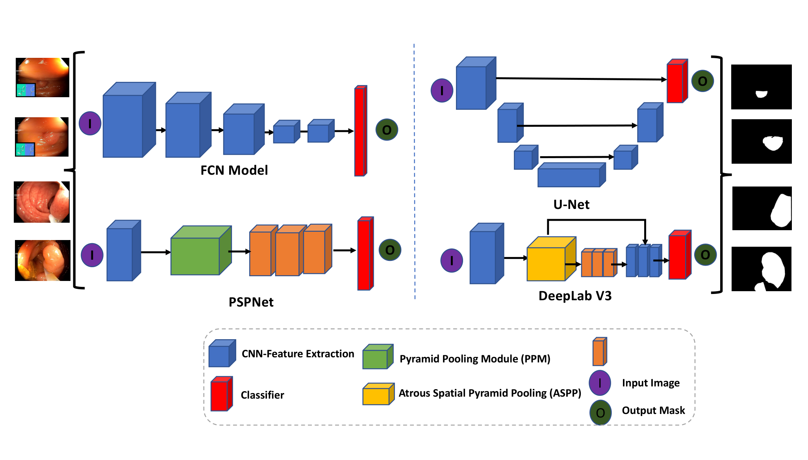
*论文原图编号：Fig. 8。四类基线网络的结构示意，区分特征提取、金字塔池化、空洞空间金字塔池化和分类器。*

- `FCN8`：下采样提取特征，再上采样恢复位置。
- `U-Net`：编码器与解码器对称，带跳连接。
- `PSPNet`：在空洞卷积骨干后接金字塔池化模块，聚合不同区域的全局上下文。
- `DeepLabV3+`：用多种空洞率的空洞卷积和 ASPP 捕获多尺度信息；论文试了 `ResNet50` 和 `ResNet101` 两种骨干。
- `ResNetUNet`：把 `ResNet` 骨干接入 U-Net，试了 `ResNet34` 和 `ResNet101`。

### 评测协议

训练设置：约 500 轮，批大小 16，输入 512×512，`Adam` 优化，学习率 0.01，权重衰减 0.00001，100 轮后保存最佳模型。增广包括缩放（0.5 到 2.0）、随机裁剪、随机水平翻转和归一化。硬件为 `Quadro RTX6000`。

C6 来自埃及，人群和内镜型号（`Olympus Exera 160AL, 180AL`）都不同于训练中心，作者把它当作完全的外部测试集。

### Baseline 设置

指标分两类。重叠类指标基于像素级真阳性、假阳性、真阴性和假阴性计数，包括 `JI`、`DSC`（即 F1 分数）、`F2`、精确率、召回率和整体准确率。$F_\beta$ 定义为

$$F_\beta = (1+\beta^2)\cdot\frac{p\cdot r}{\beta^2\cdot p + r}$$

$\beta=2$ 时更看重召回。

边界类指标用来补充重叠指标对形状不敏感的问题。平均 Hausdorff 距离为

$$d_{AHD}(G,E)=\left(\frac{1}{|G|}\sum_{g\in G}\min_{e\in E}d(g,e)+\frac{1}{|E|}\sum_{e\in E}\min_{g\in G}d(g,e)\right)/2$$

此外还报告平均表面距离 `MASD` 和归一化表面重叠 `NSD`。`NSD` 统计边界距离不超过阈值 $\tau$ 的边界点比例，论文把 $\tau$ 设为 10（单位论文未说明），取值在 0 到 1 之间。速度用 `FPS` 衡量。

## 关键结果

**技术验证要回答的是：现有网络换到一家没见过的医院后还剩多少性能。** 先看单帧，再看序列，最后看尺寸和验证中心的影响。

### 基线表现

C6 单帧（88 张）上的结果（表 5）：

| 方法 | 交并比 | Dice | 精确率 | 召回 | 平均豪斯多夫 ↓ | 表面 Dice | 平均表面距离 ↓ | 帧率 |
|---|---|---|---|---|---|---|---|---|
| `FCN8` | 0.68 | 0.76 | 0.90 | 0.74 | 10.69 | 0.49 | 37.61 | 44 |
| `U-Net` | 0.55 | 0.63 | 0.76 | 0.66 | 13.89 | 0.45 | 93.02 | 21 |
| `PSPNet` | 0.72 | 0.80 | 0.88 | 0.79 | 10.39 | 0.56 | 34.12 | 31 |
| `DeepLabV3+`（`ResNet50`） | 0.75 | 0.81 | 0.92 | 0.79 | 9.95 | 0.62 | 41.04 | 47 |
| `ResNetUNet`（`ResNet34`） | 0.73 | 0.79 | 0.92 | 0.78 | 10.04 | 0.59 | 35.83 | 87 |
| `DeepLabV3+`（`ResNet101`） | 0.75 | 0.82 | 0.92 | 0.81 | 9.67 | 0.64 | 23.29 | 33 |
| `ResNetUNet`（`ResNet101`） | 0.74 | 0.80 | 0.93 | 0.80 | 10.10 | 0.63 | 27.38 | 40 |

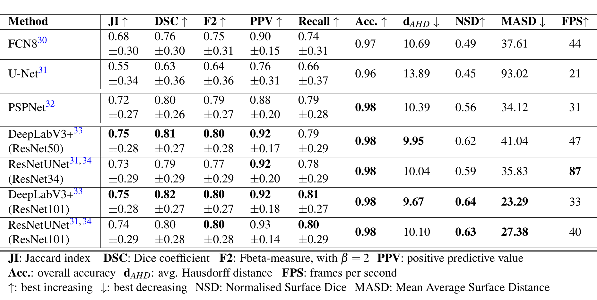
*论文原图编号：Table 5。七种分割方法在 C6 的 88 张单帧上的外部泛化结果，粗体为前两名。*

`DeepLabV3+`（`ResNet101`）在大多数指标上最好，`DSC` 0.82、`dAHD` 9.67，但每秒只处理 33 帧。

换成 `ResNet50` 骨干后 `DSC` 0.81，速度升到每秒 47 帧，代价很小。`U-Net` 最差，`DSC` 只有 0.63，`MASD` 高达 93.02。

C6 序列帧（432 张）上的结果（表 6）：

| 方法 | 交并比 | Dice | 精确率 | 召回 | 平均豪斯多夫 ↓ | 表面 Dice | 平均表面距离 ↓ |
|---|---|---|---|---|---|---|---|
| `FCN8` | 0.56 | 0.62 | 0.88 | 0.63 | 9.84 | 0.43 | 32.97 |
| `UNet` | 0.43 | 0.50 | 0.68 | 0.62 | 11.22 | 0.39 | 48.66 |
| `PSPNet` | 0.58 | 0.64 | 0.84 | 0.68 | 9.84 | 0.49 | 33.46 |
| `DeepLabV3+`（`ResNet50`） | 0.60 | 0.67 | 0.85 | 0.71 | 9.63 | 0.51 | 28.19 |
| `ResNetUNet`（`ResNet34`） | 0.59 | 0.66 | 0.87 | 0.70 | 9.78 | 0.50 | 27.10 |
| `DeepLabV3+`（`ResNet101`） | 0.65 | 0.71 | 0.90 | 0.73 | 9.08 | 0.57 | 18.59 |
| `ResNetUNet`（`ResNet101`） | 0.65 | 0.70 | 0.92 | 0.71 | 9.20 | 0.57 | 22.70 |

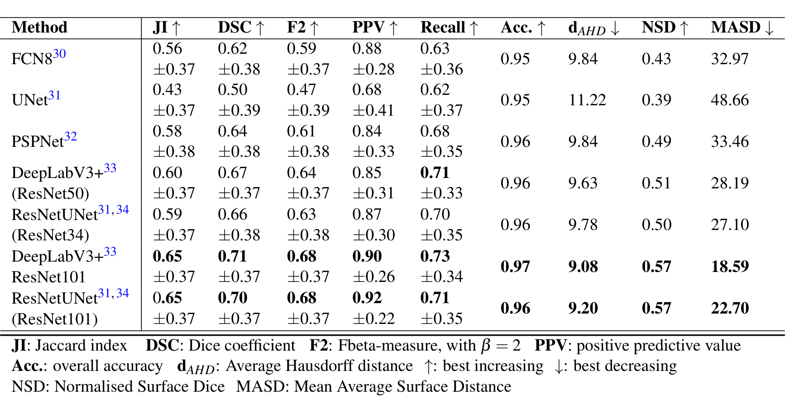
*论文原图编号：Table 6。七种分割方法在 C6 的 432 张序列帧上的外部泛化结果。*

序列上所有方法都比单帧低，最佳 `DSC` 从 0.82 降到 0.71。排名基本不变：两个 `ResNet101` 模型领先，`UNet` 垫底。

这个下降不能直接读成“序列更难分割”。序列里混有无息肉帧，**序列 `DSC` 同时包含分割质量和误报两种错误**，论文没有分开报告，复用时建议把有息肉帧的 `DSC` 和无息肉帧的误报率分开计算。

**正文数字与表格不一致**：验证总结段写序列上最高 `DSC` 为 0.65，两个 `ResNet101` 模型都是“0.65 DSC”，但表 6 中 0.65 是 `JI` 一列，对应的 `DSC` 是 0.71 和 0.70。讨论部分写序列 `DSC`“约 0.70”，与表格一致。本笔记以表格为准。

### 难度分布

作者还按息肉尺寸计算了 `DSC`。`DeepLabV3+`（`ResNet101`）在大息肉上为 0.87、中息肉 0.84，**小息肉只有 0.46**。

`PSPNet` 和 `FCN8` 的大、中息肉 `DSC` 差距超过 0.10，而 `ResNetUNet` 和 `DeepLabV3+` 差距小得多。分层的完整数值表论文没有给出。

### 覆盖与偏差

Table 7 用 `DeepLabV3+`（`ResNet50`）测试验证中心的影响：每次用四个中心训练、一个中心验证，在 C6 测试。

| 验证中心 | JI | DSC | PPV | Recall | dAHD ↓ |
|---|---|---|---|---|---|
| C1 | 0.70 | 0.76 | 0.85 | 0.79 | 4.77 |
| C2 | 0.72 | 0.79 | 0.88 | 0.80 | 4.70 |
| C3 | 0.74 | 0.80 | 0.86 | 0.83 | 4.77 |
| C4 | 0.76 | 0.82 | 0.91 | 0.81 | 4.77 |
| C5 | 0.73 | 0.78 | 0.93 | 0.78 | 4.88 |

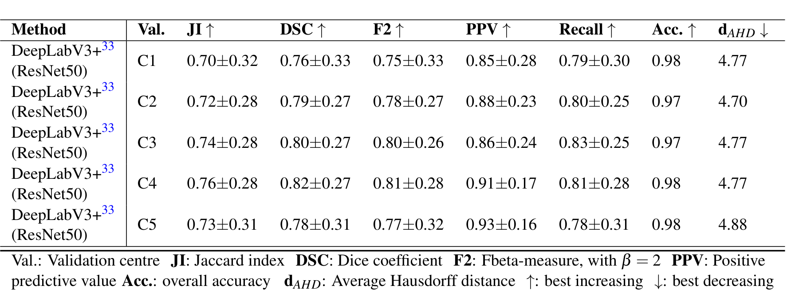
*论文原图编号：Table 7。用四个中心训练、单个中心验证、C6 测试时 DeepLabV3+（ResNet50）的结果。*

`DSC` 在 0.76 到 0.82 之间变动，作者据此认为验证数据的选择对性能影响很大。但每种设置只训练一次，这 0.06 的差距是否超出随机波动论文未说明。

这个表的 `dAHD` 都在 4.7 左右，而表 5 同一模型在 C6 上是 9.95，量级差一倍。表 7 的数值是在验证中心还是在 C6 上计算的，论文未说明，因此它与表 5 不能直接对比。

数字摆完了，接下来要问这些数字到底证明了什么。

## 深度分析

### benchmark 真正测到了什么

**一个外部测试中心能告诉我们绝对难度，但说不清难度来自哪里。**

技术验证测的是“在五个欧洲中心训练的分割网络，迁移到一家埃及中心时的表现”。这是**一种**跨中心泛化，不是泛化的全部。论文没有在 C6 内部训练或在 C1 到 C5 内部留出测试，所以读者看不到域内上界，无法知道 0.82 的 `DSC` 相比域内下降了多少。换句话说，结果证明了 C6 上的绝对难度，没有直接量化域偏移的代价。

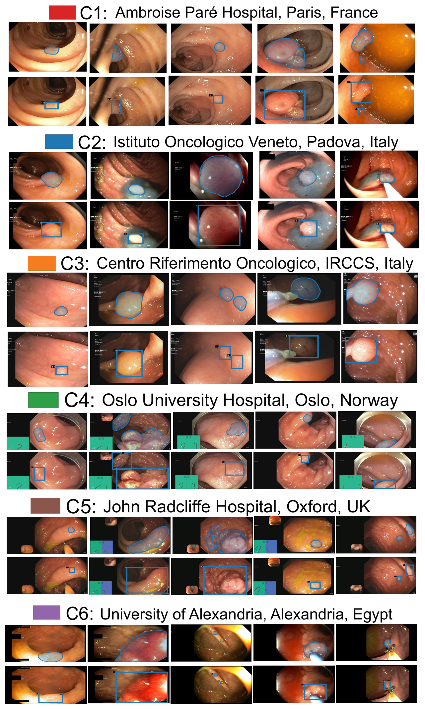
*论文原图编号：Fig. 3。六个中心的标注样例：上行为掩码轮廓，下行为对应边框；含小息肉、平坦息肉、染色和切除过程中的息肉。*

从 Fig. 3 的样例可以直观看出中心差异（这是笔者看图的观察，论文未逐条说明）：C4 和 C5 画面左下角常有绿色或蓝色的内镜位置示意块，C2 和 C3 带屏幕文字，C6 的画面偏暗偏橙。这些与病变无关的成像差异，正是跨中心评测想要暴露的。

序列数据比单帧难，作者给了两个原因：序列帧数约为单帧的 5 倍（432 对 88），序列画面视角、大小、质量变化更大且可能不含息肉。第二个原因更关键。序列里有无息肉帧，模型在这些帧上只要预测出一点前景就会拉低 `DSC`，而 Fig. 9 的讨论也提到序列中得分高的帧多数是无息肉帧。所以序列 `DSC` 同时混合了分割质量和误报控制两件事，论文没有把它们拆开报告。

结构上的结论比较可信：带残差骨干和 ASPP 的模型在两种数据上都明显优于 `U-Net`、`FCN8` 和 `PSPNet`，而且两种数据上排名一致。但多次运行或随机种子的方差论文未说明，0.01 到 0.02 的 `DSC` 差距不足以排序。表中 `DSC` 的 ± 值在 0.26 到 0.39 之间，它的含义论文未说明。我的判断是逐帧标准差，若是如此，帧与帧之间的差异极大。

**小息肉是最明确的失败点。** 小息肉 `DSC` 0.46，几乎是大息肉 0.87 的一半。论文背景部分也指出，10 毫米以下的病变最难评估恶性潜能。论文的尺寸是按像素定义，与毫米无直接换算，但两者方向一致。作者还认为 `MASD` 更能反映中小息肉上的表现。

这一判断的依据是 `ResNetUNet`（`ResNet34`）的 `MASD` 优于 `DeepLabV3+`（`ResNet50`），属于推断，没有分层的边界距离数据支持。

### 适用边界

- 适合：按中心留出的泛化评测、域适应和联邦学习实验（数据按中心分好）、序列模型与误报评测（有阴性序列）。
- 不适合直接下结论的场景：检测任务（论文只做了分割基线，没有检测指标）；病理分类（没有病理标签）；非 `Olympus` 设备的泛化（六个中心全是 `Olympus`）。
- 数据偏向：模糊标注大多被移除，留下的是专家能达成一致的较清晰病例；C2 贡献了阳性帧中最大的一份（1166 帧），平坦息肉在各中心比例从 6% 到 45% 不等。

这些边界有的是作者承认的，有的是论文没交代的，下一节分开列出。

## 局限

作者承认的局限：

- 阳性样本中包含无息肉帧，虽然作者说这些帧都靠近息肉区域以模拟真实场景。
- 标注的准确性、可靠性和完整性受标注者主观性影响。
- 模糊标注大多被移除，作者计划在后续版本中量化每帧的专家分歧。

论文未说明或存在矛盾的地方：

- 标注者间一致性（例如重复标注的 `DSC` 或 kappa）论文未说明。
- 阴性帧来自哪四家医院，论文未说明。
- 首轮被拒的 676 帧是否修正后发布，论文未说明；发布的 3447 个标注与 1537 张接受单帧及 2225 张序列帧之间如何对应，也论文未说明。
- 各中心患者数、息肉病理类型、检查适应证论文未说明；人口学信息因匿名化没有提供。
- Fig. 2a 的 C5、C6 阳性帧数与正文不一致；阴性环中 1755 一段的中心归属不清。
- 验证总结段把 `JI` 0.65 写成了序列 `DSC`；Table 7 是在哪个数据上计算的论文未说明。
- 表中 ± 的含义、多次运行的方差论文未说明，模型之间 0.01 到 0.02 的差距无法判断是否稳定。
- 只有一种外部测试划分（C6），没有给出“随机三中心训练、其余三中心测试”等作者自己建议的其他划分结果。
- 论文标题强调检测，但技术验证只有分割，检测基线论文未说明。

## 我的笔记

- 复现时先核对下载数据的各中心帧数，再和 Fig. 2a 与正文对照，确认 C5 和 C6 到底是哪组数字。
- 做泛化实验建议至少报告三种结果：域内留出、留一中心、以及小息肉分层。只看 C6 外部测试的绝对值，看不出模型改进来自泛化还是整体能力。
- 序列评测应把“有息肉帧的 `DSC`”和“无息肉帧的误报率”分开算，否则两种错误会互相掩盖。
- 训练学习率 0.01 对 `Adam` 偏大，复现基线时可能需要按官方代码确认实际设置。
- 值得追问：C6 内部训练能达到多少 `DSC`？在 4275 张阴性帧上各模型的误报率是多少？

## 引用

- Ali, S. et al. (2023). A multi-centre polyp detection and segmentation dataset for generalisability assessment. Scientific Data 10, 75.
- Ali, S. et al. (2022). Assessing generalisability of deep learning-based polyp detection and segmentation methods through a computer vision challenge. arXiv:2202.12031.
- [[Kvasir_SEG_A_Segmented_Polyp_Dataset|Kvasir-SEG: A Segmented Polyp Dataset]]
- Bernal, J. et al. (2015). WM-DOVA maps for accurate polyp highlighting in colonoscopy. Computerized Medical Imaging and Graphics 43, 99–111.
- Chen, L.-C. et al. (2018). Encoder-decoder with atrous separable convolution for semantic image segmentation. ECCV.
- Ronneberger, O., Fischer, P. & Brox, T. (2015). U-Net: convolutional networks for biomedical image segmentation. MICCAI.
- Nikolov, S. et al. (2021). Clinically applicable segmentation of head and neck anatomy for radiotherapy. J Med Internet Res 23, e26151.
