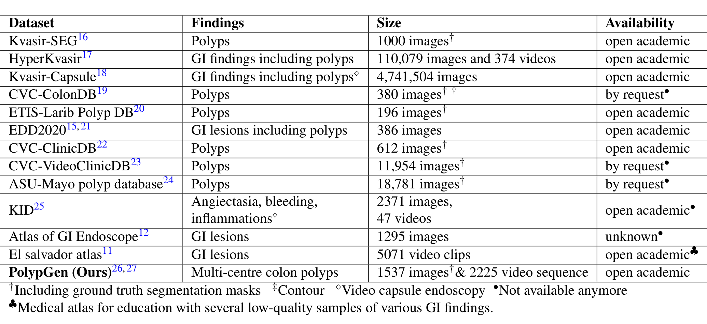
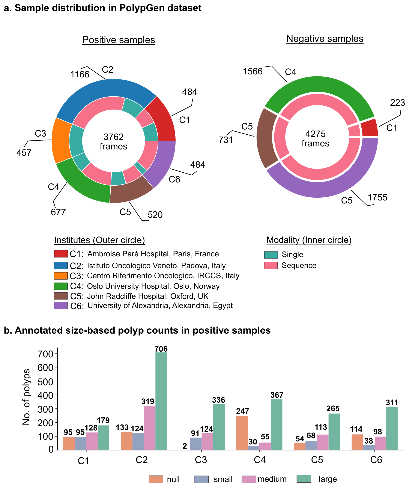
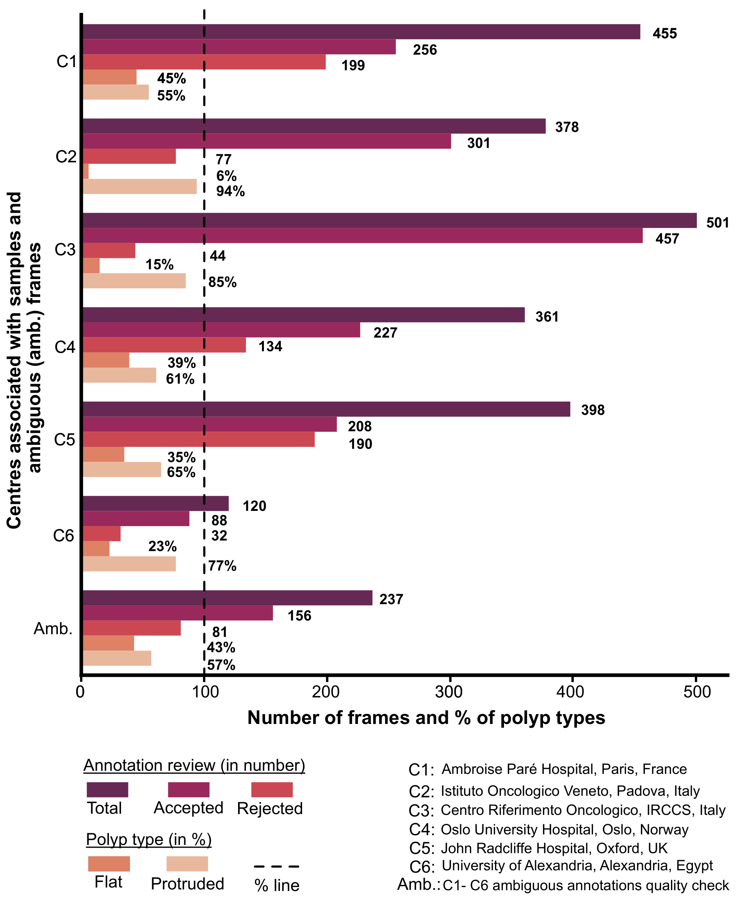
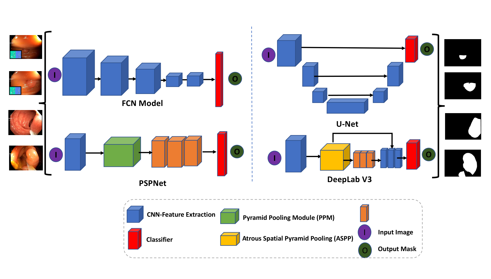
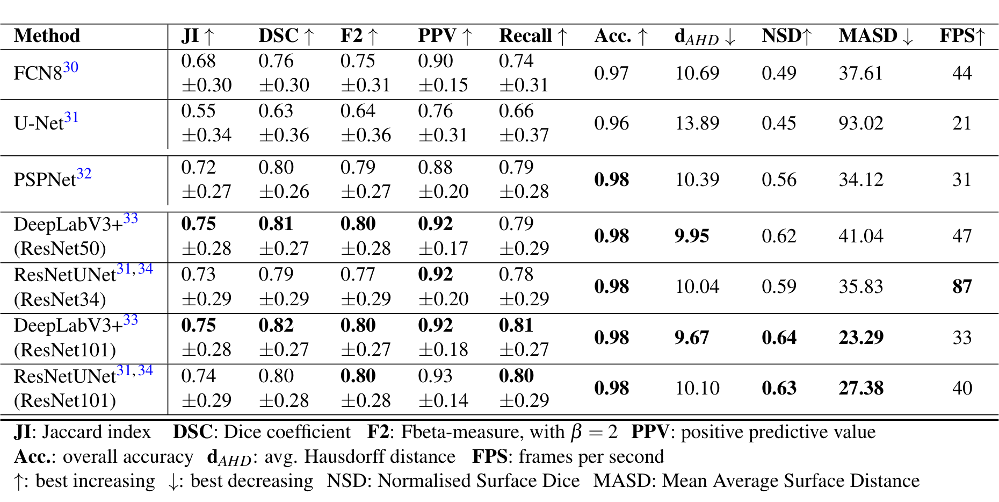
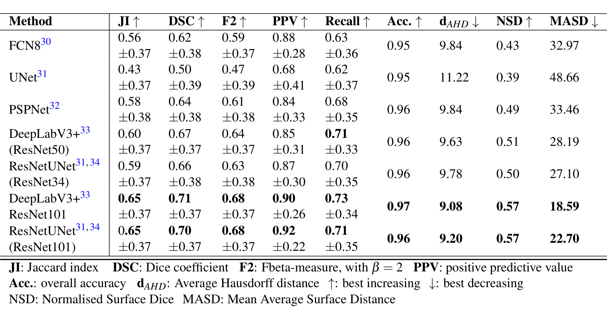
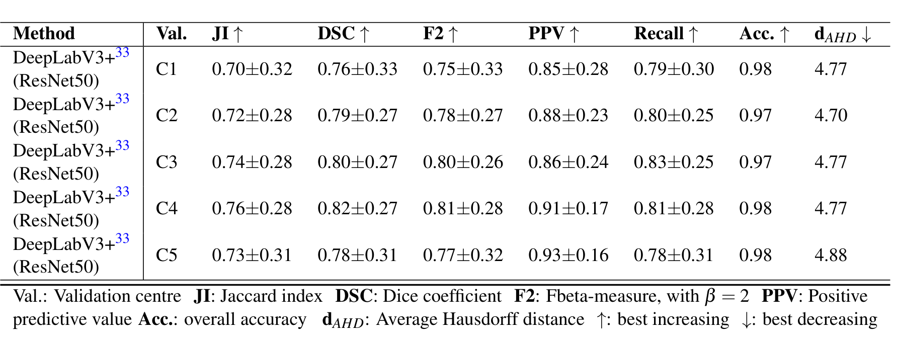

## 1. 背景与动机

**息肉漏检率高，而自动分割模型一换医院就掉分。** 论文引用的荟萃分析显示，腺瘤漏检率 26%，锯齿状息肉 27%。约 90% 的结直肠癌由这类良性前驱病变转化而来，及早发现并完整切除几乎可以消除死亡风险。

深度学习分割模型在同一中心内表现不错，但遇到域偏移较大的外部数据时性能明显下降。域偏移指训练和测试图像来自不同医院、人群或设备，统计特性不同。

作者认为多数工作不做多中心评测，原因是**缺少公开的多中心、带像素级标注的数据**。已有数据集要么只有一两个中心，要么需要申请且已不可获取，要么没有掩码。

*论文原图编号：Table 1。已有胃肠道病变数据集的规模与可获取性；带圆点标记的已不可获取。*

`PolypGen` 是表中唯一同时满足多中心、带掩码、含序列且开放获取的一项。接下来看它的答案长什么样。

## 2. 核心观点速览

**这是一份数据发布说明，分割基线只是证明数据能测出泛化差距。**

- 数据：六个中心、300 多名患者；阳性 3762 帧（单帧 1537、序列 2225），阴性 4275 帧。
- 标注：三名研究者勾画，资深消化科医生二值审核；首轮 2213 个标注拒收 676 个（30.5%）。
- 验证：C1 到 C5 训练、C6 测试；`DeepLabV3+`（`ResNet101`）单帧 `DSC` 0.82、序列 0.71、小息肉 0.46。
- 边界：只有一种划分，没有域内上界，没有检测基线，标注一致性论文未说明。

:::highlights
- 按中心分文件夹，留一中心测试是数据自带的用法
- 阴性序列可以用来测误报
:::

:::data
- 阳性 3762 帧 / 阴性 4275 帧
- 首轮拒收率 30.5%
- 小息肉 DSC 0.46
:::

先看这六个中心的数据到底差在哪里。

## 3. 六个中心与两类样本

**多中心的价值取决于中心之间的真实差异。** 六家医院分别在法国、意大利（两家）、挪威、英国和埃及，每家至少提供 50 名患者的数据。内镜系统全部是 `Olympus`，只是型号不同，所以设备差异限于同一厂商内部。

阳性样本来自确诊有息肉的患者视频，阴性样本只取无息肉的正常黏膜视频。

| 部分 | 帧数 | 说明 |
|---|---|---|
| 阳性单帧 | 1537 | C1 到 C5 共 1449 张，C6 88 张 |
| 阳性序列 | 2225 | 23 条序列，主要来自 C2（865）、C4（450）、C6（432） |
| 阴性序列 | 4275 | 23 条序列，只有原图 |

*论文原图编号：Fig. 2。上半部分为各中心阳性与阴性帧数；下半部分为按尺寸统计的息肉数量。*

**图与正文对不上。** 正文写 C5 为 458 帧、C6 为 520 帧，图中却标 C5 520、C6 484，论文未解释。阴性环有一段 1755 用的是 C6 的颜色却标为 C5，阴性帧来自哪四家医院论文未说明。

:::highlights
- 所有中心都用 Olympus 内镜
- 图像尺寸从 384×288 到 1920×1080 像素
:::

数据量交代清楚后，关键是标签可不可信。

## 4. 标注怎么做、被拒了多少

**这篇论文少见地报告了拒收率。** 三名研究者在 `Labelbox` 上平均分工勾画，医生团队复查，中心专家核对边界，再由其他中心的资深医生做二值审核，即只判接受或拒绝。

勾画规则按情形写明：凸起息肉只画隆起区，染色息肉只画未染色部分，器械遮挡处不画，远处看不清的息肉不画，已癌变但不呈息肉外观的黏膜不画。

*论文原图编号：Fig. 6。各中心标注的总数、接受数、拒收数，以及平坦与隆起息肉占比。*

不计模糊批次，首轮 2213 个标注中 676 个被拒，拒收率 30.5%。模糊批次重标后第二轮仍拒 34.17%。**三成被拒说明息肉边界本身难以达成一致**，但标注者间一致性论文未说明，被拒帧是否修正后发布也论文未说明。

:::highlights
- 审核者多数来自其他中心
- 模糊标注大多被移除，数据偏向清晰病例
:::

:::data
- 2213 个标注，接受 1537，拒收 676
- 模糊批次第二轮拒收 34.17%
:::

有了数据和标签，作者用什么协议证明它能测出泛化？

## 5. 技术验证协议

**设计很简单：五个欧洲中心训练，埃及中心测试。** C1 到 C5 的 1449 张单帧按 80/20 分成训练和验证，在 C6 的 88 张单帧和 432 张序列帧上测试。C6 的人群和内镜型号都不同于训练中心。

训练设置：约 500 轮，批大小 16，输入 512×512，`Adam`，学习率 0.01，权重衰减 0.00001，缩放、随机裁剪和水平翻转增广。

*论文原图编号：Fig. 8。四类基线网络的结构示意。*

指标除了 `DSC`（预测与真值掩码的重叠，即 F1）和 `JI`（交并比），还有边界类的平均豪斯多夫距离、平均表面距离 `MASD` 和归一化表面重叠 `NSD`。`NSD` 统计离真值边界不超过阈值的预测边界比例，论文把阈值设为 10，单位论文未说明。

协议有一处明显缺口：**没有在 C6 内部训练的上界**。所以下面的数字只能说明 C6 有多难，不能说明域偏移让模型掉了多少。

## 6. 结果说了什么

**最好的网络在单帧上 `DSC` 0.82，换成序列就降到 0.71。**

| 方法 | 单帧 DSC | 序列 DSC | 单帧 MASD ↓ | 帧率 |
|---|---|---|---|---|
| `U-Net` | 0.63 | 0.50 | 93.02 | 21 |
| `FCN8` | 0.76 | 0.62 | 37.61 | 44 |
| `PSPNet` | 0.80 | 0.64 | 34.12 | 31 |
| `DeepLabV3+`（`ResNet50`） | 0.81 | 0.67 | 41.04 | 47 |
| `ResNetUNet`（`ResNet34`） | 0.79 | 0.66 | 35.83 | 87 |
| `DeepLabV3+`（`ResNet101`） | 0.82 | 0.71 | 23.29 | 33 |
| `ResNetUNet`（`ResNet101`） | 0.80 | 0.70 | 27.38 | 40 |

*论文原图编号：Table 5。七种方法在 C6 的 88 张单帧上的结果。*

*论文原图编号：Table 6。七种方法在 C6 的 432 张序列帧上的结果。*

带残差骨干和空洞空间金字塔池化的模型在两种数据上都领先，`U-Net` 两次垫底。`ResNetUNet`（`ResNet34`）每秒 87 帧，`DSC` 只比最好的低一点，是实时场景的折中选择。

**正文有一处笔误。** 验证总结段说序列最高 `DSC` 为 0.65，但表 6 中 0.65 是 `JI`，`DSC` 是 0.71。

:::data
- 单帧最佳 DSC 0.82，序列最佳 0.71
- ResNetUNet（ResNet34）每秒 87 帧
:::

整体数字之外，按尺寸和验证中心拆开看更能说明问题。

## 7. 小息肉与验证中心

**小息肉几乎是失败点。** `DeepLabV3+`（`ResNet101`）在大息肉上 `DSC` 0.87、中息肉 0.84，小息肉只有 0.46。小息肉指外接框不超过 100×100 像素，与毫米没有固定换算。其余模型的分层数值论文未给出完整表。

表 7 每次用四个中心训练、一个中心验证，`DeepLabV3+`（`ResNet50`）的 `DSC` 在 0.76 到 0.82 之间。作者据此说验证集选择影响很大。

*论文原图编号：Table 7。不同验证中心下 DeepLabV3+（ResNet50）的结果。*

但每种设置只训练一次，这个差距是否超出随机波动论文未说明。表 7 的平均豪斯多夫距离在 4.70 到 4.88 之间，而表 5 同一模型在 C6 上是 9.95，表 7 到底在哪个数据上计算论文未说明。

:::highlights
- 小息肉 DSC 不到大息肉的一半
- 表 7 与表 5 的边界距离量级不一致
:::

## 8. 结果没说什么

**这些数字证明了 C6 难，没证明难在域偏移。** 下面三点是证据链的缺口：

- **没有域内上界。** 没有 C6 内部训练的分数，无法把下降归因于跨中心。
- **序列分数混了两种错误。** 序列里有无息肉帧，误报和分割误差都会拉低 `DSC`，论文没有分开报告。Fig. 9 的讨论也提到序列中得分高的多为无息肉帧。
- **没有方差。** 表中 ± 的含义论文未说明，多次训练的方差也没有，0.01 到 0.02 的模型差距无法判断是否稳定。

此外，标题强调检测，但技术验证只有分割；检测基线论文未说明。

## 9. 复用前要检查什么

- 下载后先统计各中心帧数，对照正文和 Fig. 2a，确认 C5 和 C6 的实际数字。
- 做泛化实验至少报告域内留出、留一中心和小息肉分层三种结果。
- 序列评测把有息肉帧的 `DSC` 和无息肉帧的误报率分开算，阴性序列正好用来测误报。
- 六个中心都是 `Olympus`，不能据此推断对其他厂商设备的泛化。

## @takeaways
- PolypGen 是少有的开放、多中心、带掩码且含序列与阴性帧的息肉数据集
- 首轮标注拒收率 30.5%，说明边界本身有分歧
- C6 外部测试上最佳单帧 DSC 0.82、序列 0.71、小息肉 0.46

## @strengths
- 按中心组织数据，留一中心评测开箱可用
- 写明勾画规则和专家审核流程，并报告拒收率
- 同时提供单帧、阳性序列和阴性序列

## @weaknesses
- 只有一种外部测试划分，没有域内上界
- 标注一致性、被拒帧去向、阴性帧中心归属论文未说明
- 正文与 Fig. 2a、表 6 存在数字不一致

## @questions
- C6 内部训练能达到多少 DSC？
- 4275 张阴性帧上各模型的误报率是多少？
- 表 7 的指标是在验证中心还是在 C6 上计算的？
