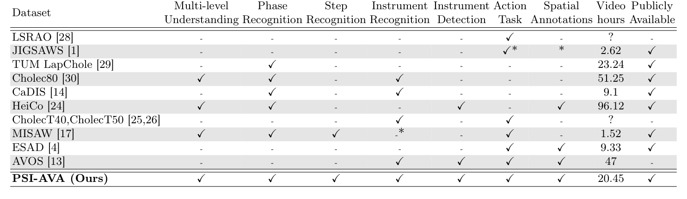
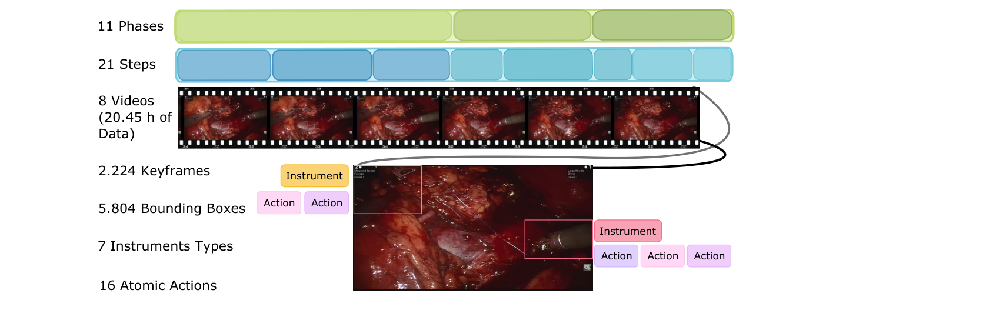
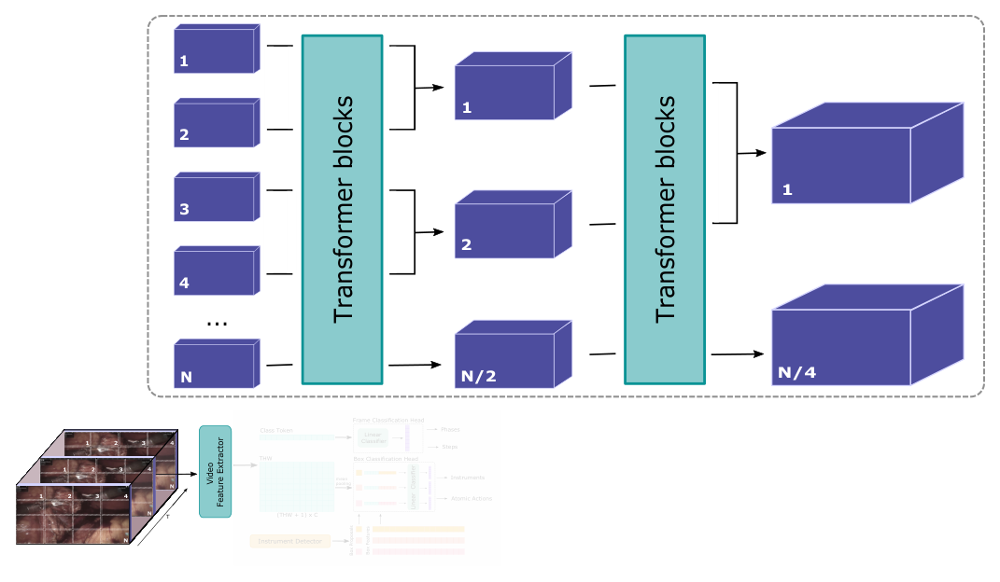
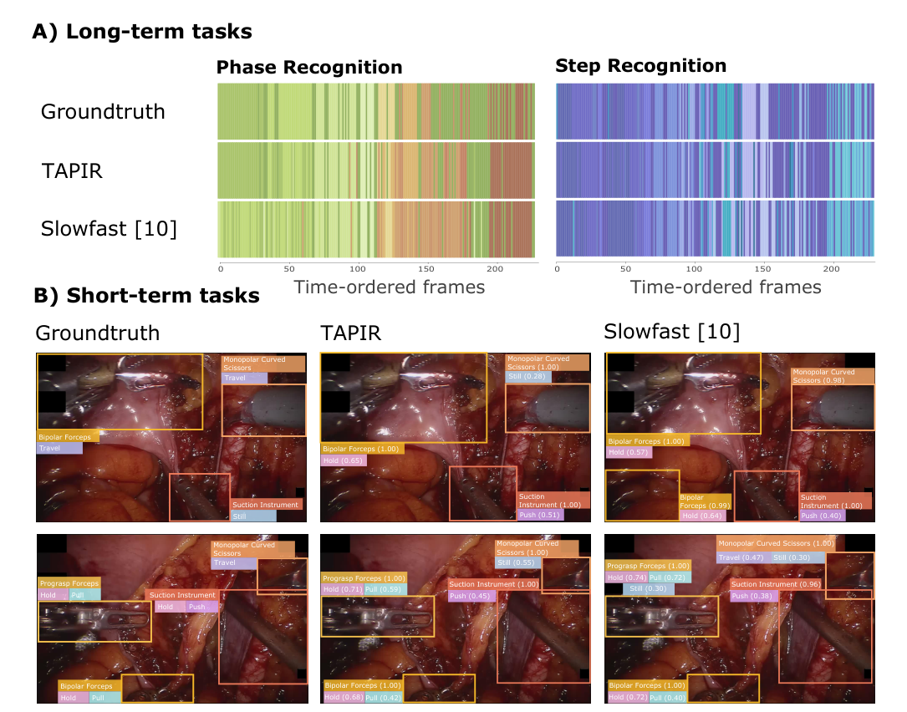
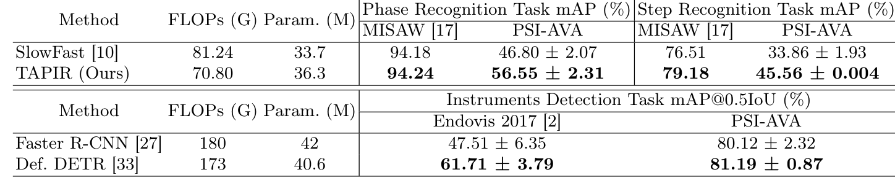

## 1. 背景与动机

**要理解一台手术,模型既要知道“进行到哪一步”,也要知道“每件器械此刻在做什么”。** 作者把手术看成器械与解剖结构之间的交互,这些交互嵌套在有目的的活动序列里。术中辅助、手术培训和自主手术机器人都需要这两种时间尺度的信息。

**问题是现有数据集几乎都只服务于一项任务。** 阶段识别最常见;动作类标签以手势或动词出现,但绑定某一术式;空间标注有框、掩码或运动学数据,却很少和流程标注共存。没有同一批视频上的多层标注,就无法检验长期流程信息能否帮助识别短期动作。

*论文原图编号：Table 1。PSI-AVA 与 10 个手术流程分析数据集在多层理解、四类任务、空间标注、视频时长和公开性上的对比。*

这张表也是下一节的出发点:PSI-AVA 是唯一在每一列都打勾的数据集。

## 2. 核心观点速览

论文给出两样东西:一个四层标注的数据集,一个把检测特征接入分类的基线。

| 层次 | 内容 | 规模 | 指标 |
|---|---|---|---|
| 阶段 | 11 类(含空闲) | `73,618` 帧,每秒 1 帧 | mAP |
| 步骤 | 20 类(含空闲) | 同上 | mAP |
| 器械检测 | 7 类器械框 | `2238` 帧,`5804` 个实例 | mAP@0.5IoU |
| 原子动作 | 16 类,每框最多 3 个 | 同上 | mAP@0.5IoU |

**主要结论和它的边界:**

- TAPIR 在阶段、步骤、动作上比 SlowFast 高 `9.75`、`11.7`、`10.11` 个点;器械检测三种方法几乎一样。
- 去掉框特征后动作 mAP 从 `28.68` 降到 `9.69`,检测特征是动作识别的关键。
- 长期标注对短期任务的贡献、标注一致性、按术者泛化,论文未说明。

:::highlights
- 四层标注共享同一批视频和同一套两折划分
- 原子动作词表与术式和被作用对象无关
:::

:::data
- 约 `20.45` 小时视频,8 台手术,3 位术者
- 原子动作最好 `28.68` mAP@0.5IoU
:::

## 3. 数据怎么来的

**规模不大,但四层标注出自同一批视频。** 视频来自波哥大 Fundación Santafé de Bogotá 的 8 台根治性前列腺切除术,使用 Da Vinci SI3000。去掉非手术片段和潜在身份信息后约 `20.45` 小时。

*论文原图编号：Fig. 1。PSI-AVA 的层次结构:阶段与步骤是覆盖整段视频的时间条带,关键帧上再标注器械框和每个框的原子动作。*

**标注分两条线。** 阶段和步骤由两位泌尿科专家逐秒标注。器械框先由预训练 Faster R-CNN 生成,再由众包标注者修正;每个框再标注最多 3 个原子动作。短期任务每 35 秒取一帧,为何选 35 秒论文未说明。

**图文数字有冲突。** 图 1 写 21 个步骤和 `2.224` 个关键帧,正文写 20 个步骤和 `2238` 个关键帧候选。原因论文未说明,引用时以正文为准并注明口径。

这些标注是否可靠,决定了后面所有分数的含义,下一节就看这一点。

## 4. 标签有多可靠

**论文没有报告任何标注一致性指标。** 两位专家是分工还是重复标注,论文未说明;众包修正的质控流程和复核比例,论文未说明。

这直接限制了对原子动作低分的解读:`28.68` 里有多少来自任务本身的歧义,有多少来自标注噪声,无法区分。

类别分布不平衡,最少见的类别对应偶发事件。各类数量只画在补充材料图里,正文未列数值。

## 5. 评测协议与基线

**两折交叉验证,每折 4 台手术,没有独立测试集。** 阶段和步骤用 mAP,器械和动作用 mAP@0.5IoU。阶段 mAP 的具体聚合方式论文未说明,复现时要对照官方代码。

*论文原图编号：Fig. 3。视频特征提取器基于 MViT,两级注意力块把标记数从 N 逐级池化到 N/2、N/4。*

TAPIR 的执行链分四步:

1. 以关键帧为中心取 16 帧,MViT 输出类别标记和时空标记。
2. 类别标记经线性层输出阶段或步骤。
3. Deformable DETR 输出器械框和框特征,置信度阈值 `0.75`。
4. 时空标记均值池化后与框特征拼接,经线性层输出器械类别或原子动作。

对照组有两个:卷积网络组合(Faster R-CNN 加在 CaDIS 上预训练的 SlowFast),以及把 MViT 换成 Video Swin 的 TAPIR-VST。**卷积网络组合的预训练数据和训练设置都与 TAPIR 不同**,下一节的差距混合了架构和训练两种因素。

## 6. 主结果说了什么

| 方法 | 阶段 | 步骤 | 器械 | 原子动作 | 计算量 (G) | 参数 (M) |
|---|---|---|---|---|---|---|
| SlowFast | 46.80 | 33.86 | 80.29 | 18.57 | 81.24 | 33.7 |
| TAPIR-VST | 51.63 | 41.00 | 81.14 | 22.49 | 65.76 | 87.7 |
| TAPIR | 56.55 | 45.56 | 80.85 | 28.68 | 70.80 | 36.3 |

**阶段、步骤和动作有区分度,器械检测几乎没有。** 三种方法的器械检测都在 80 分出头,TAPIR-VST 还略高于 TAPIR。作者说 TAPIR 计算成本更低,按表中数字只在参数量上成立,计算量反而高于 TAPIR-VST。

步骤标准差 `0.004` 比其他项小两到三个数量级,原因论文未说明。

*论文原图编号：Fig. 4。上半部分是阶段和步骤预测的时间条带,TAPIR 更连续;下半部分是两帧上的器械框与动作,两种方法都漏掉部分动作。*

定性图只有两帧示例,不能当作统计结论。主结果说明基准有难度梯度,接下来作者要证明这个基准本身是合理的。

## 7. 基准验证与框特征消融

*论文原图编号：Table 3。两种视频模型在 MISAW 与本数据集上的阶段、步骤识别,以及两种检测器在 EndoVis 2017 与本数据集上的器械检测。*

**作者用“排序一致”验证基准。** 两类方法在其他数据集和 PSI-AVA 上胜负方向一致。MISAW 上阶段识别已在 94 分以上,两者只差 `0.06` 个点;PSI-AVA 上差距接近 10 个点,区分度更高。

**框特征消融是“多层互补”的主要证据。**

| 分类头中的框特征 | 器械检测 | 原子动作 |
|---|---|---|
| 无 | 13.96 | 9.69 |
| Faster R-CNN | 80.40 | 21.18 |
| Deformable DETR | 80.85 | 28.68 |

换成更强的检测器,器械检测只多 `0.45` 个点,动作却多 `7.5` 个点。这支持“检测器质量决定动作识别上限”。表 3 与表 2、表 4 的检测数也对不上(`81.19` 对 `80.85`),口径论文未说明。

## 8. 结果没有证明什么

- **长期标注对短期任务的帮助没有被单独测量。** 无框特征时所有框共享同一份全局特征,下降只说明框级分类需要框级外观。要分开,需要比较不同初始化或做多任务联合训练,论文没有做。
- **排序一致的证据很弱。** 只比较了两个方法族,更强的模型在哪里都更强,排序一致几乎必然。
- **架构优势没有和训练设置分开。** SlowFast 与 TAPIR 预训练数据、轮数和学习率都不同。
- **泛化能力未知。** 单中心、单一机器人系统、3 位术者,按术者划分的实验论文未说明。

## 9. 和其他数据集的关系

| 数据集 | 差异 |
|---|---|
| HeiCo | 也是多层,但没有步骤和动作;PSI-AVA 补上中间尺度 |
| MISAW | 有阶段、步骤和动作,针对显微吻合手术,阶段识别已近饱和 |
| CholecT50 | 三元组绑定胆囊切除术;PSI-AVA 的动作不依赖被作用对象 |
| JIGSAWS | 手势与运动学,无阶段和器械检测 |

PSI-AVA 的独特之处是在真实机器人手术上把四个时间尺度放进同一套划分。

## 10. 复现要注意什么

- 短期任务的 MViT 用步骤识别训练好的权重初始化,不是直接用 Kinetics-400。
- 原子动作用二元交叉熵,学习率 `0.125`;其余任务用交叉熵,学习率 `0.0125`。
- 检测框置信度阈值 `0.75`,会影响器械与动作 mAP。
- 引用数据规模时注明正文与图 1 的差异。

## @takeaways
- PSI-AVA 是少有的在同一批真实机器人手术视频上同时有阶段、步骤、器械框和原子动作标注的数据集。
- 做原子动作识别时,框级检测特征是性能的主要来源。
- 器械检测在该数据集上接近饱和,区分方法时应看步骤和动作。

## @strengths
- 四层标注共享视频和划分,适合研究跨时间尺度的联合学习。
- 原子动作词表与术式无关,有迁移到其他术式的潜力。
- 代码、数据和评测脚本公开。

## @weaknesses
- 8 台手术、单中心、两折划分,没有独立测试集。
- 没有标注一致性和众包质控信息。
- 图文数字冲突,步骤标准差和两表检测数不一致没有解释。
- 消融没有区分长期标注与框级特征的贡献,基线训练设置不统一。

## @questions
- 阶段和步骤的标注者一致性如何?
- 按术者划分时性能下降多少?
- 16 类原子动作中长尾类别的单类 AP 是多少?
- 原子动作词表能否直接用于其他术式?
