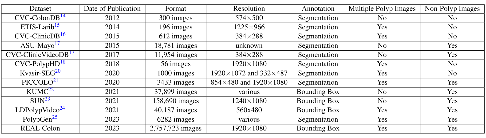
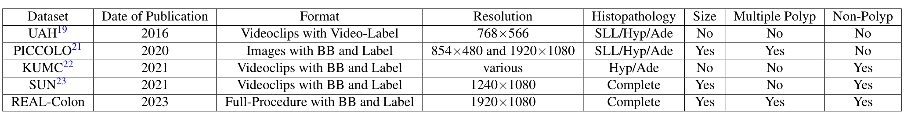
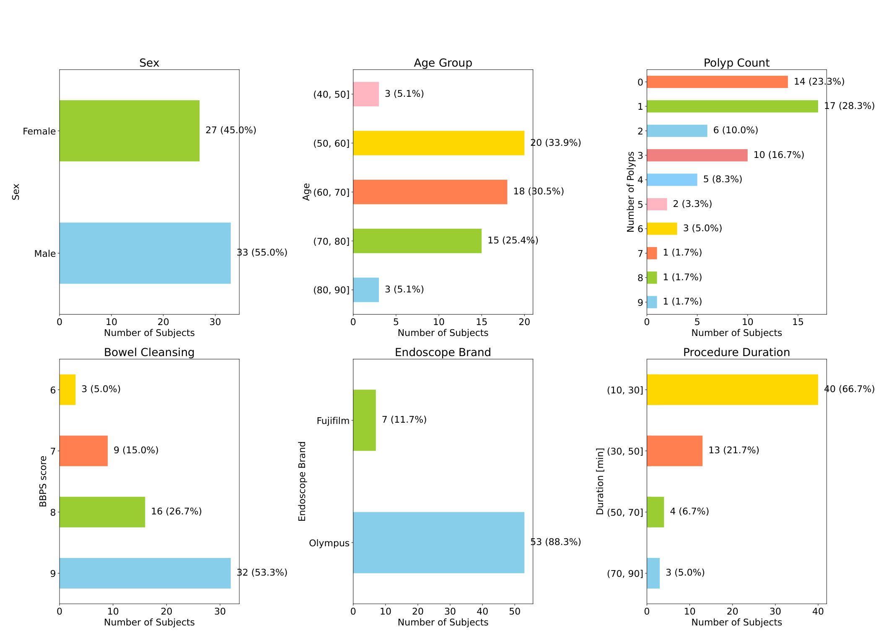
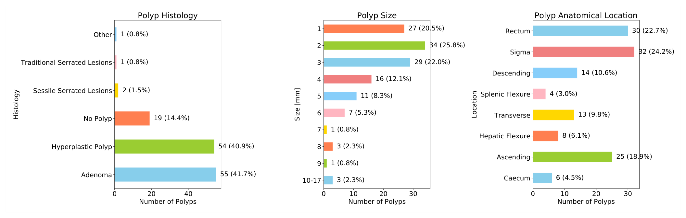
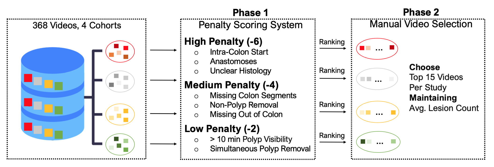
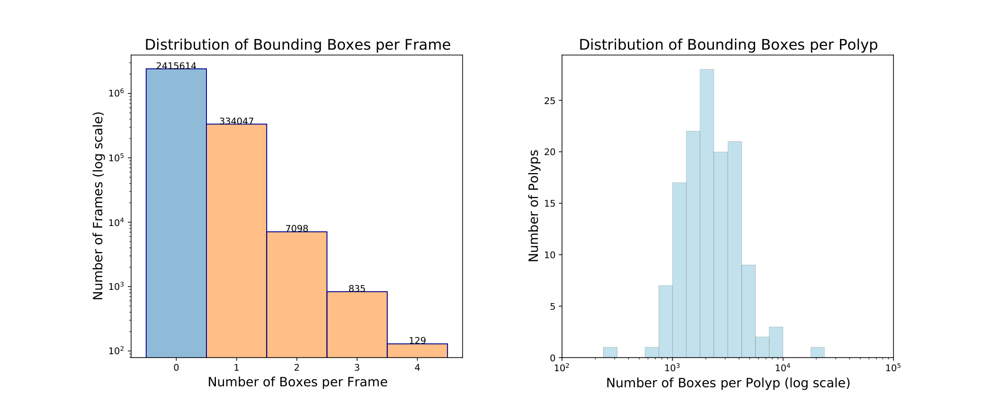
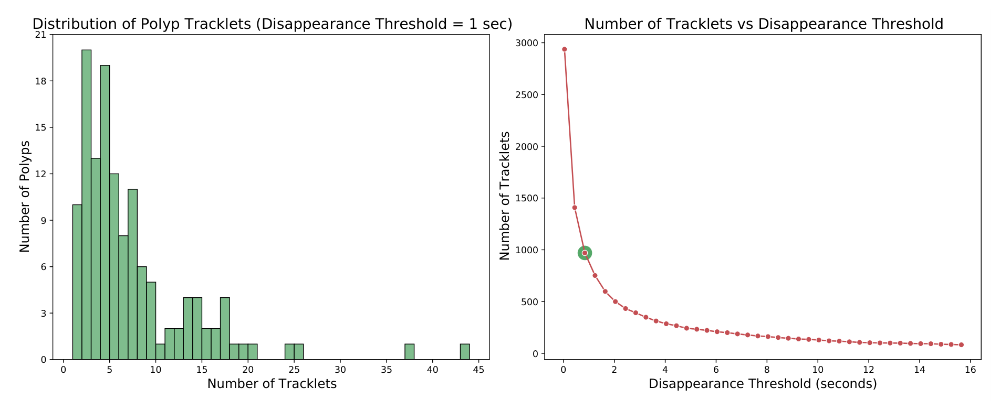
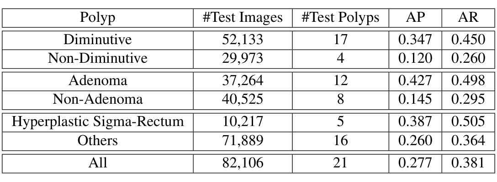
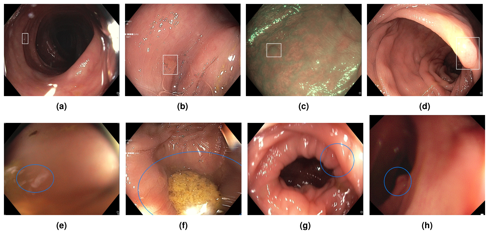

---
tags:
  - papers/手术数据集
aliases:
  - "REAL-Colon"
  - "REAL-Colon 全程结肠镜视频数据集"
date: 2024-03-04
arxiv_id: "2403.02163"
---

# REAL-Colon: A dataset for developing real-world AI applications in colonoscopy

## 核心信息

- 标题: REAL-Colon: A dataset for developing real-world AI applications in colonoscopy
- 标题翻译: REAL-Colon：面向真实世界结肠镜 AI 应用开发的数据集
- 作者: Carlo Biffi, Giulio Antonelli, Sebastian Bernhofer, Cesare Hassan, Daizen Hirata, Mineo Iwatate, Andreas Maieron, Pietro Salvagnini, Andrea Cherubini
- 机构: Cosmo Intelligent Medical Devices（爱尔兰都柏林）；Ospedale dei Castelli（意大利）；圣珀尔滕大学医院（奥地利）；Humanitas 大学与 Humanitas 临床研究中心（意大利）；佐野医院（日本兵库）；米兰比可卡大学
- 发表时间: 2024-03-04（arXiv 第 1 版）
- 发表渠道: arXiv 预印本（eess.IV）；正式版发表于 Scientific Data 第 11 卷，文章号 539（2024），本笔记依据 arXiv 第 1 版
- DOI: 10.1038/s41597-024-03359-0
- arXiv: 2403.02163
- 论文链接: https://arxiv.org/abs/2403.02163
- 代码 / 项目: https://github.com/cosmoimd/real-colon-dataset ；https://github.com/cosmoimd/DeepLearningExamples
- 数据 / 资源: https://plus.figshare.com/articles/media/REAL-colon_dataset/22202866 （Figshare+，DOI 10.25452/figshare.plus.22202866，CC BY 4.0，无需申请）
- 论文类型: benchmark_or_dataset

## 原文摘要翻译

结肠息肉的检测与诊断是预防结直肠癌的关键。近期证据表明，基于 AI 的计算机辅助检测（CADe）和计算机辅助诊断（CADx）系统可以提升内镜医生的表现，提高结肠镜检查的有效性。

然而，现有公开数据集大多由静态图像或视频片段组成，常常经过降采样，不能准确反映真实世界的结肠镜检查过程。

我们提出 REAL-Colon（真实世界多中心内镜标注视频库）数据集：它汇集了来自多个中心、60 段全分辨率真实世界结肠镜录像的 2.7M 原生视频帧。数据集包含 350k 个边界框标注，每个标注都在消化内科专家的监督下完成。每段视频还附有完整的患者临床数据、结肠镜采集信息和息肉组织病理信息。

凭借前所未有的规模、质量和异质性，REAL-Colon 是推进结肠镜 AI 研究的研究者和开发者的独特资源。它的开放与透明有助于严谨、可复现的研究，推动更准确、更可靠的结肠镜相关算法和模型的开发与基准评测。

## 创新点

1. **全程、未剪辑的结肠镜视频，配逐帧框标注。** 60 段检查从进镜前到退镜后完整录制，共 2,757,723 帧，其中 87.6% 不含息肉。此前公开集多为剪辑片段，或只保留少量阴性帧，因而无法评测整场检查中的误报率。
2. **多中心、跨三大洲的来源。** 美国、意大利、奥地利、日本的四个队列各出 15 段，覆盖 Olympus 和 Fujifilm 两种内镜。这为跨中心泛化研究提供了基本条件。
3. **每个病灶有病理、大小和部位。** 132 个被切除病灶都与电子病例报告表（eCRF）逐一核对，可以按腺瘤与非腺瘤、按大小、按部位分组评测，这是检测之外的表征（CADx）任务所需要的。
4. **同一病灶在整段视频中有唯一 ID。** 标注从切除时刻倒序回溯到首次出现，跨越短暂消失，因此可以直接研究息肉跟踪和重识别。

## 一句话总结

一家 AI 内镜公司从四个临床队列的 368 段录像中按罚分规则挑出 60 段全程结肠镜视频，逐帧标注 132 个切除病灶的 351,264 个框并附临床与病理信息，以知识共享署名协议公开；技术验证只用一个 300x300 输入的 SSD，显示阴性帧训练能把误报率从 0.080 降到 0.054，但验证规模小、表格有不一致，结论只能当作数据可用性的示例。

## 研究问题

结直肠癌每年约有两百万新发病例，超过 95% 由腺瘤等癌前息肉发展而来，结肠镜发现并切除息肉可以降低发病和死亡。但结肠镜质量高度依赖医生的技术和注意力，漏诊并不少见。随机对照试验已经显示 CADe 能减少漏检，CADx 也受到关注。

问题在于开发这类系统的数据。大型医疗器械公司有大量私有录像，学术界能用的公开数据却多是**静态图像或短片段**：只有两个数据集带息肉大小，没有一个专为息肉跟踪设计，也没有一个提供完整、未改动的检查录像。真实检查中 80% 到 90% 的帧不含息肉，而公开集要么剪掉这些阴性帧，要么只保留一小部分；分辨率和帧率也常被降采样，来源中心也少。

后果是学术模型大多逐帧训练、逐帧评测，很少关心处理速度、延迟和整场检查的误报，**评测成绩与临床实际脱节**。医生判断息肉靠的是连续画面上的时序推理，而不是一张完美的截图。作者的问题因此是：能否公开一个多中心、原生分辨率、全程未剪辑、带临床和病理信息的视频数据集，让学术界也能在真实条件下训练和评测 CADe 与 CADx。

### 核心观点速览

- **做法**：四个队列 368 段录像，按罚分规则筛到 60 段（每队列 15 段）；专业录像机以 1920x1080 采集，转为高质量 JPEG；十名标注员在专家监督下逐帧画框，再与病理报告核对。
- **产物**：2,757,723 帧、351,264 个框、132 个切除病灶；87.6% 帧为阴性；附视频级和病灶级两张元数据表。数据约 1 TB，按知识共享署名协议公开下载。
- **验证结果**：现成 SSD 在 12 段测试视频上，最佳 AP 0.216、误报率 0.054、检出率 0.505；只用阳性帧训练时 AP 0.165；息肉出现后第 1 秒内 AP 只有 0.138。
- **边界**：筛选剔除了难例与病理不清的视频；验证只有一个模型、一次训练、21 个测试病灶；表 4 与表 5 的同一行数字不一致。

这些主张分别落在数据来源、构建流程和检测验证三处，下面按这个顺序展开。

## 数据与任务定义

### 数据来源

四个队列来自不同性质的采集，每个贡献 15 段视频：

| 队列 | 来源 | 国家 | 性质 |
|---|---|---|---|
| 001 | GI Genius 美国注册随机对照试验（NCT03954548），只取美国三家中心 | 美国 | 厂商资助的注册试验 |
| 002 | 单中心前瞻性非营利研究（NCT04884581） | 意大利 | 预注册临床研究 |
| 003 | 圣珀尔滕大学医院内部采集 | 奥地利 | 科研采集活动 |
| 004 | 佐野医院消化中心内部采集 | 日本 | 科研采集活动 |

纳入标准是 40 岁及以上、因初筛、息肉切除后随访、粪便免疫化学试验阳性或症状就诊的患者；排除有结直肠癌或炎症性肠病史、结肠切除史、急诊结肠镜或正在抗血栓治疗者。四个队列都有伦理批号，患者书面同意匿名数据用于研究。切除或活检的组织都送病理，按修订版维也纳分类定级，形态按巴黎分类记录。

*论文原图编号：Table 1。公开息肉检测数据集对比：发表年份、规模、分辨率、标注类型、是否含多息肉帧和非息肉帧。放在这里是因为“前所未有的规模”以这张表为依据。*

*论文原图编号：Table 2。公开息肉表征与尺寸数据集对比：格式、分辨率、病理信息、尺寸、多息肉和非息肉。放在这里是因为它说明 REAL-Colon 是唯一的全程视频带框加病理标签的集。*

两张表里最接近的是 SUN：158,690 帧、1240x1080、病理完整且带尺寸，但它是剪辑片段，没有多息肉帧。LDPolypVideo 有 40,187 帧和阴性帧，但分辨率只有 560x480、没有病理。REAL-Colon 以 2,757,723 帧比 SUN 多一个数量级，主要增量来自阴性帧。

### 临床与病理变量

每段视频对应一名患者，元数据包括年龄、性别、内镜品牌、帧率、切除病灶数和波士顿肠道准备评分（BBPS，0 到 9 分，越高越干净）。每个病灶记录大小（毫米）、部位、组织学类别和扩展病理描述。

*论文原图编号：Figure 2。患者层面的分布：性别、年龄组、每例息肉数、BBPS、内镜品牌和检查时长。放在这里是因为它直接显示人群和采集条件的覆盖范围。*

平均年龄 64.6±10.7 岁，男性占 55%；14 段视频（23%）没有息肉。**BBPS 全部在 6 到 9 分**，其中 9 分有 32 例；Olympus 占 53 例（88.3%），Fujifilm 只有 7 例；40 例检查时长在 10 到 30 分钟。这意味着数据覆盖的是肠道准备良好、以 Olympus 为主的检查，准备差的场景基本缺席。另据我核对图 2，年龄柱合计只有 59 人，少 1 人；每例息肉数按柱高加权合计为 131 个，比正文的 132 个少 1 个，论文未说明原因。

*论文原图编号：Figure 3。病灶层面的分布：组织学、大小（毫米）和解剖部位。放在这里是因为表征类任务的类别平衡要看这张图。*

132 个切除病灶中腺瘤 55 个（41.7%）、增生性息肉 54 个（40.9%），**19 个（14.4%）病理上根本不是息肉**（淋巴滤泡、淋巴聚集、溃疡、脂肪瘤或正常组织）；无蒂锯齿状病变 2 个，传统锯齿状病变 1 个，另有 1 个纤维性肛门息肉。大小以 1 到 3 毫米为主，10 到 17 毫米只有 3 个；部位以乙状结肠 32 个和直肠 30 个最多。腺瘤与非腺瘤约各占 40%，适合做二分类，但大息肉和锯齿状病变太少，无法单独评测。

### 文件与任务

发布内容是 60 个帧压缩包、60 个标注压缩包、视频级元数据表 `video_info.csv`、病灶级元数据表 `lesion_info.csv` 和一份说明文档。

每帧对应一个 XML 标注文件，论文称按 COCO 模板生成；官方仓库给出的样例却是 VOC 风格，仓库另附转换脚本。

数据支持的任务包括：逐帧息肉检测、跨帧息肉跟踪与重识别、按病理的息肉表征、尺寸估计和整场检查的误报评测。论文只对检测做了验证，其余任务只给了统计上的动机。

## 方法主线

### 机制流程

这一节回答的问题是：怎样把临床试验的录像变成可公开、可训练的标注数据，又不丢掉“真实”。

*论文原图编号：Figure 1。从 368 段录像中挑出 60 段的两阶段流程：第 1 阶段按罚分排序，第 2 阶段每队列人工选 15 段并保持平均病灶数。放在这里是因为第 2 步的筛选就是这张图。*

1. **录制与转帧。** 输入：内镜主机的原始视频流。操作：专业录像机以 4:2:2 色度采样、10 位色深采集 1920x1080 隔行信号，先用 ProRes 编码压缩，再用 ffmpeg 转成 JPEG，三个质量参数都设为 1 以尽量减少压缩损失。输出：逐帧图像，送去匿名化。
2. **匿名化与筛选。** 输入：368 段录像和 eCRF。操作：在源头剪除屏幕上的病历信息、把帧裁剪到内镜视野、删去 eCRF 直接标识符；再按罚分打分，高罚 -6（腔内起始、可见吻合口、病理缺失或非息肉病理不清），中罚 -4（缺少进镜前或退镜后的腔外画面、退镜时不能识别所有肠段、非息肉活检或切除），低罚 -2（息肉可见超过 10 分钟、多个息肉用同一器械同时切除）。罚分累加后排序，每队列人工选 15 段，并让入选视频的平均病灶数接近总体平均。输出：60 段视频，最终最高罚分为 -4。
3. **逐帧框标注。** 输入：60 段视频。操作：十名医学图像标注员用 Cosmo 内部工具，从每个息肉被完全切除的那一帧开始倒序逐帧画框，直到它首次出现；每周与监督专家开会修正。输出：351,264 个框，同一病灶跨帧共享 ID。
4. **病理核对。** 输入：框标注和 eCRF。操作：在专家监督下把视频中的每个病灶与病理记录对应，排除不一致；病灶信息由标注员和至少一名资深消化内科医生双重检查。输出：`lesion_info.csv` 中每个病灶的大小、部位和组织学。

罚分规则的取向很清楚：**它优先剔除会让“视频中的息肉”和“病理报告”对不上的情况**，例如同时切除多个息肉、非息肉病理不清。这保证了标签可信，代价是难例和复杂情况被系统性移出。作者也说，组织学比例没有作为筛选条件，只是事后核对与原研究一致。

倒序标注是另一处关键设计。从切除时刻往回追，标注员已经知道“这里有一个息肉”，因此在息肉还很小、很远时也能把它框出来；前向标注容易漏掉这些早期帧。这正是后面能评测“出现后第 1 秒”的前提。

### 评测协议

技术验证用英伟达示例代码库中现成的 SSD 检测器，训练代码已开源。每个队列前 10 段作训练、接着 2 段作验证、最后 3 段作测试，即 40、8、12 段。输入缩放到 300x300，批大小 96，增广沿用 MS COCO 设置（缩放、随机裁剪、水平翻转、归一化），在一块 V100 上训练，按验证集 AP 选最佳轮次。

指标沿用 COCO：AP 是 IoU 从 0.5 到 0.95、步长 0.05 的平均精度，AP50、AP75 是单一阈值下的值。另外两个是逐视频计算的帧级指标：

$$\mathrm{FPR}=\frac{n_{1}}{n_{0}}$$

$$\mathrm{TPR}=\frac{m_{1}}{m_{0}}$$

其中 $n_0$ 是阴性帧总数，$n_1$ 是其中出现预测框的帧数；$m_0$ 是阳性帧总数，$m_1$ 是其中至少有一个预测框的帧数。

TPR 只要求帧上“报警”，不要求框与真值重叠。测试集是 12 段视频的全部 591,647 帧，有框和无框都算。

训练集变化两个维度：每个病灶取多少阳性帧（100、1000 或全部），以及每段视频取多少比例的阴性帧（0、1%、5%、10% 或全部）。这样设计是为了回答两个数据问题：同一息肉的大量重复帧有没有用，阴性帧有没有用。

## 关键结果

数据集好不好用，要看两类证据：数据本身的统计形态，和一个检测器在上面训练评测的表现。先看统计。

### 数据统计：稀疏、碎片化、早期很小

*论文原图编号：Figure 4。左：每帧框数分布（对数纵轴）；右：每个息肉的框数分布（对数横轴）。放在这里是因为它给出阴性帧占比和多息肉帧的稀少程度。*

2,757,723 帧中 2,415,614 帧（87.6%）没有框，342,109 帧（12.4%）至少有一个框；含 2、3、4 个框的帧分别为 7,098、835、129 帧。正文说多息肉帧不到全部帧的 0.3%、占阳性帧的 2.7%；我按图 4 的柱值计算，多息肉帧共 8,062 帧，占阳性帧约 2.4%，与正文的 2.7% 不符，但不改变“多息肉极少”的结论。在息肉出现后前 5 秒，多息肉比例升到 7.9%。每个息肉平均可见 1 分 15 秒，最长超过 12 分钟。

*论文原图编号：Figure 5。左：以 1 秒消失阈值切分时每个息肉的轨迹段数；右：轨迹段总数随消失阈值的变化。放在这里是因为它是“需要跟踪与重识别”这一主张的证据。*

以“框消失超过 1 秒即开新段”为准，**132 个息肉中只有 10 个连续出现**，其余都被切成多段；阈值放宽到 15 秒仍有超过 100 段。这说明实时系统不能每次息肉消失就重新开始时序分析，需要重识别。统计形态说明了任务难在哪里，下面看检测器实际表现。

> [!figure] Figure 6 框尺寸与空间分布
> 建议位置：关键结果
> 放置原因：说明框面积不能直接换算息肉真实大小。
> 当前状态：保留占位；自动裁图截到的是图 5 下方的正文，而不是第 8 页的箱线图与热力图。

图 6 显示两个规律：息肉刚出现时（不超过 1 秒）框都很小，散布在画面各处；之后医生把它移到画面中央，框变大且尺寸变化大，很多框超过画面的 50%。不论真实大小如何，早期框都小，所以**仅凭框面积估计息肉毫米大小不可行**，需要结合时空上下文。

### 检测验证：正样本与阴性帧

> [!figure] Table 3 不同训练子集的检测结果
> 建议位置：关键结果
> 放置原因：这是“更多正样本和阴性帧有用”的唯一证据。
> 当前状态：保留占位；自动裁图与表 4 是同一张图，下方按第 9 页原表转录全部数值。

| 每病灶阳性帧 | 阴性帧比例 | 训练图像 | AP | AP50 | AP75 | FPR | TPR |
|---|---|---|---|---|---|---|---|
| 100 | 0 | 11141 | 0.107 | 0.181 | 0.117 | 0.123 | 0.463 |
| 1000 | 0 | 107525 | 0.137 | 0.231 | 0.147 | 0.082 | 0.464 |
| 全部 | 0 | 230936 | 0.165 | 0.272 | 0.181 | 0.080 | 0.495 |
| 全部 | 0.01 | 246556 | 0.190 | 0.286 | 0.217 | 0.058 | 0.434 |
| 全部 | 0.05 | 309116 | 0.193 | 0.311 | 0.219 | 0.072 | 0.472 |
| 全部 | 0.1 | 387315 | 0.178 | 0.265 | 0.205 | 0.083 | 0.454 |
| 全部 | 全部 | 1794907 | 0.216 | 0.338 | 0.245 | 0.054 | 0.505 |

前三行只用阳性帧：每病灶从 100 帧增加到全部帧，AP 从 0.107 升到 0.165，误报率从 0.123 降到 0.080。**同一个息肉的重复帧仍然有用**，因为它们覆盖了不同距离、角度和光照。后四行加入阴性帧，全部加入时最好：AP 0.216，误报率 0.054，检出率 0.505。

但中间几行并不单调。只加 1% 阴性帧时 AP 升到 0.190、误报率降到 0.058，检出率却从 0.495 跌到 0.434；10% 时 AP 0.178，反而低于 5% 的 0.193，误报率 0.083 还高于不加阴性帧。每个设置只训练了一次，这些波动无法与随机性区分。可靠的结论只有两端：**全部阴性帧优于不加**，论文所说的“阴性越多越好”在中间段并不成立。还要注意，最后一行的训练图像是只用阳性帧时的约 7.8 倍，论文没有固定训练步数或图像总数，所以提升里可能混入了训练量本身的作用。

### 按病灶类型与早期检测

*论文原图编号：Table 4。最佳模型在测试集阳性帧不同子集上的 AP 与 AR（IoU 0.5 到 0.95）。放在这里是因为它显示模型在不同病灶类别上的差距。*

| 子集 | 测试图像 | 测试病灶 | AP | AR |
|---|---|---|---|---|
| 小息肉 | 52,133 | 17 | 0.347 | 0.450 |
| 非小息肉 | 29,973 | 4 | 0.120 | 0.260 |
| 腺瘤 | 37,264 | 12 | 0.427 | 0.498 |
| 非腺瘤 | 40,525 | 8 | 0.145 | 0.295 |
| 乙状结肠直肠增生性 | 10,217 | 5 | 0.387 | 0.505 |
| 其他 | 71,889 | 16 | 0.260 | 0.364 |
| 全部 | 82,106 | 21 | 0.277 | 0.381 |

腺瘤 AP 0.427，非腺瘤只有 0.145；小息肉 0.347，非小息肉 0.120。**分组差距很大，但每组病灶极少**：非小息肉只有 4 个，乙状结肠直肠增生性只有 5 个。一个难检的大息肉就能决定整组成绩，所以这张表说明“可以这样分组评测”，不能说明“大息肉更难检”。论文未说明小息肉的毫米阈值。

> [!figure] Table 5 息肉出现早期的检测表现
> 建议位置：关键结果
> 放置原因：早期检测是全时间分辨率标注才能做的评测。
> 当前状态：保留占位；自动提取没有找到这张表的独立裁图候选，下方按第 9 页原表转录。

| 出现时段 | 测试图像 | AP | AR |
|---|---|---|---|
| 前 1 秒 | 570 | 0.138 | 0.254 |
| 前 3 秒 | 1,710 | 0.179 | 0.334 |
| 全部 | 82,106 | 0.217 | 0.381 |

息肉出现后第 1 秒内 AP 只有 0.138，前 3 秒 0.179，均低于全部阳性帧。临床上最有价值的正是早期提醒，这一点与图 6 的“早期框小且分散”一致。**表 5 的全部行 AP 为 0.217，而表 4 的全部行是 0.277**，两者都声称是同一最佳模型在同一 82,106 张阳性帧上的结果，AR 都是 0.381。论文未说明差异来源，正文还把表 5 误写为表 4。

*论文原图编号：Figure 7。最佳模型的典型错误：上排漏检（远处小息肉、被水泡遮挡、蓝光成像、靠边过曝的大息肉），下排误报（污渍与运动模糊、固体残渣、未充分充气的黏膜、远处暗区）。放在这里是因为它把指标上的失败落到具体画面。*

漏检集中在小、远、被遮挡或成像不佳的息肉；误报落在形似息肉的区域，常伴随运动或成像不良。这些都是全程视频才会大量出现的画面，剪辑片段里很少。作者还公开了一段 60 分钟、含 6 个息肉的测试视频及预测结果。

这些数字回答了“数据能不能用来训练和评测”，但没有回答“它测到了什么、偏向哪里”，下一节讨论这一点。

## 深度分析

### 这个数据集真正测到了什么

规模大不等于测得多。这一小节问的是：有了它，哪些以前测不了的东西现在能测了。

REAL-Colon 最独特的测量对象是**整场检查中的误报**。剪辑数据集上算 AP，模型只需在有息肉的帧上框准；在全程视频上，87.6% 的帧是阴性，任何一个反复误报的区域都会累积成操作者疲劳。表 3 中误报率与 AP 并不同步（例如 1% 阴性帧时误报率 0.058 很低，检出率却最低），说明两者需要分开报告。这一点是公开数据第一次能直接检验的。

第二个测量对象是**时间维度**：倒序标注带来的早期帧、跨消失的唯一 ID、病灶可见时长。这让早期检测（表 5）和跟踪碎片（图 5）有了真值。不过论文没有给出任何跟踪或重识别的基线，这些任务目前只有统计动机。能测什么取决于数据里有什么，下面看筛选让它少了什么。

### 筛选带来的偏差

“真实世界”是这篇论文的核心卖点，但 60 段是从 368 段中挑出来的，挑法决定了它有多真实。

罚分规则剔除了腔内起始、吻合口、病理不清、同时切除多个息肉等视频，人工选择又只要求平均病灶数接近总体。结果是一个**“干净的真实世界”**：BBPS 最低 6 分，Olympus 占 88.3%，最终最高罚分 -4，即没有入选任何高罚视频。肠道准备差、术后吻合、复杂多发切除这些临床难例，在数据中基本缺席，在它上面训练的模型对这些情况的表现无从评估。

另一处容易忽略的是**只标被切除的病灶**。标注从切除时刻倒推，病灶 ID 与病理一一对应；论文没有说明检查中可见但未切除的息肉是否标注。如果没有标，它们出现的帧会被当成阴性，误报率会被高估。同样论文未说明标注员间一致性，框的质量只能靠流程描述来信任。

### 全分辨率卖点与验证的落差

数据的另一个卖点是原生分辨率，问题是验证实验有没有用上它。

数据以 1920x1080 采集、JPEG 质量参数设为 1，这是它区别于降采样数据集的卖点。但技术验证把输入缩到 300x300，图 7 的漏检又集中在小而远的息肉。**验证没有检验分辨率本身的价值**，也没有用任何时序模型。所以表 3 到表 5 的绝对数字只是一个弱基线的下限，作者自己也说重点是数据可用性而非绝对性能。早期检测难也因此不能完全归给“早期”：早期框本来就小，缩到 300x300 后更难辨认，两种原因在论文里没有分开。论文也未说明裁剪到内镜视野后的帧尺寸，这让它与其他数据集的分辨率比较只能停留在采集规格上。

### 与其他数据集的位置

选数据集时要问：它比手头已有的多了什么，又缺了什么。

| 对比对象 | 它有的 | REAL-Colon 新增的 |
|---|---|---|
| SUN | 158,690 帧、完整病理、尺寸 | 全程未剪辑、多息肉帧、四个国家 |
| LDPolypVideo | 40,187 帧、含阴性帧 | 原生分辨率、病理与尺寸 |
| PolypGen | 6,282 张、多中心、分割 | 视频、时序和病理 |
| Kvasir-SEG 等静态集 | 像素级分割 | 规模和时序，但没有分割 |

REAL-Colon 没有分割掩码，做息肉分割仍要用 PolypGen、Kvasir-SEG 一类数据集。后续的 Colon-Bench 以 REAL-Colon 的 60 段视频为底，再补多类病灶、掩码和文本，这一点来自该论文自述，不在本文中。

### 适用边界

把上面几点合起来，可以划出它适合与不适合的用途。

适合：在全程视频上评测 CADe 的误报率和早期检测；研究息肉跟踪与重识别；研究腺瘤与非腺瘤分类。不适合：评测分割；评测肠道准备差或 Fujifilm 设备下的泛化；把表 4 的分组差距当作统计结论。

## 局限

- **筛选偏差**：368 段中只入选 60 段，罚分规则移出难例，BBPS 全在 6 到 9，Olympus 占 88.3%。
- **验证单薄**：一个 SSD、一次训练、无方差或置信区间；测试集 12 段视频、21 个病灶，分组最少只有 4 个病灶。
- **表格不一致**：表 4 与表 5 的全部行 AP 分别为 0.277 和 0.217；正文把表 5 说成表 4；多息肉帧占阳性帧的比例按图 4 算约 2.4%，正文写 2.7%；图 2 年龄柱合计 59 人，息肉数按柱高合计 131 个。
- **格式说明不一致**：论文称标注为 MS COCO 格式的 XML，官方仓库样例是 VOC 风格 XML。
- **论文未说明**：裁剪到内镜视野后的帧尺寸、各视频的帧率数值（只说元数据含帧率字段）、小息肉的毫米阈值、未切除的可见息肉是否标注、标注员间一致性、表 4 与表 5 全部行不一致的原因。这限制了分辨率比较、按秒换算的早期检测和误报率的解释。
- **训练量混杂**：表 3 加入阴性帧时训练图像同时增加，没有固定训练量的对照。
- **没有其他任务的基线**：跟踪、表征、尺寸估计都只有统计动机。
- **利益冲突**：三位作者是 AI 医疗器械公司 Cosmo 的员工并持有相关专利，001 队列来自该公司 GI Genius 的注册试验，标注工具不公开。
- **数据体量**：约 1 TB，官方说明下载可能需要数天。

## 我的笔记

- 最值得借鉴的是“全程录制加倒序逐帧标注”。前者让误报率可以测，后者让早期帧和跨消失 ID 有真值。做任何长视频稀疏事件的数据集都可以照搬。
- 用它评测 CADe 时，至少同时报 AP、逐视频误报率和前 1 秒检出，单报 AP 会掩盖误报问题。
- 想检验跨中心泛化，可以改用按队列留出（三个队列训练、一个队列测试），并对表 3 的关键设置做多次随机种子重复；论文的划分在每个队列内按顺序切分，测的是同中心泛化。
- 引用技术验证数字前先核对表 4 与表 5，二者的全部行不一致；论文只用了一个弱基线，不要把这些数字当作该数据集上的最好水平。
- 下载前先读两张元数据表规划子集；标注是逐帧 XML，用官方仓库脚本转成 COCO。
- 数据在 Figshare+ 按知识共享署名协议直接下载，无需申请；Hugging Face 上只有第三方的再打包版本。
- 我的判断：这是一份“规模和真实性扎实、技术验证薄弱”的数据论文。它的价值在于第一次公开了全程视频和阴性帧，而不在于表 3 到表 5 的数字。

## 引用

- Biffi 等（2024）. REAL-Colon: A dataset for developing real-world AI applications in colonoscopy. arXiv:2403.02163；Scientific Data 11, 539.
- Biffi 等（2024）. REAL-colon dataset. Figshare+, doi:10.25452/figshare.plus.22202866.
- Misawa 等（2021）. Development of a computer-aided detection system for colonoscopy and a publicly accessible large colonoscopy video database (with video). Gastrointestinal Endoscopy.
- Ma 等（2021）. LDPolypVideo benchmark: a large-scale colonoscopy video dataset of diverse polyps. MICCAI.
- Ali 等（2023）. A multi-centre polyp detection and segmentation dataset for generalisability assessment. Scientific Data.
- Jha 等（2020）. Kvasir-SEG: A segmented polyp dataset. MMM.
- Liu 等（2016）. SSD: Single shot multibox detector. ECCV.
- Wallace 等（2022）. Impact of artificial intelligence on miss rate of colorectal neoplasia. Gastroenterology.
