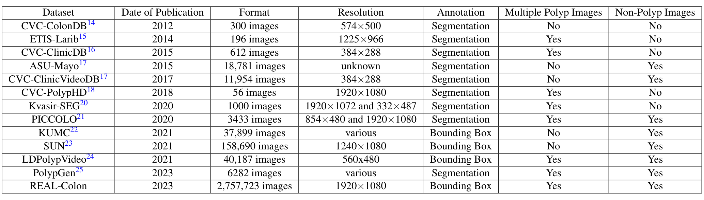
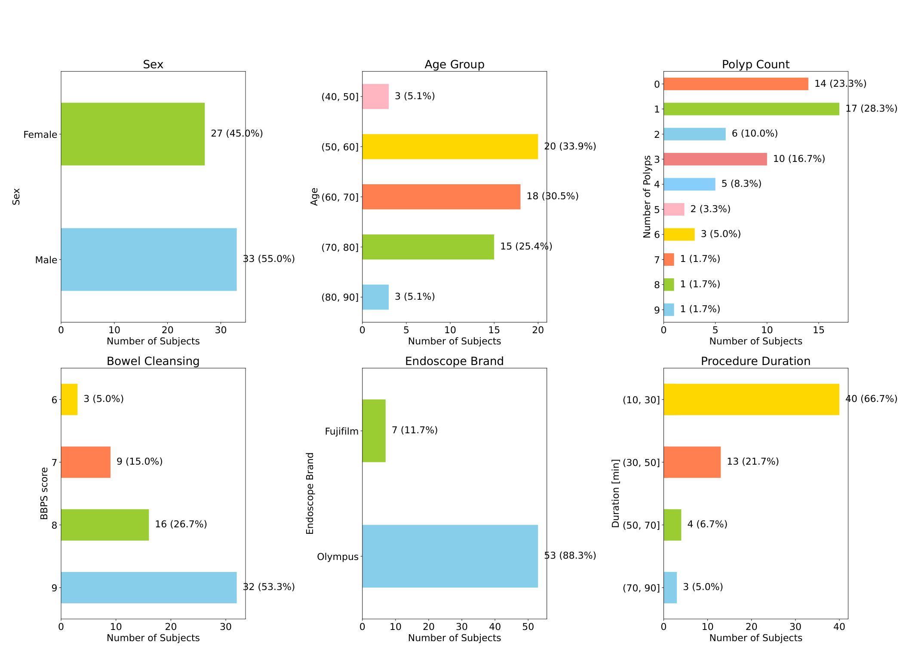
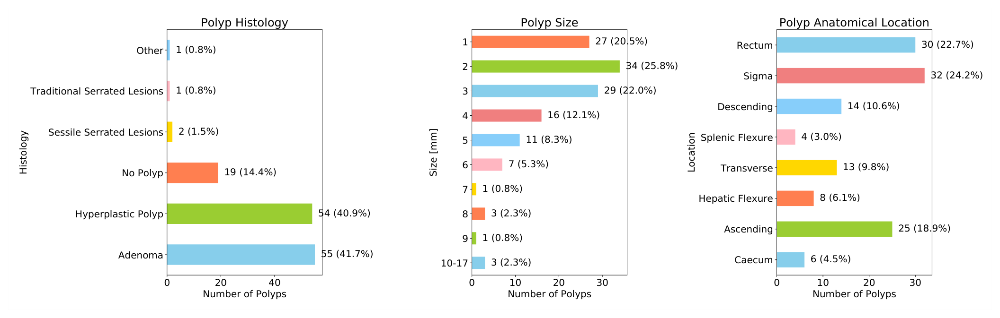
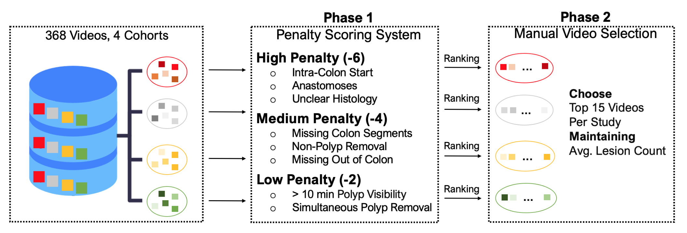
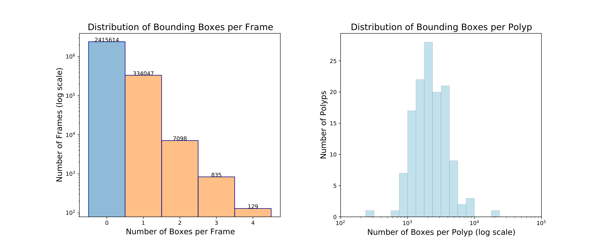
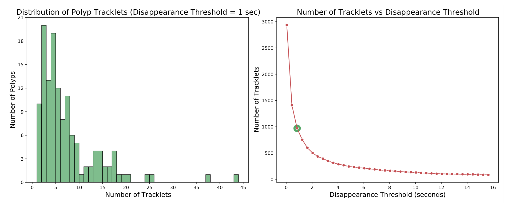
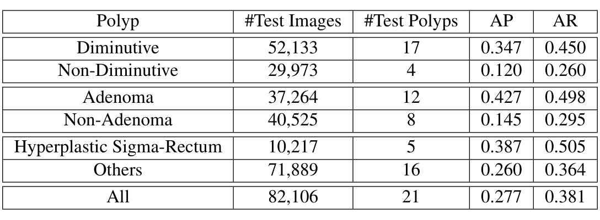
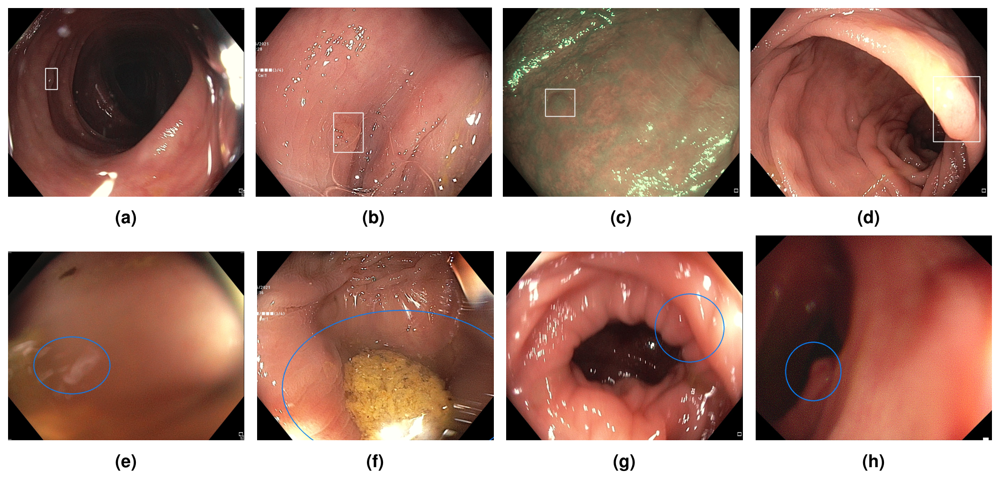

## 1. 背景与动机

结肠镜发现并切除息肉能降低结直肠癌风险，但检查质量依赖医生的技术和注意力，漏诊常见。AI 辅助检测（CADe）已在随机试验中减少漏检。

**问题在于学术界能用的数据。** 大公司有大量私有录像，公开数据却多是静态图或剪辑片段，常被降采样，来源中心少。真实检查中 80% 到 90% 的帧不含息肉，公开集要么剪掉这些阴性帧，要么只留一小部分。

后果是学术模型大多逐帧训练、逐帧评测，看不到整场检查里的误报。作者想公开一份多中心、原生分辨率、全程未剪辑、带病理的视频数据，把这块缺口补上。

## 2. 核心观点速览

- **做法**：四个队列 368 段录像，按罚分规则每队列选 15 段；1920x1080 采集，转高质量 JPEG；十名标注员从切除时刻倒序逐帧画框，再与病理报告核对。
- **产物**：2,757,723 帧、351,264 个框、132 个切除病灶，87.6% 帧为阴性；附视频级和病灶级元数据表，约 1 TB，按知识共享署名协议公开下载。
- **验证**：现成 SSD 在 12 段测试视频上最佳 AP 0.216、误报率 0.054；只用阳性帧训练 AP 0.165；息肉出现后第 1 秒 AP 只有 0.138。
- **边界**：筛选剔除了难例；验证只有一个模型、一次训练、21 个测试病灶；两张表的同一行数字不一致。

:::highlights
- 第一次公开了含全部阴性帧的全程结肠镜视频
- 同一病灶跨消失有唯一 ID，可以研究跟踪与重识别
:::

:::data
- 60 段视频，四个队列各 15 段
- 2,757,723 帧，87.6% 阴性
- 132 个切除病灶，19 个病理不是息肉
:::

下面先看数据来自哪里，再看它是怎样筛选和标注的。

## 3. 数据来自哪里

四个队列性质不同：001 是 GI Genius 美国注册随机试验中的三家美国中心，002 是意大利单中心前瞻性研究，003 和 004 是奥地利和日本医院的科研采集。纳入 40 岁以上的筛查、随访或症状就诊患者，排除结直肠癌、炎症性肠病、结肠切除史、急诊和抗血栓治疗者。

*论文原图编号：Table 1。公开息肉检测数据集对比：规模、分辨率、标注类型、多息肉帧和非息肉帧。*

最接近的是 SUN：158,690 帧、病理完整，但是剪辑片段，没有多息肉帧。REAL-Colon 帧数多一个数量级，**增量主要来自阴性帧**。

*论文原图编号：Figure 2。患者层面的性别、年龄、每例息肉数、肠道准备评分、内镜品牌和检查时长分布。*

平均年龄 64.6±10.7 岁，14 段视频没有息肉。**肠道准备评分全在 6 到 9 分**，Olympus 占 88.3%。这是一批干净、以单一品牌为主的检查。

*论文原图编号：Figure 3。病灶层面的组织学、大小和部位分布。*

腺瘤 55 个、增生性息肉 54 个，19 个切除物病理上不是息肉。大小以 1 到 3 毫米为主，10 毫米以上只有 3 个，锯齿状病变只有 3 个。腺瘤与非腺瘤够做二分类，大息肉和锯齿状病变太少。

## 4. 怎样从录像变成标注数据

*论文原图编号：Figure 1。从 368 段录像中挑出 60 段的两阶段罚分与人工选择流程。*

1. **录制与转帧**：专业录像机以 4:2:2 色度采样、10 位色深录 1920x1080 隔行信号，ProRes 压缩，再用 ffmpeg 转 JPEG，质量参数设为 1。
2. **匿名化与筛选**：剪除屏幕病历信息、裁剪到内镜视野；按罚分排序，高罚 -6（腔内起始、吻合口、病理不清），中罚 -4（缺腔外画面、肠段不全、非息肉切除），低罚 -2（息肉可见超过 10 分钟、同时切除）。最终入选视频最高罚分 -4。
3. **倒序逐帧画框**：从息肉被完全切除的那一帧往回追到首次出现，同一病灶跨帧共享 ID，每周与专家开会修正。
4. **病理核对**：每个病灶与电子病例报告表逐一对应。

**罚分规则优先剔除让视频与病理对不上的情况**，标签因此可信，代价是难例被系统性移出。倒序标注让标注员在息肉还小还远时就能框出它，这是后面能评测早期检测的前提。

:::highlights
- 倒序标注保住了早期帧
- 筛选换来可信的病理对应，也带来偏差
:::

数据有了，接下来看作者怎样验证它能用。

## 5. 验证协议

技术验证用英伟达示例代码库中现成的 SSD。每个队列前 10、中 2、后 3 段分别作训练、验证、测试，共 40、8、12 段。输入 300x300，批大小 96，COCO 默认增广，一块 V100。

指标是 COCO 的 AP、AP50、AP75，加两个逐视频帧级指标：误报率是阴性帧中出现预测框的比例，检出率是阳性帧中至少有一个预测框的比例。测试集是 12 段视频的全部 591,647 帧。

变量有两个：每个病灶取多少阳性帧，每段视频取多少比例的阴性帧。

## 6. 数据统计说了什么

*论文原图编号：Figure 4。每帧框数分布和每个息肉的框数分布。*

342,109 帧有框，其中含两个以上框的极少。每个息肉平均可见 1 分 15 秒，最长超过 12 分钟。

*论文原图编号：Figure 5。1 秒消失阈值下每个息肉的轨迹段数，以及轨迹段总数随阈值的变化。*

**132 个息肉中只有 10 个连续出现**，其余都会短暂消失；阈值放到 15 秒仍有超过 100 段。实时系统需要重识别，而不是每次消失都从头开始。

图 6 显示息肉刚出现时框都很小、散布各处，之后被移到画面中央并变大。仅凭框面积估计毫米大小不可行。

## 7. 检测结果说了什么

| 训练设置 | AP | FPR | TPR |
|---|---|---|---|
| 每病灶 100 帧，无阴性 | 0.107 | 0.123 | 0.463 |
| 全部阳性，无阴性 | 0.165 | 0.080 | 0.495 |
| 全部阳性，1% 阴性 | 0.190 | 0.058 | 0.434 |
| 全部阳性，10% 阴性 | 0.178 | 0.083 | 0.454 |
| 全部阳性，全部阴性 | 0.216 | 0.054 | 0.505 |

同一息肉的更多重复帧有用，全部阴性帧最好。但中间段不单调：10% 阴性帧的 AP 低于 5% 的 0.193，误报率还高于不加阴性帧。**可靠的只有两端的对比。**

*论文原图编号：Table 4。最佳模型在测试集不同病灶子集上的 AP 与 AR。*

腺瘤 AP 0.427，非腺瘤 0.145；小息肉 0.347，非小息肉 0.120。但非小息肉只有 4 个测试病灶，分组差距可能由个别病灶决定。

息肉出现后前 1 秒 AP 0.138，前 3 秒 0.179。**表 5 全部行 AP 为 0.217，表 4 全部行为 0.277**，同一模型同一批帧，论文未说明原因。

*论文原图编号：Figure 7。最佳模型的漏检（小而远、水泡遮挡、蓝光、过曝）与误报（污渍模糊、残渣、未充气黏膜、暗区）示例。*

:::data
- 最佳 AP 0.216，FPR 0.054，TPR 0.505
- 前 1 秒 AP 0.138
- 测试集 12 段视频、21 个病灶
:::

## 8. 为什么有用，又缺在哪里

**它第一次让整场检查的误报可以测。** 表 3 中误报率与 AP 不同步，例如 1% 阴性帧时误报率很低、检出率却最低，说明两者要分开报告。

验证没有用上全分辨率：输入缩到 300x300，漏检又集中在小而远的息肉。早期检测难，可能部分来自早期框小加上缩放，两者没有分开。阴性帧的收益也混入了训练量增加，最后一行训练图像约为只用阳性帧时的 7.8 倍，论文没有固定训练量的对照。

筛选让它成了“干净的真实世界”：没有高罚视频，肠道准备差和复杂多发切除基本缺席。只标切除病灶，论文未说明可见但未切除的息肉是否标注；若没标，误报率会被高估。

## 9. 结果没说什么

- 论文未说明裁剪后的帧尺寸、各视频帧率、小息肉阈值、标注员间一致性。
- 论文未说明表 4 与表 5 全部行不一致的原因。
- 跟踪、表征、尺寸估计都没有基线，只有统计动机。
- 每个设置只训练一次，没有方差，分组结论不具统计意义。
- 划分是队列内顺序切分，测的是同中心泛化，不是跨中心泛化。

## 10. 复用前要注意什么

- 数据在 Figshare+ 直接下载，约 1 TB，官方提示可能需要数天；Hugging Face 上只有第三方再打包版本。
- 论文称标注是 COCO 格式，官方仓库样例是 VOC 风格 XML，用仓库脚本转换。
- 三位作者是 AI 医疗器械公司员工，001 队列来自该公司产品的注册试验。

## @takeaways
- 全程视频加阴性帧，让误报率第一次可以在公开数据上测
- 倒序逐帧标注保住了早期帧和跨消失的病灶 ID
- 技术验证只是弱基线示例，表 4 与表 5 不一致
- 筛选偏向干净检查与单一品牌

## @strengths
- 规模、分辨率和全程录制在公开数据中领先
- 每个病灶有病理、大小和部位，并与病例报告核对
- 许可宽松，下载和统计代码开源

## @weaknesses
- 技术验证只有一个 300x300 的 SSD 和一次训练
- 测试病灶只有 21 个，分组结论不稳
- 表格数字和格式说明存在不一致
- 没有分割掩码，没有跟踪基线

## @questions
- 按队列留出测试时，误报率和 AP 下降多少
- 可见但未切除的息肉是否被当作阴性
- 高分辨率输入和时序模型能把前 1 秒 AP 提升多少
