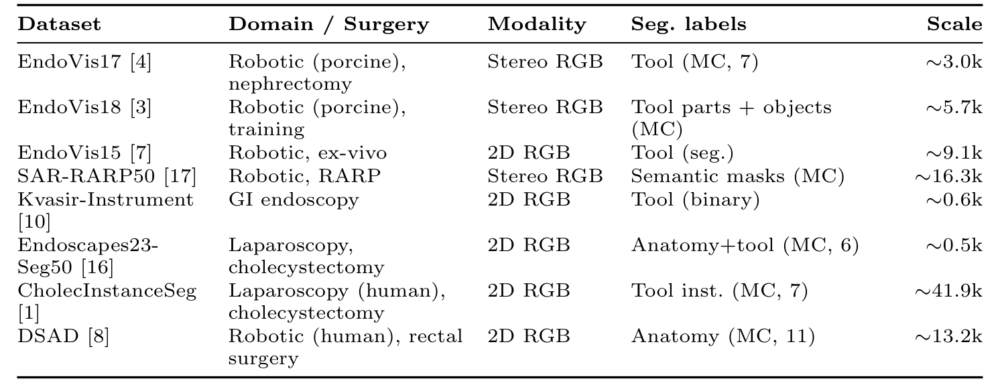
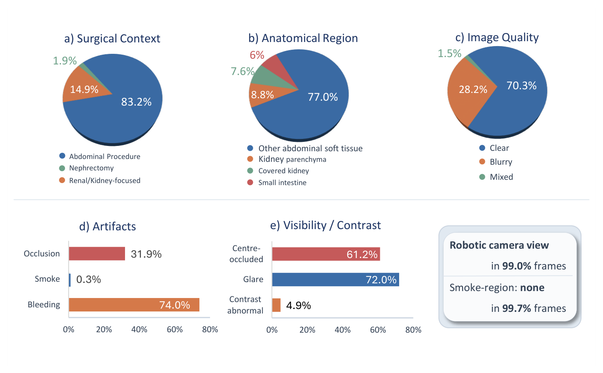
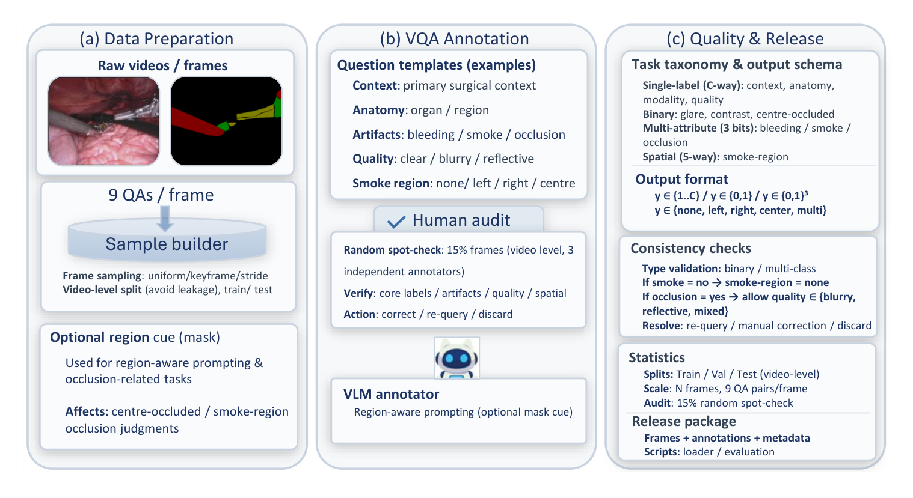
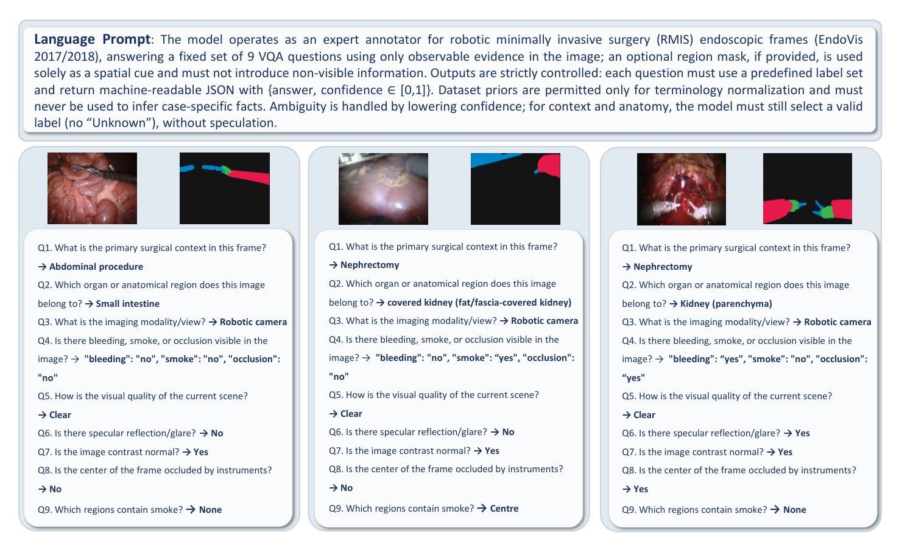
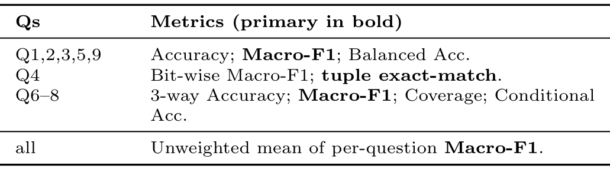
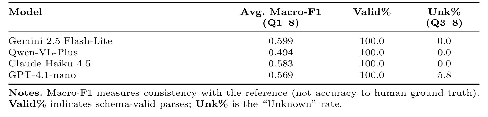

---
tags:
  - papers/手术数据集
aliases:
  - "RoboSurg-VQA"
  - "分割感知手术视觉问答基准"
date: 2026-05-21
arxiv_id: 2605.23068
---

# RoboSurg-VQA: A Multimodal Benchmark for Surgical Segmentation-Aware Visual Question Answering

## 核心信息

- 标题: RoboSurg-VQA: A Multimodal Benchmark for Surgical Segmentation-Aware Visual Question Answering
- 标题翻译: RoboSurg-VQA:面向手术分割感知视觉问答的多模态基准
- 作者: Chengyi Zhang, Zi Ye, Ziyang Wang
- 机构: Swansea University(英国); Maynooth University(爱尔兰); Aston University(英国)
- 发表时间: 2026-05-21(arXiv v1)
- 发表渠道: arXiv 预印本(cs.CV)
- arXiv: 2605.23068
- 论文链接: https://arxiv.org/abs/2605.23068
- 代码 / 项目: https://github.com/ziyangwang007/Robosurg-VQA(论文写明代码将在此发布)
- 数据 / 资源: 数据清单写明录用后发布,论文未给出独立的数据下载地址
- 论文类型: 基准与数据集论文(benchmark_or_dataset)

## 原文摘要翻译

机器人辅助与微创手术(RMIS/MIS)中可靠的视觉理解,需要的不只是准确的掩码:在临床实践中,医生会以近似语言的方式询问手术语境、可见性、伪影以及解剖结构和手术器械是否存在,而这些问题往往出现在遮挡、烟雾、出血和镜面高光造成的退化视野下。

我们提出 RoboSurg-VQA,这是一个分割感知的视觉问答(VQA)基准,通过在统一模式下改造公开手术分割数据集构建而成。每一帧都配有一组固定的、有临床动机的问题,覆盖手术语境、解剖(含区域)、成像模态与视角、手术伪影、图像质量以及基本的可见性和空间属性,并使用封闭答案集以支持一致的评测。

为扩大标注规模,我们通过受约束的提示生成候选答案,配合自动的有效性与一致性检查,再经人工审核以提高合理性和标签一致性。我们报告了基准统计、健全性基线以及在困难手术条件下的常见评测难点。代码将发布于 https://github.com/ziyangwang007/Robosurg-VQA。

## 创新点

1. 把分割数据改造成问答基准。作者不重新采集视频,而是把公开手术分割数据集统一成按帧组织的格式,保留原始掩码,再映射到预定义问题。这条路线成本低,而且让掩码可以作为空间线索参与回答。
2. 固定九问的闭集问题体系。九个问题覆盖手术语境、解剖、成像模态、出血烟雾遮挡、画质、高光、对比度、中心遮挡和烟雾区域,每问有固定答案空间,三个问题允许 Unknown。闭集答案让打分可复现,避免开放式回答难以比对。
3. 约束式模型辅助标注流水线。视觉语言模型在温度 0、只输出 JSON 的约束下回答九问,经确定性归一化、跨问题一致性规则和 15% 人工抽检,得到格式上零错误的标签。
4. 针对类别偏斜的评测协议。作者用多数类基线说明准确率会被先验抬高,因此规定 Macro-F1 为主指标,多属性题用元组精确匹配,带 Unknown 的题另报覆盖率和条件准确率。

## 一句话总结

RoboSurg-VQA 把 EndoVis17/18 两个猪组织机器人手术分割数据集的 11,480 帧配上固定九问和闭集答案,答案由视觉语言模型在 JSON 约束下生成、再抽检 15% 帧人工审核;论文给出的是格式质检、标签分布、与 GPT-4o-mini 参照标签的跨模型一致性和多数类基线,没有任何模型在人工真值上的成绩。

## 研究问题

**分割排行榜只回答“像素属于哪一类”,而医生在术中更常问的是语境、可见性和伪影,这些问题现有基准测不到。**

机器人与微创手术依赖内镜画面,但视野受限、镜面高光、烟雾和频繁遮挡让场景理解很难。EndoVis 2017 器械分割和 EndoVis 2018 场景分割挑战赛为像素级感知打下基础,Cholec80 等带流程标签的视频数据集推动了场景理解,但这些基准都不衡量医生在控制台前提出的问题。

视觉问答是连接感知和语言的自然接口,但手术问答与自然图像问答不同:术语专业、画面经常退化、正确答案依赖细粒度线索。已有工作包括 Surgical-VQA 的结构化手术问答、Surgical-VQLA 的带定位问答,以及 SurgicalGPT、GP-VLS、EndoChat 等多模态指令与对话模型。作者认为这些数据集来源和标签空间有限,或者以对话为目标,没有对齐到可见性、遮挡、伪影、画质这类与分割相关的评测。

论文要回答的问题是:**公开手术分割数据集里已有的监督,能否转成一个标准化的问答基准,用来评测多模态模型在真实手术条件下的表现。**

> [!figure] Fig 1 示例帧与 RoboSurg-VQA 对话
> 建议位置：研究问题
> 放置原因：用一帧小肠画面和三组问答直观说明基准要问什么。
> 当前状态：保留占位；首次裁剪带入页眉，修复裁剪又带入图注首行，修复次数已用尽。
> 论文原图编号：Fig 1

原图展示一帧小肠画面和三组问答:手术语境答“腹部手术”,解剖区域答“小肠”,是否模糊答“否”。其中“图像是否模糊”并不是九问中的原句,九问里对应的是画质题 Q5。

### 核心观点速览

**论文的回答是:不重新标数据,而是让视觉语言模型在严格约束下替分割帧回答九个固定问题,再用规则和人工抽检把关。**

支撑这一回答的有四步:

1. 把 EndoVis17/18 的 11,480 帧统一成带器械掩码的样本表。
2. 定义九个闭集问题,覆盖语境、解剖、模态、伪影、画质和遮挡。
3. 让模型以温度 0、JSON 输出作答,再经归一化、一致性规则和 15% 人工抽检。
4. 规定以 Macro-F1 为主的评测协议,并用多数类基线说明准确率会被先验抬高。

**结论的边界同样清楚:**标签主要是模型生成的,论文报告的是格式质检和“与 GPT-4o-mini 参照标签的一致性”,没有任何模型在人工真值上的成绩。来源只有两个猪组织机器人数据集,烟雾和模态两类题在当前数据上几乎是常数。

下一节先看这 11,480 帧从哪里来、九问具体问什么。

## 数据与任务定义

### 任务定义

这一节要弄清楚基准的输入、问题和标签各是什么,以及数据有多偏。

给定手术图像 $I$ 和分割标注 $M$,任务是用每类问题各自的封闭答案空间,回答一组固定问题 $\{Q_k\}_{k=1}^{K}$,这里 $K=9$。问题覆盖三层:全局场景属性(语境、模态)、中层属性(画质、对比度)和区域敏感属性(可见性、遮挡、伪影位置)。对区域相关的问题,掩码作为可选的空间支持。

### 数据来源

Table 1 列出 8 个公开手术分割数据集作为候选来源:

*论文原图编号：Table 1。8 个公开手术分割来源的领域、模态、分割标签与规模。放在这里是因为它是作者“统一异构来源”这一说法的依据,但实际实例化只用了其中前两个。*

**实际实例化的基准只用了 EndoVis17 和 EndoVis18 两个数据集,共 11,480 帧。** 这两个数据集都是猪组织上的机器人手术,掩码只有器械,没有器官类别。Table 1 中 SAR-RARP50、CholecInstanceSeg、DSAD 等人体手术来源都没有进入当前版本。

划分为 8,745 帧训练、2,735 帧测试。数据分布在三个站点:站点 1 有 2,400 帧,站点 2 有 3,232 帧,站点 3 有 5,848 帧。每个样本以“站点、划分、编号”三元组作为全局键。

站点与来源数据集如何对应,论文未说明。表 1 中两个来源的规模约为 3.0k 与 5.7k,合计少于 11,480,差额从何而来论文也未说明。

### 九问问题体系

> [!figure] Table 2 问题列表与受控答案空间
> 建议位置：数据与任务定义
> 放置原因：九个问题的原文与答案空间是理解评测口径的核心。
> 当前状态：保留占位；自动裁图未生成候选，内容已用下表重写。
> 论文原图编号：Table 2

| 编号 | 问题 | 答案类型 | 标签 |
|---|---|---|---|
| Q1 语境 | 本帧主要的手术语境是什么 | 3 类,无 Unknown | 机器人辅助肾切除、肾脏相关手术、其他腹部手术 |
| Q2 解剖 | 画面属于哪个器官或区域 | 4 类,无 Unknown | 小肠、肾实质、被脂肪筋膜覆盖的肾、其他腹部软组织 |
| Q3 模态 | 成像模态或视角 | 4 类 | 内镜、机器人摄像头、合成、Unknown |
| Q4 伪影 | 是否可见出血、烟雾、遮挡 | 3 位多属性 | 每位取是或否 |
| Q5 画质 | 当前画面的视觉质量 | 5 类 | 清晰、模糊、反光、混合、Unknown |
| Q6 高光 | 是否有镜面反射或高光 | 3 类 | 是、否、Unknown |
| Q7 对比度 | 对比度是否正常 | 3 类 | 是、否、Unknown |
| Q8 中心遮挡 | 画面中心是否被器械遮挡 | 3 类 | 是、否、Unknown |
| Q9 烟雾区域 | 哪些区域有烟雾 | 5 类空间,严格 | 无、左、右、中心、多处 |

Q1 和 Q2 不允许 Unknown,模型必须选一个标签;Q6 到 Q8 允许 Unknown。这一设计让语境和解剖题永远有答案,但也意味着模型在看不清时被迫猜测,标签里会混入低置信的猜测。

### 标签分布

*论文原图编号：Figure 3。各问题的答案分布:语境、解剖、画质三个饼图,伪影与可见性两个条形图,以及机器人摄像头视角和烟雾区域为无的占比。放在这里是因为它直接显示标签严重偏斜。*

正文给出的分布:

- Q1:其他腹部手术 83.22%,机器人辅助肾切除 14.86%,肾脏相关手术 1.92%。
- Q2:其他腹部软组织 77.03%,肾 8.84%,被覆盖的肾 7.57%,小肠 6.56%。
- Q3:机器人摄像头 98.82%。
- Q4:烟雾为否 99.72%,出血为是 73.99%,遮挡为是 31.86%。
- Q8:中心被遮挡为是 61.18%。

Figure 3 的饼图图例把 14.9% 标给肾脏相关手术、1.9% 标给肾切除,与正文的对应关系相反;Q3 在图中写作 99.0%,正文为 98.82%。以正文为准。

**偏斜的程度决定了评测设计。** 一道题如果九成以上是同一答案,只报准确率就分不出模型好坏。我的判断:EndoVis17 本身是猪肾切除数据,而 Q1 有八成以上被标为“其他腹部手术”,说明语境标签来自模型看图判断,并未直接取自来源数据集的元数据。

数据清楚之后,下一节看这些标签是怎么生成和把关的。

## 方法主线

**标签由模型生成,所以这一节的关键问题是:约束和抽检能把模型的错误压到多低。**

### 构建流程

*论文原图编号：Fig 2。数据构建流程:数据准备、模型辅助问答标注与人工审核、质检与发布三栏。放在这里是因为它把抽帧、掩码线索、标注模型、一致性检查和发布包放在一张图里。*

每个查询给标注模型两路视觉输入:原始 RGB 帧,以及一张只含器械、不含器官类别的伪彩分割掩码。掩码只为器械定位和可见性相关属性(例如中心遮挡)提供空间线索,不为解剖或手术语境提供语义监督。

### 机制流程

1. 数据统一:输入为 EndoVis17/18 的帧与器械掩码;操作是把掩码编码为伪彩图并写成共享清单,每条记录关联帧、掩码、site、划分与编号;输出为以 (site, split, id) 为键的样本表。
2. 约束式模型标注:输入为 RGB 帧加伪彩掩码和固定提示;操作是视觉语言模型以温度 0 回答九问,每问只输出 JSON 格式的取值与 $[0,1]$ 区间的置信度;输出为每帧九个候选答案。
3. 自动校验:输入为候选答案;操作是类型校验、Q1/Q2 的别名映射与安全回退、置信度截断,以及规则“若 Q4 烟雾为否,则 Q9 置为无”;输出为格式合规的标签。
4. 人工抽检:输入为按视频分层抽出的 15% 帧,按视频抽样是为了降低相邻帧的时间相关;操作是三名独立标注者核对合理性与跨题一致性,并选择修正、在同样约束下重新查询模型或丢弃;输出为发布用标签,丢弃帧从发布集删除。

### 标注提示的约束

*论文原图编号：Fig 4。模型辅助标注示例:上方是语言提示,下方是三帧原图、器械掩码和九问答案。放在这里是因为它展示了提示约束和输出格式。*

提示要求模型扮演 RMIS 内镜帧的专家标注员,只依据画面中可观察的证据作答;掩码只作空间线索,不能引入看不到的信息;数据集先验只能用于术语规范,不能用来推断个案事实;拿不准时降低置信度,但 Q1 和 Q2 仍须选一个有效标签。

**这里有一处未交代清楚的关键信息:主标注模型是哪一个,论文未说明。** Table 4 把 GPT-4o-mini 作为一致性参照,我的判断是它很可能就是主标注模型,但原文没有直说。这影响表 4 的含义:如果参照就是标签来源,那么其他模型的一致性分数其实是“与标签生成者有多像”。这一点论文未说明,读者因此无法判断表 4 是在衡量标签质量还是在衡量模型间的相似度。

### 评测协议

*论文原图编号：Table 3。各问题组的评测指标,粗体为主指标。放在这里是因为它规定了基准的正式打分方式。*

- 闭集分类题(Q1、Q2、Q3、Q5、Q9):报准确率、平衡准确率和 Macro-F1,以后者为主指标。
- 多属性题 Q4:报三位逐位 Macro-F1 的平均,以及三位全对的元组精确匹配(主指标)。
- 带 Unknown 的 Q6 到 Q8:报 3 类准确率、Macro-F1(主指标)、覆盖率和条件准确率。
- 总分:各问题 Macro-F1 的无权平均。

覆盖率定义为

$$\text{Coverage} = 1 - \frac{N_{\text{Unknown}}}{N}$$

条件准确率只在模型未答 Unknown 的子集上计算。Macro-F1 对每个类别的 F1 等权平均,少数类答错会直接拉低分数,这正是作者选它作主指标的理由。

流程和指标确定后,下一节看论文报告的数字各自证明了什么。

## 关键结果

**论文的结果全部是关于标签本身的:格式是否合规、人工改了多少、不同模型答得像不像、先验有多强。** 没有一项是模型在人工真值上的成绩。

### 格式质检

在最终语料上,约束协议得到完全可机读的输出:0 条解析错误、0 条缺失答案、闭集题 0 条越界预测;烟雾与烟雾区域的一致性规则在发布标签中 0 违规。**这些零只说明格式合规,答案是否正确是另一回事。**

### 人工抽检

抽检按视频分层抽取 15% 帧,覆盖不同 site、划分与视觉条件。在抽检子集上:

| 处理结果 | 比例 |
|---|---|
| 人工修正 | 4.8% |
| 同协议重新询问 | 8.7% |
| 丢弃(视觉证据不足或不可用) | 2.3% |

三类结果互斥,合计约 15.8% 的抽检帧被动过。**所以模型标签并不干净:**如果这个比例对未抽检的 85% 帧同样成立,大约每六帧就有一帧的标签需要复查。这是我的推断,论文没有做这种外推。

重询的触发条件是低置信度或歧义等自动标记。三名审核者之间的一致性论文未说明,因此人工修正本身的可靠度也无法量化。

### 跨模型一致性

*论文原图编号：Table 4。以 GPT-4o-mini 为参照的跨模型一致性:Q1 到 Q8 平均 Macro-F1、合规率和 Unknown 率。放在这里是因为它是论文唯一的多模型比较。*

| 模型 | 平均 Macro-F1(Q1–Q8) | 合规率 | Unknown 率(Q3–Q8) |
|---|---|---|---|
| Gemini 2.5 Flash-Lite | 0.599 | 100.0 | 0.0 |
| Claude Haiku 4.5 | 0.583 | 100.0 | 0.0 |
| GPT-4.1-nano | 0.569 | 100.0 | 5.8 |
| Qwen-VL-Plus | 0.494 | 100.0 | 0.0 |

**四个模型与参照的一致性都只在 0.5 到 0.6 之间。** 作者明确说这些分数衡量的是与参照的一致性,而非对人工真值的准确率。我的判断:同一组帧上不同模型给出的答案分歧这么大,说明这些题目对视觉语言模型并不容易,也说明单一模型生成的标签含有不小的模型特异成分。

### 多数类基线

多数类基线永远回答训练集里最常见的类别。在测试集上它的准确率看起来很高:

| 问题 | 准确率 |
|---|---|
| Q3 模态 | 0.9810 |
| Q1 语境 | 0.8161 |
| Q2 解剖 | 0.6680 |
| Q5 画质 | 0.7941 |
| Q9 烟雾区域 | 1.0000 |

但由于少数类被系统性漏掉,它的 Macro-F1 很低:语境题约 0.30,解剖题约 0.20。对 Q6 到 Q8,只答主类的预测器平衡准确率处于随机水平。**所以只看准确率会严重高估模型。**

**Q9 准确率 1.0000 意味着测试集里烟雾区域全是“无”,这道题在当前版本里无法区分任何模型。** 按协议总分是各问题 Macro-F1 的平均,常数题会让总分里有一项无法区分模型,这一影响论文未讨论。作者据此得出两点:强先验会抬高朴素准确率;可见性和伪影类属性需要按遮挡或画质分层分析。

这些数字说明了标签的性质,下一节讨论它们合在一起能支持多强的结论。

## 深度分析

### 这个基准真正测到了什么

**关键问题是:分数高到底说明模型答对了,还是说明它像标注模型。**

在当前版本里,RoboSurg-VQA 测的是**模型答案与一个视觉语言模型生成的标签有多一致**。只有 15% 帧经过人工核对,其余帧的标签就是模型输出。用它评测别的视觉语言模型,本质上是“用模型评模型”:分数高可能是因为答对了,也可能只是与标注模型有相同的偏好。论文没有一个纯人工标注的测试子集,所以这两种解释分不开。

### 分割感知的实际范围

标题强调“分割感知”,但在实例化中掩码只有器械。按九问逐一看:

- 与掩码直接相关的是 Q8 中心遮挡,以及部分 Q4 遮挡。
- Q1 语境、Q2 解剖、Q5 到 Q7 的画质类问题都与掩码无关,只能靠看图。
- Q9 烟雾区域在测试集上恒为“无”。

**所以“分割感知”在当前数据上主要落在器械遮挡这一两个问题上。** 作者也写明掩码不提供解剖或语境的语义监督。论文没有做有掩码与无掩码两种条件的对照,所以掩码到底有没有改善标签,无法从结果中看出。Table 1 中带解剖标签的 DSAD、Endoscapes 若加入,才可能让解剖题真正有分割依据。

### 标签分布暴露的题目问题

- Q3 有 98.82% 为机器人摄像头,而来源本来就是机器人手术,这题几乎是常数。
- Q4 烟雾 99.72% 为否,与 Q9 一起让烟雾相关的两题都缺少正例。
- Q1 在猪肾切除数据上把八成以上判成“其他腹部手术”,语境标签与来源事实的关系论文未说明;Q2 解剖标签有没有外科医生核验,论文也未说明。

这些问题不影响作者关于“准确率会被先验抬高”的结论,反而是它的来源;但它们说明当前版本更像一个协议示范,而不是一个分布合理的评测集。

### 与已有手术问答工作的位置

| 工作 | 特点 | RoboSurg-VQA 的差异 |
|---|---|---|
| Surgical-VQA | 基于 EndoVis 等数据的结构化手术问答 | 新增画质、伪影、可见性问题,答案空间固定 |
| Surgical-VQLA | 在问答上加定位 | 不做定位输出,掩码只作输入线索 |
| SurgicalGPT、GP-VLS、EndoChat | 开放对话或指令模型 | 闭集答案,打分可复现 |
| VQA-RAD、SLAKE | 放射影像问答 | 面向内镜画面的烟雾、出血、遮挡 |

论文没有在相同帧上与这些工作的问题集做重叠或难度比较,上表的差异来自作者的定位陈述。

把这些判断收拢起来,就是下一节的局限清单。

## 局限

- 没有人工真值上的模型成绩。表 4 只是与参照模型的一致性,论文没有给出任何模型的真实准确率,也没有训练或微调基线。
- 85% 帧未经人工核对,而抽检中约 15.8% 帧被修正、重询或丢弃;三名审核者之间的一致性论文未说明。
- 主标注模型的身份论文未说明,Table 4 的参照与标签来源是否同一模型不清楚。
- 只实例化 EndoVis17/18 两个猪组织机器人数据集,不能外推到人体手术或腹腔镜;site 与来源的对应、帧数如何达到 11,480 论文未说明。
- 题目分布严重偏斜:Q3 与 Q9 近乎常数,烟雾正例极少。
- Figure 3 的图例与正文百分比对应不一致。
- 数据清单写明录用后发布,具体发布时间与许可论文未说明,代码仓库为承诺地址,当前无法复现统计。
- 没有有掩码与无掩码的对照,分割线索对标签或模型的作用无法检验。

## 我的笔记

- 可借鉴的做法:闭集答案、JSON 输出、温度 0、确定性归一化和跨题规则,能低成本把分割数据转成可打分的问答。
- 评测时报 Macro-F1 和平衡准确率,Q3、Q9 这类近常数题建议单独列出或剔除,不计入总分。
- 若要用它评模型,先自建一个纯人工标注的测试子集,否则只能报“与标签模型的一致性”。
- 按视频划分、按视频抽检,避免相邻帧泄漏。

后续问题:

- 主标注模型是不是 GPT-4o-mini,它在人工修正子集上的准确率是多少?
- Q1 与 Q2 在猪组织帧上依据什么判定,有无外科医生核验?
- 加入表 1 的其余 6 个来源后,标签偏斜能否缓解?
- 开源或微调后的视觉语言模型在人工真值上能达到多少?

## 引用

- Zhang, Ye, Wang (2026). RoboSurg-VQA: A Multimodal Benchmark for Surgical Segmentation-Aware Visual Question Answering. arXiv:2605.23068.
- Allan et al. (2019). 2017 Robotic Instrument Segmentation Challenge. arXiv:1902.06426.
- Allan et al. (2020). 2018 Robotic Scene Segmentation Challenge. arXiv:2001.11190.
- Seenivasan et al. (2022). Surgical-VQA: Visual Question Answering in Surgical Scenes using Transformer. MICCAI.
- Bai et al. (2023). Surgical-VQLA: Transformer with Gated Vision-Language Embedding for Visual Question Localized-Answering in Robotic Surgery. arXiv:2305.11692.
- Seenivasan et al. (2023). SurgicalGPT: End-to-End Language-Vision GPT for Visual Question Answering in Surgery. MICCAI.
- Wang et al. (2025). EndoChat: Grounded Multimodal Large Language Model for Endoscopic Surgery. arXiv:2501.11347.
