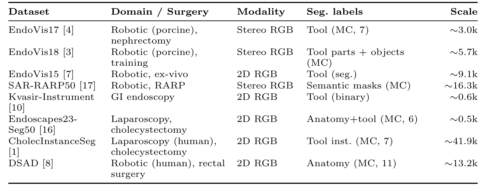
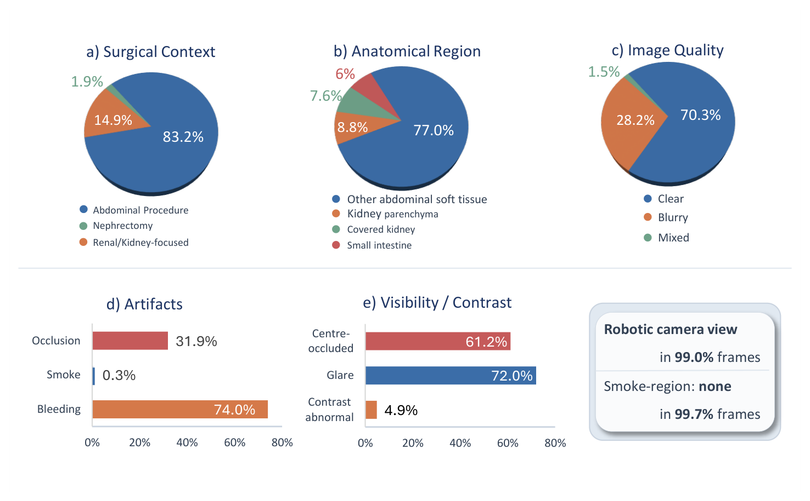
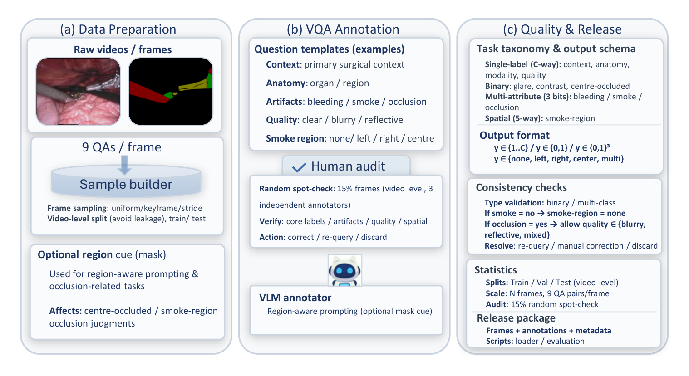
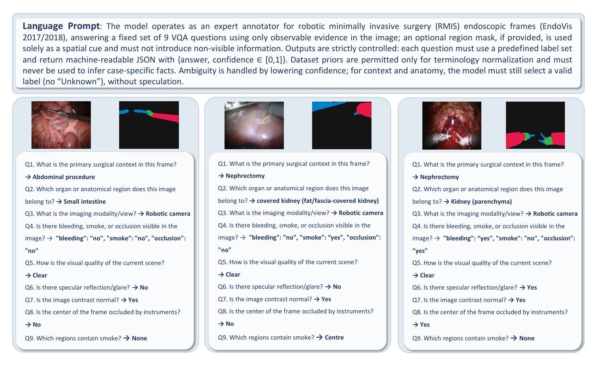
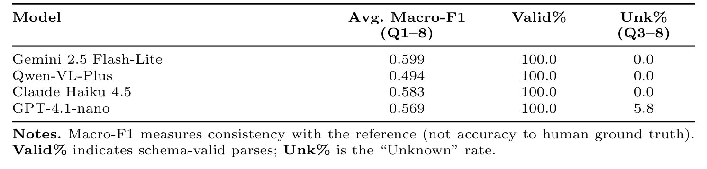

## 1. 背景与动机

**分割排行榜只回答“像素属于哪一类”,医生在术中更常问的是语境、可见性和伪影。** 内镜画面视野受限,还常有高光、烟雾、遮挡,EndoVis 2017/2018 等分割挑战赛测不到这些问题。

已有手术问答工作有 Surgical-VQA、Surgical-VQLA,以及 SurgicalGPT、EndoChat 等对话模型。作者认为它们来源和标签空间有限,或以对话为目标,没有对齐到画质、伪影、遮挡这类与分割相关的评测。

:::highlights
- 缺口:没有一个标准化、闭集、面向画质伪影可见性的手术问答基准
- 思路:把公开分割数据里已有的监督改造成问答
:::

## 2. 核心观点速览

论文的做法是让视觉语言模型在严格约束下替分割帧回答九个固定问题,再用规则和人工抽检把关。

**它报告的结果全部关于标签本身:**格式是否合规、人工改了多少、不同模型答得像不像、先验有多强。没有任何模型在人工真值上的成绩。

**边界有三条:**标签主要由模型生成;来源只有两个猪组织机器人数据集;烟雾和模态两类题在当前数据上几乎是常数。

:::data
- 11,480 帧,8,745 训练 / 2,735 测试,每帧 9 问
- 15% 帧人工抽检,其中 4.8% 修正、8.7% 重询、2.3% 丢弃
- 四个模型与参照的一致性 Macro-F1 在 0.494 到 0.599 之间
:::

## 3. 数据从哪里来

*论文原图编号：Table 1。8 个公开手术分割来源。当前版本实际只用了前两个。*

Table 1 列出 8 个候选来源,但实例化的基准只用了 EndoVis17 和 EndoVis18。两者都是猪组织上的机器人手术,掩码只有器械。

数据分布在三个站点:2,400、3,232、5,848 帧。站点与来源的对应论文未说明;表中两个来源约 3.0k 与 5.7k,合计少于 11,480,差额从何而来论文也未说明。**所以复现前必须等清单发布,才能确认样本构成。**

## 4. 九问问什么

九个问题都有固定答案空间:语境 3 类、解剖 4 类、模态 4 类、伪影 3 位多属性、画质 5 类、高光、对比度、中心遮挡各 3 类(含 Unknown)、烟雾区域 5 类空间。语境和解剖不允许 Unknown,看不清时模型也必须选一个。

*论文原图编号：Figure 3。各问题的答案分布。图例与正文百分比的类别对应不一致,以正文为准。*

**标签严重偏斜:**模态题 98.82% 是机器人摄像头,烟雾为否占 99.72%,语境题 83.22% 是其他腹部手术。EndoVis17 本是猪肾切除数据,语境却八成以上被判成其他腹部手术,说明语境标签来自模型看图判断。

:::highlights
- 掩码只含器械,解剖和语境题与掩码无关
- 偏斜让准确率失去区分度
:::

## 5. 标签怎样生成和把关

*论文原图编号：Fig 2。构建流程:数据准备、模型辅助标注与人工审核、质检与发布。*

标注模型同时看 RGB 帧和伪彩器械掩码,以温度 0 只输出 JSON,每问给取值和置信度。语境和解剖答案经别名映射与置信度截断;规则“烟雾为否则烟雾区域为无”强制跨题一致。

*论文原图编号：Fig 4。标注提示与三组示例输出。*

之后按视频分层抽 15% 帧,由三名独立审核者核对,选择修正、重询或丢弃。**主标注模型是哪一个,论文未说明**,这决定了后面跨模型比较的含义。

## 6. 结果说了什么

格式上全部合规:0 解析错误、0 缺失、0 越界,一致性规则 0 违规。**这只证明约束生效,不证明答案正确。**

抽检中合计约 15.8% 的帧被动过。我的推断:若同样比例适用于其余 85% 未抽检帧,大约每六帧就有一帧标签需要复查。

*论文原图编号：Table 4。以 GPT-4o-mini 为参照的跨模型一致性。*

| 模型 | 平均 Macro-F1 | Unknown 率 |
|---|---|---|
| Gemini 2.5 Flash-Lite | 0.599 | 0.0 |
| Claude Haiku 4.5 | 0.583 | 0.0 |
| GPT-4.1-nano | 0.569 | 5.8 |
| Qwen-VL-Plus | 0.494 | 0.0 |

多数类基线在测试集上准确率很高(模态 0.9810、烟雾区域 1.0000),但语境和解剖的 Macro-F1 只有约 0.30 和 0.20。**所以只看准确率会严重高估模型,作者因此把 Macro-F1 定为主指标。**

:::data
- 模态题多数类准确率 0.9810,烟雾区域 1.0000
- 语境题 Macro-F1 约 0.30,解剖题约 0.20
:::

## 7. 结果没说什么

- 没有人工真值,分数高可能只是像标注模型。表 4 明确是一致性,不是准确率。
- 没有有掩码与无掩码的对照,分割感知是否有用无法检验;实际与掩码相关的主要是中心遮挡题。
- 烟雾区域在测试集上恒为无,这一题在总分中无法区分模型。
- 三名审核者之间的一致性论文未说明,人工修正的可靠度无法量化。

## 8. 使用前要核对什么

数据清单写明录用后发布,具体时间和许可论文未说明;代码地址为 github.com/ziyangwang007/Robosurg-VQA。若要拿它评模型,建议先自建一个纯人工标注的测试子集,并把模态、烟雾这类近常数题单列。

## @takeaways
- 闭集问题加 JSON 约束是把分割数据转成可评分问答的低成本做法
- 当前分数衡量的是与模型标签的一致性
- 报 Macro-F1,近常数题单列

## @strengths
- 问题体系和答案空间定义清楚,打分可复现
- 标注约束、一致性规则和抽检比例交代具体
- 用多数类基线主动揭示准确率陷阱

## @weaknesses
- 标签主要由模型生成,没有人工真值评测
- 只用两个猪组织机器人数据集,分布严重偏斜
- 主标注模型身份未说明,图 3 图例与正文不一致

## @questions
- 主标注模型是否就是 GPT-4o-mini,它在人工修正子集上准确率多少?
- 猪组织帧上的语境和解剖标签有无外科医生核验?
- 加入 Table 1 其余来源后偏斜能否缓解?
