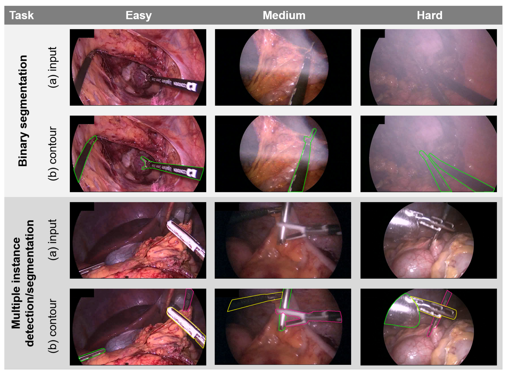
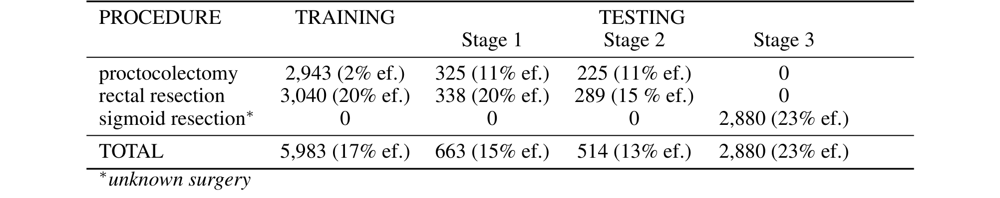
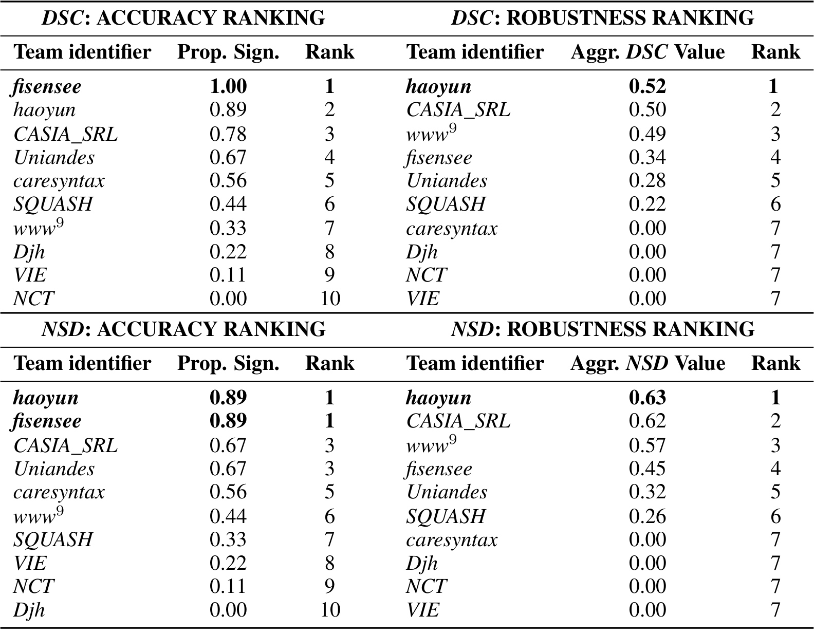
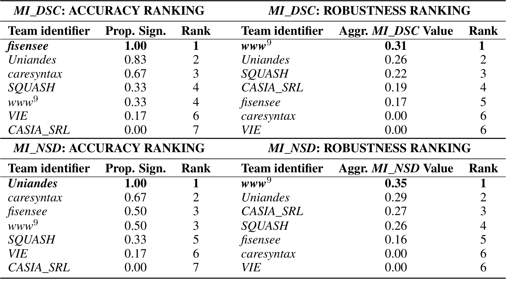
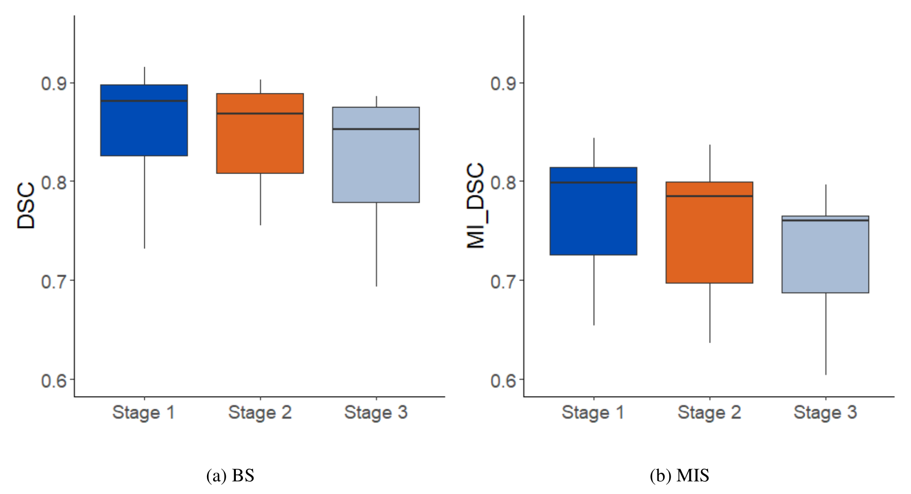
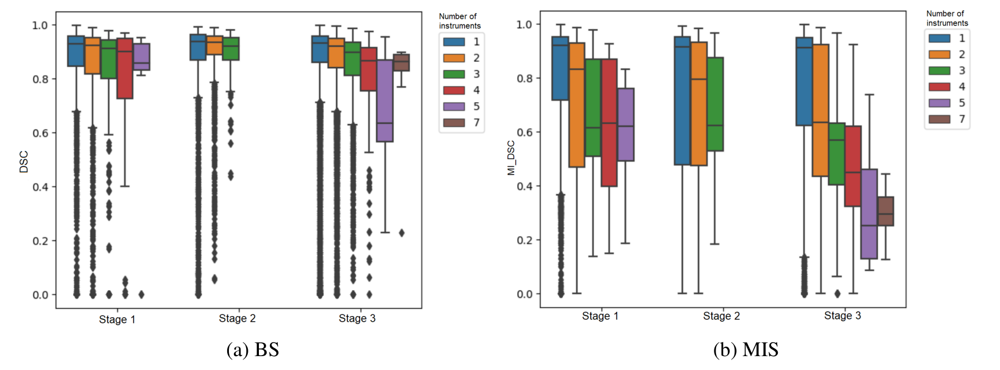
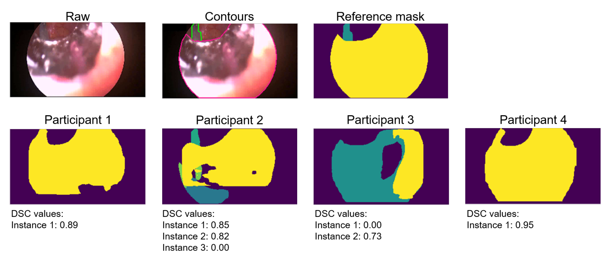
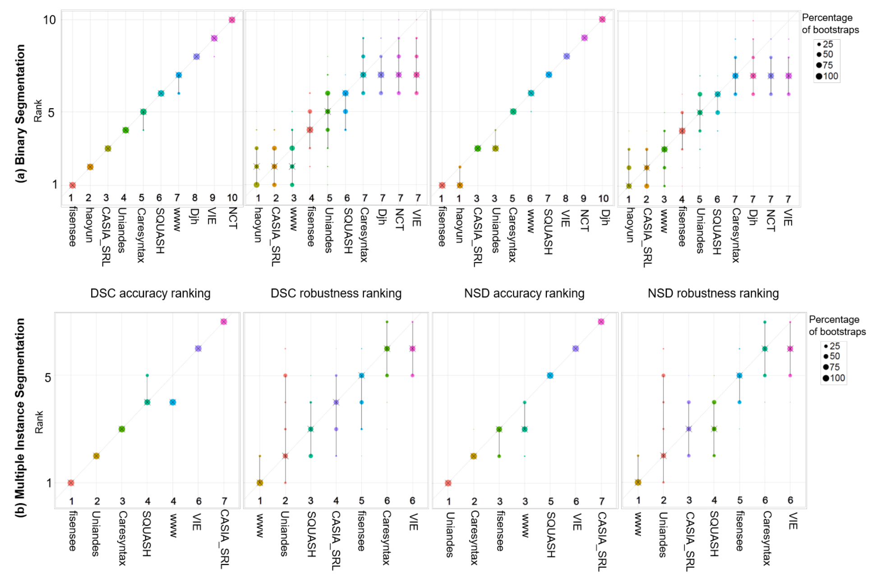

## 1. 背景与动机

腹腔镜手术中，技能评估、增强现实等辅助功能都要先知道器械在哪里。商用追踪靠光学或电磁标记，需要额外硬件；只用视频做器械分割可以绕开硬件。

难点在于验证。各组用自己的数据报告结果，很难比较。EndoVis 系列挑战提供了公共基准，但以往器械数据只有约 500 到 4,000 帧，多为干净画面，**测不出算法遇到血液、烟雾、运动伪影时会不会失败，也测不出换一批患者、换一种手术还能不能用。**

ROBUST-MIS 2019 是 MICCAI 2019 的 EndoVis 子挑战，就是为补这两个缺口而设。

:::highlights
- 以往器械分割基准小且干净，测不出稳健性和泛化
- 本挑战专门针对这两点设计数据、划分和排名
:::

## 2. 核心观点速览

**这是一份挑战结果报告：发布 30 台结直肠手术的 10,040 帧标注，用三项任务、三阶段测试和两种排名比较 10 支队伍。**

- **数据**：一家医院、三种术式各 10 台，经外包初标和医学背景团队复核。
- **评测**：二值分割、多实例检测、多实例分割；测试分同患者、同术式新患者、新术式三阶段；排名分准确性与稳健性。
- **结果**：二值分割平均 Dice 约 0.88，与以往冠军相当；检测指标几乎饱和；多实例分割在器械多于 3 把时冠军平均只有 0.45。
- **边界**：三阶段只下降 3% 到 5%，且混有测试集构成差异；术式都属结直肠手术；失败模式是定性归纳。

:::data
- 10,040 帧，30 台手术，三种术式
- 有效提交：二值 10、检测 6、多实例分割 7
:::

## 3. 数据从哪里来

视频在海德堡大学医院的一体化手术室采集，相机和光源固定为同一套 Karl Storz 设备，分辨率从 1920×1080 下采样到 960×540。三种术式是直肠切除、全结直肠切除和乙状结肠切除，各 10 台。

抽帧先按 1 帧/秒得到 4,456 帧，再在手术阶段切换处补抽到 10,040 帧。**超过一半的帧来自阶段切换附近**，器械更换和多器械同框可能更常见（我的判断，论文没有给出两部分帧的对比）。

*论文原图编号：Figure 1。二值分割与多实例检测/分割在易、中、难三档的输入帧与参考轮廓，可以看到烟雾、反光和器械交叉。*

标注分四步：外包初标；组织者发现不一致后制定协议；14 名工程师和 4 名医学生复核全部标注，模糊情形由小组给出共识；医学专家质控，最后由一名医学专家和一名工程师裁定。实例编号只在单帧内有效，不跨帧一致。

:::highlights
- 单中心、单一设备、三种相近术式
- 实例编号不跨帧，不能直接用于追踪评测
:::

## 4. 任务与三阶段划分

每个样本是 10 秒、250 帧的片段，只有末帧有标注。二值分割输出前景掩码；多实例分割用 1、2、… 区分实例；多实例检测只需粗略定位，提交格式相同。

划分规则：乙状结肠切除全部留给第 3 阶段；其余每种术式最短的 2 台给第 2 阶段；剩下 16 台中每第 10 个标注帧给第 1 阶段，其余为训练。

*论文原图编号：Table 1。各阶段各术式的帧数与空帧比例（ef）。*

| 阶段 | 测什么 | 帧数 | 空帧 |
|---|---|---|---|
| 训练 | | 5,983 | 17% |
| 第 1 阶段 | 同患者 | 663 | 15% |
| 第 2 阶段 | 同术式新患者 | 514 | 13% |
| 第 3 阶段 | 新术式 | 2,880 | 23% |

**三个阶段的样本量和空帧比例差别很大**，这会影响后面对泛化下降的解读。任务说明写末帧至少含一把器械，表中却有空帧，空帧怎么计分论文未说明。

:::data
- 训练 5,983 帧，第 3 阶段 2,880 帧
- 第 2 阶段只来自 4 台手术
:::

## 5. 指标与两种排名

二值任务用 Dice 系数（DSC，衡量重叠）和归一化表面 Dice（NSD，衡量边界在容差内是否重合）。容差 $\tau=13$ 取自 5 名标注者在 100 张图上的差异，单位论文未说明。

$$DSC(Y,\hat{Y})=\frac{2|Y\cap\hat{Y}|}{|Y|+|\hat{Y}|}$$

多实例任务先用匈牙利算法把预测实例与参考实例一一配对，逐对计算 DSC 或 NSD，再在图内对实例取平均，得到 MI_DSC 与 MI_NSD。**漏掉的实例得 0 分。** 检测任务用交并比大于 0.3 算命中，在全部图像上算平均精度均值（mAP）。

两种排名回答不同问题：

- **准确性排名**：每对算法做单侧 Wilcoxon 检验（显著性水平 0.05），按显著胜出比例排序，问"平均谁更好"。
- **稳健性排名**：取每个算法逐帧分数的 5% 分位数，问"最差的 5% 帧有多差"。

缺失结果记 0。测试数据不下发，参赛者提交 Docker 镜像，由组织者运行。

:::highlights
- 稳健性排名是这次挑战最有特色的设计
- 多实例指标对漏检很敏感
:::

## 6. 结果说了什么

*论文原图编号：Table 4。二值分割第 3 阶段排名，左为准确性，右为稳健性。*

二值分割中，fisensee 拿下 DSC 准确性第一，haoyun 拿下 DSC 稳健性（0.52）和 NSD 两项排名。**caresyntax、Djh、NCT、VIE 的 5% 分位数都是 0.00**，即在至少 5% 的帧上完全失败；准确性第一的 fisensee 在稳健性上只排第 4。

*论文原图编号：Table 6。多实例分割第 3 阶段的四个排名。*

多实例分割中，MI_DSC 准确性冠军是 fisensee，MI_NSD 准确性冠军是 Uniandes，两项稳健性冠军都是 www，分别只有 0.31 和 0.35。检测任务 6 支队伍的 mAP 在 0.94 到 1.00 之间，几乎没有区分度。

*论文原图编号：Figure 5。三个阶段的箱线图，左为二值分割，右为多实例分割。*

| 任务 | 第 1 阶段 | 第 2 阶段 | 第 3 阶段 |
|---|---|---|---|
| 二值分割 DSC 中位数 | 0.88 | 0.87 | 0.85 |
| 多实例分割 MI_DSC 中位数 | 0.80 | 0.78 | 0.76 |

作者称这证实了"性能随域差距下降"，下降约 3% 与 5%。**但检测任务不支持这个结论**：附录表 7 中 VIE 从第 1 阶段 0.750 升到第 3 阶段 0.978。

:::data
- 二值分割中位数 0.88 到 0.85
- 多实例分割中位数 0.80 到 0.76
- 检测 mAP 0.94 到 1.00
:::

## 7. 多实例为什么难

*论文原图编号：Figure 6。按画面中器械数分层的三阶段箱线图。*

准确性冠军的平均 MI_DSC 在 1、2、3、多于 3 把器械时分别是 0.82、0.71、0.62、0.45。二值分割几乎不受器械数影响。

图 2 中多实例分数成簇，作者指出这些簇对应不同器械数。**一部分下降来自指标本身**：两把器械漏掉一把，该帧就落在 0.5 附近（我的判断）。论文没有把检测召回和配对后的分割质量分开报告，所以分不清是"找不到"还是"分不准"。

*论文原图编号：Figure 8。器械彼此靠近的测试帧，部分队伍把一把器械拆成两个实例。*

作者查看最差和最好的 100 例后归纳：算法能处理反光、血液、不同光照；难在小、透明、相邻、交叉、遮挡、运动的器械和图像边缘。**烟雾的说法前后矛盾**：结果节列为难点，讨论节又说已稳健。

:::highlights
- 多实例分割随器械数单调下降
- 失败模式是定性归纳，烟雾结论不一致
:::

## 8. 结果没说什么

- **跨术式泛化的距离有限。** 三种术式都是结直肠手术，作者自己说换到胆胰或上消化道手术可能下降更多。
- **阶段间下降的原因没分开。** 三阶段帧数与空帧比例不同，阶段差异的检验或置信区间论文未说明。
- **"训练流程比结构更重要"只是假设。** fisensee 同时用了 8 模型集成与大量增强，haoyun 用了预训练和 5 折交叉验证，没有受控对比。
- **视频信息的价值没有被证明或否定。** 只有 3 支队伍用了视频，都没有获益；只有末帧有标注、实例编号不跨帧，也不利于时序模型（我的判断）。

## 9. 排名靠得住吗

图 4 用 1000 次自助抽样检验排名。准确性排名几乎不变；**稳健性排名的区间明显更宽**，作者解释为 5% 分位数本身不稳定。稳健性排名中相邻名次的差别不宜过度解读。

*论文原图编号：Figure 4。自助法气泡图，黑叉为中位名次，黑线为 95% 区间。*

Docker 提交杜绝了测试集过拟合和人工标注测试集；5 支队伍首次提交失败后获准重交，组织者核对过网络参数没有改动。www 队用 EndoVis 2017 数据目视检查，被列为灰色地带。

## 10. 复现与复用

- 用官方评测代码，尤其是匈牙利匹配、缺失记 0、图内先平均的规则。
- 空帧计分和 NSD 容差单位论文未说明，复现前先查代码。
- 三阶段划分可直接借鉴到其他手术数据。
- 960×540 下采样对小器械有影响，作者认为较小。

## @takeaways
- 三阶段划分把"记住患者"和"跨术式泛化"分开，值得复用
- 只看均值会漏掉偶尔完全失败的算法，稳健性排名能暴露它们
- 二值分割在这套数据上已接近饱和，检测任务阈值过松
- 多实例分割在多器械画面中远未解决，但部分下降来自指标计分方式

## @strengths
- 数据量和画面难度都超过以往 EndoVis 器械数据
- 首次设多实例检测和分割任务，并单独设最差情况排名
- Docker 提交、公开评测代码、自助法稳定性分析，评测过程透明

## @weaknesses
- 单中心、单设备、三种相近术式，跨机构泛化未测
- 阶段间下降没有统计检验，混有测试集构成差异
- 失败模式只有定性归纳，烟雾结论前后矛盾
- 检测任务指标饱和，几乎无法区分算法

## @questions
- 稳健性排名对分位数选择（1%、5%、10%）有多敏感？
- 按患者或手术聚合而非按帧聚合，排名会怎样变化？
- 把检测召回和配对后分割质量分开后，多器械画面的下降主要来自哪一边？
