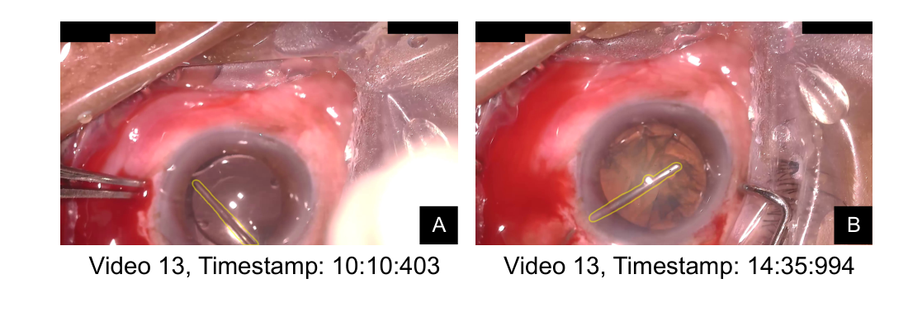
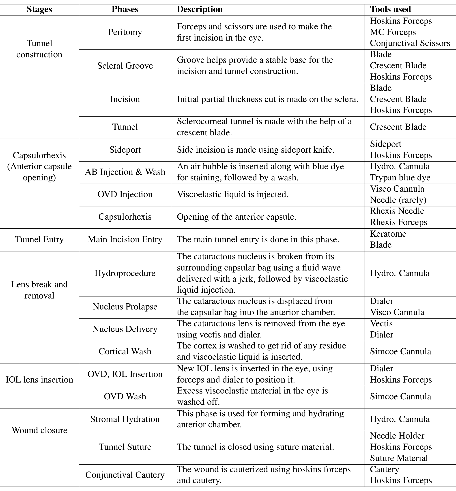
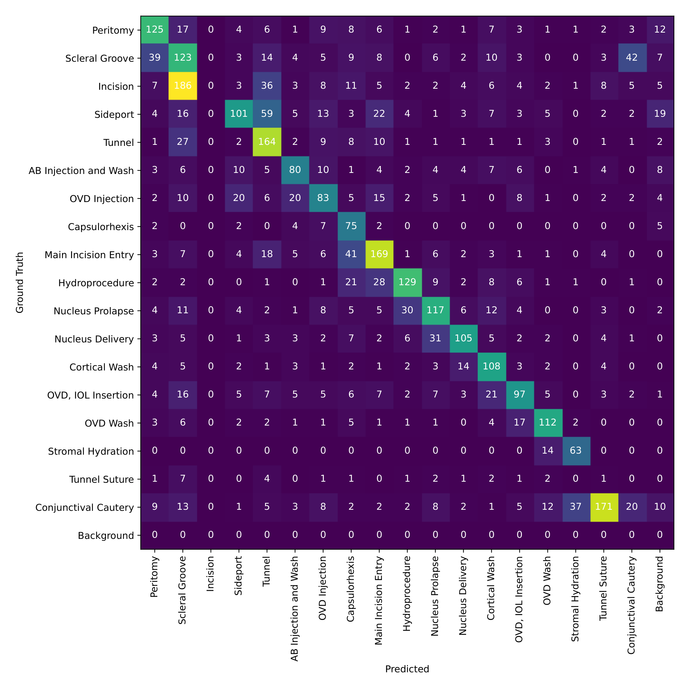
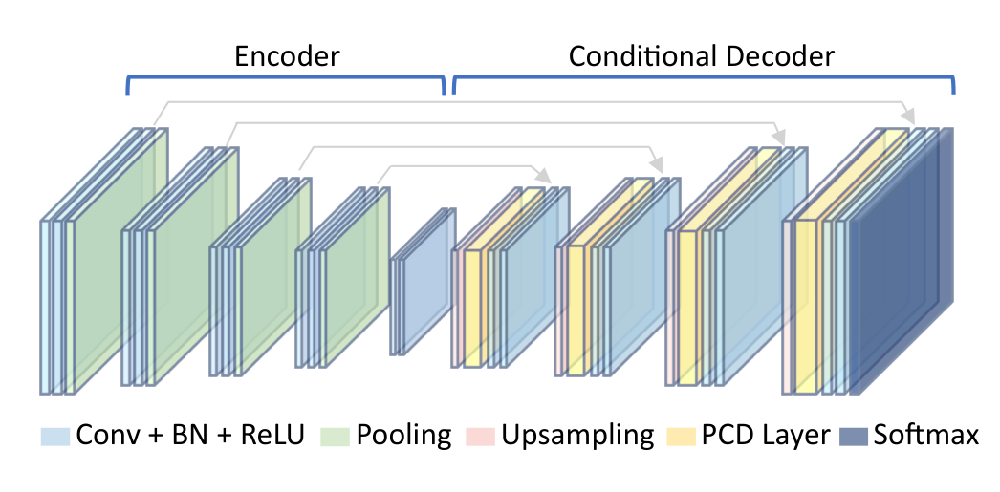
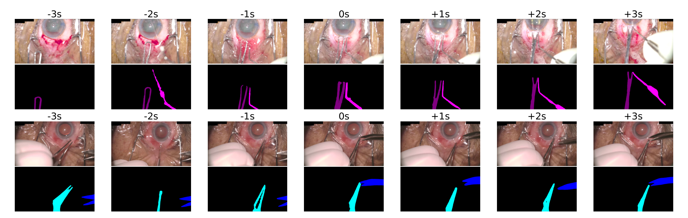
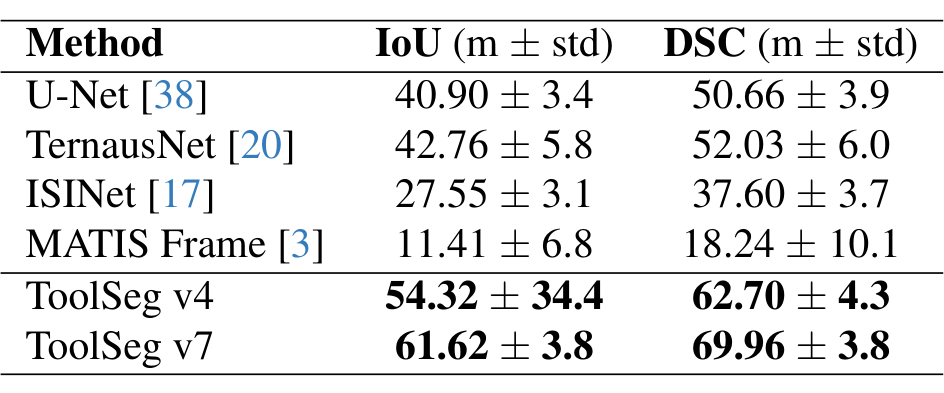
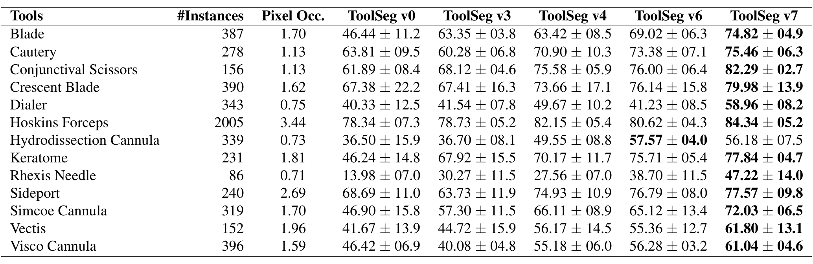
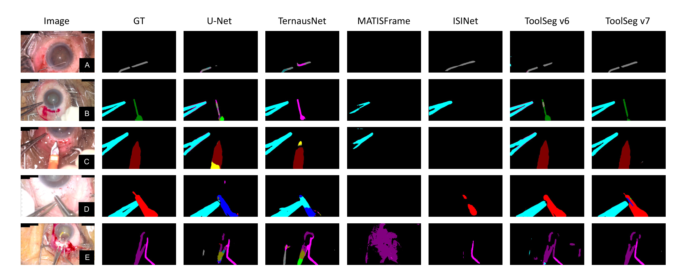
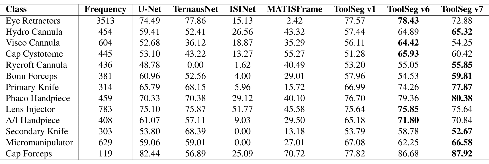
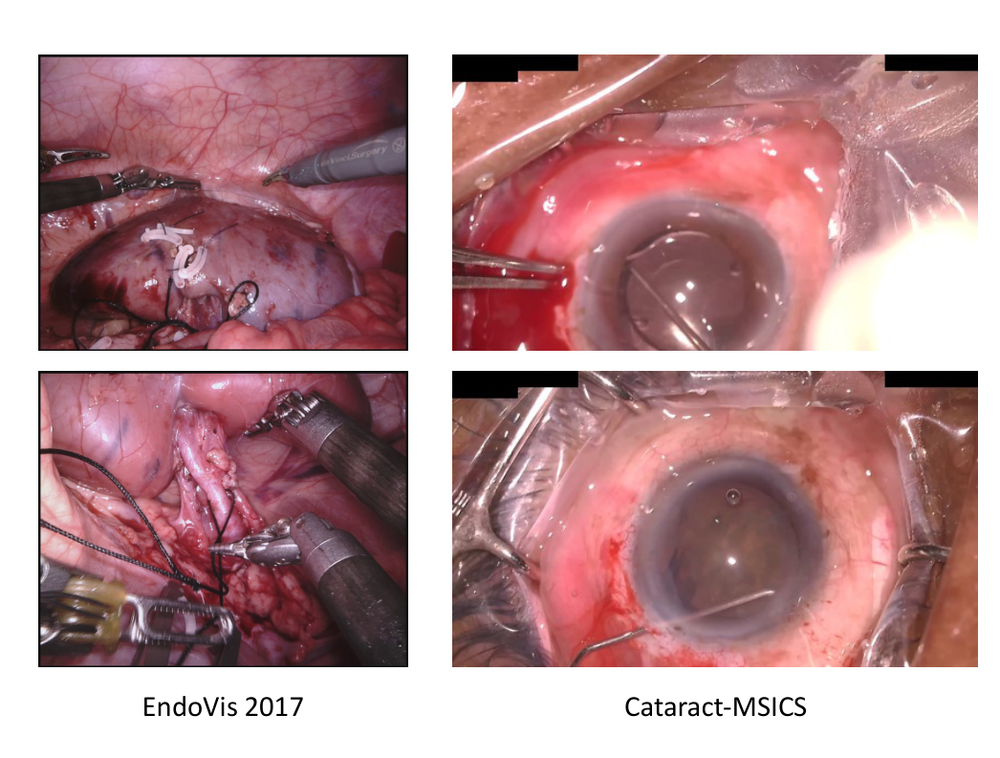

---
tags:
  - papers/手术数据集
aliases:
  - "Sankara-MSICS"
  - "Cataract-MSICS"
  - "ToolSeg"
date: 2024-11-25
arxiv_id: 2411.16794
---

# Phase-Informed Tool Segmentation for Manual Small-Incision Cataract Surgery

## 核心信息

- 标题: Phase-Informed Tool Segmentation for Manual Small-Incision Cataract Surgery
- 标题翻译: 面向手法小切口白内障手术的阶段感知器械分割
- 作者: Bhuvan Sachdeva, Naren Akash, Tajamul Ashraf, Simon Mueller, Thomas Schultz, Maximilian W. M. Wintergerst, Niharika Singri Prasad, Kaushik Murali, Mohit Jain
- 机构: Microsoft Research(班加罗尔); Sankara Eye Hospital(班加罗尔); University of Bonn(波恩)
- 发表时间: 2024-11-25(arXiv v1),本笔记依据 v2(2024-12-03)
- 发表渠道: arXiv 预印本(cs.CV)
- DOI: 10.48550/arXiv.2411.16794
- arXiv: 2411.16794
- 论文链接: https://arxiv.org/abs/2411.16794
- 代码 / 项目: 论文未给出
- 数据 / 资源: Sankara-MSICS(v1 名为 Cataract-MSICS),论文未给出下载地址或许可
- 论文类型: 方法论文,附带新数据集(AI_method)

## 原文摘要翻译

白内障手术是全球最常见的手术,发展中国家承担的负担尤其重。自动手术视频分析已在普通外科中得到研究,但在眼科手术中的应用仍然有限。

现有工作主要关注超声乳化白内障手术,这是一种昂贵的术式,在最需要白内障治疗的地区难以普及。相比之下,手法小切口白内障手术在高手术量场景和复杂病例中是首选的低成本、更快的替代方案。然而目前没有针对这一术式的数据集。

为填补这一空白,我们提出 Sankara-MSICS,这是第一个综合性数据集,包含 53 个手术视频,标注了 18 个手术阶段,并对 3,527 帧中的 13 种手术器械做了像素级标注。

我们用最先进的模型在该数据集上做了基准测试,并提出 ToolSeg:这一新框架通过引入阶段条件解码器,以及利用基础模型伪标签的简单而有效的半监督设置来提升器械分割。我们的方法显著提升了分割性能,平均 Dice 分数提高 23.77% 到 38.10%,对出现较少和尺寸较小的器械提升尤其明显。此外,我们展示了该框架能泛化到其他手术场景,并在 CaDIS 数据集上验证了其有效性。

## 创新点

1. 第一个 MSICS 数据集。此前公开的白内障分割数据集(InSegCat、Cataract-1K、CaDIS)都来自超声乳化手术。
   新数据集包含 53 个视频、18 个阶段的起止时间标注,以及 3527 帧 13 类器械的像素级掩码,覆盖娩核匙、旋核钩、结膜剪等超声乳化中不用的器械。
2. 阶段条件解码器(PCD 层)。作者统计发现器械出现与手术阶段强相关,于是在 U-Net 解码器每一级加入按阶段学习的通道仿射变换(PAFT)、像素级混合系数(DFBF)和门控(CGate),把阶段当作分割先验。
3. 基于 SAM 2 的伪标签半监督。用真值掩码采样点提示 SAM 2,迭代修正后向前后传播 90 帧,每个标注帧多得 6 个伪标签帧,共 20878 帧,先在伪标签上训练再在人工标注上微调。
4. 在 CaDIS 上验证同一套方法,说明阶段先验和伪标签不只对 MSICS 有效。

## 一句话总结

Sankara-MSICS 给出 53 个小切口白内障手术视频的阶段标注和 3527 帧 13 类器械掩码;ToolSeg 用阶段条件解码器加 SAM 2 伪标签,把 U-Net 基线的 DSC 从 50.66 提到 69.96(真值阶段)或 62.70(预测阶段)。

## 研究问题

**白内障是可预防致盲的首要原因,但手术视频分析几乎只研究了富裕地区用的术式。** 每年超过 26 million 人接受白内障手术。常用术式有三种:超声乳化、MSICS 和飞秒激光辅助手术。超声乳化依赖昂贵设备,在低收入和中等收入国家普及有限;MSICS 成本低、速度快、对设备依赖少,是资源有限地区最常用的术式,也适合硬核、过熟和膨胀期白内障以及悬韧带松弛的病人。

两种术式差别很大。小切口手术的切口为 6 到 8 mm,超声乳化为 2 到 3 mm;它有结膜剪开、核脱出、核娩出等独有阶段,使用娩核匙(Vectis)、旋核钩(Dialer)、结膜剪、Simcoe 套管、电凝、新月形刀等独有器械。已有的白内障数据集因此不能直接用于这一术式。

器械分割本身也难:眼内器械细小,前景严重不均衡(本数据集背景平均占每帧 94.51% 的像素);角膜和巩膜反光会扭曲器械外观;不同器械外观相近,例如 图 1 中的水分离套管和 Dialer。

论文要回答两个问题:能否提供一个 MSICS 的阶段与器械数据集;已有分割模型在上面表现如何,能否借助阶段信息和未标注帧改进。

*论文原图编号：Figure 1。同一视频中两帧外观相似的器械:左图是水分离阶段的水分离套管,右图是人工晶体植入阶段的 Dialer。放在这里是因为它直接说明了为什么要用阶段区分外观相似的器械。*

### 核心观点速览

论文的答案分两部分:一个新数据集,一个利用阶段信息的分割方法。

- 数据:53 个视频标注 18 个阶段的起止时间,3527 帧标注 13 类器械掩码,按视频五折交叉验证。
- 阶段先验:器械出现与阶段强相关,ToolSeg 在 U-Net 解码器每级加入按阶段调制特征的 PCD 层。
- 伪标签:用 SAM 2 把每个人工标注帧的掩码传播到前后帧,扩充到 24405 帧。
- 结果:U-Net 基线 DSC 50.66;用预测阶段加伪标签(v4)到 62.70,用真值阶段加伪标签(v7)到 69.96。
- 边界:最好结果依赖人工标注的阶段,可部署的是 v4;数据集是否公开论文未说明。

下一节先看这批数据从哪来、怎样标注。

## 数据与任务定义

### 数据来源

数据能外推到哪里,取决于视频来自哪里。

53 个白内障手术视频于 2023 年 10 月到 2024 年 10 月在 Sankara 眼科医院录制,论文正文把地点匿名化。视频平均时长 15 分 39 秒,标准差 7 分 38 秒,帧率 30 fps,分辨率 1920 × 1080,由安装在手术显微镜上的相机录制,术者看到的视野与录像一致。为节省计算,所有帧缩小 4 倍到 480 × 270。

术者人数、病人人口统计、伦理审批和知情同意,论文未说明。**这是单中心数据**,跨医院、跨设备的表现没有证据。

### 阶段与器械

阶段标注是后面方法的输入,先看阶段怎样定义。

两名住院眼科医生讨论确定了 18 个 MSICS 手术阶段,并给每个视频标注每个阶段的起止时间。表 6 把 18 个阶段归入六个大步骤:隧道构建、撕囊、隧道入口、晶状体破碎与取出、人工晶体植入、伤口闭合,并列出每个阶段使用的器械。

*论文原图编号：Table 6。常规 MSICS 的阶段、描述和所用器械。放在这里是因为阶段与器械的对应关系是 ToolSeg 使用阶段先验的依据。*

标注工具最初覆盖 20 种器械和一个杂项类别。少于 50 个实例的器械(MC 镊、针、撕囊镊、台盼蓝、持针器)和杂项类别被排除;开睑器每帧都可见,也不标注。最终保留 13 类。

| 器械 | 实例数 | 像素占比(%) |
|---|---|---|
| Hoskins 镊 | 2005 | 3.44 |
| 粘弹剂套管 | 396 | 1.59 |
| 新月形刀 | 390 | 1.62 |
| 刀片 | 387 | 1.70 |
| Dialer | 343 | 0.75 |
| 水分离套管 | 339 | 0.73 |
| Simcoe 套管 | 319 | 1.70 |
| 电凝 | 278 | 1.13 |
| 侧切口刀 | 240 | 2.69 |
| 角膜刀 | 231 | 1.81 |
| 结膜剪 | 156 | 1.13 |
| Vectis | 152 | 1.96 |
| 撕囊针 | 86 | 0.71 |

数据呈长尾分布,三类器械少于 200 个实例。Hoskins 镊的实例数约是撕囊针的 23 倍(本笔记按上表自算)。**少见器械的像素占比也小**,撕囊针、水分离套管、Dialer 都在 0.75% 以下,这是后面它们分数最低的背景。

### 标注协议

掩码有多可信,取决于标注流程。

抽帧在各阶段均匀进行,另外补充含少见器械的帧以缓解不均衡。标注用基于 SAM 的网页工具(React.js 和 Node.js 实现):标注员用正负点击提示 SAM 生成掩码,再从下拉菜单选择器械类别,每帧同时显示其所属阶段帮助识别器械。

- 标注人员:住院眼科医生,每次 6 到 8 人、每段 2 小时,每人标 120 到 150 帧。
- 质量控制:所有标注员都标一组 30 帧的公共子集,由一名资深眼科医生先标作真值;程序与人工比对后,两名眼科医生的标注因质量问题被拒绝。
- 去噪:形态学开闭运算;去掉小于 100 像素或小于掩码面积 10% 的连通域;25 × 25 高斯模糊平滑。所有处理在原始 1920 × 1080 分辨率上完成。

标注者间一致性的数值、被拒绝的帧数,论文未说明。SAM 生成的边界可能带有模型偏差,作者在局限中也承认残留噪声。因此无法估计标签噪声对低分器械的贡献。

### 数据划分与任务

划分方式决定测试结果能信几分。

最终数据集为 3527 帧。评测用按视频划分的五折交叉验证,每折测试集 7 到 9 个视频,其余帧按 80:20 随机分成训练和验证。

| 折 | 训练(视频) | 验证(视频) | 测试(视频) |
|---|---|---|---|
| 1 | 2387(37) | 585(7) | 555(9) |
| 2 | 2434(38) | 504(7) | 589(8) |
| 3 | 2542(39) | 441(7) | 544(7) |
| 4 | 2506(39) | 509(7) | 512(7) |
| 5 | 2513(39) | 510(7) | 504(7) |

表 7 中每折训练、验证、测试的视频数相加都是 53,说明训练和验证也按视频划分。任务是单帧 14 类语义分割(13 类器械加背景),指标是 IoU 和 Dice(DSC),报告五折均值和标准差。正文没有说明均值是否包含背景类,关键结果一节会从表 4 反推。

有了数据和任务,下一节看 ToolSeg 怎样把阶段信息用进分割网络。

## 方法主线

### 阶段与器械的相关性

为什么要用阶段?因为阶段几乎决定了画面里可能出现哪些器械。

图 2 的共现统计显示阶段对器械有很强的提示作用:Vectis 只在核娩出阶段出现,电凝主要出现在结膜电凝阶段;Hoskins 镊和新月形刀则跨越多个阶段。作者据此把阶段作为分割的先验。

> [!figure] Figure 2 手术阶段与器械共现矩阵
> 建议位置：方法主线
> 放置原因：它是使用阶段先验的直接统计依据。
> 当前状态：保留占位；该图未进入候选裁图，表 6 已给出同样的阶段与器械对应关系。

### 阶段识别

实际使用时没有人工阶段标签,阶段要先预测出来,它的质量决定方法的实际收益。

阶段由 MS-TCN++ 预测。它是两级时序卷积网络,第一级用双路空洞卷积给出初始逐帧预测,后续级用空洞残差层细化,输入是 15 fps 提取的 I3D 特征。为避免数据泄漏,MS-TCN++ 在同期采集的另外 90 个内部视频上训练,再在 Sankara-MSICS 上测试。

测试结果:准确率 50.10%,精确率 47.60%,F1 50.23%。图 9 的混淆矩阵中,切口阶段的帧大多被预测为巩膜沟,隧道缝合阶段的帧大多被预测为其他阶段,相邻阶段混淆很多,其中切口阶段一帧都没有被预测出来。**预测阶段只有一半是对的**,后面预测阶段与真值阶段的差距由此而来。

*论文原图编号：Figure 9。MS-TCN++ 在 Sankara-MSICS 上的阶段识别混淆矩阵,行为真值、列为预测。放在这里是因为它说明预测阶段的质量有限,解释了后面预测阶段与真值阶段之间的差距。*

### 模型结构

阶段信号怎样进入网络?答案是在解码器每一级按阶段调制特征。

ToolSeg 是 U-Net 式编码器-解码器,四个阶段加瓶颈层,每一级解码器后加一个 PCD 层。

*论文原图编号：Figure 3。ToolSeg 网络结构:编码器、加入 PCD 层的条件解码器和 Softmax 输出。放在这里是因为它说明 PCD 层插在解码器的哪些位置。*

PCD 层由三部分组成。设阶段为 $p$,输入特征为 $f$。

PAFT 为每个阶段学习一对通道向量 $\gamma_p$ 和 $\beta_p$,按通道缩放和平移特征:

$$f' = \gamma_p \odot f + \beta_p$$

DFBF 计算像素级混合系数,由特征上的卷积 $H$ 和阶段嵌入 $\eta_p$ 组成:

$$\alpha = H(f) + \eta_p$$

CGate 用 $\alpha$ 在阶段调制特征和原始特征之间加权:

$$f'' = f' \cdot \alpha + f \cdot (1 - \alpha)$$

只用 PAFT 的版本叫 PCD-Base(正文也写作 PCD-Basic),三者都用的叫 PCD-Gated。

论文正文说 $\alpha$ 是两项的平均,公式却写成相加;$\alpha$ 是否经过 sigmoid 限制在 0 到 1 之间,论文未说明,而 $1-\alpha$ 的门控含义依赖这一点。

PAFT 与 FiLM(按条件生成逐通道缩放和平移的调制方式)形式相同。论文把 $\gamma_p$ 称为平移、$\beta_p$ 称为缩放,与公式中两者的位置正好相反,复现时以公式为准。

### 伪标签生成与自训练

人工标注只覆盖 3527 帧,视频中其余帧都没用上。伪标签要解决的是少见器械样本不足。

每个人工标注帧中的每个器械,按两步生成 SAM 2 提示:

1. 从该器械真值掩码的前景和背景各采样两个点,作为初始提示得到预测掩码。
2. 迭代修正:按真值把预测分为真阳、真阴、假阳、假阴四个区域,每个区域采样两个点,共八个正负点,再次提示 SAM 2。

保留与真值重叠最高的那组点,用它在视频中向前、向后各传播 90 帧,每隔 30 帧取一帧,每个标注帧多得 6 个伪标签帧。3527 个标注帧共生成 20878 个伪标签帧,总帧数 24405。

*论文原图编号：Figure 8。SAM 2 把 0s 帧的掩码传播到前后 3 秒。放在这里是因为它显示了传播的质量与失败:第一行 -2s 帧受手术灯反光影响,掩码出现错误。*

训练分两段:先在人工标注加伪标签的数据上训练(弱监督),再只在人工标注上微调(强监督)。作者在 45 个视频的 654 个同时有人工标注和伪标签的帧上比较,伪标签的 DSC 为 66.06%,IoU 为 55.79%。**伪标签质量明显低于人工标注**,所以只适合作弱监督,再用人工标注微调。

### 机制流程

1. 输入整段手术视频的 I3D 特征,MS-TCN++ 输出每帧的阶段标签;实验中也可直接用人工标注的真值阶段。
2. 输入人工标注帧与真值掩码,用迭代点提示驱动 SAM 2 向前后传播,输出每个标注帧 6 个伪标签帧,并入训练集。
3. 输入 480 × 270 的帧和该帧的阶段,U-Net 编码器提取特征,每一级解码器经 PCD 层按阶段调制,输出 14 类分割图。
4. 先在人工加伪标签数据上训练,再在人工标注上微调,用验证集 DSC 最高的模型在测试集上计算 IoU 与 DSC,五折取平均。

### 关键实现细节

- 优化:AdamW,初始学习率 $10^{-4}$,批大小 16,最多 100 个 epoch,早停耐心 10,单张 A100。
- 损失函数、数据增强、阶段嵌入维度、PCD 层的参数量,论文未说明。
- 四个基线的训练设置是否与 ToolSeg 相同,论文未说明。

下一节看这些设计在表格里各带来多少提升。

## 关键结果

### 主结果与强基线

先看已有方法在 MSICS 上的水平,以及 ToolSeg 比它们高多少。表 3 是五折均值和标准差:

| 方法 | IoU | DSC |
|---|---|---|
| U-Net | 40.90 ± 3.4 | 50.66 ± 3.9 |
| TernausNet | 42.76 ± 5.8 | 52.03 ± 6.0 |
| ISINet | 27.55 ± 3.1 | 37.60 ± 3.7 |
| MATIS Frame | 11.41 ± 6.8 | 18.24 ± 10.1 |
| ToolSeg v4(预测阶段 + 伪标签) | 54.32 | 62.70 ± 4.3 |
| ToolSeg v7(真值阶段 + 伪标签) | 61.62 ± 3.8 | 69.96 ± 3.8 |

**在腹腔镜数据上表现好的两个实例分割方法,在本数据集上明显落后于 U-Net 系语义分割。** 作者的解释是眼科器械更小、彼此相似、并融入复杂背景。表 3 中 v4 的 IoU 标准差印作 34.4,表 1 同一配置为 4.4,应为排版错误。正文说 U-Net 的 DSC 为 52.03,表中是 50.66,52.03 是 TernausNet 的值。

*论文原图编号：Table 3。ToolSeg 与已有方法在 Sankara-MSICS 上的对比。放在这里是为了核对上表数字与原表一致。*

### 消融到底说明了什么

主结果混合了阶段和伪标签两个因素,消融用来分开它们。表 1 把三个因素拆开:是否用阶段条件、阶段来源、是否加伪标签。v0 就是 U-Net 基线。

| 变体 | 阶段条件 | 阶段来源 | 伪标签 | IoU | DSC |
|---|---|---|---|---|---|
| v0 | 无 | 无 | 无 | 40.90 ± 3.4 | 50.66 ± 3.9 |
| v1 | 无 | 无 | 有 | 48.68 ± 4.9 | 58.29 ± 5.0 |
| v2 | PCD-Base | MS-TCN++ | 无 | 46.58 ± 5.5 | 55.40 ± 5.8 |
| v3 | PCD-Gated | MS-TCN++ | 无 | 48.77 ± 5.5 | 57.52 ± 5.4 |
| v4 | PCD-Gated | MS-TCN++ | 有 | 54.32 ± 4.4 | 62.70 ± 4.3 |
| v5 | PCD-Base | 真值 | 无 | 54.26 ± 4.6 | 62.98 ± 4.7 |
| v6 | PCD-Gated | 真值 | 无 | 56.13 ± 4.5 | 64.76 ± 4.5 |
| v7 | PCD-Gated | 真值 | 有 | 61.62 ± 3.8 | 69.96 ± 3.8 |

从这张表能读出四点:

- 阶段条件有用,但增益大小取决于阶段质量。真值阶段让 DSC 提高 12 到 14 个点,准确率 50.10% 的预测阶段只提高 5 到 7 个点。
- 伪标签单独使用也有效:v1 比 v0 高 7.63 个 DSC 点,接近预测阶段条件的增益。
- 两者叠加接近线性。预测阶段下,v4 比 v3 高 5.18 个点;真值阶段下,v7 比 v6 高 5.20 个点。
- 门控优于仅用 PAFT,但差距小:预测阶段时 2.12 个点,真值阶段时 1.78 个点,都小于一个标准差。

论文报告的百分比都是相对提升。摘要里的“23.77% 到 38.10%”是两个完整变体相对基线的比值(62.70 / 50.66 与 69.96 / 50.66),不是百分点。

贡献列表中“优于已有方法 24.46% DSC、31.27% IoU”对应的是 v6 相对 TernausNet。

第三条贡献把同样的 31.27% IoU 写成伪标签带来的提升,与 表 1 不符(v7 相对 v6 的 IoU 相对提升约 9.8%)。

### 标注量与伪标签

伪标签能省多少人工标注?表 2 在真值阶段的 PCD-Gated 模型上改变人工标注比例:

| 人工标注 | 伪标签 | IoU | DSC |
|---|---|---|---|
| 100% | 无 | 56.13 ± 4.5 | 64.76 ± 4.5 |
| 25% | 有 | 51.39 ± 5.5 | 60.36 ± 5.3 |
| 50% | 有 | 57.11 ± 4.6 | 65.92 ± 3.9 |
| 100% | 有 | 61.62 ± 3.8 | 69.96 ± 3.8 |

50% 标注加伪标签比 100% 无伪标签高 1.16 个 DSC 点,在标准差以内。25% 时低 4.40 个点,作者称“与全监督相当”,这个说法偏宽。伪标签由人工标注帧传播而来,标注减到 25% 时伪标签数量也会随之减少;各设置下伪标签的实际帧数,论文未说明。

> [!figure] Table 2 不同人工标注比例下的伪标签效果
> 建议位置：关键结果
> 放置原因：用来核对标注比例实验的原始数值。
> 当前状态：保留占位；自动裁图与目标不一致，实际裁到的是 表 1 的变体配置列。上表数字取自 PDF 文本。

### 逐类结果

阶段先验和伪标签分别帮了哪些器械?表 4 给出 13 类器械在五个变体上的 DSC。13 类的平均正好等于 表 1 的 DSC 均值,说明论文的 mIoU 和 mDSC 不含背景类。

*论文原图编号：Table 4。各变体在 13 类器械上的 DSC,含实例数和像素占比。放在这里是因为它是判断阶段先验和伪标签分别帮了哪些器械的依据。*

- 阶段先验帮助最大的是阶段专属器械:刀片从 46.44 到 63.35,角膜刀从 46.24 到 67.92,撕囊针从 13.98 到 30.27(v0 对 v3)。
- 跨阶段器械提升小:Hoskins 镊 78.34 到 78.73,Dialer 40.33 到 41.54。
- 伪标签对少见、细小的器械帮助最大:撕囊针 38.70 到 47.22,Dialer 41.23 到 58.96(v6 对 v7)。
- 也有退化:加入预测阶段后,电凝从 63.81 降到 60.28,侧切口刀从 68.69 降到 63.73,粘弹剂套管从 46.42 降到 40.08;水分离套管在 v7 略低于 v6。

表 4 标为 v3 的列,13 类平均为 55.40,等于表 1 中 v2 的 DSC,而不是 v3 的 57.52。

这一列可能实际是只用 PAFT 的版本,论文未说明。

*论文原图编号：Figure 5。五个示例帧上各方法的分割结果。放在这里是因为它显示 MATIS Frame 在第一、第四行几乎没有输出,在第五行把大片背景判为器械,与表 3 的低分一致。*

### 泛化到 CaDIS

方法是否只适用于 MSICS?作者在 CaDIS(超声乳化手术)上选 13 类器械和 18 个阶段重复实验:

| 方法 | IoU | DSC |
|---|---|---|
| U-Net | 52.69 | 62.84 |
| TernausNet | 46.47 | 55.22 |
| ISINet | 11.51 | 15.41 |
| MATIS Frame | 25.59 | 34.43 |
| ToolSeg v1(伪标签) | 54.65 | 64.36 |
| ToolSeg v6(真值阶段) | 60.73 | 68.63 |
| ToolSeg v7(真值阶段 + 伪标签) | 59.05 | 67.72 |

v6 比 U-Net 高 5.79 个 DSC 点。

**在 CaDIS 上加伪标签反而让 v7 低于 v6**,和 Sankara-MSICS 上的结论不同,论文没有解释。

这里的阶段都是 CaDIS 真值阶段,论文只给出这一种设置,也没有标准差。CaDIS 原本是 36 类整场景标注,13 类器械如何选出、CaDIS 的阶段标签从哪里来,论文未说明,所以这一结果不能和 CaDIS 原论文的基线直接比较。

*论文原图编号：Table 8。各方法在 CaDIS 13 类器械上的 DSC 与频次。放在这里是因为它显示 v7 在粘弹剂套管上从 v6 的 64.42 降到 54.25,是 v7 整体略低的主要来源之一。*

> [!figure] Table 5 ToolSeg 与已有方法在 CaDIS 上的对比
> 建议位置：关键结果
> 放置原因：核对上面 CaDIS 汇总表的原始数值。
> 当前状态：保留占位；自动裁图与目标不一致，实际裁到的是 表 4 的前四列。上表数字取自 PDF 文本。

## 深度分析

### 为什么有效

结果表说明了哪些设计有用,这一节讨论为什么有用、在哪里可能失效。

阶段条件相当于给每一帧一个器械候选集合的先验。表 6 中多数阶段只用一到三种器械,PAFT 按阶段改变通道响应,让解码器偏向该阶段可能出现的器械。逐类结果支持这一解释:增益集中在刀片、角膜刀、撕囊针这类只在少数阶段出现的器械上,而 Hoskins 镊、Dialer 这类跨阶段器械几乎不受益。

伪标签的作用是另一回事。相邻帧中同一器械的外观、位置变化不大,传播得到的掩码给少见器械增加了样本。Dialer 和撕囊针像素占比都在 0.75% 以下,它们的增益最大,符合“样本不足”的解释。

两种增益叠加近似相加。我的判断:它们解决的是不同问题,阶段条件解决“是哪种器械”,伪标签解决“少见器械样本不够”。

### 对阶段识别的依赖

最好结果 v7 用的是人工标注的真值阶段,实际部署拿不到。

能用于实际的是 v4,DSC 62.70,比 v7 低约 7 个点。MS-TCN++ 的准确率只有 50.10%,而且从未预测出切口阶段(图 9 中该列全为 0),这种阶段信号仍能带来 5 到 7 个点的提升,说明模型能部分容忍错误阶段。

这里有一个缺失的对照:没有用随机阶段或打乱阶段做条件的实验。PCD 层增加了参数,无法完全排除部分增益来自容量增加而不是阶段信息。真值阶段与预测阶段的明显差距,说明阶段信息确实起作用,但不能精确划分两者各占多少。

伪标签的增益也有一个没分开的因素:训练分两段(先在大数据上训练再微调),但没有只用人工标注做两段训练的对照。表 2 中 50% 标注超过全监督的 1.16 个点也在标准差以内,没有多次种子的显著性检验。

### 基线对比是否公平

表 3 把 ToolSeg 的完整版本(阶段条件加伪标签)和只用人工标注、没有阶段信息的基线比较,两个因素混在一起。更公平的读法是看 表 1:同样是 U-Net 骨干,只加伪标签(v1)提升 7.63 个点,只加预测阶段(v3)提升 6.86 个点。

ISINet 和 MATIS Frame 分数很低,可能有三个原因:眼科器械小、实例分割对小目标不利;这两个方法原本依赖时序信息,这里只用单帧;训练设置可能没有为本数据集调过。论文只给出第一种解释,没有对照实验区分。所以“实例分割不适合眼科”这个结论还不能下。

### 这个数据集能支持什么

Sankara-MSICS 能支持 MSICS 器械分割、阶段识别以及两者联合建模的研究。它的阶段标注覆盖整段视频,分割只覆盖抽出的 3527 帧,适合研究“用阶段辅助分割”这一类问题。

它不能直接支持实例级或时序一致性的评测:标注是语义掩码,同一帧两个同类器械不区分实例;抽帧不连续,无法评估视频级分割。数据来自一家医院,术者人数未说明。最关键的是,论文没有给出数据下载地址、许可或发布说明,数据能否获取,论文未说明。

### 论文定位

| 数据集 | 术式 | 器械类别 | 帧数 |
|---|---|---|---|
| InSegCat | 超声乳化 | 11 | 843 |
| Cataract-1K | 超声乳化 | 9 | 2256(30 个视频) |
| CaDIS | 超声乳化 | 29 | 4671 |
| Sankara-MSICS | MSICS | 13 | 3527(53 个视频) |

帧数不比 CaDIS 多,但它是唯一的 MSICS 数据,并同时有整段视频的阶段标注。方法上,ToolSeg 与用光流作时序先验的 MF-TAFNet 不同,用离散阶段标签作先验,代价是需要一个阶段识别模型。CaDIS 的帧数沿用本论文的写法。

*论文原图编号：Figure 6。腹腔镜手术 EndoVis 2017 与眼科手术 Cataract-MSICS 的画面对比。放在这里是因为它显示眼科场景器械更细、反光更强,解释了腹腔镜上有效的实例分割方法为什么在这里落后。图中仍使用 v1 的名称 Cataract-MSICS。*

这些分析引出了使用前要知道的边界。

## 局限

作者承认的局限:

- 视频数量和多样性有限,缺少复杂和异常手术。
- SAM 辅助标注虽经质量控制和去噪,仍可能残留噪声。
- 预测阶段与真值阶段之间有明显性能差距,作者建议用更好的阶段识别或端到端联合训练。
- 伪标签固定每 30 帧取一帧,可能漏掉有价值的帧。

笔记补充的边界:

- 数据集是否公开、许可和获取方式,论文未说明。
- 单中心数据,术者人数、病人人口统计、伦理审批论文未说明。
- 最好结果依赖真值阶段;CaDIS 泛化实验也只用真值阶段。
- 损失函数、数据增强、基线训练设置、$\alpha$ 是否经 sigmoid、各标注比例下的伪标签帧数,论文未说明,结果难以完全复现。
- 缺少随机阶段条件和只用人工标注两段训练的对照,阶段语义与伪标签的真实贡献没有完全分开。
- 所有结果来自五折交叉验证,没有多次种子或显著性检验;变体间 2 个点左右的差距在标准差以内。
- 正文与表格有多处不一致:U-Net 的 DSC、v4 的 IoU 标准差、表 4 中 v3 列的数值、第三条贡献的 31.27%。

## 我的笔记

可复用的点:

- 阶段条件可以用 FiLM 式的按类别通道仿射加门控实现,只需在解码器每级加一个小模块,适合任何有离散上下文标签的分割任务。
- 报告阶段条件方法时,真值阶段和预测阶段必须分开报,只报真值阶段会高估实际收益。
- 用真值掩码采样点提示 SAM 2 再传播,是低成本扩充标注的可复现方案;伪标签质量 DSC 为 66.06%,适合作弱监督而不是替代人工标注。
- 引用摘要中的“提升 23.77% 到 38.10%”时要注明是相对提升,换成百分点是 12.04 到 19.30。

要避免的:

- 不要把 v7 当作可部署性能引用,实际可用的是 v4。
- 不要用本论文的 CaDIS 数字和 CaDIS 原论文的基线比较,类别集合不同。
- 复用伪标签前先检查反光帧,图 8 显示手术灯反光会让传播出错。

后续问题:

- 用随机或打乱的阶段做条件,性能会降多少?
- 阶段识别准确率从 50% 提到 80% 时,v4 能接近 v7 吗?
- 为什么在 CaDIS 上加伪标签反而降低了效果?
- 数据集是否公开,以什么许可发布?

## 引用

- Grammatikopoulou et al. (2021). CaDIS: Cataract dataset for surgical RGB-image segmentation. Medical Image Analysis 71, 102053.
- Ghamsarian et al. (2024). Cataract-1K dataset for deep-learning-assisted analysis of cataract surgery videos. Scientific Data 11, 373.
- Li et al. MS-TCN++: Multi-stage temporal convolutional network for action segmentation. IEEE TPAMI.
- Ravi et al. (2024). SAM 2: Segment anything in images and videos. arXiv:2408.00714.
- Kirillov et al. (2023). Segment anything. ICCV.
- Ronneberger et al. (2015). U-Net: Convolutional networks for biomedical image segmentation. MICCAI.
- Iglovikov and Shvets (2018). TernausNet: U-Net with VGG11 encoder pre-trained on ImageNet. arXiv:1801.05746.
- González et al. (2020). ISINet: An instance-based approach for surgical instrument segmentation. MICCAI.
- Ayobi et al. (2023). MATIS: Masked-attention transformers for surgical instrument segmentation. ISBI.
