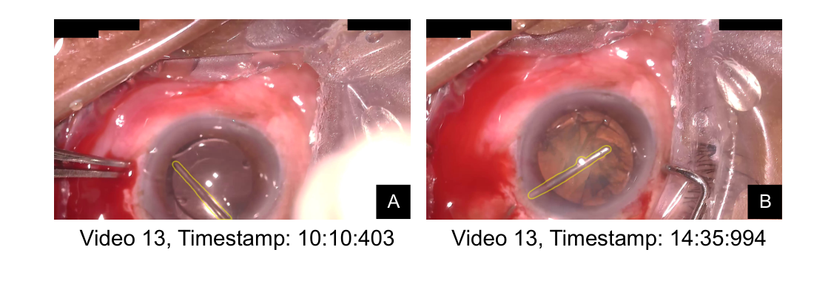
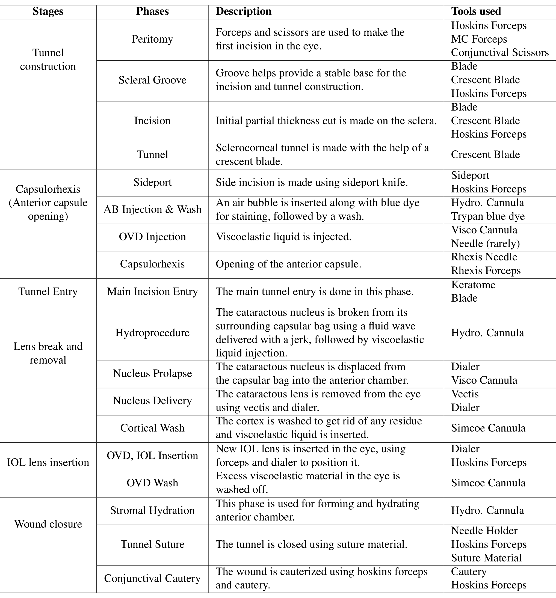
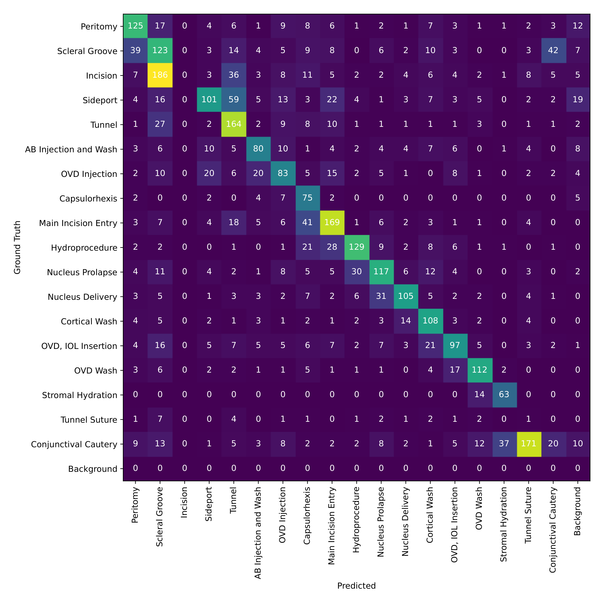
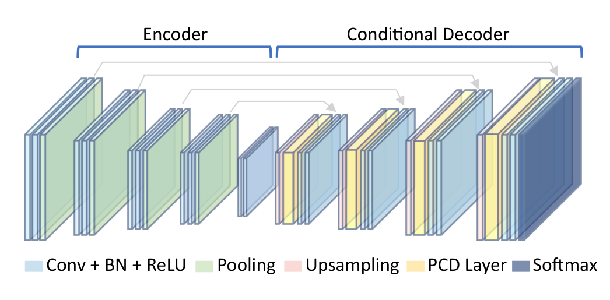
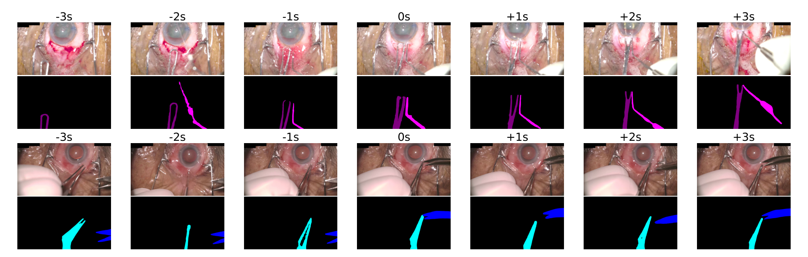
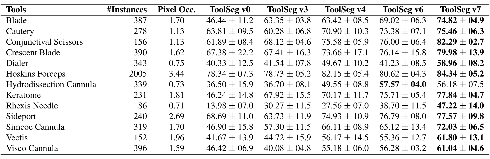

## 1. 背景与动机

**白内障手术视频分析几乎只研究了超声乳化,而低收入地区最常用的是手法小切口手术(MSICS)。** 超声乳化依赖昂贵设备;MSICS 成本低、速度快,也适合硬核等复杂病例。

两种术式的阶段和器械都不同。MSICS 切口为 6 到 8 mm,有核娩出等独有阶段,使用娩核匙(Vectis)、旋核钩(Dialer)、结膜剪等超声乳化中不用的器械,已有的白内障数据集不能直接替代。

眼科器械分割本身也难:器械细小,背景平均占每帧 94.51% 的像素;角膜反光扭曲器械外观;不同器械外观相近。

*论文原图编号：Figure 1。同一视频中外观相似的水分离套管(左)和旋核钩(右),二者属于不同阶段。*

:::highlights
- 缺口:没有公开的 MSICS 数据集
- 难点:小器械、强反光、外观相似
:::

## 2. 核心观点速览

论文的答案分两部分:一个数据集,一个用阶段信息辅助分割的方法 ToolSeg。

- 数据:53 个视频标注 18 个阶段,3527 帧标注 13 类器械,按视频五折交叉验证。
- 阶段先验:在 U-Net 解码器每级加入按阶段调制特征的 PCD 层。
- 伪标签:SAM 2 把人工掩码传播到前后帧,共 24405 帧。

**结果:** U-Net 基线 DSC 50.66,预测阶段加伪标签到 62.70,真值阶段加伪标签到 69.96。**边界:** 最好结果依赖人工阶段标签,数据集是否公开论文未说明。

:::data
- 53 个视频,18 个阶段,3527 帧,13 类器械
- DSC:基线 50.66,v4 62.70,v7 69.96
:::

## 3. 数据从哪里来、怎样标注

数据能外推多远,取决于来源。53 个视频于 2023 年 10 月到 2024 年 10 月在 Sankara 眼科医院录制,1920 × 1080、30 fps,训练时缩小到 480 × 270。**这是单中心数据**,术者人数、病人统计和伦理审批论文未说明。

标注用基于 SAM 的网页工具:住院眼科医生点击正负点生成掩码并选类别,每帧显示所属阶段。质量控制用一组 30 帧的公共子集与资深医生的标注比对,两名医生的标注因质量问题被拒绝;之后做形态学去噪和高斯平滑。标注者间一致性的数值论文未说明。

*论文原图编号：Table 6。MSICS 的 18 个阶段及各阶段所用器械,是阶段先验的依据。*

器械呈长尾分布:Hoskins 镊有 2005 个实例,撕囊针只有 86 个。**少见器械的像素占比也最小**,撕囊针、水分离套管、旋核钩都在 0.75% 以下。

:::highlights
- 阶段与器械一一对应得很紧,多数阶段只用一到三种器械
- 少见器械又小又少,是最难的类别
:::

## 4. 阶段从哪来:MS-TCN++

部署时没有人工阶段标签,阶段要先预测。作者用 MS-TCN++(多级时序卷积网络)在另外 90 个内部视频上训练,在本数据集上测试。

**预测阶段只有一半是对的:** 准确率 50.10%,F1 50.23%。混淆矩阵中切口阶段一帧都没有被预测出来,相邻阶段大量混淆。

*论文原图编号：Figure 9。阶段识别混淆矩阵,行为真值、列为预测。*

这一质量限制了阶段先验的实际收益,第 7 节的结果会显示这一点。

## 5. ToolSeg:按阶段调制解码器

阶段信号怎样进入网络?在 U-Net 解码器每一级加一个 PCD 层。

*论文原图编号：Figure 3。ToolSeg 结构,黄色为 PCD 层。*

PCD 层有三步。PAFT 为每个阶段 $p$ 学习通道向量,做逐通道缩放和平移,形式与 FiLM 相同:

$$f' = \gamma_p \odot f + \beta_p$$

DFBF 由特征卷积和阶段嵌入算出像素级系数 $\alpha = H(f) + \eta_p$;CGate 用它混合两种特征:

$$f'' = f' \cdot \alpha + f \cdot (1 - \alpha)$$

只用 PAFT 的叫 PCD-Base,三步都用的叫 PCD-Gated。$\alpha$ 是否经 sigmoid 限制在 0 到 1,论文未说明,而门控的含义依赖这一点。

## 6. SAM 2 伪标签

人工标注只覆盖 3527 帧,其余帧都没用上。对每个标注帧中的每个器械,先从真值前景、背景各采两点提示 SAM 2,再按真阳、真阴、假阳、假阴四个区域各采两点迭代修正,保留最好的一组点。

用这组点向前后各传播 90 帧、每 30 帧取一帧,每个标注帧多得 6 帧,共 20878 帧伪标签。训练先用人工加伪标签,再只用人工标注微调。

*论文原图编号：Figure 8。掩码传播到前后 3 秒;第一行 -2s 帧受手术灯反光影响出错。*

**伪标签质量明显低于人工标注**:654 帧对比 DSC 66.06%,所以只作弱监督。

## 7. 结果说了什么

先看拆开两个因素的消融(表 1,五折 DSC 均值):

| 变体 | 阶段 | 伪标签 | DSC |
|---|---|---|---|
| v0 | 无 | 无 | 50.66 |
| v1 | 无 | 有 | 58.29 |
| v3 | 预测,Gated | 无 | 57.52 |
| v4 | 预测,Gated | 有 | 62.70 |
| v6 | 真值,Gated | 无 | 64.76 |
| v7 | 真值,Gated | 有 | 69.96 |

**两个因素都有用,而且叠加近似相加。** 真值阶段带来 12 到 14 个点,预测阶段只有 5 到 7 个点;伪标签单独带来 7.63 个点。

基线对比(表 3):TernausNet 52.03 最高;在腹腔镜上表现好的实例分割方法 ISINet 和 MATIS Frame 只有 37.60 和 18.24。

*论文原图编号：Table 4。13 类器械的逐类 DSC。*

逐类看:阶段先验主要帮了只在少数阶段出现的器械,如角膜刀从 46.24 到 67.92;伪标签主要帮了少见小器械,如旋核钩从 41.23 到 58.96。跨阶段使用的 Hoskins 镊几乎不受阶段影响。

在 CaDIS 上,v6 的 DSC 为 68.63,高于 U-Net 的 62.84;**但加伪标签的 v7 反而降到 67.72**,论文没有解释。

:::data
- 伪标签单独 +7.63 个点,预测阶段单独 +6.86 个点
- MS-TCN++ 准确率 50.10%
- CaDIS:v6 68.63,v7 67.72
:::

## 8. 为什么有效

阶段相当于给每帧一个器械候选集合。PAFT 按阶段改变通道响应,让解码器偏向该阶段可能的器械,所以增益集中在阶段专属器械上。

伪标签解决的是另一件事:少见器械样本不足。两者叠加近似相加,我的判断是它们作用在不同的误差来源上。

## 9. 结果没说什么

- 阶段语义与额外参数没分开:没有用随机或打乱阶段做条件的对照。
- 伪标签与两段训练没分开:没有只用人工标注做两段训练的对照;50% 标注胜过全监督的 1.16 个点在标准差以内。
- 实例分割方法落后的原因没分开:ISINet 和 MATIS 本依赖时序,这里只用单帧,调参情况论文未说明。
- 泛化只对阶段条件成立:CaDIS 上只有真值阶段版本,伪标签反而降低效果。

## 10. 复现要注意什么

论文报告的百分比是相对提升:摘要的“23.77% 到 38.10%”换成百分点是 12.04 到 19.30。正文与表格有几处不一致:U-Net 的 DSC 被写成 52.03;表 3 中 v4 的 IoU 标准差印作 34.4;表 4 标为 v3 的列平均值等于表 1 的 v2。

损失函数、数据增强、基线训练设置、各标注比例下的伪标签帧数,论文未说明。代码与数据下载地址论文未给出。

## @takeaways
- 阶段条件可用按类别的通道仿射加门控实现,改动小
- 可部署性能看 v4(62.70),不是 v7(69.96)
- SAM 2 点提示加传播是低成本扩充标注的方案,伪标签只作弱监督

## @strengths
- 第一个 MSICS 器械与阶段数据集,填补低收入地区术式的空白
- 消融把阶段来源、门控和伪标签分开报告,并给出五折标准差
- 逐类结果把增益和器械的阶段专属性、样本量对应起来

## @weaknesses
- 数据是否公开、许可和获取方式论文未说明
- 最好结果依赖人工阶段标签,预测阶段准确率只有 50.10%
- 缺少随机阶段和两段训练的对照,文字与表格有多处不一致

## @questions
- 用随机阶段做条件时性能下降多少?
- 阶段识别准确率提高后,v4 能否接近 v7?
- 为什么 CaDIS 上伪标签降低了效果?
