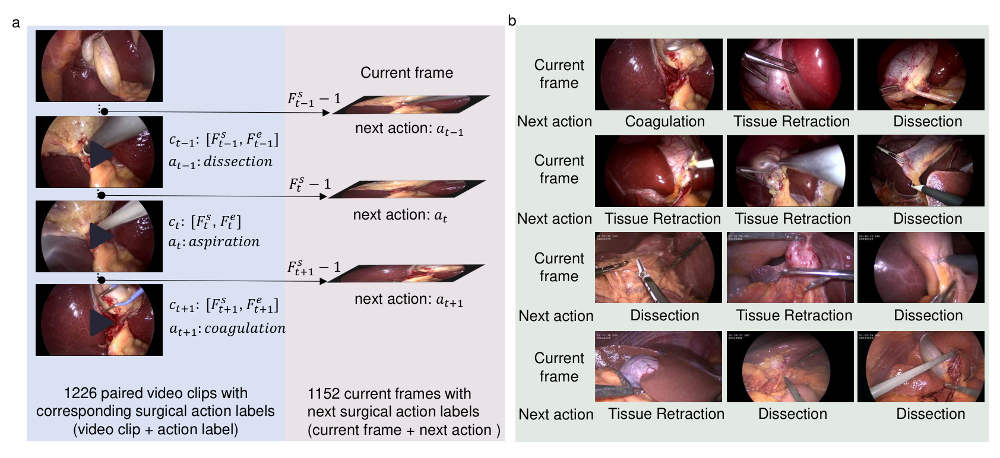
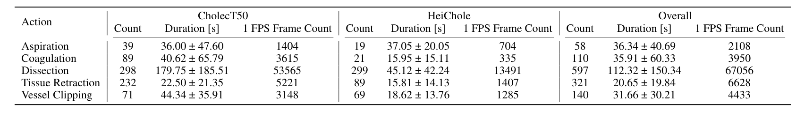
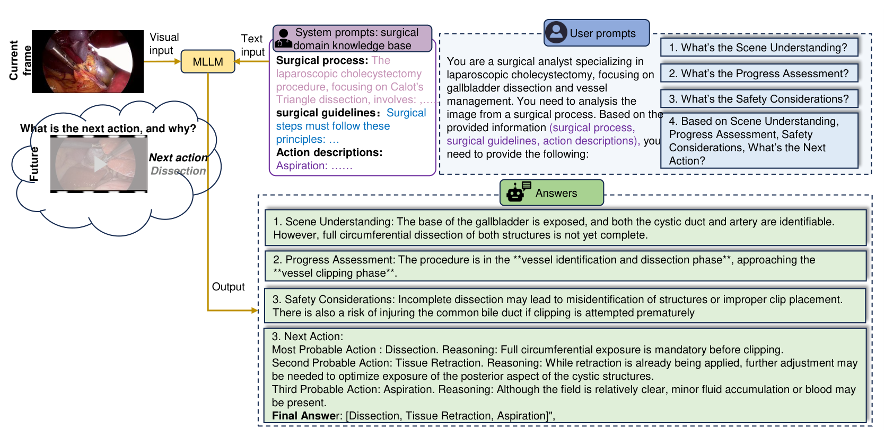
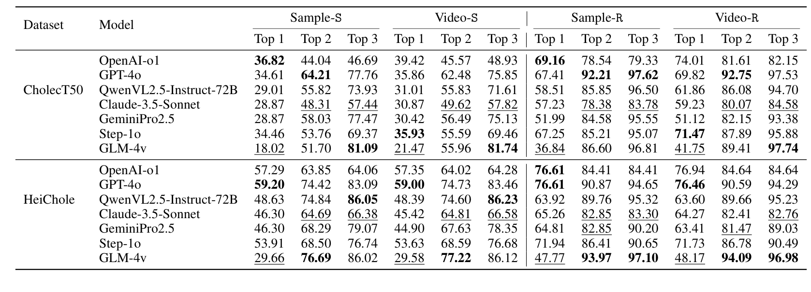
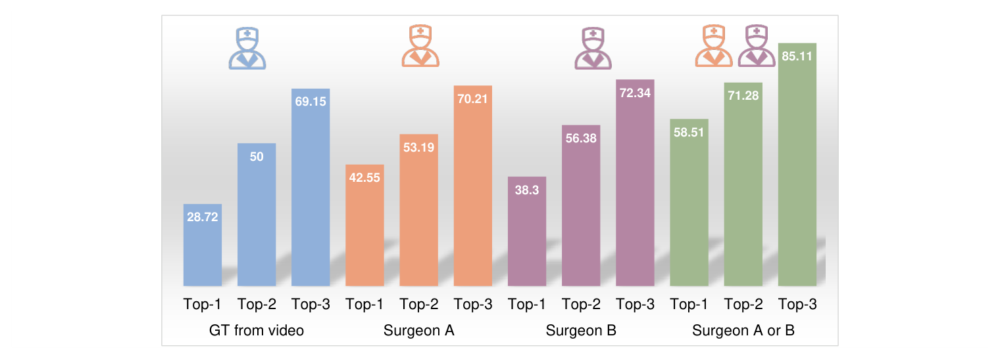
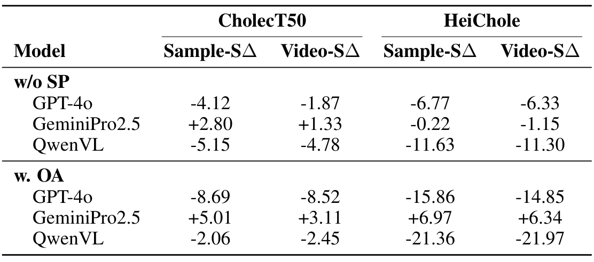
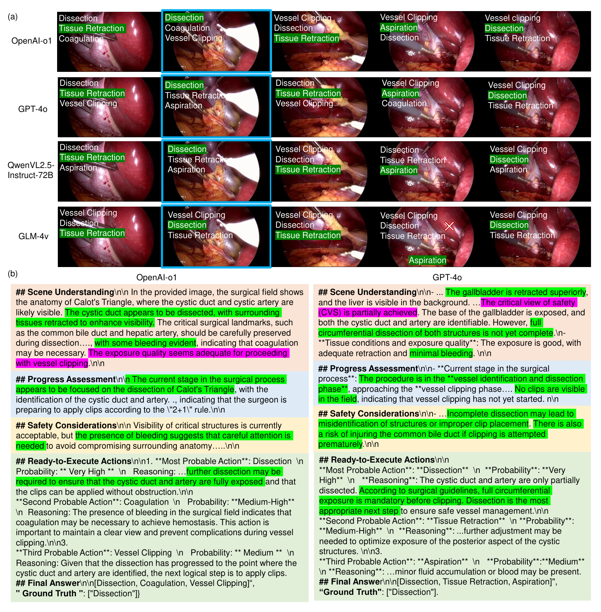

## 1. 背景与动机

**手术里最需要辅助的时刻是"接下来该做什么",而现有评测几乎只问"现在在做什么"。**

通用多模态基准测识别、属性和空间关系;医学模型和数据集集中在影像判读与诊断问答;手术 AI 的数据集多做阶段识别、器械分割和器械与组织的交互检测。它们描述的都是已经发生的事。

作者想要的是前瞻判断:看到当前画面,说出下一步该做哪个动作。这既要看清器械和组织的细节,又要知道手术流程走到了哪一步。论文要回答的是,能否把已有的胆囊切除视频改造成这样的评测,并量化当前多模态大模型的水平。

## 2. 核心观点速览

- **样本怎么来:** 在两个公开胆囊切除数据集的阶段 2 到 4 上标注五类动作片段,取每个片段起点前一帧作为当前帧,该片段的动作作为下一动作,共 1,152 个样本。
- **怎么问:** 给模型一张当前帧和一段长提示(手术流程、操作规范、动作描述),让它先分析场景、进度和风险,再给出三个排序候选。
- **结果:** 严格首选准确率最好只有 36.82 和 59.20;两种提示消融在不同模型上方向相反。
- **边界:** 论文没有给先验基线。按已发布标签算,恒答"解剖"在两个子集上都高于所有模型。论文也已被作者撤稿。

:::highlights
- 任务定义写的是多步规划,实验做的是看一张图、在五类里猜一个
- 最该先看的数字不是模型排名,而是多数类先验
:::

## 3. 样本是怎样构造的

一个样本的质量取决于动作片段切得准不准,以及"当前帧"到底包含多少信息。

*论文原图编号：Figure 1。(a) 标注动作片段的起止帧和标签,取下一片段起点前一帧为当前帧;(b) 当前帧与下一动作示例。*

五类动作是吸引、电凝、解剖、夹闭和组织牵拉。标注时把连续同标签的帧合并成片段,只保留动作位于画面中央、且只含一个动作的片段,再人工复核。标注者人数、资质和一致性论文未说明,正文说"来自三个数据集"但只列出两个,1,226 个片段如何减到 1,152 个当前帧也未说明。

当前帧是下一片段起点的前一帧,画面里多半还是上一个动作的状态。**所以一部分样本实际上是"认出当前动作,再按流程推一步"。**

:::data
- 74 例:CholecT50 50 例、HeiChole 24 例
- 1,226 个片段,平均 68.66 ± 115.99 秒
- 当前帧 1,152 个:679 加 473
:::

## 4. 类别分布决定了分数的下限

*论文原图编号：Table 2。五类动作的片段数、时长与 1 FPS 帧数。*

解剖占片段的 48.7%,吸引只有 58 个片段。论文没有给出下一动作标签的分布,我用 Hugging Face 上的已发布标签统计:解剖在 CholecT50 子集占 37.56%,在 HeiChole 子集占 61.52%。

HeiChole 的标签里还有 32 条拼写成 "Tissueretration",评分时是否合并论文未说明。**类别越集中,恒答多数类的分数越高,这正是后面判断模型的标尺。**

:::data
- 恒答解剖:CholecT50 37.56,HeiChole 61.52(外部核查)
:::

## 5. 模型怎样被提问和打分

*论文原图编号：Figure 2。MLLM-SAP:当前帧加系统提示与用户提示,输出分析与三个候选动作。*

系统提示是一个手术知识库:流程、规范、五类动作描述。用户提示要求依次回答场景理解、进度评估、安全考虑,再给出三个候选。公开提示里还多一段"补充询问",要求检查夹闭是否满足"2+1"规则,论文正文没有提到。

打分有四种口径:严格样本级、严格病例级、放宽样本级(下一个或再下一个动作都算对)、放宽病例级,每种再分前一到前三。五类里前三候选就覆盖三类,放宽再接受两个真值,**分数上限被抬得很高**。模型版本、解码参数、无效输出的计分方式,论文都未说明。

## 6. 结果说了什么

*论文原图编号：Table 3。七个模型在两个子集上的十二种准确率。*

| 子集 | 恒答多数类 | 最好模型严格首选 |
|---|---|---|
| CholecT50 | 37.56 | 36.82(o1) |
| HeiChole | 61.52 | 59.20(GPT-4o) |

**七个模型的严格首选准确率都没有超过恒答"解剖"。** 这个先验在测试集上统计,偏乐观,但差距方向在两组都一致。

GLM-4v 首选最低(18.02)、前三最高(81.09),像是每次列出最常见的几类;o1 首选最高,前三却只有 46.69。放宽后分数普遍上升,但正文"超过 20 个点"在 HeiChole 子集上七个模型都不成立。

:::highlights
- 模型排名比较的是谁更接近多数类策略
- 放宽与前三指标主要反映类别覆盖,不反映判断
:::

## 7. 医生参照与提示消融

*论文原图编号：Figure 4。GPT-4o 在视频真值、医生甲、医生乙、两人任一四种参照下的准确率。*

换成医生偏好做真值,GPT-4o 首选从 28.72 升到 42.55 和 38.3,接受两人任一时升到 58.51。这支持"视频动作只是合理选择之一",但"两人任一"同时接受两个答案,本身就会涨分;医生之间的一致率论文未说明。正文说 64 个样本,图中所有百分比却都能写成整数除以 94。

*论文原图编号：Table 4。去掉系统提示与只问动作两种消融的首选差值。*

去掉系统提示后 QwenVL 在 HeiChole 降 11.63,GeminiPro2.5 在 CholecT50 反而升 2.80;只问动作时 QwenVL 降 21.36,GeminiPro2.5 升 6.97。**提示影响很大,但方向因模型而异。** 正文所说 GPT-4o 降 8.85 在表中找不到。

## 8. 结果没说什么

- 没说明模型看懂了画面:没有先验、随机和纯文本对照,外部核查显示先验更高。
- 没说明模型能做多步规划:实验只有单帧输入和单个下一动作。
- 没说明领域知识普遍有用:三个模型里有一个方向相反,且只给差值。
- 没说明推理文本可靠:只展示了挑选出的例子,没有量化。

*论文原图编号：Figure 3。四个模型对五个当前帧的前三预测,以及 o1 与 GPT-4o 的文本回答。*

## 9. 复用前要检查什么

数据是公开的,但只含当前帧、统一提示和下一动作,不含动作片段与起止帧,数据卡没有许可证,原视频仍受 CholecT50 和 HeiChole 的条款约束。复用时先算多数类与纯文本基线,统一标签拼写,约束模型输出恰好三个合法类别,并按病例报告方差。

## @takeaways
- 当前帧取下一片段起点前一帧,是从动作标注低成本构造预测样本的办法
- 在这个基准上,七个模型的严格首选准确率都不超过类别先验
- 前三与放宽指标在五类任务里信息量很低
- 论文已撤稿,正文与表格有多处不一致,引用时需核对原表

## @strengths
- 问题选得对:术中下一动作是比识别更贴近临床辅助的需求
- 数据已公开在 Hugging Face,无访问门槛
- 引入外科医生偏好做第二真值,正视了手术决策的多解性

## @weaknesses
- 没有任何先验基线,主结论无法与"恒答解剖"区分
- 单帧输入与任务定义中的视觉历史和多步规划不符
- 正文与表格数字不一致,外科医生实验样本数自相矛盾
- 公开提示多出一段偏向夹闭的补充询问,正文未说明

## @questions
- 给模型 5 到 10 秒的多帧输入后,首选准确率能否超过先验
- 按阶段条件的先验(已知当前阶段时最常见的下一动作)是多少
- 去掉"补充询问"后夹闭的预测比例是否下降
