---
tags:
  - papers/手术数据集
aliases:
  - "SAR-RARP50"
date: 2023-12-31
arxiv_id: "2401.00496"
---

# SAR-RARP50: Segmentation of surgical instrumentation and Action Recognition on Robot-Assisted Radical Prostatectomy Challenge

## 核心信息

- 标题: SAR-RARP50: Segmentation of surgical instrumentation and Action Recognition on Robot-Assisted Radical Prostatectomy Challenge
- 标题翻译: SAR-RARP50：机器人辅助前列腺根治术中的手术器械分割与动作识别挑战赛
- 作者: Dimitrios Psychogyios, Emanuele Colleoni, Beatrice Van Amsterdam 等 50 位作者，末位作者 Danail Stoyanov
- 机构: University College London（主办方）、King's College London、香港中文大学、Universidad de los Andes、Intuitive Surgical 等参赛与组织单位
- 发表时间: 2023-12-31（arXiv v2：2024-01-23）
- 发表渠道: arXiv 预印本（cs.CV），EndoVis 2022 子挑战总结论文
- arXiv: 2401.00496
- 论文链接: https://arxiv.org/abs/2401.00496
- 数据 / 资源: https://rdr.ucl.ac.uk/projects/SAR-RARP50_Segmentation_of_surgical_instrumentation_and_Action_Recognition_on_Robot-Assisted_Radical_Prostatectomy_Challenge/191091
- 论文类型: benchmark_or_dataset

## 原文摘要翻译

手术器械分割与动作识别是许多计算机辅助介入应用的基础模块，应用范围从手术技能评估到决策支持系统。如今基于学习的动作识别与分割方法优于传统方法，但依赖大规模标注数据集。此外，动作识别与器械分割算法通常彼此孤立地训练和预测，没有利用潜在的跨任务关系。

借助 `EndoVis 2022` 的 `SAR-RARP50` 挑战赛，我们发布了首个多模态、公开、体内（in-vivo）的手术动作识别与器械语义分割数据集，包含 50 段机器人辅助前列腺根治术（`RARP`）的缝合视频片段。

挑战赛有两个目标：其一，让研究者利用该数据集的规模，开发稳健且高精度的单任务手术动作识别与器械分割方法；其二，进一步探索多任务学习方法的潜力，并判断它们相对于单任务方法的比较优势。共有 12 支队伍参赛，提交了 7 个动作识别方法、9 个器械分割方法，以及 4 个同时完成动作识别与器械分割的多任务方法。

完整数据集可从 UCL 数据仓库获取。

## 创新点

- **真实体内手术的双模态标注。** 同一批 50 例 `RARP` 缝合视频同时有 10Hz 的动作标签和 1Hz 的九类器械分割掩码。此前动作识别多依赖 `JIGSAWS` 一类训练台数据，分割多依赖猪体或离体场景，这份数据把两者都搬到了真实手术里。
- **零件级分割类别与六条边界标注规则。** 器械按杆、腕、钳口三段标注，另有缝针、缝线、夹子、吸引器、针持、导尿管六类非器械物体；对遮挡、血液淹没、低照度、暗角等情况给出明确规则，便于不同器械之间共享语义。
- **几何平均评分与逐视频排名稳定性分析。** 动作识别把帧准确率和分段 F1@10 相乘后开方，分割把 mIoU 与 mNSD 相乘后开方，多任务再取两者的几何平均；赛后还按逐视频得分重新排名，检验排名是否稳定。
- **把“多任务是否优于单任务”作为公开问题来检验。** 论文没有给出肯定答案，而是如实报告：在收到的提交中，只有一支队伍可以做单任务与多任务的直接对比，且差别很小。

## 一句话总结

`SAR-RARP50` 用 50 例真实前列腺根治术缝合视频建立了动作识别（8 类、10Hz）与器械分割（9 类、1Hz）的联合基准，12 支队伍的结果显示两阶段注意力模型和测试时增强最有效，而多任务学习是否带来收益仍无定论。

## 研究问题

### 真实手术数据的缺口

**现有模型在受控数据上表现好，到真实手术里会变差。** 手术动作识别和器械分割是技能评估、手术自动化和导航可视化的基础，但现有评测大多建立在受控数据上。动作识别常用小规模训练台数据，分割常用猪体或离体场景的 EndoVis 2017 与 2018 数据。论文指出，这些数据与真实手术视频之间存在领域差异，学习方法在真实视频上会表现变差。

| 已有数据 | 场景 | 本数据集补上的部分 |
|---|---|---|
| `JIGSAWS` | 训练台上的模拟操作，动作识别 | 真实体内手术的动作序列 |
| EndoVis 2017 / 2018 | 猪体或离体场景，器械分割 | 血液、低照度、镜头污染下的分割 |
| `RARP45` | 45 例真实 RARP 缝合，只有动作标签 | 新增 5 例，并为全部视频补分割掩码 |

### 为什么难以采集

**缺数据的根源在采集和标注成本。** 伦理、法规与法律限制，加上多中心协调成本，使真实手术数据难以大规模采集；跨术式统一标注标准也不容易，人工逐帧标注耗时、昂贵且易错。这是论文认为该领域长期缺数据的原因。

### 两个任务为何要放在一起

**第二个缺口是两个任务一直分开做。** 动作识别与器械分割通常各自训练、各自预测。作者假设两者之间存在可利用的关联，例如器械位置与形态能提示当前动作，因此设立第三个多任务子挑战，只给手术视频输入，要求同时输出动作标签和分割掩码。难点在于两种标签的采样率不同（10Hz 与 1Hz），以及优化时需要平衡两个目标。

### 核心观点速览

**这是一篇挑战赛总结论文：发布数据集、定义评分、汇总 12 支队伍的结果，不提出作者自己的模型。**

- 数据：50 例真实 RARP 的 DVC 缝合视频，动作 8 类按 10Hz 标注，器械 9 类按 1Hz 标注，40 例训练、10 例测试。
- 评分：三个子挑战都用两项指标的几何平均，赛后再看逐视频排名是否稳定。
- 结果：动作识别最高 0.828，分割最高 0.847，多任务最高 0.824；时序建模、测试时增强、手术数据预训练与高分同时出现。
- 边界：方法结论都来自跨队比较，没有受控消融；多任务是否优于单任务，只有一支队伍可以对照，差别只有千分之几，论文自己也说无定论。

下面先看数据如何构建，再看评分规则，最后看结果能说明什么。

## 数据与任务定义

### 数据来源

**数据只来自一家医院、一种机器人、一个缝合步骤，这决定了它能测什么。** 数据来自伦敦大学学院医院（Westmoreland Street 院区）的 50 例机器人辅助前列腺根治术，由 8 位资历不同的外科医生完成（资深顾问、高年资和低年资住院医生）。

所有手术使用 `da Vinci Si` 机器人。视频由 `dVLogger` 分别记录双目两路，60 帧每秒、1080i 分辨率，之后按时间戳同步并重写为固定帧率，再去除隔行伪影。

选取的片段是背深静脉复合体（DVC）的缝合：前列腺与膀胱、尿道断开后，需要缝合这一血管丛来控制出血。`SAR-RARP50` 是 `RARP45` 的超集，新增 5 例手术，并为所有视频补上 1Hz 的器械分割掩码。视频之间在光照、颜色、时长、出血量和镜头污染程度上都有差异。手术总时长、患者信息和伦理审批细节，论文未说明。

### 动作标签

**动作标签要回答的问题是：缝合过程中此刻双手在做哪一步。** 动作字典由一名外科专家与一名机器学习研究者共同设计，包含 7 个双手动作和 1 个背景类：

| 编号 | 动作 |
|---|---|
| G0 | 其他（背景） |
| G1 | 拾针 |
| G2 | 定位针尖 |
| G3 | 进针穿过组织 |
| G4 | 出针 |
| G5 | 打结 |
| G6 | 剪线 |
| G7 | 放回或丢下缝针 |

标注由一名受过训练的机器学习研究者完成，作者给出的理由是临床与非临床人员对这些动作的理解没有分歧。论文未说明是否做过多人标注一致性检验，这限制了对动作边界噪声的估计。标签以帧列表和标签列表的形式按 10Hz 提供。

动作数据的难点在于时长、频次和顺序的变异。在 `RARP45` 上，单例缝合平均约 5 分钟，范围约 2 到 12 分钟；G5 打结在超过 75% 的手术中没有出现。出血等意外情况会导致同一动作重复尝试或手术策略改变。

> [!figure] Fig. 1 动作时长与类别频次分布
> 建议位置：数据与任务定义
> 放置原因：同时展示单例缝合时长的分布和逐手术的动作类别频次，直接说明动作标签的不平衡，例如 G5 大多缺席。
> 当前状态：保留占位；自动提取的区域混入相邻正文，未生成独立的图像主体裁剪。

### 分割标签与标注协议

**分割标签的难点在于如何处理被血液、液体或暗光遮住的器械。** 分割共 9 类：器械按零件分为杆、腕、钳口三类，另有缝针、缝线、夹子、吸引器、针持、导尿管六类。按零件标注的目的是让语义能在不同型号的机器人器械之间迁移。

标注协议有六条边界规则：

1. 每个像素只属于一个类别，遮挡时只标最上层物体。
2. 带孔钳口（如 Cadiere 钳）按无孔形状标注。
3. 液体漂浮遮挡器械时，按被遮挡物的预期形状补全。
4. 完全浸没在液体中的部分不标注。
5. 画面边缘因光照不足看不清的部分不标注。
6. 形状清楚但因暗角在边缘淡出的器械杆，掩码延伸到画面边缘。

原始帧按 1Hz 采样后上传到 `Supervisely` 平台，由外包标注服务 `HITL` 的标注团队在临床人员监督下完成，再由两名机器学习研究者复核与修正，修正时参考整段视频的信息。标注者间一致性指标论文未说明。

> [!figure] Fig. 2 分割标注协议的六类边界情形
> 建议位置：数据与任务定义
> 放置原因：用六个真实样例对应上面六条规则，是理解遮挡、浸没、暗角等标注边界最直接的图。
> 当前状态：保留占位；该图未进入视觉复核候选，自动提取的区域包含页码，未生成独立的图像主体裁剪。

### 划分与类别覆盖

训练集为 40 例手术的 12998 帧，测试集为另外 10 例的 3252 帧。作者称划分时有意让两个集合的标签分布相近。各类像素平均覆盖率差异很大：

| 类别 | 训练集 | 测试集 |
|---|---|---|
| 器械杆 | 12.04(±2.89)% | 10.97(±2.83)% |
| 钳口 | 2.24(±1.19)% | 3.61(±2.13)% |
| 器械腕 | 3.59(±1.06)% | 3.85(±1.18)% |
| 缝线 | 1.00(±0.33)% | 0.94(±0.21)% |
| 夹子 | 0.15(±0.19)% | 0.13(±0.16)% |
| 缝针 | 0.44(±0.15)% | 0.45(±0.15)% |
| 吸引器 | 0.51(±0.53)% | 0.70(±1.03)% |
| 导尿管 | 0.19(±0.24)% | 0.27(±0.36)% |
| 针持 | 0.20(±0.15)% | 0.23(±0.12)% |

器械杆一类就占约 12% 的画面，而夹子、导尿管、针持都不到 0.3%。这意味着按类平均的 mIoU 会被小类严重拉低，后面的定性失败也集中在这些小类上。

有了数据，下一步是规定怎么给提交打分。

## 方法主线

**这里的“方法”是评分规则和参赛方案谱系，不是作者的新模型。** 评分规则决定了哪类错误会被放大。

### 机制流程

1. 输入：参赛方法读取测试集 10 段手术视频，输出逐帧动作标签（按 10Hz 评测）和逐帧九类分割掩码（按 1Hz、1920x1080 分辨率评测）。
2. 动作打分：从预测中提取每段视频的帧准确率与分段 F1@10，先在 10 段视频上分别取平均，再相乘开方，输出动作分。
3. 分割打分：把预测掩码与参考掩码对齐，计算每帧每类的 IoU 与 NSD，依次对类别、帧、视频取平均得到 mIoU 和 mNSD，再相乘开方得到分割分。
4. 输出排名：多任务分取动作分与分割分的几何平均；赛后另对每段视频单独打分、单独排名，再对排名取平均，检验排名稳定性。

### 评分公式

帧准确率与分段 F1@K 的定义如下，其中分段 F1 在预测片段与同类参考片段的 IoU 超过 $k/100$ 时记为真阳性，本挑战取 $K=10$。论文未说明同类多个预测片段与同一参考片段如何一一匹配：

$$
FWA_i=\frac{\#\text{correct frames}}{\#\text{frames in video } i},\qquad F1@K=\frac{2\cdot P\cdot R}{P+R}
$$

$$
Score_{ar}=\sqrt{FWA_{avg}\cdot F1@10_{avg}}
$$

分割使用 IoU 与归一化表面 Dice（NSD）。NSD 统计预测边界与参考边界之间距离小于阈值 $\tau$ 的边界像素比例，比 IoU 更宽容贴近边界的误差，但对边界内部的小错误不敏感，因此两者一起使用：

$$
NSD_{ijk}=\frac{\|\delta^{Pred}_{ijk}\|+\|\delta^{Target}_{ijk}\|}{\|\Delta^{Pred}_{ijk}\|+\|\Delta^{Target}_{ijk}\|}
$$

$$
Score_{s}=\sqrt{mIoU\cdot mNSD},\qquad Score_{mt}=\sqrt{Score_{ar}\cdot Score_{s}}
$$

论文中 NSD 公式（11）分母印刷为两个 $\Delta^{Target}$，按定义应为预测集与参考集各一项，上面按定义书写。阈值 $\tau$ 的具体取值论文未说明，实现参照 Seidlitz 等人（2022），复现者无法确定 mNSD 的严格程度。

### 参赛方法谱系

**参赛方案的差异主要在三处：是否建模长时序、用什么预训练、推理时是否做增强。** 动作识别的方案分两类：一类先逐帧提取特征，再用长程时序模型处理整段视频；另一类在以目标帧为中心的时间窗口上直接分类，再做平滑后处理。

| 队伍 | 动作识别方案 | 关键设置 |
|---|---|---|
| SummerLab-AI | 预训练特征 + `ASFormer` | 平滑损失权重 0.25，5 折交叉验证 |
| Uniandes | `MViT` 时间窗口 + 单层分类头 | 32 帧窗口，250 步迭代滤波 |
| CAMI-SIAT | `Bridge-Prompt` + `ASFormer` | 用 28 段视频训练，50 轮 |
| NCC-Next | `Video Swin` 与 `SlowFast` 集成 | 5 折共 10 个模型，多尺度滤波 |
| TSO22 | `ResNet50` 特征 + `MS-TCN` | 两阶段训练，`MS-TCN` 训练 200 轮 |
| KingSurgial-AI | 改进的长视频注意力模型 | 前向与后向局部时序聚合 |
| Medical-Mechatronics | 逐帧 `Xception` | 无时序建模 |

分割方案中，前三名都是注意力模型：

- Uniandes 用 `Mask2Former`，并先在 EndoVis 2017 与 2018 上微调。
- HiLab-2022 在方法节中写为 `Swin` 与 `SegFormer` 的集成，讨论节却写成 `Swin` 加 `UperNet`，论文前后不一致。
- SummerLab-AI 用 `Swin` 编码器加 `UperNet` 解码器，并做多尺度与翻转测试时增强。

第 4 名 AIA-Noobs 是 `UNet++` 卷积网络加翻转测试时增强。除 TheOne-Lab 外，所有队伍都使用了预训练网络。

多任务方案只有 4 个：

- Uniandes 把两个单任务架构合并为一个时间窗口模型。
- AIA-Noobs 把分割网络的输出送入 `ResNet18` 与 `LSTM` 做动作分类，形成级联。
- SummerLab-AI 在分割骨干上加双向 `LSTM`。
- Team SK 用共享 `ResNet-101` 编码器，分割头与单帧动作分类头并列。

评分规则和方案都清楚之后，可以看三个子挑战的结果。

## 关键结果

### 动作识别

**动作识别的分差主要来自时序建模：有没有长程时序，F1@10 能差出一个数量级。**

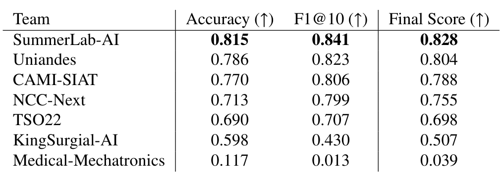
*论文原图编号：Table 6。动作识别汇总结果：测试集平均准确率、F1@10 与最终分。*

| 队伍 | 准确率 | F1@10 | 最终分 |
|---|---|---|---|
| SummerLab-AI | 0.815 | 0.841 | 0.828 |
| Uniandes | 0.786 | 0.823 | 0.804 |
| CAMI-SIAT | 0.770 | 0.806 | 0.788 |
| NCC-Next | 0.713 | 0.799 | 0.755 |
| TSO22 | 0.690 | 0.707 | 0.698 |
| KingSurgial-AI | 0.598 | 0.430 | 0.507 |
| Medical-Mechatronics | 0.117 | 0.013 | 0.039 |

前五名集中在 0.698 到 0.828 之间，SummerLab-AI 领先第二名 0.024。逐帧的 Medical-Mechatronics 在 F1@10 上接近零，说明没有时序建模时预测会严重碎片化。作者认为两阶段方法更好，因为它们能一次处理长时序；前几名也主要是注意力模型。在大规模视频动作数据集上预训练的方法明显好于没有预训练的方法。

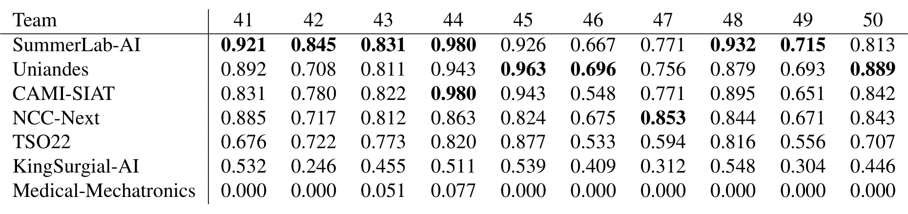
*论文原图编号：Table 3。各队在 10 段测试视频上的逐视频 F1@10。*

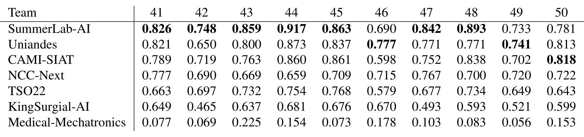
*论文原图编号：Table 4。各队在 10 段测试视频上的逐视频准确率。*

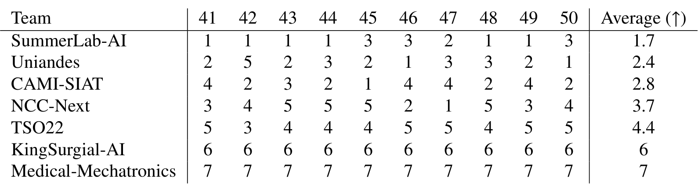
*论文原图编号：Table 5。按逐视频动作分重新排名后的平均名次，排名与总榜一致。*

逐视频排名的平均名次为 SummerLab-AI 1.7、Uniandes 2.4、CAMI-SIAT 2.8，与总榜顺序一致。不同视频之间差异明显：视频 44 由资深顾问完成，出血少、镜头运动少、动作序列规整，是各方法得分最高的视频；视频 46 由低年资住院医生完成，出血、镜头运动和助手干预都更多，动作序列更长也更不规整，是各方法得分最低的视频。

### 器械分割

**分割的前七名差距不大，真正的区分在小类和聚合方式。**

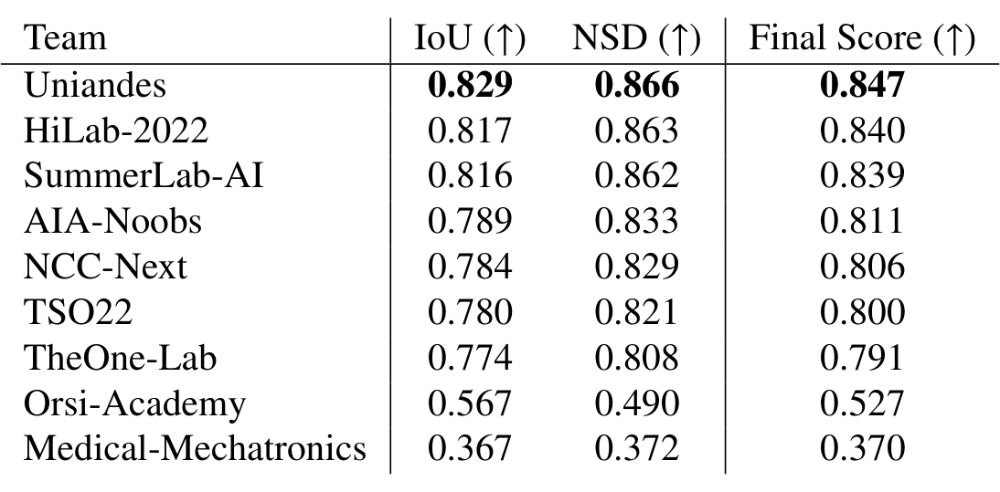
*论文原图编号：Table 10。分割最终结果：测试集 mIoU、mNSD 与最终分。*

| 队伍 | mIoU | mNSD | 最终分 |
|---|---|---|---|
| Uniandes | 0.829 | 0.866 | 0.847 |
| HiLab-2022 | 0.817 | 0.863 | 0.840 |
| SummerLab-AI | 0.816 | 0.862 | 0.839 |
| AIA-Noobs | 0.789 | 0.833 | 0.811 |
| NCC-Next | 0.784 | 0.829 | 0.806 |
| TSO22 | 0.780 | 0.821 | 0.800 |
| TheOne-Lab | 0.774 | 0.808 | 0.791 |
| Orsi-Academy | 0.567 | 0.490 | 0.527 |
| Medical-Mechatronics | 0.367 | 0.372 | 0.370 |

前三名非常接近，第一与第三只差 0.008。前七名都在 0.791 以上，说明在主要器械类别上，现有方法已经能在真实手术画面中给出较准的掩码。

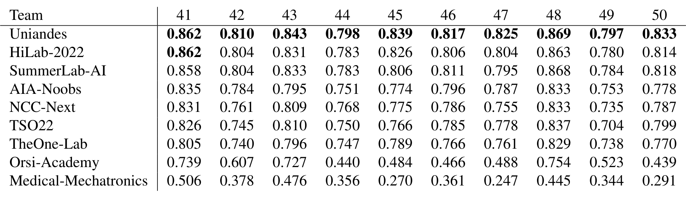
*论文原图编号：Table 7。各队逐视频分割 mIoU。*

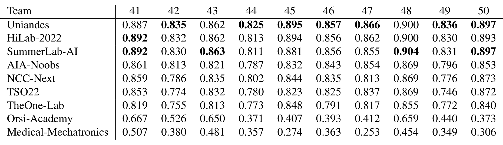
*论文原图编号：Table 8。各队逐视频分割 mNSD。*

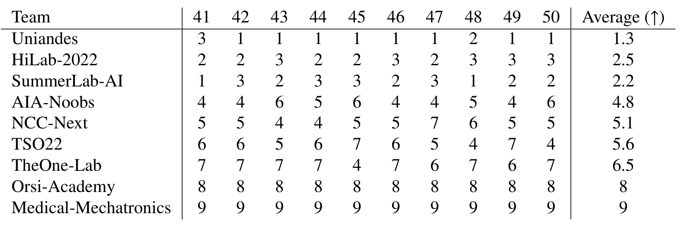
*论文原图编号：Table 9。按逐视频分割分重新排名后的平均名次。*

逐视频排名给出了不同的顺序：SummerLab-AI 平均名次 2.2，排在 HiLab-2022 的 2.5 之前，与总榜的第二、第三名对调。作者据此提醒，聚合方式和指标选择会实质改变挑战赛排名。

测试时增强（TTA）出现在一半提交中。使用 TTA 的卷积网络 AIA-Noobs 排第 4，超过了未用 TTA 的第 5、第 6 名注意力模型。

NCC-Next 在集成中用了与 HiLab-2022 相同的架构却排第 5，作者由此认为 TTA 比网络集成更有效。

Uniandes 是唯一在预训练阶段使用手术器械数据集的队伍，作者认为这对其第一名有重要作用。以上三条都是作者基于跨队比较的观察，下文深度分析给出替代解释。

### 多任务

**多任务子挑战要回答的是：同时学两个任务能否互相帮助。答案是看不出来。**

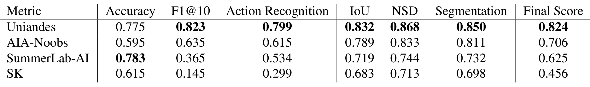
*论文原图编号：Table 16。多任务最终结果，同时给出动作与分割的各项分数。*

| 队伍 | 动作准确率 | F1@10 | 动作分 | 分割分 | 最终分 |
|---|---|---|---|---|---|
| Uniandes | 0.775 | 0.823 | 0.799 | 0.850 | 0.824 |
| AIA-Noobs | 0.595 | 0.635 | 0.615 | 0.811 | 0.706 |
| SummerLab-AI | 0.783 | 0.365 | 0.534 | 0.732 | 0.625 |
| SK | 0.615 | 0.145 | 0.299 | 0.698 | 0.456 |

Uniandes 在多任务上两项都最好。SummerLab-AI 的准确率最高，但 F1@10 只有 0.365，说明它的帧级分类大体对、片段却很碎，几何平均把它的动作分拉到 0.534；Team SK 只用单帧预测，F1@10 只有 0.145，作者把这一差距归因于缺少时序上下文。

采样率处理方式与动作分有对应关系：Uniandes 与 AIA-Noobs 保留了 10Hz 动作标签（后者把 1Hz 分割结果复制补齐到 10Hz），动作分高于把动作标签降到 1Hz 的 SummerLab-AI 与 Team SK。

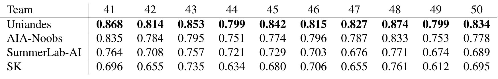
*论文原图编号：Table 11。多任务提交的逐视频分割 mIoU。*

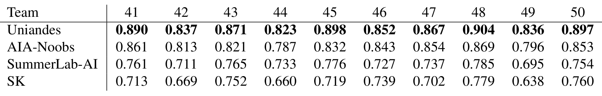
*论文原图编号：Table 12。多任务提交的逐视频分割 mNSD。*

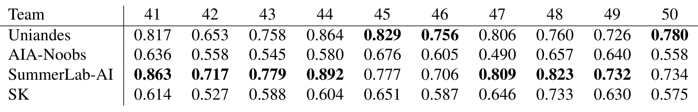
*论文原图编号：Table 13。多任务提交的逐视频动作准确率。*

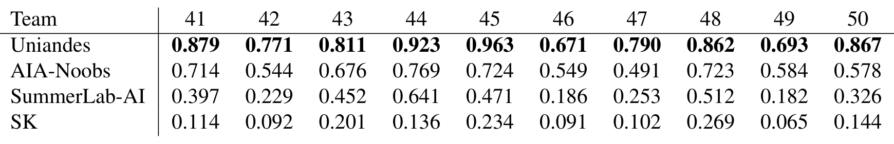
*论文原图编号：Table 14。多任务提交的逐视频动作 F1@10。*

**单任务与多任务的唯一直接对比来自 Uniandes。** 其多任务分割分 0.850 略高于单任务的 0.847，动作分 0.799 略低于单任务的 0.804。AIA-Noobs 的多任务分割分与其单任务完全相同，因为它本质上是级联；SummerLab-AI 因时间限制提交了与单任务不同的网络；Team SK 没有提交单任务模型。作者的结论是：基于收到的提交，无法判断多模态数据能否在多任务学习中提升精度。

### 定性失败样例

**分数掩盖的失败集中在罕见器械上。**

> [!figure] Fig. 6 视频 42 上各队分割预测与参考
> 建议位置：关键结果
> 放置原因：展示被血液覆盖的钳口、暗背景中的缝线和吸引器，是说明小类与罕见类失败的核心样例。
> 当前状态：保留占位；该图未进入视觉复核候选，自动提取只得到分散的子图，未生成独立的整图裁剪。

视频 42 的样例中，所有方法都能定位暗背景里的缝线，但所有队伍都把右侧的吸引器误分为器械杆；除 Orsi-Academy 外都在左侧钳口上多预测了一段缝线。视频 48 的样例含有偶尔出现的施夹器，除 AIA-Noobs 外所有队伍都分错了它的类别，一半队伍把夹子分成缝针，所有方法都预测出带钳口的针持，而数据集中针持是整体一类。作者据此指出，对小目标和样本少的类别，方法存在偏差。

这些结果的含义需要放回评测设计里看。

## 深度分析

### 这个基准实际测到了什么

**它测的是一个缝合步骤内的动作分割和零件级器械分割，范围比标题窄。** 动作部分测的是单一缝合子步骤内 8 类动作的时序分割能力，而不是整台手术的阶段识别。F1@10 的阈值很宽松（片段 IoU 超过 0.1 即算命中），它主要惩罚碎片化和乱序，对边界精度要求不高。分割部分测的是零件级语义分割，主类面积大，所以总分主要由器械杆、腕、钳口决定；小类的失败在总分中被稀释，只能在逐类或定性分析里看到。

### 方法结论为何只能当作线索

**我的判断：论文中的方法结论都是相关观察，不是因果证据。** 论文中关于架构、预训练、TTA 的判断都来自跨队比较。各队的数据划分（例如 CAMI-SIAT 只用 28 段视频训练，Orsi-Academy 用 37 段）、输入分辨率、预训练数据、后处理都不同，没有任何受控消融。作者自己也写道 TTA 与集成的两份提交“难以比较”。因此“注意力优于卷积”“TTA 优于集成”是可检验的假设，不是被证明的结论。

例如前几名动作方法同时用了大规模视频预训练和平滑后处理，差距也可能来自这两点；Uniandes 的分割优势也可能来自 `Mask2Former` 的掩码分类结构或更高的输入分辨率。

### 多任务问题为何悬而未决

**问题没有被回答，原因在挑战赛的设计。** 挑战赛设计本身限制了这个问题的回答：多任务子挑战只要求同时输出两种预测，不要求同队提交同架构的单任务版本。结果是 4 个多任务方案里只有 1 个能与自身单任务对照，且差别只有千分之几，在 10 段测试视频的规模下无法区分噪声与收益。

### 测试集规模与排名稳定性

**10 段测试视频太少，排名的可信度需要额外证据。** 测试集只有 10 例手术，单个困难视频（如视频 46）就能明显拉动平均分。论文用逐视频排名平均来检查稳定性，这比只看总分更可靠，但仍没有给出置信区间或显著性检验，前三名之间 0.008 的分割差距是否可靠，论文未说明。

## 局限

- 单中心、单一机器人型号、单一缝合子步骤：数据全部来自同一家医院的 `da Vinci Si` 手术，能否外推到其他术式或其他医院，论文未说明。
- 动作标签由一名研究者标注，没有标注者间一致性数据；分割标注有两名研究者复核，但一致性指标论文未说明。
- NSD 的距离阈值 $\tau$ 取值论文未说明，这会影响他人复现 mNSD 分数。
- 所有方法层面的结论都来自跨队对比，没有受控消融，不能把差距归因于单一设计。
- 多任务对比只有一支队伍可用，问题本身没有被回答。
- 测试集标签是否公开、数据许可条款，论文未说明，只给出了数据仓库链接。
- 前三名之间没有置信区间或显著性检验，论文未说明分差是否超出噪声。
- 论文本身有几处不一致：NSD 公式（11）分母印刷为两个 $\Delta^{Target}$；HiLab-2022 的架构在两处描述不同；摘要称 EndoVis 2022，结论节称 Endovis2023。

## 我的笔记

- 做手术动作分割时，优先尝试“逐帧特征 + 长程时序模型 + 窗口滤波”的组合；Uniandes 的经验是传统窗口滤波比学习式滤波更好。
- 评估分割时同时报告 mIoU、mNSD 和逐视频排名，并单独看小类；总分接近时，排名可能因聚合方式而对调。
- 做多任务时，保留高频动作标签、把低频分割结果对齐到高频，比把动作标签降采样到 1Hz 更可取。
- 想检验多任务是否有用，需要自己在同一骨干、同一划分下做单任务与多任务的受控对比，这是本挑战留下的空白。
- 后续问题：在 `RARP` 以外的术式上，用 `SAR-RARP50` 训练的模型泛化会如何？施夹器、吸引器这类罕见器械，重采样或合成数据能否补救？

## 引用

- Psychogyios et al. (2023). SAR-RARP50: Segmentation of surgical instrumentation and Action Recognition on Robot-Assisted Radical Prostatectomy Challenge. arXiv:2401.00496.
- Van Amsterdam et al. (2022). Gesture recognition in robotic surgery with multimodal attention. IEEE Transactions on Medical Imaging.
- Allan et al. (2019). 2017 robotic instrument segmentation challenge. arXiv:1902.06426.
- Allan et al. (2020). 2018 robotic scene segmentation challenge. arXiv:2001.11190.
- Gao et al. (2014). JHU-ISI gesture and skill assessment working set (JIGSAWS).
- Seidlitz et al. (2022). Robust deep learning-based semantic organ segmentation in hyperspectral images. Medical Image Analysis.
- Maier-Hein et al. (2018). Why rankings of biomedical image analysis competitions should be interpreted with care. Nature Communications.
