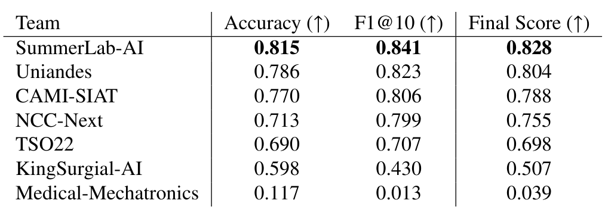
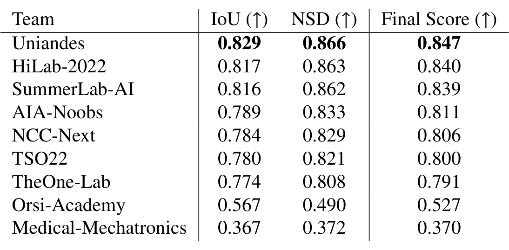
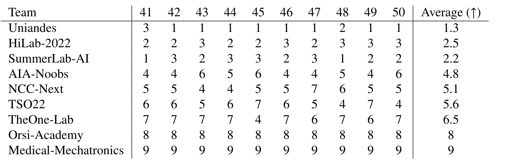
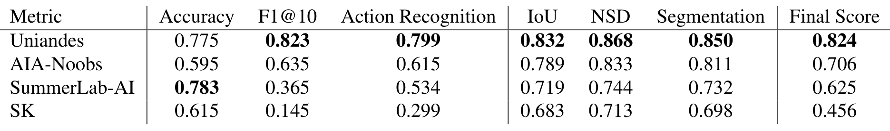

## 1. 背景与动机

**手术动作识别和器械分割模型在受控数据上表现好，到真实手术里会变差。** 动作识别多用 `JIGSAWS` 这类训练台数据，分割多用 EndoVis 2017 与 2018 的猪体或离体场景。论文认为两者与真实手术视频之间有领域差异。

真实数据难采集：伦理、法规、多中心协调都是门槛，逐帧人工标注又贵又易错。

另一个缺口是两个任务一直分开做。器械的位置和形态本可以提示当前动作，但很少有数据同时提供两种标签，所以也没人能系统检验两者互相帮助的效果。

## 2. 核心观点速览

**这是一篇挑战赛总结论文：发布数据集、定义评分、汇总参赛结果，不提出作者自己的模型。**

- 数据：50 例真实 RARP 的 DVC 缝合视频，动作 8 类按 10Hz 标注，器械 9 类按 1Hz 标注。
- 划分：40 例 12998 帧训练，10 例 3252 帧测试。
- 参赛：12 支队伍，提交 7 个动作识别、9 个分割、4 个多任务方法。
- 结果：动作最高 0.828，分割最高 0.847，多任务最高 0.824。
- 边界：方法结论都来自跨队比较；多任务是否有用，论文自己说无定论。

:::highlights
- 首个同时含动作与分割标签的公开体内手术视频数据集（作者声明）
- 方法结论来自跨队比较，没有受控消融
:::

:::data
- 50 例手术，8 位外科医生
- 12998 训练帧 / 3252 测试帧
:::

## 3. 数据从哪来

**数据只来自一家医院、一种机器人、一个缝合步骤，这决定了它能测什么。** 50 例手术在伦敦大学学院医院完成，都用 `da Vinci Si` 机器人，由 8 位资历不同的外科医生主刀。

截取的片段是背深静脉复合体（DVC）的缝合：前列腺与膀胱、尿道断开后，缝合这一血管丛来控制出血。视频之间在光照、颜色、出血量、镜头污染上都有差异。

`SAR-RARP50` 是 `RARP45` 的超集，新增 5 例手术，并给全部视频补上 1Hz 的分割掩码。

接下来看两种标签各自怎么定义。

## 4. 两种标签怎么定义

**动作标签回答“双手此刻在做哪一步”，分割标签回答“每个像素属于哪个器械零件”。**

动作有 8 类：G0 背景，G1 到 G7 依次是拾针、定位针尖、进针、出针、打结、剪线、放下缝针。标注由一名研究者完成，论文未说明是否做过一致性检验。在 `RARP45` 上，单例缝合平均约 5 分钟，G5 打结在超过 75% 的手术中缺席。

分割有 9 类：器械按杆、腕、钳口三段标注，另有缝针、缝线、夹子、吸引器、针持、导尿管。标注协议规定了遮挡、带孔钳口、液体覆盖、完全浸没、低照度、暗角六种情形的处理方式。

**类别极不平衡。** 器械杆在训练集上平均占画面 12.04%，夹子、导尿管、针持都不到 0.3%。按类平均的 mIoU 因此容易被小类拉低。

## 5. 评分规则

**三个子挑战都用两项指标的几何平均，任何一项太低都会拉低总分。**

$$
Score_{ar}=\sqrt{FWA_{avg}\cdot F1@10_{avg}},\quad Score_{s}=\sqrt{mIoU\cdot mNSD},\quad Score_{mt}=\sqrt{Score_{ar}\cdot Score_{s}}
$$

帧准确率 FWA 只看每帧分类对不对。分段 F1@10 把连续同类帧当作片段，片段 IoU 超过 0.1 就算命中，它主要惩罚预测碎片化和乱序。

NSD 统计边界像素中距离对方边界小于阈值 $\tau$ 的比例，比 IoU 更宽容贴边误差。**阈值 $\tau$ 的取值论文未说明**，复现者无法确定 mNSD 的严格程度。论文的 NSD 公式（11）分母印刷为两个 $\Delta^{Target}$，与文字定义不一致。

赛后，作者还对每段测试视频单独打分、单独排名，再对名次取平均，检验总榜是否稳定。

## 6. 动作识别：时序建模拉开差距

*论文原图编号：Table 6。动作识别汇总结果：平均准确率、F1@10 与最终分。*

**前五名都有时序建模，分数在 0.698 到 0.828 之间；逐帧分类的 Medical-Mechatronics 只有 0.039。** 后者 F1@10 仅 0.013，说明没有时序上下文时预测会碎成大量短片段。

SummerLab-AI 用预训练特征加 `ASFormer`，以 0.828 领先第二名 0.024。逐视频排名平均名次为 1.7、2.4、2.8，与总榜一致，前三名排名稳定。

视频之间差别明显。资深顾问完成的视频 44 得分最高，出血少、动作规整；低年资住院医生完成的视频 46 得分最低，出血、镜头运动和助手干预都更多。

## 7. 器械分割：前排接近，失败在小类

*论文原图编号：Table 10。分割最终结果：mIoU、mNSD 与最终分。*

**前七名都在 0.791 以上，第一与第三只差 0.008。** Uniandes 以 0.847 第一，它是唯一先在 EndoVis 2017 与 2018 上微调的队伍。

*论文原图编号：Table 9。按逐视频分割分重新排名后的平均名次。*

换成逐视频排名，SummerLab-AI 平均名次 2.2，排到 HiLab-2022 的 2.5 之前，第二、第三名对调。**聚合方式会改变名次。**

作者观察到，用测试时增强的卷积网络 AIA-Noobs 排第 4，超过未用增强的两个注意力模型，并据此认为测试时增强比集成更有效。

定性样例中，所有队伍都把视频 42 的吸引器误分为器械杆；视频 48 的施夹器，除 AIA-Noobs 外都分错了类别。罕见器械是共同短板。

## 8. 多任务：看不出互相帮助

*论文原图编号：Table 16。多任务最终结果。*

**唯一能直接对照的 Uniandes，多任务分割 0.850 对单任务 0.847，动作 0.799 对单任务 0.804，差别只有千分之几。** 其余三队要么是级联，要么提交了不同网络，要么没有单任务版本。

采样率处理与动作分对应：保留 10Hz 动作标签的 Uniandes、AIA-Noobs 动作分更高，把动作标签降到 1Hz 的两队更低。

SummerLab-AI 多任务准确率 0.783 最高，F1@10 却只有 0.365，片段很碎；Team SK 用单帧预测，F1@10 只有 0.145。

论文的结论是：基于收到的提交，无法判断多任务能否提升精度。

## 9. 结果没说什么

**我的判断：论文里的方法结论都是相关观察，不是因果证据。**

- 各队训练划分、分辨率、预训练、后处理都不同，没有任何受控消融。
- 测试时增强与集成的比较涉及两支不同队伍，作者自己也说难以比较。
- Uniandes 的分割优势也可能来自 `Mask2Former` 的结构，而非手术数据预训练。
- 测试集只有 10 例，前三名之间没有置信区间或显著性检验。

论文还有几处前后不一致：HiLab-2022 在方法节写为 `Swin` 与 `SegFormer` 集成，讨论节写成 `Swin` 加 `UperNet`；摘要称 EndoVis 2022，结论节称 Endovis2023。

## 10. 复现要注意什么

- NSD 阈值 $\tau$、F1@10 的片段匹配细节论文未说明，需要查官方评测代码。
- 动作与分割采样率不同，多任务训练时注意对齐，保留 10Hz 动作标签。
- 单中心、单术式、单一机器人：外推到其他医院或术式前需要另行验证。
- 测试标签是否公开、数据许可条款，论文未说明，使用前需查看数据仓库页面。

## @takeaways
- SAR-RARP50 是真实体内手术上的动作识别与零件级器械分割联合基准，覆盖 50 例 DVC 缝合视频。
- 动作识别里，时序建模是最大的分水岭；分割里，前排接近，罕见器械是共同短板。
- 多任务学习的价值在这次挑战中没有被验证，也没有被否定。

## @strengths
- 同一批真实手术视频同时有动作与分割标签，并给出详细的标注边界规则。
- 评分使用几何平均，并做了逐视频排名稳定性分析。
- 如实报告多任务结论无定论，没有夸大。

## @weaknesses
- 方法结论全部来自跨队比较，缺少受控实验。
- 测试集只有 10 例，没有显著性检验。
- NSD 阈值、标注一致性、数据许可等关键信息未说明，文中有几处前后不一致。

## @questions
- 同一骨干、同一划分下，多任务与单任务的受控对比结果会怎样？
- 在其他术式或其他医院数据上，这些模型的泛化如何？
- 针对施夹器、吸引器等罕见器械，重采样或合成数据能否改善分割？
