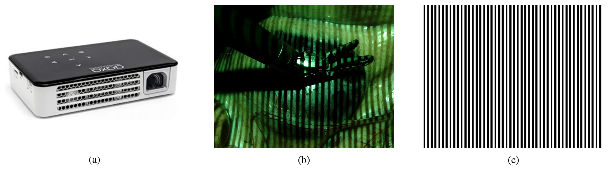
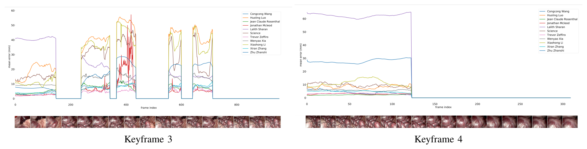
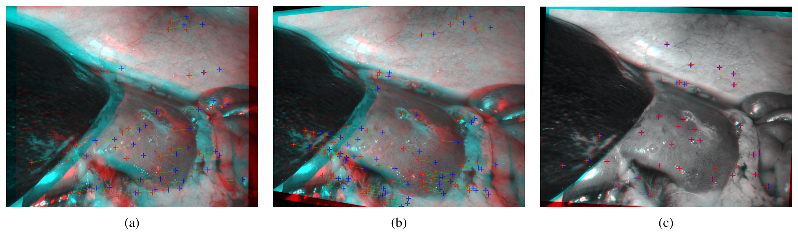

## 1. 背景与动机

**手术场景重建是 SLAM、增强现实和手术自动化的基础，但手术领域缺少带稠密深度真值的数据。**

内镜深度估计有三条路线。立体法最常用，但需要标定，而临床团队规模化标定内镜并不现实，术中调焦还会让标定失效。单目法不用标定，几乎全靠机器学习。内镜内结构光要达到帧率需要专门硬件。

通用视觉有 Middlebury 和 KITTI 这样的数据集，手术领域的同类数据通常规模小，或只有体模。原因是真值难以获得。

## 2. 核心观点速览

**这是一份挑战赛报告：发布数据、汇报 13 个方法的成绩，并公开数据的缺陷。**

- 数据：`da Vinci Xi` 在猪尸体上采集，7 个训练集、2 个测试集，每集 4 到 5 个关键帧。
- 真值：关键帧来自格雷码结构光，中间帧来自机器人运动学重投影。
- 结果：冠军 Zeffiro（`PSMNet`）两个测试集平均 3.60、3.47 mm，亚军 Rosenthal 为 3.44、4.05 mm。
- 边界：标定、同步、对齐都有误差，真值精度和合并排名方式论文未说明。

:::highlights
- 关键帧真值来自结构光，插值帧真值来自运动学
- 冠亚军在两个测试集上互有胜负
:::

:::data
- 7 个训练集 / 2 个测试集
- 冠军平均误差 3.60 与 3.47 mm
:::

接下来先看真值怎么来的，因为后面所有数字都建立在它上面。

## 3. 真值如何构建

**每个关键帧，先拍白光图像，再关灯投影 10 位格雷码，让每个像素有唯一编码。**

投影仪为 `AAXA P300 Neo Pico`，体积 15 × 3 × 9 cm，图案 1280 × 720。有了逐像素编码，左右视图匹配变得直接，三角化即可得到稠密深度。投影仪难以摆放，需要多个投影位置覆盖全场景。

*论文原图编号：Fig. 2。左为投影仪，中为投射条纹时的内镜视野，右为一张格雷码图案。*

内镜在关键帧之间移动时，机器人记录相机位姿。场景静止，因此可以把关键帧点云变换到新位姿、投影到中间帧，得到插值序列的近似真值。

**这一步把真值从单帧扩展到视频，也把运动学误差带进了真值。** 真值以 3 通道图像存储，每个非零像素保存一个 3D 点坐标。结构光真值本身的精度，论文未说明。

## 4. 评测协议

指标是逐像素深度的平均绝对误差（mm），只在有真值的像素上计算：

$$
\mathrm{MAE} = \frac{1}{|\Omega|}\sum_{p\in\Omega}\left|\hat{d}(p) - d(p)\right|
$$

公式是按原文文字写出的，原文没有公式。测试集各含 5 个关键帧，前 4 个带插值序列，第 5 个只有单张图。

原文说丢弃“不足 10% 的帧有真值”的帧，字面有歧义，更可能指有真值像素比例；冠军如何合并两个测试集，论文未说明。**因此表格无法精确复算名次。**

## 5. 参赛路线

比赛期 10 个方法覆盖了四条路线：

| 路线 | 代表方法 |
|---|---|
| 传统立体匹配 | HHI 的 `patchRM` 加在线校正；挪威科技大学的变分视差 |
| 监督立体网络 | Rediminds 与约翰斯·霍普金斯的 `PSMNet`；西安大略的多尺度代价体 |
| 编解码或无监督网络 | 深圳先进院的 `VGG` 编解码、海德堡与哈工大的 `UNet` 变体、KeXue Fu 的无监督网络 |
| 生成模型 | 深圳先进院的 `CycleGAN` |

赛后 3 个方法不计入排名：伦敦大学学院的 `DeepPruner` 与 `HSM`，以及伯尔尼大学的量化代价体网络。伯尔尼方法用 `k-means` 聚类真值视差，视差数和推理时间都减少 40%（79.1 ms）。

**多个前排方法都在处理真值质量问题**，比如用高斯插值填洞、用 `SGBM` 和 `ICP` 清洗训练真值。

## 6. 结果说了什么

| 方法 | 测试集 1 | 测试集 2 |
|---|---|---|
| Zeffiro（冠军） | 3.60 | 3.47 |
| Rosenthal（亚军） | 3.44 | 4.05 |
| Congcong Wang | 4.10 | 4.28 |
| Lalith Sharan（最差） | 43.03 | 48.72 |
| `DeepPruner`（赛后） | 3.00 | 1.67 |
| 伯尔尼（赛后） | 3.07 | 2.25 |

**冠军靠测试集 2 胜出。** 简单平均后约为 3.54 对 3.75 mm，这是笔记推算的，论文没给合并值。

逐关键帧看，最低值分散在不同方法上。测试集 1 关键帧 1 对所有方法都难，最低也有 5.70 mm；只有单帧的关键帧 5 上，赛后方法可低到 0.62 mm。

*论文原图编号：Fig. 6。测试集 2 关键帧 3、4 的逐帧误差曲线，归零段推测是被丢弃的帧，原文未明说。*

:::data
- 关键帧 5 最低 0.62 mm
- 测试集 1 关键帧 1 最低 5.70 mm
:::

关键帧和插值帧的误差差距，引出下一个问题：数据本身有多可靠。

## 7. 数据的缺陷

**参赛者在补充章节中报告了三类问题。**

- 标定误差：数据集 4、5 用提供的参数校正后，匹配点不在同一扫描线。重新估计外参无效，只用基础矩阵校正正常，作者推断误差在内参。
- 时间不同步：视频帧与运动学插值真值不同步，视频滞后。
- 对齐错误：数据集 8、9 的真值相对 RGB 整体平移；它们是否就是测试集，论文未说明。

*论文原图编号：Fig. 7。左图用提供的标定参数校正，匹配点不在同一扫描线；中图重新估计外参后仍偏；右图为未标定校正。*

这些问题都没有量化。伯尔尼团队提出用 `SIFT` 特征加 `PnP` 从图像估计位姿，替代运动学，但论文没有发布修正后的数据。

## 8. 结果没说什么

- **名次是否显著，论文未说明。** 我的判断是，冠亚军不到 1 mm 的差距可能落在真值误差范围内。
- **赛后方法的优势不能归因于模型。** 它们手工清洗真值、弃用数据集 4、5，是否接触测试真值论文未说明。
- **内参判断只是排除法。** 真值深度图的离散化也可能造成投影偏移，作者没有重新标定来验证。
- 图例方法名与表格不一致，图 5 两个子图相同，正文把表称作图，原因论文未说明。

## 9. 复现要注意什么

先检查数据集 4、5 的标定，必要时重新估计内参或弃用。插值帧与关键帧分开报告，并说明是否剔除覆盖不足的帧。总帧数、分辨率和数据许可论文未说明，需另查官方发布渠道。

## @takeaways
- SCARED 的关键帧真值来自结构光，插值帧真值来自运动学，两者质量不同
- 冠军 Zeffiro 两个测试集平均 3.60 与 3.47 mm，与亚军互有胜负
- 数据集 4、5 标定有误，视频与真值不同步，数据集 8、9 有错位

## @strengths
- 用真实组织和结构光提供稠密深度真值，比体模数据更接近手术外观
- 13 个方法在同一协议下逐关键帧比较，覆盖传统方法和多种网络
- 公开记录数据缺陷并给出诊断方法

## @weaknesses
- 真值精度、总帧数、分辨率、合并排名方式论文未说明
- 只有静态猪尸体场景和单一误差指标，没有方差或显著性
- 多数方法只有一两句描述，图表存在编号和图例错误

## @questions
- 结构光真值和运动学插值真值各自的误差有多大？
- 用清洗后的数据重训比赛期方法，名次会不会变？
- 在形变组织和活体数据上，这些方法的误差会如何变化？
