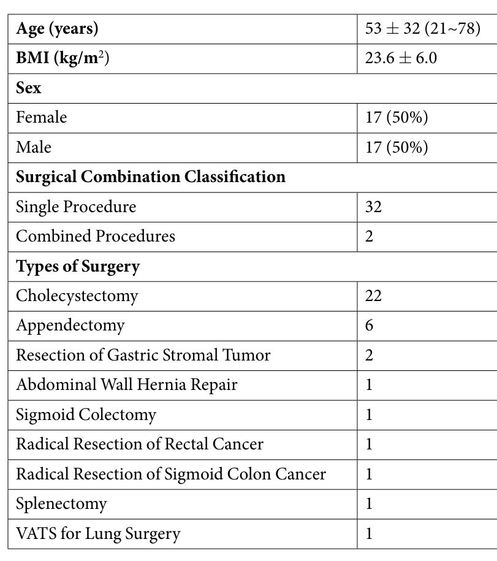
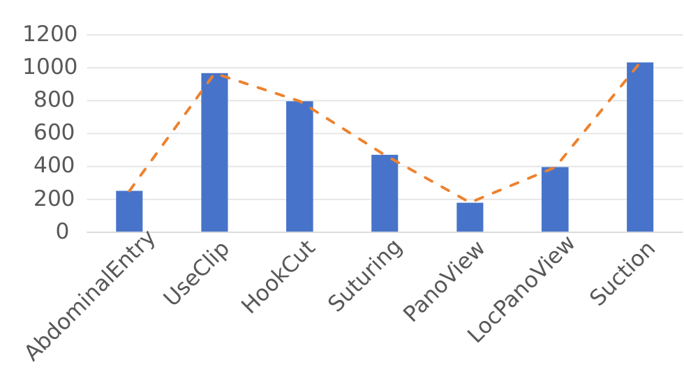
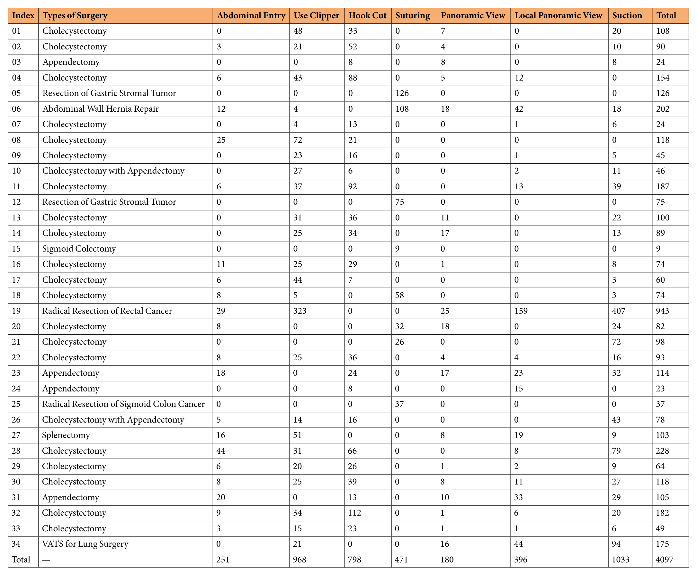
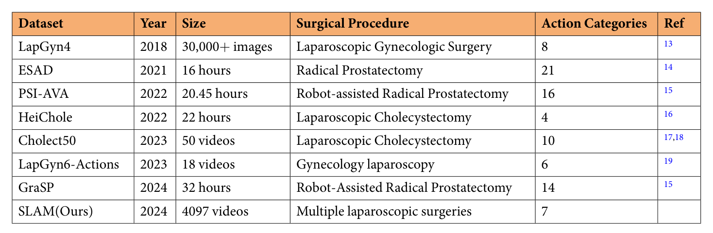
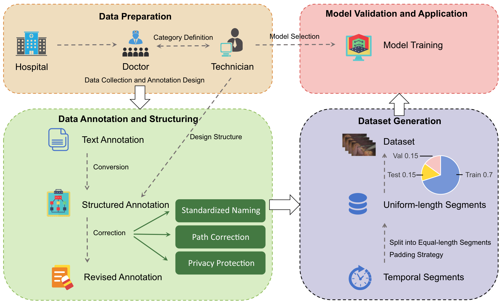
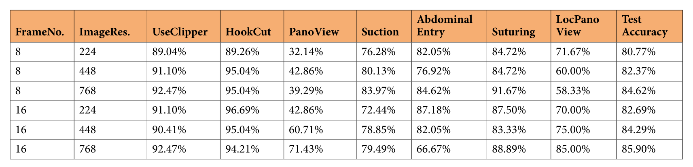
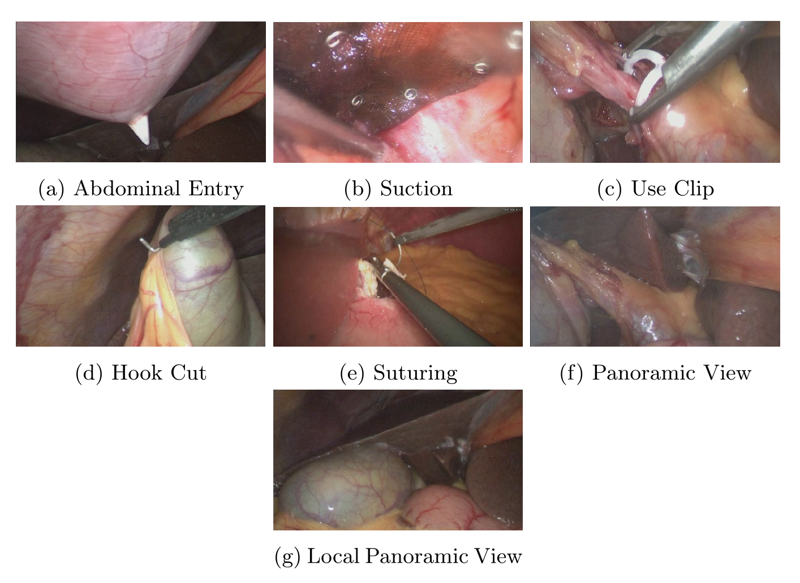
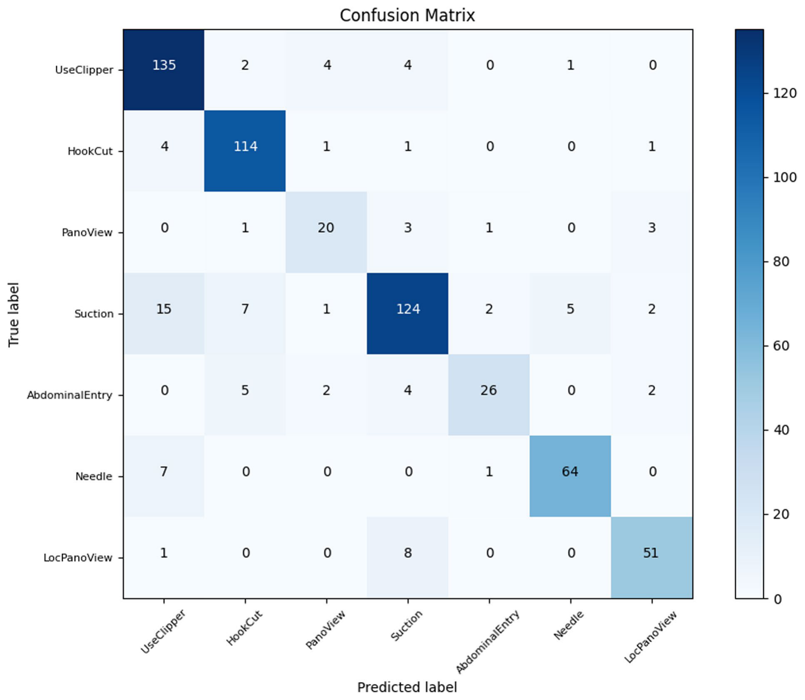

---
tags:
  - papers/手术数据集
aliases:
  - "SLAM"
  - "Surgical LAparoscopic Motions"
date: 2025-05-24
doi: 10.1038/s41597-025-05093-7
---

# A Comprehensive Video Dataset for Surgical Laparoscopic Action Analysis

## 核心信息

- 标题: A Comprehensive Video Dataset for Surgical Laparoscopic Action Analysis
- 标题翻译: 面向腹腔镜手术动作分析的综合视频数据集(SLAM)
- 作者: Zi Ye, Ru Zhou, Zili Deng, Dan Wang, Ying Zhu, Xiaoli Jin, Lijun Zhang, Tianxiang Chen, Hanwei Zhang, Mingliang Wang
- 机构: 上海交通大学医学院附属瑞金医院卢湾分院普外科; 广州智能软件研究院; 中国科学院大学杭州高等研究院; 中国科学院软件研究所; 中国科学技术大学网络空间安全学院
- 发表时间: 2025-05-24(收稿 2025-01-09,接收 2025-04-29)
- 发表渠道: Scientific Data 12:862(Data Descriptor)
- DOI: 10.1038/s41597-025-05093-7
- 论文链接: https://www.nature.com/articles/s41597-025-05093-7
- 代码 / 项目: https://github.com/yezizi1022/SLAM-Vivit_Cls
- 数据 / 资源: https://doi.org/10.6084/m9.figshare.28104782.v3(figshare,无需注册)
- 论文类型: 数据集论文(benchmark_or_dataset)

## 原文摘要翻译

腹腔镜手术因微创和恢复快,已在多个外科领域广泛应用,但它对术者的技术要求很高。计算机视觉和深度学习的进步对手术动作识别帮助很大,但现有公开数据集规模小、同质性高、标注质量不一,限制了这些技术的效果。

为解决上述问题,我们构建了 SLAM 数据集(Surgical LAparoscopic Motions),涵盖腹腔镜胆囊切除术、阑尾切除术等多种术式。数据集标注了七个关键动作:进腹、上夹、电钩切割、缝合、全景视野、局部全景视野和吸引。数据集共包含 4,097 个视频片段,每个片段都标有对应的动作类别。

此外,我们用 ViViT 模型对数据集做了全面验证,实验结果表明该数据集在腹腔镜手术动作识别上具有良好的训练和测试能力,最高分类准确率为 85.90%。作为公开的基准资源,SLAM 旨在推动腹腔镜手术动作识别和人工智能驱动外科的发展,支持智能手术机器人和手术自动化。

## 创新点

1. 跨术式的动作片段数据。34 台手术涵盖胆囊切除、阑尾切除、胃间质瘤切除、疝修补、结直肠手术、脾切除共 9 种术式,而表 1 中的已有数据集各自只覆盖一种术式。这让同一个分类器能在不同手术背景下学习同一个基础动作。
2. 以“基础动作”为单位。七类动作是多数腹腔镜手术都会出现的操作和视野状态,不依赖具体术式的阶段定义,便于跨术式复用。
3. 公开的训练、验证、测试划分。三个 CSV 文件直接给出片段路径和标签,针对的是 CholecT50 测试集不公开的问题。
4. 附带一台胸腔镜肺手术的数据,用于检验从腹腔镜到胸腔镜的迁移,以及跨术式数据作为增广的效果。

## 一句话总结

SLAM 从一家医院的 34 台腹腔镜手术中切出 4097 个 30 帧片段并标注七类基础动作,ViViT 在其上的最高测试准确率为 85.90%,但全景视野类只有 32.14% 到 71.43%。

## 研究问题

腹腔镜手术视野受限、操作精细,自动识别术中动作可以服务于术中导航、培训和术后评估,也是手术机器人自动化的基础。论文认为限制这一方向的主要是数据:已有公开数据集规模小、术式单一,部分测试集不公开,标注可能不完整或有偏。

表 1 列出七个已有数据集:

| 数据集 | 术式 | 规模 | 动作类别数 |
|---|---|---|---|
| LapGyn4 | 妇科腹腔镜 | 30,000+ 张图像 | 8 |
| ESAD | 前列腺根治切除 | 16 小时 | 21 |
| PSI-AVA | 机器人前列腺根治切除 | 20.45 小时 | 16 |
| HeiChole | 腹腔镜胆囊切除 | 22 小时 | 4 |
| CholecT50 | 腹腔镜胆囊切除 | 50 个视频,测试集不公开 | 10 |
| LapGyn6-Actions | 妇科腹腔镜 | 18 个视频 | 6 |
| GraSP | 机器人前列腺根治切除 | 32 小时 | 14 |
| SLAM | 多种腹腔镜手术 | 4097 个片段 | 7 |

**这些数据集的共同问题是每个只覆盖一种术式**,而且规模单位各不相同,难以训练一个跨术式通用的动作分类器。论文要回答的是:能否提供一个覆盖多种腹腔镜术式、划分公开、可直接训练的动作识别数据集,并证明现成视频模型能在上面学到东西。

### 核心观点速览

- **做法**:从一家医院的 34 台手术中切出 4097 个 30 帧片段,每段标一个基础动作,共七类,按 70/15/15 公开划分。
- **验证**:只用 ViViT 一个模型,比较 8 或 16 帧、224 到 768 分辨率六种设置,最高测试准确率 85.90%。
- **附加实验**:加入 1 台胸腔镜手术的数据后,腹腔镜和胸腔镜测试集准确率都提高。
- **边界**:总时长约 82 分钟,胆囊切除占 22 台,单个病人贡献近四分之一片段;划分单位论文未说明,混淆矩阵的计数更像按片段分层随机划分,所以 85.90% 不能直接当作对新病人的泛化能力。

下面先看数据从哪里来、标了什么,再看构建流程和验证协议,最后判断结果能说明什么。

## 数据与任务定义

### 数据来源

这一节回答两个问题:数据的多样性来自哪里,又受什么限制。

- 34 台完整腹腔镜手术视频,2021 到 2023 年在上海交通大学医学院附属瑞金医院卢湾分院录制,单中心。
- 设备:26003BA HOPKINS 30° 内镜,直径 10 毫米,长 31 厘米;25 fps,1920 × 1080。
- 部分视频有录制时产生的竖线伪影,论文提供了受影响片段清单。
- 伦理:瑞金医院卢湾分院伦理委员会批准(LWEC2024022),豁免个人知情同意;病人 ID 经哈希匿名化。

表 2 给出病人构成:男女各 17 人;单一术式 32 人,联合术式 2 人;胆囊切除 22 例,阑尾切除 6 例,胃间质瘤切除 2 例,其余 6 种术式各 1 例(含 1 例胸腔镜肺手术)。**多样性主要停留在术式名称上**:除胆囊和阑尾外,每种术式只有 1 到 2 例。

表 2 的年龄写作 53 ± 32,范围 21~78。范围只有 57 岁,标准差不可能达到 32,这个数值可能有误,论文未作解释。

*论文原图编号：Table 2。SLAM 病人构成。放在这里是因为它给出术式分布,能看出胆囊切除占 22 例。*

### 七类动作

| 动作 | 含义 |
|---|---|
| Abdominal Entry | 器械进入腹腔;第一个套管在镜头进入前放置,拍不到,只标后续套管 |
| Use Clip | 用夹子夹闭组织或血管 |
| Hook Cut | 电钩切割和分离组织 |
| Suturing | 进出针缝合 |
| Panoramic View | 观察整体视野 |
| Local Panoramic View | 观察局部细节,例如血管 |
| Suction | 吸除积液或积血 |

前四类和吸引是操作动作,两类全景是视野状态。**两类全景只靠视野范围区分,没有特定器械动作**,这为后面它们互相混淆埋下伏笔。

### 片段统计

表 3 给出每个病人每类的片段数,合计 4097 个。

| 类别 | 片段数 |
|---|---|
| Abdominal Entry | 251 |
| Use Clip | 968 |
| Hook Cut | 798 |
| Suturing | 471 |
| Panoramic View | 180 |
| Local Panoramic View | 396 |
| Suction | 1033 |

*论文原图编号：Fig 2。各动作类别的片段总数。放在这里是因为它直观显示 Panoramic View 和 Abdominal Entry 最少。*

**病人之间的片段数差别很大**:19 号直肠癌根治术有 943 个片段,约占全集 23%;15 号乙状结肠切除只有 9 个。34 号胸腔镜肺手术有 175 个片段。正文说每个病人有 15 到 38 个片段,与表 3 矛盾,应以表 3 为准。

按 25 fps、每段 30 帧计算,4097 个片段约 82 分钟视频。表 1 把 SLAM 写作 4097 videos,与按小时计的 HeiChole(22 小时)、GraSP(32 小时)不是同一单位。

*论文原图编号：Table 3。逐病人逐类片段数。放在这里是因为它是判断病人分布和类别分布的唯一依据。*

*论文原图编号：Table 1。与已有腹腔镜动作数据集的对比。放在这里是因为它给出各数据集的规模单位、术式和类别数。*

### 数据组织与划分

- 顶层目录 LaparoMotion 下有 clip 子目录和 train.csv、val.csv、test.csv。
- 每个 CSV 三列:patient(病人 ID)、file_path(片段路径)、label(动作类别)。
- clip 下 34 个病人目录,每个片段统一为 30 帧。
- 全集按 70% / 15% / 15% 分为训练、验证、测试。**划分单位是病人还是片段,论文未说明**;片段之间是否重叠,论文也未说明。CSV 带 patient 列,使用者可以自行检查。

## 方法主线

这是数据集论文,方法主线是数据构建与验证协议。这一节回答:片段是怎样切出来的,标签可信到什么程度。

### 机制流程

1. 数据准备:医生定义动作类别,技术团队负责采集并参与设计标注规范,输出 34 台手术原始视频和类别定义。
2. 标注与结构化:先做文本标注,再转换为结构化格式,经统一命名、路径修正和隐私处理,输出修订后的标注。
3. 数据集生成:把标注区间切成等长片段,短片段从头循环补帧,按 70/15/15 划分,并提供记录每个片段原始起止帧的 CSV。
4. 模型验证:用 ViViT 在划分上训练和测试,输出逐类和整体准确率。

*论文原图编号：Fig 3。数据采集与标注流程。放在这里是因为它对应上面四个阶段。*

### 标注复核

- 两名专攻腹腔镜的副主任医师各标一半数据。
- 一名主任医师随机抽查 10% 的标注,其中约 1% 被修改。
- 论文承认没有做标注者间一致性分析。

**每个片段只有一名医师标注**,抽查比例 10%、改动约 1% 只能说明抽查样本内一致,不能代表两名医师之间的分歧大小。

### 验证协议

- 模型:ViViT。
- 训练 80 个 epoch,按验证集最高指标选权重,再在测试集评估。
- 基础配置:输入 8 帧,每帧缩放到 224 × 224,批大小 4。
- 对比设置:帧数 8 或 16,分辨率 224、448 或 768,共六组。
- 指标:逐类准确率和整体测试准确率。
- 8 或 16 帧如何从 30 帧片段中采样,预训练权重、优化器和学习率,论文未说明。这让表 4 的结果无法按原设置复现,只能借助作者的代码仓库。

## 关键结果

### 帧数与分辨率

表 4 为六种设置下的测试准确率(%):

| 帧数 | 分辨率 | 上夹 | 电钩 | 全景 | 吸引 | 进腹 | 缝合 | 局部全景 | 整体 |
|---|---|---|---|---|---|---|---|---|---|
| 8 | 224 | 89.04 | 89.26 | 32.14 | 76.28 | 82.05 | 84.72 | 71.67 | 80.77 |
| 8 | 448 | 91.10 | 95.04 | 42.86 | 80.13 | 76.92 | 84.72 | 60.00 | 82.37 |
| 8 | 768 | 92.47 | 95.04 | 39.29 | 83.97 | 84.62 | 91.67 | 58.33 | 84.62 |
| 16 | 224 | 91.10 | 96.69 | 42.86 | 72.44 | 87.18 | 87.50 | 70.00 | 82.69 |
| 16 | 448 | 90.41 | 95.04 | 60.71 | 78.85 | 82.05 | 83.33 | 75.00 | 84.29 |
| 16 | 768 | 92.47 | 94.21 | 71.43 | 79.49 | 66.67 | 88.89 | 85.00 | 85.90 |

*论文原图编号：Table 4。ViViT 六种设置的逐类与整体准确率。*

整体准确率在 80.77% 到 85.90% 之间,16 帧 768 分辨率最高。**整体分数的波动只有约 5 个点,逐类波动却大得多**:全景视野在 32.14% 到 71.43% 之间,进腹在 66.67% 到 87.18% 之间,局部全景在 58.33% 到 85.00% 之间。电钩和上夹稳定在 89% 以上。

论文把长时间步对电钩、缝合的提升解释为更多时序信息,把高分辨率对上夹的提升解释为细节更清楚。这些解释合理,但每个设置只训练一次;进腹在测试集只有 39 个片段,一两个样本就能改变几个百分点,所以设置之间的小差距不宜过度解读。

### 跨术式迁移

> [!figure] Table 5 仅腹腔镜模型与混合模型的测试准确率
> 建议位置：关键结果
> 放置原因：这张表是迁移与增广结论的唯一证据。
> 当前状态：保留占位；自动视觉质量检查拒绝了该裁图,数值已在下表转录。

| 模型 | 混合测试集 | 腹腔镜测试集 | 胸腔镜测试集 |
|---|---|---|---|
| 仅腹腔镜 | 79.97 | 81.59 | 43.75 |
| 混合 | 85.90 | 86.66 | 65.62 |

仅用腹腔镜数据训练的模型在胸腔镜数据上有 43.75%,论文以此说明迁移可行;加入胸腔镜数据后三个测试集都提高,腹腔镜测试集从 81.59% 升到 86.66%。

胸腔镜测试集的片段数论文未说明。43.75% 和 65.62% 恰好是 14/32 和 21/32,推断测试集约 32 个片段。**这个结论只来自一台手术**,而且混合模型训练样本更多,无法区分“多样性有益”和“样本更多有益”。另外,表 4 的 85.90% 等于混合模型在混合测试集上的值,说明表 4 的测试集本身就含胸腔镜片段。

## 深度分析

### 这个数据集测到什么

前面的结果给出了分数,这一节判断分数背后测到了什么。

SLAM 测的是 30 帧短片段的动作分类。在 25 fps 下,一个片段约 1.2 秒。它不测时序定位,也不测手术阶段。短动作片段不足 30 帧时会循环补帧,模型可能看到重复内容。

*论文原图编号：Fig 1。七类动作的示例帧。放在这里是因为 (f) 与 (g) 两类全景视野外观接近。*

### 混淆来自哪里

*论文原图编号：Fig 4。16 帧、768 分辨率下的混淆矩阵。放在这里是因为它显示主要错误集中在 Suction 和两类全景之间。*

混淆矩阵中全景视野有 20 个判对,3 个判为局部全景;吸引有 15 个被判为上夹。论文认为这些错误来自视觉或上下文相似。图中缝合类写作 Needle,各行和与表 4 的逐类准确率吻合,说明行是真值。

### 划分可能有病人泄漏

混淆矩阵各行和为 146、121、28、156、39、72、60,分别约为各类总片段数的 15%。**这说明测试集是按类别分层、按片段比例抽出的**,而不是按病人整台留出(我的判断)。若如此,同一病人同一动作区间切出的相邻片段可能同时出现在训练集和测试集,模型可以借助病人特有的组织外观和光照来判别,85.90% 可能高估了对新病人的表现。按病人划分的结果论文未报告。

### 多样性实际集中在少数病人

19 号病人一人贡献 943 个片段,上夹 323 个、吸引 407 个,分别占这两类总数的三分之一以上。在按片段划分的前提下,这两类的高准确率很可能部分来自同一台手术的内部重复。按术式留出的测试论文未报告,所以“多术式提高泛化”目前没有直接证据。

### 论文定位

| 对比对象 | 对方的情况 | SLAM 新在哪里 | SLAM 弱在哪里 |
|---|---|---|---|
| LapGyn4、LapGyn6-Actions | 只有妇科腹腔镜 | 覆盖普外科多种术式 | 不含妇科 |
| HeiChole、CholecT50 | 只有胆囊切除,有阶段或三元组标注;CholecT50 测试集不公开 | 划分全部公开,术式更多 | 只有片段级单标签,总时长短得多 |
| ESAD、PSI-AVA、GraSP | 机器人前列腺切除,长视频、动作检测或多层级任务 | 非机器人腹腔镜,标签简单易用 | 不支持定位、检测或长时序任务 |

我的判断:SLAM 适合作为跨术式基础动作分类的入门基准,不适合替代按小时计的流程或三元组数据集。

正文与表 1 还有一处不一致:正文说 CholecT50 有 100 个三元组类别,表 1 写 10。读表 1 时应回到原始论文核对。

## 局限

- 单中心、单一内镜设备:跨中心的光照、设备和术者差异没有覆盖,泛化没有证据。
- 没有标注者间一致性统计:每段只有一人标注,10% 抽查只改动约 1%,无法估计两名医师之间的分歧。
- 只有 ViViT 一个模型,只训练一次:没有方差,设置之间几个点的差距无法判断是否可靠,也没有其他架构可供比较。
- 训练细节论文未说明:帧采样方式、预训练权重、优化器、学习率都缺失,复现只能依赖作者代码。
- 划分单位论文未说明:从混淆矩阵计数看更像按片段划分,存在病人泄漏风险。
- 胸腔镜实验只有 1 台手术,测试片段数论文未说明。
- 正文与表格有三处不一致:每病人片段数、年龄标准差、表 1 类别数。

## 我的笔记

- 照着做:使用前先用 CSV 的 patient 列统计训练集和测试集的病人重叠;若有重叠,自行按病人重新划分,并同时报告两种划分的结果。
- 要检查:报告逐类准确率或宏平均;整体准确率被吸引、上夹两类主导,会掩盖全景视野的低分。
- 要避免:不要把 85.90% 当作对新病人的泛化指标,也不要把胸腔镜实验当作跨部位迁移的结论。
- 可利用:两类全景视野可以作为难例子集单独评测;作者提供的原始起止帧 CSV 可用来去掉循环补帧,或把相邻片段拼回长序列。

后续问题:

- 按病人划分后,ViViT 的准确率会下降多少?
- 换成其他视频模型(如 3D 卷积网络)后,全景视野的低分是否仍然存在?
- 如果对 19 号病人降采样,上夹和吸引的准确率会怎样变化?

## 引用

- Arnab et al. (2021). ViViT: A video vision transformer. ICCV.
- Wagner et al. (2023). Comparative validation of machine learning algorithms for surgical workflow and skill analysis with the HeiChole benchmark. Medical Image Analysis 86.
- Nwoye et al. (2023). CholecTriplet2021: A benchmark challenge for surgical action triplet recognition. Medical Image Analysis 86.
- Valderrama et al. (2022). Towards holistic surgical scene understanding. MICCAI.
- Nasirihaghighi et al. (2023). Action recognition in video recordings from gynecologic laparoscopy. CBMS.
- Ye, Z. (2025). Surgical LAparoscopic Motions. figshare, doi:10.6084/m9.figshare.28104782.v3.
