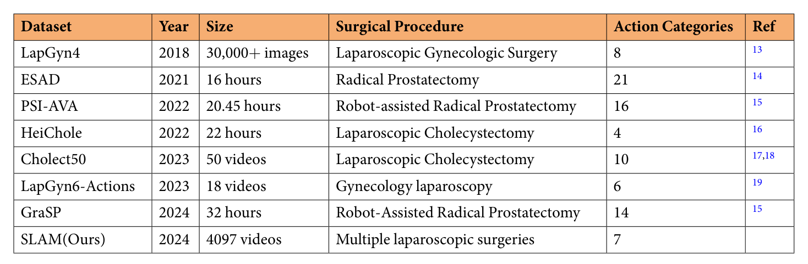
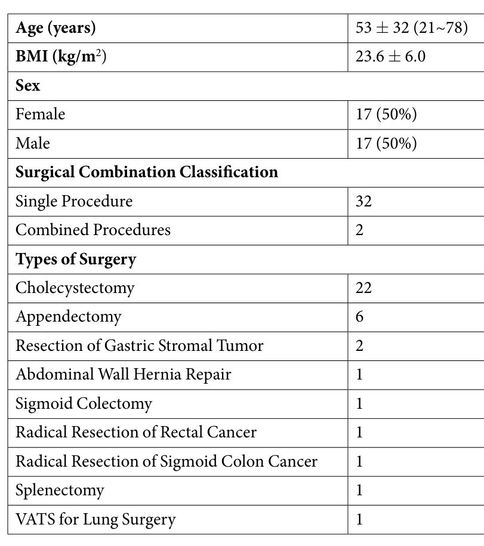
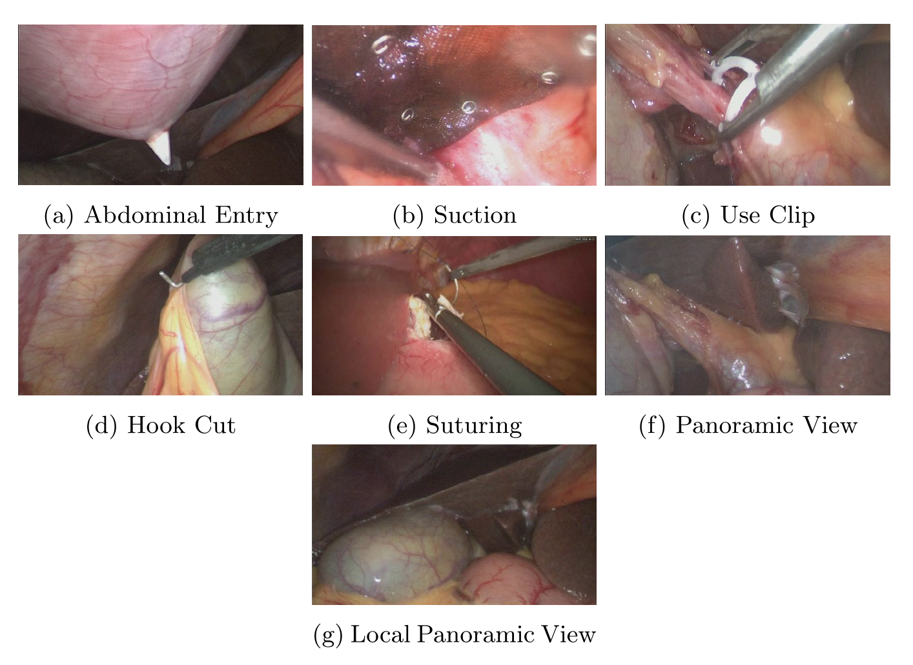
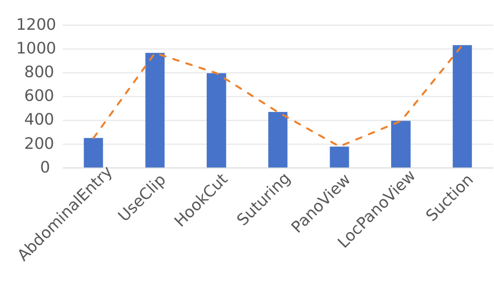
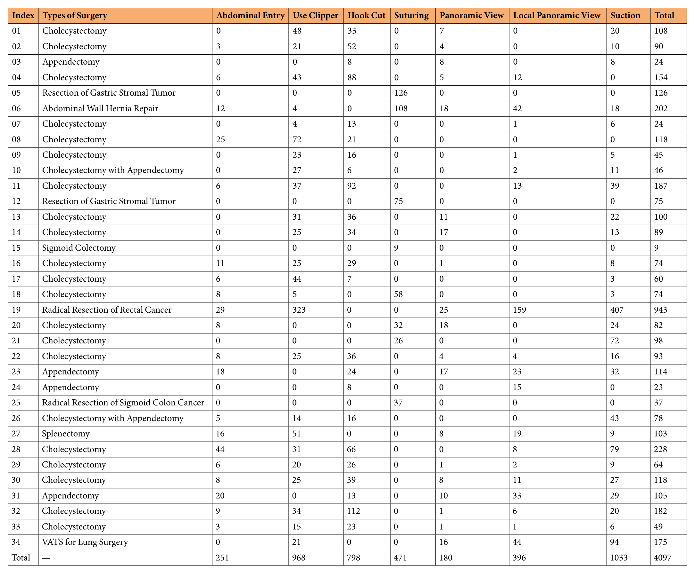
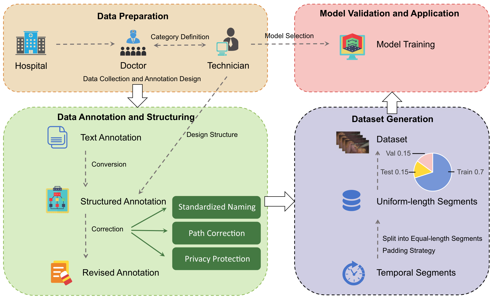
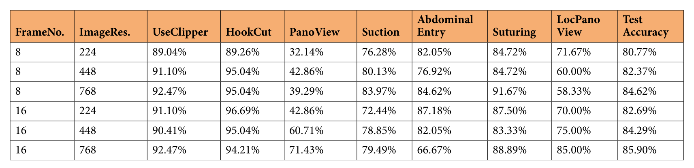
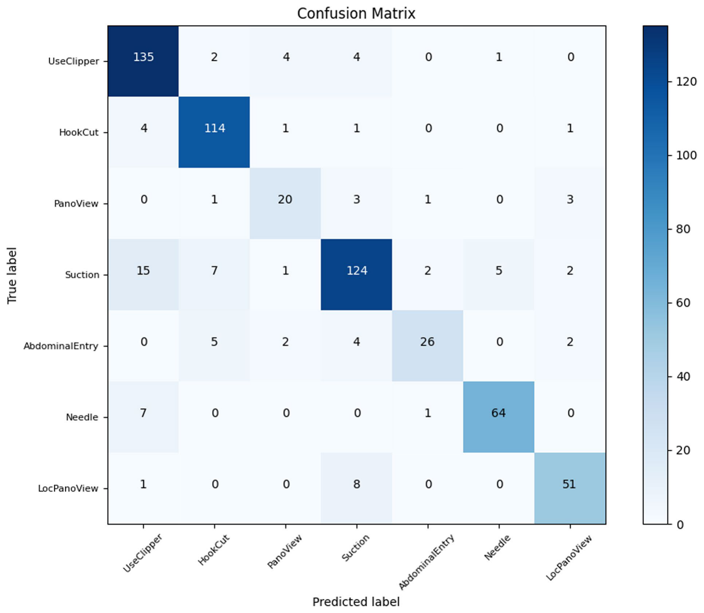

## 1. 背景与动机

**腹腔镜动作识别缺少跨术式的公开数据。** 自动识别术中动作可以服务于导航、培训和术后评估,也是手术机器人自动化的一步。论文认为瓶颈在数据:已有数据集规模小、术式单一、部分测试集不公开、标注质量不一。

表 1 中七个已有数据集各自只覆盖一种术式:LapGyn4 和 LapGyn6-Actions 是妇科,HeiChole 和 CholecT50 是胆囊切除,ESAD、PSI-AVA、GraSP 是前列腺切除。CholecT50 的测试集不公开。

*论文原图编号：Table 1。已有腹腔镜动作数据集与 SLAM 的对比。*

:::highlights
- 缺口:没有一个公开数据集同时覆盖多种腹腔镜术式的基础动作
:::

## 2. 核心观点速览

论文的答案是 SLAM:从 34 台手术中切出 4097 个 30 帧片段,每段标一个动作,共七类,按 70/15/15 公开划分。

**验证只用了一个模型。** ViViT 在六种帧数与分辨率设置下的测试准确率为 80.77% 到 85.90%,全景视野类最低。

**最该记住的边界:** 片段总时长约 82 分钟;划分单位论文未说明,混淆矩阵的计数更像按片段分层抽样;19 号病人一人贡献 943 个片段。所以 85.90% 不能直接当作对新病人的表现。

:::data
- 34 台手术,4097 个片段,每段 30 帧
- 最高测试准确率 85.90%(16 帧、768 分辨率)
:::

## 3. 数据从哪里来

**多样性在术式名称上,不在样本量上。** 34 台手术在 2021 到 2023 年录制于瑞金医院卢湾分院,单中心、同一款 30° 内镜,25 fps,1920 × 1080。胆囊切除 22 例、阑尾切除 6 例,其余 7 种术式各 1 到 2 例,其中 1 例是胸腔镜肺手术。

*论文原图编号：Table 2。病人构成与术式分布。*

表 2 的年龄写作 53 ± 32,范围 21~78。范围只有 57 岁,标准差不可能是 32,这个数值可能有误,论文未解释。

## 4. 七类动作与分布

七类中五类是操作(进腹、上夹、电钩切割、缝合、吸引),两类是视野状态(全景、局部全景)。**两类全景只靠视野范围区分**,没有特定器械动作。

*论文原图编号：Fig 1。七类动作的示例帧,(f) 与 (g) 外观接近。*

*论文原图编号：Fig 2。各类片段总数,吸引 1033 个最多,全景 180 个最少。*

表 3 给出逐病人计数。**19 号直肠癌根治术一台就有 943 个片段**,约占全集 23%,其中上夹 323 个、吸引 407 个。正文说每个病人有 15 到 38 个片段,与表 3 矛盾。

*论文原图编号：Table 3。逐病人逐类片段数。*

:::data
- 各类片段数:进腹 251,上夹 968,电钩 798,缝合 471,全景 180,局部全景 396,吸引 1033
- 19 号病人 943 个片段,胸腔镜 34 号病人 175 个
:::

## 5. 片段是怎样做出来的

流程分四段:医生定义类别、技术团队设计标注;文本标注转为结构化格式并做命名、路径和隐私处理;把标注区间切成 30 帧等长片段,不足的从头循环补帧;最后按 70/15/15 划分并训练模型。

*论文原图编号：Fig 3。数据采集与标注流程。*

**每段只有一名医师标注。** 两名副主任医师各标一半,主任医师抽查 10%,约 1% 被修改。论文承认没有标注者间一致性分析。

片段是否重叠、划分按病人还是按片段,论文未说明。作者提供了每段原始起止帧的 CSV,可以用来检查。

## 6. 验证协议

ViViT 训练 80 个 epoch,按验证集最好的权重测试;基础输入 8 帧、224 × 224、批大小 4,再比较 16 帧和 448、768 分辨率。帧采样方式、预训练权重、优化器、学习率,论文未说明,复现只能依赖作者代码。

## 7. 结果说了什么

*论文原图编号：Table 4。六种设置的逐类与整体准确率。*

**整体分数只差约 5 个点,逐类分数差得多。** 整体在 80.77% 到 85.90% 之间;全景视野在 32.14% 到 71.43% 之间,局部全景在 58.33% 到 85.00% 之间。电钩和上夹稳定在 89% 以上。

16 帧 768 分辨率下全景升到 71.43%,进腹却降到 66.67%。进腹在测试集只有 39 个片段,一两个样本就能改变几个点;每个设置只训练一次,这类波动不宜当作规律。

胸腔镜实验:仅腹腔镜训练的模型在胸腔测试集上 43.75%,混合训练后 65.62%,腹腔镜测试集也从 81.59% 升到 86.66%。胸腔测试片段数论文未说明,按百分比推断约 32 个。

:::data
- 仅腹腔镜模型:混合 79.97%,腹腔镜 81.59%,胸腔 43.75%
- 混合模型:混合 85.90%,腹腔镜 86.66%,胸腔 65.62%
:::

## 8. 错误集中在哪里

*论文原图编号：Fig 4。16 帧、768 分辨率下的混淆矩阵,缝合类在图中写作 Needle。*

全景有 20 个判对、3 个判为局部全景;吸引有 15 个被判为上夹。各行和与表 4 吻合,说明行是真值。**两类全景的混淆来自类别定义本身**:区别只是视野大小,短片段里很难看出。

## 9. 结果没说什么

**测试集更像按片段抽样。** 混淆矩阵各行和为 146、121、28、156、39、72、60,约为各类总数的 15%(我的判断)。若按片段划分,同一动作区间的相邻片段可能分进训练和测试,模型能借助病人特有的外观,85.90% 可能偏高。

**多术式的好处没有被单独检验。** 没有按术式留出的测试,上夹和吸引的三分之一以上来自 19 号病人。

**胸腔镜增广的效果与样本量混在一起。** 混合模型多了 175 个片段,论文没有等样本量对照,而且胸腔数据只来自一台手术。

## @takeaways
- SLAM 是 30 帧短片段的七类动作分类,总时长约 82 分钟,不是长视频流程数据
- 85.90% 来自单模型单次训练,划分单位未说明
- 全景与局部全景是最难的一对,适合作为难例子集
- 使用前先按 patient 列检查训练集和测试集的病人重叠

## @strengths
- 覆盖 9 种术式,动作定义不依赖具体术式
- 划分、标签和代码全部公开,figshare 无需注册
- 逐病人逐类计数完整,方便自行重划分

## @weaknesses
- 单中心、单设备,单个病人占近四分之一片段
- 无标注者间一致性,每段只有一人标注
- 只有一个基线,训练细节缺失
- 正文与表格有不一致:每病人片段数、年龄标准差、CholecT50 类别数

## @questions
- 按病人划分后准确率会降多少?
- 8 或 16 帧如何从 30 帧片段中采样?
- 对 19 号病人降采样后,上夹和吸引的准确率如何变化?
