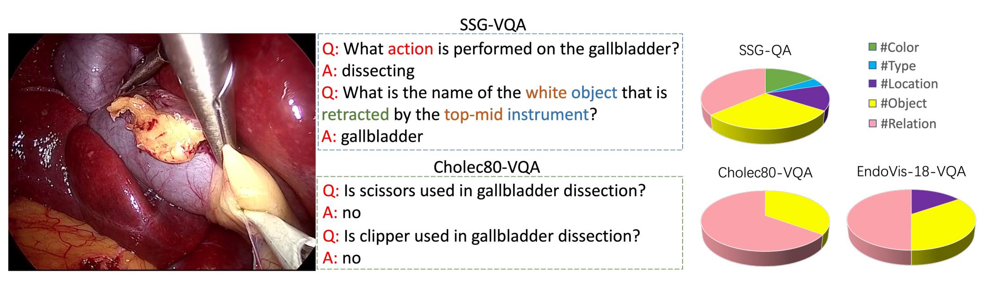
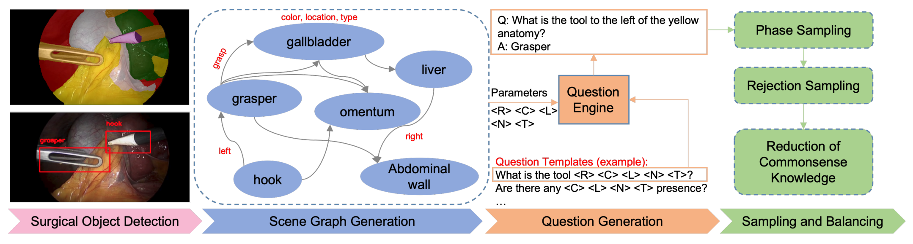
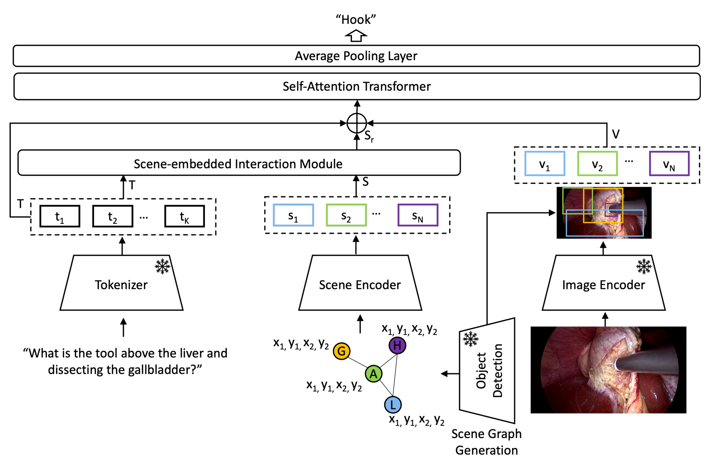
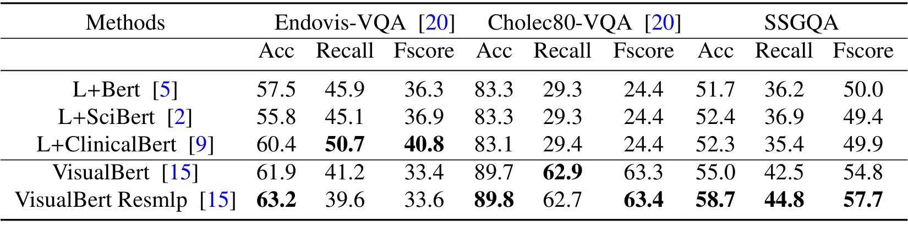
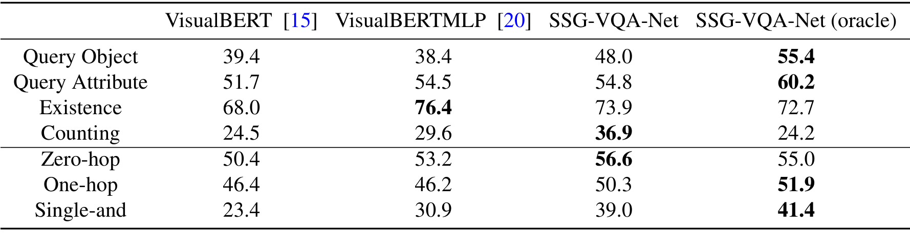
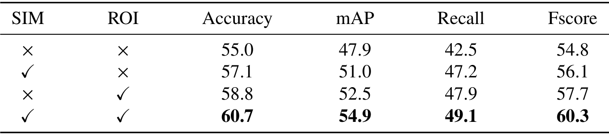
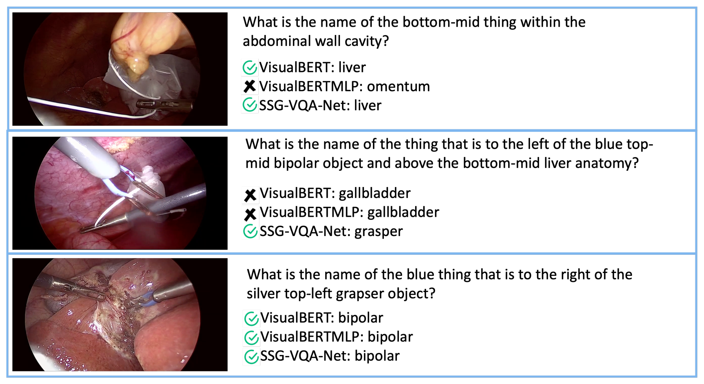
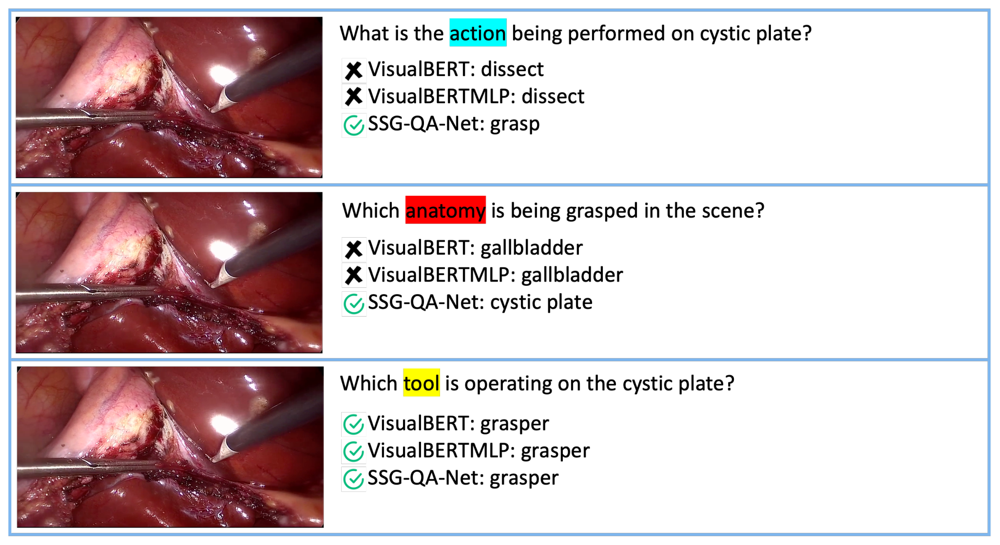
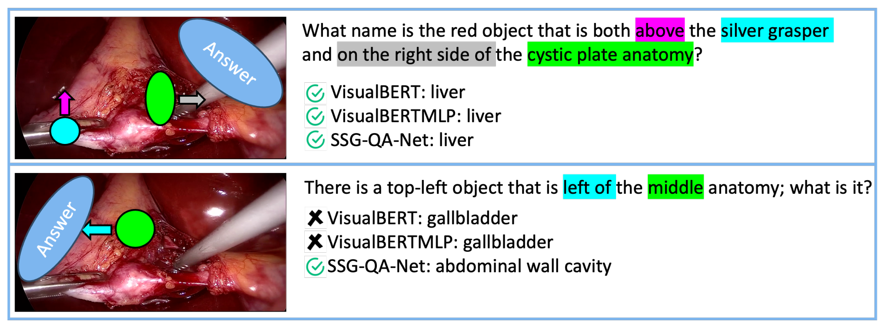

---
tags:
  - papers/手术数据集
aliases:
  - "SSG-VQA"
  - "SSG-VQA-Net"
  - "Surgical Scene Graph VQA"
date: 2024
arxiv_id: "2312.10251"
---

# Advancing Surgical VQA with Scene Graph Knowledge

## 核心信息

- 标题: Advancing Surgical VQA with Scene Graph Knowledge
- 标题翻译: 用场景图知识推进手术视觉问答
- 作者: Kun Yuan, Manasi Kattel, Joël L. Lavanchy, Nassir Navab, Vinkle Srivastav, Nicolas Padoy
- 机构: 斯特拉斯堡大学 ICube 实验室（CNRS）；斯特拉斯堡 IHU；慕尼黑工业大学 CAMP
- 发表时间: 2024
- 发表渠道: IPCAI 2024（International Journal of Computer Assisted Radiology and Surgery）
- arXiv: 2312.10251
- 论文链接: https://arxiv.org/abs/2312.10251
- 代码 / 项目: https://github.com/CAMMA-public/SSG-VQA
- 数据 / 资源: https://github.com/CAMMA-public/SSG-VQA
- 论文类型: benchmark_or_dataset

## 原文摘要翻译

**目的：** 现代手术室日益复杂，需要创新的术中辅助系统。手术数据科学此前主要关注视频分析，而把手术计算机视觉与自然语言能力结合正成为必需。本文旨在借助场景图知识推进手术场景中的视觉问答，解决现有手术视觉问答系统的两个主要问题：去除数据集中的问题条件偏差，以及在模型设计中加入场景感知推理。

**方法：** 首先，我们提出基于手术场景图的数据集 SSG-VQA，它通过在公开数据集上运行分割和检测模型生成。我们利用器械与解剖结构的空间信息和动作信息构建手术场景图，再把这些图送入问题引擎，生成多样的问答对。与现有手术问答数据集相比，SSG-VQA 更复杂、更多样、具有几何依据、无偏且以手术动作为导向。随后，我们提出手术问答模型 SSG-VQA-Net，它包含一个轻量的场景嵌入交互模块（SIM），通过文本特征与场景特征之间的交叉注意力，把几何场景知识引入模型设计。

**结果：** 对 SSG-VQA 数据集的全面分析表明，SSG-VQA-Net 在不同题型和复杂度上均优于现有方法。我们指出，现有手术问答系统的主要限制在于缺乏回答复杂问题所需的场景知识。

**结论：** 我们提出了新的手术问答数据集和模型，并表明在模型设计中加入几何场景特征可以显著提升结果。源代码和数据集将公开于 https://github.com/CAMMA-public/SSG-VQA。

## 创新点

1. **用场景图自动生成手术问答。** 以往的 EndoVis-18-VQA 与 Cholec80-VQA 只问器械或阶段是否出现。SSG-VQA 先为每帧建立器械与解剖的场景图，节点带颜色、位置、类型属性，边带空间关系与动作三元组，再由问题引擎套模板出题，于是能问“黄色解剖结构左边是什么器械”这类需要定位的问题。
2. **规模与多样性。** 25k 个场景、960k 个问题、501k 个不重复问题，平均问题长 12.8 词，每场景 38.9 题；问题数是 EndoVis-18-VQA 的 8 倍、Cholec80-VQA 的 22 倍。
3. **把问题条件偏差当作需要检验的对象。** 作者删除可能泄露答案的模板和无效问题，并用只读问题的语言模型做对照，证明 EndoVis-18-VQA 可被纯语言模型破解。
4. **按推理步数分档。** 问题分为零跳、单跳、双条件三档，分别涉及零个、一个、两个物体关系，可用来诊断模型在哪一步推理失败。
5. **参考模型 SSG-VQA-Net。** 在全局图像特征外加入检测框的物体级特征和坐标，用两层交叉注意力让问题词挑选相关的场景节点。

## 一句话总结

SSG-VQA 在 CholecT45 的 45 段胆囊切除视频上，用检测、分割和动作三元组建立手术场景图，再用 40 个模板生成 960k 个带空间关系与动作的问答，配套模型 SSG-VQA-Net 借助检测框把 mAP 提到 54.9，但训练集标签由模型自动生成，问题也只是模板语言。

## 研究问题

**手术视觉问答要求模型看懂画面里谁在哪、谁在对谁做什么，但已有数据集问不出这类问题。** 医生希望用一句话提问，系统看着当前画面作答。这需要模型理解多个器械与解剖结构之间的空间和动作关系。

EndoVis-18-VQA 和 Cholec80-VQA 规模小，问题多是“某器械是否出现”这类分类题。它们还存在问题条件偏差，即只读问题、不看图像也能答对。已有模型则把整张图切成图块，与文本一起送进大型 Transformer，图块里没有物体级信息。

论文因此要回答两个问题：能否构建一个问题多样、必须看图、带几何依据的手术问答数据集；显式加入物体位置和类别，能否改善复杂问题的回答。

### 核心观点速览

论文的答案是：先给每帧画面建一张场景图，再让问题引擎按模板出题，答案由图算出。

- **场景图。** 检测与分割模型给出器械和解剖结构的框，质心比较给出空间关系，CholecT45 三元组给出动作关系。
- **问题引擎。** 40 个模板加五类参数，生成五类题型、三档推理步数的问答，共 960k 题。
- **去偏差。** 按阶段和器械出现抽帧，删除能从问题推出答案的模板，并用纯语言模型做对照。
- **参考模型。** SSG-VQA-Net 加入检测框的物体特征和坐标，mAP 54.9，比最强基线高 3.1。

**边界：** 训练集标签由模型自动生成，只有 5 段测试视频人工修正；问题是模板语言；模型读入的框与出题用的框同源。

## 数据与任务定义

**使用这份数据前要先弄清：图像从哪来，标签有多可信，题目长什么样。**

### 数据来源

SSG-VQA 沿用 CholecT45 的视频与划分：40 段腹腔镜胆囊切除视频用于训练，5 段用于测试。物体框来自两个模型：在 m2cai16-tool-locations 上训练的器械检测器，以及在 CholecSeg8k 上训练的语义分割模型。动作关系取自 CholecT45 的 <器械, 动作, 目标> 三元组标注。

构建场景图的器械检测器引用的是 YOLOv5，分割模型引用的是 DeepLabv3+；参考模型里用的 YOLOv7 则另在本数据集训练集的框上训练，两者不是同一个检测器。

**测试集视频的框和类别由人工修正，训练集则保留模型输出。** 因此只有测试集可视为干净标签。训练帧上检测与分割的错误率论文未说明，这限制了我们判断训练标签噪声有多大。

*论文原图编号：Fig. 1。同一画面上 SSG-VQA 与 Cholec80-VQA 的问答对比，右侧饼图是三个数据集问题在颜色、类型、位置、物体、关系类别上的分布。放在这里是因为它直观展示了新数据集问的是什么。*

### 任务拆分

任务是单帧图像加一个问题，从预定义答案集里选出答案。问题按查询内容分为五类：

| 题型 | 例子 |
|---|---|
| 查询物体 | 胆囊左侧的器械叫什么 |
| 查询属性 | 一个物体同时在黄色物体左边、棕色解剖下方，它在什么位置 |
| 查询关系 | 正在进行什么动作 |
| 存在判断 | 画面上中位置有没有双极电凝 |
| 计数 | 右下方有几个器械 |

按推理复杂度再分三档：零跳、单跳、双条件，分别需要理解零个、一个、两个物体之间的关系。答案集共有多少类，论文未说明，因此无法估算随机猜测的水平。

### 规模统计

| 指标 | EndoVis-18-VQA | Cholec80-VQA | SSG-VQA |
|---|---|---|---|
| 手术场景数 | 2k | 21k | 25k |
| 问题数 | 11k | 43k | 960k |
| 不重复问题 | 17 | 51 | 501k |
| 平均长度（词） | 5.8 | 2.0 | 12.8 |
| 每场景问题数 | 5.0 | 6.5 | 38.9 |

附录表 7 给出属性类别数：SSG-VQA 有 7 种颜色、2 种类型、6 个位置、13 类物体、16 种关系，Cholec80-VQA 只有 7 类物体，没有颜色、位置和关系类别。**不重复问题从 51 个增至 501k 个，模型很难靠记住问题句式答题。** 颜色属性怎样取值，论文未说明。

附录正文把每场景 38.9 题误写成“平均问题长度 38.9 词”，与表 1 的 12.8 词矛盾，应以表格为准。

下一节说明这些题目是如何从画面一步步生成的。

## 方法主线

**问题在于怎样让自动出的题既多样，又必须看图才能答。** 论文的做法是让题目和答案都从同一张场景图里来。本节先写数据构建，再写作为参考基线的模型。

### 机制流程

1. **检测与分割。** 输入为 CholecT45 帧。器械检测器与分割模型从每帧提取器械和解剖结构的框，送入场景图构建。
2. **场景图生成。** 节点是器械与解剖，属性为颜色、位置、类型；位置把画面切成九宫格，按物体所在格赋值。空间关系边通过比较两物体质心得到，动作关系边来自 CholecT45 三元组。输出为每帧一张有向图。
3. **问题生成。** 问题引擎扩展 CLEVR 引擎，输入场景图与 40 个人工模板，按场景图查询五个参数：颜色、位置、类型、名称、关系，并把取值填入模板。例如“某关系、某颜色、某位置、某类型的器械是什么”这一模板，填入“在左侧”“黄色”“空”“解剖”后，得到“黄色解剖结构左侧的器械是什么”。输出为问答对。
4. **采样与平衡。** 按 Cholec80 的阶段与器械出现标签抽帧，而不像 Cholec80-VQA 那样均匀抽帧；删除可能含问题条件偏差的模板，以及“画面里没有胆囊时问胆囊位置”这类无效问题。输出为最终数据集。

*论文原图编号：Fig. 2。从目标检测、场景图生成、问题生成到采样与平衡的四段流程。放在这里是因为它把上面四步画在一张图上。*

### 参考模型 SSG-VQA-Net

**已有模型只看全局图块，模型自己并不知道物体在哪。** SSG-VQA-Net 把检测框的位置和类别显式送进模型。它有三路输入：

- 文本：预训练分词器把问题转成文本嵌入 $T=\{t_1,\dots,t_K\}$。
- 视觉：ResNet18 提取特征图，YOLOv7 检测物体，再按检测框做区域池化，得到 $N$ 个物体特征 $V=\{v_1,\dots,v_N\}$。检测器在本数据集训练集的框上训练。
- 场景：把每个检测框的类别和坐标拼接，经一层线性层（场景编码器）得到 $S=\{s_1,\dots,s_N\}$。

场景嵌入交互模块 SIM 有两层，每层依次做交叉注意力、自注意力和前馈。交叉注意力以场景嵌入为查询、文本嵌入为键和值：

$$\mathrm{Attention}(Q,K,V)=\mathrm{softmax}\left(\frac{QK^\top}{\sqrt{d_k}}\right)V$$

先以 $S$ 为查询、$T$ 为键和值做交叉注意力，再对结果做自注意力，得到与问题相关的场景嵌入 $S_r$。随后把 $S_r$、$V$、$T$ 拼接，送入自注意力编码器，平均池化后映射到答案集。

*论文原图编号：Fig. 3。SSG-VQA-Net 的三路输入：分词器、场景编码器加 SIM、检测框加 RoIAlign，拼接后经自注意力与平均池化得到答案。放在这里是因为它给出了基线模型的数据流。*

### 评测协议

指标沿用 Surgical-VQA 的准确率、召回率和 F 值，在本数据集上另报 mAP。

基线分两组。纯语言模型有 L+Bert、L+SciBert、L+ClinicalBert，只读问题。

视觉语言模型有 VisualBert、VisualBert Resmlp、SurgicalGPT，同时读图像和问题。

上界版本（oracle）用数据集里的框标签代替检测器输出。学习率、训练轮数和重复运行次数论文未说明，结果也没有置信区间，因此表中一两个点的差距无法判断是否稳定。

下一节先检验数据集是否真的需要看图，再看模型表现。

## 关键结果

**先要确认这份数据真的需要看图，否则后面的模型比较没有意义。**

### 问题条件偏差检验

*论文原图编号：Table 2。纯语言模型与视觉语言模型在三个数据集上的准确率、召回率、F 值。放在这里是因为它是“偏差更低”这一说法的唯一证据。*

| 模型 | EndoVis 准确率 / F 值 | Cholec80 准确率 / F 值 | 本数据集 准确率 / F 值 |
|---|---|---|---|
| L+ClinicalBert | 60.4 / 40.8 | 83.1 / 24.4 | 52.3 / 49.9 |
| VisualBert | 61.9 / 33.4 | 89.7 / 63.3 | 55.0 / 54.8 |
| VisualBert Resmlp | 63.2 / 33.6 | 89.8 / 63.4 | 58.7 / 57.7 |

在 EndoVis-18-VQA 上，纯语言模型的召回率与 F 值都高于视觉语言模型，**说明这份数据的答案可以直接从问题推出。**

Cholec80-VQA 上纯语言模型准确率达 83.1，但 F 值只有 24.4。高准确率主要来自答案分布不均，作者据此把它归为低偏差。

在本数据集上，纯语言模型的各项指标都低于视觉语言模型，准确率比 VisualBert Resmlp 低 6.4 个点。**这支持“需要看图”，但不能说明偏差已被消除：** 纯语言模型仍有约 52 的准确率，而多数类或答案先验基线论文未说明，所以这 52 有多少来自偏差无法判断。

### 主结果

| 模型 | Acc | mAP | Recall | Fscore |
|---|---|---|---|---|
| L+ClinicalBert | 52.3 | 40.4 | 35.4 | 49.9 |
| VisualBert | 55.0 | 47.9 | 42.5 | 54.8 |
| VisualBert Resmlp | 58.7 | 51.8 | 44.8 | 57.7 |
| SurgicalGPT | 58.5 | 49.4 | 44.8 | 57.8 |
| SSG-VQA-Net | 60.7 | 54.9 | 49.1 | 60.3 |
| SSG-VQA-Net（oracle） | 62.8 | 56.3 | 50.6 | 62.3 |

除上界版本外，SSG-VQA-Net 在四项指标上都最好。**所有模型准确率都在 52 到 63 之间，说明这份数据离饱和还远，作为评测集有区分度。** 上界版本只比 SSG-VQA-Net 高 1.4 个 mAP，检测误差不是主要瓶颈。

### 按题型与复杂度

*论文原图编号：Table 4。四个模型在四类题型与三档复杂度上的 mAP。放在这里是因为它显示了提升集中在哪类问题。*

| 拆分 | VisualBERT | VisualBERTMLP | SSG-VQA-Net | oracle |
|---|---|---|---|---|
| 查询物体 | 39.4 | 38.4 | 48.0 | 55.4 |
| 查询属性 | 51.7 | 54.5 | 54.8 | 60.2 |
| 存在判断 | 68.0 | 76.4 | 73.9 | 72.7 |
| 计数 | 24.5 | 29.6 | 36.9 | 24.2 |
| 零跳 | 50.4 | 53.2 | 56.6 | 55.0 |
| 单跳 | 46.4 | 46.2 | 50.3 | 51.9 |
| 双条件 | 23.4 | 30.9 | 39.0 | 41.4 |

**提升集中在需要定位的题上：** 双条件题比 VisualBERTMLP 高 8.1，计数题比 VisualBERT 高 7.3，查询物体题比两个基线高 8.6 到 9.6 个点。存在判断题上 SSG-VQA-Net 反而低于 VisualBERTMLP（73.9 对 76.4），说明物体级特征对“有没有”这类全局问题帮助不大。

上界版本在计数题上只有 24.2，比用检测器的版本低 12.7 个点，存在判断与零跳题上也更低。原因论文未说明。

### Cholec80-VQA 上的结果

| 模型 | 参数量 | Acc | Recall | Fscore |
|---|---|---|---|---|
| VisualBert | 209.8M | 89.7 | 62.9 | 63.3 |
| VisualBert Resmlp | 184.7M | 89.8 | 62.7 | 63.4 |
| SurgicalGPT | 234.5M | 87.5 | 57.5 | 57.9 |
| SSG-VQA-Net | 145.3M | 90.6 | 64.4 | 63.7 |

在旧数据集上，SSG-VQA-Net 用更少参数拿到最高分，但各模型差距都在 1 个点上下，SurgicalGPT 落后约 3 个点。作者由此认为瓶颈在视觉理解而非文本生成；不过这里的答案是固定集合上的分类，生成式解码本就无从发挥，这个推论只在分类设置下成立。

### 消融

*论文原图编号：Table 6。SIM 与 RoIAlign 四种组合的四项指标。放在这里是因为它拆开了两个模块各自的贡献。*

两者都不加时 mAP 为 47.9，与 VisualBert 相同；只加 SIM 为 51.0，只加 RoIAlign 为 52.5，两者都加为 54.9。**两个模块各带来约 3 到 5 个点，叠加后再涨，作者据此说二者互补。** 但论文没有参数量对齐的对照，也没有多次运行，增益与“多了输入令牌和参数”这一解释没有被区分开。

下面的示例展示这些题目长什么样。

### 定性示例

*论文原图编号：Fig. 8。三道含位置与颜色属性的题目上三种模型的答案。放在这里是因为它展示了属性类问题的样子。*

*论文原图编号：Fig. 9。同一画面上动作、解剖、器械三道三元组题目的答案。放在这里是因为它展示了动作关系问题的样子。*

*论文原图编号：Fig. 10。两道需要多步空间推理的题目上三种模型的答案。放在这里是因为它展示了双条件题的样子。*

## 深度分析

**分数高不等于能回答医生的问题。** 本节讨论这份数据实际测到的能力，以及结果背后可能的替代解释。

### 数据集真正测到了什么

SSG-VQA 测的是模板语言下的物体识别与空间关系推理。由于答案由场景图算出，答对一题等价于从图像中恢复相关节点和边。动作类题目测的则是 CholecT45 三元组识别。它不测开放式回答、跨帧推理，也不测医生真实的提问方式。

### 数据与模型同源

问题来自检测框构成的场景图，SSG-VQA-Net 又读入同类框的坐标和类别。**一个怀疑者会说：模型的提升有一部分是“读回”了出题时用到的信息。**

论文里有两点能部分回应：测试集的图经人工修正，模型用的是另训的 YOLOv7。要真正区分，需要比较检测质量不同的设置，或用独立来源的框出题；论文只给了上界版本这一组对照。

### 上界版本的反常

上界版本用标注框，按理应在每类题上都不差于检测器版本，但计数题低了 12.7 个点。我的推断是标注框与检测框的数量或粒度不同，使计数答案的分布变了；论文未说明，这一点让上界版本的含义打了折扣。

### 适用边界

数据只覆盖腹腔镜胆囊切除、单帧图像和固定答案集。它适合比较模型的空间推理与定位能力，不能代表术中真实提问，也不能外推到其他术式。

## 局限

- 训练集场景图由模型自动生成，只有 5 段测试视频人工修正；训练标签错误率论文未说明。
- 题目来自 40 个模板，被删除的偏差模板清单论文未说明，语言分布与医生提问不同。
- 只有一种术式，没有时序问题。
- 答案集大小、颜色取值方法、训练超参数与重复次数论文未说明，结果没有置信区间。
- 纯语言模型仍有约 52 的准确率，缺少多数类基线。
- 附录正文把每场景 38.9 题误写成平均问题长度。

## 我的笔记

- **可以照搬：** 新建问答数据集时，先训练只读问题的模型做对照，并按题型和推理步数分开报告。
- **使用前检查：** 只把人工修正的测试集当金标准；报告结果时注明是否读入检测框，以及检测器在哪份数据上训练。
- **避免：** 把本数据集上的分数当作临床问答能力；把固定答案集上的分类结果推到生成式问答。
- 待查：多数类基线的准确率；换成真实医生的提问，模型排名是否保持。

## 引用

- Yuan et al. (2024). Advancing Surgical VQA with Scene Graph Knowledge. IPCAI 2024. arXiv:2312.10251.
- Seenivasan et al. (2022). Surgical-VQA: Visual Question Answering in Surgical Scenes using Transformer. MICCAI.
- Seenivasan et al. (2023). SurgicalGPT: End-to-end Language-Vision GPT for Visual Question Answering in Surgery. arXiv:2304.09974.
- Nwoye et al. (2022). Rendezvous: Attention Mechanisms for the Recognition of Surgical Action Triplets in Endoscopic Videos. MedIA.
- Johnson et al. (2017). CLEVR: A Diagnostic Dataset for Compositional Language and Elementary Visual Reasoning. CVPR.
