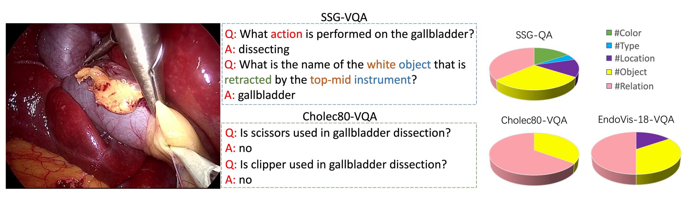
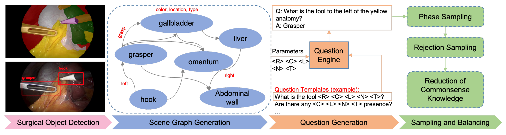
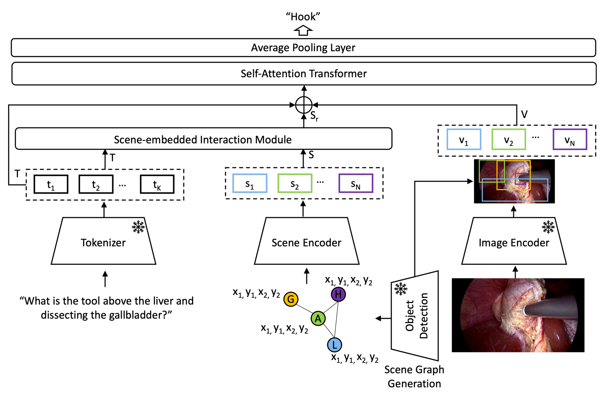
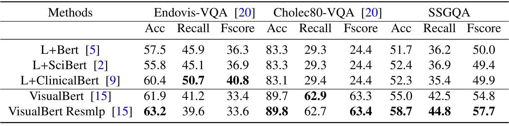
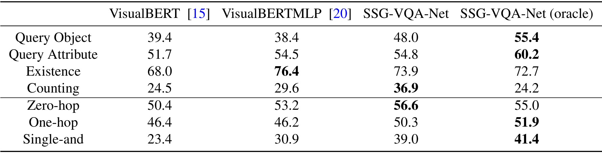
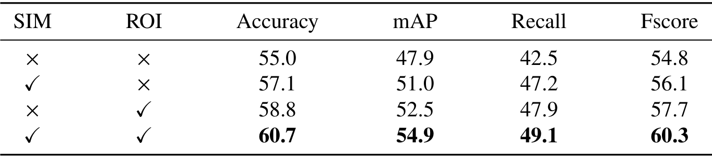

## 1. 背景与动机

**手术视觉问答要模型看懂“谁在哪、谁在对谁做什么”，已有数据集却问不出这类问题。** EndoVis-18-VQA 和 Cholec80-VQA 规模小，题目多是“某器械是否出现”。

更麻烦的是问题条件偏差：只读问题不看图也能答对。已有模型又只看全局图块，不知道物体在哪。论文想补上数据和模型两头的缺口。

## 2. 核心观点速览

论文的思路是：让题目和答案都从同一张场景图里来。

- 检测与分割给出物体框，质心比较给出空间关系，三元组给出动作关系。
- 问题引擎用 40 个模板生成 960k 题，分五类题型、三档推理步数。
- 按阶段和器械抽帧，删去能从问题推出答案的模板，并用纯语言模型对照。
- 参考模型 SSG-VQA-Net 读入检测框，mAP 54.9。

**边界：** 训练集标签是模型自动生成的，只有 5 段测试视频人工修正；模型读的框与出题的框同源。

:::highlights
- 题目与答案由场景图自动生成，复杂度可控
- 纯语言对照实验揭穿了 EndoVis-18-VQA 的偏差
:::

:::data
- 25k 场景，960k 题，501k 不重复题
- 平均 12.8 词，每场景 38.9 题
:::

## 3. 数据从哪来

视频与划分沿用 CholecT45：40 段训练，5 段测试，全部是腹腔镜胆囊切除。器械框来自在 m2cai16-tool-locations 上训练的检测器，解剖框来自在 CholecSeg8k 上训练的分割模型。

**测试集的框和类别经人工修正，训练集保留模型输出。** 训练帧上的检测错误率论文未说明，因此训练标签噪声有多大无从判断。

*论文原图编号：Fig. 1。同一画面上 SSG-VQA 与 Cholec80-VQA 的题目对比，以及三个数据集的题目类别分布。*

下一节看题目怎样从这些框里长出来。

## 4. 题目怎样生成

**难点是让自动出的题既多样，又必须看图。**

1. 场景图：节点是器械和解剖，属性为颜色、位置、类型；位置按九宫格赋值，空间关系比较质心，动作关系取自三元组。
2. 问题引擎：扩展 CLEVR 引擎，40 个模板，按场景图填入颜色、位置、类型、名称、关系五类参数，答案由图算出。
3. 采样与平衡：按阶段和器械出现标签抽帧，删除带偏差的模板与无效问题。

*论文原图编号：Fig. 2。目标检测、场景图生成、问题生成、采样与平衡四段流程。*

题目分五类：查询物体、查询属性、查询关系、存在判断、计数。按推理步数再分零跳、单跳、双条件三档。颜色怎样取值、答案集多大，论文未说明。

## 5. 规模对比

| 指标 | EndoVis-18-VQA | Cholec80-VQA | SSG-VQA |
|---|---|---|---|
| 场景数 | 2k | 21k | 25k |
| 问题数 | 11k | 43k | 960k |
| 不重复问题 | 17 | 51 | 501k |
| 平均长度（词） | 5.8 | 2.0 | 12.8 |

**不重复问题从 51 个增至 501k 个，模型很难靠记住句式答题。** 附录正文把每场景 38.9 题误写成平均长度 38.9 词，应以表格为准。

## 6. 参考模型

**已有模型不知道物体在哪，SSG-VQA-Net 把框的位置和类别直接送进去。**

- 文本：分词器得到问题嵌入。
- 视觉：ResNet18 特征图加 YOLOv7 检测框，区域池化得到物体特征。
- 场景：框的类别和坐标经线性层编码，再经两层交叉注意力，让问题词挑出相关节点。

三路拼接后经自注意力编码器与平均池化，从答案集中选答案。

*论文原图编号：Fig. 3。三路输入与场景嵌入交互模块。*

## 7. 这份数据真的需要看图吗

*论文原图编号：Table 2。纯语言模型与视觉语言模型在三个数据集上的结果。*

在 EndoVis-18-VQA 上，纯语言模型的召回率与 F 值高于视觉语言模型，**答案能从问题推出。** 在本数据集上，纯语言模型准确率 52.3，比 VisualBert Resmlp 低 6.4 个点。

这支持“需要看图”，但没有证明偏差已消除：多数类基线论文未说明，52.3 里有多少来自答案分布无法判断。

## 8. 结果说了什么

| 模型 | 准确率 | mAP | F 值 |
|---|---|---|---|
| VisualBert | 55.0 | 47.9 | 54.8 |
| VisualBert Resmlp | 58.7 | 51.8 | 57.7 |
| SurgicalGPT | 58.5 | 49.4 | 57.8 |
| SSG-VQA-Net | 60.7 | 54.9 | 60.3 |
| 上界版本 | 62.8 | 56.3 | 62.3 |

**所有模型准确率都在 52 到 63 之间，数据集远未饱和。** 上界版本只高 1.4 个 mAP，检测误差不是主要瓶颈。

*论文原图编号：Table 4。按题型与推理步数拆分的 mAP。*

提升集中在需要定位的题：双条件题比 VisualBERTMLP 高 8.1，计数题比 VisualBERT 高 7.3。存在判断题反而低于 VisualBERTMLP（73.9 对 76.4）。

:::data
- 双条件题：23.4、30.9、39.0、41.4
- 消融 mAP：47.9、51.0、52.5、54.9
:::

## 9. 为什么有效，又可能不是

*论文原图编号：Table 6。场景嵌入交互模块与区域池化的四种组合。*

两个模块各带来约 3 到 5 个点，叠加后达 54.9。**但没有参数量对齐的对照，也没有多次运行，**增益与“多了输入和参数”尚未区分。

更大的替代解释是同源：题目由检测框构成的场景图派生，模型又读入同类框。测试集人工修正、模型另训 YOLOv7，能部分回应；真正区分需要独立来源的框。

上界版本计数题只有 24.2，比检测器版本低 12.7 个点，原因论文未说明。

## 10. 结果没说什么

- 不说明临床问答能力：题目是 40 个模板的组合，不是医生的提问。
- 不说明生成式问答：答案是固定集合上的分类，所以“瓶颈在视觉而非文本生成”只在分类设置下成立。
- 不说明其他术式与时序：只有胆囊切除单帧图像。
- 不说明差距是否稳定：学习率、轮数、重复次数论文未说明。

## 11. 复现要注意什么

- 只把人工修正的测试集当金标准。
- 报告结果时注明是否读入检测框，以及检测器的训练数据。
- 按题型和推理步数分开报告，并补一个多数类基线。

## @takeaways
- 场景图加模板能大规模出题，答案由图算出，复杂度可控
- 新数据集先做纯语言对照，EndoVis-18-VQA 就此暴露偏差
- 物体级框信息让定位类题目明显提升，存在判断题例外

## @strengths
- 规模与多样性远超已有手术问答数据，代码和数据公开
- 偏差检验和按推理步数拆分让评测可诊断

## @weaknesses
- 训练标签是模型自动输出，错误率未报告
- 题目与模型输入同源，缺少可区分的对照
- 无方差、无多数类基线，附录有笔误

## @questions
- 多数类基线在本数据集上是多少？
- 上界版本为何在计数题上大幅下降？
- 换成医生的真实提问，模型排名是否保持？
