---
tags:
  - papers/手术数据集
aliases:
  - "SUREON"
  - "SUREON 手术视觉推理基准"
  - "SUREON-VLM"
date: 2026-10-30
arxiv_id: 2603.06570
---

# SUREON: A Benchmark and Vision-Language Model for Surgical Reasoning

## 核心信息

- 标题: SUREON: A Benchmark and Vision-Language Model for Surgical Reasoning
- 标题翻译: SUREON：面向手术推理的基准与视觉语言模型
- 作者: Alejandra Perez, Anita Rau, Busisiwe Mlambo, Lee White, Aina Brunet, Juan Verde, Juan Caicedo, Joël L. Lavanchy, Adam Schmidt, Chinedu Nwoye, Omid Mohareri, Muhammad Abdullah Jamal
- 机构: Intuitive Surgical; 贝尔维特格大学医院; 斯特拉斯堡 IHU; 斯特拉斯堡大学; 波哥大圣菲基金会; 巴塞尔 Clarunis 消化健康中心; 巴塞尔大学
- 发表时间: 2026（arXiv v2 于 2026-10-30）
- 发表渠道: arXiv 预印本（cs.CV）；项目页与数据卡标注为 WACV 2027 录用
- arXiv: 2603.06570
- 论文链接: https://arxiv.org/abs/2603.06570
- 代码 / 项目: https://github.com/aperezr20/sureon ；https://aperezr20.github.io/sureon
- 数据 / 资源: https://huggingface.co/datasets/aleperez24/sureon（需登录并经人工审核开通，CC BY-NC-SA 4.0，只含问答与时间窗，不含视频）
- 论文类型: 数据集与基准论文（benchmark_or_dataset）

## 原文摘要翻译

一个合格的手术 AI 模型应当依据视觉证据进行推理；然而，许多现有手术基准在没有视觉输入时也能被部分解答，因为模型可以利用手术流程先验或常见的解剖结构与器械交互，仅凭语言推断答案。

为此，我们提出 SUREON，一个用于评估基于视觉的手术推理的视频问答（QA）数据集与基准。我们的流水线从带讲解的手术教学视频中生成问答对，用多个模型改写错误选项以减少语言偏差，并用训练过的对抗猜测器过滤掉无需视觉证据即可作答的问题。所得数据集包含覆盖 168 种术式、10 个专科的 76K 条训练问答，以及经外科专家核验、涵盖 10 个类别的 340 道基准题。对主流商业与开源模型的评测表明，手术视觉推理在很大程度上仍未解决：没有模型超过 53% 的准确率，即便外科专家也只达到 64.9%。

我们还提出 SUREON-VLM，这是一个在我们筛选后的数据上训练、避免语言捷径的基线模型；它在 SUREON 上优于现有开源模型，并在多个标准手术基准上与更大的专科模型相当。训练消融显示，干扰项改写与盲测筛选增强了视觉依赖，使多模态增益从 8.7 提高到 29.1 个百分点，同时把训练集从 176.6K 条筛减到 76K 条。因此，SUREON 既提供了一个经过核验的手术视觉推理测试平台，也提供了能增强视觉依赖的训练数据。

## 创新点

1. 把“题目必须靠看视频才能答”作为构建时的硬约束。此前的手术视觉问答基准（SurgPub-Video、SurgCoT 等）只生成题目，不检查纯文本模型能否答对；SUREON 在生成阶段就删去无图可解的题，并在评测时对每个模型同时报告有图、无图两种成绩。
2. 盲测猜测器里加入了在答案分布上微调过的模型。通用领域的盲测多用零样本模型，作者指出零样本会低估可学到的捷径；表 8 中盲微调猜测器的无图准确率在 0.7 以上，远高于零样本的 0.3 左右，说明这一步不是多余的。
3. 用检索示例约束干扰项的风格，并混合三个不同家族的生成模型。目的是消除“正确答案更长、更具体”这类表面线索；图 9 中干扰项平均词数从 4.4 提到 6.5，与正确答案的 6.2 接近。
4. 用讲解视频的“语义锚定时刻”出题，题型从感知扩展到推理。十类题中包括局部动作目的、安全操作识别、下一步预测、时序排序与流程总结，超出了由阶段、器械标签改写而来的封闭标签空间。
5. 同时发布训练库与基线模型，并用消融说明数据的价值。SUREON-VLM 在同一骨干上比较了三个阶段的数据，表明筛选后数据更少但多模态增益更高。

## 一句话总结

SUREON 从 3,148 个手术讲解视频中自动出题，经干扰项改写、Qwen3-VL-8B 猜测器盲测筛选和 6 名外科医生核验，得到 76,061 条训练问答和 340 道基准题；最好的模型 Gemini 3.1 Pro 只有 52.2，外科医生 64.9，而在筛选后数据上训练的 8B 模型多模态增益达到 29.1。

## 研究问题

外科医生做决定时依靠的是术野里的视觉线索：解剖平面是否安全、组织状态意味着下一步该做什么。视觉语言模型被寄望于术中决策支持，但现有手术基准大多把已有数据集的阶段、动作、器械标签改写成问答，标签空间封闭，测不到这种推理。

更深的问题是，这些基准不检查题目是否真的需要看视频。论文引用的证据显示，通用领域的多模态基准有很大一部分能被纯文本模型解答；在手术里，模型也可以凭流程常识或常见的器械与解剖搭配猜出答案。高分到底来自视觉推理还是背过的手术知识，无从区分。

常规的自动构建方法让大模型出题、出干扰项、判断质量、给其他模型打分。作者认为这在手术里是循环的：现有多模态模型在手术视觉任务上本来就差，不能指望它给自己也答不好的考试判卷；而全部交给外科医生又不可扩展。

论文要回答的是：能否用一条大部分自动化的流程，从讲解视频中批量生成手术视频问答，并保证留下的题目必须依赖画面才能答对；用这样的数据训练，模型是否会更依赖视觉。

### 核心观点速览

- **思路**：讲解视频是少数把“画面线索”和“临床含义”同时说出来的素材，用它出题；再把不看视频也能答对的题全部删掉。
- **三步去捷径**：用检索示例让干扰项的长度和风格接近正确答案；用无图猜测器（含在答案分布上微调过的）多次作答，稳定答对就删；验证集再重抽干扰项直到最强猜测器答错。
- **规模**：训练库 76,061 条（伪标签），基准 340 题（6 名外科医生核验）。
- **结果**：**最好的 Gemini 3.1 Pro 只有 52.2，外科医生 64.9**；前三名之间差异不显著。用筛选后数据训练的 8B 模型多模态增益 29.1，高于商业模型的约 20。
- **边界**：筛选猜测器全来自 Qwen 家族，训练库和基准走同一流程，“更依赖视觉”目前只在同源评测上得到证明。

下文先看数据从哪来、题型怎么定，再看四个构建阶段，最后看结果能说明什么、不能说明什么。

## 数据与任务定义

要判断这个基准测的是什么，先要知道题目的原料是什么、被分成哪些题型、最终有多少。

### 数据来源

- 源数据是 SurgLaVi-β：3,148 个 YouTube 手术教学讲解视频的带时间戳转写，附专科、主题、术式元数据。原数据集是预训练语料，没有划分。
- 作者按术式主题分层，在视频级留出约 10% 作验证：2,809 个训练视频，339 个验证视频。训练库与基准不共享源视频。
- 内容是腹腔镜和机器人辅助的微创手术，覆盖普外、泌尿、结直肠、妇科、胸外、减重、血管等专科。
- 视频本身不重新分发；发布的是问答、时间窗与元数据，许可沿用 CC BY-NC-SA 4.0。

### 任务拆分

十类题分为短窗口和长时程两组。前八类是七选一单选题，时序排序（TO）和流程总结（SM）为开放式。

| 组别 | 题型 | 测什么 |
|---|---|---|
| 感知 | 实体存在（EE） | 片段中出现哪个解剖结构、器械或耗材 |
| 感知 | 实体属性（EA） | 可观察的状态，如扩张、炎症、已夹闭 |
| 感知 | 器械与动作交互（IAI） | 哪件器械做了某动作，或某器械在做什么 |
| 感知 | 动作描述（AD） | 正在执行哪个手术动作 |
| 感知 | 与术式无关的动作（PAD） | 切、缝、牵拉等不超过 3 个词的底层动作 |
| 推理 | 局部动作推理（LAR） | 当前动作的直接目的 |
| 推理 | 安全操作识别（SPI） | 可见的安全相关行为 |
| 推理 | 预测（F） | 观察窗口之后最可能的下一步 |
| 推理 | 时序排序（TO） | 三个事件的先后顺序 |
| 推理 | 流程总结（SM） | 达成某目标的多个高层步骤 |

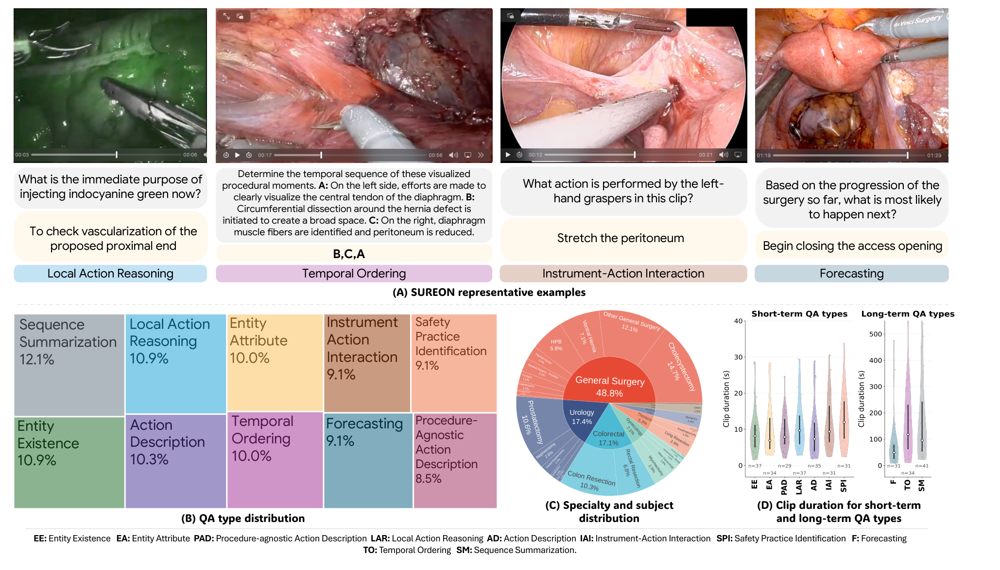
*论文原图编号：Figure 1。面板一为四类题的示例，面板二为基准中十类题的占比，面板三为专科与主题的层级分布，面板四为各题型片段时长分布。放在这里是因为它同时给出了题目长什么样和基准的构成。*

### 样本统计

| 属性 | SUREON-DB（训练） | SUREON（基准） |
|---|---|---|
| 问答数 | 76,061 | 340 |
| 标注方式 | 自动伪标签 | 专家核验 |
| 短窗口 / 长时程题型 | 7 / 3 | 7 / 3 |
| 单选 / 开放 | 8 / 2 | 8 / 2 |
| 专科 | 10 | 8 |
| 术式类型 | 168 | 69 |
| 片段 | 63,123 | 335 |
| 源视频 | 2,191 | 165 |
| 短窗口片段中位时长（秒） | 7.3 | 8.5 |
| 长时程片段中位时长（秒） | 113.0 | 80.6 |

- 基准的专科分布以普外为主（48.8%），其次泌尿 17.4%、结直肠 17.1%、妇科 7.1%；术式中胆囊切除占 14.7%，前列腺切除 10.6%。
- 基准每类 29 到 41 题；计准确率的 299 题中感知 166 题、推理 133 题，SM 另有 41 题。
- 基准只占 165 个源视频，且只覆盖 8 个专科，**单个专科的结论样本量很小**。
- 与表 1 中的已有资源相比，SUREON-DB 的问答数（76.1K）不算大，SurgVLM-DB 有 7.79M、SurgAtlas 有 793.2K；它的不同在于同时覆盖感知与推理，并且是唯一做过盲测筛选的。

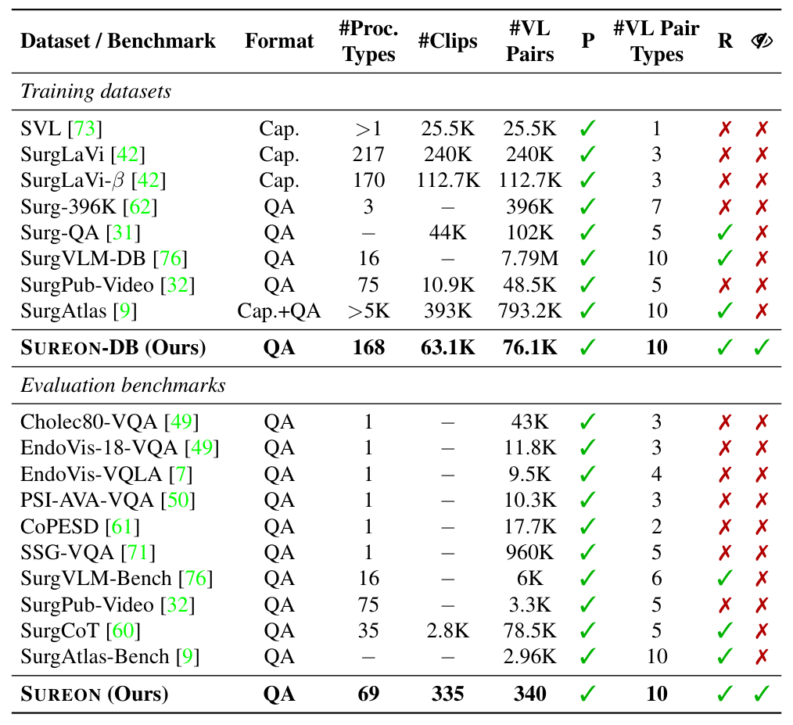
*论文原图编号：Table 1。已有手术视觉语言训练集（上）与评测基准（下）在格式、术式数、片段数、问答数、题型数、是否含推理与是否做盲测筛选上的对比。放在这里是因为它说明 SUREON 的定位：规模中等，但是表中唯一做了盲测筛选的。*

规模与题型清楚之后，下一个问题是这些题是怎么造出来的，以及每一步删掉了什么。

## 方法主线

本节的“方法”是数据构建与评测协议，SUREON-VLM 只作为验证数据价值的基线。核心难点是：出题的大模型本身不懂手术画面，怎样让它造出的题“必须看画面”。

### 机制流程

1. **转写锚定出题**。输入是每个视频的带时间戳转写。10 对按题型专门化的生成器与验证器智能体（共 20 个，均为 gpt-5，推理强度设为高）提取“语义锚定时刻”，即讲解者明确把某个语义线索和当前画面对应起来的时间段，并生成题目、答案与初始选项。输出 198,248 条经验证的问答，进入干扰项改写。
2. **干扰项改写**。输入是题目、正确答案、局部转写与元数据。把正确答案编码后查询同题型答案池，取回风格示例，三个开源模型各生成 6 个干扰项，得到 18 个候选。输出是每题的干扰项候选池，进入盲测。
3. **盲测筛选与强化**。输入是只有文字的题目和选项。Qwen3-VL-8B 系列猜测器多次无图作答，任一猜测器能稳定答对就删题；验证集再迭代重抽干扰项，直到最强猜测器答不对。输出是 SUREON-DB 与强化后的验证集。
4. **专家核验**。输入是强化后验证集中的候选题，附视频片段与转写。6 名外科医生逐题判定，任一条件不满足即丢弃。输出是 340 道题的 SUREON 基准。

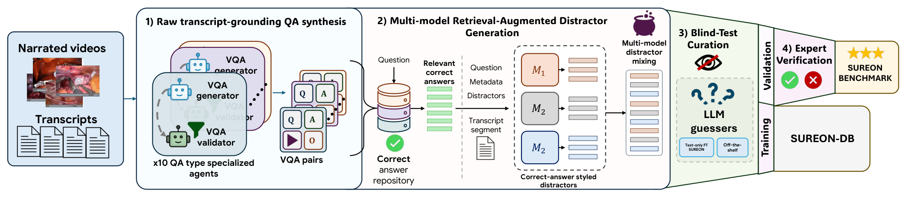
*论文原图编号：Figure 3。四阶段构建流程：转写锚定出题、多模型检索增强干扰项生成、盲测筛选、专家核验；训练划分成为 SUREON-DB，验证划分经核验成为基准。放在这里是因为它对应上面四步的数据流向。*

### 构建流程：转写锚定出题

讲解是稀疏的。画面里有双极钳，讲解者可能只提到血管闭合器；如果把讲解当成完整的场景描述，会引入标签噪声。因此每条题目都绑定一个语义锚定时刻：

$$z^{k}_{ij} = \left(v_i[t_s, t_e],\ s_{ij},\ c_k\right)$$

其中 $v_i[t_s, t_e]$ 是视频片段，$s_{ij}$ 是支撑的转写上下文，$c_k$ 是目标题型。

- 生成器温度 0.1，每份转写调用 3 次以提高召回；验证器温度 0.0，按题型约束和四条通用规则过滤：不得引入转写中没有的实体或结论、必须指向当前画面而非过去事件或泛泛知识、时间窗必须覆盖答案来源、近重复题合并。
- 各题型还有专门约束，例如 EE 的答案实体不能出现在题干中，PAD 的答案不超过 3 个词，LAR 的理由必须由讲解明确说出，F 的窗口必须在被预测动作之前结束。
- 3,148 个视频中 2,478 个（78.7%）产出至少一条题目：训练 176,593 条，验证 21,655 条，总花费约 2 万美元。gpt-5 是闭源接口，作者承认精确复现依赖该模型版本持续可用。

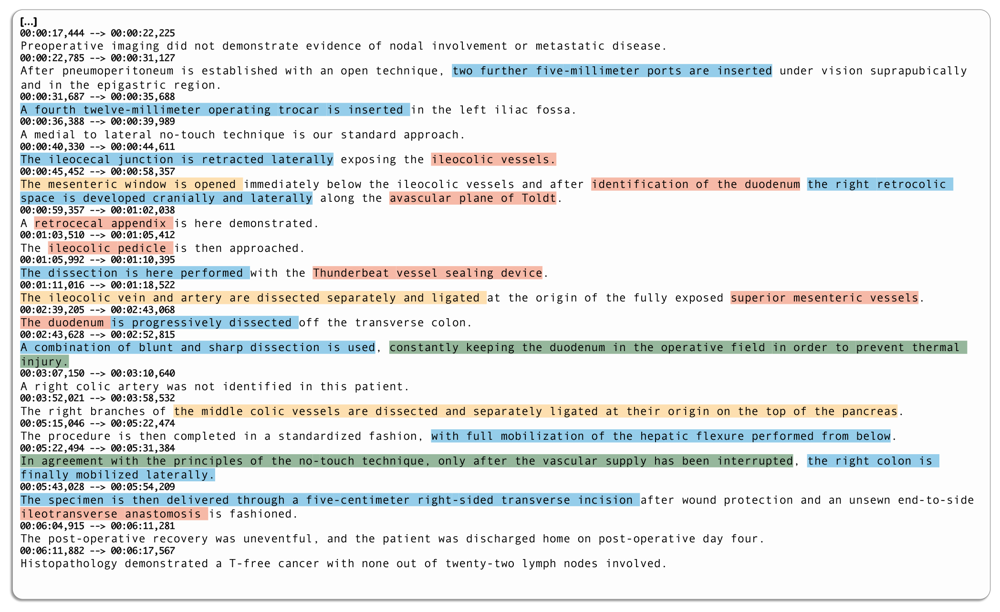
*论文原图编号：Figure 6。一段腹腔镜结肠切除讲解转写中被识别出的语义锚定时刻，按实体存在、实体属性、动作描述、安全操作识别四类着色。放在这里是因为它直观说明了题目从哪些句子来、哪些句子被跳过。*

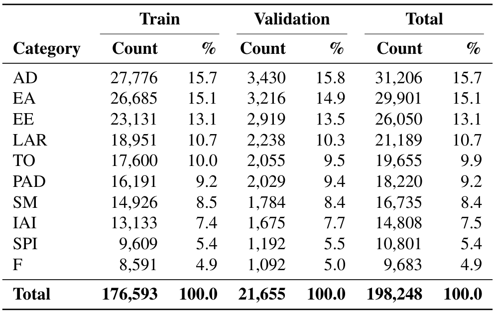
*论文原图编号：Table 6。阶段一验证后各题型在训练、验证与全集中的数量与占比。放在这里是因为它给出筛选前的基数，后面的存活率都相对它计算。*

### 构建流程：干扰项改写

阶段一的干扰项有两类偏差：正确答案来自转写，更长、更具体；干扰项来自模型自身知识，更短、更笼统。另外单一模型的措辞习惯也会成为捷径，在微调时尤其容易被学到。

- 检索增强：用 BAAI/bge-m3 编码训练集中所有正确答案，按同术式、同专科、同主题、同题型四个池各取余弦相似度前 100，按此优先顺序合并去重，至多保留 100 个示例。
- 生成：M1 为 medgemma-27b-text-it，M2 为 Llama-3.1-70B，M3 为 Qwen3.5-35B-A3B；每个模型以题目、正确答案、原选项、局部转写、示例集和元数据为条件，生成 6 个干扰项，要求事实上错误但临床上合理、风格与示例一致。
- 混合：最终 6 个干扰项从 18 个候选中随机抽取。整套生成在 4 块 H200 上用 vLLM 运行约 6.4 天。

### 构建流程：盲测筛选与强化

猜测器集成全部基于 Qwen3-VL-8B-Instruct，分四类：在改写后干扰项上盲微调、在阶段一干扰项上盲微调、不微调的现成模型、带视频训练但无图评测。前三类用于训练集，四类都用于验证集。每个猜测器对一道题无图查询 5 次，温度 0.7，一致性分数为答对次数的比例：

$$S(g, x) = \frac{1}{R}\sum_{r=1}^{R} \mathbb{1}\left[\hat{y}_r = y^{*}\right]$$

一道题被保留，当且仅当所有猜测器都满足 $S(g, x) < \tau = 3/5$。

其中 $R=5$，$\hat{y}_r$ 是第 $r$ 次无图回答，$y^{*}$ 是正确答案。

多次查询的目的是区分稳定可解与碰巧猜中，避免误删真正依赖视觉的题。阈值为何取 3/5、为何重复 5 次，论文未说明，也没有做敏感性分析，因此无法判断删除量对阈值有多敏感。

- 训练集用 4 折交叉验证：猜测器在三折上训练，在留出折上打分。可盲测的 161,667 条中保留 61,135（37.8%），删除 100,532（62.2%）；加上不参与筛选的 SM 题，得到 76,061 条。**超过六成自动生成的题不看视频就能稳定答对**，这本身就是对“直接用讲解出题”的有力反证。
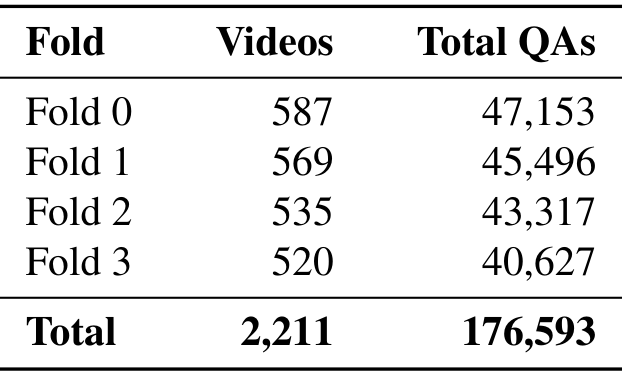
*论文原图编号：Table 9。训练集 4 折交叉验证中各折的视频数与问答数。放在这里是因为它说明每个留出折约 520 到 587 个视频，猜测器始终在未见过的视频上打分。*

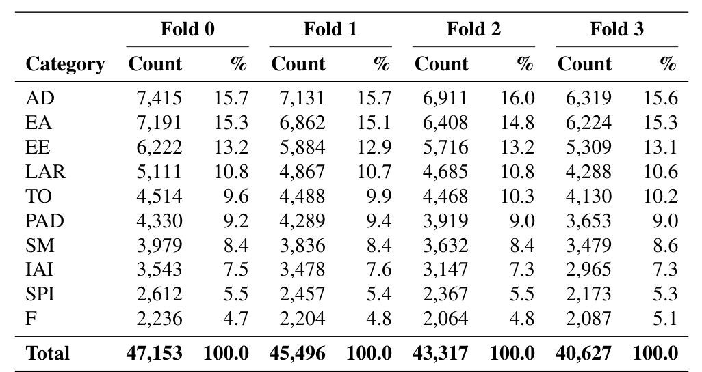
*论文原图编号：Table 10。四折中各题型的问答数与占比。放在这里是因为它说明分层后各折题型比例一致，筛选结果不受折间题型差异影响。*

- 验证集强化：用 SUREON-DB 纯文本训练一个 10 轮的更强猜测器，对每道题最多 32 次从候选池重抽干扰项，第一次让它答不对（$S < 3/5$）的组合被保留，否则丢题。验证集从筛选后的 8,203 条降到 6,677 条（30.8%）。
- SM 题没有干扰项，不参与筛选和强化，全部保留。

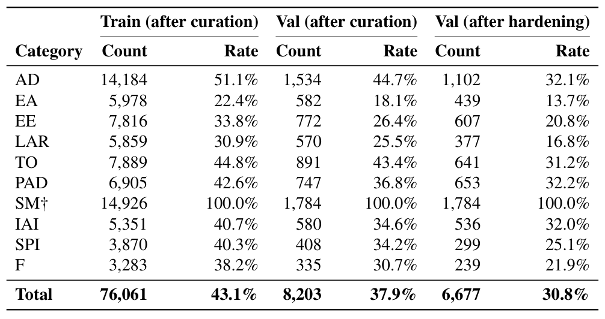
*论文原图编号：Table 11。盲测筛选后训练集、验证集以及强化后验证集的各题型数量与相对阶段一的存活率。放在这里是因为它显示不同题型被删的比例差别很大：EA 训练集只剩 22.4%，AD 剩 51.1%。*

### 构建流程：专家核验

- 6 名来自不同机构的外科医生在网页平台上审核，每题由一人审，可跳过专科外的题；四项条件同时满足才通过：题目清楚且可由该片段回答、答案临床正确且在时间窗内可见或有直接支持、片段是真实术野而非幻灯片、所有干扰项合理但明确错误。
- 审核者还需确认题目必须看视频才能回答。预测题要打开完整视频，确认标注的下一步确实紧接片段之后发生。
- 共审 602 题，通过 340、拒绝 262（56.5% 通过）。有理由的 178 个拒绝中，22.5% 是含糊或多解，14.6% 不准确，9.6% 片段过短，9.6% 画面中看不到。核验累计约 32 小时。
- 另取 74 题由两人独立复核，一致 52 题（70.3%），只用于估计一致性，不改变保留决定。

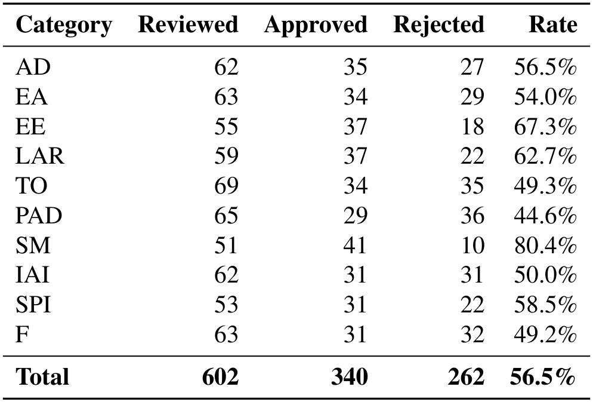
*论文原图编号：Table 12。各题型的审核数、通过数、拒绝数与通过率。放在这里是因为它说明核验并非走过场：PAD 只有 44.6% 通过。*

### 评测协议

- 每段均匀抽最多 8 帧、至少 4 帧。推理前用面向 YouTube 训练的 YOLO 检测器模糊人脸、设备标识等非术野区域，并用文字识别模糊屏幕上的术式名、器械名等叠加文字，防止模型读字作答。
- 每帧带绝对时间戳，后接题目和 7 个选项；题目、选项及顺序对所有模型固定。单选随机基线 1/7 = 14.3%，TO 为 3 个事件的 6 种排列，随机 16.7%。
- 时序排序题要求从自由输出中抽出的顺序与参考完全一致。SM 由 Claude Opus 4.8 依据转写参考判分：漏掉关键步骤、顺序错、把“保留某结构”说成“切断”都判错，同义改写算对。
- 无图条件把帧全部去掉，题目和选项不变。多模态增益定义为

$$\mathrm{MG} = S_v - S_{wv}$$

即有图准确率减无图准确率。
- $\mu$ 是 299 道计准确率题的合并准确率，SM 单独报告。置信区间用 10,000 次自助法，与 Wilson 区间平均相差 0.25 个百分点；模型两两比较用配对 McNemar 检验，并对 66 对做 Holm–Bonferroni 校正。
- 人类基线来自 5 名参与核验的外科医生，只看片段、题目和选项，不匹配专科，每题一人作答，且不会遇到自己审过的题；累计约 8.5 小时。
- 每段最多 8 帧对长时程题是否够用，论文未说明：长时程片段中位 80.6 秒，没有帧数消融，所以预测与排序题的低分无法与输入信息不足分开。

### 基线设置：SUREON-VLM

- 骨干为 Qwen3-VL-8B-Instruct，全参微调视觉编码器、投影层和语言模型。
- 训练数据为 SUREON-DB 加公开数据转换来的模板问答：22 个公开数据集（17 个图像分支、13 个片段分支，8 个重叠）共 5,503,231 条，覆盖器械与解剖定位、三元组、CVS、阶段、步骤和动作。
- 采用两阶段：第一阶段图像为主（图像 72.7%、片段 14.9%、SUREON-DB 12.4%），第二阶段三者各占三分之一。
- 10 轮、bfloat16、AdamW 学习率 2e-6、余弦调度带 10% 预热；6 块 H200，等效批大小 192，上下文 8,192 词元，每段 8 帧。SUREON-DB 的干扰项每次加载时从候选池重新抽取，作为数据增强。
- 对照组：同一骨干只用 SUREON-DB 或只用公开数据训练。

协议定好后，结果要回答三件事：现有模型能做到多少、构建流程的每一步是否真的起作用、加入推理数据会不会损失感知能力。

## 关键结果

### 主结果与强基线

> [!figure] Table 3 SUREON 基准主结果
> 建议位置：关键结果
> 放置原因：它给出 12 个模型和基线在十类题上的有图、无图准确率与多模态增益，是全文的核心结果。
> 当前状态：保留占位；修复后的裁剪仍混入了下方正文段落，主要数值已整理为下表。

| 模型 | $\mu$ 有图 | $\mu$ 无图 | MG | 感知 | 推理 | SM |
|---|---|---|---|---|---|---|
| 随机 | 14.6 | — | — | — | — | — |
| 外科医生 | 64.9 | — | — | 72.9 | 54.9 | — |
| Gemini 3.1 Pro | 52.2 | 31.8 | +20.4 | 53.0 | 51.1 | 0.0 |
| SUREON-VLM | 48.2 | 19.1 | +29.1 | 48.8 | 47.4 | 14.6 |
| GPT-5.1（高推理） | 46.8 | 25.8 | +21.1 | 50.0 | 42.9 | 29.3 |
| SUREON-VLM（仅 SUREON-DB） | 44.1 | 22.1 | +22.1 | 42.8 | 45.9 | 7.3 |
| Gemma 4 | 35.8 | 21.4 | +14.4 | 39.8 | 30.8 | 4.9 |
| Qwen3VL-32B-Thinking | 34.1 | 27.8 | +6.3 | 42.2 | 24.1 | 9.8 |
| Qwen3VL-8B-Instruct | 23.1 | 13.4 | +9.7 | 26.5 | 18.8 | 0.0 |
| SUREON-VLM（仅公开数据） | 20.7 | 12.0 | +8.7 | 27.1 | 12.8 | 2.4 |
| MedGRPO | 16.7 | 9.7 | +7.0 | 19.3 | 13.5 | 0.0 |
| Molmo2 | 15.0 | 17.1 | −2.0 | 20.5 | 8.3 | 0.0 |
| MedGemma 1.5 | 10.7 | 11.0 | −0.3 | 12.0 | 9.0 | 0.0 |

- 外科医生 64.9，95% 区间 [59.5, 70.2]，显著高于所有模型。Gemini 3.1 Pro（52.2）、SUREON-VLM（48.2）、GPT-5.1（46.8）三者两两差异经校正后不显著。
- 两个开源医学模型几乎是随机水平，且有图不比无图好。
- 只用公开模板数据训练的同一骨干只有 20.7，低于未微调的 Qwen3VL-8B（23.1）；只用 SUREON-DB 达到 44.1。这说明**常规的“标签改写成问答”训练配方迁移不到推理**，甚至会损害骨干原有的能力。
- 商业模型无图仍有 25.8（GPT-5.1）和 31.8（Gemini），都高于随机 14.6，说明对 Qwen 之外的强模型，基准里仍有可不看画面答对的成分。

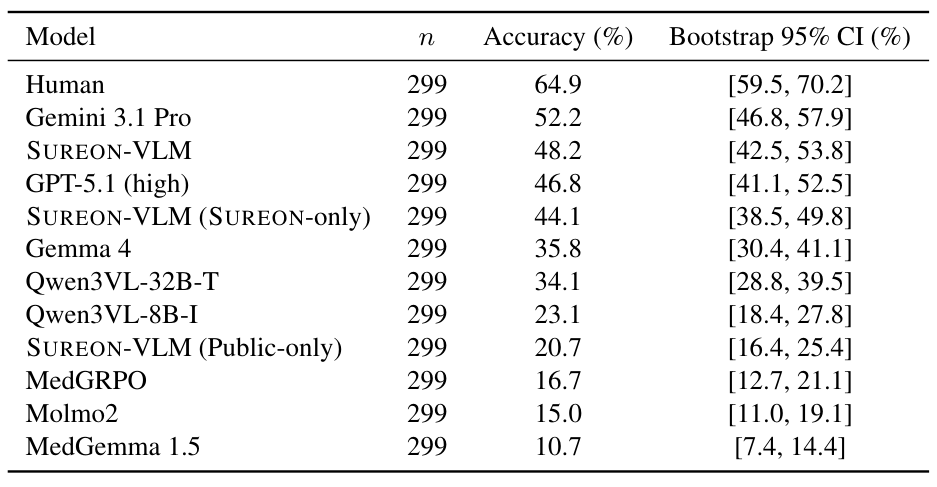
*论文原图编号：Table 14。299 道计准确率题上的总体准确率与自助法 95% 置信区间。放在这里是因为它说明前三名的区间相互重叠。*

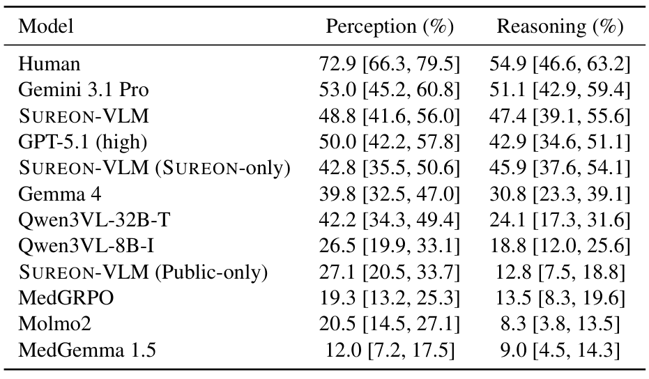
*论文原图编号：Table 15。感知（166 题）与推理（133 题）两个子集的准确率和置信区间。放在这里是因为它显示多数通用模型推理显著弱于感知，而 SUREON-DB 训练的模型两者接近。*

### 分题型的差异

- 外科医生在 PAD 上 96.5，但 EE 只有 51.3、LAR 只有 35.1。作者解释为专科特有的解剖知识不足，以及推断动作目的本身更难；几位医生也反映专科外的题难以回答。
- 模型普遍在预测题上最差：Gemini 3.1 Pro 19.4，GPT-5.1 25.8，SUREON-VLM 35.5，而人类 54.8。
- Gemini 3.1 Pro 在 LAR 上无图 59.5，高于有图 56.8，MG 为 −2.7；它在 SM 上为 0.0。
- 每个题型只有 29 到 37 道计准确率题，类别级 95% 区间平均半宽 14.3 个百分点，作者明确只把这些差异当作大致趋势。

### 构建流程消融

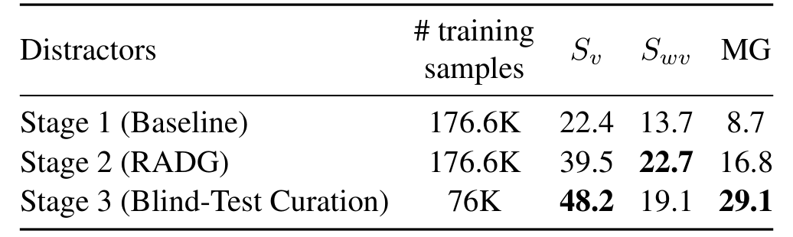
*论文原图编号：Table 4。分别用阶段一、阶段二、阶段三的干扰项训练 SUREON-VLM，在 SUREON 上的有图准确率、无图准确率与多模态增益。放在这里是因为它是“筛选让数据更依赖视觉”这一结论的直接证据。*

| 训练数据 | 样本数 | $S_v$ | $S_{wv}$ | MG |
|---|---|---|---|---|
| 阶段一（原始干扰项） | 176.6K | 22.4 | 13.7 | 8.7 |
| 阶段二（检索增强干扰项） | 176.6K | 39.5 | 22.7 | 16.8 |
| 阶段三（盲测筛选） | 76K | 48.2 | 19.1 | 29.1 |

- 阶段二同时抬高了有图和无图准确率；阶段三在样本减少 57.0% 的情况下，有图继续上升、无图下降。
- 作者的解读是：视觉依赖的提升来自删去奖励语言捷径的监督，而不是来自数据量。这组对比控制了骨干与训练设置，是全文最干净的证据；但评测基准也经同一流程筛过，见深度分析。

### 干扰项策略消融

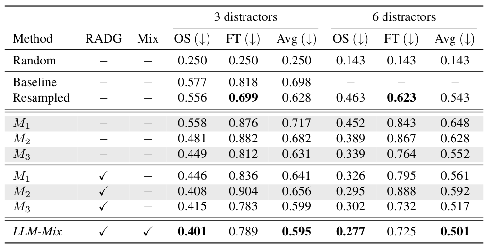
*论文原图编号：Table 8。不同干扰项策略下，现成模型（OS）与盲微调模型（FT）的无图准确率，越低越好。放在这里是因为它说明为什么最终选 6 个干扰项的多模型混合。*

- 6 个干扰项时，单个模型加检索增强后现成猜测降到 0.295 至 0.326，混合后为 0.277，全表最低。
- 但盲微调猜测器仍有 0.725，远高于随机 0.143。改写干扰项只能压低零样本猜测，学得到的捷径仍大量存在，这正是阶段三必须删题的原因。
- 用其他题的正确答案作干扰项（Resampled）在微调条件下更难被利用（0.623），但零样本下仍有 0.463。

### 筛选是否只对 Qwen 有效

- 用 SUREON-DB 训练的 Qwen3 猜测器，在验证集强化前后的无图准确率从 36.5% 降到 21.4%。
- 未参与任何筛选的 Gemma-4-31B-IT 在两个集合上分别为 23.2% 和 22.9%，基本不变且接近较低水平。作者据此认为强化主要去掉了 Qwen 学到的捷径，但留下的题对其他家族同样难。

### 公开感知基准

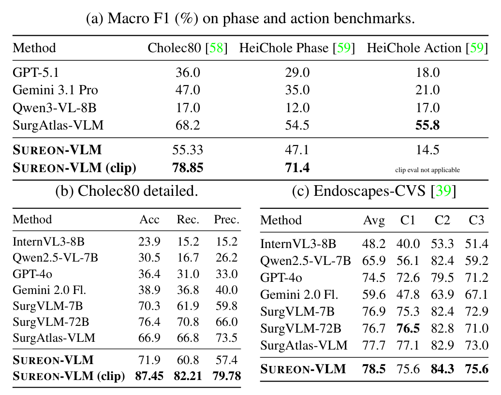
*论文原图编号：Table 5。子表一为 Cholec80 与 HeiChole 阶段和动作识别的宏 F1，子表二为 Cholec80 的准确率、召回与精确率，子表三为 Endoscapes-CVS 三项标准的准确率。放在这里是因为它检验加入推理数据后感知能力是否被保住。*

- Cholec80 帧级宏 F1 55.33，片段级 78.85；SurgAtlas-VLM 为 68.2。HeiChole 阶段片段级 71.4。
- Endoscapes-CVS 平均 78.5，高于 SurgVLM-72B 的 76.7 和 SurgAtlas-VLM 的 77.7。
- HeiChole 动作识别只有 14.5，远低于 SurgAtlas-VLM 的 55.8。作者承认广度带来取舍。
- 商业与其他手术模型只在帧级评测，且部分数字取自原论文，与 SUREON-VLM 的片段级结果不是同条件比较。

### 训练顺序消融

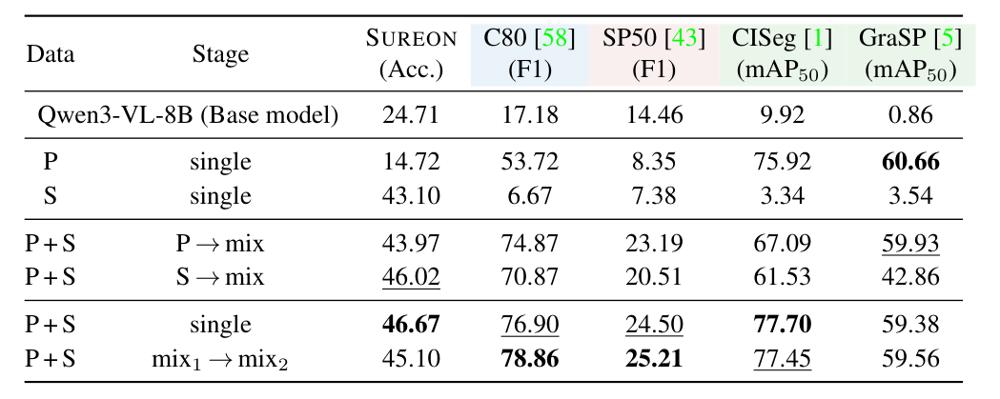
*论文原图编号：Table 19。不同数据组成与训练顺序在 SUREON 和四个公开基准上的表现，以未微调骨干为参照。放在这里是因为它说明单源微调会抹掉骨干原有能力，而顺序决定保留什么。*

- 单源训练会遗忘：只用公开数据，SUREON 从 24.71 降到 14.72；只用 SUREON-DB，CholecInstanceSeg 定位从 9.92 降到 3.34，Cholec80 阶段从 17.18 降到 6.67。
- 先 SUREON 后混合时，GraSP 定位只有 42.86，比先见图像的方案低约 17 个点；先图像再加推理的顺序更稳。
- 最终选 mix1→mix2，因为各任务平均最好；但它的 SUREON 为 45.10，低于单阶段混合的 46.67。正文表 3 报告的 48.2 与本表的数字不一致，原因论文未说明（是否不同检查点或解码设置不得而知），引用 SUREON-VLM 的成绩时应注明出自哪张表。

结果给出了数字，但这些数字到底在测什么、哪些解释还没被排除，需要单独讨论。

## 深度分析

### 基准真正测到了什么

SUREON 测的是“在讲解者口述过的时刻，模型能否从 4 到 8 帧中识别结构、动作和意图，并且排除了 Qwen3-VL-8B 系列无图可答的题”。这比“手术视觉推理”窄。

第一，盲测筛选是相对于特定猜测器的。商业模型无图仍有 25.8（GPT-5.1）和 31.8（Gemini），都明显高于随机 14.6，说明对更强的语言模型，仍有部分题可以不看画面答对。作者把评测时的 MG 作为补充检查，这是合理的；但这也意味着单看 $\mu$ 会混入语言先验。

第二，题目来源决定了覆盖。只有讲解者说出来的内容才能成为题目，看得见但没讲的内容被系统地漏掉；教学视频偏向典型解剖和熟练操作，并发症与罕见入路少。

第三，片段只有最多 8 帧，短窗口中位时长约 8 秒、长时程约 81 秒。时序排序和预测题实际考的是从稀疏帧中把握进程，帧数本身可能是瓶颈，论文没有做帧数消融。

### 训练与评测同源带来的偏差

SUREON-VLM 的 MG 最高（29.1），作者以此说明它最依赖视觉。但它的训练数据和基准走的是同一条构建流程，干扰项来自同一个候选池、同样的三个生成模型，题目由同一组 gpt-5 智能体写成。模型可能学到了这种出题风格下“正确答案的样子”，在无图条件下反而被筛选过的干扰项系统性误导，从而抬高 MG。

表 3 里 SUREON-VLM 无图只有 19.1，低于 Qwen3VL-32B（27.8）和 Gemini（31.8）。这既可能是更依赖视觉，也可能是训练让它在无图时更不会利用常识。论文没有在独立构建的手术视频推理基准上检验 MG 的提升是否迁移，因此“筛选让模型更依赖视觉”目前只在同源评测上成立。

### 人类基线的含义

**64.9 不是专家上限，而是跨专科作答的下界**。每题只有一名外科医生作答，且不按专科匹配；医生自报“有把握”只占 31.4%，“有些把握”37.5%，“没把握”17.7%，另有 13.4% 未记录。核验阶段双人一致率也只有 70.3%。这些说明部分题即便对外科医生也带有专科知识门槛或判断空间。

LAR 上人类只有 35.1，而 Gemini 有 56.8。一种解释是题目的“正确目的”来自讲解者口述，带有个人表述习惯，其他医生给出的同样合理的理由会被判错；作者的解释是推断意图本身更难。两种解释论文都没有用数据区分。

### 错误模式说明了什么

- 感知错误多是近邻混淆：把胆囊管认成胆囊动脉，把腹膜后间隙说成 Toldt 间隙，说明模型有粗粒度场景理解，缺细粒度辨别。
- 吸引冲洗器被预测为“吸血清理视野”，实际是钝性分离。这是器械常规用途的语言先验压过了画面，说明数据层面去捷径不能保证模型推理时不回退到先验。
- 推理错误倾向于泛泛而正确的说法，如“保持术野方向感”，缺少具体平面和距离。这类回答流畅、懂行，但不具体。

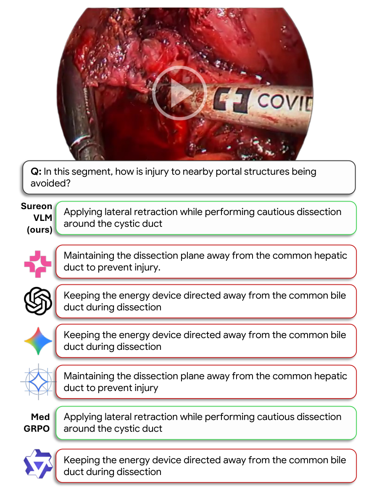
*论文原图编号：Figure 4。一道安全操作识别题上七个模型的回答，绿框为正确、红框为错误；只有 SUREON-VLM 与 MedGRPO 答对。放在这里是因为它展示了错误答案与正确答案在措辞上同样专业，靠语言风格无法区分。*

### 相对已有工作新在哪里

| 路线 | 代表 | 题目来源 | 是否检查无图可解 |
|---|---|---|---|
| 标签改写 | Cholec80-VQA、SSG-VQA、SurgVLM-Bench | 已有阶段、器械、动作标注 | 否 |
| 讲解视频出题 | SurgPub-Video、SurgCoT、SurgAtlas-Bench | 讲解转写 | 否 |
| 事后诊断 | SurgCheck | 场景图替换实体名 | 是，但只用于诊断 |
| SUREON | 本文 | 讲解转写的语义锚定时刻 | 是，构建时删题并加评测 MG |

通用领域的盲测筛选多用零样本模型，SUREON 增加了盲微调猜测器，并把强化做成按题迭代重抽干扰项的过程。代价是删除量很大：训练集保留 43.1%，验证集到强化后只剩 30.8%，最终基准只有 340 题。

### 适用边界

- 适合作为手术视觉语言模型的感知与推理评测，并要求同时报告无图成绩。
- 不能作为临床可用性的证据：教学视频经剪辑、无烟雾血液遮挡，SUREON-DB 未经专家核验，作者明确禁止临床使用。
- 340 题、每类约 30 题的规模只能区分差距较大的模型，前几名之间的排名不稳定。

综上，SUREON 最可靠的贡献是方法上的：证明了自动出题必须做无图检查，并给出一套可复用的检查流程；下面集中列出不能外推的地方。

## 局限

- 筛选只改写干扰项，没有改写题干；点出术式或阶段的题干本身就可能泄露答案。
- 猜测器全部来自 Qwen3-VL-8B，换用其他家族或更强的模型，被删除的题会不同。
- 题目只覆盖讲解者口述的内容；教学视频病例偏典型，罕见解剖和术中并发症不足。
- 剪辑过的讲解录像与真实术中视频差别大，高分不代表可用于术中。
- SUREON-DB 是伪标签，未经专家核验。
- 基准每题由一名医生核验，双人一致率 70.3%；SM 的大模型评审与人类多数票一致率 79.1%，且更严格。
- 阶段一依赖闭源的 gpt-5，构建总花费约 2 万美元，精确复现依赖该版本可用。
- 数据集需在 Hugging Face 申请访问，许可 CC BY-NC-SA 4.0 禁止商用，视频需按原始来源自行获取。

## 我的笔记

- 评测自己的手术视觉语言模型时，至少同时跑有图和无图两种条件，报告 MG；只报准确率无法区分视觉推理和背知识。
- 自动生成选择题时，先查正确答案与干扰项的长度分布；用检索示例约束干扰项风格是低成本的修正。
- 盲测筛选要包含在答案分布上微调过的猜测器，零样本猜测会大幅低估可学捷径（表 8 中 0.277 对 0.725）。
- 引用 SUREON 结果时注意前三名差异不显著，类别级结果误差约 ±14 个点。
- 想追问的：换用其他家族猜测器，被删的题重叠多少；在独立构建的手术推理基准上 SUREON-VLM 的 MG 是否仍最高；表 3 的 48.2 与表 19 的 45.10 为何不同。

## 引用

- Perez, A., Rau, A., Mlambo, B., et al. SUREON: A Benchmark and Vision-Language Model for Surgical Reasoning. arXiv:2603.06570, 2026.
- arXiv: https://arxiv.org/abs/2603.06570
- 项目页: https://aperezr20.github.io/sureon
- 代码: https://github.com/aperezr20/sureon
- 数据: https://huggingface.co/datasets/aleperez24/sureon
