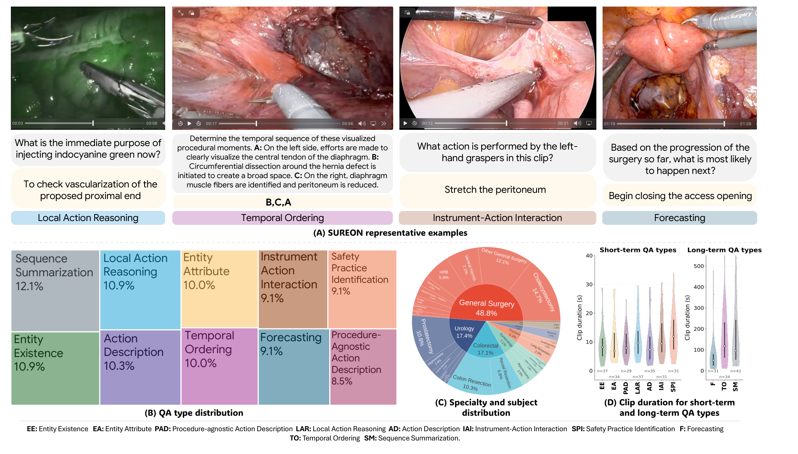
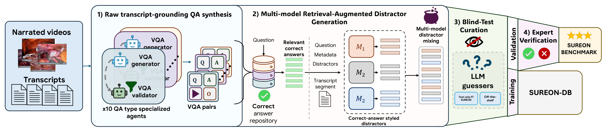
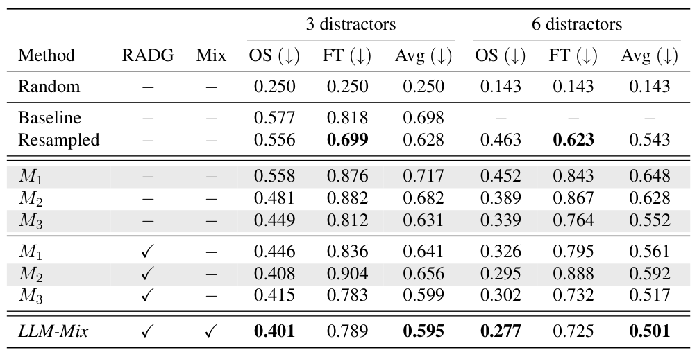
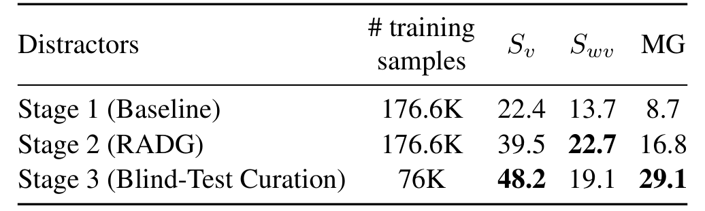

## 1. 背景与动机

手术视觉语言模型的评测有一个隐患：**很多题不看视频也能答对**。模型可以靠流程常识或常见的器械与解剖搭配猜出答案，于是高分分不清是视觉推理还是背过的手术知识。

已有基准大多把阶段、器械、动作标签改写成问答，标签空间封闭；从讲解视频出题的 SurgPub-Video、SurgCoT 等虽然更开放，但都没有检查纯文本模型能否答对。

自动出题通常交给大模型，但大模型在手术画面上本来就差，让它给自己也答不好的题判卷是循环的；全部交给外科医生又不可扩展。

## 2. 核心观点速览

- **原料**：讲解视频里，讲解者会明确说出“此刻画面里的什么意味着什么”，作者把这样的时间段称为语义锚定时刻，每道题都从这里出。
- **去捷径**：干扰项按正确答案的风格重写；无图猜测器（含在答案分布上微调过的）多次作答，稳定答对就删；验证集再重抽干扰项直到最强猜测器答错。
- **结果**：**Gemini 3.1 Pro 52.2、SUREON-VLM 48.2、GPT-5.1 46.8，外科医生 64.9**；前三名差异不显著。
- **边界**：猜测器全是 Qwen 家族，训练库与基准同源，“更依赖视觉”只在同源评测上成立。

:::highlights
- 自动生成的手术选择题有六成以上不看视频就能稳定答对
- 多模态增益 MG 让每个模型都要同时报有图和无图成绩
:::

:::data
- 训练库 76,061 条，基准 340 题，10 类题型
- 最好模型 52.2，外科医生 64.9，随机 14.6
:::

## 3. 数据从哪来、分成哪些题

源数据是 SurgLaVi-β 的 3,148 个 YouTube 手术讲解视频转写，按术式主题在视频级 9:1 划分训练与验证。基准覆盖 8 个专科、69 种术式，普外占 48.8%。

十类题分两组。感知类问片段里有什么、在做什么：实体存在、实体属性、器械与动作交互、动作描述、与术式无关的动作。推理类问为什么、接下来怎样：局部动作目的、安全操作、下一步预测、三事件排序、流程总结。前八类七选一，后两类开放。

*论文原图编号：Figure 1。四类题示例、十类题占比、专科与主题分布、各题型片段时长。*

题目来源也划定了覆盖范围：**讲解者没说的内容不会成为题目**，教学视频里的病例也偏典型。

## 4. 四个构建阶段

*论文原图编号：Figure 3。转写锚定出题、多模型检索增强干扰项、盲测筛选、专家核验四个阶段。*

| 阶段 | 做什么 | 留下多少 |
|---|---|---|
| 一：出题 | 10 对 gpt-5 生成器与验证器，每份转写调用 3 次 | 198,248 条，约 2 万美元 |
| 二：干扰项 | bge-m3 检索风格示例，三个模型各出 6 个，混合抽取 | 每题 18 个候选 |
| 三：盲测 | Qwen3-VL-8B 猜测器无图答 5 次，答对 3 次即删 | 训练 76,061；验证 6,677 |
| 四：核验 | 6 名外科医生，四项条件全过才保留 | 602 题中 340 题 |

阶段二解决的是表面线索：原始干扰项平均 4.4 个词，正确答案 6.2 个词，改写后干扰项 6.5 个词。但它压不住学得到的捷径，这正是阶段三存在的理由。

## 5. 盲测筛选为什么要用微调猜测器

零样本模型只能发现“一眼看得出”的捷径。**在题目和选项上训练过的模型，能学到零样本发现不了的规律**。

表 8 给出了差距：6 个干扰项的多模型混合，零样本猜测 0.277，盲微调猜测仍有 0.725，远高于随机 0.143。

*论文原图编号：Table 8。不同干扰项策略下现成模型与盲微调模型的无图准确率。*

训练集用 4 折交叉验证避免猜测器见过自己要打分的题。结果是可盲测的 161,667 条中删去 100,532 条（62.2%）。

阈值为何取 3/5、为何查询 5 次，论文未说明，也没有敏感性分析。

## 6. 评测协议

- 每段最多 8 帧，模糊人脸、设备标识和屏幕叠加文字，防止模型读字作答。
- 选择题 7 个选项，随机 14.3%；排序题随机 16.7%；流程总结由 Claude Opus 4.8 依参考判分，与人类多数票一致 79.1%。
- 多模态增益 $\mathrm{MG} = S_v - S_{wv}$，即有图减无图准确率。
- 299 道计准确率题用自助法置信区间，两两比较用 McNemar 检验并做 Holm–Bonferroni 校正。

长时程片段中位 80.6 秒也只给 8 帧，帧数是否成为瓶颈论文未说明。

## 7. 结果说了什么

| 模型 | 有图 | 无图 | MG |
|---|---|---|---|
| 外科医生 | 64.9 | — | — |
| Gemini 3.1 Pro | 52.2 | 31.8 | +20.4 |
| SUREON-VLM | 48.2 | 19.1 | +29.1 |
| GPT-5.1 | 46.8 | 25.8 | +21.1 |
| Qwen3VL-32B-Thinking | 34.1 | 27.8 | +6.3 |
| MedGemma 1.5 | 10.7 | 11.0 | −0.3 |

**外科医生显著高于所有模型，前三名之间不显著**。两个开源医学模型接近随机，有图不比无图好。

构建消融是最干净的证据：同一骨干用三阶段数据训练，MG 从 8.7 到 16.8 再到 29.1，样本从 176.6K 降到 76K。

*论文原图编号：Table 4。阶段一、二、三干扰项训练出的模型在 SUREON 上的有图、无图准确率与多模态增益。*

加入推理数据后感知能力基本保住：Endoscapes-CVS 平均 78.5，Cholec80 片段级宏 F1 78.85；但 HeiChole 动作识别只有 14.5。

:::data
- MG：8.7 → 16.8 → 29.1
- 训练样本 176.6K → 76K
:::

## 8. 结果没说什么

- **基准里仍有语言可解成分**：GPT-5.1 无图 25.8、Gemini 31.8，都明显高于随机。筛选只针对 Qwen 家族的捷径。
- **训练与评测同源**：SUREON-VLM 的训练库与基准走同一流程，MG 高也可能是学到了这套出题风格。论文没有在独立基准上检验。
- **64.9 不是专家上限**：每题一名医生、不匹配专科，自报有把握的只占 31.4%；核验双人一致率 70.3%。
- **SUREON-VLM 的成绩有两个版本**：表 3 为 48.2，表 19 的最终配置为 45.10，差异原因论文未说明。
- **类别排名不可靠**：每类只有 29 到 37 题，区间半宽平均 14.3 个点。

## 9. 复现与复用要注意什么

- 数据在 Hugging Face 需申请访问，许可 CC BY-NC-SA 4.0；只含问答与时间窗，视频要按原始来源自行获取。
- 阶段一依赖闭源 gpt-5，精确重建需要该版本可用。
- 评测自己的模型时同时报有图、无图与 MG，并按论文的模糊和抽帧设置预处理。
- 自建手术问答数据时，盲测猜测器至少包含一个在答案分布上微调过的版本。

## @takeaways
- 自动出题的手术问答必须做无图检查，否则六成以上的题可能不靠画面
- MG 应成为手术视觉语言模型评测的标配
- 前三名差异不显著，SUREON 适合区分大差距而非细排名

## @strengths
- 把视觉依赖作为构建时的硬约束，并公开每阶段的删除量
- 盲测加入微调猜测器，并用未参与筛选的 Gemma 做了交叉检查
- 统计报告完整：自助法区间、McNemar 检验与多重比较校正

## @weaknesses
- 猜测器单一家族，训练与评测同源，独立验证缺失
- 人类基线不匹配专科，只有一人作答
- 表 3 与表 19 的 SUREON-VLM 成绩不一致未解释

## @questions
- 换用其他家族猜测器重新筛选，被删除的题有多少重叠
- 联合改写题干而不只是干扰项，能否减少删题
- 在未剪辑的真实术中视频上，SUREON 分数与临床判断是否相关
