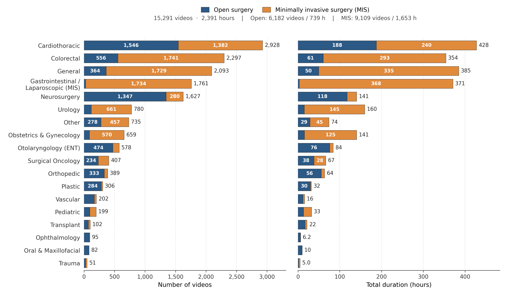
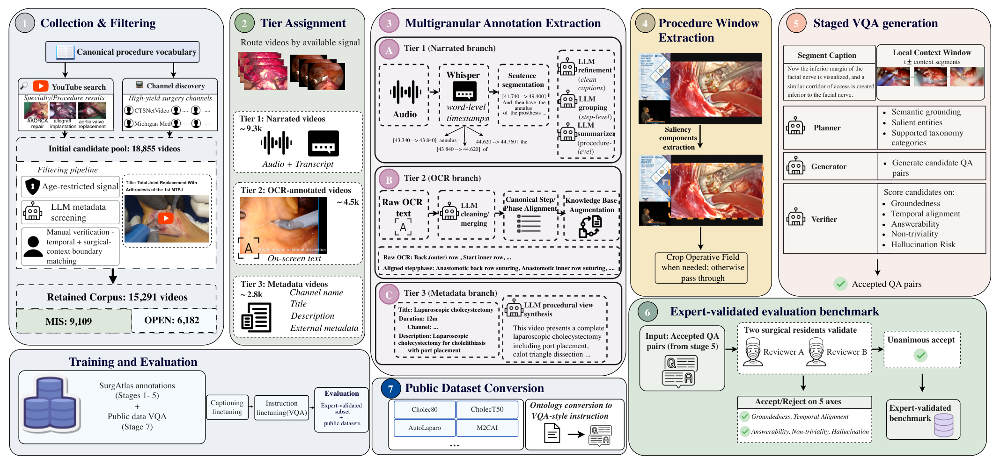
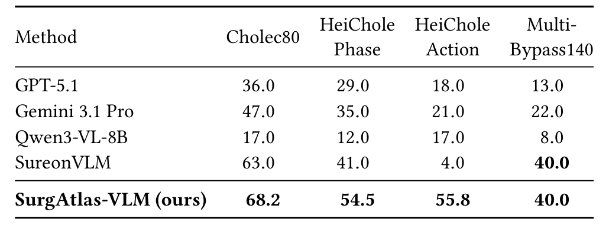

## 1. 背景与动机

**手术视觉-语言模型缺的是原生的、带语言的手术视频。** 已有的大规模系统多数靠把公开数据集的阶段、器械标签改写成对话，标签来自封闭词表，说不出一个动作为什么做。

另一条路线从讲解视频的旁白里提取监督，但公开视频池只有两三千个，而且讲解者只讲教学要点，常规步骤很少说。

**开放手术几乎缺席。** 现有公开资源基本是腔镜或机器人画面；开放手术的 AVOS 只有 47 小时带标注，EgoSurgery 只有 20 个视频，都没有语言监督。

:::highlights
- 缺口一：监督来源窄，靠标签改写或讲解旁白
- 缺口二：公开手术视频池小
- 缺口三：没有带语言的开放手术数据
:::

## 2. 核心观点速览

论文的答案是 SurgAtlas：从 YouTube 检索和高产频道收集 18,855 个候选，筛出 15,291 个视频、2,391 小时，开放 6,182 个、微创 9,109 个。

每个视频按可用信号分档：有旁白的转写成字幕、步骤和摘要；有屏幕文字的规范成步骤描述；都没有的只用标题生成摘要。再从字幕生成 400K 条推理问答，并由两名住院医师审出一个 2,890 对的评测子集。

**最有信息量的结果是跨术式消融。** 只用微创训练的模型在开放分区上只有 29.1，在第一人称开放手术 EgoSurgery 上只有 24.8，比未微调的底座还低。

**边界同样清楚：** 字幕和摘要没有人工准确率，评测用大模型判分且问题与训练集同源，标准基准的领先没有排除公开转换数据的贡献。

:::data
- 15,291 个视频，2,391 小时，18 个专科
- 四层标注：300K 字幕、81K 步骤、12.2K 摘要、400K 问答
- 专家子集：开放 1,462 对、微创 1,428 对
:::

## 3. 视频从哪里来

收集分两条线：按标准术式词表检索，标题与术式按词元集合的杰卡德相似度匹配；以及挖掘大学外科、学会等高产频道。

筛选有一个巧妙的信号：**YouTube 会把真实术中画面标为年龄限制，作者把它当作正向信号。** 之后用大模型读标题和描述排除纯讲座，最后由 17 名标注者人工核验并标出手术起止时间。

*论文原图编号：Figure 4。18 个专科的视频数与时长，按开放和微创分解。*

专科分布很不均衡：心胸、结直肠、普外、胃肠、神经外科五个专科占约 70%，眼科只有 95 个视频。三个过滤各剔除了多少视频，论文未说明。

:::data
- 18,855 个候选，保留 15,291 个
- 开放 739 小时，微创 1,653 小时
:::

## 4. 四层标注怎样做出来

**核心思路是按信号分档，而不是把所有视频套进一个模板。**

| 档 | 条件 | 视频数 | 产出 |
|---|---|---|---|
| Tier 1 | 有旁白 | 约 9,360 | 字幕、步骤、摘要、问答 |
| Tier 2 | 有屏幕文字 | 约 4,460 | 步骤/阶段描述 |
| Tier 3 | 仅元数据 | 约 2,778 | 摘要 |

旁白分支丢弃 Whisper 的原生分段，按词级时间戳重组完整句子，再由大模型精修、分组、摘要。屏幕文字分支先清洗、合并，再和大模型生成的标准步骤表对齐；**对不上就保留原短语，这种回退占了 64.9%。**

*论文原图编号：Figure 3。七阶段构建管线：收集筛选、分档、抽取、裁剪、问答生成、专家验证、公开数据转换。*

问答由规划器、生成器、校验器三个大模型依次产生，校验器在依据性、时间对齐、可回答性、非平凡性、幻觉风险五维打分，拒绝 7%。各步所用的模型和阈值，论文未说明。

:::highlights
- 只有 Tier 1 的视频有问答
- 除筛选与专家审核外，所有文本都由大模型生成或改写
:::

## 5. 训练与评测协议

验证模型 SurgAtlas-VLM 基于 Qwen3-VL-8B：先三步字幕预训练，逐步解冻投影层、语言模型和视觉编码器；再用 SurgAtlas 问答加 18 个公开数据集的转换问答做指令微调。

评测分三类：已有手术基准（阶段、动作、三元组、关键安全视野），基线数字引自原论文；专家子集和自动测试集，用大模型判分；跨术式消融，加 EgoSurgery 零样本。

**判分模型与提示，以及 SurgAtlas-VLM 推理时的帧数，论文都未说明。**

## 6. 结果说了什么

已有基准上，宏 F1 在 Cholec80 阶段为 68.2（SureonVLM 63.0），HeiChole 阶段 54.5（41.0），MultiBypass140 持平 40.0。

*论文原图编号：Table 1。四个识别基准上的宏 F1。*

专家子集上，总体微创 42.9、开放 39.3，比最强通用模型高 2.5 和 1.7 个点，比未微调底座高约 19 个点。**但操作推理落后 GPT-5 系列约 10 个点，微创分区的操作理由细类差距超过 20 个点。**

| 模型 | 专家微创 | 专家开放 | EgoSurgery |
|---|---|---|---|
| Qwen3-VL-8B | 24.0 | 19.9 | 43.8 |
| GPT-5.1 | 40.4 | 37.0 | 55.9 |
| 仅微创 | 40.1 | 29.1 | 24.8 |
| 仅开放 | 32.2 | 38.9 | 62.5 |
| 合并 | 42.5 | 39.0 | 56.1 |

**单一术式训练在另一术式上掉约 10 个点，仅开放模型在第一人称手术室画面上最好。** 这说明开放手术的视角、光照和人员信息可以迁移，腔镜画面不行。

:::data
- 三元组 mAP 5.5，所有模型都在 2.4 到 5.5 之间
- Cholec80 准确率 66.9，低于 SurgVLM-72B 的 76.4
:::

## 7. 结果没说什么

- **领先未必是能力。** 专家子集的问题和训练集出自同一条生成管线，措辞和选项风格一致，判分也是大模型。格式适应与能力提升在论文里没有被分离。
- **标准基准的领先未必来自新语料。** 这些基准的训练集已转换进指令数据，论文没有去掉它们的消融。
- **质量只有部分证据。** 97.6% 是对已通过自动校验的 2,960 对的人工通过率；300K 字幕、81K 步骤、12.2K 摘要的准确率论文未说明。
- **跨术式结论没有对齐规模。** 开放 739 小时、微创 1,653 小时，消融未控制数据量。

:::highlights
- 三个核心论断中只有跨术式结论有直接实验支持，且仍有规模混杂
:::

## 8. 相对已有路线新在哪里

| 路线 | 代表 | 短板 | SurgAtlas 的差异 |
|---|---|---|---|
| 旁白中心 | SurgLaVi、SUREON | 依赖讲解视频 | 加入屏幕文字与元数据两档 |
| 标签改写 | SurgVLM、SurgΣ | 封闭词表，独立视频少 | 规模来自原生收集 |
| 纯视觉 | LEMON | 无语言 | 带四层语言标注 |
| 开放手术 | AVOS、EgoSurgery | 无语言，规模小 | 6,182 个开放视频与分区评测 |

**最独特的是开放手术部分和对应的分区评测。**

## 9. 复现要注意什么

- 视频来自 YouTube，可能下架；发布内容是视频还是链接、许可如何，论文未说明。
- 阈值和各步大模型选型没有公开，管线本身难以独立复现。
- 正文与表 4 中底座在 EgoSurgery 上的分数不一致（47.8 对 43.8）。
- 用它评测时，应分开报告开放与微创，并补一个非同源的问答集。

## @takeaways
- 规模来自原生 YouTube 收集，开放手术 6,182 个视频是最独特的部分
- 四层标注几乎全由大模型生成，只有问答有人工抽检
- 开放与微创之间迁移很差，开放数据对手术室场景更有用
- 专家子集上的领先需要警惕同源与大模型判分的偏差

## @strengths
- 年龄限制信号、词级时间戳重组句子等收集技巧简单可复用
- 按信号分档，不丢弃无讲解的视频
- 专家子集按开放与微创分区，并有严格的双人一致通过标准
- 跨术式消融加域外零样本，证据方向一致

## @weaknesses
- 字幕、步骤、摘要没有人工准确率
- 评测依赖大模型判分，判分模型未公开
- 基线数字引自原论文，标准基准没有排除公开转换数据的消融
- 单次运行，无方差；关键阈值与模型选型未公开

## @questions
- 大模型判分与人工判分的一致性如何
- 去掉公开转换数据后，标准基准成绩还剩多少
- 按时长对齐开放与微创子集后，跨术式差距是否仍在
- 视频下架后数据集如何保证可复现
