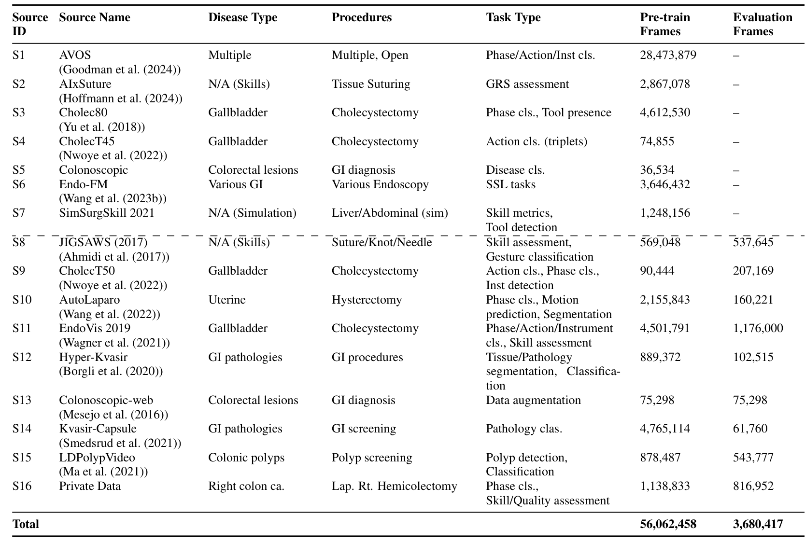
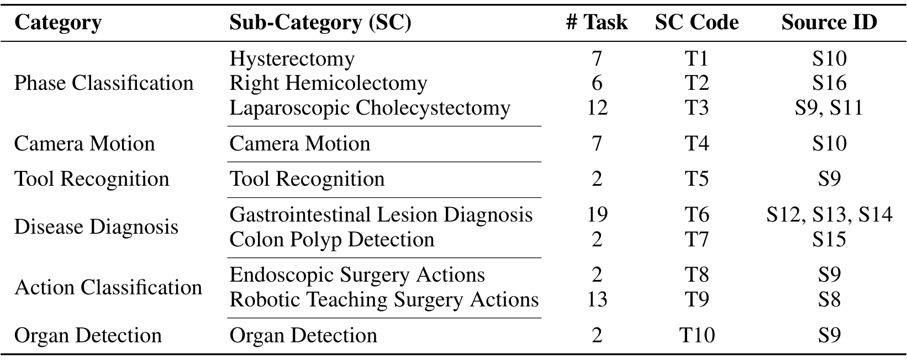
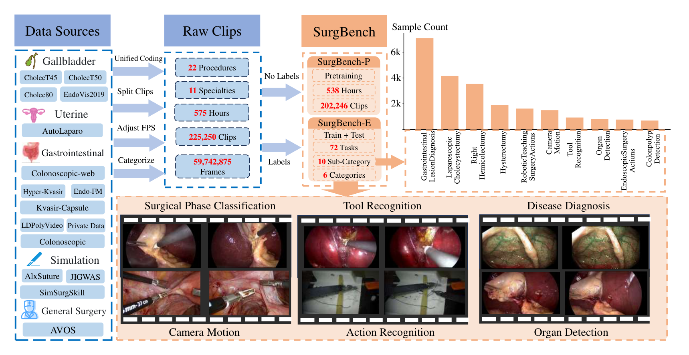
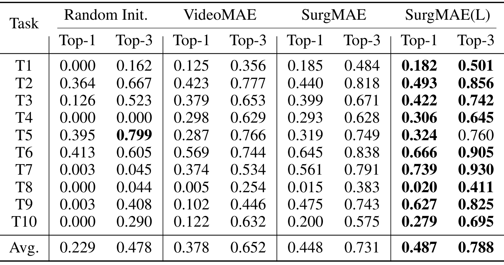
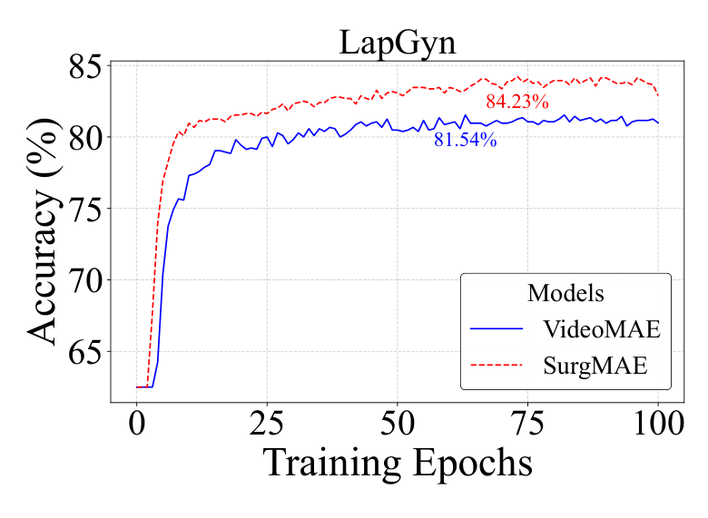

## 1. 背景与动机

**通用视频基础模型靠海量多样的数据学到可迁移的表示,手术视频缺的正是这样的数据。** 论文认为已有手术数据有三个短板:病种单一、术式和专科窄(多是腹腔镜胆囊切除和机器人前列腺切除)、任务孤立(单一术式的阶段识别或单独的器械识别)。

已有的手术预训练语料 Endo-FM、GSViT、Surg-3M 只覆盖 3 到 5 个专科,而且都没有配套的统一评测集。论文要做的是同时补上预训练数据和评测协议。

:::highlights
- 缺口:多专科的手术视频预训练数据,以及统一的多任务评测
:::

## 2. 核心观点速览

**SurgBench 没有新增标注,做的是“收集、统一格式、重新切片”。** 16 个来源(15 个公开、1 个私有)统一成 H.264、短边 320、20 到 30 FPS。无标签部分切成 10 秒片段作预训练集 SurgBench-P;带标签的 9 个来源切成 1 到 10 秒片段作评测集 SurgBench-E。

验证方法是让 VideoMAE 在 SurgBench-P 上继续预训练,冻结骨干只训分类头。平均 Top-1 从 Kinetics 版的 0.378 升到 0.448。

**边界:单次、线性探测;预训练与评测同源,论文未说明是否剔除测试视频;专科广度大多来自 AVOS 一个来源。**

:::data
- SurgBench-P:论文称 53M 帧、11 个专科、22 种术式、538 小时
- SurgBench-E:23,004 个片段、10 个子任务、72 个标签
- 平均 Top-1:随机 0.229、VideoMAE 0.378、SurgMAE 0.448、SurgMAE(L) 0.487
:::

## 3. 数据从哪里来

评测能外推多远,取决于数据来源。表 2 把 16 个来源分成两组:S1 到 S7 只进预训练集,S8 到 S16 同时贡献预训练帧和评测帧。

*论文原图编号：Table 2。16 个来源的病种、术式、任务和帧数。虚线以上只用于预训练。*

**AVOS 一个来源贡献 28,473,879 个预训练帧,占预训练合计 56,062,458 的一半以上。** AVOS 是从 YouTube 收集的开放手术视频,有 330 个链接已失效。它和 SimSurgSkill2021、AIxSuture 受许可限制,只用于预训练,不随评测集发布。

私有数据是中国三家三甲医院的腹腔镜右半结肠切除,按 6 个阶段标注。

:::highlights
- 预训练帧的一半以上来自 AVOS
- 三个来源因许可不能再分发
:::

## 4. 评测集怎样组织

SurgBench-E 按 6 个类别、10 个子类、72 个标签组织,论文称 6C-10S-72T。

*论文原图编号：Table 3。10 个子类 T1 到 T10 的标签数与来源。*

**“72 个任务”实际是 72 个类别标签,独立的分类问题只有 10 个。** 其中 T5 器械、T7 息肉、T8 内镜动作、T10 器官都只有 2 个标签。“器官检测”和“息肉检测”在这里是片段级二分类,不是定位任务。

切片后按视频 5:5 划分训练与测试,同一视频只出现在一侧。不平衡因子控制在 10 以内;一个片段有多个标签时拆成多个单标签样本,并用 top-k 准确率评测。

:::data
- 子类标签数从 2 到 19 不等,T6 消化道病变最多
:::

## 5. 预训练与评测协议

继续预训练从 Kinetics-400 版 VideoMAE 出发,遮盖比例 0.9,每个片段 16 帧、时间采样率 4。数据经四阶段精炼:收集全部片段、过滤 AVOS 等过大来源、上采样少数来源、再上下采样对齐评测分布,最后只剩 39,807 个片段。**每阶段保留多少、各来源占多少,论文未说明。**

*论文原图编号：Figure 1。数据构建流程:来源、原始片段、SurgBench-P 与 SurgBench-E 的拆分。*

评测时冻结骨干只训分类头,也就是线性探测。标准版用 ViT-Base,大模型版用 ViT-Large;两者训练轮数分别是 54 和 38 个 epoch,批大小和学习率也不同。

指标是 top-k 准确率:$\mathrm{Acc@}k=\frac{1}{M}\sum_m \mathbb{1}[y_m\in\mathrm{Top}_k(\hat{p}_m)]$。分类头输出多少类,论文未说明。

## 6. 结果说了什么

*论文原图编号：Table 4。四个模型在 T1 到 T10 上的 Top-1 与 Top-3。*

**继续预训练后平均 Top-1 高 7 个点、Top-3 高 7.9 个点。** 提升主要来自 T9 机器人教学动作(0.102 到 0.475)和 T7 结肠息肉(0.374 到 0.561)。大模型版再高 3.9 和 5.7 个点。

表里也有论文没讨论的反例:T5 的 Top-3 最高的是随机初始化,为 0.799;T4 标准版 0.293 略低于 VideoMAE 的 0.298;T1 大模型版 0.182 略低于标准版 0.185。所以“几乎所有类别都提升”需要打折。

*论文原图编号：Figure 7。LapGyn 上的微调曲线,唯一的分布外实验。*

LapGyn 上继续预训练模型 84.23%,VideoMAE 81.54%。但 LapGyn 与 AutoLaparo 同属妇科腹腔镜,是近分布迁移,不能支撑“对未见模态泛化”。

:::data
- T9 Top-1:0.102 到 0.475
- LapGyn:81.54% 对 84.23%
:::

## 7. 结果没说什么

**二类子任务的数字说明分类头不是逐子任务的。** 若每个子类有自己的二分类头,Top-3 应恒为 1、Top-1 随机水平为 0.5;而 T8 的 Top-1 只有 0.000 到 0.020。我的推断是分类头建在更大的标签空间上,论文未说明。

**预训练与评测同源。** S8 到 S16 既贡献预训练帧也贡献评测帧,论文未说明是否剔除了测试视频。提升最大的 T7、T9,来源都在预训练集中。

**规模数字前后不一致。** 摘要 53M,表 2 预训练合计 56,062,458,第 4 节 74.4M,三者无法换算。

**大模型对比不是干净的规模实验。** 训练轮数、批大小、学习率都不同,且只有两个规模点。

:::highlights
- 主结果能否当作泛化证据,取决于测试视频是否被剔除
:::

## 8. 复现要注意什么

- 数据和代码只能申请获取;AVOS 链接已部分失效,专科广度难以还原。
- 四阶段精炼的比例、分类头结构、Top-3 算法、随机种子都需要自己补齐。
- 只有线性探测结果,全参数微调下的差距论文未说明。
- 所有结果单次运行,子类间 1 个点以内的差别不可靠。

## @takeaways
- SurgBench 的价值是把多个手术视频来源统一成一套预训练加评测的流程
- 评测是 10 个片段级分类子任务,不是 72 个独立任务
- 主结果需要先确认测试视频是否从预训练集中剔除

## @strengths
- 统一编码、按视频划分、控制不平衡,协议清楚
- 附录逐个说明每个来源的切片方法与许可
- 专科覆盖比已有手术预训练语料广

## @weaknesses
- 规模数字在摘要、表 2、正文之间不一致
- 单次线性探测,没有方差,也没有全参数微调
- 二类子任务的评测方式不透明,逐类结果表缺失(正文显示 Table ??)
- 数据只能申请获取

## @questions
- SurgBench-P 是否剔除了 SurgBench-E 测试集所在的视频?
- 分类头是 72 类共享还是逐子任务?
- 全参数微调下继续预训练的优势还剩多少?
