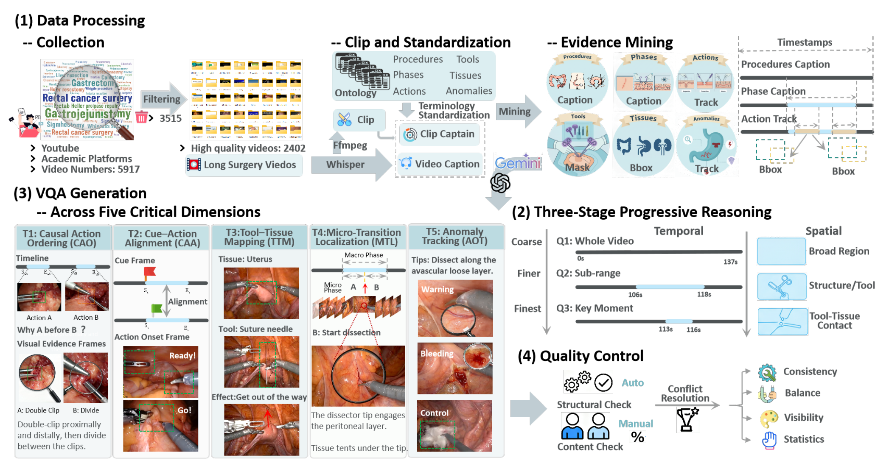
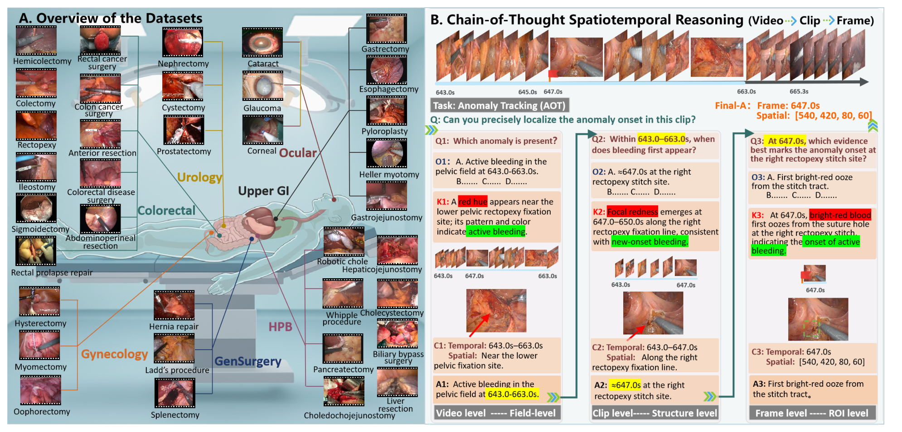
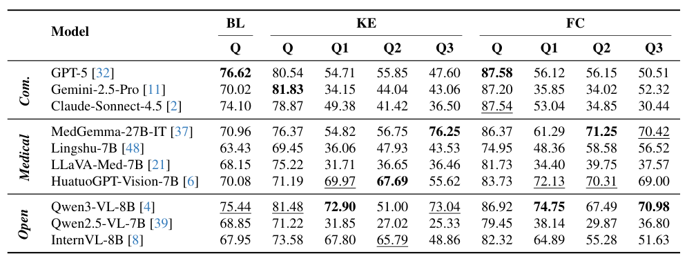
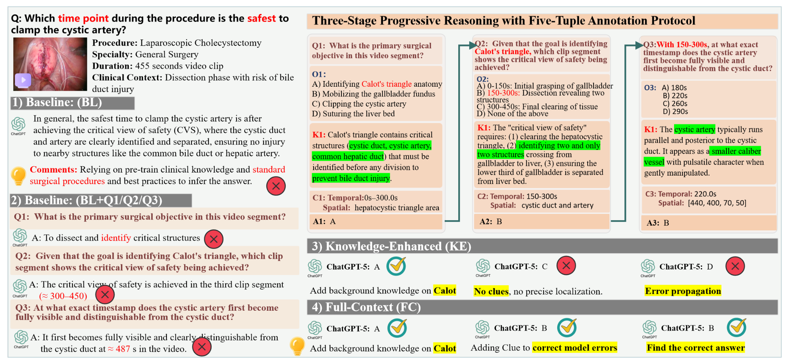

## 1. 背景与动机

**已有手术问答基准大多问"这一帧里有什么",外科判断却依赖"什么时候、在哪里、为什么先做"。** 作者把已有基准分成两类:通用基准问阶段、器械这类问题;专科基准范围窄,多为帧级或片段级问答。两类都把视频切成离散片段,不测跨时间的推理。

MLLM 已经能做阶段识别和器械识别,但这些任务答对,不代表它能沿时间轴推理。论文要回答:MLLM 能否在不同手术场景中做渐进的时空推理和因果判断。

:::highlights
- 缺口不在规模,在问法:已有基准不测时间上的因果和定位。
:::

## 2. 核心观点速览

论文的做法是把一道视频题拆成三级,并把"医学知识"和"画面线索"分开提供。

- 数据:8917 个病例筛到 2841 个视频,覆盖 7 个专科 35 种术式。
- 协议:每题拆成视频级 Q1、片段级 Q2、帧级 Q3,每级五个字段:问题、选项、知识、线索、答案。
- 评测:同一道题在基线、知识增强、全上下文三种设置下各答一次。
- 结果:全上下文下 GPT-5 平均 87.58% 最高;知识增强下它的主问题 80.54%,Q3 只有 47.60%。

**边界:没有随机基线和纯文本对照,线索可能直接含答案。**

:::data
- 2841 个视频,19345 个主问题,59177 个子问题,合计 78522 个问答对
- 10 个模型,全上下文平均 74.95% 到 87.58%
:::

## 3. 题目从哪里来

视频来自 YouTube、ASVIDE 等公开平台、十个开源数据集和临床档案。按术式完整、临床有效、有双语讲解三条标准筛选,保留 31.9%。

证据挖掘把讲解视频变成带时间戳的监督信号:

- 用 ASR 字幕做语义锚点,标出术式和阶段。
- YOLOv10 检测组织,SAM2 分割器械,ByteTrack 跨帧跟踪。
- 根据外观变化检测动作起点,异常用轨迹标注起始时间和区域。

*论文原图编号：Figure 2。构建四步:数据处理、三阶段推理、五维问答生成、质量控制。图中视频数 5917、3515、2402 与正文的 8917、2841 不一致。*

问答文本由人写还是大模型生成,论文未说明。Fig 2 在字幕生成后出现 Gemini 和 ChatGPT 的标志,而这两家的模型又在被测之列。

:::highlights
- 时间证据主要来自讲解字幕,所以数据偏向有讲解的教学视频。
:::

下一节看题目长什么样。

## 4. 三级拆题与五元组

三个阶段逐级收窄范围:Q1 判断整段视频里是否发生目标事件;Q2 在片段内判断何时何处首次出现;Q3 在亚秒级定位起始帧和区域。

$$(Q_1,O_1,K_1,C_1)\Rightarrow A_1 \rightarrow (Q_2,O_2,K_2,C_2,A_1)\Rightarrow A_2 \rightarrow (Q_3,O_3,K_3,C_3,A_2)\Rightarrow A_3$$

式中五个字母依次表示问题、选项、知识、线索、答案。**知识给"为什么",线索给"何时何处"。** 分开投放后,可以区分模型是缺医学知识还是找不到画面。

*论文原图编号：Figure 1。左侧为 7 个专科 35 种术式,右侧为一道异常起始追踪题,时间窗从 643.0 到 663.0 秒收窄到 647.0 秒。*

五个维度是:因果动作排序 CAO、线索-动作对齐 CAA、可供性映射 AM、微转换定位 MTL、异常起始追踪 AOT。

评测时 Q2、Q3 的前提是标准答案还是模型自己的答案,论文未说明。用标准答案时测单步能力,用模型答案时测累积误差,两种情况下 Q3 的含义不同。

## 5. 怎么评测

三种设置:

| 设置 | 给模型什么 |
|---|---|
| 基线 BL | 视频和主问题 |
| 知识增强 KE | 再加知识字段,依次回答 Q1 到 Q3 和主问题 |
| 全上下文 FC | 再加线索字段 |

解码统一:temperature = 0.0,最多生成 4096 个词元,不重试。指标是准确率。

每题几个选项、随机基线多少、视频抽几帧,论文都未说明。没有随机基线,就无法判断 CAO 上 90% 左右的分数离瞎猜有多远。

下一节看分数。

## 6. 结果说了什么

| 模型 | BL | KE | FC |
|---|---|---|---|
| GPT-5 | 76.62 | 80.54 | 87.58 |
| Claude-Sonnet-4.5 | 74.10 | 78.87 | 87.54 |
| Gemini-2.5-Pro | 70.02 | 81.83 | 87.20 |
| Qwen3-VL-8B | 75.44 | 81.48 | 86.92 |
| MedGemma-27B-IT | 70.96 | 76.37 | 86.37 |
| Lingshu-7B | 63.43 | 69.45 | 74.95 |

**全上下文下前三名是商用模型,但与开源的 Qwen3-VL-8B 只差 0.66 个点;基线下 Qwen3-VL-8B 反而高于两个商用模型。** 单次运行,没有置信区间,"商用全面领先"在基线下不成立。

维度难度差别很大。CAO 本质接近二选一,全上下文下 8 个模型超过 96;AM 和 AOT 最难。

增益并不单调:从基线到知识增强,10 个模型中有 9 个至少在一个维度下降。例如 Claude 的 MTL 从 79.49 降到 72.45。

正文说 Claude 加线索后提高约 13.44,实际是 BL 到 FC 的差,KE 到 FC 只有 8.67。

:::data
- GPT-5 从 BL 到 FC 平均 +10.96
- Claude 的 AM 从 59.80 到 87.51
- Qwen2.5-VL-7B 从 KE 到 FC +8.23
:::

## 7. 子问题跟不上主问题

*论文原图编号：Table 3。主问题与 Q1、Q2、Q3 在三种设置下的准确率。*

知识增强下,GPT-5 主问题 80.54,Q3 只有 47.60;Gemini-2.5-Pro 主问题 81.83,Q1 只有 34.15。**子问题的排名与主问题不同:MedGemma-27B-IT 的 Q3 为 76.25,高于三个商用模型。**

加线索也不一定有用:Claude 的 Q3 从 36.50 降到 30.44,Gemini 的 Q2 从 44.04 降到 34.02。论文没有解释。

另一种解释是子问题更难判分,Q3 要求精确时间点,选项可能更相近。各级的选项数论文未说明,所以"子问题低"不一定等于"推理链断裂"。

:::highlights
- 主问题高分可能来自题面常识,子问题才暴露定位能力。
:::

## 8. 结果没说什么

*论文原图编号：Figure 4。一道"何时夹闭胆囊动脉最安全"的题,GPT-5 在四种条件下的回答。*

Fig 4 是线索纠错的唯一案例。其中第二个子问题的线索写"时间 150 到 300 秒",正确选项也正是"150 到 300 秒"。**如果线索普遍这样贴近答案,全上下文测的是读提示,不是时空定位。**

论文没有分开的几件事:

- 知识和线索带来的增益,与子问题拆解本身的提示作用。
- 模型看视频与只读题面的差别,需要纯文本对照。
- 推理能力与视频输入方式的差别,接口模型与本地模型的帧数可能不同。

## 9. 复现与使用要注意什么

我在 2026-11-07 查看了 Hugging Face 上公开的数据:

- 主问题文件分训练 11218 条、测试 4825 条,答案是自由文本,不是选项字母。
- 测试集的 1869 个视频中,1867 个也出现在训练集里,划分按问题而不是按视频。
- 线索以视频片段路径给出,没有看到独立的知识字段;视频打包为约 328 GB 的压缩包。
- 代码仓库只有说明文档,评测代码尚未发布。

这些与论文的多选、五元组描述不完全一致,使用前要先确认判分方式。

## @takeaways
- 三级拆题能定位模型在哪一级出错,是这篇论文最值得借鉴的设计。
- 全上下文的高分不能直接当作时空定位能力,线索可能含答案。
- 用它训练再评测前,要按视频重新划分。

## @strengths
- 覆盖 7 个专科 35 种术式,问题围绕时间和因果,而不是单帧识别。
- 知识与线索分开投放,同一题三种设置,便于诊断模型缺什么。
- 数据已在 Hugging Face 公开,无需申请。

## @weaknesses
- 没有随机基线、纯文本基线和置信区间。
- 选项数、视频输入方式、子问题前提、问答生成方式都未说明。
- 摘要说 10 个模型、引言说 12 个;图内视频数与正文不一致;表 2 平均列口径不明。

## @questions
- 只给题面和知识、不给视频时,各维度准确率是多少?
- 线索与答案字面重合的题占多少,去掉后全上下文增益还剩多少?
- 子问题前提改用模型自己的答案后,Q3 会再掉多少?
