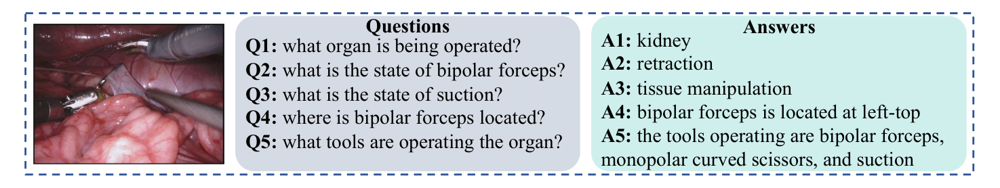
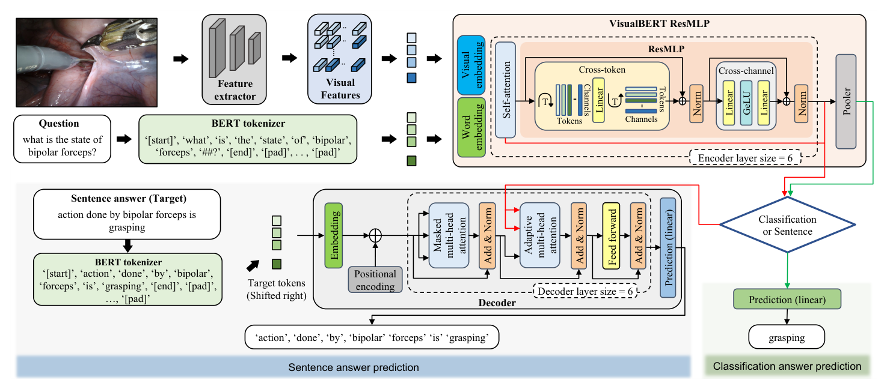
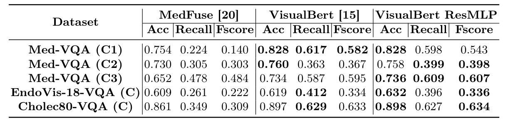
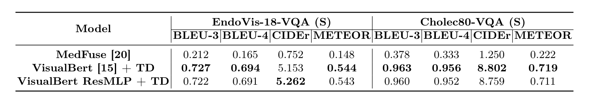
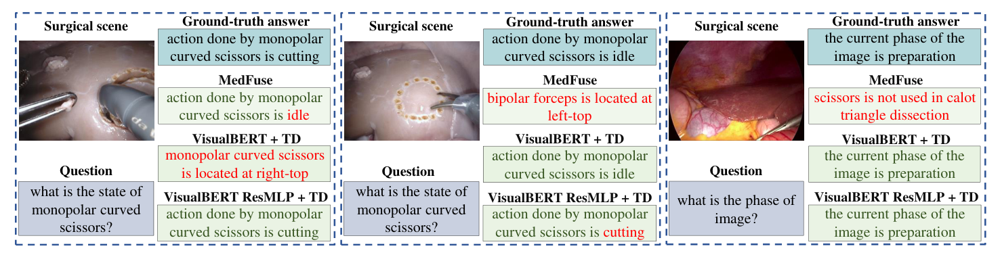
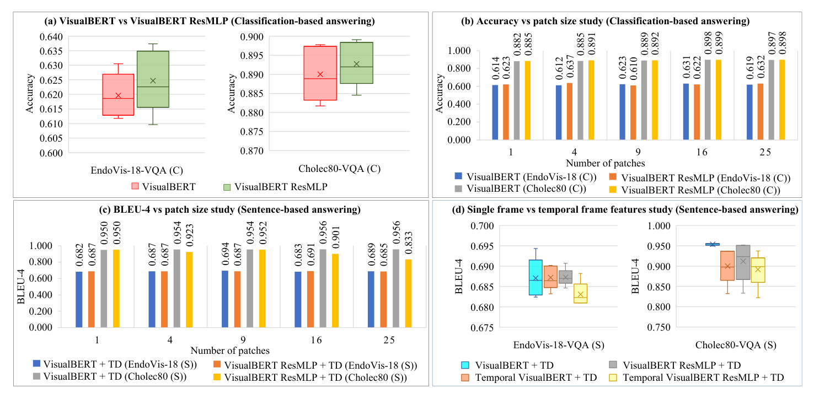

---
tags:
  - papers/手术数据集
aliases:
  - "Surgical-VQA"
date: 2022-06-22
arxiv_id: "2206.11053"
---

# Surgical-VQA: Visual Question Answering in Surgical Scenes using Transformer

## 核心信息

- 标题: Surgical-VQA: Visual Question Answering in Surgical Scenes using Transformer
- 标题翻译: Surgical-VQA：基于 Transformer 的手术场景视觉问答
- 作者: Lalithkumar Seenivasan, Mobarakol Islam, Adithya K Krishna, Hongliang Ren
- 机构: 新加坡国立大学生物医学工程系；帝国理工学院生物医学图像分析组；印度国立理工学院蒂鲁吉拉帕利分校电子与通信工程系；香港中文大学电子工程系；香港中文大学信兴高等工程研究所
- 发表时间: 2022-06-22
- 发表渠道: arXiv 预印本（cs.CV），本笔记依据第 2 版
- arXiv: 2206.11053
- 论文链接: https://arxiv.org/abs/2206.11053
- 代码 / 项目: https://github.com/lalithjets/Surgical_VQA
- 数据 / 资源: EndoVis-18-VQA、Cholec80-VQA（由 EndoVis-18 与 Cholec80 扩展而来）
- 论文类型: AI_method

## 原文摘要翻译

手术中的视觉问答基本上还没有被研究过。外科专家稀缺，并且常被临床和学术工作压得喘不过气。这种负担限制了他们回答患者、医学生或低年资住院医师关于手术过程提问的时间。

有时，学生和低年资住院医师为了不打断课堂，也不愿意提太多问题。虽然计算机辅助模拟器和过去手术的录像已经可供他们观摩、提升技能，但他们的问题仍然很大程度上依赖医学专家来回答。一个可靠的手术视觉问答系统可以作为“第二意见”，作为后备，减轻医学专家答疑的负担。标注医学数据的缺乏和领域专用术语的存在，限制了针对手术过程的视觉问答研究。

本文设计了一个手术视觉问答任务，根据手术场景回答关于手术过程的问题。我们进一步扩展 MICCAI 2018 内镜视觉挑战赛数据集和手术流程识别数据集，提出两个分别带有分类式答案和句子式答案的手术视觉问答数据集。为完成该任务，我们采用视觉-文本 Transformer 模型。我们还提出一个基于残差多层感知机的 `VisualBERT` 编码器模型，它强化视觉词元与文本词元之间的交互，提升了分类式回答的性能。此外，我们研究了输入图像图块数量和时序视觉特征对模型在分类式和句子式回答中性能的影响。

## 创新点

1. **把手术场景问答定义成两类任务。** 分类式回答输出一个单词标签，句子式回答输出一句完整答案。问题覆盖器官、器械状态、器械位置、手术阶段和器械数量，同一帧画面换个问题就能取出不同信息。
2. **用已有标注模板化生成两个问答数据集。** `EndoVis-18-VQA` 来自 EndoVis-18 的工具-组织交互标注，`Cholec80-VQA` 来自 `Cholec80` 的器械和阶段标注。两者都不需要新的人工标注，给手术视觉问答提供了第一批可训练、可比较的数据。
3. **残差多层感知机版编码器（VisualBERT ResMLP）。** 在每层自注意力之后，借鉴 `ResMLP` 用跨词元模块和跨通道模块替换原来的中间层和输出层，强制词元之间再做一次线性混合。分类任务上它小幅领先 `VisualBERT`，参数量从 `184.2M` 降到 `159.0M`。
4. **整图网格特征替代目标提议。** 视觉词元直接取 `ResNet18` 最后卷积层特征并做自适应平均池化，得到 $n^2$ 个图块词元，绕开了手术场景里难以获得的目标检测器。
5. **编码器加解码器做句子回答，并做图块数与时序特征消融。** 解码器按下一个词预测训练，推理用束搜索。消融显示图块数对分类有小幅正作用，对句子回答影响不明确，时序特征反而降低句子回答表现。

## 一句话总结

论文把 EndoVis-18 和 Cholec80 的现有标注套进问答模板，构造了两个手术问答数据集。去掉目标检测的视觉-文本 Transformer 在这两个数据集上明显好于基于长短期记忆网络的 `MedFuse`。新提出的残差多层感知机版编码器相对原版只在分类上有小幅优势，换来一成多的参数节省。

## 研究问题

论文的出发点是手术教学中的答疑缺口。患者、医学生和低年资住院医师对诊断和手术过程常有疑问，但外科专家人数少、临床和教学负担重，学生也不愿频繁打断课堂。已有的计算机辅助训练技术和模拟器能帮助练习技能，录像也能用来观摩，但它们都不回答学生的问题，答疑仍然落在专家身上。作者设想一个能同时读取手术画面和问题、给出可靠答案的系统，作为专家之外的“第二意见”。

技术上的障碍有两个。第一，通用视觉领域的问答模型依赖大规模标注数据，医学领域缺这样的数据。第二，医学专用词汇让预训练的通用问答模型难以直接迁移。医学视觉问答已有少量工作（如 `MedFuse`），面向手术场景的视觉问答基本是空白。

因此论文要回答两个问题：能否从已有手术视频数据集的标注出发构造手术问答数据，并用视觉-文本 Transformer 回答关于器械、器械与组织交互和手术过程的问题；在此基础上，能否用加强词元交互的编码器进一步改进效果。

### 核心观点速览

**论文的答案是：不做新标注，把已有标注套进问答模板，再用去掉目标检测的视觉-文本 Transformer 去答。** 它由四步组成：

- **造数据：** 从 EndoVis-18 的 14 个肾切除序列和 `Cholec80` 的 40 个胆囊切除视频生成问答对，各有分类版和句子版。
- **取视觉词元：** 用 `ResNet18` 整图特征池化成 $n^2$ 个图块，不需要目标检测器。
- **改编码器：** 在 `VisualBERT` 每层自注意力后接跨词元和跨通道模块，参数从 `184.2M` 降到 `159.0M`。
- **生成句子：** 编码器后接 6 层 Transformer 解码器，用束搜索逐词生成。

**主要收益来自从长短期记忆网络换成 Transformer，新编码器只在分类上带来很小的提升。** 句子任务上新编码器反而略差，时序特征也没有帮助。所有结论都建立在模板生成的简单问题上，统计检验和临床评估论文都没有做。

下面先看任务和数据是怎么来的，因为问题的简单程度决定了后面所有分数该怎么读。

## 数据与任务定义

### 任务定义

给定一帧手术画面和一个自然语言问题，模型输出答案。论文定义两种输出形式：

- **分类式回答（C）：** 答案是一个单词，按固定答案类别做分类。例如问“正在手术的是什么器官”，答“肾脏”。
- **句子式回答（S）：** 答案是一句话。例如问“双极钳在哪里”，答“双极钳位于左上方”。

*论文原图编号：Fig. 1。一帧肾切除术画面配五个问题和答案，覆盖器官、器械状态、器械位置和参与操作的器械。放在这里是因为它直接给出了任务的输入输出形式，也能看出句子答案是“主语加固定谓语加一个槽位”的模板句。*

### 数据来源与构建

两个新数据集都不是重新人工标注，而是把原数据集已有的标注套进问答模板生成。

| 数据集 | 来源 | 答案类别（C 版本） | 训练集 | 测试集 |
|---|---|---|---|---|
| `EndoVis-18-VQA` | EndoVis-18 的 14 个机器人肾切除术视频序列，基于工具、组织、边界框和交互标注，每帧生成问答对 | 26 类：1 个器官、8 种器械、13 种器械交互、4 个器械位置 | 11 个序列，1560 帧，9014 对 | 3 个序列，447 帧，2769 对 |
| `Cholec80-VQA` | `Cholec80` 的 40 个视频，按 0.25 fps 采样得 21591 帧，基于器械操作和阶段标注，每帧生成两个问答对 | 14 类：8 个手术阶段、2 个器械状态、4 个器械数量 | 34k 对，17k 帧 | 9K 对，4.5k 帧 |
| `Med-VQA` | ImageCLEF 2019 医学视觉问答挑战赛，共 3825 张图 | C1 模态 45 类，C2 成像平面 16 类，C3 器官 10 类 | 沿用原始划分 | 沿用原始划分 |

`EndoVis-18-VQA` 沿用工具-组织交互检测任务的划分，按序列分成 11 个训练序列和 3 个测试序列。`Cholec80-VQA` 沿用 `Cholec80` 的原划分，但 40 个视频各有多少进入训练和测试，论文未说明。两个手术数据集的 C 版本和 S 版本共用同一套图像和划分，只是答案形式不同。`Med-VQA` 作为通用医学问答的外部对照，结果只出现在分类表里；实现细节列出了它的句子任务超参数，但句子结果表没有它，原因论文未说明。

问题模板的完整清单、每类问题的数量分布、句子模板的具体写法，论文未说明。从 Fig. 1 和 Fig. 3 能看到的句子模板有三种：器械动作句、器械位置句和当前阶段句，每句只有一到两个词随画面变化。

**数据的难度上限由模板决定。** 有了这个前提，再看模型如何把画面和问题编码在一起。

## 方法主线

### 机制流程

模型要解决的问题是：手术数据没有目标检测标注，`VisualBERT` 原本依赖的目标提议拿不到。论文的做法是改用整图网格特征，并在编码器里加一步词元混合。

1. **构造词元。** 输入是手术画面和问题。问题由 BERT 分词器切成词元，分词器在本数据集上重新训练过，以收录手术领域词汇。画面送入在 ImageNet 上预训练的 `ResNet18`，对最后卷积层做自适应平均池化，得到边长为 $n$、通道数为 256 的特征图，即 $n^2$ 个视觉词元。输出的两串词元分别送入词嵌入层和视觉嵌入层。
2. **联合编码。** 嵌入后的两串词元拼在一起进入 6 层编码器。每层先做自注意力，再经过跨词元模块（沿词元维做线性混合）和跨通道模块（沿通道维做两层线性变换，中间用 `GeLU`），两个模块都带残差连接和层归一化。输出送到池化模块和解码器两个方向。
3. **分类式回答。** 池化模块的输出接一个线性预测层，直接预测答案类别，输出单个答案标签。
4. **句子式回答。** 编码器输出接一个 6 层 Transformer 解码器（论文记作 TD）。训练时把目标答案右移一位作为输入，依次经过带掩码的多头注意力、读取编码器输出的自适应多头注意力和前馈层，预测下一个词。推理时从起始符开始用束搜索逐词生成，直到预测出结束符，输出答案句子。

*论文原图编号：Fig. 2。上半部是特征提取、分词器和编码器，下半部是解码器，右侧菱形分支选择分类或句子输出。放在这里是因为它把机制流程四步和编码器内部结构画在了一张图里。图中红线表明解码器读取的是编码器自注意力子模块的输出，这一点与后文对句子任务结果的解释直接相关。*

### 模型结构：从原版编码器到残差多层感知机版

`VisualBERT` 是在 BERT 上加视觉输入的多层 Transformer 编码器。文本词元的嵌入由词嵌入、段嵌入和位置嵌入相加；视觉词元的嵌入由视觉特征、段嵌入和位置嵌入相加。原版的视觉特征来自目标提议网络，每层编码器由自注意力、中间层和输出层组成，最后接池化模块。

本文做了两处改动。第一处是视觉词元的来源：不用目标提议，直接从整张图提取网格特征，图块数由池化尺寸 $n$ 决定。第二处是编码器层内部：保留自注意力，把中间层和输出层换成跨词元和跨通道两个模块：

$$X_{CT} = \mathrm{Norm}\left(X_{SA} + \left(A\left(X_{SA}^{T}\right)\right)^{T}\right)$$

$$X_{CC} = \mathrm{Norm}\left(X_{CT} + C\left(\mathrm{GeLU}\left(B\left(X_{CT}\right)\right)\right)\right)$$

其中 $X_{SA}$ 是自注意力输出，$\mathrm{Norm}$ 是层归一化。

式中三个可学习线性层分别记为 $A$、$B$、$C$。

第一个式子把词元维和通道维转置后，让线性层 $A$ 沿词元维混合，再转置回来，相当于每个通道都对所有词元做一次固定权重的加权和。第二个式子是逐词元的两层前馈网络。用 PyTorch 写，跨词元模块就是对输入转置、过线性层、再转置回来，加上残差后做层归一化。

线性层 $A$ 的输入维度等于词元个数，所以这个模块要求序列长度固定。Fig. 2 中问题被填充符补到固定长度，与这一约束相符，但具体长度论文未说明。

相对 `ResMLP` 原文，本文只借用了跨词元和跨通道两种结构，并保留了自注意力，因此它不是纯多层感知机模型，而是在注意力之后再加一次固定权重的混合。**这一步能否带来收益，要看下一节的数字。**

### 关键实现细节

| 项目 | 设置 |
|---|---|
| 视觉骨干 | ImageNet 预训练的 `ResNet18`，取最后卷积层，池化后 256 通道 |
| 嵌入维度 / 隐藏层维度 | 300 / 2048 |
| 编码器 / 解码器层数 | 6 / 6 |
| 损失与优化器 | 交叉熵，Adam |
| 分类任务 | 批大小 64，训练 80 轮 |
| 分类任务学习率（Med-VQA） | $5\times10^{-6}$ |
| 分类任务学习率（EndoVis-18-VQA） | $1\times10^{-5}$ |
| 分类任务学习率（Cholec80-VQA） | $5\times10^{-6}$ |
| 句子任务 | 批大小 50 |
| 句子任务（Med-VQA） | 50 轮，学习率 $1\times10^{-4}$ |
| 句子任务（EndoVis-18-VQA） | 100 轮，学习率 $5\times10^{-5}$ |
| 句子任务（Cholec80-VQA） | 51 轮，学习率 $1\times10^{-6}$ |
| 时序消融骨干 | UCF101 预训练的 3D `ResNet50`，时间长度 3（当前帧加前两帧） |

论文写池化后的特征含 256 个通道，但没有说明这是骨干的原始输出还是另有投影层，也没有说明 256 维视觉特征如何映射到 300 维嵌入。注意力头数、束宽、分词器的词表大小和训练语料、问题序列长度，以及 `MedFuse` 在句子任务上如何改造，论文都未说明。

## 关键结果

关键结果要回答两件事：Transformer 是否比已有的医学问答模型好，以及新编码器是否比原版好。下文用“基线”指 `MedFuse`，“原版”指 `VisualBERT`，“新版”指 `VisualBERT ResMLP`；句子任务中两个 Transformer 模型都接解码器，记作“原版加解码器”和“新版加解码器”。

### 分类式回答主结果

| 数据集 | 基线准确率 | 基线 F 值 | 原版准确率 | 原版 F 值 | 新版准确率 | 新版 F 值 |
|---|---|---|---|---|---|---|
| Med-VQA (C1) | 0.754 | 0.140 | 0.828 | 0.582 | 0.828 | 0.543 |
| Med-VQA (C2) | 0.730 | 0.303 | 0.760 | 0.367 | 0.758 | 0.398 |
| Med-VQA (C3) | 0.652 | 0.484 | 0.734 | 0.595 | 0.736 | 0.607 |
| EndoVis-18-VQA (C) | 0.609 | 0.222 | 0.619 | 0.334 | 0.632 | 0.336 |
| Cholec80-VQA (C) | 0.861 | 0.309 | 0.897 | 0.633 | 0.898 | 0.634 |

*论文原图编号：Table 1。三种模型在五个分类子集上的准确率、召回率和 F 值。放在这里是因为它是新版编码器的主要证据，上表只摘了准确率和 F 值，召回率见原表。*

两个 Transformer 模型对基线的优势很清楚，F 值的差距尤其大。以 Cholec80-VQA (C) 为例，基线的 F 值只有 0.309，原版和新版分别是 0.633 和 0.634。基线准确率高而 F 值低，说明它主要在高频类别上答对，少数类别几乎答不出来。

新版相对原版的优势则很小。准确率上最大的差距在 EndoVis-18 分类集，0.632 对 0.619；Cholec80 分类集只差 0.001。

在 Med-VQA 上，新版在成像平面子集的准确率反而低 0.002，在模态子集的 F 值低了 0.039。作者自己的措辞也是“略微优于”。

### 三折检验与参数量

为了说明小幅提升是稳定的，作者在 EndoVis-18-VQA (C) 上做了三折比较：

| 模型 | 第 1 折准确率 | 第 1 折 F 值 | 第 2 折准确率 | 第 2 折 F 值 | 第 3 折准确率 | 第 3 折 F 值 |
|---|---|---|---|---|---|---|
| 原版 | 0.619 | 0.334 | 0.605 | 0.313 | 0.578 | 0.337 |
| 新版 | 0.632 | 0.336 | 0.649 | 0.347 | 0.585 | 0.373 |

> [!figure] Table 2 EndoVis-18-VQA (C) 三折对比
> 建议位置：关键结果
> 放置原因：这是新版提升“一致”的唯一证据，三折的准确率和 F 值都更高。
> 当前状态：保留占位；自动裁剪得到的候选图实际是表 1，与表 2 身份不符，数值已转写在上表。

三折中新版的准确率和 F 值都更高，第 2 折差距最大（准确率 0.649 对 0.605）。但只有三折、只在一个数据集上做，没有方差或显著性检验，折的划分方式论文未说明。所以这组数据支持“新版不低于原版”，还不足以证明稳定更好。

参数量上，分类模型新版为 `159.0M`，原版为 `184.2M`，少 13.64%；句子模型新版加解码器为 `184.7M`，原版加解码器为 `209.8M`，少 11.98%。两组的绝对差都约 25M，来自用跨词元和跨通道模块替换中间层和输出层。

### 句子式回答主结果

肾切除数据集（EndoVis-18-VQA (S)）：

| 模型 | BLEU-4 | CIDEr | METEOR |
|---|---|---|---|
| 基线 | 0.165 | 0.752 | 0.148 |
| 原版加解码器 | 0.694 | 5.153 | 0.544 |
| 新版加解码器 | 0.691 | 5.262 | 0.543 |

胆囊切除数据集（Cholec80-VQA (S)）：

| 模型 | BLEU-4 | CIDEr | METEOR |
|---|---|---|---|
| 基线 | 0.333 | 1.250 | 0.222 |
| 原版加解码器 | 0.956 | 8.802 | 0.719 |
| 新版加解码器 | 0.952 | 8.759 | 0.711 |

*论文原图编号：Table 3。三种模型在两个句子数据集上的四项指标。放在这里是因为它是句子式回答的全部定量证据，上表省略了 BLEU-3 一列。*

Transformer 模型与基线的差距比分类任务大得多。两个 Transformer 变体之间的关系则倒了过来：除 EndoVis-18 的 `CIDEr` 外，原版加解码器在所有指标上都略高于新版加解码器。

作者的解释是，解码器的自适应多头注意力除了读取编码器最终输出，还读取编码器自注意力子模块的输出；跨词元模块强制的词元交互可能干扰了自注意力子模块的训练，从而影响句子生成。这是推测，论文没有用实验验证。另外，基线原本是分类模型，它的句子版本如何实现论文未说明，句子任务上的巨大差距需要打个折扣来读。

*论文原图编号：Fig. 3。三个定性样例，红字是错误答案。放在这里是因为它展示了错误的形态：基线常答非所问，问器械状态却答位置，问阶段却答器械使用；Transformer 模型的错误多是句式正确、关键槽位答错，把“切割”和“空闲”互换。第一例中原版加解码器也答成了位置句。*

### 消融：图块数与时序特征

*论文原图编号：Fig. 4。四个子图依次是：不同图块数下两种编码器分类准确率的箱线图；分类准确率随图块数的变化；句子 BLEU-4 随图块数的变化；单帧与时序特征的句子指标箱线图。放在这里是因为消融的全部结论都只来自这张图。*

图块数取 1、4、9、16、25。Fig. 4(b) 中分类准确率总体随图块数增加略升。例如 Cholec80 (C) 上新版从 1 个图块的 0.885 升到 16 个图块的 0.899；但 EndoVis-18 (C) 上新版在 4 个图块时就达到 0.637，之后在 0.610 到 0.632 之间波动，并非单调。

Fig. 4(c) 中句子 BLEU-4 对图块数基本不敏感，作者认为“多数情况下单个图块就给出最好或接近最好的结果”。Cholec80 (S) 上新版加解码器在 25 个图块时掉到 0.833。

时序实验把骨干换成在 UCF101 上预训练的 3D `ResNet50`，输入当前帧和前两帧。作者称两个模型用时序特征后表现都下降。从 Fig. 4(d) 的箱线图看，下降主要出现在胆囊切除数据上；肾切除数据上原版加解码器的箱体几乎不变，只有新版加解码器略降。

**这组消融只告诉我们“当前设置下多帧没有帮助”。** 它为什么不足以否定时序信息，留到深度分析里讨论。

## 深度分析

### 为什么 Transformer 对基线的优势这么大

最大的收益来自从长短期记忆网络融合换成 Transformer 联合编码，而不是新版模块。分类任务上两个 Transformer 都把 F 值提高了一大截，说明联合注意力能借问题挑出画面中相关的信息，少数类答对得更多。句子任务的差距更大，原因在于答案是模板句：模型只要学会“问状态就用动作句式、问位置就用位置句式”，再填对槽位即可。Fig. 3 中基线的错误大多是选错了句式，这类错误在 `BLEU` 上惩罚很重。

### 模板答案会抬高句子指标

句子答案由固定模板生成，一句中只有一到两个词需要从画面推断，其余词由问题类型决定。这带来两个后果。

第一，Cholec80-VQA (S) 上 BLEU-4 达到 0.956，并不表示模型具备开放式描述能力，主要说明它复现了模板。第二，句子指标对槽位错误不敏感。Fig. 3 第二例中新版加解码器把“空闲”答成“切割”，整句只错一个词，`BLEU` 仍然很高，临床含义却完全相反。句子答案中槽位词的准确率论文未说明，这让“可靠第二意见”的定位缺少直接支撑。

### 新版编码器的收益到底有多可信

新版在两个手术数据集上的分类准确率收益只有 0.001 到 0.013，作者用三折检验支撑“一致”。三折方向确实一致，但只有三个样本，而且第 3 折两个模型都明显低于前两折，说明折间差异本身就和模型差异同量级。Fig. 4(b) 中，EndoVis-18 (C) 上 9 个和 16 个图块时原版反而更高。

更稳妥的结论是：新版在参数少约 25M 的情况下，分类性能不低于原版，略有优势的可能性较大，但证据不足以说明跨词元交互本身带来了可靠增益。

参数节省来自结构替换。原版每层的中间层和输出层是一个两层前馈网络，新版把它换成一个沿词元维的线性层加一个沿通道维的两层网络。每层参数的拆解和推理速度对比，论文未说明。

### 时序实验存在混杂变量

时序实验同时改变了三件事：输入帧数（从 1 到 3）、骨干（从 2D `ResNet18` 到 3D `ResNet50`）、预训练数据（从 ImageNet 换成 UCF101 动作识别）。

表现下降可能来自其中任何一项，例如动作识别的自然视频与内镜画面差异更大。所以 Fig. 4(d) 只能说明这一种时序特征提取方式在当前问题上没有帮助，推不出时序信息对手术视觉问答无用。另外，当前的问题（阶段、器械状态、位置）多数单帧就能回答，时序信息的价值本来就难以体现。

### 复杂度与扩展性

整图网格特征省掉了目标检测器，适合没有检测标注的手术数据。代价是空间分辨率很粗：实验最多 25 个图块，位置答案也只有 4 个粗粒度类别（如左上）。跨词元线性层的大小随序列长度平方增长，并且要求固定长度，扩展到长问题或多帧输入时需要重新设计。

### 复现注意点

- 代码公开在论文给出的仓库中。问答模板、分词器训练方式、序列长度和束宽都需要从代码中确认，论文未说明。
- 三个数据集的学习率和训练轮数各不相同，例如 Cholec80-VQA (S) 用 51 轮和 $1\times10^{-6}$。是否在测试集上调过这些超参数，论文未说明。
- `Cholec80-VQA` 的规模以“34k”“9K”“17k”“4.5k”这样的约数给出，复现时应以代码生成结果为准。
- 基线原本是为分类设计的模型，它在句子任务上的实现方式论文未说明，句子任务的基线对比因此偏弱。

## 局限

- **问题简单且由模板生成。** 作者承认当前任务只回答“不太复杂”的问题。问题类型限于器官、器械状态、位置、阶段和器械数量，答案空间是 26 类和 14 类，与“回答学生疑问”的动机之间还有很大距离。
- **没有临床评估。** 论文以“可靠第二意见”为动机，但没有外科医生参与评估，也没有错误代价分析或置信度输出。
- **基线单一。** 只和 `MedFuse` 及 `VisualBERT` 比较，没有通用视觉问答预训练模型或其他医学问答方法。
- **统计证据薄。** 主表是单次运行，没有方差和显著性检验；三折检验只在一个数据集上做。
- **句子任务中新版略差，原因未验证。** 作者把它归因于跨词元模块对自注意力训练的干扰，并建议未来用异步训练解决，但没有实验支持。
- **时序实验有混杂变量。** 帧数、骨干和预训练数据同时改变。
- **泛化范围窄。** EndoVis-18 只有肾切除一种术式和一个器官类别，`Cholec80` 只有胆囊切除，没有跨中心或跨术式测试。

作者提出的未来方向有两个：引入开放式问题，让模型回答更复杂的手术问题；设计异步训练方式，让句子任务也能受益于跨词元模块而不损害自注意力。

## 我的笔记

这篇论文的主要价值在于开了手术视觉问答这个方向，并给出了一套低成本造数据的做法：把已有的检测、交互和阶段标注直接套进问答模板。这让后续工作有了可比较的起点，也决定了它测的其实是“换了问法的多任务分类”。读结果时应当把它理解为：Transformer 联合编码能根据问题选出对应的标注维度并做分类，而不是能理解手术。

对后续工作有用的几点：

- 评估模板句子答案时，应单独报告槽位准确率，或按问题类型拆开报告分类准确率。
- 想验证时序信息，应固定骨干，只改变帧数。
- 用沿词元维的混合模块替换前馈网络能省参数，但如果下游模块依赖注意力输出，要单独检查影响。

值得追问的问题：

- 各类问题（器官、状态、位置、阶段、数量）的准确率分别是多少？EndoVis-18 上器官问题只有一个答案，是否抬高了整体准确率？
- 句子答案中槽位词的准确率与分类版本是否一致？
- 只保留跨通道模块、或保留原前馈网络只加跨词元模块，各自贡献多少？

## 引用

- Seenivasan L., Islam M., Krishna A. K., Ren H. Surgical-VQA: Visual Question Answering in Surgical Scenes using Transformer. arXiv:2206.11053, 2022. https://arxiv.org/abs/2206.11053
- Li L. H., Yatskar M., Yin D., Hsieh C.-J., Chang K.-W. VisualBERT: A simple and performant baseline for vision and language. arXiv:1908.03557, 2019.
- Touvron H. et al. ResMLP: Feedforward networks for image classification with data-efficient training. arXiv:2105.03404, 2021.
- Sharma D., Purushotham S., Reddy C. K. MedFuseNet: An attention-based multimodal deep learning model for visual question answering in the medical domain. Scientific Reports 11(1), 2021.
- Allan M. et al. 2018 Robotic Scene Segmentation Challenge. arXiv:2001.11190, 2020.
- Twinanda A. P. et al. EndoNet: A Deep Architecture for Recognition Tasks on Laparoscopic Videos. IEEE Transactions on Medical Imaging 36(1), 2016.

