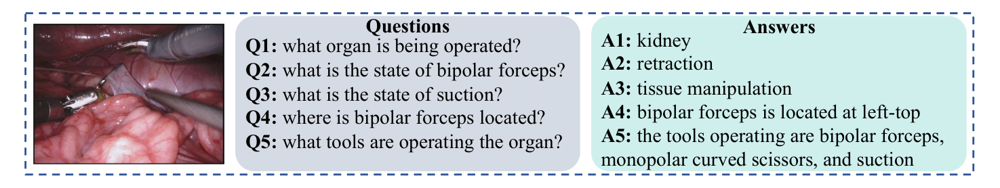
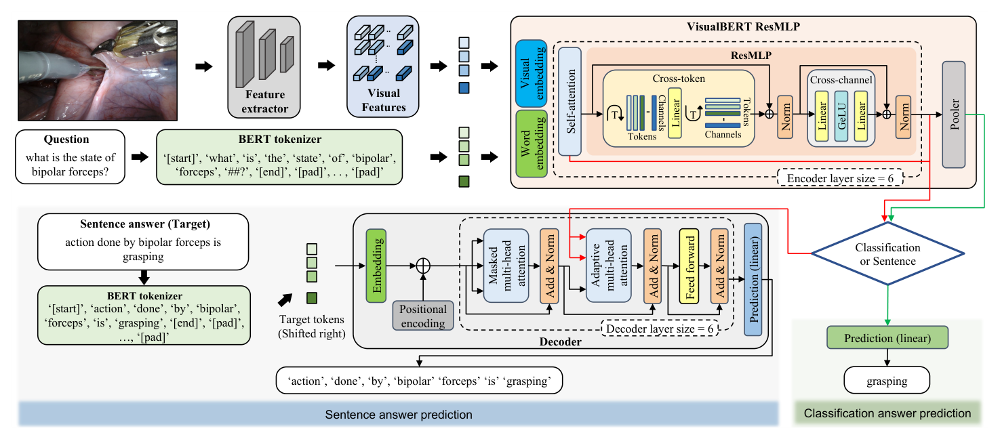
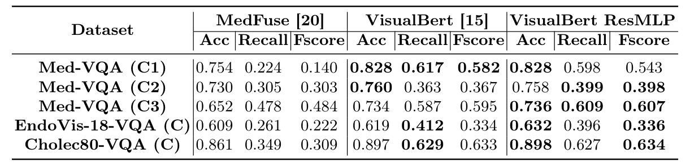
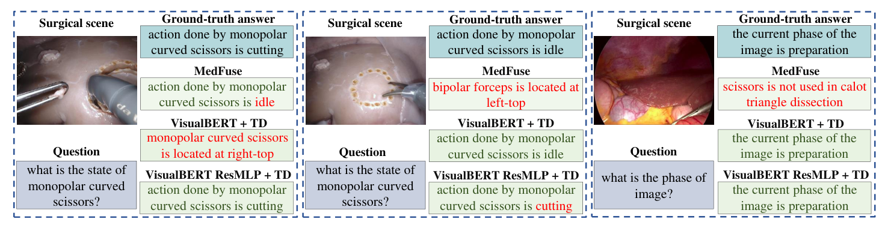
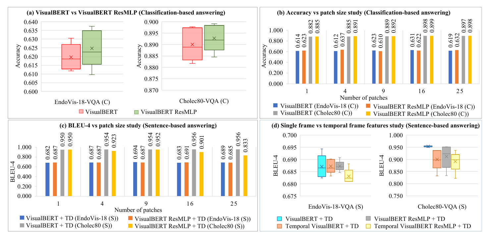

## 1. 背景与动机

**外科专家答疑的时间有限，学生的问题常常没人回答。** 模拟器和手术录像能帮学生练手，但不会回答问题，答疑仍然压在专家身上。作者希望有一个系统能看懂手术画面、回答问题，作为专家之外的“第二意见”。

难点有两个。医学领域缺少大规模问答标注；医学专用词汇又让通用视觉问答模型难以直接迁移。医学视觉问答只有少量工作，手术场景基本是空白。

下一节先给出论文的整体答案，再逐步展开。

## 2. 核心观点速览

**论文的做法是：不做新标注，把已有标注改写成问答，再用视觉-文本 Transformer 去答。**

- 从 EndoVis-18 的 14 个肾切除序列和 Cholec80 的 40 个胆囊切除视频生成问答对，各有分类版和句子版。
- 用 `ResNet18` 整图特征池化成若干图块作为视觉词元，不需要目标检测器。
- 在 `VisualBERT` 每层自注意力后加跨词元和跨通道模块，参数从 184.2M 降到 159.0M。
- 编码器后接 6 层解码器，用束搜索逐词生成句子答案。

**主要收益来自换成 Transformer，新编码器只在分类上带来很小的提升。** 句子任务上它反而略差，时序特征也没有帮助。所有结论都建立在模板生成的简单问题上。

:::highlights
- 两个数据集都由已有标注模板化生成，没有新增人工标注
- 新编码器在分类上小幅领先，在句子上略落后
:::

## 3. 数据是怎么来的

**问题有多简单，决定了后面的分数该怎么读。** EndoVis-18-VQA 有 26 类答案：1 个器官、8 种器械、13 种器械交互、4 个器械位置。训练集是 11 个序列、1560 帧、9014 对，测试集是 3 个序列、447 帧、2769 对。

Cholec80-VQA 按 0.25 fps 采样 21591 帧，每帧两个问答对，有 14 类答案：8 个手术阶段、2 个器械状态、4 个器械数量。训练约 34k 对，测试约 9K 对。40 个视频怎样划入训练和测试，论文未说明。

*论文原图编号：Fig. 1。一帧肾切除画面配五个问题和答案。句子答案是“主语加固定谓语加一个槽位”的模板句。*

问题模板的完整清单和每类问题的数量，论文未说明。从图中能看到的句子模板只有三种：器械动作、器械位置、当前阶段。

:::data
- EndoVis-18-VQA：26 类答案，测试 447 帧
- Cholec80-VQA：21591 帧，14 类答案
:::

## 4. 模型怎么把画面和问题放在一起

**手术数据没有目标检测标注，原版 VisualBERT 依赖的目标提议拿不到。** 论文改用整图网格特征：对 `ResNet18` 最后卷积层做自适应平均池化，得到 $n^2$ 个视觉词元。问题由在本数据集上重新训练的 BERT 分词器切成词元。

两串词元一起进入 6 层编码器。每层先做自注意力，再做跨词元混合和跨通道变换：

$$X_{CT} = \mathrm{Norm}\left(X_{SA} + \left(A\left(X_{SA}^{T}\right)\right)^{T}\right)$$

$$X_{CC} = \mathrm{Norm}\left(X_{CT} + C\left(\mathrm{GeLU}\left(B\left(X_{CT}\right)\right)\right)\right)$$

第一个式子先转置，让线性层沿词元维混合，相当于每个通道对所有词元做一次固定权重的加权和。第二个式子是逐词元的两层前馈网络。**线性层的输入维度等于词元个数，所以序列长度必须固定**，具体长度论文未说明。

*论文原图编号：Fig. 2。上半部是编码器，下半部是解码器，右侧选择分类或句子输出。红线表明解码器读取编码器自注意力子模块的输出。*

分类时池化输出接线性层；句子时编码器接 6 层解码器，训练用右移的目标答案，推理用束搜索。嵌入维度 300，隐藏层 2048。

## 5. 分类结果：好过基线，比原版只好一点

**两个 Transformer 模型对基线 MedFuse 的优势很清楚，F 值差距尤其大。**

| 数据集 | MedFuse 准确率 | 原版准确率 | 新版准确率 | 新版 F 值 |
|---|---|---|---|---|
| Med-VQA (C1) | 0.754 | 0.828 | 0.828 | 0.543 |
| EndoVis-18-VQA (C) | 0.609 | 0.619 | 0.632 | 0.336 |
| Cholec80-VQA (C) | 0.861 | 0.897 | 0.898 | 0.634 |

MedFuse 在 Cholec80 上的 F 值只有 0.309，说明它主要在高频类别上答对。新版对原版的差距在 Cholec80 上几乎为零，在 Med-VQA 的模态子集上 F 值还低于原版的 0.582。

*论文原图编号：Table 1。三种模型在五个分类子集上的准确率、召回率和 F 值。*

三折检验中新版的准确率是 0.632、0.649、0.585，原版是 0.619、0.605、0.578，三折方向一致。**但只有三折、没有方差和显著性检验，只能说明新版不低于原版。** 参数量上新版少 13.64%。

:::data
- EndoVis-18-VQA (C) 准确率：0.632 对 0.619
- 分类模型参数：159.0M 对 184.2M
:::

## 6. 句子结果：分数很高，但要看模板

**句子任务上 Transformer 与基线的差距更大，两种编码器的关系却倒过来了。**

| 模型 | EndoVis-18 BLEU-4 | Cholec80 BLEU-4 | Cholec80 CIDEr |
|---|---|---|---|
| MedFuse | 0.165 | 0.333 | 1.250 |
| 原版加解码器 | 0.694 | 0.956 | 8.802 |
| 新版加解码器 | 0.691 | 0.952 | 8.759 |

作者推测，跨词元模块干扰了解码器所依赖的自注意力输出，这一点没有实验验证。新版加解码器为 184.7M，比原版加解码器的 209.8M 少 11.98%。

*论文原图编号：Fig. 3。三个定性样例，红字为错误。MedFuse 常选错句式，Transformer 模型多是句式对、槽位错。*

**BLEU-4 达到 0.956 主要说明模型复现了模板。** 槽位词答错只扣一个词的分，临床含义却可能完全相反。槽位词的准确率论文未说明，基线的句子版本如何实现也未说明。

## 7. 消融：图块数与时序特征

*论文原图编号：Fig. 4。四个子图依次是两种编码器的分类箱线图、分类准确率随图块数变化、句子 BLEU-4 随图块数变化、单帧与时序特征对比。*

图块数取 1、4、9、16、25。分类准确率总体略升，例如 Cholec80 上新版从 0.885 升到 0.899，但 EndoVis-18 上并不单调。句子任务对图块数不敏感，作者称单个图块常常最好或接近最好。

时序实验换成 UCF101 预训练的 3D `ResNet50`，输入当前帧和前两帧，句子表现下降。**这一实验同时改变了帧数、骨干和预训练数据**，三者的影响没有分开。

## 8. 结果没有证明什么

- 新编码器稳定更好：差距与折间波动同量级，没有显著性检验。
- 模型能回答开放式手术问题：问题由模板生成，答案空间是 26 类和 14 类。
- 时序信息对手术问答无用：骨干和预训练域同时改变，无法分离。
- 系统可以作为可靠第二意见：没有外科医生参与评估，也没有错误代价分析。

## 9. 复现要注意什么

代码公开在论文给出的仓库中。问答模板、分词器训练语料、序列长度、注意力头数和束宽，论文都未说明，需要从代码确认。

三个数据集的学习率和训练轮数各不相同，例如 Cholec80 句子任务用 51 轮和 $1\times10^{-6}$。是否在测试集上调过这些设置，论文未说明。

:::highlights
- 复现前先从代码里取出问答模板，判断问题难度
- 评估句子答案时单独统计槽位词准确率
:::

## @takeaways
- 用已有标注模板化生成问答，是手术视觉问答的低成本起点，但难度受模板限制
- 主要收益来自 Transformer 联合编码，新编码器的贡献主要是省参数
- 句子指标会被模板抬高，需要配合槽位准确率来读

## @strengths
- 首次给出手术场景视觉问答的任务定义和两个可复现的数据集
- 去掉目标检测器，适配没有检测标注的手术数据
- 公开代码，同时报告分类和句子两种形式

## @weaknesses
- 问题简单且全部由模板生成
- 只和 MedFuse 及原版比较，没有显著性检验
- 时序消融存在混杂变量，句子任务中新版变差的原因未验证

## @questions
- 各类问题的准确率分别是多少，单一答案的器官问题是否抬高了整体准确率
- 固定骨干只增加帧数，时序特征是否仍然无效
- 只保留跨通道模块或只加跨词元模块，各自贡献多少
