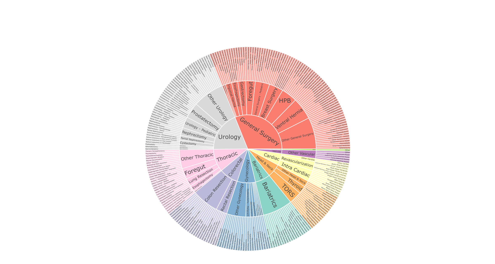
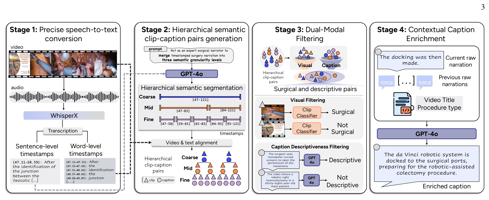
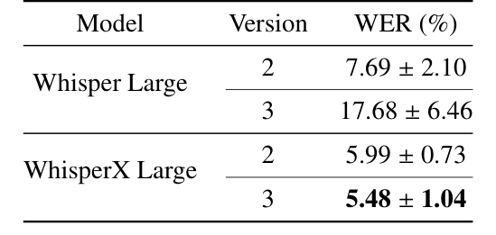
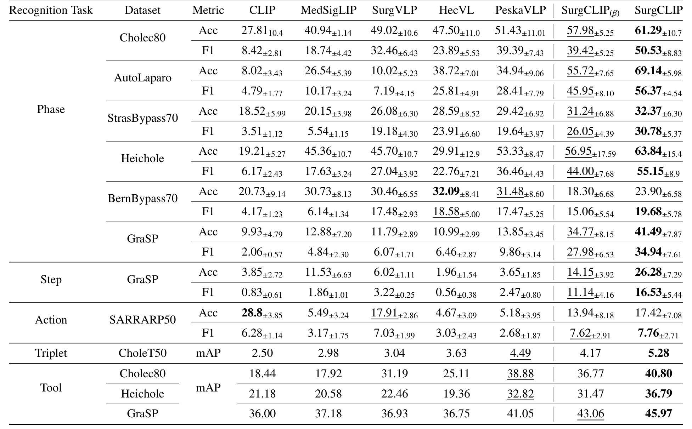
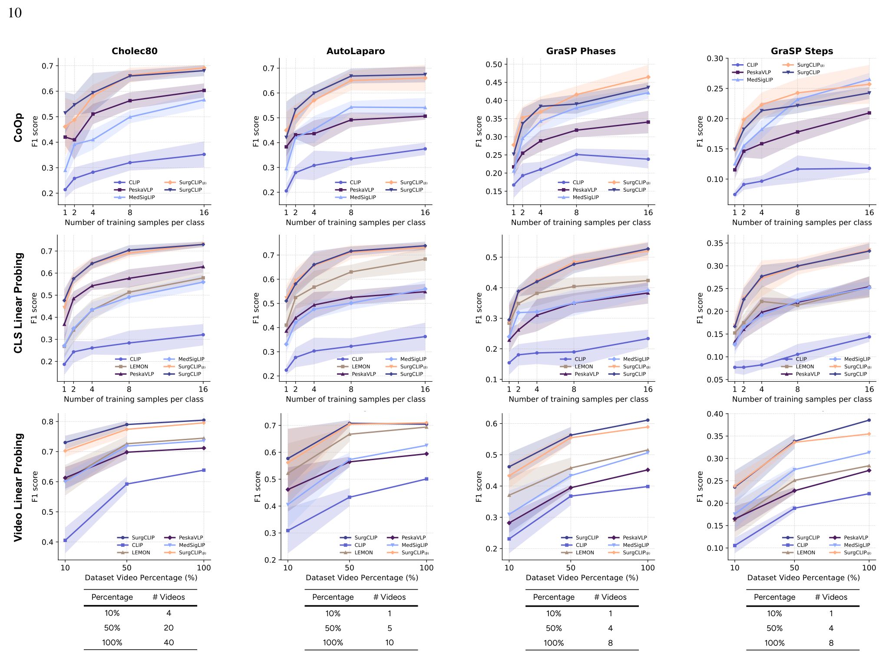
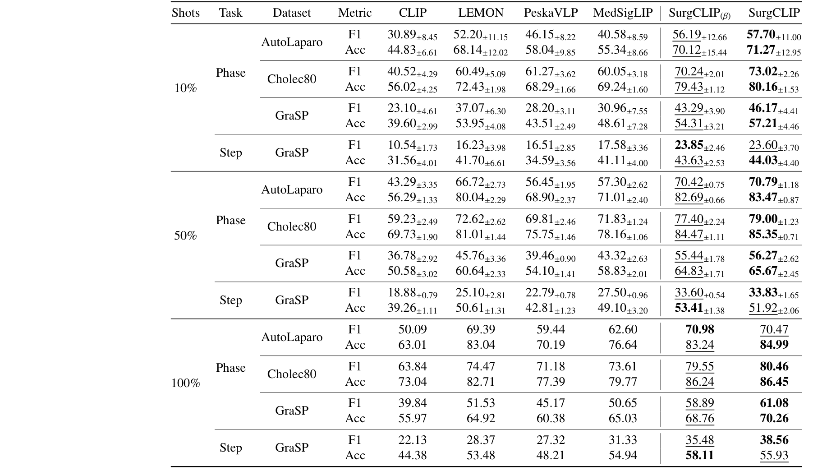
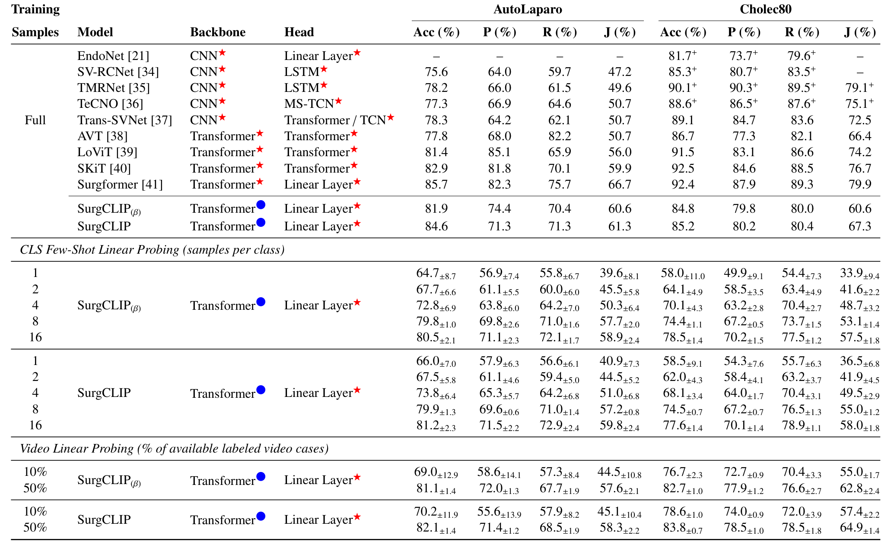
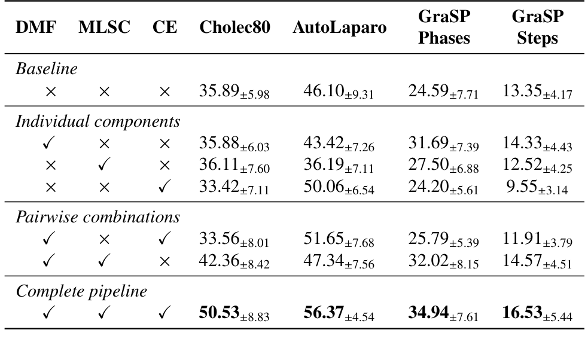

---
tags:
  - papers/手术数据集
aliases:
  - "SurgLaVi"
  - "SurgLaVi-β"
  - "SurgCLIP"
  - "手术分层视频语言数据集"
date: 2025-09-09
arxiv_id: 2509.10555
---

# SurgLaVi: Large-Scale Hierarchical Dataset for Surgical Vision-Language Representation Learning

## 核心信息

- 标题: SurgLaVi: Large-Scale Hierarchical Dataset for Surgical Vision-Language Representation Learning
- 标题翻译: SurgLaVi:面向手术视觉语言表征学习的大规模分层数据集
- 作者: Alejandra Perez, Chinedu Nwoye, Ramtin Raji Kermani, Omid Mohareri, Muhammad Abdullah Jamal
- 机构: Intuitive Surgical;哥伦比亚安第斯大学人工智能研究中心(CinfonIA)
- 发表时间: 2025-09-09(arXiv v1);本笔记依据 v2(2026-02-05)
- 发表渠道: arXiv 预印本(cs.CV);代码仓库标注已发表于 Medical Image Analysis 2026
- arXiv: 2509.10555
- 论文链接: https://arxiv.org/abs/2509.10555
- 代码 / 项目: https://github.com/aperezr20/SurgLaVi
- 数据 / 资源: https://huggingface.co/datasets/aleperez24/SurgLaVi(公开、非门控,只含 SurgLaVi-β 的 SQL 数据库与转写,视频需按数据库里的 YouTube 链接自行下载)
- 论文类型: 数据集论文(benchmark_or_dataset)

## 原文摘要翻译

视觉-语言预训练把语言与手术视频对齐,能支持手术流程理解和跨任务迁移,而不依赖专家标注数据,因此对手术领域有独特优势。然而,现有数据集在规模、术式多样性、语义质量和层级结构上都有限,制约了手术视觉-语言预训练的进展。

本文提出 SurgLaVi,这是迄今最大、最多样的手术视觉-语言数据集,包含近 24 万对片段-字幕,来自 200 多种术式,并分为粗、中、细三个层级。SurgLaVi 的核心是一条全自动流水线:它为手术视频生成细粒度转写,并把视频切分为语义连贯的手术流程单元。

为保证标注质量,流水线用双模态过滤去除无关和噪声样本。在此框架下,字幕还会补充上下文细节,使标注语义丰富且易于理解。为保证可获取性,我们发布 SurgLaVi-β,这是完全由公开数据构建的开源衍生版本,含 11.3 万对片段-字幕,比现有手术视觉-语言预训练数据集大四倍以上。

为展示 SurgLaVi 数据集的价值,我们提出 SurgCLIP,一个采用双编码器、仿照对比语言图像预训练的视频-文本对比学习框架,作为代表性基础模型。

SurgCLIP 在阶段、步骤、动作和器械识别上取得一致提升,超过以往最好方法,而且常常领先很多。这些结果说明,大规模、语义丰富、结构分层的数据集能直接转化为更强、更可泛化的表征,SurgLaVi 因此成为开发手术基础模型的关键资源。

## 创新点

1. 按语义而不是按固定时长切分片段。先用 WhisperX 得到词级时间戳,再让 GPT-4o 把相邻句子合并为粗、中、细三层语义段,最后用词级时间戳截取视频。已有数据集 GenSurg+ 用固定 45 秒片段,SVL 平均 6 秒,常把一个完整操作切断。
2. 在片段级做双模态过滤。SigLIP 零样本分类去掉幻灯片、示意图、术后病房等非手术画面,GPT-4o 去掉"谢谢大家"之类不描述画面的字幕。过滤在片段级做,同一视频里的好片段可以保留。
3. 公开一个带字幕的子集。SurgLaVi-β 只用 LEMON 和 GenSurgery 两批公开 YouTube 视频,发布了带字幕的数据库。此前 SVL 完全私有,GenSurg+ 的字幕私有。
4. 用简单模型反证数据的作用。SurgCLIP 只是 TimeSformer 加 BERT 的双编码器,训练时把三层样本混在同一批里,并按片段时长调整采样步长。

## 一句话总结

SurgLaVi 用转写、语义分段、双模态过滤和字幕改写四步,从 5,317 段讲解手术视频中自动生成 239,776 对三层片段-字幕,公开子集 SurgLaVi-β 有 112,757 对。

在它上面训练的简单双编码器 SurgCLIP,零样本阶段识别 F1 在 Cholec80 上达到 50.53,比此前最好的 PeskaVLP 高约 11 个点。

## 研究问题

**难点在于:手术领域缺少既大又干净、又带流程层级的视频-文字配对数据。** 手术视频-语言预训练的思路是:把手术讲解视频切成片段,配上解说转写,用对比学习对齐视觉和语言。这样可以不靠专家逐帧标注就学到可迁移的表征。

作者认为现有数据是主要瓶颈,而不是模型设计:

- 分段靠启发式规则或固定时长,常把一个完整的手术动作切断,片段和字幕语义不完整。
- 噪声多。ASR 时间戳不准导致错位,讲座里有大量非手术画面,解说常偏离当前画面。
- 规模小、术式窄。SVL 有约 2.5 万对但只含腹腔镜,GenSurg+ 覆盖机器人手术但只有 1.7 万对。
- 都不公开,难以复现。

此前的改进(HecVL 加阶段摘要、PeskaVLP 用 LLM 纠错、VidLPRO 加交叉注意力)都在 SVL 上堆模型复杂度。论文要回答:如果先把数据做大、做干净、做出层级,一个简单模型能否超过这些复杂模型。

### 核心观点速览

论文的答案是:让大模型按解说语义切片段、过滤、改写字幕,数据质量上去后,简单的双编码器就够用。

- 数据:5,317 段讲解手术视频、843 小时、239,776 对三层片段-字幕,覆盖 217 种术式;公开子集 SurgLaVi-β 有 112,757 对。
- 关键做法:词级时间戳加 GPT-4o 语义分段,SigLIP 与 GPT-4o 双重过滤,再按上下文改写字幕。
- 结果:SurgCLIP 零样本阶段识别 F1 在 Cholec80、AutoLaparo、GraSP 上分别为 50.53、56.37、34.94,都是最高。
- 边界:**BernBypass70 和动作识别上并不领先;"数据比模型重要"没有通过交换数据和模型的对照来证明;完整版含私有视频,未发布。**

下一节先看数据从哪来、有多大。

## 数据与任务定义

这一节回答:视频从哪来,过滤后剩多少,覆盖哪些术式,用哪些基准来检验。

### 数据来源

- 公开视频:LEMON 提供的 3,110 段和 GenSurgery 提供的 4,172 段 YouTube 手术视频,去重后 6,812 段。这些视频由外科医生和机构为教学目的公开。
- 私有档案:2,945 段来自一个经机构批准的手术培训资料库,作者称不含可识别的患者信息,用于 AI 研究已经过正式审查授权。
- 合计 9,758 段。没有解说的视频在第一阶段被丢弃(转写为空),最终剩 5,317 段;各环节分别丢弃多少段,论文未说明。

### 规模

| 数据集 | 视频 | 片段-字幕对(K) | 平均片段时长(秒) | 开源 |
|---|---|---|---|---|
| SVL | 1,326 | 25.5 | 6.0 | 否 |
| GenSurg+ | 1,800 | 17.0 | 45.0 | 字幕私有 |
| SurgLaVi | 5,317 | 粗 35.4 / 中 64.2 / 细 140.2 / 合计 239.8 | 粗 86.6 / 中 45.1 / 细 18.2 / 平均 28.6 | 部分 |
| SurgLaVi-β | 2,464 | 粗 15.7 / 中 30.0 / 细 66.9 / 合计 112.6 | 粗 65.4 / 中 36.1 / 细 15.2 / 平均 35.6 | 是 |

- SurgLaVi:843 小时,帧率 10 到 60 fps(均值 29);粗层片段合计 664.9 小时、7,000 万帧。
- SurgLaVi-β:465 小时,帧率 15 到 30 fps;粗层合计 398 小时、4,100 万帧。

公开子集的片段-字幕对是 GenSurg+ 的 6.6 倍、SVL 的 4.4 倍,这是"大四倍以上"的来源。细层片段平均 18.2 秒,比 GenSurg+ 固定的 45 秒短得多,更接近单个操作的时长。

### 覆盖范围

作者用外科专家设计的内部分类体系,把 GPT-4o 读取每段视频的转写摘要后给出的专科、主题、术式三级标签作为弱标注。完整数据覆盖 10 个专科、39 个主题、217 种术式;β 子集覆盖 9 个专科、34 个主题、170 种术式。GenSurg+ 只有 28 种术式。

图 1(B) 的视频分布中,普通外科占 38.08%,结直肠 19.49%,胸外 14.49%,泌尿 8.07%。弱标签的准确率论文未说明,所以这些比例只能当作大致分布。

*论文原图编号：Fig 6(附录)。外科专家设计的手术分类体系,从专科(内环)、主题(中环)到术式(外环),扇区大小与术式数量成正比。*

### 下游任务

| 任务 | 基准 | 术式 |
|---|---|---|
| 阶段识别 | Cholec80、HeiChole、AutoLaparo、StrasBypass70、BernBypass70、GraSP | 胆囊切除、子宫切除、胃旁路、机器人前列腺切除 |
| 步骤识别 | GraSP | 机器人前列腺切除 |
| 动作识别 | SARRARP50 | 机器人前列腺切除 |
| 三元组识别 | CholecT50 | 胆囊切除 |
| 器械存在 | Cholec80、HeiChole、GraSP | 同上 |

下游基准只有四种术式,远少于训练数据的 217 种,所以评测测不到术式多样性本身的收益。下一节看这些片段-字幕是怎样生成的。

## 方法主线

这一节回答:原始视频怎样变成三层片段-字幕,每一步用什么模型,过滤器有多准;SurgCLIP 只是检验数据的基线。

### 机制流程

*论文原图编号：Fig 2。四阶段流水线:语音转写、分层语义分段与对齐、双模态过滤、上下文字幕改写。*

1. 语音转写:输入视频音轨,WhisperX(基于 Whisper Large v3)输出句级时间戳转写,再用强制音素对齐得到毫秒级词级时间戳;转写为空的视频丢弃。输出交给分段阶段。
2. 分层分段与对齐:输入每段视频的句级转写,对每段视频调用一次 GPT-4o,把相邻句子合并为粗、中、细三层语义段(对应 SAGES 框架的阶段、步骤、任务)。再用词级时间戳确定每段的起止时间,截取视频片段,段内所有词拼成字幕。输出三层片段-字幕对。
3. 双模态过滤:视觉上,对每个细层片段均匀取 24 帧,用 SigLIP 零样本判断每帧是否为手术画面,超过 50% 帧为手术才算手术片段;中、粗层片段继承其细层子片段的标签,不一致时取多数。文本上,GPT-4o 判断字幕是否在描述画面。两者都通过才保留。
4. 上下文改写:输入保留下来的字幕、同层前 5 条字幕、视频标题和术式类型,GPT-4o 输出改写后的字幕,例如把"接着进行了对接"改写为"达芬奇机器人系统与手术端口对接,为机器人辅助结肠切除做准备"。输出最终数据集。

对齐时片段与字幕的关系写成:

$$y^g_{ij} = \{\, w_{ik} \in T_i \mid t^{start,g}_{ij} \le \tau^{start}_{ik} \wedge \tau^{end}_{ik} \le t^{end,g}_{ij} \,\}$$

其中 $T_i$ 是视频 $v_i$ 的词级转写,$g$ 是层级。也就是说字幕只收完全落在段内的词,片段边界和字幕内容由同一份时间戳决定。

### 过滤器的验证

- ASR 选型:在 2.5 小时由外科医生给出真值转写的解说视频上比较词错误率,WhisperX v3 为 5.48%,Whisper Large v3 为 17.68%。
- 视觉过滤:在 159 个人工标注片段(59 个手术、100 个非手术)上比较三个 OpenCLIP 模型,选 SigLIP;多数投票比平均帧嵌入稳。24 帧、阈值 50% 时 F1 为 96.6,精确率 94.29,召回率 99.0。
- 文本过滤:随机抽 212 条字幕由一位手术数据科学专家标注,GPT-4o 的精确率 93.95,召回率 94.59,F1 94.27。

*论文原图编号：Table 1(附录)。两种 ASR 模型各两个版本在手术解说上的词错误率。*

过滤前后的规模变化(附录图 2):

| 阶段 | SurgLaVi | SurgLaVi-β |
|---|---|---|
| 未过滤 | 373,343 | 175,641 |
| 手术画面 | 291,916 | 153,596 |
| 描述性字幕 | 258,596 | 117,231 |
| 两者皆通过 | 239,776 | 112,757 |

完整数据约有 36% 的片段-字幕对被过滤掉。两个过滤器各自的验证集都很小(159 个片段、212 条字幕),改写后的字幕则完全没有人工评估。

### SurgCLIP 基线

- 结构:视频编码器是 ImageNet 初始化的 ViT-B/16,以 TimeSformer 的分离时空注意力处理 16 帧;文本编码器是 BERT-base。两路 768 维输出投影到 256 维共享空间。
- 混合层级批次:每个批次随机混入三层样本,对比损失在混合池上计算,相当于同时优化跨层检索。
- 动态采样:每个片段帧数固定,采样步长随片段时长变化,细层片段帧率高,粗层片段覆盖时间长。
- 训练:AdamW,学习率 1e-4,权重衰减 0.02,余弦衰减 50 轮,批大小 312,单张 H200。

损失是双向 InfoNCE 的平均:

$$\mathcal{L}_{v\to t} = -\frac{1}{B}\sum_{i=1}^{B}\log\frac{\exp(\mathrm{sim}(z^v_i,z^t_i)/\tau)}{\sum_{j=1}^{B}\exp(\mathrm{sim}(z^v_i,z^t_j)/\tau)},\quad \mathcal{L}=\tfrac12(\mathcal{L}_{v\to t}+\mathcal{L}_{t\to v})$$

### 评测协议

- 零样本:冻结视觉编码器,对每个评测帧取居中的 16 帧窗口,平均池化后与各类提示文本嵌入算余弦相似度。指标为逐视频准确率和逐视频宏平均 F1,标准差跨视频计算;器械和三元组用 mAP。
- 线性探测:拼接 768 维骨干输出与 256 维投影输出成 1024 维特征,用 32 帧窗口平均。分两种少样本:按视频比例(10%、50%、100%)和按每类帧数(1、2、4、8、16),每种 5 个随机子集。
- CoOp:冻结两路编码器,只学共享的上下文标记。
- 时序探测:在冻结的逐帧特征上训练 MS-TCN(3 阶段、每阶段 8 层)。
- 基线:CLIP、MedSigLIP、SurgVLP、HecVL、PeskaVLP;探测实验另加自监督纯视觉模型 LEMON。

协议讲完,下一节看结果。

## 关键结果

这一节回答:用这份数据训练的模型强在哪里、弱在哪里,三个数据设计各贡献多少。

### 零样本主结果

*论文原图编号：Table 2。七个模型在阶段、步骤、动作、三元组和器械识别上的零样本结果。*

阶段识别 F1:

| 基准 | 通用 CLIP | 医学 MedSigLIP | SurgVLP | HecVL | PeskaVLP | β 版 | 完整版 |
|---|---|---|---|---|---|---|---|
| Cholec80 | 8.42 | 18.74 | 32.46 | 23.89 | 39.39 | 39.42 | 50.53 |
| AutoLaparo | 4.79 | 10.17 | 7.19 | 25.81 | 28.41 | 45.95 | 56.37 |
| StrasBypass70 | 3.51 | 5.54 | 19.18 | 23.91 | 19.64 | 26.05 | 30.78 |
| HeiChole | 6.17 | 17.63 | 27.04 | 22.76 | 36.46 | 44.00 | 55.15 |
| BernBypass70 | 4.17 | 6.14 | 17.48 | 18.58 | 17.47 | 15.06 | 19.68 |
| GraSP | 2.06 | 4.84 | 6.07 | 6.46 | 9.86 | 27.98 | 34.94 |

- 只用公开数据的 SurgCLIP(β) 在五个阶段基准上已超过所有基线,BernBypass70 例外。
- 完整数据进一步提升,AutoLaparo 和 GraSP 上比 PeskaVLP 高约 28 和 25 个点。
- β 版的优势并不均匀:Cholec80 上 F1 为 39.42 对 PeskaVLP 的 39.39,只多 0.03 个点,引言写成 +0.3%。
- 引言列出的增幅混用了指标。HeiChole 的 +10.51 是准确率之差;Cholec80 的 +10 也与准确率之差 9.86 吻合,按 F1 算是 11.14。
- 子宫切除和前列腺切除两个基准的增幅才是 F1。胃旁路 StrasBypass70 的 +11.14 是对 PeskaVLP 算的,而该基准上 F1 最强的基线其实是 HecVL(23.91)。
- 反例:BernBypass70 上两个 SurgCLIP 的准确率(18.30、23.90)低于其余四个手术或医学模型;SARRARP50 动作识别准确率 17.42,低于 CLIP 的 28.8;CholecT50 三元组 mAP 只有 5.28。
- 器械存在识别的平均精度:完整版在三个胆囊切除和前列腺切除基准上分别为 40.80、36.79、45.97,都是最高;β 版在前两个基准上低于 PeskaVLP。

### 线性探测与 CoOp

*论文原图编号：Fig 9。CoOp、按类少样本线性探测、按视频比例线性探测三种范式下的 F1 曲线,底部小表是各比例对应的训练视频数。*

全量视频线性探测 F1(附录表 6):

| 任务 | CLIP | LEMON | PeskaVLP | MedSigLIP | SurgCLIP(β) | SurgCLIP |
|---|---|---|---|---|---|---|
| AutoLaparo 阶段 | 50.09 | 69.39 | 59.44 | 62.60 | 70.98 | 70.47 |
| Cholec80 阶段 | 63.84 | 74.47 | 71.18 | 73.61 | 79.55 | 80.46 |
| GraSP 阶段 | 39.84 | 51.53 | 45.17 | 50.65 | 58.89 | 61.08 |
| GraSP 步骤 | 22.13 | 28.37 | 27.32 | 31.33 | 35.48 | 38.56 |

*论文原图编号：Table 6(附录)。10%、50%、100% 训练视频下的线性探测 F1 与准确率。*

- SurgCLIP 在几乎所有设置下领先,唯一例外是 CoOp 下的 GraSP 步骤识别。
- 每类 16 帧标注常常好于把一整段视频全部标注,作者据此主张稀疏而多样的标注更划算。
- 时间窗口:阶段识别随帧数增加而提升;GraSP 步骤在 8 帧时最好。单帧输入时 LEMON 和 MedSigLIP 有时优于 SurgCLIP。

> [!figure] Fig 11 时间窗口大小对线性探测 F1 的影响
> 建议位置：关键结果
> 放置原因：它是"阶段识别依赖时间上下文、步骤识别在 8 帧饱和"的证据。
> 当前状态：保留占位；自动抽取没有找到这张图的独立图像,结论见本节文字。
> 论文原图编号：Fig 11

### 时序探测

> [!figure] Table 3 MS-TCN 时序探测结果
> 建议位置：关键结果
> 放置原因：它给出分段 F1,是"SurgCLIP 特征时间一致性更好"的证据。
> 当前状态：保留占位；修复裁剪后 GraSP 后三行被截断,已达修复上限,关键数字转写到下表。
> 论文原图编号：Table 3

| 基准 | 指标 | LEMON | SurgCLIP(β) | SurgCLIP |
|---|---|---|---|---|
| Cholec80 | F1 | 75.77 | 82.39 | 83.35 |
| Cholec80 | F1@10 | 65.38 | 86.22 | 84.49 |
| AutoLaparo | F1 | 58.57 | 72.32 | 73.34 |
| AutoLaparo | F1@10 | 36.93 | 69.43 | 62.96 |
| GraSP | F1 | 37.83 | 48.98 | 44.89 |
| GraSP | F1@10 | 22.79 | 38.83 | 38.55 |

- LEMON 是最强的非 SurgCLIP 基线;CLIP 的分段 F1 在 AutoLaparo 和 GraSP 上接近 0。
- 分段 F1 上 β 版普遍高于完整版。作者把 GraSP 上的反超归因于 β 子集中前列腺切除比例更高。
- GraSP 上 MS-TCN 不如 32 帧线性探测,作者归因于阶段之间的长空闲段和视频数少。

### 与全监督专用模型的距离

*论文原图编号：Table 4。AutoLaparo 与 Cholec80 上与端到端全监督模型的比较,SurgCLIP 只训练线性层。*

- AutoLaparo:SurgCLIP 全量线性探测准确率 84.6%,接近 Surgformer 的 85.7%;每类 16 帧时准确率 81.2%,已高于 TMRNet、TeCNO 等 CNN 方法。
- Cholec80:全量准确率 85.2%,与 AVT 的 86.7% 相近,但 Jaccard 67.3% 明显低于 Surgformer 的 79.9%。
- GraSP:全量阶段 F1 61.1,比 TAPIS 低 2.34;MuST 为 68.8。
- 作者总结专用模型平均仍领先 7.4 个点。

> [!figure] Table 5 GraSP 上与全监督模型的比较
> 建议位置：关键结果
> 放置原因：补充 GraSP 阶段与步骤上的上限对比。
> 当前状态：保留占位；自动裁剪视觉质量不合格,关键数字已写在上方列表。
> 论文原图编号：Table 5

### 消融

层级消融(表 6,零样本 F1):

| 预训练层级 | Cholec80 | AutoLaparo | GraSP 阶段 | GraSP 步骤 |
|---|---|---|---|---|
| 仅粗 | 32.34 | 43.70 | 20.76 | 12.85 |
| 仅中 | 39.72 | 43.65 | 23.73 | 13.57 |
| 仅细 | 39.12 | 53.48 | 31.15 | 16.81 |
| 三层合用 | 50.53 | 56.37 | 34.94 | 16.53 |

流水线组件消融:

*论文原图编号：Table 7。双模态过滤(DMF)、多层语义分段(MLSC)、上下文改写(CE)的单独与组合效果,零样本 F1。*

- 单个组件效果不稳定:只加 MLSC 时 AutoLaparo 从 46.10 降到 36.19;只加 CE 时 GraSP 步骤从 13.35 降到 9.55。
- DMF 加 MLSC 在 Cholec80 上为 42.36,完整流水线为 50.53,比基线高 14.64。
- 表中没有 MLSC 加 CE 的组合。

单个组件不稳定、合起来才最好,说明组件之间有依赖,但没有多次训练的方差,几个点的差距是否稳定无法判断。

采样步长消融(表 8):

> [!figure] Table 8 采样步长消融
> 建议位置：关键结果
> 放置原因：它是"动态步长优于固定步长"的证据。
> 当前状态：保留占位；自动裁剪取到的是表 7,身份不符。
> 论文原图编号：Table 8

| 采样 | Cholec80 | AutoLaparo | GraSP 阶段 | GraSP 步骤 |
|---|---|---|---|---|
| 固定步长 1 | 43.75 | 34.18 | 31.36 | 14.19 |
| 固定步长 4 | 40.45 | 41.82 | 24.75 | 13.15 |
| 动态 | 50.53 | 56.37 | 34.94 | 16.53 |

按表格计算,动态步长比步长 1 高 2.34 到 22.19 个点,比步长 4 高 3.38 到 14.55 个点。正文写的是"比步长 1 高 6.78 到 14.55、比步长 4 高 9.08 到 22.19",与表格不符。

结果看完,下一节讨论这些数字能支持多强的结论。

## 深度分析

这一节回答:实验到底证明了数据的作用,还是只证明了这套数据加这个模型更好。

### 数据与模型两个变量没有分开

论文的核心论点是"数据质量和结构比模型复杂度更关键"。但主实验同时换了数据和模型:SurgCLIP 用时空注意力视频骨干,对照模型多用逐帧卷积骨干,训练数据也不同。

要证明数据的作用,需要把对照模型放到本数据上训练,或把 SurgCLIP 放到旧数据集 SVL 上训练,论文都没有做。

流水线消融(表 7)是更直接的数据证据:同一个模型,数据处理不同,F1 差 3 到 15 点。这说明处理方式有用,但没有控制过滤后样本数的变化。

### 层级效应与样本量混在一起

三层合用的样本数是任一单层的 1.7 倍以上(239,776 对 140,173)。三层合用更好,可能来自层级互补,也可能只是样本更多。作者自己也说细层更好是因为样本多、字幕短。要分开这两个因素,需要等样本量的对照。

### 零样本结果依赖提示

零样本阶段识别的类别文本是作者为每个基准写的描述句,附录给出了全部提示。所有模型用同一套提示,比较是公平的,但绝对数值受提示措辞影响。BernBypass70 和 SARRARP50 上的反例说明,训练字幕的风格与某些基准的类别描述并不一致。

### 与已有路线的定位

- 相对 SVL 和 GenSurg+:规模大一个量级,按语义分段,β 子集带字幕公开。
- 相对 HecVL、PeskaVLP:它们在 SVL 上加阶段摘要、LLM 纠错和复杂训练;本文把类似的 LLM 处理前移到数据构建,模型保持简单。
- 相对眼科 OphVL:OphVL 有 375K 对,规模更大,但只有一个专科。
- 相对 LEMON:LEMON 是纯视觉自监督,在线性和时序探测中是最强基线,说明语言监督的优势在有时间窗口时更明显,单帧时不一定领先。

### 能复现什么

主模型 SurgCLIP 用了 2,945 段私有档案,外部无法复现。可复现的是 SurgCLIP(β) 和 β 子集。β 子集依赖 YouTube 视频,作者只发布数据库和转写,需要用 yt-dlp 和登录 cookie 自行下载,链接失效后能拿到的视频会少于论文统计。

下一节把这些问题集中列出。

## 局限

- 作者承认:只能用有解说的视频;解说常描述刚做完或将要做的操作,会带来时间错位;全自动流程没有专家核验,基础模型可能引入噪声或偏差。
- 数据与模型的贡献没有分开,"数据比模型重要"只是间接证据。
- 层级消融没有控制样本量;流水线消融缺 MLSC 加 CE 组合。
- 标准差只跨视频,没有多次预训练的方差。
- 只评了分类类任务,没有检索、字幕生成或问答。
- 改写后的字幕没有人工评估,错误率论文未说明;改写可能把解说里没有的内容写进去。
- 专科标签由 GPT-4o 弱标注,准确率论文未说明。
- 9,758 段源视频到 5,317 段的丢弃明细论文未说明。
- 正文与表格有不一致:表 8 的增幅区间、引言中 β 版 Cholec80 的 +0.3%。
- 完整 SurgLaVi 未发布。

## 我的笔记

可以照搬:

- 先拿词级时间戳,再让大模型按语义分段,比固定时长切片干净。
- 视觉过滤用多类提示平均嵌入加帧级多数投票。
- 按片段时长调步长、固定帧数。

使用前要检查:

- 许可写法不一致:数据卡元数据写 CC BY-SA 4.0,数据卡正文和代码仓库写的是带非商用条款的 CC BY-NC-SA 4.0,商用前要确认。
- β 数据库含 6,812 段源视频的记录,其中 3,148 段有解说;字幕带过滤标记,可以选择用原始或改写字幕。

后续问题:

- 在 SurgLaVi-β 上训练 PeskaVLP,差距还剩多少?
- 改写字幕的错误率是多少?

## 引用

- Yuan et al. (2023). Learning multi-modal representations by watching hundreds of surgical video lectures (SVL / SurgVLP). Medical Image Analysis.
- Yuan et al. (2024). HecVL: Hierarchical video-language pretraining for zero-shot surgical phase recognition. MICCAI.
- Yuan et al. (2024). Procedure-aware surgical video-language pretraining with hierarchical knowledge augmentation (PeskaVLP). NeurIPS.
- Honarmand et al. (2024). VidLPRO: A video-language pre-training framework for robotic and laparoscopic surgery (GenSurg+). arXiv.
- Che et al. (2025). LEMON: A large endoscopic monocular dataset and foundation model for perception in surgical settings. arXiv:2503.19740.
- Schmidgall et al. (2024). General surgery vision transformer: A video pre-trained foundation model for general surgery. arXiv:2403.05949.
- Bain et al. (2023). WhisperX: Time-accurate speech transcription of long-form audio. Interspeech.
- Radford et al. (2021). Learning transferable visual models from natural language supervision. ICML.
