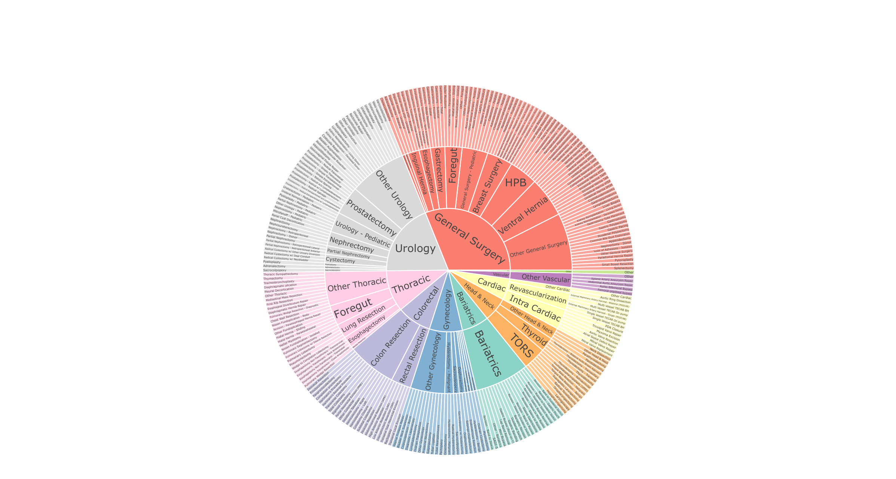
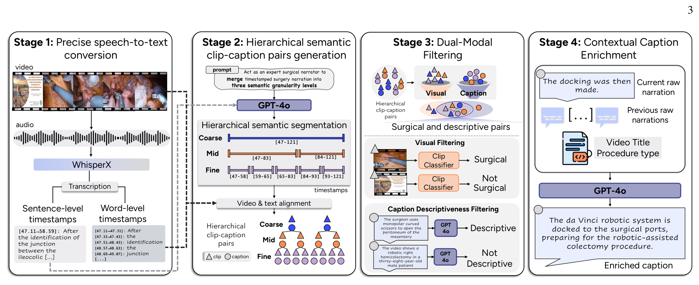
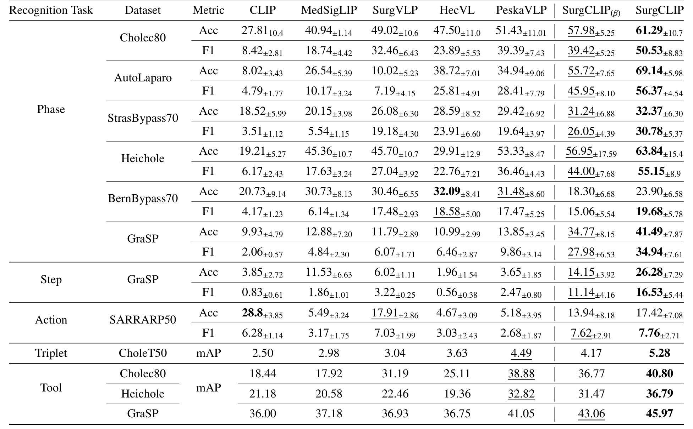
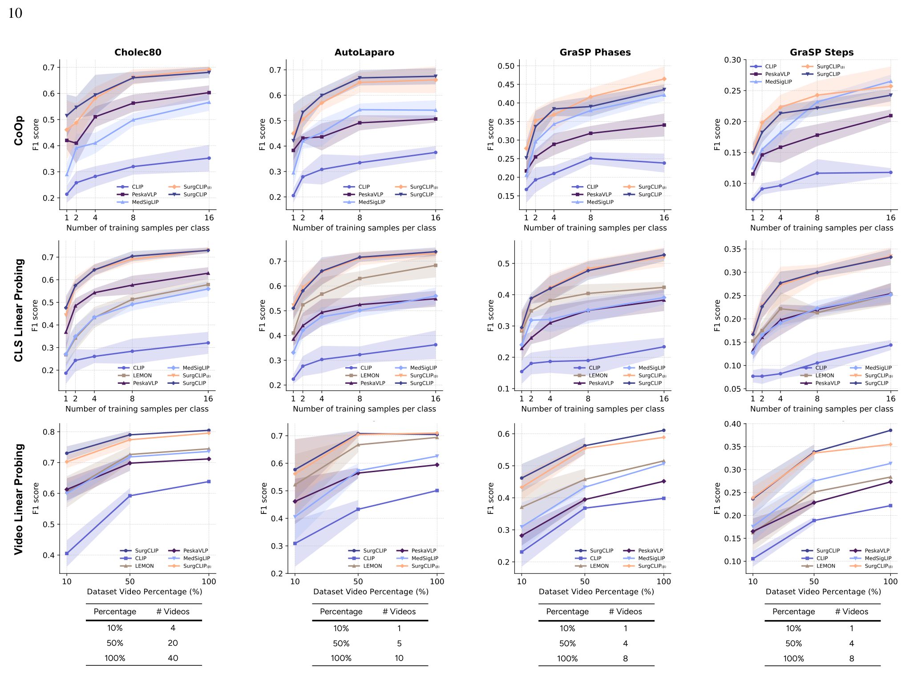
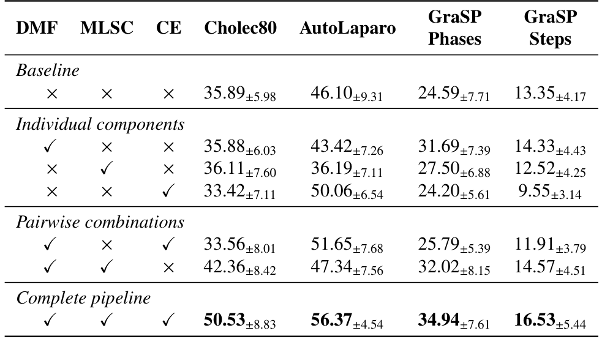

## 1. 背景与动机

**手术视频-语言预训练的瓶颈在数据。** 这类方法把讲解视频切成片段,配上解说转写,用对比学习对齐视觉与语言,从而不靠专家逐帧标注就学到可迁移的表征。

已有数据集有四个问题:按固定时长或启发式规则切片,常把一个完整操作切断;解说与画面错位,讲座里还夹着幻灯片;SVL 约 2.5 万对且只含腹腔镜,GenSurg+ 只有 1.7 万对;两者都不公开字幕。

此前的改进(HecVL、PeskaVLP、VidLPRO)都在 SVL 上堆模型复杂度。作者反过来问:先把数据做大、做干净、做出层级,简单模型能否胜出。

:::highlights
- 作者认为瓶颈在数据而不是模型。
:::

## 2. 核心观点速览

**答案是让大模型按解说语义切片段、过滤、改写字幕。** 数据质量上去后,一个 TimeSformer 加 BERT 的双编码器就能在零样本阶段识别上超过更复杂的模型。

- 数据:5,317 段视频、843 小时、239,776 对三层片段-字幕,217 种术式;公开子集 SurgLaVi-β 有 112,757 对。
- 结果:零样本阶段识别 F1 在 Cholec80、AutoLaparo、GraSP 上分别为 50.53、56.37、34.94。
- 边界:BernBypass70 和动作识别不领先;数据与模型的作用没有被对照实验分开;完整版含私有视频,未发布。

:::data
- 239,776 对(完整),112,757 对(公开)
- 217 种术式,10 个专科
:::

## 3. 数据从哪来

视频来自三处:LEMON 提供的 3,110 段和 GenSurgery 提供的 4,172 段公开 YouTube 视频(去重 6,812 段),以及 2,945 段机构培训档案。没有解说的视频被丢弃,最终剩 5,317 段,各环节丢弃多少论文未说明。

| 数据集 | 视频 | 对数(K) | 平均时长(秒) | 开源 |
|---|---|---|---|---|
| SVL | 1,326 | 25.5 | 6.0 | 否 |
| GenSurg+ | 1,800 | 17.0 | 45.0 | 字幕私有 |
| SurgLaVi | 5,317 | 239.8 | 28.6 | 部分 |
| SurgLaVi-β | 2,464 | 112.6 | 35.6 | 是 |

**公开子集是 GenSurg+ 的 6.6 倍。** 术式标签由 GPT-4o 读取转写摘要给出,准确率论文未说明。

*论文原图编号：Fig 6(附录)。手术分类体系:专科、主题、术式三环,扇区大小与术式数量成正比。*

下一节看这些视频怎样变成片段-字幕。

## 4. 四阶段构建流水线

*论文原图编号：Fig 2。语音转写、分层语义分段与对齐、双模态过滤、上下文字幕改写。*

1. 转写:WhisperX 输出句级转写和毫秒级词级时间戳。
2. 分段与对齐:每段视频调用一次 GPT-4o,把相邻句子合并为粗、中、细三层(对应阶段、步骤、任务),再用词级时间戳截取视频,段内的词拼成字幕。
3. 过滤:细层片段取 24 帧,SigLIP 判为手术帧的超过一半才保留,上层片段按多数继承;GPT-4o 判断字幕是否描述画面。两者都通过才保留。
4. 改写:GPT-4o 读当前字幕、同层前 5 条字幕、视频标题和术式,输出改写后的字幕。

**过滤器在小验证集上表现不错。** 视觉过滤在 159 个片段上 F1 为 96.6,文本过滤在 212 条字幕上 F1 为 94.27。完整数据约 36% 的对被过滤掉。改写字幕没有人工评估。

:::data
- WhisperX v3 词错误率 5.48%
- 未过滤 373,343 对,保留 239,776 对
:::

## 5. SurgCLIP 与评测协议

SurgCLIP 是 ViT-B/16 的 TimeSformer 加 BERT-base,投影到 256 维,双向 InfoNCE 损失。两点设计和数据层级对应:每个批次混入三层样本;每个片段帧数固定、步长随时长变化。

评测都用冻结特征:零样本(16 帧窗口与类别描述文本比相似度)、线性探测、CoOp 和 MS-TCN 时序探测。指标是逐视频准确率和宏平均 F1,标准差跨视频计算,没有多次预训练的方差。

下一节看结果。

## 6. 结果说了什么

*论文原图编号：Table 2。七个模型在阶段、步骤、动作、三元组、器械识别上的零样本结果。*

| 阶段 F1 | PeskaVLP | β 版 | 完整版 |
|---|---|---|---|
| Cholec80 | 39.39 | 39.42 | 50.53 |
| AutoLaparo | 28.41 | 45.95 | 56.37 |
| GraSP | 9.86 | 27.98 | 34.94 |
| BernBypass70 | 17.47 | 15.06 | 19.68 |

**优势集中在 AutoLaparo 和 GraSP。** β 版在 Cholec80 上只比 PeskaVLP 多 0.03 个点;BernBypass70 准确率低于其余四个手术或医学模型;动作识别准确率 17.42 低于通用 CLIP 的 28.8。

全量线性探测中,完整版 Cholec80 阶段 F1 为 80.46,高于 LEMON 的 74.47。与全监督专用模型相比,AutoLaparo 准确率 84.6% 接近 Surgformer 的 85.7%,作者总结平均仍差 7.4 个点。

*论文原图编号：Fig 9。CoOp、按类少样本、按视频比例三种线性探测范式的 F1 曲线。*

:::highlights
- 每类 16 帧标注常好于标注一整段视频。
:::

## 7. 消融说明了什么

*论文原图编号：Table 7。双模态过滤、多层语义分段、上下文改写三个组件的单独与组合效果。*

**单个组件常常低于基线,三者合用才最好。** 只加分段时 AutoLaparo 从 46.10 降到 36.19;完整流水线在 Cholec80 上比基线高 14.64。表中缺分段加改写的组合。

层级消融中三层合用 Cholec80 为 50.53,仅粗层为 32.34。动态步长比固定步长好,但按表格算,比步长 1 高 2.34 到 22.19 个点,与正文写的区间不符。

下一节讨论这些数字能支持多强的结论。

## 8. 结果没说什么

- **数据和模型同时换了。** SurgCLIP 用时空注意力骨干,对照模型多用逐帧卷积骨干;没有交换数据和模型的对照,"数据比模型重要"只是间接证据。
- 三层合用的样本数是细层单独的 1.7 倍,层级和样本量的作用没有分开。
- 只评分类任务,没有检索、字幕生成或问答。
- 改写字幕的错误率、弱标签准确率论文未说明。

## 9. 复现要注意什么

- 完整 SurgLaVi 含 2,945 段私有档案,主模型无法复现;可复现的是 β 版。
- Hugging Face 和 GitHub 公开发布 β 数据库与转写(非门控),视频需用 yt-dlp 和 YouTube cookie 自行下载,链接失效会让可用数据减少。
- 数据库含 6,812 段源视频记录,其中 3,148 段有解说,保留原始字幕和过滤标记,可以复现消融版本。
- 许可写法不一致:数据卡元数据写 CC BY-SA 4.0,正文和仓库写带非商用条款的版本。

## @takeaways
- 先拿词级时间戳,再让大模型按语义分段,比固定时长切片更干净。
- 公开子集 112,757 对是目前可直接用的最大手术视频-字幕数据之一。
- 结果优势集中在阶段识别,动作和三元组识别仍弱。

## @strengths
- 流水线全自动,每个过滤器都给了小规模验证。
- 评测协议全面:零样本、三种少样本探测、时序探测、与全监督模型对比。
- 公开子集带原始字幕和过滤标记。

## @weaknesses
- 数据与模型、层级与样本量都没有分开。
- 改写字幕没有人工评估,消融只训练一次。
- 正文与表格有不一致(表 8 区间、β 版 Cholec80 增幅)。

## @questions
- 在 β 子集上训练 PeskaVLP,差距还剩多少?
- 改写字幕引入了多少解说里没有的内容?
- β 子集的 YouTube 视频现在还能下载到多少?
