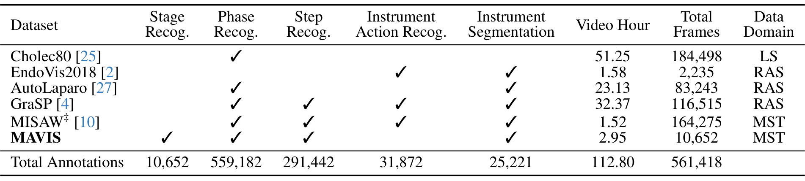
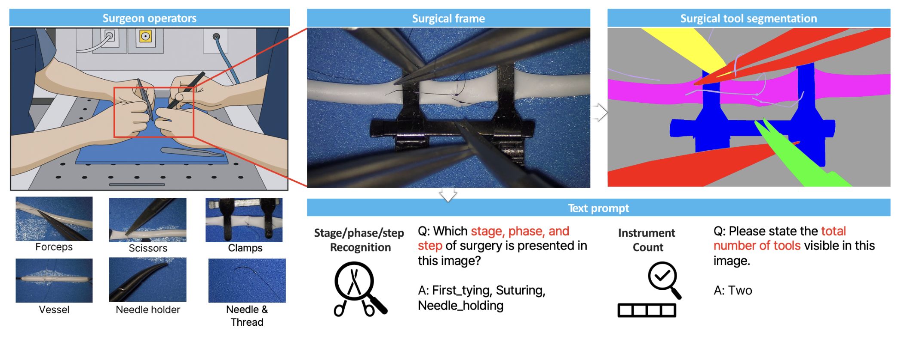
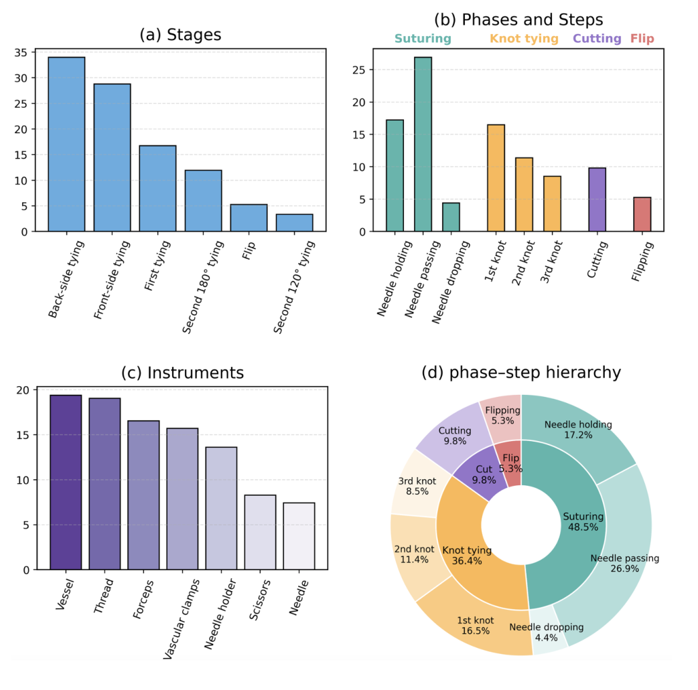
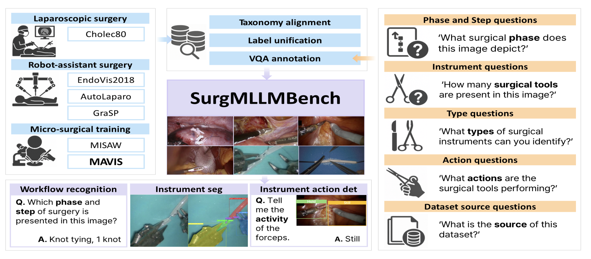
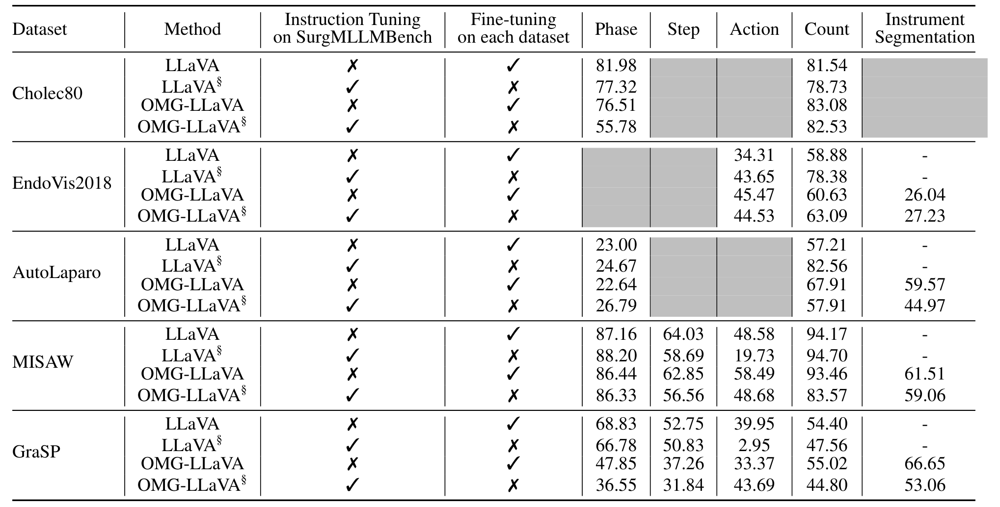
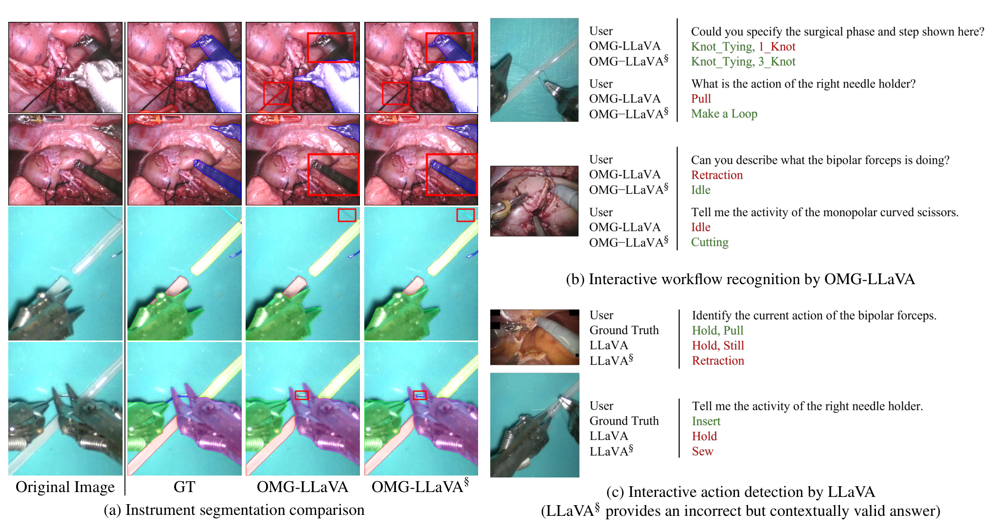
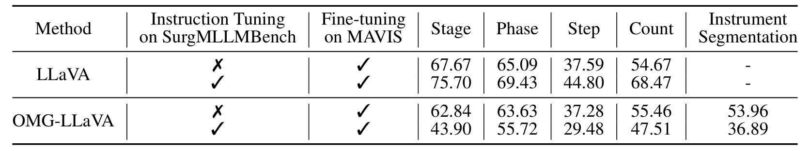

## 1. 背景与动机

腹腔镜和机器人手术中，外科医生只能看内窥镜的二维画面。镜头会转、会缩放、会被器械挡住，随时弄清“现在做到哪一步、每把器械在干什么”并不容易。

多模态大模型被寄望成为术中助手：回答提问，同时在画面上标出器械。**但现有数据撑不起这个目标。** EndoChat、LLaVA-Surg 有大量问答，没有阶段和步骤标签；Surgical-LLaVA 有阶段标签，空间监督只有边界框；GraSP 任务齐全，却只有一种手术。各数据集的标签名也互不相同。

所以论文要做的是：把多个来源合成一套标签字段统一、同时带流程标签和像素分割的数据，看一个模型能否在三个手术域上都用。

## 2. 核心观点速览

- 数据：Cholec80、EndoVis2018、AutoLaparo、GraSP、MISAW 加上新采集的 MAVIS，共 561,418 帧、112.80 小时，覆盖腹腔镜、机器人辅助、显微外科训练三个域。
- 问答由五类固定模板生成，评分用精确字符串匹配，分割用 mIoU。
- 统一训练的单一模型在小数据集的计数上更好，在 Cholec80 阶段、GraSP 多项和动作识别上更差。
- **动作标签没有做语义合并**，LLaVA 统一训练后 GraSP 动作从 39.95 跌到 2.95。
- 留出 MAVIS 的迁移实验里，LLaVA 受益，OMG-LLaVA 全面退化。

:::highlights
- 这是格式统一的多源合集，标签语义并未统一
- “单一模型不掉点”只对部分格子成立
:::

## 3. 数据：六个来源各提供什么

这一节回答：每个任务实际由哪些数据撑着。

*论文原图编号：Table 1。六个来源的标注覆盖、时长、帧数和手术域。*

**各任务的标注量差了一个数量级。** 阶段有 559,182 帧，器械动作只有 31,872 帧，分割 25,221 帧。stage 这一层只来自 MAVIS。原始 MISAW 没有分割，作者补入约 3,000 张。

两处需要读者自己留意：表 1 把 AutoLaparo（腹腔镜子宫切除）归为机器人辅助手术；Cholec80 只勾了阶段，却在表 2 中有计数结果。论文对两处都未解释。

训练、验证、测试的划分方式论文未说明。若按帧随机切，相邻帧几乎一样，测试分数会偏高。

:::data
- 561,418 帧，112.80 小时
- 动作 31,872 帧，分割 25,221 帧
:::

来源清楚之后，看新采集的 MAVIS。

## 4. MAVIS：显微吻合的完整流程

这一节回答：新数据录了什么、标到多细。

*论文原图编号：Figure 2。MAVIS 采集与标注流程。*

MAVIS 记录 1 mm 人工血管的前后壁完整吻合，19 个视频由三名显微外科医生分别主刀 7、7、5 个，1920 × 1080、1 FPS，共 10,652 帧。标注分三级：6 个大阶段、4 个阶段、8 类步骤，另有 8 类像素分割。

*论文原图编号：Figure 3。MAVIS 各层级与器械类别分布。*

**作者称分布均衡，图中数字不支持。** 缝合占 48.5%，翻转只有 5.3%。标注者人数和一致性论文未说明，所以步骤标签的噪声上限无从判断。

有了数据，下一步是把标注变成问答。

## 5. 构建与评测协议

这一节回答：异构标注怎么变成可训练的问答样本，分数怎么算。

*论文原图编号：Figure 1。SurgMLLMBench 总览与五类问题。*

1. 统一格式：视频拆帧，按 COCO 风格写入统一字段，缺失项留空。
2. 生成问答：五类问题，即流程、器械数量、器械类型、器械动作、数据来源；问题里带数据集标识。
3. 配对掩码：分割标注作为 OMG-LLaVA 的像素级监督。

作者不用 GPT 生成问题，换来答案确定、可精确评分，代价是问法单一。每帧实际生成几个问题，论文未说明。

**精确匹配不认同义词。** 合并多个命名体系后，“意思对、名字错”会被记为错误。

基线是 LLaVA（只能出文字）和 OMG-LLaVA（能出掩码），都用 LoRA 训练一轮。LLaVA 逐集微调和统一训练的学习率相差十倍，理由论文未说明。

协议清楚之后，看主表。

## 6. 结果：统一训练到底掉没掉点

这一节回答：一个模型在全部数据上训练，是否不如逐集训练。

*论文原图编号：Table 2。逐集微调与统一指令微调（§）对比。*

逐格看有三种情况：

- **更好**：LLaVA 在 EndoVis2018 计数从 58.88 升到 78.38，AutoLaparo 计数从 57.21 升到 82.56。小数据集借到了别处的计数监督。
- **持平**：MISAW 阶段、Cholec80 计数、EndoVis2018 分割。
- **更差**：OMG-LLaVA 的 Cholec80 阶段从 76.51 跌到 55.78，AutoLaparo 分割从 59.57 跌到 44.97。

作者把差异概括为“不大”。按表格，这个说法对 LLaVA 的阶段和计数大体成立，对 OMG-LLaVA 和动作任务不成立。

:::data
- Cholec80 阶段（OMG-LLaVA）：76.51 → 55.78
- AutoLaparo 计数（LLaVA）：57.21 → 82.56
:::

最大的掉点出在动作识别。

## 7. 动作识别为何跌到 2.95

这一节回答：统一训练的 LLaVA 在 GraSP 动作上为何几乎全错。

作者的解释是同义标签冲突：IDLE 与 STILL、RETRACTION 与 PULL 在不同数据集里是不同名字。图 5 中 GraSP 真值为 PULL，模型答了 EndoVis2018 的 RETRACTION。

*论文原图编号：Figure 5。分割对比、交互式流程识别与动作识别示例。*

**这个解释只有示例支撑。** 混淆矩阵论文未说明。另一种解释同样成立：动作样本少，被阶段和计数等大任务稀释。合并同义标签后重算才能区分两者。

动作之外，统一训练对新数据集有没有用，要看留出的 MAVIS。

## 8. 迁移到 MAVIS：一个受益，一个退化

这一节回答：在基准上训练过的模型，换到新数据后是否更容易学。

*论文原图编号：Table 3。MAVIS 上从基准初始化与只训 MAVIS 的对比。*

LLaVA 用基准权重初始化后四项都提升，stage 从 67.67 到 75.70，计数从 54.67 到 68.47。stage 是基准里没有的任务，这说明学到的东西能迁移到新任务。

**OMG-LLaVA 五项全降**，stage 从 62.84 跌到 43.90，分割从 53.96 跌到 36.89。作者归因于像素解码器难以跨域迁移，但没有实验验证。两组微调轮数也不同（LLaVA 3 轮，OMG-LLaVA 1 轮），只训 MAVIS 的对照组轮数论文未说明。

这也是再微调后的迁移；不微调直接测的结果论文未说明。

## 9. 深入分析：这个基准测到了什么

**文字部分本质上是多个分类任务换了问答外壳。** 固定模板提问、离散标签作答、字符串精确匹配，它不测开放描述、多轮推理或同义回答。标题里的“交互式推理”是应用定位，不是实验测到的能力。

分割部分与传统分割基准一致。真正新增的“同一模型出答案也出掩码”，论文没有检查两者是否一致，例如说有两个器械时是否也分出两个掩码。

“统一分类体系”实际停在字段层。字段对齐了，字段里的标签名没有对齐，这直接造成动作掉点。

我的判断：相对 EndoBench 这类纯评测集，本文的价值更多在“能拿来训”，而不是作为独立考卷；EndoBench 本文未讨论，这一比较是补充的。

## 10. 结果没说什么

- 没说明问答形式比专用分类或分割模型损失多少精度，因为没有专用模型参照。
- 没说明差异是否稳定，所有结果单次运行、无方差。
- 没说明迁移收益来自手术视觉表征还是多训几轮，轮数未对齐。
- 没说明测试帧是否与训练帧来自同一视频，划分方式未给。
- MAVIS 是人工血管训练场景，不代表真实患者手术。

## 11. 复现要注意什么

- 先确认各来源的划分是否按视频切分。
- 合并动作标签前建同义词表，或改用语义匹配评分。
- 比较统一训练与逐集训练时逐格看，并对齐学习率和轮数。
- 数据集在 Hugging Face 以 CC-BY-NC-4.0 公开，原始帧仍受各来源许可约束。

## @takeaways
- SurgMLLMBench 是字段统一、标签名未统一的多源手术问答加分割合集
- 统一训练在小数据集计数上获益，在动作和部分阶段任务上明显掉点
- 迁移到 MAVIS 只对 LLaVA 成立，OMG-LLaVA 全面退化

## @strengths
- 同时提供阶段、步骤、动作和像素分割，跨三个手术域
- 新采集的 MAVIS 覆盖显微吻合完整流程，带三级流程标签
- 数据已在 Hugging Face 公开

## @weaknesses
- 动作标签没有跨数据集语义合并，精确匹配放大了这个问题
- 划分方式、标注一致性、每帧问题数均未说明
- 只有两个基线、单次运行，迁移实验轮数未对齐

## @questions
- 合并同义动作标签后，GraSP 与 MISAW 的动作准确率能恢复多少
- 去掉问题中的数据集标识，统一模型表现会怎样
- 不微调直接在 MAVIS 上测，统一模型的零样本结果如何
