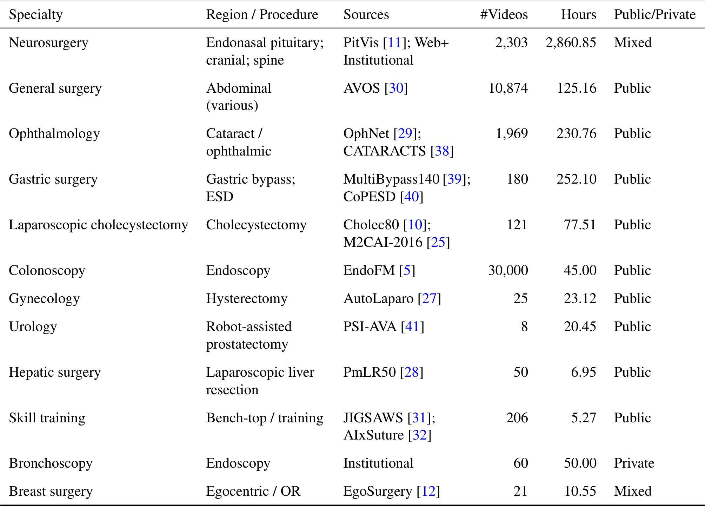
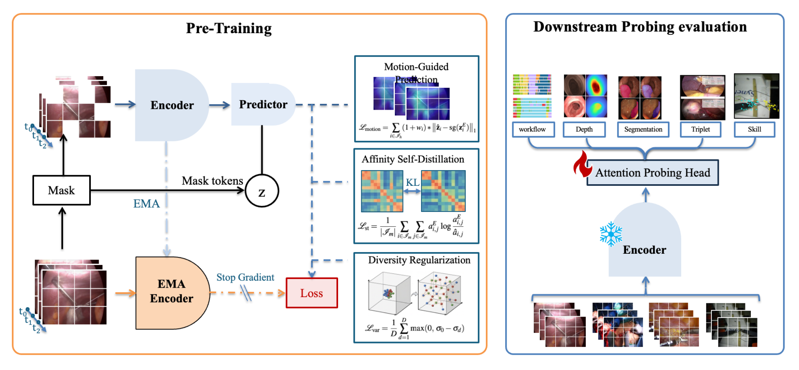
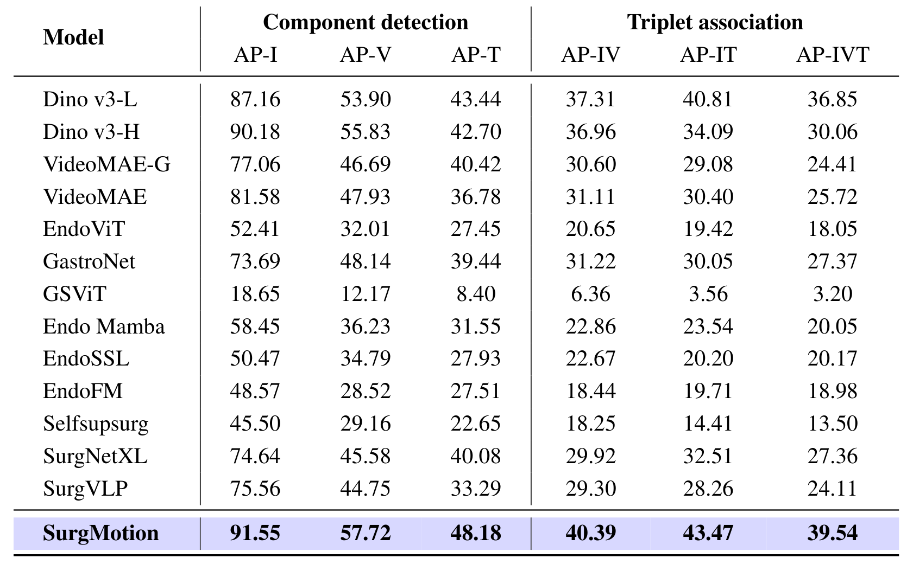

## 1. 背景与动机

手术视频预训练多沿用 VideoMAE 式的像素重建。作者认为手术画面里烟雾、反光、液体流动造成大量不可预测的像素变化，重建目标把容量浪费在这些噪声上，而有用的器械与组织交互很稀疏。

**另一个瓶颈是数据窄。** 已有手术模型的预训练语料多是单一术式或内镜，难以跨专科泛化。

SurgMotion 同时从目标函数和数据两头下手。

## 2. 核心观点速览

- **思路**：保留 V-JEPA 的潜空间掩码预测，预测被遮区域在教师编码器里的特征，而不是像素。
- **三个改动**：只对运动最强的 3 个掩码词元加权回归；对齐掩码词元间的相似度结构；惩罚特征维度方差过小。
- **数据**：SurgMotion-15M，正文称 3,658 小时、50 个来源，神经外科 2,860.85 小时占绝大多数；语料不公开。
- **结果**：冻结骨干后 8 个工作流集全部第一，PitVis F1 75.53 对 65.22。
- **边界**：没有消融，没有同数据对照，9 个下游集与预训练来源同名。

:::highlights
- 新内容全部集中在三项损失，其余沿用 V-JEPA
- 领先幅度在少见专科大、在常见腹腔镜和结肠镜集小
:::

:::data
- 3,658 小时、50 个来源
- 8 个工作流集全部第一
:::

## 3. 语料是怎么拼起来的

*论文原图编号：Table 1。SurgMotion-15M 的数据来源与规模。*

语料按专科汇编公开数据集，再加网络与机构视频。**神经外科 2,860.85 小时**，其余专科多在几十到两百多小时，结肠镜 30,000 段只有 45.00 小时。

为抵消偏斜，采样权重取 $1/(N_d|D_s|)$，让每个专科、每个数据集的采样质量相等。

表 1 小时数加起来约 3,707.7，视频数 45,817，都和正文的 3,658 小时、45,757 个视频对不上；50 个来源只点名 15 个。**语料构成无法从论文复核。**

## 4. 三项损失各做什么

*论文原图编号：Figure 2。预训练框架与下游探测评测。*

**运动加权回归**：用像素的时间差分加空间邻域差分给掩码词元打运动分，只取前 3 个，用 $(1+w_i)$ 加权的 ℓ1 回归教师特征。按公式字面，其他掩码词元不产生回归梯度，是否如此需查代码。

**亲和自蒸馏**：学生与教师各自在掩码词元之间算温度 0.1 的 softmax 相似度分布，用 KL 对齐，只在掩码集内算，避免背景主导。

**方差正则 SFDR**：逐维标准差低于阈值就罚。阈值取值论文未说明；引言说还有协方差项，公式里没有。

总目标为 $\mathcal L=\mathcal L_{motion}+0.1\,\mathcal L_{st}+0.3\,\mathcal L_{var}$。

## 5. 训练与评测协议

两阶段：16 帧训练 200 轮，再用 64 帧继续 80 轮，全程 1 fps，4 张 H800。

评测时冻结骨干，接 4 层、16 头的注意力探测头，同时训练 16 组超参取最好。**13 个对比模型走同一流程**，这让分数可比；但选最好用的是哪个划分，论文未说明。

## 6. 结果说了什么

| 数据集 | SurgMotion F1 | 最强基线 F1 |
|---|---|---|
| Cholec80 | 84.17 | 81.22 |
| EgoSurgery | 50.72 | 36.34 |
| PitVis | 75.53 | 65.22 |
| OphNet | 51.22 | 39.99 |
| PMLR50 | 85.65 | 68.68 |

工作流识别 8 集全胜，少见专科领先超过 10 个点，腹腔镜三集只领先几个点。

*论文原图编号：Table 6。CholecT50 三元组识别。*

三元组 AP-IVT 39.54 对 36.85；动词提升 3.8 点、器械提升 4.4 点，幅度相近。技能评估误差降低约 26%。

稠密任务领先很小：Kvasir 上 DINOv3-H 0.9019 反而更高，C3VD 的 RMSE 1.88 对 1.91。

:::data
- PitVis F1 75.53 对 65.22
- CholecT50 AP-IVT 39.54
- JIGSAWS 平均绝对误差 2.649 对 3.5962
:::

## 7. 为什么有效

作者的解释是潜空间目标避开了像素噪声，运动加权把梯度集中在器械上。

**但有三个变量同时变化**：目标函数、数据量与覆盖、64 帧长输入。VideoMAE 基线没在 SurgMotion-15M 上训练，所以胜过它不能证明潜空间目标更好。

我的判断：领先最大的集恰是语料覆盖而基线少见的专科，更像数据覆盖的效应。

## 8. 结果没说什么

- 三个损失各自贡献：没有消融，论文未说明。
- 数据规模的作用：图 1(c) 是跨模型散点，不是同一模型的规模扫描。
- 是否见过测试视频：9 个下游集与表 1 来源同名，去重情况论文未说明。
- 显著性：全是单次结果，没有方差。

## 9. 复现要注意什么

- 表格疑点：EndoMamba 在表 5 与表 6 的六个数字完全相同；AVOS 上六个基线同为 48.34 与 8.15；基准数 17 与逐集计数 19 不符。
- 仓库有 ViT-L 和 ViT-G 两个权重，表中结果对应哪个论文未说明。
- 要验证方法本身，需在同一语料上训练原版 V-JEPA 和 VideoMAE 做对照。

## @takeaways
- SurgMotion 的权重是目前覆盖专科最广的手术视频冻结特征。
- 专科与数据集双重反比采样可以直接照搬到多源医疗视频汇编。
- 引用它的分数前，先确认测试视频不在预训练来源里。

## @strengths
- 统一协议下比较 13 个模型、19 个数据集，覆盖面很广。
- 公开了权重、评测代码和各数据集预处理脚本。
- 方法改动小而清楚，容易在 V-JEPA 代码上复现。

## @weaknesses
- 没有任何消融或同数据对照，创新点无法单独验证。
- 语料不公开，表 1 合计与正文不一致。
- 多处表格数字疑似录入错误，基线异常值未讨论。

## @questions
- 去掉三个损失中任一项，各下游指标掉多少？
- 在与预训练严格去重的测试集上，优势是否保留？
- σ0 取多少，Top-K 是否真的只回归 3 个词元？
