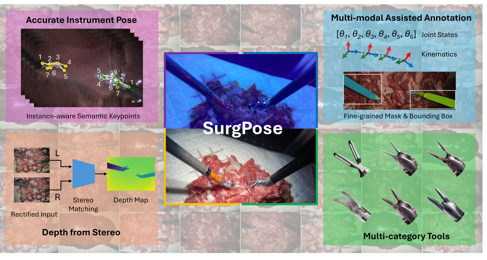
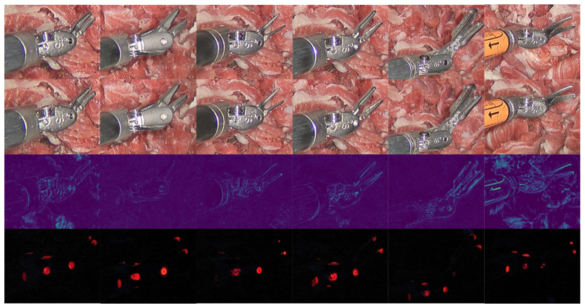

---
tags:
  - papers/手术数据集
aliases:
  - "SurgPose"
  - "机器人手术器械关节姿态数据集"
date: 2025-02-17
arxiv_id: 2502.11534
---

# SurgPose: a Dataset for Articulated Robotic Surgical Tool Pose Estimation and Tracking

## 核心信息

- 标题: SurgPose: a Dataset for Articulated Robotic Surgical Tool Pose Estimation and Tracking
- 标题翻译: SurgPose:面向机器人手术器械关节姿态估计与跟踪的数据集
- 作者: Zijian Wu, Adam Schmidt, Randy Moore, Haoying Zhou, Alexandre Banks, Peter Kazanzides, Septimiu E. Salcudean
- 机构: 不列颠哥伦比亚大学机器人与控制实验室; Intuitive Surgical; 伍斯特理工学院; 约翰斯·霍普金斯大学
- 发表时间: 2025-02-17(arXiv v1)
- 发表渠道: arXiv 预印本(cs.RO),arXiv 备注为 ICRA 2025 录用
- arXiv: 2502.11534
- 论文链接: https://arxiv.org/abs/2502.11534
- 代码 / 项目: https://surgpose.github.io/ ; https://github.com/zijianwu1231/SurgPose
- 数据 / 资源: https://zenodo.org/records/15278516(Zenodo 公开下载,CC-BY-4.0,无需申请)
- 论文类型: 数据集论文(benchmark_or_dataset)

## 原文摘要翻译

准确高效的手术机器人器械姿态估计,对手术培训中的增强现实(AR)和基于学习的自主操作等下游应用具有根本意义。人体和动物的姿态估计已经取得显著进展,但由于公开数据稀缺,这在手术机器人领域仍是难题。da Vinci 末端执行器运动学的绝对误差较大,标定过程繁琐,使得采集经过标定的运动学数据代价高昂。

受此限制驱动,我们采集了名为 SurgPose 的数据集,为基于视觉的手术器械姿态估计与跟踪提供实例感知的语义关键点和骨架。我们用紫外(UV)反应漆标记关键点,这种漆在白光下不可见、在紫外光下发出荧光;我们在不同光照条件下执行同一条轨迹,分别采集原始视频和关键点标注。

SurgPose 数据集包含约 120k 个手术器械实例(约 80k 用于训练,约 40k 用于验证),共 6 个类别。每个器械实例标注 7 个语义关键点。由于视频以立体图像对形式采集,可以基于立体匹配得到的深度把 2D 姿态提升到 3D。除了发布数据集,我们还测试了几种手术器械跟踪的基线方法,以展示 SurgPose 的用途。更多信息见 surgpose.github.io。

## 创新点

1. 用不可见荧光标记代替人工点击取关键点。关键点处涂紫外反应漆,同一条轨迹先在 UV 黑光下跑一次取标注,再在白光下跑一次取图像。标注来自荧光点的位置,图像里又几乎看不到标记,避免了人工逐帧点击,也避免了可见标记成为模型的捷径。
2. 每帧同时给出关键点、立体图像、运动学和关节状态。以往机器人器械姿态数据集都没有立体和运动学(表 I),SurgPose 在 dVRK 上逐步记录 PSM 的末端位姿和关节角,可用于 3D 姿态、运动学校正等任务。
3. 规模和类别比现有同类数据集大。6 类器械、30 条轨迹、约 60K 标注帧、约 120K 实例、每实例 7 个关键点,而 Du 等人工重标的 EndoVis15 只有 1.85K 帧、5 个关键点。
4. 用纹理特征定量检验标记是否可见。借用 STIR 的做法,对涂漆前后的关键点图块计算 GLCM 特征,看有无标记的图块能否被区分。

## 一句话总结

SurgPose 用紫外荧光漆加双光照重放,在 dVRK 上为 6 类 da Vinci 器械自动得到约 120K 个实例的 7 点关键点标注,并附立体图像和运动学。

三个人体姿态基线在跨背景验证集上 mAP 为 53.6 到 66.2,作者承认存在严重过拟合,数据集更适合做评测和小样本微调,而非单独训练临床可用模型。

## 研究问题

**难点在于:da Vinci 的运动学读数本身不准,而能直接从图像估计器械关节姿态的公开数据又很少。** 增强现实、多模态配准、内镜视觉伺服和基于学习的操作都需要知道器械在相机画面里的准确位置。有 da Vinci API 的系统能读到关节状态和运动学,但线缆和器械的柔性、齿隙会让刚体运动学模型偏离真实位置;要把器械投影到相机画面,还要做手眼标定。PSM(患者侧操作臂)有 7 个自由度、18 个关节、累计两米多长,标定很繁琐。

直接从内镜图像估计器械姿态是更省事的路线,但深度模型需要大量高质量标注。已有数据很少:

- EndoVis15 只标了器械轴上的一个点。
- Du 等人手工重标 EndoVis15 的 1850 帧,每帧 5 个关键点。
- SurgRIPE 给出腕部 6D 位姿,但依赖可见点阵,事后再用图像修复擦除。
- PhaKIR 有 30K 帧多器械关键点,但是传统腹腔镜器械,单目内镜也未标定。

人工逐帧点关键点费时且易错。论文要回答:能否用一种对普通相机不可见、但可自动提取的标记,低成本地为机器人器械取得大规模关键点真值。

### 核心观点速览

**做法是让同一段机器人运动跑两遍:一遍在紫外黑光下拍荧光点当标注,一遍在白光下拍正常画面当图像。** 支撑它的有四步:

- 在器械关节处用小画笔涂透明的红色紫外反应漆,白光下几乎看不见。
- 用 dVRK 驱动 PSM1 和 PSM3 沿离线生成的闭合轨迹运动,保证两遍完全可重复。
- 在 UV 视频上用 SAMv2 点提示分割荧光点、取中心作关键点,人工复核每帧。
- 用标定后的立体内镜和 RAFT 给出参考深度,可把 2D 关键点提升到 3D。

结果是 30 条轨迹、约 120K 个实例、6 类器械。YOLOv8、ViTPose、DeepLabCut 三个基线在换了背景组织和灯光的验证集上 mAP 为 53.6 到 66.2。**边界很明确:全部是离体组织背景、固定内镜、器械不互相遮挡,作者自己说基线在换背景时严重过拟合。**

## 数据与任务定义

任务是逐帧检测机器人器械实例并定位 7 个语义关键点,也可做跨帧跟踪,或借助立体深度做 3D 姿态。

### 数据来源

数据在实验室里用第一代 da Vinci IS1200 加 dVRK 采集,背景是离体动物组织,不含任何病人数据。

内镜(ECM)全程固定,只有 PSM1 和 PSM3 运动,两者工作空间不重叠以免碰撞。

### 关键点定义

以大持针器为例(Fig 2),关键点 1 到 5 构成骨架,沿器械轴、腕关节和两片钳口分布,所有器械都用同样的 5 点骨架;关键点 6 和 7 是冗余点,作者认为可能有助于跟踪。代码仓库说明 1 到 5 号点(PSM3 为 8 到 12)每帧都有,6、7(13、14)只在少数帧有。

> [!figure] Fig 2 关键点定义
> 建议位置：数据与任务定义
> 放置原因：说明 7 个关键点在大持针器上的位置和骨架连接。
> 当前状态：保留占位；自动裁剪被视觉质量门判为缺陷(visual_defect)。
> 论文原图编号：Fig 2

### 规模与划分

每条轨迹 1001 步,每步保存左右图像、PSM1 和 PSM3 的末端正向运动学与关节状态,执行一遍约 7 分钟,图像分辨率 986×1400。关键点按 COCO 格式标注。表 II 给出各类器械的实例数:

| 器械 | 训练实例 | 验证实例 |
|---|---|---|
| 大持针器 | 32K | 12K |
| 大号持针器(Mega) | 12K | 4K |
| 显微镊 | 6K | 8K |
| 弯剪 | 6K | 4K |
| DeBakey 镊 | 12K | 4K |
| Prograsp 镊 | 12K | 8K |

训练和验证在两个方面不同:

- 背景:训练集是离体鸡胗和猪肝,验证集是离体鸡腿肉和牛肉。
- 灯光:手术灯亮度训练集为 100%,验证集为 50%。

**所以验证集测的是跨背景、跨亮度的泛化,不是同分布精度。** 器械类别分布也不均衡,大持针器在训练集中占四成。

### 公开情况

论文称发布数据集。外部核查结果如下:

- 项目页 surgpose.github.io 的数据链接指向 Zenodo 记录 15278516,访问权限为公开,许可为 CC-BY-4.0。
- 共 34 个压缩包(000000 到 000033)。代码仓库把第 0 到 19 号定为训练、20 到 33 号定为验证,与论文"30 条轨迹"不一致,论文未说明差异来源。
- 每个文件夹含左右关键点 YAML 和参考框 JSON。
- 另含 dVRK 原始位姿与关节角 YAML、立体标定文件、白光左右视频,部分还有绿色漆版本视频。
- 视频需按 30 FPS 抽帧才能与标签对齐。

## 方法主线

要让一张图像同时"有真值"又"没有标记",关键是把标注和成像拆到两次运动里。这一节按顺序讲:先让标记看不见,再让运动可重复,最后从荧光视频里自动取点。

*论文原图编号：Fig 1。中间为同一场景在 UV 光与白光下的画面;四个角分别是实例级语义关键点、多模态辅助标注(关节状态、运动学、掩码与框)、立体深度和 6 类器械。*

### 机制流程

1. 涂漆。输入是一把未标记的器械。用微型画笔在关键点处涂漆器型紫外反应漆(GLO Effex),作者试了红绿两种,红色更透明,选红色。输出是带不可见标记的器械,用丙酮可擦除。
2. 生成并执行轨迹。输入是手动拖动 PSM 到四个顶点圈出的矩形工作空间。在其中随机取点,用周期三次插值样条连成闭合曲线,再插值成 1000 步;关节 4 到 7(7 为钳口开合角)用周期正弦轨迹。每一步先改关节、再移动末端,记录关节 4 到 7 与末端 6D 位姿,拍左右帧。输出是一条可在两种光照下重放的轨迹。
3. 双光照采集。同一轨迹先在两盏 365nm 50W 紫外 LED 黑光下执行,再关黑光、开手术灯执行一次。输出是一段荧光视频和一段正常视频,两者逐步对齐。
4. 提取标注。荧光视频首帧上对每个荧光点给点提示,SAMv2 把掩码传播到整段视频,掩码中心即关键点,语义编号来自首帧提示。作者逐帧复核并修正。另在白光视频上用 SAMv2 分割整个器械,掩码面积用于评测时的尺度归一。输出是 COCO 格式的关键点和器械掩码、参考框。

> [!figure] Fig 4 采集装置
> 建议位置：方法主线
> 放置原因：展示 dVRK 控制的 PSM1、PSM3、固定内镜和黑光灯的布置。
> 当前状态：保留占位；自动裁剪被视觉质量门判为缺陷(visual_defect)。
> 论文原图编号：Fig 4

> [!figure] Fig 3 画笔与紫外漆
> 建议位置：方法主线
> 放置原因：展示红绿两种漆在白光和黑光下的外观。
> 当前状态：保留占位；自动裁剪被视觉质量门判为缺陷(visual_defect)。
> 论文原图编号：Fig 3

为什么不直接阈值分割荧光点?作者给了两个理由:阈值只能得到点的位置,得不到语义编号;荧光强度随姿态和视频变化。SAMv2 能分割很弱的荧光点,首帧给定编号后可沿时间保持。

### 立体校正与深度

用棋盘格和 OpenCV 标定立体内镜,得到内参和左右相机间刚体变换后做极线校正,再用 RAFT 估计视差,按下式换成深度:

$$\text{Depth} = \frac{f \times b}{\left|d + (c_{x1} - c_{x0})\right|}$$

其中 $f$ 为焦距,$b$ 为基线,$d$ 为视差,$c_{x1}-c_{x0}$ 为左右主点的横向差。这个深度只是参考值,论文没有给出它与真实深度的误差。

代码仓库另说明标定文件来自 MATLAB 2024b 立体标定工具,与论文写的 OpenCV 不同,论文未说明是否两次标定。

### 标记可见性检验

作者为每类器械在 100% 和 50% 灯光下各拍一对涂漆前后的白光图像,共 12 对。

- 定性:两图相减看差分图。
- 定量:在每个关键点周围取 40×40 灰度图块,计算 GLCM(灰度共生矩阵,描述像素对的纹理统计)的不相似度和相关性两个特征,看能否用线性或二次判别分析、聚类把有无标记的图块分开。

之所以不只看差分强度,是因为两次拍摄之间器械和光照会有微小变化,单看像素差会把运动误认为标记。

### 评测协议

基线用 COCO 的 OKS(关键点相似度):预测点与真值点的欧氏距离经过一个未归一化的高斯,标准差取器械分割面积的平方根乘以每个关键点的常数。按 OKS 阈值匹配后算精确率-召回率曲线,报告 0.5:0.05:0.95 多个阈值上的平均 AP,即 mAP。

基线设置:

- YOLOv8:YOLOv8-pose-x。
- ViTPose:ViT-Pose-H,用 MAE 预训练权重。
- DeepLabCut:ImageNet 初始化,检测器为 ResNet-101。

训练轮数、输入尺寸、每个关键点的 OKS 常数和测速硬件,论文未说明,因此表 III 的数字不能直接复现。下一节看这套流程产出的数据和基线结果。

## 关键结果

数据造出来之后,读者要问三件事:它比已有数据集大多少,标记会不会被模型看见,现成方法在上面能做到什么程度。论文按这个顺序给证据。

### 与已有数据集的对比

表 I 只比较了机器人器械姿态数据集:

| 数据集 | 立体 | 运动学与关节状态 | 相机矩阵 | 类型 | 器械类别 | 轨迹 | 标注帧 | 标注实例 | 关键点 |
|---|---|---|---|---|---|---|---|---|---|
| EndoVis15 | 否 | 否 | 否 | ex vivo | 2 | 6 | 9K | 12K | 1 |
| Du 等 2018 | 否 | 否 | 否 | ex vivo | 2 | 6 | 1.85K | 24.52K | 5 |
| SurgPose | 是 | 是 | 是 | ex vivo | 6 | 30 | 60K | 120K | 7 |

**SurgPose 在每一列都占优,但三者都是离体场景。** 标注帧数是 Du 等的三十多倍,而且多了立体、运动学和相机矩阵三类辅助信息。我的判断:60K 帧来自 30 条约 7 分钟的连续轨迹,相邻帧几乎重复,有效样本量要比帧数小得多,论文没有给按轨迹抽样的学习曲线来检验这一点。

### 标记几乎不可见

如果白光图像里能看到漆点,模型就可能只学会找漆点。作者用差分图和纹理特征检查这一点。

*论文原图编号：Fig 6。自上而下依次为涂漆前、涂漆后、两者差分、紫外光下的画面,每列一种器械。*

Fig 6 第三行的差分图在涂漆位置没有明显亮斑,差异主要出现在器械边缘,作者解释为涂漆时器械被碰动。第四行显示紫外光下荧光点清晰。

> [!figure] Fig 5 GLCM 特征分布
> 建议位置：关键结果
> 放置原因：它是"有无标记的图块难以区分"这一结论的定量证据。
> 当前状态：保留占位；自动裁剪被视觉质量门判为缺陷(visual_defect)。图中横轴为不相似度、纵轴为相关性,红绿两色点交错分布。
> 论文原图编号：Fig 5

Fig 5 中有标记与无标记的图块在两维 GLCM 空间里交错,作者称用线性或二次判别分析、聚类都难以分开。**这说明简单纹理特征看不出标记,但不等于深度网络也看不出。** 图中只画了 Fig 6 第一列(一种器械)的图块,作者在正文里也承认,部分涂漆过量的地方肉眼可见。

### 标注工作量

半自动流程是否真的省力?

去掉首帧提示后,每段视频平均需人工修正 2.1±1.6 次,每段耗时 1 到 10 分钟。**这是流程省力的主要证据,但只计了干预次数和时间,没有报告关键点标注本身的像素误差。**

### 基线表现

现成人体姿态方法不改结构,能在这个数据集上做到多少?

| 方法 | mAP | 推理延迟(ms) |
|---|---|---|
| YOLOv8 | 63.3±1.23 | 16.4 |
| ViTPose | 53.6±1.06 | 7.7 |
| DeepLabCut | 66.2±2.01 | 194.8 |

DeepLabCut 精度最高但最慢,作者把慢归因于它使用全尺寸输入;YOLOv8 和 ViTPose 都能实时运行。**最高与最低相差 12.6 个点,说明数据集能拉开方法,但看不出瓶颈在哪个关键点或哪类器械。** 论文没有给出分器械或分关键点的结果,也没有说明 ± 是多次训练还是多条轨迹的标准差。

这些分数都是在换了背景的验证集上测的,下一节讨论它们到底反映了什么。

## 深度分析

前面的结果说明数据能用,这一节追问:它测到了什么,方法靠什么成立,还缺什么证据。

### 数据集真正测到了什么

SurgPose 测的是:在固定内镜、离体组织背景、两把互不遮挡的机器人器械做随机平滑运动时,模型能否定位器械关节。它不测真实手术中的烟雾、出血、组织遮挡、器械互相遮挡和内镜移动。**验证集换了组织和灯光,所以表 III 的分数混合了定位能力和跨背景泛化两部分。** 论文没有给同背景测试结果,两部分无法拆开,三个方法的排名在同背景下是否不变也无从判断。作者在局限一节说基线换背景后严重过拟合,但没有给出训练集上的对照分数,"严重"的程度无法量化。

### 双光照重放为什么成立

这套方法的前提是两遍运动完全一致。作者用 dVRK 执行闭合、光滑的离线轨迹,每一步先改关节再移动末端,保证可重复。但论文没有测量两遍之间器械位置的偏差。线缆柔性和齿隙正是论文开头说运动学不准的原因,同样的因素也可能让两遍执行出现像素级差异。代码仓库还提到首帧因系统延迟存在错误标签。**标注精度的上限取决于重放精度,而这一项论文未说明。**

### 运动学数据的价值和限制

每帧附带的末端位姿和关节角,使数据集可以研究视觉与运动学融合、运动学误差校正等任务,这是其他同类数据集没有的。但代码仓库说明这些是 dVRK 的原始读数,需要补偿,只有相对值较可靠;论文也没有给手眼标定结果。所以它们适合作辅助输入或相对运动线索,不能当作 3D 位姿真值。

### 与已有路线的定位

- 相对 Du 等人工重标:用荧光自动取点代替人工点击,规模从 1.85K 帧到 60K 帧。
- 相对 SurgRIPE:SurgRIPE 用可见点阵再做图像修复,修复痕迹可能留下线索;SurgPose 的标记本身近似不可见,不需修复。
- 相对 STIR:同样用不可见荧光标记和 GLCM 检验,STIR 标的是组织形变(红外 ICG),SurgPose 标的是器械关节(紫外漆)。
- 相对 LUV:直接继承了 LUV 的透明紫外漆标注思路,应用对象从布料、缝线换成手术器械。
- 相对合成数据:作者认为仿真到真实的差距限制性能,真实数据仍不可少;但 SurgPose 自身的场景多样性也有限。

## 局限

作者自述:

- 数据分布不够多样,换背景时基线严重过拟合,单靠 SurgPose 可能训练不出能迁移到临床的模型。
- 只有离体组织,没有在体或尸体环境;器械之间没有遮挡;没有缝合等具体手术任务。
- 作者认为它仍适合小样本学习、无监督学习和基础模型微调的设计与评测。

笔记核查补充:

- 基线训练细节、OKS 关键点常数、测速硬件和 ± 的来源,论文未说明。
- 标记不可见性只用两个 GLCM 特征、少量图块和线性或二次判别分析验证,没有测试深度模型能否学到标记。
- 双光照两遍之间的重放误差、关键点标注的像素误差、RAFT 深度误差,论文都未说明。
- 公开数据有 34 个文件夹,论文写 30 条轨迹;关键点 6、7 只在少数帧有标注;论文写用 OpenCV 标定,代码仓库写标定文件来自 MATLAB。
- 运动学是未补偿的原始读数。

## 我的笔记

可复用的点:

- 紫外荧光漆加双光照重放,是给任何可重复执行的机器人运动低成本获取视觉真值的通用办法,也可用于其他器械或机械臂。
- 用器械分割面积做 OKS 尺度,让人体姿态的 COCO 评测工具可以直接沿用。

使用前要检查:

- 按 30 FPS 抽帧对齐标签;只用 1 到 5 号关键点。
- 自行划出同背景测试集,把定位精度和跨背景泛化分开报告。
- 按轨迹而不是按帧划分训练和测试,避免相邻帧泄漏。
- 把运动学当相对量使用。

后续问题:

- 在白光图像上训练一个分类器,能否检测出紫外标记?
- 同背景测试的 mAP 是多少,跨背景下降多少?
- 两遍重放之间器械位置差多少像素?
- RAFT 参考深度相对真实深度的误差多大?

## 引用

- Bodenstedt et al. Comparative evaluation of instrument segmentation and tracking methods in minimally invasive surgery. arXiv.
- Du et al. (2018). Articulated multi-instrument 2-D pose estimation using fully convolutional networks. IEEE TMI.
- Thananjeyan et al. (2022). All you need is LUV: Unsupervised collection of labeled images using UV-fluorescent markings. IROS.
- Schmidt et al. (2024). Surgical tattoos in infrared: A dataset for quantifying tissue tracking and mapping (STIR). IEEE TMI.
- Ravi et al. (2024). SAM 2: Segment anything in images and videos. arXiv:2408.00714.
- Teed and Deng (2020). RAFT: Recurrent all-pairs field transforms for optical flow. ECCV.
- Xu et al. (2022). ViTPose: Simple vision transformer baselines for human pose estimation. NeurIPS.
- Mathis et al. (2018). DeepLabCut: markerless pose estimation of user-defined body parts with deep learning. Nature Neuroscience.
