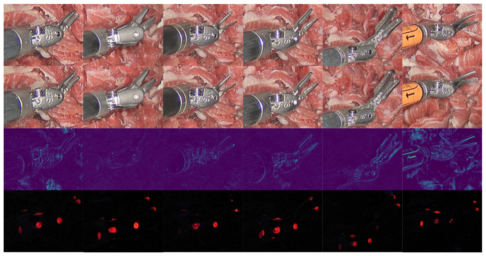
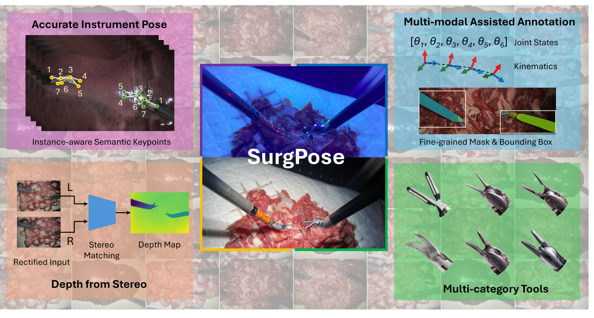

## 1. 背景与动机

**da Vinci 的运动学读数不准,而能直接从图像估计器械关节姿态的公开数据又很少。** 线缆柔性和齿隙让刚体运动学偏离真实位置,把器械投影到画面还要做繁琐的手眼标定。

视觉方法需要大量关键点真值,但人工逐帧点击费时易错。已有数据要么只标一个点(EndoVis15),要么只有 1.85K 帧(Du 等),要么用可见点阵再做图像修复(SurgRIPE),要么是非机器人器械(PhaKIR)。

:::highlights
- 缺口是带关节语义的机器人器械关键点真值,而且要便宜地大量获取。
:::

下一节看论文怎么低成本取得这种真值。

## 2. 核心观点速览

**做法是让同一段机器人运动跑两遍:一遍在紫外黑光下拍荧光点当标注,一遍在白光下拍正常画面当图像。**

- 在器械关节涂透明的红色紫外反应漆,白光下几乎看不见。
- dVRK 驱动两个操作臂沿离线生成的闭合轨迹运动,两遍可重复。
- SAMv2 在荧光视频上追踪每个点,人工复核每帧。
- 标定立体内镜加 RAFT 给参考深度,可把 2D 点提升到 3D。

结果是 30 条轨迹、约 120K 个实例、6 类器械,每实例 7 个关键点。**边界:全部是离体组织、固定内镜、器械不互相遮挡。**

:::data
- 约 80K 训练实例,约 40K 验证实例
- 每条轨迹 1001 步,约 7 分钟,986×1400
:::

## 3. 标记怎样做到看不见

作者对漆有两条要求:涂漆前后器械外观差异尽量小,黑光下荧光要亮到能用简单方法提取。按 LUV 的建议选漆器型紫外漆,试了红绿两色,红色更透明,最终选红色。漆用丙酮可擦除。

*论文原图编号：Fig 6。自上而下依次为涂漆前、涂漆后、两者差分、紫外光下的画面,每列一种器械。*

差分图在涂漆处没有明显亮斑,边缘的差异来自涂漆时器械被碰动。定量上,作者在每个关键点周围取 40×40 灰度图块,算 GLCM 的不相似度和相关性,有无标记的图块交错,判别分析和聚类都分不开。

**但这只说明两个手工纹理特征看不出标记。** 图中只画了一种器械的图块,作者也承认涂漆过量时肉眼可见。

:::highlights
- 不可见性的证据较弱:没有测深度网络能否检测标记。
:::

## 4. 运动怎样做到可重复

两遍拍摄的前提是运动完全一致。作者手动拖动操作臂圈出矩形工作空间,在其中随机取点,用周期三次插值样条连成闭合曲线,插值成 1000 步;关节 4 到 7 用周期正弦轨迹。每一步先改关节、再移动末端,记录关节角和末端 6D 位姿,拍左右帧。

装置是第一代 da Vinci IS1200 加 dVRK,两盏 365nm 50W 紫外灯,内镜全程固定。两个操作臂工作空间不重叠。

**论文没有测量两遍之间器械位置的偏差,** 而线缆柔性恰恰是作者开头说运动学不准的原因,所以标注精度的上限未知。

## 5. 关键点怎样自动取出

直接阈值分割荧光点得不到语义编号,荧光强度也随姿态变化。作者在荧光视频首帧对每个点给提示,让 SAMv2 把掩码传播到整段,掩码中心即关键点。白光视频上再用 SAMv2 分割整个器械,掩码面积用作评测的尺度。

*论文原图编号：Fig 1。中间为同一场景在 UV 光与白光下的画面;四角为语义关键点、关节状态与运动学、立体深度、6 类器械。*

人工修正平均每段 2.1±1.6 次,每段 1 到 10 分钟。这是流程省力的证据,但论文没有给关键点相对人工标注的像素误差。

:::data
- 每段视频人工修正 2.1±1.6 次
:::

## 6. 数据长什么样

| 器械 | 训练实例 | 验证实例 |
|---|---|---|
| 大持针器 | 32K | 12K |
| 大号持针器 | 12K | 4K |
| 显微镊 | 6K | 8K |
| 弯剪 | 6K | 4K |
| DeBakey 镊 | 12K | 4K |
| Prograsp 镊 | 12K | 8K |

**训练集背景是鸡胗和猪肝、灯光 100%,验证集是鸡腿肉和牛肉、灯光 50%。** 所以验证集测的是跨背景泛化。

数据在 Zenodo 公开,CC-BY-4.0,共 34 个文件夹;代码仓库把前 20 个定为训练,与论文"30 条轨迹"不一致。关键点 6、7 只在少数帧有,视频要按 30 FPS 抽帧才对得上标签。运动学是 dVRK 原始读数,未补偿。

## 7. 基线结果说了什么

| 方法 | mAP | 推理延迟(ms) |
|---|---|---|
| YOLOv8 | 63.3±1.23 | 16.4 |
| ViTPose | 53.6±1.06 | 7.7 |
| DeepLabCut | 66.2±2.01 | 194.8 |

评测用 COCO 的 OKS,尺度取器械分割面积,mAP 取阈值 0.5:0.05:0.95 的平均。DeepLabCut 最准但最慢,作者归因于全尺寸输入;另两种能实时运行。最高与最低相差 12.6 个点。

**这些分数混合了定位能力和跨背景泛化。** 论文没给同背景测试分数,也没说明 ± 的来源、训练轮数、输入尺寸和测速硬件。

## 8. 它真正测到了什么

我的判断:SurgPose 测的是固定视角、离体背景、器械不遮挡、随机平滑运动下的关节定位。它不测烟雾、出血、组织遮挡、器械互挡和内镜运动。

60K 帧来自 30 条连续轨迹,相邻帧几乎重复,有效样本量远小于帧数。按帧随机划分会造成泄漏,应按轨迹划分。

作者在局限中说基线换背景后严重过拟合,单靠 SurgPose 难以训练出临床可用模型,建议用于小样本学习、无监督学习和基础模型微调的评测。

## 9. 复现与使用要注意什么

- 按 30 FPS 抽帧,只依赖 1 到 5 号关键点。
- 自己划一个同背景测试集,与跨背景结果分开报告。
- 把运动学当相对量或辅助输入,不当 3D 真值。
- RAFT 深度只是参考,论文没有给误差。
- 立体标定:论文写 OpenCV,代码仓库写 MATLAB,使用仓库提供的标定文件。

## @takeaways
- 紫外荧光漆加双光照重放,可以为任何可重复运动的机器人低成本取得视觉关键点真值。
- SurgPose 是目前机器人器械关键点数据里规模最大、附带立体和运动学的一个,但场景单一。
- 表 III 的分数是跨背景分数,不能当作同分布定位精度。

## @strengths
- 标注不靠人工点击,标记又近似不可见,避免了可见标记带来的捷径。
- 每帧同步提供立体、运动学、关节状态和器械掩码。
- 数据以 CC-BY-4.0 公开,附采集、标注和深度估计代码。

## @weaknesses
- 不可见性只用两个 GLCM 特征检验,没有用深度网络检验。
- 两遍重放误差、关键点像素误差、深度误差均未报告。
- 基线训练细节缺失,没有同背景对照,过拟合程度无法量化。
- 公开文件夹数与论文轨迹数不一致。

## @questions
- 在白光图像上训练的分类器能否检测出紫外标记?
- 同背景测试的 mAP 是多少?
- 两遍重放之间器械位置差多少像素?
