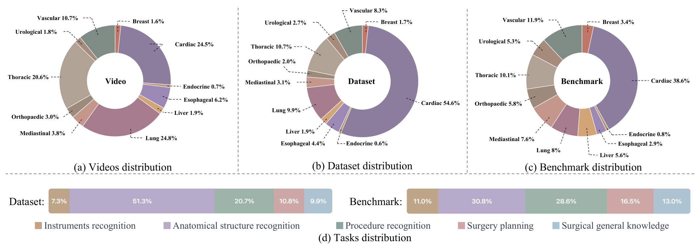
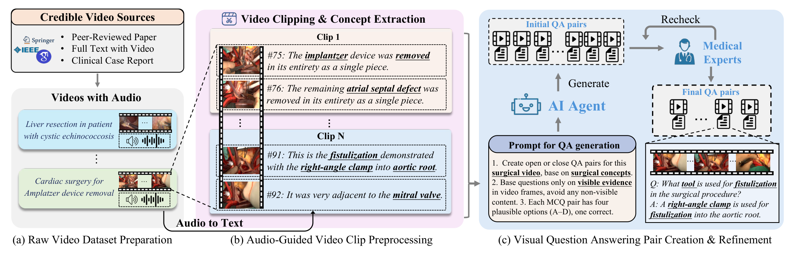
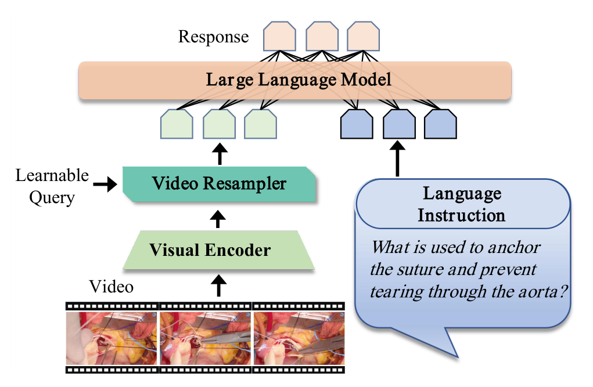
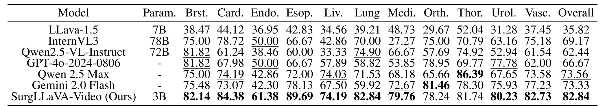
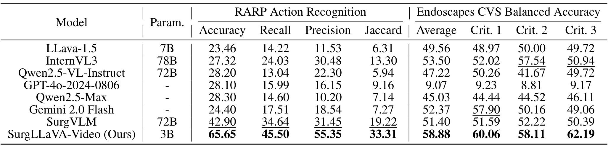
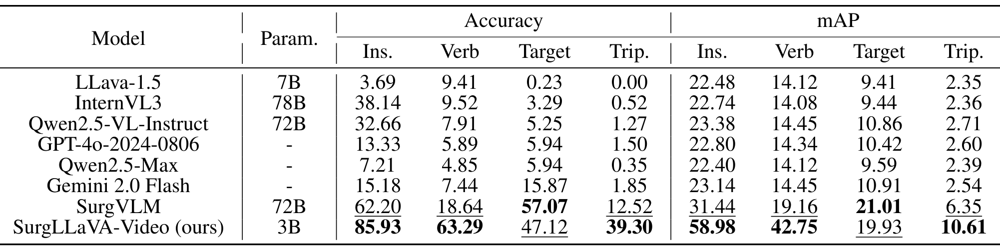
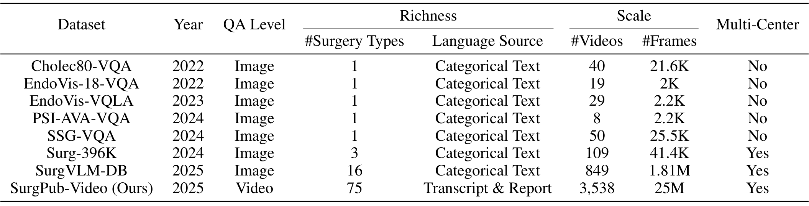

---
tags:
  - papers/手术数据集
aliases:
  - "SurgPub-Video"
  - "SurgLLaVA-Video"
date: 2025-08-12
arxiv_id: 2508.10054
---

# SurgPub-Video: A Comprehensive Surgical Video Dataset for Enhanced Surgical Intelligence in Vision-Language Model

## 核心信息

- 标题: SurgPub-Video: A Comprehensive Surgical Video Dataset for Enhanced Surgical Intelligence in Vision-Language Model
- 标题翻译: SurgPub-Video:用于增强视觉语言模型手术智能的综合手术视频数据集
- 作者: Yaoqian Li, Xikai Yang, Dunyuan Xu, Yang Yu, Litao Zhao, Xiaowei Hu, Jinpeng Li, Pheng-Ann Heng
- 机构: 香港中文大学计算机科学与工程系; 华南理工大学未来技术学院; 香港中文大学医学智能与 XR 研究所
- 发表时间: 2025-08-12(arXiv v1)
- 发表渠道: arXiv 预印本(q-bio.OT),arXiv 元数据注明 AAAI-2026
- arXiv: 2508.10054
- 论文链接: https://arxiv.org/abs/2508.10054
- 代码 / 项目: 论文未给出链接,只说模型将会发布
- 数据 / 资源: 论文未给出链接,只说数据集和基准将会发布
- 论文类型: 数据集与基准论文(benchmark_or_dataset),附带一个微调模型

## 原文摘要翻译

视觉语言模型(VLM)在手术场景分析中显示出很大潜力,但现有模型受限于帧级数据集,缺少带有手术流程知识的高质量视频数据。

为此,我们做出以下贡献:

- (i)SurgPub-Video,一个综合数据集,包含来自同行评审临床期刊的 3,000 多个手术视频和 2500 万个标注帧,覆盖 11 个专科;
- (ii)SurgLLaVA-Video,一个面向手术视频理解的专用视觉语言模型,基于 TinyLLaVA-Video 架构,同时支持视频级和帧级输入;
- (iii)一个视频级手术视觉问答(VQA)基准,覆盖血管、心脏、胸科等 11 个手术专科。

在所提基准和另外三个手术下游任务(动作识别、技能评估和三元组识别)上的大量实验表明,SurgLLaVA-Video 仅用 30 亿参数就明显优于通用模型和手术专用模型。数据集、模型和基准将会发布,以推动手术视频理解的进一步发展。

## 创新点

1. 换了数据来源。视频全部取自 25 个同行评审医学期刊中附带视频的论文,共 3,538 个原始视频。相比 YouTube 等网络视频,每个视频都对应一篇经过同行评审的文章,文字说明有据可查。
2. 文本不再是类别标签。问答对由术者讲解的音频转写和配套论文正文生成,而不是由“胆囊切除”“肝脏”这类类别名转写,问题可以涉及操作理由和风险判断。
3. 半自动的构建流程。Whisper 转写、粗粒度片段合并、细粒度概念抽取、问答生成四个智能体串联,再由医学专家复核,得到 10,926 个片段和 48,520 个问答对。
4. 一个按专科和任务两维评测的视频 VQA 基准(3,337 个样本),以及在其上微调的 3B 模型 SurgLLaVA-Video。

## 一句话总结

SurgPub-Video 把期刊论文附带的手术视频切成约 30 秒的片段,用讲解转写和论文文本让 GPT-4o 出题、专家复核,得到 48,520 个视频问答对;在其上微调的 3B 模型在同源基准上总体准确率 82.84,高于 GPT-4o 的 66.67。

## 研究问题

**手术视觉语言模型(VLM)大多只看单帧,理解不了手术步骤怎样随时间展开。** 论文认为根源在数据:缺少带指令式问答标注的高质量手术视频。它列出三个障碍:

- 视频多样性不够:帧级 VQA 数据集帧数多,但来自很少的源视频。表 1 中 SSG-VQA 只有 50 个源视频,最大的 SurgVLM-DB 也只有 849 个。
- 标注粒度不够:视频通常只有稀疏的类别标签,改写成指令样本要大量人工,还容易出错。
- 来源不可靠:社交媒体视频没有临床审核,语音识别转写又有噪声。

已有两条路线各缺一半。把公开帧级数据集转成 VQA(SurgVLM-DB、EndoBench 一类)保留了标注精度,但丢了时间信息。从网络视频挖讲解(SurgVLP、Surg-3M 一类)有时间上下文,但讲解没有同行评审,而且多用于预训练图像编码器,不提供问答对。

论文要回答的问题是:能否从可信来源构建一个全由视频组成、文本丰富的手术 VQA 数据集,并让小模型借此理解手术视频。

### 核心观点速览

论文的答案是去找期刊论文附带的手术视频:它们有术者讲解,又经过同行评审。

- 数据:25 个期刊的 3,538 个原始视频,切成 10,926 个片段,生成 48,520 个问答对,覆盖 11 个专科、五类任务。
- 构建:Whisper 转写切片,三个 LLM 智能体合并片段、抽概念、出题,出题由 GPT-4o 完成,医学专家复核。
- 模型:在 TinyLLaVA-Video 上微调出 3B 的 SurgLLaVA-Video,用重采样器把多帧压成固定长度。
- 结果:自建基准总体准确率 82.84,GPT-4o 为 66.67;三个外部数据集也领先 SurgVLM,但 CholecT50 的目标识别落后。
- 边界:基准与训练集同源、只有 SurgLLaVA-Video 做过微调,没有单帧或盲答对照,领先幅度不能全算作视频理解。

下一节先看数据从哪里来、怎样分布。

## 数据与任务定义

### 数据来源

数据能外推到哪里,取决于视频是谁拍的、为什么拍。

原始视频从 25 个同行评审医学期刊爬取,只保留附带手术视频的文章,共 3,538 个。期刊列表放在补充材料里,正文没有列出。

- 原始视频平均 323.5 秒,分辨率 1920×1080,帧率 30 Hz。
- 覆盖 11 个专科,表 1 记为 75 种手术。
- 每个视频对应一篇同行评审文章,文章正文提供额外文字。

**期刊视频是作者为展示术式而剪辑的教学视频,不是完整的术中录像。** 它的讲解可信,但画面经过挑选,和临床实时视频的分布不同。

摘要说的 2500 万帧怎样算出,论文未说明。按 3,538 个视频、平均 323.5 秒、30 Hz 估算约为 3400 万帧;按 10,926 个片段、平均 29.85 秒估算约为 980 万帧,两者都不等于 2500 万。

### 规模与专科分布

最终数据集有 10,926 个片段,平均 29.85 秒,以及 48,520 个开放式和选择题问答。片段覆盖 75 种手术、1,823 种解剖结构、40 种器械和 1,290 种操作步骤。

Fig 2 给出三层的专科分布,这里摘四个最大的专科:

| 层级 | 心脏 | 肺 | 胸科 | 血管 |
|---|---|---|---|---|
| 原始视频(Fig 2a) | 24.5% | 24.8% | 20.6% | 10.7% |
| 数据集片段(Fig 2b) | 54.6% | 9.9% | 10.7% | 8.3% |
| 基准(Fig 2c) | 38.6% | 8% | 10.1% | 11.9% |

**从原始视频到片段,心脏手术占比从 24.5% 升到 54.6%,肺从 24.8% 降到 9.9%。** 论文没有解释原因。我的推断是心脏手术视频讲解更密,切出的片段更多。训练数据因此偏向心脏手术。

### 五类任务

问答按五类手术概念生成,Fig 2d 给出两层的任务占比:

| 任务 | 数据集 | 基准 |
|---|---|---|
| 器械识别 | 7.3% | 11.0% |
| 解剖结构识别 | 51.3% | 30.8% |
| 操作步骤识别 | 20.7% | 28.6% |
| 手术规划 | 10.8% | 16.5% |
| 手术常识 | 9.9% | 13.0% |

一半以上的训练问答问的是解剖结构,器械只占 7.3%。这与文本来源有关:讲解和论文更常说明“这是哪里”,较少点名每件器械。

### 基准划分

基准要回答模型在没见过的视频上表现如何,关键是怎样抽样。

论文从 705 个视频中随机抽取 20% 的问答,再从多数类中删去部分相似问答,得到 3,337 个样本,心脏占比压到 38.6%。训练集和测试集按视频严格分开。705 个视频是否就是全部测试视频,论文未说明。

评测指标是总体准确率、分专科准确率和分任务准确率。各专科的样本数论文未给出;按 Fig 2c 的占比估算,内分泌只有约 27 个,这一列的分数波动会很大。

*论文原图编号：Figure 2。原始视频、数据集和基准三层的专科分布,以及五类任务的占比。放在这里是因为它显示心脏手术在片段层被放大、在基准层被压回。*

数据的样子清楚了,下一节看问答对是怎样从视频里生成的。

## 方法主线

这是数据集论文,方法主线是数据构建流程和评测协议;模型是用来证明数据有用的手段。

### 构建流程

问答质量取决于每一步交给谁做,以及谁来把关。

构建流程用一组 LLM 作“判断智能体”,从粗到细处理视频:

- 音频转文字(ATT)智能体:用 OpenAI Whisper 把音频切成带时间戳的短段文字。短段太碎,很多不是手术内容。
- 粗粒度视频处理(CGVP)智能体:按转写删去片头片尾等非手术段,再把语义相关的相邻短段合并,输出 15 到 30 秒的片段。例如血管游离包含清除脂肪、上止血夹、切开血管,应合成一个片段。
- 细粒度概念抽取(FGCE)智能体:把片段转写和对应文章文本交给 LLM,判断片段含有哪类概念(器械、步骤、解剖、规划、常识),记录片段长度、文本和概念。
- 问答生成(QAG)智能体:逐个片段生成开放式问答和四选一选择题。提示要求问题只基于帧中可见的证据,选择题带有迷惑性的错误选项。问题还会取材于讲解中给出的因果理由,如手术结果预测和风险判断。

QAG 的输出由医学专家复核修改,生成与复核可以多轮迭代。实验部分说明出题的智能体是 GPT-4o。

**整条流程里,问题和答案的文本来源都是转写和文章,而不是画面。** FGCE 明确只读文字;QAG 是否输入视频帧,论文未说明。如果没有输入帧,“只基于可见证据”就只能靠提示词约束,无法保证。专家人数、复核比例和修改率也论文未说明,问答正确率只能从流程判断。

### 机制流程

1. 输入 25 个期刊的 3,538 个原始视频和配套文章,用 Whisper 从音频提取带时间戳的短段文字。
2. 输入短段文字,CGVP 删除非手术段并合并相关段,输出 15 到 30 秒的片段;FGCE 结合文章文本给片段打上五类概念。
3. 输入片段、转写和概念,QAG 用 GPT-4o 生成开放式和选择题问答,经医学专家复核,得到 48,520 个问答。
4. 按视频划出 3,337 个样本的基准,其余问答用来微调 SurgLLaVA-Video,输出基准与三个外部数据集上的准确率。

*论文原图编号：Figure 3。问答生成流程:左图收集期刊视频,中图转写与切片,右图由智能体出题、医学专家复核。放在这里是因为它给出了提示词摘要和一个真实问答例子。*

### SurgLLaVA-Video 模型

已有手术 VLM(如 SurgVLM)把单帧视觉标记直接接到文本前面,帧一多,标记数就线性增长。SurgLLaVA-Video 沿用 TinyLLaVA-Video,由视觉编码器、视频组重采样器和语言模型三部分组成,用重采样器解决这个问题。

视觉编码器先逐帧提取特征。设片段有 $T$ 帧、每帧 $N$ 个特征、特征维度 $D$,编码结果展平后为:

$$\hat Z\in\mathbb{R}^{(T\times N)\times D}$$

重采样器用固定数量的可学习查询压缩这些视觉特征。它把视觉特征和查询切成同样多的份数,每份视觉特征只与对应的那个查询做交叉注意力,得到一段输出,再把各段拼接:

$$V=[V_1;V_2;\dots;V_L]\in\mathbb{R}^{L\times D}$$

$V$ 与文本问题 $S$ 一起输入语言模型生成答案。**视觉标记数固定为 $L$,与帧数无关,所以帧数增加只会让每个查询分到更多帧,不会撑大语言模型的输入。** 这也解释了后面帧数消融里 32 帧反而下降:固定容量要容纳更多冗余帧。

*论文原图编号：Figure 4。SurgLLaVA-Video 结构。放在这里是因为它显示可学习查询把多帧特征压成固定长度后再与问题拼接。*

### 训练与评测设置

- 从 TinyLLaVA-Video 预训练权重开始,冻结视觉编码器,全量微调语言模型和重采样器。
- 4 张 NVIDIA A40 训练;推理温度 0.2。
- 开源对比模型:LLaVA-1.5、InternVL3、Qwen2.5-VL-Instruct。
- 闭源对比模型:GPT-4o、Qwen2.5-Max、Gemini 2.0 Flash。
- 下游任务另加手术专用模型 SurgVLM(72B)。
- 下游任务沿用 SurgVLM 的设置,用选择题格式,按预测与真值完全匹配计准确率。

视觉编码器和语言模型的具体型号、$L$ 的取值、学习率、轮数、批大小,论文未说明。对比模型都是零样本调用;下游三个数据集的训练集是否参与 SurgLLaVA-Video 的微调,论文也未说明。这两点决定了下一节的比较是否公平。

## 关键结果

### 基准结果

第一个问题是:在自建基准上,3B 的微调模型能不能超过大得多的零样本模型。表 2 摘五个专科和总体(准确率,%):

| 模型 | 参数 | 心脏 | 食管 | 骨科 | 胸科 | 血管 | 总体 |
|---|---|---|---|---|---|---|---|
| LLaVA-1.5 | 7B | 44.12 | 42.83 | 29.67 | 52.04 | 37.45 | 35.82 |
| InternVL3 | 78B | 78.72 | 66.67 | 75.00 | 70.79 | 75.18 | 69.17 |
| Qwen2.5-VL-Instruct | 72B | 61.24 | 60.00 | 57.69 | 74.92 | 61.54 | 62.44 |
| GPT-4o | - | 67.98 | 66.67 | 78.95 | 69.77 | 62.00 | 66.67 |
| Qwen2.5-Max | - | 74.19 | 72.00 | 65.66 | 86.39 | 73.58 | 73.56 |
| Gemini 2.0 Flash | - | 73.07 | 78.13 | 81.46 | 78.30 | 77.23 | 73.33 |
| SurgLLaVA-Video | 3B | 84.38 | 89.69 | 78.24 | 81.74 | 82.73 | 82.84 |

SurgLLaVA-Video 总体 82.84,比 GPT-4o 高 16.17 个点,比最强的零样本模型 Qwen2.5-Max 高 9.28 个点。**3B 模型在同源基准上明显领先,但领先并不均匀。**

正文的几处表述比表格更强:

- 正文说在所有专科上都有一致提升。表 2 中骨科 78.24 低于 Gemini 2.0 Flash 的 81.46,胸科 81.74 低于 Qwen2.5-Max 的 86.39。
- 正文说十一个专科中有十个提升超过 10%。相对 GPT-4o 超过 10 个点的是 8 个专科;相对每个专科的最强基线,超过 10 个点的只有内分泌和食管。
- 乳腺、肝、泌尿三个专科只比最强基线高 0.32、0.16、2.45 个点。

心脏手术的领先较大(84.38 对 InternVL3 的 78.72),而心脏正是训练片段占比 54.6% 的专科。领先最大的食管和内分泌在训练片段中占比很小,所以不能简单说成“训练多的专科领先多”。

*论文原图编号：Table 2。基准上 7 个模型的 11 个专科准确率。放在这里是为了核对上表未摘录的专科。*

### 下游任务

自建基准是同源测试,外部数据集更能说明泛化。三个数据集都用选择题格式:

| 模型 | RARP 准确率 | RARP Jaccard | CVS 平均平衡准确率 | 三元组准确率 | 三元组 mAP |
|---|---|---|---|---|---|
| InternVL3 | 27.32 | 13.30 | 53.50 | 0.52 | 2.36 |
| GPT-4o | 28.10 | 9.16 | 9.07 | 1.50 | 2.60 |
| Gemini 2.0 Flash | 24.40 | 7.27 | 52.37 | 1.85 | 2.54 |
| SurgVLM | 42.90 | 19.22 | 51.40 | 12.52 | 6.35 |
| SurgLLaVA-Video | 65.65 | 33.31 | 58.88 | 39.30 | 10.61 |

- SAR-RARP50 动作识别(机器人前列腺切除的 8 类动作):准确率比 SurgVLM 高 22.75 个点,Jaccard 高 14.09 个点。
- Endoscapes2023 关键安全视野(CVS)评估(三条标准各做二分类):平均平衡准确率 58.88,比 InternVL3 高 5.38、比 SurgVLM 高 7.48。平衡准确率的随机水平是 50,**多数模型都在随机附近,最好的结果也只高出约 9 个点。**
- CholecT50 三元组识别:器械、动作、三元组准确率比 SurgVLM 高 23.73、44.65、26.78 个点;目标准确率 47.12 低于 SurgVLM 的 57.07,目标 mAP 19.93 也低于 21.01。

GPT-4o 在 CVS 上只有 9.07,远低于随机,更像是拒答或答案格式无法匹配,论文未解释。三元组里目标识别是唯一落后的分项,说明期刊讲解里的解剖知识没有直接转化为腹腔镜胆囊切除中的目标定位。

*论文原图编号：Table 3。SAR-RARP 动作识别与 Endoscapes CVS 结果。放在这里是因为它包含 GPT-4o 在 CVS 上的异常低分。*

*论文原图编号：Table 4。CholecT50 三元组识别结果。放在这里是因为它显示目标识别是 SurgLLaVA-Video 唯一落后的分项。*

### 消融

消融要回答两件事:多少帧够用,数据加多是否还有收益。两组都按五类任务报告选择题准确率。

- 输入帧数(8、16、24、32):总体在 16 帧最高,为 80.82;解剖识别在 24 帧到 85.08,32 帧下降;手术常识在 16 帧后下降。
- 数据规模(25%、50%、75%、100%):总体近似线性上升,全量为 80.82;器械和步骤识别提升约 7% 到 14%,解剖识别提升 10%,手术常识提升 13%;手术规划在 75% 时到 82.40 后持平。

**消融的最佳总体是 80.82,而表 2 的主结果是 82.84,两者口径不同,论文未说明原因。** 消融也只训练一次,相邻设置之间几个点的差距无法排除随机波动。

> [!figure] Figure 5 输入帧数与数据规模的消融雷达图
> 建议位置：关键结果
> 放置原因：两张雷达图给出五类任务在不同帧数和数据规模下的准确率。
> 当前状态：保留占位;修复后的裁图底部仍混入图注首行,一次修复机会已用完。

结果都指向同一个方向,下一节讨论这些数字能证明到哪一步。

## 深度分析

### 基准测到了什么

**基准与训练集来自同一批期刊、同一套 GPT-4o 出题流程,只是按视频分开。** SurgLLaVA-Video 在这种问答风格上微调过,其他模型都是零样本。因此 82.84 对 66.67 的差距至少包含两部分:手术视频理解,以及对出题风格、选项分布的适应。

能把两者分开的对照有三种:只给问题不给视频的盲答、只给单帧的输入、把对比模型在同样数据上微调。论文三种都没有做。帧数消融最少也用了 8 帧,没有单帧这一档,所以无法知道有多少问题单帧就能答对。

我的判断:基准适合比较“在 SurgPub-Video 上训练过的模型”,不适合直接说明零样本模型的手术能力差。

### 下游结果的解读

外部数据集比自建基准更有说服力,但仍有三点限制。

- 下游训练集是否参与微调论文未说明。若参与,与零样本模型的比较就不公平;SurgVLM 当时的设置也需要对齐。
- CVS 上大多数模型接近随机,58.88 的领先是在很低的水平上取得的,不能据此说模型能支持高风险临床决策,而论文正文是这样写的。
- 三元组的目标识别落后,说明这条数据路线对解剖定位的帮助有限,正好对应期刊视频与腹腔镜实时画面的差异。

### 论文定位

| 路线 | 代表 | 与 SurgPub-Video 的差别 |
|---|---|---|
| 单一数据集转 VQA | Cholec80-VQA、SSG-VQA | 单一术式,类别标签转写,帧级 |
| 多源汇总 | SurgVLM-DB、EndoBench | 术式更多,但仍是帧级、类别文本 |
| 网络视频 | SurgVLP、Surg-3M、SurgVISTA | 有时间信息,但讲解未经同行评审,多用于预训练 |

SurgPub-Video 的新意在于用期刊视频同时获得时间连续性和可信来源,并直接产出问答。它付出的代价是画面经过剪辑、专科偏向心胸外科,腹腔镜和眼科这类常见数据集的术式反而很少。

*论文原图编号：Table 1。与七个帧级手术 VQA 数据集的规模对比。放在这里是因为它列出各数据集的源视频数,例如 SurgVLM-DB 为 849 个、SSG-VQA 为 50 个。*

表 1 只和帧级数据集比较,没有和同为视频语言数据的 SurgVLP、Surg-3M 比较视频数和时长,所以“规模远超已有数据集”只在帧级 VQA 这一类里成立。最后把这些边界集中列出。

## 局限

- 期刊视频的版权和再发布许可论文未说明,数据能否完整公开存疑;论文只说将会发布。
- 医学专家复核的人数、比例和修改率论文未说明,问答正确率没有数字。
- 出题时 GPT-4o 是否看到视频帧论文未说明;若只读文字,问题可能无需看画面就能回答。
- 基准中开放式答案的评分方式论文未说明,基准准确率可能只来自选择题。
- 没有盲答、单帧或对比模型微调的对照,视频理解与风格适应无法分开。
- 所有实验只训练一次,没有方差;消融总体 80.82 与表 2 的 82.84 不一致。
- 下游三个数据集是否参与微调论文未说明。
- 视觉编码器与语言模型型号、训练超参数论文未说明,难以复现。
- 摘要的 2500 万帧无法由给出的视频数和时长复现。
- 专科偏向心脏与胸部手术,剪辑后的教学视频与实时术中画面分布不同。

## 我的笔记

可以照搬的做法:

- 期刊论文附带的手术视频是一个可信、带讲解的视频来源,适合做视频语言数据。
- 用转写时间戳切片、再按语义合并成 15 到 30 秒片段的流程,可直接用于其他讲解类手术视频。
- 基准按专科和任务两个维度报告,便于看出模型在哪里弱。

使用前要检查的:

- 拿到数据后先确认许可,以及问答是否带有专家复核标记。
- 用这个基准比较模型时,区分零样本模型和在 SurgPub-Video 上训练过的模型。
- 自己复现时补做盲答和单帧对照,至少跑三次报方差。

不要做的:

- 不要把 CVS 上 58.88 的结果当作临床可用的证据。
- 不要用本数据集推断腹腔镜或眼科手术上的表现。

后续问题:

- 只给问题、不给视频时,SurgLLaVA-Video 能答对多少?
- 只输入单帧时,基准分数掉多少?
- 专家复核改动了多少问答,哪类问题改得最多?

## 引用

- Zhang et al. (2025). TinyLLaVA-Video: Towards Smaller LMMs for Video Understanding with Group Resampler. arXiv:2501.15513.
- Zeng et al. (2025). SurgVLM: A Large Vision-Language Model and Systematic Evaluation Benchmark for Surgical Intelligence. arXiv:2506.02555.
- Radford et al. (2023). Robust speech recognition via large-scale weak supervision. ICML.
- Psychogyios et al. (2023). SAR-RARP50. arXiv:2401.00496.
- Mascagni et al. (2025). Endoscapes. Scientific Data 12(1): 331.
- Nwoye and Padoy (2022). Data splits and metrics for method benchmarking on surgical action triplet datasets. arXiv:2204.05235.
- Yuan et al. (2025). Learning multi-modal representations by watching hundreds of surgical video lectures. Medical Image Analysis.
- Che et al. (2025). Surg-3M: A dataset and foundation model for perception in surgical settings. arXiv:2503.19740.
