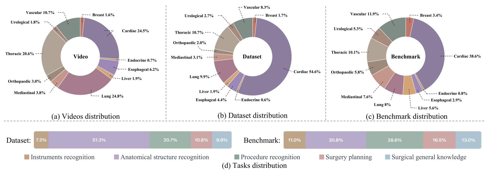
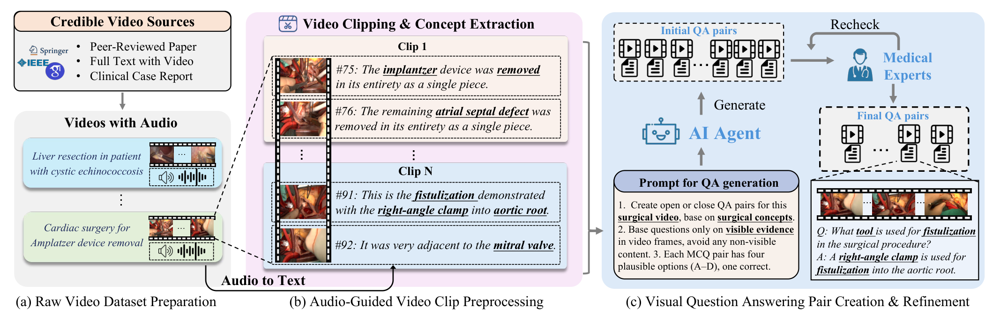
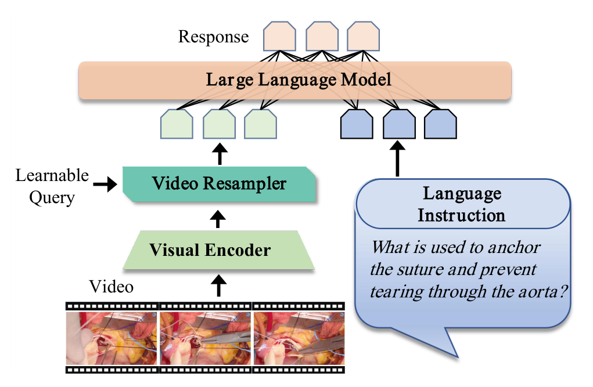
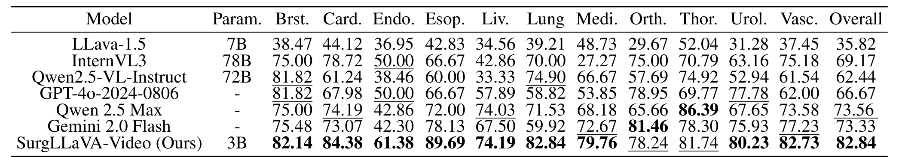
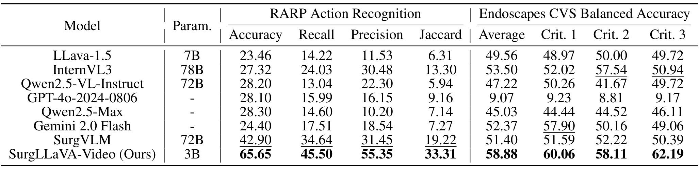
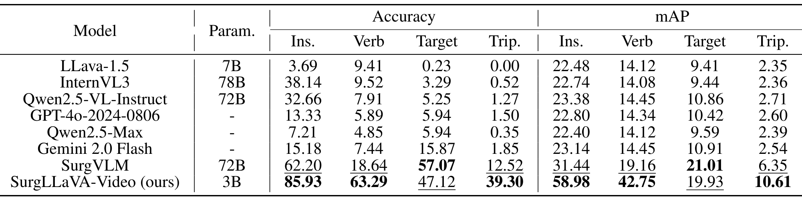

## 1. 背景与动机

**手术视觉语言模型大多只看单帧,理解不了手术步骤怎样随时间展开。** 论文把原因归到数据:缺少带问答标注的高质量手术视频。

已有两条路线各缺一半。把公开帧级数据集转成问答(如 SurgVLM-DB)标注准,但没有时间信息;从网络视频挖讲解(如 SurgVLP、Surg-3M)有时间信息,但讲解没有同行评审,也很少直接提供问答。

帧级数据集的源视频也很少。表 1 中 SSG-VQA 只有 50 个源视频,最大的 SurgVLM-DB 也只有 849 个。

:::highlights
- 缺口:没有全由视频组成、文本可信的手术问答数据集
- 帧级转换丢时间,网络视频不可信
:::

## 2. 核心观点速览

论文的答案是去找期刊论文附带的手术视频:它们有术者讲解,又经过同行评审。

- 数据:3,538 个原始视频切成 10,926 个片段,生成 48,520 个问答,覆盖 11 个专科、五类任务。
- 构建:Whisper 转写切片,三个 LLM 智能体合并片段、抽概念、出题,出题模型是 GPT-4o,医学专家复核。
- 模型:在 TinyLLaVA-Video 上微调出 3B 的 SurgLLaVA-Video。
- 结果:自建基准总体 82.84,GPT-4o 为 66.67;外部三个数据集也领先 SurgVLM,但三元组的目标识别落后。

**边界:基准与训练集同源,只有 SurgLLaVA-Video 做过微调,领先不能全算作视频理解。**

:::data
- 3,538 个原始视频,25 个期刊
- 10,926 个片段,平均 29.85 秒
- 48,520 个问答,基准 3,337 个
:::

## 3. 数据从哪里来

**期刊视频是作者为展示术式剪辑的教学视频,讲解可信,但画面经过挑选。** 原始视频平均 323.5 秒,1920×1080,30 Hz,每个视频对应一篇同行评审文章。

专科分布在切片后明显偏移:心脏手术从原始视频的 24.5% 升到片段的 54.6%,肺从 24.8% 降到 9.9%。论文没有解释原因。我的推断是心脏手术讲解更密,切出的片段更多。

一半以上的训练问答问解剖结构(51.3%),器械只占 7.3%。基准经去重后,心脏降到 38.6%,解剖降到 30.8%。

摘要的 2500 万帧怎样算出,论文未说明。按原始视频估算约 3400 万帧,按片段估算约 980 万帧,都对不上。

*论文原图编号：Figure 2。原始视频、数据集和基准三层的专科分布,以及五类任务占比。放在这里是因为它显示心脏手术在片段层被放大。*

:::data
- 心脏占比:原始 24.5%,片段 54.6%,基准 38.6%
- 解剖识别占训练问答 51.3%
:::

## 4. 问答怎样生成

问答质量取决于每一步交给谁,以及谁来把关。流程分四步:

1. Whisper 把讲解转成带时间戳的短段文字。
2. CGVP 智能体删去非手术段,把相关短段合并成 15 到 30 秒的片段。
3. FGCE 智能体读片段转写和论文文本,标出器械、步骤、解剖、规划、常识五类概念。
4. QAG 智能体用 GPT-4o 出开放题和四选一选择题,医学专家复核,可多轮迭代。

**问题和答案的文字来源都是转写和论文,不是画面。** FGCE 明确只读文字;QAG 是否看到视频帧,论文未说明。专家人数、复核比例、修改率也都论文未说明。

*论文原图编号：Figure 3。问答生成流程与一个真实问答例子。放在这里是因为它给出了出题提示的摘要。*

:::highlights
- 文本来自讲解与论文,而不是类别标签
- 出题是否看画面论文未说明
:::

## 5. 模型怎样处理视频

SurgLLaVA-Video 由视觉编码器、视频组重采样器和语言模型组成。逐帧特征展平后,重采样器用固定数量的可学习查询做分组交叉注意力,输出固定长度的视觉标记:

$$V=[V_1;V_2;\dots;V_L]\in\mathbb{R}^{L\times D}$$

**视觉标记数与帧数无关**,所以帧数多了不会撑大语言模型输入,但固定容量要容纳更多冗余帧。训练时冻结视觉编码器,全量微调语言模型和重采样器,4 张 A40,推理温度 0.2。编码器与语言模型型号、学习率、轮数论文未说明。

*论文原图编号：Figure 4。SurgLLaVA-Video 结构。放在这里是因为它显示可学习查询把多帧特征压成固定长度。*

## 6. 基准结果说了什么

SurgLLaVA-Video 总体 82.84,比 GPT-4o 高 16.17 个点,比最强零样本模型 Qwen2.5-Max 高 9.28 个点。

| 模型 | 参数 | 心脏 | 骨科 | 胸科 | 总体 |
|---|---|---|---|---|---|
| InternVL3 | 78B | 78.72 | 75.00 | 70.79 | 69.17 |
| GPT-4o | - | 67.98 | 78.95 | 69.77 | 66.67 |
| Qwen2.5-Max | - | 74.19 | 65.66 | 86.39 | 73.56 |
| Gemini 2.0 Flash | - | 73.07 | 81.46 | 78.30 | 73.33 |
| SurgLLaVA-Video | 3B | 84.38 | 78.24 | 81.74 | 82.84 |

**正文说所有专科一致提升,表格并不支持。** 骨科输给 Gemini 2.0 Flash,胸科输给 Qwen2.5-Max。正文说十个专科提升超过 10%,而相对 GPT-4o 超过 10 个点的是 8 个,相对最强基线超过 10 个点的只有内分泌和食管。

*论文原图编号：Table 2。基准上 7 个模型的 11 个专科准确率。*

:::data
- 总体 82.84,GPT-4o 66.67,Qwen2.5-Max 73.56
- 骨科 78.24 对 81.46,胸科 81.74 对 86.39
:::

## 7. 外部数据集说了什么

外部数据集比同源基准更能说明泛化,三项都用选择题格式。

| 任务 | 指标 | SurgVLM | SurgLLaVA-Video |
|---|---|---|---|
| SAR-RARP50 动作 | 准确率 | 42.90 | 65.65 |
| Endoscapes CVS | 平均平衡准确率 | 51.40 | 58.88 |
| CholecT50 三元组 | 三元组准确率 | 12.52 | 39.30 |
| CholecT50 目标 | 准确率 | 57.07 | 47.12 |

**CVS 上多数模型在随机水平 50 附近,最好的也只高约 9 个点。** GPT-4o 只有 9.07,低于随机,论文未解释。目标识别是唯一落后的分项。

*论文原图编号：Table 3。SAR-RARP 与 Endoscapes CVS 结果。*

*论文原图编号：Table 4。CholecT50 三元组识别结果。*

## 8. 消融说了什么

- 帧数:总体在 16 帧最高,为 80.82;解剖识别在 24 帧到 85.08,32 帧下降。
- 数据规模:总体随数据近似线性上升;手术规划在 75% 数据时到 82.40 后持平。

**消融最佳总体 80.82,主结果是 82.84,口径不同,论文未说明原因。** 消融只跑一次,相邻设置几个点的差距无法排除随机波动。

## 9. 结果没说什么

- **没有分开视频理解和出题风格适应。** 基准与训练集同源,对比模型都是零样本;盲答、单帧、对比模型微调三种对照都没有。
- **下游是否零样本不清楚。** 下游训练集是否参与微调论文未说明。
- **问答正确率没有数字。** 专家复核规模和开放题评分方式都论文未说明。
- **不能外推到常见术式。** 专科偏向心胸外科,剪辑后的教学视频与腹腔镜实时画面不同。

## 10. 复现要注意什么

- 确认数据许可;期刊视频的版权与发布方式论文未说明。
- 补齐模型型号、重采样器查询数和训练超参数,这些论文都未给出。
- 比较时区分零样本与微调模型,并至少跑三次报方差。
- 若要证明时间理解,先做单帧和打乱帧序对照。

## @takeaways
- 期刊附带视频是可信、带讲解的手术视频来源
- 转写切片再按语义合并,是可复用的视频处理流程
- 82.84 对 66.67 是同源、微调对零样本的比较
- CVS 与三元组目标识别显示泛化有限

## @strengths
- 数据来源有同行评审背书,文本比类别标签丰富
- 构建流程每一步都有明确分工,并有专家复核
- 基准按专科和任务两维报告

## @weaknesses
- 缺少盲答、单帧等关键对照
- 正文表述强于表格,如所有专科一致提升
- 复核规模、评分方式、模型型号、许可等多项论文未说明
- 2500 万帧与消融 80.82 等数字对不上

## @questions
- 只给问题不给视频时,模型能答对多少?
- 专家复核改动了多少问答?
- 下游三个数据集的训练集是否参与了微调?
