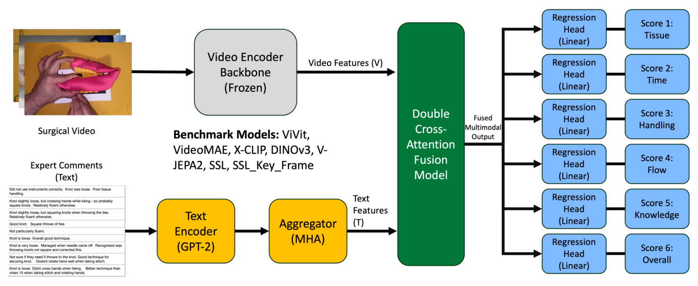
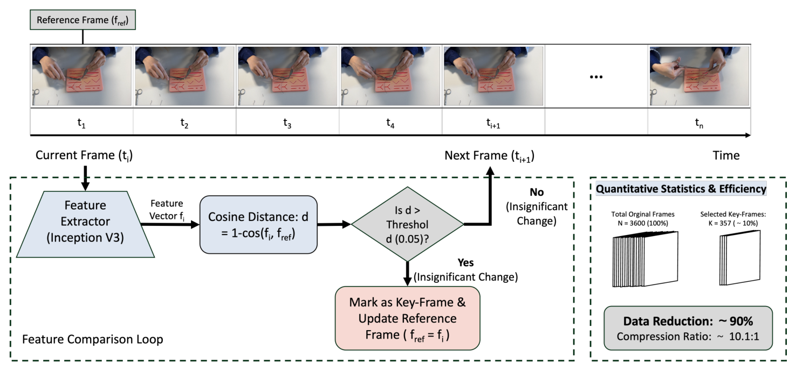
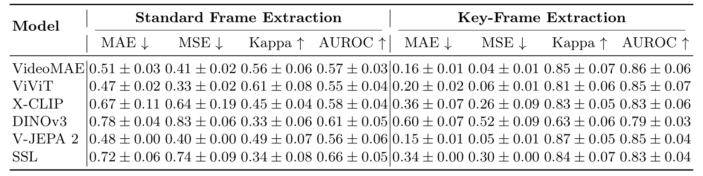
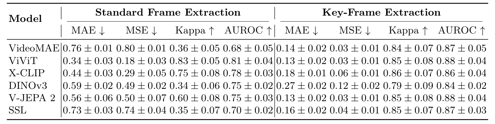

## 1. 背景与动机

OSATS 是外科技术评分的通用量表：专家按组织保护、器械操作、操作流程等维度给 1 到 5 分。它要求专家逐段看录像，费时，不同评分者之间也有差异。

专家打分时常写评语解释原因，例如“结有点松”。**现有自动方法几乎只看视频，评语这类解释分数的信息很少和视频、分数放进同一个评测协议。**

作者想先给出一个可复现的基准设置，并明确说不追求新的最优架构。

## 2. 核心观点速览

**做法是用一份小而三模态对齐的数据，配受控基线，分别看采样方式和评语各起多大作用。**

- 数据：214 段约一分钟的模拟训练视频，两名以上专家按六维打分并写评语。
- 两种设置：纯视频预测算自动评估；评语辅助预测只算事后辅助，因为评语和分数出自同一批人。
- 采样：关键帧采样 CA-Frame 让六个骨干的四项指标全部改善。
- 评语：标准采样下帮助多数骨干，关键帧下增益很小。

**边界：** 只有视频级五折验证，独立测试集结果论文未说明，数据与代码未公开。

:::highlights
- 首次把专家自由文本评语作为一种模态放进技能评估基准
- 评语辅助结果被作者单独列出，不当作自动评估
:::

:::data
- 214 段视频，每段约一分钟
- 六个 OSATS 维度，每维 1 到 5 分
:::

下面先看数据本身，因为所有边界都来自它怎么采集和划分。

## 3. 数据与标注

视频由医生提供，记录练习台上的操作区域；从论文图片看是缝合打结。受训者人数、任务种类和年资分布，论文未说明。

| 维度 | 原文名称 |
|---|---|
| 组织保护 | Respect for Tissue |
| 时间与动作 | Time & Motion |
| 器械操作 | Instrument Handling |
| 操作流程 | Flow of Operation |
| 器械知识 | Knowledge of Instruments |
| 总分 | Overall Score |

每维取多名评分者的均分作为连续标签。**评分者间一致性、分数分布、每段的评分者人数，论文未说明，因此无法知道标签本身的噪声有多大。**

数据怎么分，决定了结果能说明什么。

## 4. 划分与指标

10% 的视频留作测试集，其余 90% 做五折交叉验证，同一视频的帧、分数和评语只进一份。**参与者与场次元数据不全，同一受训者的视频可能分在训练和验证两侧。** 作者因此只称之为视频级内部性能。

- MAE 与 MSE：主指标，六维宏平均。
- 二次加权 kappa：预测取整后与取整均分比较，不等于评分者之间的信度。
- AUROC：按本数据集各维中位数分高低，阈值不是临床能力分界。

正文提到一个均值预测基线，但数字论文未说明，所以无法判断误差比平凡水平好多少。

## 5. 基线流程

1. 帧采样：均匀抽 16 帧，或用 CA-Frame 选出关键帧后再按时间顺序抽 16 帧。
2. 视觉编码：六个冻结骨干之一提取特征，投影到 256 维。
3. 评语融合（仅辅助设置）：冻结 GPT-2 编码评语，多头注意力聚合，再与视频特征做双向协同注意力。
4. 回归：六个线性头各输出一维分数，损失为六维 MSE 平均。

*论文原图编号：Fig. 1。评语辅助基线框架：冻结视频骨干与冻结 GPT-2 分别提取特征，双向交叉注意力融合后接六个回归头。*

六个骨干是 VideoMAE、ViViT、X-CLIP、DINOv3、V-JEPA 2，以及在 SurgVU 840 多小时视频上预训练的手术域 SSL 编码器。训练用 AdamW，学习率 $1\times10^{-4}$，批量 8，200 轮。

两个变量里，采样方式的设计最需要细看。

## 6. 关键帧采样 CA-Frame

CA-Frame 用 InceptionV3 的 2048 维特征，当某帧与参考帧的余弦距离超过 0.05 时，记为关键帧并更新参考帧。平均从 3000 多帧中选出约 80 帧。**两种采样都用 16 帧，CA-Frame 只改变帧的时间位置。**

*论文原图编号：Fig. 2。CA-Frame 流程与统计面板。面板示例写 3600 帧选 357 帧，与正文平均约 80 帧不一致；“是”分支下的“变化不显著”字样也应为“变化显著”。*

阈值和帧数怎么选，论文没有消融。下一节看它带来的变化有多大。

## 7. 纯视频结果

*论文原图编号：Table 1。六个骨干在标准采样与关键帧采样下的纯视频结果。*

| 骨干 | 标准 MAE | 关键帧 MAE | 标准 AUROC | 关键帧 AUROC |
|---|---|---|---|---|
| VideoMAE | 0.51 | 0.16 | 0.57 | 0.86 |
| ViViT | 0.47 | 0.20 | 0.55 | 0.85 |
| X-CLIP | 0.67 | 0.36 | 0.58 | 0.83 |
| DINOv3 | 0.78 | 0.60 | 0.61 | 0.79 |
| V-JEPA 2 | 0.48 | 0.15 | 0.56 | 0.85 |
| SSL | 0.72 | 0.34 | 0.66 | 0.83 |

**标准采样下 AUROC 都在 0.55 到 0.66，接近随机；换成关键帧后升到 0.79 到 0.86。** 手术域 SSL 编码器没有优势，逐帧编码的 DINOv3 最差。

:::data
- V-JEPA 2 关键帧 MAE 0.15，kappa 0.87
- VideoMAE 关键帧 MSE 从 0.41 降到 0.04
:::

采样的作用这么大，加评语还能再提升多少？

## 8. 评语辅助结果

*论文原图编号：Table 2。同六个骨干在评语辅助设置下的结果，作者注明评语可能含评分信息。*

标准采样下，ViViT 的 MAE 从 0.47 降到 0.34，kappa 从 0.61 升到 0.83。**但 VideoMAE 加评语后反而变差：MAE 从 0.51 升到 0.76，V-JEPA 2 也从 0.48 升到 0.56。**

关键帧下，ViViT 与 V-JEPA 2 达到最佳 AUROC 0.88，比纯视频的 0.85 只高一点，在标准差 0.04 以内。

:::highlights
- 评语的增益集中在标准采样下较弱的模型上
- 部分骨干加评语后误差上升，融合模块不总能用好文本
:::

数字看完，接下来问这些数字能证明什么。

## 9. 结果没说什么

**关键帧收益缺乏解释。** 帧数不变却让误差降到约三分之一，至少有三种解释：关键帧信息更密；标准采样下模型只学到均值；关键帧集中在手和器械画面，模型借此认人，再借视频级划分记住这个人的分数。均值基线、按人划分和随机采样消融论文未说明，三者无法区分。

**评语可能就是分数的文字版。** “结很松”“技术总体良好”几乎直接对应分数，ViViT 的 kappa 跳到 0.83 更像读出了答案。去掉评价词的对照论文未说明。

**定性注意力图不能当证据。** 示例是挑出来的，通用基线是哪个骨干论文未说明。

**独立测试集结果论文未说明。** 表中只有五折统计；SSL 关键帧等处标准差为 0.00，原因也未解释。

这些缺口决定了复现时要先补什么。

## 10. 复现与使用要注意什么

- 先拿到参与者编号，按人划分重跑。
- 先跑均值预测基线，再看骨干提升有没有意义。
- 评语辅助与纯视频分开报告，并写明评语来源。
- 数据与代码目前都未公开，论文只说代码以后公开，数据开放与否论文未说明。

按我的背景知识，JIGSAWS 等已有技能数据集以运动学或视频加分数为主，本文并未引用它们做对比；评语这一模态是 SurgSkill-Bench 的主要新意。

## @takeaways
- 214 段模拟视频、六维 OSATS、专家评语，是一个三模态对齐的小基准
- 关键帧采样在表 1 中带来全面改善，但原因没有被消融拆开
- 评语辅助只算事后预测，增益与读答案尚未区分
- 结果只代表视频级内部验证

## @strengths
- 主动写明 kappa、AUROC 和划分的口径限制
- 骨干全部冻结、帧数相同，比较条件受控
- 把评语辅助与纯视频分开定义和报告

## @weaknesses
- 规模小，受训者、任务、评分者一致性等元数据缺失
- 无均值基线数字、无测试集结果、无采样消融
- 图 2 示意的数字和分支标签与正文不符
- 数据与代码均未公开

## @questions
- 按参与者划分后，关键帧采样的提升是否保持？
- 去掉评语中的直接评价词后，辅助增益还剩多少？
- 均值预测基线的误差是多少？
