---
tags:
  - papers/手术数据集
aliases:
  - "SurgToolLoc"
  - "SurgVU"
  - "SurgToolLoc and SurgVU Challenges 2022-2025"
date: 2023-05-11
arxiv_id: 2305.07152
---

# Intuitive Surgical SurgToolLoc and SurgVU Challenges Results: 2022-2025

## 核心信息

- 标题: Intuitive Surgical SurgToolLoc and SurgVU Challenges Results: 2022-2025
- 标题翻译: Intuitive Surgical SurgToolLoc 与 SurgVU 挑战赛结果(2022-2025)
- 作者: Aneeq Zia, Max Berniker, Rogerio Garcia Nespolo, Xiaorui Zhang, Conor Perreault 等, 末位作者 Anthony Jarc
- 机构: Intuitive Surgical, Inc. 及各参赛队所在单位(NVIDIA、Argonne National Laboratory、University of Strasbourg、DKFZ 等)
- 发表时间: arXiv 首版 2023 年 5 月;本笔记依据 v4(2026-05-16)
- 发表渠道: arXiv 预印本(cs.CV),MICCAI EndoVis 子挑战总结报告
- arXiv: 2305.07152
- 论文链接: https://arxiv.org/abs/2305.07152
- 代码 / 项目: https://surgtoolloc.grand-challenge.org
- 数据 / 资源: 2022 训练集 https://console.cloud.google.com/storage/browser/isi-surgtoolloc-2022 ;完整数据集见配套论文 arXiv:2501.09209
- 论文类型: 挑战赛数据集与评测报告(benchmark_or_dataset)

## 原文摘要翻译

机器人辅助(RA)手术有望改变外科干预方式。
Intuitive Surgical 致力于推动这些变化,以及实现这些变化所需的机器学习模型与算法。
出于这些目标,我们邀请手术数据科学社区参加一项依托医学图像计算与计算机辅助干预(MICCAI)会议举办的年度竞赛。
每年的内容有所变化,我们在先进 RA 应用的背景下向社区提出困难的机器学习问题。
本文记录这些挑战的结果,重点是手术器械定位(SurgToolLoc)与手术视觉理解(SurgVU)。
随挑战一同公开的数据集在另一篇论文 arXiv:2501.09209 [1] 中详细介绍。

## 创新点

1. **用机器人系统事件当训练标签,而不是人工逐帧标注。** 每次器械安装和卸下都会在达芬奇系统里留下带器械类型和时间的事件。挑战把这些事件转成剪辑级的“工具存在”标签直接发给参赛队,让问题变成“能否从噪声弱标签学出检测器”。这是挑战设计的核心:标签便宜,但和画面中真正可见的器械并不一致。
2. **同一套视频、同一个主任务连续四年。** 2022 到 2025 年的第一赛道始终是弱监督工具分类与定位,测试集换新但标注协议不变,2023 年还把新模型放回 2022 测试集复测。这让“年度进步”有了一个部分可控的参照。
3. **测试集的框标注规则贴合手术需求。
** 框以器械的 clevis(腕部关节)为主体,clevis 不明显或器械很大时才包含尖端;界面 UI 区域在测试帧中模糊,防止模型直接读出 UI 上的器械名称。
4. **第二赛道逐年扩展到更高层的理解。** 2024 年加入全监督的手术步骤识别,2025 年加入开放式手术视觉问答(VQA),让同一数据集同时支撑感知、时序识别和多模态问答三类任务的对比。
5. **收录参赛队自写的方法报告。** 正文绝大部分篇幅是各队的完整方法、训练细节和预实验数字,读者可以把排行榜结果和具体做法对照着看。

## 一句话总结

SurgToolLoc/SurgVU 用达芬奇训练练习视频和系统事件导出的噪声工具存在标签,连续四年考察弱监督手术器械检测:冠军 mAP 依次为 `0.4077`、`0.4669`、`0.4244`、`0.5188`,而领先队伍几乎都靠伪标签、跟踪传播或人在环标注自己造出带框训练集,纯弱监督方法始终落后。

## 研究问题

**机器人辅助手术会产生大量可自动记录的数据,瓶颈在标注。** 达芬奇系统在手术中记录视频、器械运动学和系统事件,这些数据可以用于手术表现量化、技能评估和手术规划。但给这些数据加上有意义的标注需要懂手术的人,成本高、耗时长,不同标注者之间还会有差异。

**系统事件提供了一种免费但有噪声的标签。** 每次安装或卸下器械,系统都会记录器械类型和时间;能量器械的激活也会留下事件。作者指出,这些事件并不总能代表视野里实际可见的器械,更不提供器械的位置。如果有机器学习方法能把它们当作噪声弱标签来训练,价值会很大,而现有算法的精度和稳健性还不够。

**挑战的设计目标是推动这一个问题的年度进步。** 组织方从 2020 年起每年举办挑战,从 2022 年开始固定为弱监督手术器械定位(SurgToolLoc):给参赛队大量内镜视频和逐帧的工具存在信息,要求在隐藏测试集上分类并定位器械。每年另设一个使用同一批视频的第二赛道。论文要回答的问题是:只靠系统事件导出的存在标签,社区能把手术器械检测做到什么程度,哪些策略真正起作用。

### 核心观点速览

**论文的答案是:四年里检测分数有进步,但最高也只到 0.5188 mAP,而且进步主要来自参赛队自己造出的带框数据。**

- **任务:** 用剪辑级或逐帧的工具存在标签,训练能在 1 FPS 测试帧上分类并给出 clevis 框的检测器。
- **主线结果:** 冠军 mAP 依次为 `0.4077`、`0.4669`、`0.4244`、`0.5188`。通用检测的 CO-DETR 在 COCO 上为 `0.66`,差距明显。
- **起作用的做法:** 少量人工标注加跟踪传播、教师模型伪标签、人在环迭代。纯类激活图和不带框监督的视觉语言模型一直落后。
- **第二赛道:** 全监督步骤识别前五名都超过 `0.81` 加权 F1;开放式问答 BLEU 最高 `0.4215`,零样本模型加结构化上下文好于微调。
- **边界:** 每年测试集不同,只有 2023 对 2022 做了同测试集复测;2025 年新增带框验证集,组织方承认它很可能促成了这年的提升。

下一节先讲数据和标签,因为“弱”和“噪声”具体从哪里来,决定了后面所有方法的走向。

## 数据与任务定义

### 数据来源

视频和系统数据来自在达芬奇系统上进行的手术训练练习。受训者(以及部分专家)在猪组织上完成解剖、缝合、电凝等标准化操作。两种动物模式并存:麻醉的活体猪和离体猪器官,前者画面整体更红。视频是外科医生控制台视角,只取双目内镜两路视频中的一路。系统数据提供机器人上安装的器械;临床专家团队另外把视频切分为手术步骤。

**2022/2023 训练集:** 从 11 个不同训练练习中采样 24,695 个 30 秒剪辑,60 FPS,分辨率 1280×720,共 14 种器械:持针器、Cadiere 抓钳、ProGrasp 抓钳、单极弯剪、双极钳、吻合器、Force 双极钳、血管闭合器、永久电凝钩/铲、施夹器、尖端上翘开窗抓钳、吸引冲洗器、双极分离钳、抓持牵开器。
每个剪辑同时最多装有 3 把器械。

**2024/2025 训练集:** 扩展为 155 次训练中的 280 段长视频,同样 60 fps、720p,总时长超过 840 小时、超过 1800 万帧,器械为同一器械集中的 12 种。
另外提供 8 类互斥的手术任务标签(缝合、子宫角、悬韧带、直肠动静脉、技能应用、运动范围、牵拉与避碰、其他),未标注片段一律记为“其他”。
2025 年在此基础上增加每段任务的自然语言描述(CSV 中的 matched description 列),并为第一赛道新增一个带真实框标注的小验证集。

### 标签格式与噪声来源

存在标签是一个长度为 4 的字符串列表,对应机器人四条机械臂 USM1 到 USM4,装内镜的臂记为 `nan`。论文给出的例子如下:

`['cadiere forceps', 'nan', 'force bipolar', 'grasping retractor']`

四条臂通常(但不一定)从左到右安装。
因为器械在整个剪辑内都处于安装状态,每个剪辑只给一个标签。

噪声有三个来源,论文都明确写出:器械装着但被遮挡或暂时移出视野;部分标签因技术原因缺失或错配;器械分布高度不平衡。参赛队的报告补充了更具体的现象,例如 TeamZero 发现有整段全黑的帧也继承了父剪辑的标签,WhiteBox 统计出训练集中最常见类别的样本数是最少类别的 1149 倍。

### 测试集与标注协议

| 年份 | 测试集 | 标注 | 推理采样 |
|---|---|---|---|
| 2022 | 93 个剪辑,时长均值 747.31 秒(SD 579.92) | 30 名有经验的众包标注者画框,两轮复核 | 1 FPS |
| 2023 | 新的 108 个剪辑,时长均值 687.45 秒(SD 424.68) | 复用 2022 流程 | 1 FPS |
| 2024 | 同条件下的新训练视频 | 框标注 + 逐帧任务标签 | 1 FPS |
| 2025 | 同条件下的新训练视频 | 框标注;VQA 每题 5 个参考答案 | 1 FPS |

框的主体是器械的 clevis。
如果 clevis 定义不清,或器械很大、clevis 不总在视野中(例如 monopolar curved scissors),框会把尖端也包进去。
禁止使用画面 UI 中的信息做预测,测试帧中 UI 区域被模糊。

### 四年任务与指标

| 年份 | 赛道 1 | 赛道 2 | 排名指标 |
|---|---|---|---|
| 2022 | 工具存在分类(多标签,14 类) | 分类 + 框定位 | 赛道 1:按工具出现频率加权的平均 F1;赛道 2:COCO mAP@[0.5:0.05:0.95] |
| 2023 | 仅一个赛道,同 2022 赛道 2 | 无 | COCO mAP |
| 2024 | 弱监督分类与定位 | 逐帧手术任务识别(全监督) | mAP;加权 F1 |
| 2025 | 弱监督分类与定位,附带小验证集框标签 | 30 秒剪辑上的开放式 VQA | mAP;平均 BLEU |

2025 年 VQA 的 BLEU 计算方式是:每题只输出一个答案,分别和 5 个参考答案计算 BLEU,取最大值作为该题得分,再对所有问题取平均。

### 与相近数据集和挑战的位置

- **相对 EndoVis 2017/2018 分割挑战:** 那两届给的是像素级掩码,而本挑战训练时只给存在标签,不给框或掩码。很多队伍反过来把 EndoVis 2017/2018 的掩码当作预训练或造框的来源。
- **相对 Cholec80 这类工具存在数据:** Cholec80 的存在标签由人工逐帧标注,本挑战的标签由机器人事件自动导出,规模大得多但噪声也大。
- **相对 COCO 通用检测:** 组织方用 CO-DETR 的 `0.66` 作参照,并把差距归因于手术画面高度相似、背景单一、类别区分要求细。这是作者的解释,论文没有用实验验证。

这些差别说明,本挑战的新意在标签来源,而不在任务形式。下一节看组织方和参赛队如何把这种弱标签变成可评测的检测结果。

## 方法主线

这篇论文本身没有提出模型。“方法”在这里指两件事:组织方的数据构建与评测协议,以及参赛队方法的演化谱系。

### 机制流程

1. **从系统事件构造训练标签:** 输入是达芬奇训练练习的视频与安装/卸载事件,组织方把每个剪辑内装在四条臂上的器械写成存在标签,输出剪辑级(2024 年起为逐帧)的噪声标签,随视频一起发给参赛队。
2. **参赛队把弱标签变成可训练的监督:** 输入是视频和存在标签,队伍通过分割预训练、跟踪传播、伪标签迭代或人工标注生成带框数据,再训练检测器,输出打包成 Docker 容器的算法。
3. **在隐藏测试集上统一评测:** Grand Challenge 的 T2 机制自动运行容器,输入 1 FPS 的测试视频(先用含两段视频的预测试集调试),输出逐帧框或预测 JSON,平台按固定指标算分并更新排行榜。
4. **汇总报告:** 只有同时提交最终结果和方法报告的队伍算完整提交,报告原样收入论文,组织方在每年末尾给出结果表和讨论。

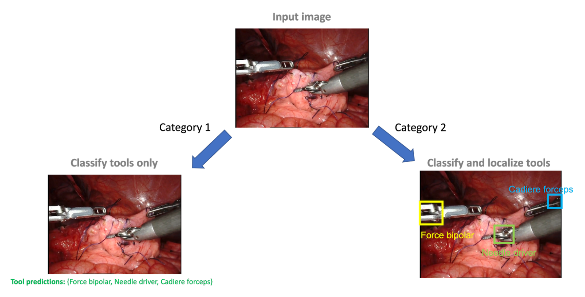
*论文原图编号：Figure 1。2022 年两个赛道的区别:赛道 1 只输出工具集合,赛道 2 还要给出每把工具的框。*

### 评测协议

挑战以 Grand Challenge 平台上的 “Type 2” 形式举办:参赛队提交容器,评测在私有测试集上按标准化流程自动执行,参赛队看不到测试数据和标签。
2022 年赛道 1 输出每帧工具的布尔列表,赛道 2 输出每帧检测到的工具及框坐标;2024 年起赛道 1 输出 COCO 检测格式的 JSON,赛道 2 输出逐帧步骤预测或单个答案。

### 2022 年:从分类出发的多条路线

2022 年 79 支队伍表示有兴趣,赛道 1 有 17 支、赛道 2 有 11 支做了完整提交。队伍方法可以分成三类。

**第一类,借公开分割数据造框。** HKMV 把 EndoVis17 与 EndoVis18 掩码中的 clevis 部分转成框,得到 5212 张图。
检测器是两阶段 Faster R-CNN,骨干用 EfficientNet-b3 加特征金字塔,四层特征图分别下采样 8、16、32、64 倍。
随后用 0.7 的分数阈值筛选模型在比赛数据上的预测,把训练集扩充到 11035 张。
HRI MV 只人工标注序列首帧,用 SiamFC++ 单目标跟踪往后传播。
再用公开分割数据训练的类 U-Net 网络做交叉校验,交并比低于 0.2 的伪标签被丢弃,最终得到约 25000 帧。
检测器用 Cascade RCNN,分类头的候选框宽高各扩大两倍,以便看到钳口。

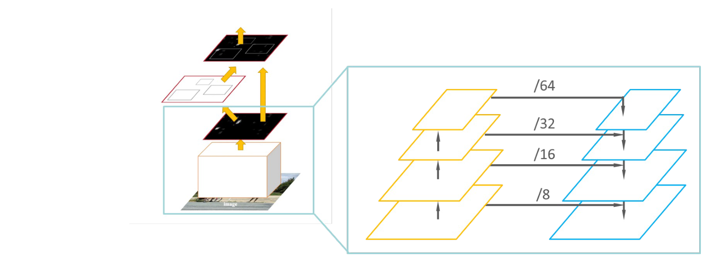
*论文原图编号：Figure 8。HKMV 的检测器结构,右侧放大部分是四层特征金字塔。*

**第二类,先挑“干净帧”再训练。** NVIDIA 用 2017 器械分割挑战公开的模型分割每帧,只保留能数出三把不同器械、且器械轮廓触到画面边缘的帧,这样剪辑级标签可以直接套到帧上;交叉验证时用图像哈希把同一场景的连续剪辑放进同一折,防止泄漏。赛道 2 先人工画少量框训练 YoloV5,再加入弱监督伪标签重训。

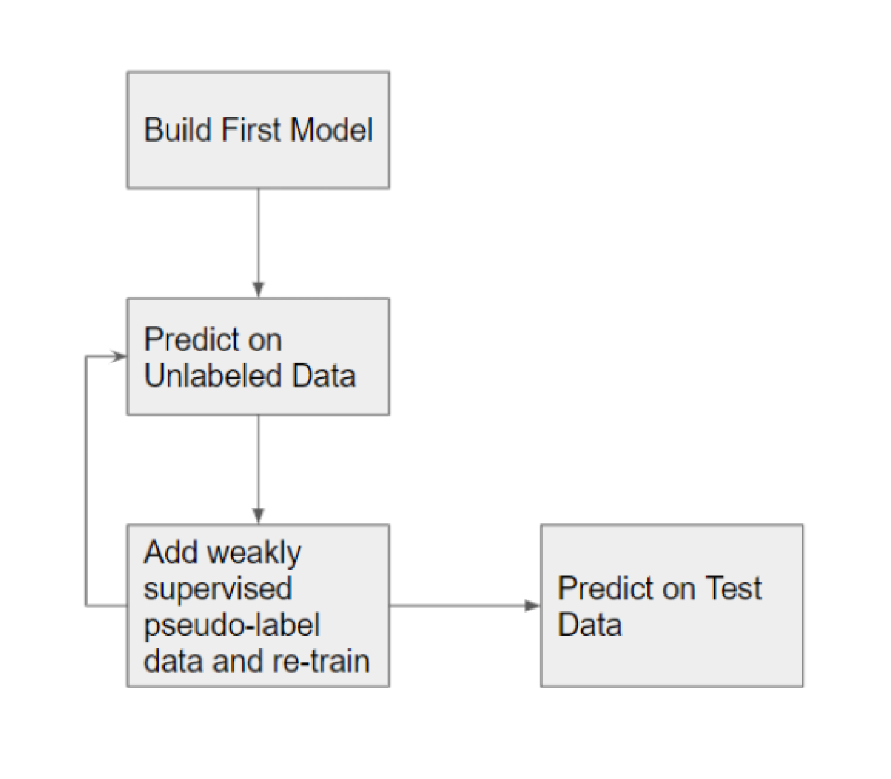
*论文原图编号：Figure 10。NVIDIA 赛道 2 的伪标签迭代流程。*

**第三类,用分类网络的激活图定位。** SK 用 MFF-Net 的类激活图加 Otsu 阈值,HVRL 用 Grad-CAM++。
VANDY-VISE 用 Query2Label 的交叉注意力图,ITeM 用带 SE 模块与多阶段融合的定位图。
CAMMA 用空间注意力网络,也属于这一类。
这一类在赛道 1 上表现尚可,在赛道 2 上 mAP 接近零。

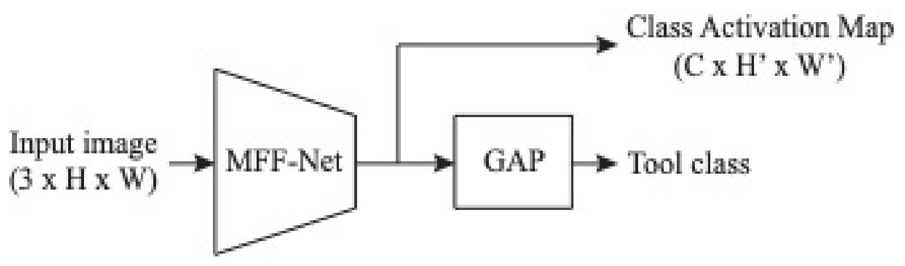
*论文原图编号：Figure 13。SK 的结构:同一网络输出类激活图和工具类别。*

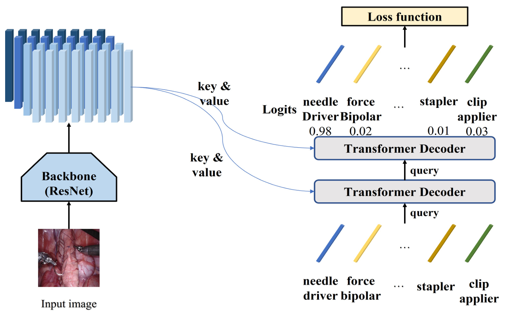
*论文原图编号：Figure 14。VANDY-VISE 使用的 Query2Label 结构,类别嵌入作为查询。*

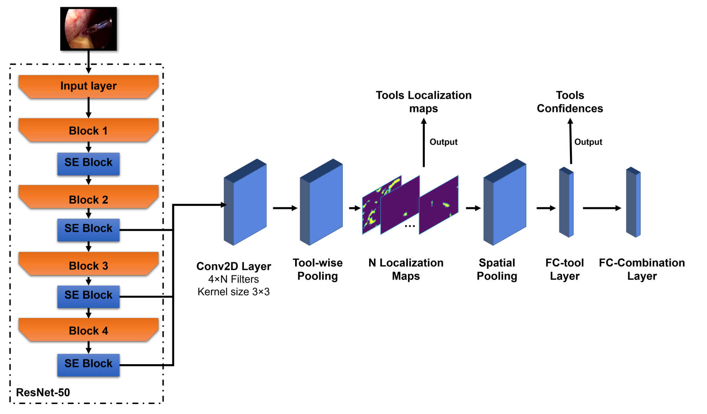
*论文原图编号：Figure 16。ITeM 的完整流程,包括工具级池化、空间池化和工具组合分类层。*

预处理上,多数队伍都裁掉左右黑边并遮挡底部 UI。
HVRL 以 0.5 的概率随机裁掉或模糊 UI;BioMedIA 则另用 YOLOv5 出框、ConvNext 分类的两阶段结构,按“标签顺序对应画面中逆时针位置”的假设给框分配类别。

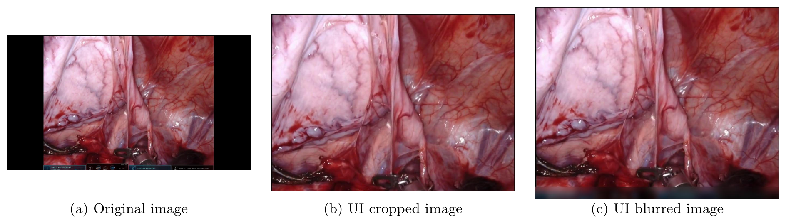
*论文原图编号：Figure 12。HVRL 的预处理:原图、裁掉 UI、模糊 UI 三种形式。*

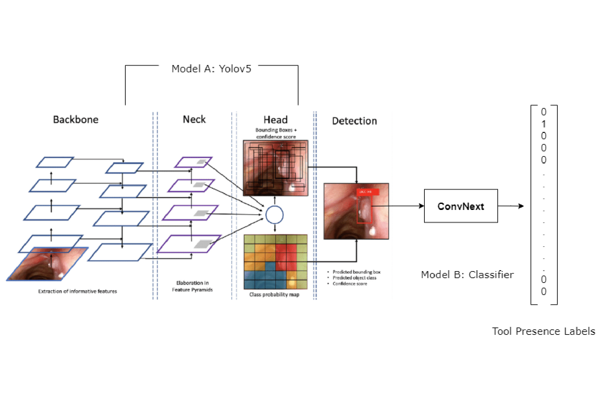
*论文原图编号：Figure 23。BioMedIA 的两阶段结构:YOLOv5 出框,ConvNext 分类。*

### 2023 年:跟踪传播伪标签成为主流

2023 年只保留检测赛道,18 支队伍表示有兴趣。
排名靠前的做法都是“少量人工标注 + 跟踪扩展”。
PUMCH 用 MAE 预训练骨干,人工标注后用 OSTrack 生成 30,000 个伪标签,检测器选 RTMDet 并与跟踪模型融合。
ANL-Surg 人工标注约 1500 帧,再加修订后的 NVIDIA 2022 数据约 1000 帧,用 Mixformer 双向跟踪传播。
其最终模型用 432,918 张图训练 YOLOv8。
SDS-HD 在 600 个剪辑上手工打关键点、用 TAPIR 跟踪并转成框,再扩展到共 268020 帧。
CAIR-HK 的 WS-YOLO 则不靠大量人工,先训练识别杆部、clevis、尖端的部件检测器,再按“从左到右对应标签顺序”的先验和多轮 IoU 过滤迭代,预测试 mAP 从 0.043 升到 0.157。

### 2024 与 2025 年:人在环标注和教师模型

2024 年领先队伍都依赖人工整理的框。
PDMYR 用 K-Means 聚成 1,000 类,选离中心最近的图做首批样本。
之后用文字识别读界面找低频器械,再用带跟踪辅助的 DarkLabel 工具在三天内标注 220,000 帧。
InspireLab 用 YOLOv10 半监督迭代、人工修正,扩展到 19,016 张;MULTIS 只用 3,842 张。
SJTUB 用 SAM2 半自动生成超过 30 万帧,但最终只得 0.2754。

2025 年冠军 PUH-SVU 先在超过 200 万帧无标注数据上用 MAE 预训练 ViT-L,用 5000 余个人工框做 OSTrack 锚点生成伪标签,再用 Co-DETR 教师模型迭代过滤,最后按均匀采样与尾部类密集采样分别训练两个 RTMDet 并按类别取优。
第二名 Medibot 把检测和分类拆开:单类 YOLOv8l 只判断“是不是器械”,再用 ResNet-50 对放大两倍的框分 12 类。

第二赛道方面,2024 年步骤识别的前几名都用视频或图像骨干加时序平滑。
PDMYR 用视频 Swin 骨干,SurgOp 用 MViT,TeamBCU 用图像分类器集成。
2025 年 VQA 的冠军 Capybara 没有微调 VLM,而是用在 SurgToolLoc 2022 数据上训练的工具与器官分类器生成结构化描述,再交给零样本的 LLaVA-OneVision-7B 回答。

## 关键结果

### 2022 年排行榜

赛道 1 共 13 个完整提交,按工具出现频率加权的平均 F1。

| 排名 | 队伍 | 赛道 1 F1 | 赛道 2 mAP |
|---|---|---|---|
| 1 | HRI MV | 0.7485 | 0.4077 |
| 2 | HKMV | 0.72 | 0.3726 |
| 3 | NVIDIA | 0.7055 | 0.3058 |
| 4 | ANL-Surg | 0.6691 | 0.0961 |
| 5 | HVRL | 0.6605 | 0 |
| 6 | SK | 0.643 | 0.0247 |
| 8 | VANDY-VISE | 0.6206 | 0.0003 |
| 10 | ITeM | 0.5978 | 0 |
| 13 | BioMedIA | 0.5521 | 无赛道 2 提交 |

赛道 2 只有前三名超过 0.3 mAP,其余队伍在 0 到 0.1 之间。
组织方观察到,区分赛道 2 高低分的关键是是否在带器械分割标签的数据上预训练。
赛道 1 前五名中有三队用了 EndoVis 器械分割数据(HRI MV、HKMV、ANL-Surg)。
赛道 2 前三名中有两队用了(HRI MV、HKMV)。
赛道 2 好的队伍赛道 1 也好,反过来不成立:赛道 1 的 F1 尚可的 HVRL 在赛道 2 得 0。

**这张表说明分类和检测是两件事:能判断“有没有”的模型,不一定能把框画对。** 赛道 1 的 F1 从 0.5521 到 0.7485 分布较平,赛道 2 却断崖式分成两档。

本地验证和测试之间的落差很大。
NVIDIA 赛道 1 集成模型本地验证 F1 为 0.8526,排行榜只有 0.7055;赛道 2 本地 mAP 0.4132,排行榜 0.3058。
HVRL 本地 F1 为 0.930,测试只有 0.6605。

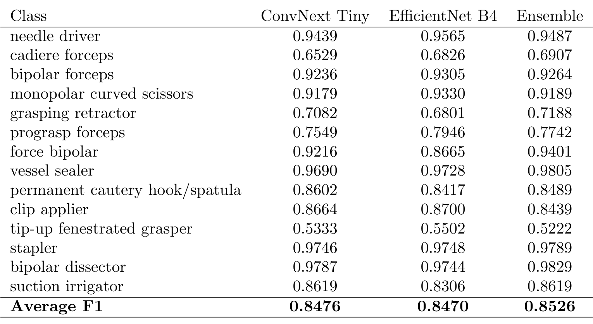
*论文原图编号：Table 5。NVIDIA 赛道 1 在本地验证集上的逐类 F1,尖端上翘开窗抓钳与 Cadiere 抓钳最低。*

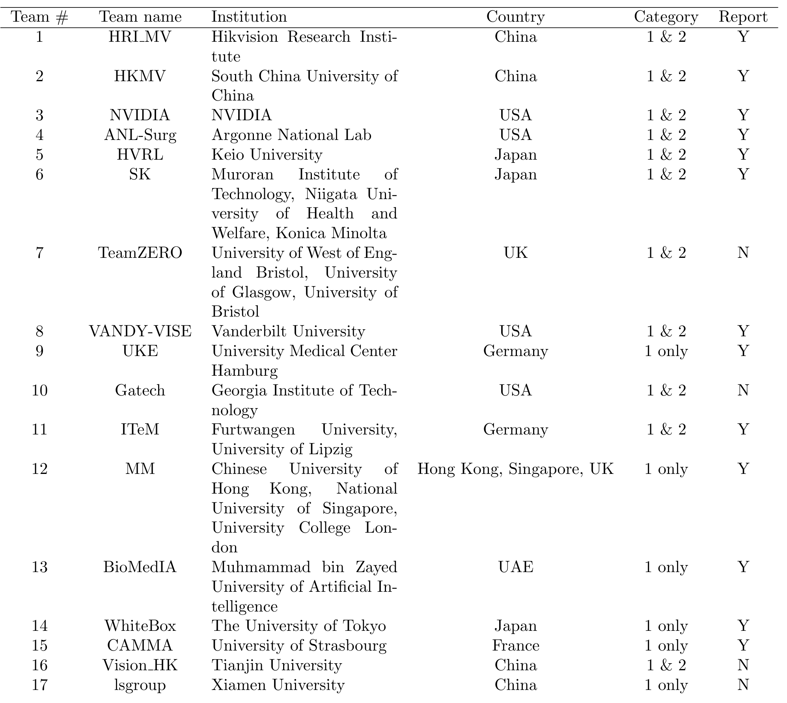
*论文原图编号：Table 1。2022 年参赛队、所属机构与参加的赛道,Report 一列标出是否提交了方法报告。*

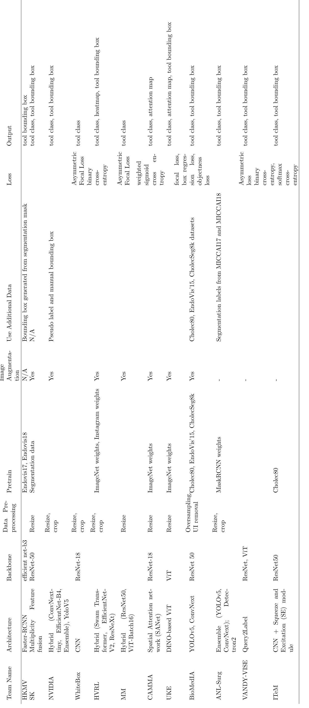
*论文原图编号：Table 2。2022 年各队方法汇总,横排表格,从架构、骨干、预训练到损失与输出。*

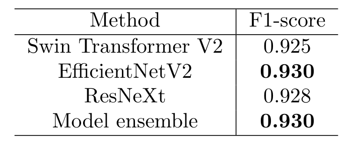
*论文原图编号：Table 10。HVRL 本地验证 F1,三个单模型和集成都在 0.925 以上,与测试成绩差距明显。*

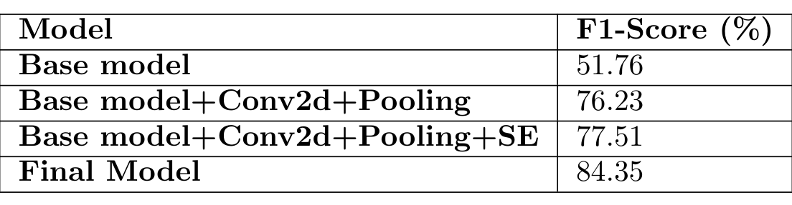
*论文原图编号：Table 11。ITeM 在预测试数据上的模块消融,定位层加池化带来最大提升。*

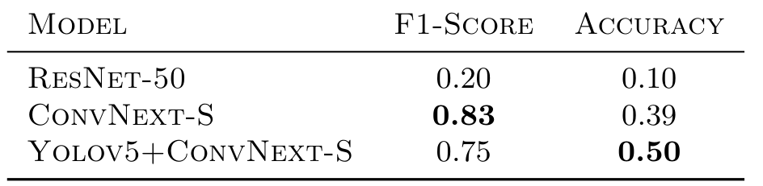
*论文原图编号：Table 12。BioMedIA 不同模型在验证集上的 F1 与准确率。*

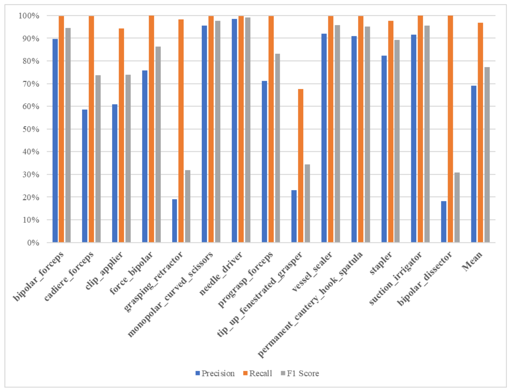
*论文原图编号：Figure 17。ITeM 在验证集上的逐类精确率、召回率与 F1,召回率普遍接近满分而精确率差异很大。*

> [!figure] Table 7 ANL-Surg 五折交叉验证 F1
> 建议位置：关键结果
> 放置原因：五折 F1 在 0.84748 到 0.91667 之间,可作为本地验证偏乐观的又一个例子。
> 当前状态：保留占位；视觉复核发现候选裁剪是 3.6.3 节正文而不是表格主体,图表身份不符。

### 2023 年排行榜与跨年复测

| 排名 | 队伍 | mAP |
|---|---|---|
| 1 | PUMCH | 0.4669 |
| 2 | ZJURealdoctor | 0.3899 |
| 3 | Jmees | 0.3478 |
| 4 | seventeen | 0.3404 |
| 5 | ANL-Surg | 0.3377 |
| 6 | SDS-HD | 0.3074 |
| 7 | HVRL | 0.1774 |
| 9 | CAIR-HK | 0.1489 |
| 11 | TUE-VCA | 0.0934 |
| 12 | MapleLab | 0.0007 |

**2023 年前六名都在 0.3 以上,而 2022 年只有三名。** 跟踪传播伪标签让“少量人工标注 + 大量自动扩展”变得可行。

组织方把 2023 模型放到 2022 测试集上复测。所有模型分数都下降,说明 2022 测试集更难,但 2023 模型仍好于 2022 模型。这是四年中唯一一次在同一测试集上的跨年对比。

> [!figure] Figure 45 2022 与 2023 年结果对比
> 建议位置：关键结果
> 放置原因：这是论文中唯一在同一测试集上比较跨年模型的图,是“年度进步”结论最直接的证据。
> 当前状态：保留占位；资产提取没有找到这张图的独立裁剪候选。

### 2024 年两个赛道

| 赛道 1 排名 | 队伍 | mAP | 赛道 2 排名 | 队伍 | 加权 F1 |
|---|---|---|---|---|---|
| 1 | PDMYR | 0.4244 | 1 | PDMYR | 0.8977 |
| 2 | InspireLab | 0.4217 | 2 | SurgOp | 0.8521 |
| 3 | MULTIS | 0.3478 | 3 | TeamBCU | 0.8216 |
| 4 | SJTUB | 0.2754 | 4 | SmartLab HKUST | 0.821 |
| 5 | SKJP | 0.031 | 5 | InspireLab | 0.8103 |
| 6 | SEU-MIA | 0.001 | 6 | MIDAS | 0.6916 |

2024 年 90 支队伍报名,两个赛道各有 6 个完整提交。全监督的步骤识别 6 队都超过 0.69,前五名都超过 0.81;弱监督检测则只有前两名超过 0.42。同一支队伍 PDMYR 在两个赛道都拿第一,说明差距来自任务和监督方式,而不是队伍水平。

**这组对照是论文里最清楚的证据:同一批视频,有逐帧标签时步骤识别能到 0.8977,只有存在标签时检测停在 0.4244。**

### 2025 年两个赛道

| 赛道 1 排名 | 队伍 | mAP | 赛道 2 排名 | 队伍 | BLEU |
|---|---|---|---|---|---|
| 1 | PUH-SVU | 0.5188 | 1 | Capybara | 0.4215 |
| 2 | Medibot | 0.5018 | 2 | UoM-SurgicalAI | 0.3656 |
| 3 | PDMYR | 0.4354 | 3 | Medibot | 0.3404 |
| 4 | SK | 0.2266 | 4 | AMI | 0.295 |
| 5 | Algoritmi | 0.161 | 6 | gardenia | 0.2615 |
| 6 | SurgTroopers | 0.1577 | 8 | Algoritmi | 0.1231 |

2025 年 87 支队伍报名,赛道 1 有 6 个、赛道 2 有 8 个完整提交。赛道 1 前两名首次超过 0.50 mAP。组织方同时指出,这一年新增的带框小验证集很可能贡献了这次提升。VQA 的 BLEU 在 0.1231 到 0.4215 之间,组织方自己也认为分数偏低、任务尚处起步。

UoM-SurgicalAI 的对比最能说明问答赛道的特点。
在自建本地验证集上,DoRA 微调的 InternVL3 得 0.8528,高于零样本的 0.5701。
到了正式最终阶段,零样本 InternVL3 为 0.2776,高于 DoRA 的 0.2367 和 DCT-GaLore 的 0.2134。
零样本 InternVL3.5 进一步到 0.3656。

### 四年冠军汇总

| 年份 | 弱监督检测冠军 | mAP | 测试集 |
|---|---|---|---|
| 2022 | HRI MV | 0.4077(结果表);讨论中写作 0.4452 | 93 个剪辑 |
| 2023 | PUMCH | 0.4669 | 新的 108 个剪辑 |
| 2024 | PDMYR | 0.4244 | 新测试视频 |
| 2025 | PUH-SVU | 0.5188 | 新测试视频,训练时有带框验证集 |

作为对照,通用检测的 CO-DETR 在 COCO 上 mAP 可达 0.66。**四年冠军都在这一参照之下,而且只有 2022 到 2023 这一步有同测试集的证据支撑。** 下一节分析这些数字背后的原因,以及哪些结论站得住。

## 深度分析

### 这个 benchmark 真正测到了什么

名义上测的是“弱监督手术器械检测”,实际排行榜奖励的是**谁能更高效地自己造出带框训练集**。
从 2023 年起,前列队伍几乎都做了人工标注:PUMCH 和 ANL-Surg 人工标注后用跟踪传播,SDS-HD 手工打关键点,PDMYR 两年都人工标注 220,000 帧。
组织方在 2025 年讨论中也直说:四年里伪标签和人在环策略始终压过纯弱监督方法,类激活图、无框监督的视觉语言模型一直落后。

所以这个 benchmark 更接近“低标注预算下的手术器械检测”,而系统事件标签的作用主要是帮队伍挑帧、给伪标签做一致性校验(比如 CAIR-HK 和 BioMedIA 用“左到右对应标签顺序”的先验)。如果想评估真正的弱监督学习算法,这个协议本身无法排除人工标注,论文也没有对“是否用人工框”分组排名。

### 为什么激活图类方法会失败

赛道 2 的指标是 mAP@[0.5:0.05:0.95],高 IoU 阈值要求框贴紧 clevis。
而 CAM、Grad-CAM、注意力图天然会落在器械最有判别性的部分,范围和 clevis 并不对应。
HRI MV 的特征图分析给了一个具体例子:原模型的高激活集中在 clevis,把 Cadiere 抓钳误判成 ProGrasp 抓钳和尖端上翘开窗抓钳。
扩大候选框把钳口也包进来后,才分类正确。
也就是说,分类需要钳口信息,而评测要求框只包 clevis,二者在激活图上无法同时满足。
2024 年 SEU-MIA 的 CLIP 加 CAM 方案只得 0.001,团队自己的结论是 CAM 不是为精确检测多个重叠目标设计的。

### 为什么本地分数普遍虚高

论文给出的多个队伍报告里,本地验证与测试差距很大:SJTUB 本地 mAP@50-95 为 0.90,提交只有 0.2754;AIT 本地约 0.33,测试 0.11;BioMedIA 的训练 F1 达到 0.989。
可从文中找到的机制有三条:训练剪辑来自少数练习、连续剪辑高度相似(NVIDIA 专门用图像哈希按场景分折);本地验证的标签本身来自同一套噪声或自造伪标签,和测试的人工框口径不同;测试集来自不同的训练视频。
论文没有对这一差距做系统分析,这些只是各队报告里的自我解释。

### 数量与质量

2024 年给了一个难得的对照:SJTUB 用 SAM2 生成超过 30 万帧,得 0.2754;MULTIS 只用 3,842 张人工整理的图,得 0.3478;PDMYR 的 220,000 帧人工标注得 0.4244。
组织方据此推测标注质量比数量更重要。
Medibot 2025 年的报告给出同方向的证据:在一定范围内增加准确标注的数据持续提升效果,少量高质量标注比大量噪声伪标签更有价值。
需要注意这些不是控制变量实验,各队的模型和训练配置都不同。

### 年度进步的可比性边界

论文的核心叙事是“逐年进步”,但证据强度不一:

- 2023 对 2022 有同一测试集的复测(Fig 45),这是唯一硬对比。
- 2024 冠军 0.4244 低于 2023 的 0.4669,组织方自己说测试集不同、要谨慎解读。
- 2025 冠军 0.5188 最高,但这一年首次提供带框验证集,训练条件变了。

此外 2022 年冠军分数在论文里前后不一致:Table 14 中 HRI MV 为 0.4077,HRI MV 的报告也写集成模型 0.4077 排第一,而 2025 年讨论中写的 2022 冠军分数是 0.4452。
论文未说明 0.4452 的来源。

### 第二赛道说明了什么

2024 年步骤识别和检测放在同一数据上,步骤识别前五名都超过 0.81 加权 F1,说明这批视频在有逐帧标签时可以学得很好,检测的低分主要来自监督不足,而不是数据本身不可用。论文对此的解读是数据平衡和时序后处理(众数滤波、多数投票平滑)至少和架构一样重要;SurgOp 用单个 MViT、只用 1% 的样本训练就拿到第二。

2025 年 VQA 的结论是零样本 VLM 加结构化上下文优于微调。
这里的机制在 Capybara 报告中说得清楚:官方描述只有 21 种不同的文本,微调会过拟合模板;而问题大多问器械、器官和动作,准确识别器械与器官就能推出大部分答案。
UoM 的结果进一步说明本地验证与正式测试的分布不一致会翻转结论。
Medibot 也指出单靠 BLEU 不足以衡量答案正确性。

### 挑战轮:哪些结论没有被分离

- **“逐年进步”** 只被部分支撑。另一种解释是测试集难度变化或 2025 带框验证集带来的提升,论文只在 2023 对 2022 做了同测试集复测。
- **“数据整理压过架构”** 没有被分离。领先队伍同时换了更强的检测器和更多标注,论文没有同一检测器换不同标签来源的对照。
- **“标注质量比数量重要”** 没有被分离。SJTUB 团队自己怀疑问题出在数据偏差或后处理代码。
- **“零样本胜过微调”** 只被部分支撑。BLEU 可能偏好与参考答案句式相近的短答案,论文没有做语义或人工正确性评估。

这些边界决定了下一节列出的局限。

## 局限

- **年度比较只有一次是控制过的。** 每年测试集不同,2025 年又加入带框验证集,冠军分数的变化不能全部归因于方法进步。
- **“弱监督”约束没有强制执行。** 允许人工标注,排行榜不区分是否使用人工框,导致结论更多反映标注策略而非弱监督算法。
- **指标有偏。
** 2022 年赛道 1 的 F1 按工具出现频率加权,高频器械主导分数;VQA 用 BLEU,只衡量 n-gram 重叠,论文自己也承认 BLEU 偏低、任务尚处起步。
- **方法报告口径不统一。** 各节由参赛队自写,预实验指标、验证集划分各不相同,部分报告没有给出测试分数,TeamZero 等队伍没有提交报告。
- **关键信息未给出。** 测试集的类别分布、标注者间一致性、2025 年带框验证集的规模,论文未说明。2024/2025 测试集的视频数量,论文未说明。
- **数据范围有限。** 全部是猪模型上的训练练习,不是真实人体手术;器械只来自达芬奇系统。论文没有讨论向临床视频的外推。
- **数字前后不一致。** 2022 冠军 mAP 在结果表为 0.4077,讨论中为 0.4452,论文未说明差异来源;2022 赛道 1 完整提交数在 3.2 节写 17,结果表与讨论写 13,论文未说明是否按“提交报告”过滤。
- **强监督上限未给出。** 作者说计划研究同一任务在强标签下的表现,论文未说明结果,因此无法判断 0.5 左右离上限有多远。

## 我的笔记

- 这份报告最有用的地方不是排行榜,而是把“系统事件当弱标签”这条路线连续压测了四年,结论很一致:没有带框监督就做不好高 IoU 的检测。
做手术器械检测时,应该一开始就预留人工标注预算,用跟踪(OSTrack、Mixformer、TAPIR、DarkLabel)把少量标注扩展开。
- 系统事件标签更适合当筛选器和校验器:挑出“标签说有三把器械、画面里也分割出三把”的帧,或者用左右顺序先验给框分配类别。
- 复现时验证集一定要按场景或病例分组,NVIDIA 的图像哈希分折和 PDMYR 的按病例分组都是可直接借用的做法。
- 检测与分类解耦(Medibot 的单类检测器加分类器、HRI MV 的扩大分类候选框)是针对“框只包 clevis、分类却要看钳口”这一矛盾的具体解法,值得在类似“定位部位小、判别部位在别处”的任务里尝试。
- 后续问题:同一架构用强标签训练能达到多少,这能告诉我们 0.5 左右的分数离上限有多远,作者说计划研究但论文未给结果。

## 引用

- Zia et al. (2025). Surgical Visual Understanding (SurgVU) Dataset. arXiv:2501.09209.
- Twinanda et al. (2016). EndoNet: A Deep Architecture for Recognition Tasks on Laparoscopic Videos(Cholec80).
- Allan et al. (2019). 2017 Robotic Instrument Segmentation Challenge.
- Allan et al. (2020). 2018 Robotic Scene Segmentation Challenge.
- Lin et al. (2014). Microsoft COCO: Common Objects in Context.
