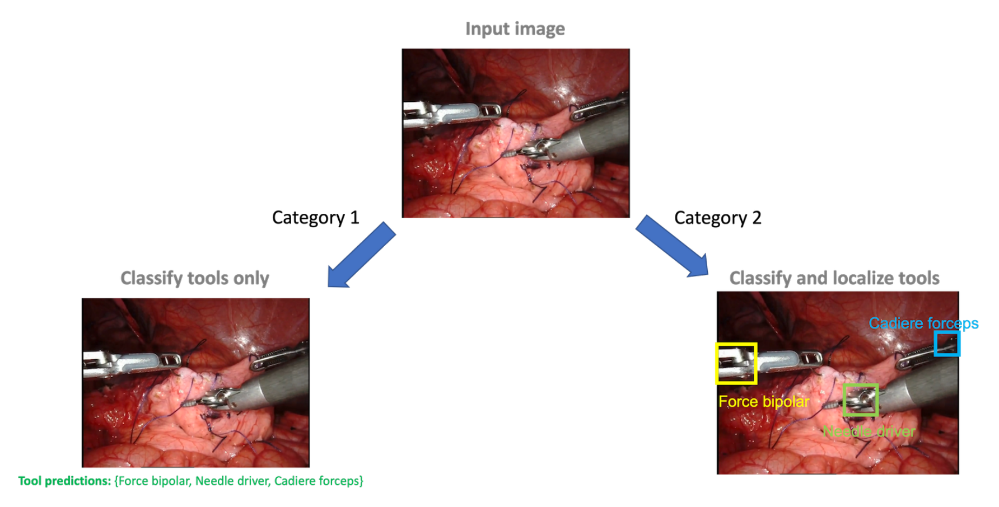
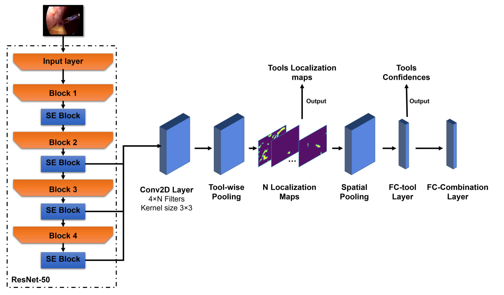

## 1. 背景与动机

**机器人手术的数据很多,难的是标注。** 达芬奇系统在手术中记录视频、运动学和系统事件,但给视频加上有意义的标注需要懂手术的人,成本高、耗时长,不同标注者之间还有差异。

**系统事件是一种免费的标签。** 每次装上或卸下器械,系统都会记下器械类型和时间。问题在于,器械装着不代表在画面里看得见,事件也不告诉你器械在哪。组织方想知道:能不能把这种噪声弱标签直接拿来训练检测器。

于是从 2022 年起,Intuitive Surgical 在 MICCAI EndoVis 连续举办同一个主任务的挑战赛,每年再加一个使用同一批视频的第二赛道。

## 2. 核心观点速览

**四年里检测分数有进步,但最高只到 0.5188 mAP,而且进步主要来自参赛队自己造出的带框数据。**

- 冠军 mAP 依次为 0.4077、0.4669、0.4244、0.5188;通用检测 CO-DETR 在 COCO 上为 0.66。
- 起作用的是少量人工标注加跟踪传播、教师模型伪标签、人在环迭代;类激活图路线一直落后。
- 全监督步骤识别前五名都超过 0.81 加权 F1,开放式问答 BLEU 最高 0.4215。
- 每年测试集不同,只有 2023 对 2022 做过同测试集复测;2025 年新增带框验证集。

:::highlights
- 这个挑战的新意在标签来源,而不在任务形式
- 排行榜实际奖励的是“谁能更省力地造出带框训练集”
:::

:::data
- 冠军 mAP:0.4077 / 0.4669 / 0.4244 / 0.5188
- COCO 参照:CO-DETR 0.66
:::

下面先看标签具体弱在哪里。

## 3. 数据与标签:弱在哪里

视频来自达芬奇系统上的手术训练练习,受训者在活体猪或离体猪器官上做解剖、缝合、电凝等标准操作。

- **2022/2023:** 24,695 个 30 秒剪辑,60 FPS,1280×720,14 种器械,每剪辑最多 3 把。
- **2024/2025:** 155 次训练的 280 段长视频,超过 840 小时、超过 1800 万帧,12 种器械,另有 8 类手术任务标签;2025 年再加任务的文字描述和一个带框小验证集。

**标签是四条机械臂各装了什么。** 装内镜的臂记为 `nan`,整个剪辑只给一个标签。噪声来自三处:器械装着但被遮挡或移出视野;部分标签缺失或错配;器械分布极不平衡,WhiteBox 统计最常见类别是最少类别的 1149 倍。

**测试框只框 clevis。** clevis 是器械尖端与杆之间的腕部关节;只有它不明显或器械很大时才把尖端也包进来。测试帧的界面区域被模糊,防止模型直接读出器械名称。

*论文原图编号：Figure 1。2022 年两个赛道:只分类,或分类加定位。*

这条“只框 clevis”的规则,后面会解释为什么激活图类方法几乎全军覆没。

## 4. 四年任务与评测协议

| 年份 | 赛道 1 | 赛道 2 | 指标 |
|---|---|---|---|
| 2022 | 工具存在分类 | 分类加框 | 加权 F1;mAP |
| 2023 | 只有检测 | 无 | mAP |
| 2024 | 弱监督检测 | 逐帧步骤识别 | mAP;加权 F1 |
| 2025 | 弱监督检测,附带框验证集 | 开放式问答 | mAP;BLEU |

mAP 是在 0.5 到 0.95 的十个交并比阈值上平均的检测精度,框不贴合就会大幅扣分。问答的 BLEU 对 5 个参考答案分别计算,取最大后再平均。

参赛队提交容器,Grand Challenge 平台在隐藏测试集上以 1 FPS 自动评测;只有同时交最终结果和方法报告的队伍算完整提交。

## 5. 参赛方法的三条路线

**路线一,借公开分割数据造框。** HKMV 把 EndoVis17/18 掩码里的 clevis 转成框,得到 5212 张图,再自训练扩到 11035 张。HRI MV 只人工标注首帧,用 SiamFC++ 跟踪传播,交并比低于 0.2 的伪标签丢弃。

**路线二,少量人工标注加跟踪扩展。** 2023 年 PUMCH 用 OSTrack、ANL-Surg 用 Mixformer、SDS-HD 用 TAPIR 关键点跟踪;2024 年 PDMYR 用 DarkLabel 三天标注 220,000 帧;2025 年 PUH-SVU 再加上 MAE 预训练和 Co-DETR 教师伪标签。

**路线三,用分类网络的激活图定位。** SK、HVRL、VANDY-VISE、ITeM、CAMMA,以及 2024 年 SEU-MIA 的 CLIP 方案都属于这一类。

*论文原图编号：Figure 16。ITeM 的激活图定位流程,是路线三的典型结构。*

## 6. 结果说了什么

**2022 年分类尚可、检测断崖。** 赛道 1 前三 F1 为 0.7485、0.72、0.7055;赛道 2 只有前三超过 0.3 mAP,HVRL 与 ITeM 为 0。

**2023 年路线二全面领先。** PUMCH 0.4669,前六名都在 0.3 以上;2023 模型放回 2022 测试集复测仍然更好,这是唯一的同测试集跨年证据。

**2024 年同一批视频的对照最清楚。** PDMYR 检测 0.4244,步骤识别 0.8977;SJTUB 用 SAM2 生成超过 30 万帧,只得 0.2754。

**2025 年首次超过 0.5。** PUH-SVU 0.5188、Medibot 0.5018;组织方承认带框验证集很可能促成了提升。

:::data
- 2022 赛道 2:HRI MV 0.4077,HKMV 0.3726,NVIDIA 0.3058
- 2024 步骤识别:PDMYR 0.8977
- 2025 问答:Capybara 0.4215,UoM-SurgicalAI 0.3656
:::

这些数字为什么会这样,下一节看机制。

## 7. 为什么数据整理压过架构

**激活图落在判别区,而评测要框 clevis。** HRI MV 的特征图显示原模型高激活集中在 clevis,结果把 Cadiere 抓钳误判;扩大候选框包进钳口后才分对。分类要看钳口,评测只框 clevis,激活图两头都顾不上。

**本地分数普遍虚高。** NVIDIA 本地 F1 为 0.8526,测试 0.7055;SJTUB 本地 0.90,测试 0.2754。连续剪辑高度相似、本地标签与测试口径不同,都会抬高本地分数。NVIDIA 用图像哈希按场景分折,就是针对前一点。

**零样本问答胜过微调。** Capybara 指出官方描述只有 21 种文本,微调容易学成模板;UoM 在本地验证上 DoRA 微调 0.8528 高于零样本 0.5701,正式最终阶段却是零样本 0.2776 高于 DoRA 的 0.2367。

## 8. 结果没说什么

- **年度进步没有被完全控制。** 只有 2023 对 2022 做了复测,2024 冠军低于 2023,2025 训练条件变了。
- **数据整理与架构没有被分离。** 领先队伍同时换了标签和检测器,论文没有单变量对照。
- **标注质量比数量重要,只是跨队观察。** SJTUB 团队自己怀疑问题在数据偏差或后处理代码。
- **BLEU 不等于答案正确。** Medibot 也指出单靠 BLEU 不够。
- **论文未说明:** 2025 带框验证集的规模、测试集标注者间一致性、2024/2025 测试集的视频数量与类别分布、强标签下的性能上限。
- **数字前后不一致:** 2022 冠军在 Table 14 为 0.4077,2025 讨论写 0.4452;2022 赛道 1 完整提交在 3.2 节写 17,结果表与讨论为 13,论文未说明原因。

## 9. 复现与借用要注意什么

- 验证集按场景或病例分组,参考 NVIDIA 的图像哈希分折。
- 遮挡底部界面:训练时随机裁掉或模糊,测试帧本来就被模糊。
- 先确定框的口径(clevis 还是尖端),再选生成伪标签的方法。
- 定位部位小、判别部位在别处时,考虑检测与分类解耦,如 Medibot 的单类检测器加分类器。

## @takeaways
- 只靠系统事件存在标签,社区四年最好做到 0.5188 mAP
- 领先方法都自造带框数据,存在标签主要用来挑帧和校验
- 同一批视频有逐帧标签时步骤识别可到 0.8977,说明低分来自监督不足

## @strengths
- 同一主任务连续四年,并做过一次同测试集跨年复测
- 测试框口径和界面遮挡规则写得清楚
- 收录各队完整方法报告,能把排行榜和做法对照着读

## @weaknesses
- 不限制人工标注,排行榜不区分是否用了人工框
- 每年测试集不同,年度结论证据强度不一
- 文中有数字前后不一致,且部分关键统计论文未说明

## @questions
- 同一检测器在强标签下能达到多少?
- 不同标签来源对同一管线的影响有多大?
- 换成语义层面的评估后,零样本与微调的排序会不会改变?
